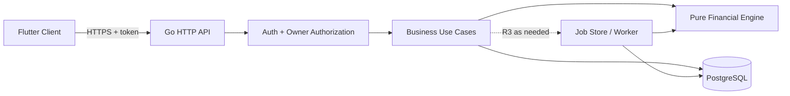
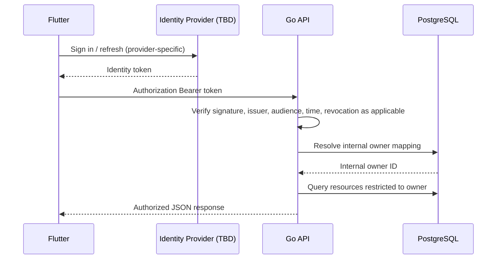
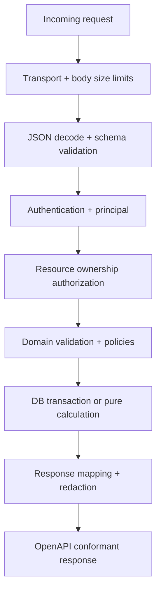
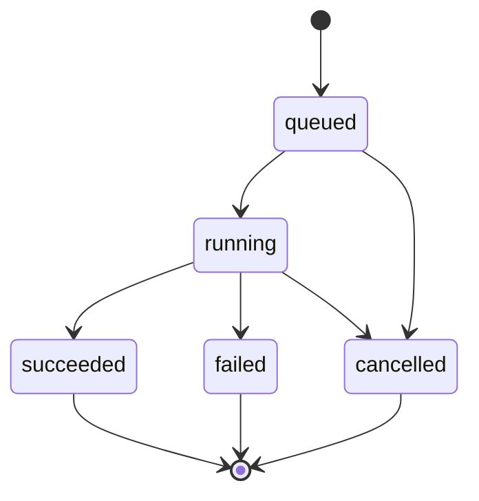

# Esokira — API Guidelines (Flutter ↔ Go)

> **Canonical path:** `docs/architecture/API-GUIDELINES.md`  
> **Versi:** `0.1.0`  
> **Tanggal:** 30 Oktober 2026  
> **Status:** `REVIEWED_INTERNAL — PENDING_OWNER_APPROVAL`  
> **Jenis:** aturan dan blueprint kontrak HTTP; **BUKAN** spesifikasi OpenAPI final atau bukti endpoint telah dibuat  
> **Scope:** R0 Foundation, R1 MVP, R2 Planning V1, R3 Advanced. R4 hanya discovery  
> **Stack yang dipilih owner:** Flutter (mobile) + Go (backend) + PostgreSQL (database) dalam monorepo `/frontend`, `/backend`  
> **Kandidat transport:** REST over HTTPS + JSON dan kontrak OpenAPI, masih **PROPOSED** sesuai arsitektur sebelumnya.  
> **Audience:** Product Owner, AI coding agent, backend/frontend engineers, reviewer keamanan, QA.

---

## 0. Tujuan, kewenangan, dan cara membaca

Dokumen ini mengatur *bagaimana API dirancang*, bukan mengarang *apa yang harus dihitung atau diizinkan*. Tujuannya menyamakan ekspektasi Flutter dan Go mengenai semantik endpoint, resource, keamanan, presisi data finansial, status perubahan, error, retry, dan kontrak yang dapat dites.

**Peringatan penting:** dokumen sebelumnya telah direview **secara internal** tetapi masih menunggu persetujuan Product Owner. Endpoint, bentuk JSON, HTTP status, header, pilihan library, dan default dalam dokumen ini adalah **PROPOSED** sampai diberi approval dan direalisasikan dalam `contracts/openapi.yaml`. Jangan mengklaim API siap dipakai atau kontrak sudah terimplementasi hanya karena contoh muncul di sini.

### 0.1 Legenda yang wajib digunakan

| Label | Makna | Tindakan agent |
|---|---|---|
| `DECIDED` | Dipilih eksplisit oleh pemilik proyek | Hormati sebagai constraint. |
| `REQUIRED` | Invariant dari kebutuhan/domain/keamanan | Semua desain API harus memenuhinya. |
| `PROPOSED` | Konvensi atau contoh yang direkomendasikan | Boleh direview dan diprototipekan; belum kontrak final. |
| `TBD` | Belum ada keputusan owner | Dokumentasikan pilihan; jangan memilih diam-diam. |
| `BLOCKED` | Tidak aman diproduksi sebelum prasyarat terpenuhi | Jangan tulis implementasi production atau tandai selesai. |
| `OUT OF SCOPE` | Belum menjadi janji rilis | Jangan tambahkan endpoint production. |

### 0.2 Sumber kebenaran dan pencegahan kontradiksi

| Subjek | Sumber otoritatif |
|---|---|
| Tujuan produk dan non-goals | [`../product/PRODUCT-VISION.md`](../product/PRODUCT-VISION.md) |
| Fitur, acceptance criteria, release | [`../product/PRD.md`](../product/PRD.md) (`FR-xxx`, `EN-xxx`, `NFR-xxx`) |
| Feature priorities, dependencies | [`../product/FEATURE-MATRIX.md`](../product/FEATURE-MATRIX.md) |
| Definisi keadaan keuangan dan invariants | [`../financial/FINANCIAL-DOMAIN-RULES.md`](../financial/FINANCIAL-DOMAIN-RULES.md) (`DR-001`–`DR-024`) |
| Rumus, validasi numerik, asumsi | [`../financial/CALCULATION-SPECS.md`](../financial/CALCULATION-SPECS.md) (`CS-001`–`CS-016`) |
| Golden tests dan negative tests | [`../financial/FINANCIAL-TEST-CASES.md`](../financial/FINANCIAL-TEST-CASES.md) |
| Arsitektur dan trust boundaries | [`SYSTEM-ARCHITECTURE.md`](./SYSTEM-ARCHITECTURE.md) |
| Go use cases, repository, transactions | [`BACKEND-ARCHITECTURE.md`](./BACKEND-ARCHITECTURE.md) |
| Flutter models, caching, UI state, retries | [`FRONTEND-ARCHITECTURE.md`](./FRONTEND-ARCHITECTURE.md) |
| Data model, ownership, actual/plan separation | [`DATABASE-DESIGN.md`](./DATABASE-DESIGN.md) |
| HTTP API setelah mendapat approval | `contracts/openapi.yaml` (**belum dinyatakan tersedia**) |
| Skema SQL yang benar-benar digunakan | `backend/db/migrations/` setelah schema disetujui dan diterapkan |

**Ketika terjadi konflik:** catat file, heading, requirement ID, dan alternatif; tandai `CONFLICT`; hentikan hanya scope yang terdampak. Dokumen ini tidak berhak mengubah arti finansial, tujuan fitur, atau schema tanpa approval.

### 0.3 Aturan wajib untuk AI coding agent

1. Baca PRD, aturan domain, spesifikasi perhitungan, dan desain backend/frontend/database yang relevan sebelum mendefinisikan endpoint.
2. Selalu lihat kode dan file `contracts/openapi.yaml` yang *benar-benar ada* pada repo. Jangan menyatakan endpoint telah ada jika baru merupakan contoh dokumentasi.
3. **Tidak boleh mempercayai `user_id`, `owner_id`, atau resource ownership yang dikirim client**. Semua identitas pemilik diturunkan dari principal terverifikasi pada server.
4. **Tidak boleh menggunakan bilangan floating-point JSON sebagai sumber saldo uang aktual**; pilih representasi exact setelah `DB-Q02` dan `API-Q03` disetujui.
5. **Jangan pernah** memperlakukan saldo simulasi sebagai saldo aktual atau menulis akun/transaksi dari kalkulator, goals, forecast, atau insight.
6. Transfer aktual harus atomik dan aman dari retry; request yang timeout bisa saja sudah committed.
7. Jangan membuat response error yang membocorkan SQL query, stack trace, secret, token, atau nilai keuangan sensitif.
8. Jangan menyembunyikan asumsi kalkulasi. Output harus menyertakan provenance minimum, unit, horizon/as-of, dan batasannya sesuai jenis fitur.
9. Semua operasi baru harus mendapat schema OpenAPI, contoh valid, negative tests, authz tests, dan perubahan client Flutter yang terkoordinasi.
10. Jangan memakai mock data sebagai hasil finansial production atau mengisi keputusan `TBD` tanpa persetujuan.

---

## 1. Prinsip kontrak API

**DECIDED:** Go mengelola operasi backend, PostgreSQL menyimpan data utama, Flutter adalah client; tidak ada akses PostgreSQL langsung dari perangkat.

**REQUIRED:** authz object-level, pemisahan actual vs planned vs forecast, exact money, reproducibility, idempotent actual writes, dan privacy-first observability.

**PROPOSED:** desain resource-first REST, HTTPS, JSON, prefiks `/api/v1`, dokumentasi OpenAPI 3.1.x, error berbasis RFC 9457, dan generated/validated DTO sesuai kebutuhan.

Prinsip operasional:

- Contract-first: setiap endpoint ditentukan oleh behavior FR, constraints DR, semantics CS, lalu ditulis pada OpenAPI sebelum handler dan Flutter DTO.
- Single meaning: satu field atau enum memiliki arti yang sama di seluruh endpoint dan versi.
- Explicit source: `actual`, `planned`, `forecast`, `simulation` tidak disamarkan.
- Default aman: server menolak input yang secara domain tidak lengkap; dilarang menggunakan rate/usia/target finansial tersembunyi.
- Safe failure: jika commit belum diketahui, jangan meminta client mengirim ulang write dengan identitas baru.
- Evolvable API: hindari kontrak yang mengekspos table/entity internal, query SQL, atau detail penyedia autentikasi.
- Minimal interfaces: endpoint hanya dirilis saat kebutuhan, authz, dan acceptance tests tersedia.

**Non-goals R0–R3:** API transfer uang sungguhan, trading, broker/bank connector, payment gateway, kredit, rekomendasi investasi spesifik, dan layanan akuntansi bisnis. `FR-023/024` adalah R4 discovery, bukan izin membuat shared access/portfolio production API.

## 2. Topologi jaringan dan trust boundary



Kewajiban endpoint privat:

1. Verifikasi identitas pada boundary server.
2. Bentuk principal internal (`owner_id`) dari mapping token yang tervalidasi; jangan menerima nilai owner dari request body/header arbitrer.
3. Cek ownership resource dan resource anak/pasangan pada use case/repository (termasuk endpoint export, simulation results, download, cancellation).
4. Jalankan validasi domain sebelum perubahan disimpan, dan proteksi database sebagai lapisan tambahan.
5. Terapkan least privilege serta data minimization pada response.

Firebase Auth dan OIDC adalah **opsi**, bukan pilihan final; `PRD Q-02 / ARCH-Q01 / BE-Q01 / DB-Q06` tetap `TBD`. Public health endpoints harus meminimalkan informasi sistem yang diungkap.

## 3. HTTP conventions dan endpoint naming

### 3.1 Base path dan environment (`PROPOSED`)

| Lingkungan | Contoh alamat | Catatan |
|---|---|---|
| Local | `http://localhost:<port>/api/v1` | Hanya untuk device host/dev; emulator dan perangkat fisik memiliki network addressing sendiri. |
| Staging | `https://<staging-domain>/api/v1` | Host dan certificate ditentukan melalui infrastructure. |
| Production | `https://<api-domain>/api/v1` | TLS wajib, host belum ditentukan. |

Contoh memakai placeholder, **bukan domain yang telah dipesan**. Tidak ada secret/token di URL, route, query, crash report, atau analytics event.

### 3.2 Resource naming

- Gunakan kata benda jamak pada koleksi: `/accounts`, `/financial-goals`, `/scenarios`, `/simulation-runs`.
- Gunakan parameter path generik seperti `{accountId}`, `{scenarioId}`; jenis ID final (`UUID` kandidat) masih perlu disahkan.
- Nested path hanya bila relasi membantu operasi dan ownership check: `/scenarios/{scenarioId}/versions`; untuk read berdasarkan ID langsung dapat lebih sederhana.
- Endpoint kalkulator tanpa mutasi boleh memakai `POST /calculators/compound` jika payload input kompleks; POST tidak otomatis berarti perubahan uang aktual.
- Jangan memakai `/user/{userId}/...` untuk resource pribadi yang hanya milik principal aktif; gunakan `/me` atau koleksi yang selalu owner-scoped di backend.
- Action khusus resource, misalnya cancel run, harus mempunyai transisi dan semantik jelas; path/method final `API-Q09` masih `TBD`.
- Gunakan kebijakan trailing slash yang konsisten, redirect aman, dan definisi canonical path pada OpenAPI; jangan membuat 2 route setara tanpa alasan.

### 3.3 HTTP method semantics

| Method | Pemakaian awal | Sifat yang perlu dijaga |
|---|---|---|
| `GET` | Mengambil resource/list/read-model | Tidak mengubah state domain; query params non-sensitive, authorized. |
| `POST` | Membuat resource/menjalankan kalkulasi atau run | Untuk writes yang bisa duplikat wajib idempotency contract. |
| `PUT` | Mengganti keseluruhan representasi bila dipakai | Idempotent secara HTTP; definisikan required fields/preconditions. |
| `PATCH` | Partial update jika disetujui | Field yang dapat diubah, versi resource, dan konflik harus eksplisit. |
| `DELETE` | Delete/archive/request cancellation jika disetujui | Domain lifecycle dan retention berlaku; bukan otomatis hard-delete. |

`PUT` idempotent tidak berarti aman dari *lost update* dua client. Pertimbangkan `ETag` + `If-Match` dan status `412` jika disetujui (`API-Q08`). Untuk perubahan finansial aktual, metode dan reversibility harus mengikuti `DB-Q01/03`, bukan keputusan transport semata.

### 3.4 HTTP headers (`PROPOSED`)

| Header | Arah | Tujuan | Ketentuan |
|---|---|---|---|
| `Authorization: Bearer <token>` | Client → API | Identitas | Token tidak muncul di log, URL, atau error. Provider TBD. |
| `Content-Type: application/json` | Client → API | Request JSON | Reject media type tidak didukung bila endpoint mensyaratkan JSON. |
| `Accept: application/json` | Client → API | Response sukses | Error dapat `application/problem+json` jika RFC 9457 diadopsi. |
| `Idempotency-Key` | Client → API | Dedup POST aktual | Kontrak detail `API-Q05 / DB-Q04` TBD. |
| `If-Match` / `ETag` | Keduanya | Optimistic concurrency | Opsional sampai disetujui. |
| `X-Request-ID` | Keduanya | Troubleshooting | Server harus generate/sanitize; jangan blindly trust client value. |
| `Retry-After` | API → Client | Backoff/availability | Hanya ketika kebijakan endpoint mendukung. |
| `Cache-Control` | API → Client | Privasi data | Untuk data finansial privat default rekomendasi `no-store`. |
| `Accept-Language` | Client → API | Pesan error terlokalisasi | Error code stabil lintas bahasa. |

Bila nanti ada web client, kaji CORS dan cookie/CSRF sesuai model sesi. Flutter native tidak otomatis memerlukan CORS. HTTP error/status mengikuti semantik RFC 9110, bukan istilah domain yang dikarang.

## 4. JSON serialization dan schema hygiene

### 4.1 Konvensi nama dan tipe (`PROPOSED`)

- JSON property: `snake_case` atau `camelCase` harus diputuskan secara tunggal (`API-Q02`). Contoh dokumen ini memakai **`snake_case` sebagai kandidat**, belum keputusan final.
- Enum string bernama jelas, contoh `status: "active"`; jangan menggunakan angka tanpa enum mapping.
- Boolean hanya untuk status yang memang biner; state seperti `queued/running/succeeded/failed` tidak dikompresi menjadi `is_done`.
- `null` berbeda dari field yang tidak disediakan. Semantik PATCH untuk `null`, omitted, dan `0` harus dirumuskan.
- JSON `number` tidak boleh digunakan untuk saldo aktual jika berisiko kehilangan presisi/overflow di client.
- Unknown fields: **PROPOSED** reject input tak dikenal di endpoint mutasi; backend dapat tetap menerima field respons tambahan untuk kompatibilitas. Harus disepakati (`API-Q04`).
- Payload memiliki batas ukuran, kedalaman, list length, dan query complexity; angkanya diperoleh dari profiling, **bukan dipilih agent asal-asalan**.

### 4.2 ID, timestamp, dan tanggal

| Jenis | Rekomendasi | Larangan |
|---|---|---|
| Resource identifier | UUID sebagai opaque string (`PROPOSED`) | ID dipakai sebagai pengganti authz. |
| Instant timestamp | RFC 3339 offset-aware/UTC, misalnya `2026-10-30T07:15:00Z` | Local datetime tanpa zona diperlakukan universal. |
| Civil/local date | `YYYY-MM-DD` sebagai tanggal kalender | Diganti instant UTC tanpa policy timezone. |
| Zone ID | IANA tz, misal `Asia/Jakarta` jika perlu | Inferens zona tersembunyi dari IP. |
| Effective vs recorded | Field terpisah seperti `occurred_on`, `recorded_at`, `as_of` | Menggabungkan semua arti tanggal menjadi `created_at`. |

Timestamp yang dikirim client tidak boleh otomatis dipercaya sebagai server commit time. Revisi/backdating dan timezone cutoff mengikuti `DB-Q03/DR-018`.

## 5. Exact monetary amounts, rate, dan units (**critical / BLOCKED details**)

### 5.1 Kebijakan presisi yang wajib, pilihan encoding yang belum final

`DR-004` mewajibkan nominal aktual exact. `DB-Q02 / FE-Q06 / API-Q03` menentukan salah satu format interoperable berikut:

| Opsi (`PROPOSED`) | Contoh | Risiko dan trade-off |
|---|---|---|
| Decimal string + currency | `{ "amount": "125000.00", "currency": "IDR" }` | Perlu parser decimal yang ketat; fleksibel untuk satuan pecahan. |
| Integer minor unit sebagai **string** + currency | `{ "amount_minor": "125000", "currency": "IDR" }` | Skalanya mengikuti ISO currency; untuk IDR harus dinyatakan, jangan diasumsikan semua minor unit sama. |
| Integer rupiah sebagai string (IDR-only) | `{ "amount_idr": "125000" }` | Lebih sederhana tetapi mengunci IDR-first dan definisi fractional. |

**Belum dipilih salah satu.** Seluruh contoh API di dokumen ini yang memakai `amount` berbentuk decimal string adalah **wire-format kandidat ilustratif**, bukan schema final. Pilihan serialisasi tidak boleh dikunci terpisah dari PostgreSQL type dan Go/Flutter parsing. Jangan menormalkan angka menjadi `double` di Flutter.

### 5.2 Semantik nilai negatif, currency, dan fees

- Untuk pemasukan/pengeluaran yang dipilih sebagai tipe kejadian, tentukan apakah `amount` selalu positif dan tanda ditentukan oleh `kind`. **PROPOSED** model demikian lebih mudah diuji; posting movement memiliki signed deltas internal. Final bergantung pada model ledger (`DB-Q01`).
- IDR-first adalah target awal `PROPOSED`, bukan izin mengabaikan currency field secara diam-diam. Tidak ada FX konversi otomatis tanpa sumber nilai tukar, waktu kurs, dan policy.
- Fee transfer, bila ada, menjadi pengeluaran eksternal terpisah; transfer internal tanpa fee tidak menciptakan pendapatan/pengeluaran dan tidak mengubah net worth.
- `0`, nilai negatif, overflow, digit eksponen, desimal yang terlalu panjang, `NaN`, `Infinity`, dan scientific notation ditangani sesuai schema yang disetujui. Jangan membiarkan default deserializer mengubah nominal dengan rounding tak terlihat.
- Tampilkan formatted currency hanya di UI; backend mengirim nilai machine-readable + currency, bukan `"Rp 1.000.000"` sebagai nilai hitung.

### 5.3 Tingkat imbal hasil dan inflasi

`"annual_effective_rate": "0.08"` berarti fraksi `8%` per tahun efektif **hanya bila input contract menyatakannya secara eksplisit**. `"8"` bukan 8%. Harus ada metadata `rate_basis`, `period`, `contribution_timing` dan konvensi compounding sesuai `CALCULATION-SPECS.md`. Representasi decimal rate vs JSON number juga perlu disepakati (`API-Q03`).

Jangan menambah default return, inflasi, volatilitas, horizon, atau setoran tersembunyi jika client mengosongkannya. Client dan server menyetujui precision, rounding, dan error semantics sebelum release.

## 6. Authentication, authorization, dan session contracts

### 6.1 Authentication contract (provider-agnostic)



**REQUIRED:** token diverifikasi sesuai provider; tidak cukup hanya decode JWT tanpa signature/claims verification. Provider policy menentukan revocation/refresh dan clock skew. Session/logout security dan device credential storage dirinci saat provider dipilih.

### 6.2 Object-level authorization

- Semua operasi `GET/{id}`, `PATCH/{id}`, nested list, `DELETE/{id}`, download, simulation run, event, dan export membatasi owner.
- Relasi dua akun pada transfer wajib diverifikasi keduanya milik principal yang sama; child-parent relation juga perlu owner-safe.
- Jangan menggunakan `owner_id` dari request body; `owner_id` tidak perlu diekspos pada private create DTO.
- **PROPOSED anti-enumeration:** untuk resource orang lain yang tak boleh diketahui keberadaannya, kembalikan `404` tanpa informasi identitas; auth missing/invalid adalah `401`. Kebijakan `403` vs `404` dibakukan di `API-Q06`.
- Rate limiting, abuse prevention, dan resource limits berlaku bahkan bila user telah terautentikasi.
- Admin/service credentials, jika suatu hari ada, memiliki skema principal terpisah dan tidak bisa mengambil data pribadi melalui endpoint pengguna biasa tanpa jalur serta audit khusus.

### 6.3 Privacy and response minimization

- Jangan kirim seluruh financial profile saat layar hanya membutuhkan nama tujuan.
- Field rahasia/PII tidak dimasukkan dalam URL, error `detail`, log request body, response debug, metric labels, atau analytics.
- Tidak ada endpoint enumerasi semua pengguna untuk R0–R3.
- Token/refresh token tidak disimpan di log atau crash report; penyimpanan aman perangkat adalah keputusan frontend terpisah.
- Cache data finansial privat: default rekomendasi `Cache-Control: no-store`; kebijakan cache offline Flutter (`FE-Q05`) harus mempertimbangkan enkripsi, logout wipe, dan stale data.

## 7. HTTP status codes dan error taxonomy

### 7.1 Sukses dan common failures (`PROPOSED`)

| Status | Makna yang diinginkan | Contoh |
|---|---|---|
| `200 OK` | Read/update atau calculation synchronously succeeded | GET, PATCH (bila mengembalikan body), compound calculation. |
| `201 Created` | Resource diciptakan secara durable | POST financial goal, account, scenario version. |
| `202 Accepted` | Processing diterima namun belum selesai | Async simulation/export job, dengan status URL. |
| `204 No Content` | Berhasil tanpa body | Delete/archive yang telah benar-benar selesai. |
| `400 Bad Request` | Body/query malformed | Invalid JSON syntax, unsupported parameter encoding. |
| `401 Unauthorized` | Missing/invalid authentication | Token tidak valid. |
| `403 Forbidden` | Principal sah tetapi akses ditolak | Scope/permission; policy tidak boleh bocor owner. |
| `404 Not Found` | Resource tidak ditemukan atau disembunyikan | ID asing dengan anti-enumeration. |
| `409 Conflict` | Konflik resource, state, atau idempotency payload | `idem_key_reused`, concurrent state clash. |
| `412 Precondition Failed` | `If-Match` tidak cocok bila conditional update dipakai | Edit berdasar versi lama. |
| `415 Unsupported Media Type` | Request tidak memakai media type yang diterima | XML pada JSON-only endpoint. |
| `422 Unprocessable Content` | Input sintaks valid tetapi invalid domain/semantic | Impossible date/goal parameters; enum invalid. |
| `429 Too Many Requests` | Quota/rate limit | Job quota; `Retry-After` jika layak. |
| `500 Internal Server Error` | Unexpected failure, body disanitasi | No stack trace/SQL output. |
| `503 Service Unavailable` | Dependency/maintenance unavailable | Tidak mengklaim posting sukses bila tidak confirmed. |

`405 Method Not Allowed`, `413 Content Too Large`, `428 Precondition Required`, dan `504 Gateway Timeout` dapat dipakai bila kontrak/reverse proxy memerlukannya. Jangan memaksa semua kegagalan sebagai `200 {"success": false}`.

### 7.2 Problem Details RFC 9457 (`PROPOSED`)

RFC 9457 adalah kandidat standar `Content-Type: application/problem+json`, *bukan* format final hingga `API-Q04` disetujui. Klien jangan mem-parse kalimat `detail` untuk business logic; gunakan `type` atau extension `code` yang terdokumentasi.

Contoh JSON **ilustratif**:

```json
{
  "type": "https://api.esokira.example/problems/invalid-input",
  "title": "Invalid input",
  "status": 422,
  "detail": "Tanggal target harus setelah tanggal acuan.",
  "instance": "/api/v1/goals",
  "code": "GOAL_TARGET_DATE_INVALID",
  "request_id": "req_example_01",
  "errors": [
    {"pointer": "#/target_date", "code": "MUST_BE_FUTURE"}
  ]
}
```

Domain `api.esokira.example` merupakan **placeholder dokumentasi**, bukan domain aktif. `code`, `request_id`, dan `errors` adalah extension yang harus distandarkan pada schema; jangan mengirim nilai pribadi/nominal dalam error detail, pointer, atau instance. `status` bila ada konsisten dengan HTTP status.

### 7.3 Error codes dan domain errors

| Error code kandidat | Kelas | Tindakan UI | Catatan |
|---|---|---|---|
| `AUTH_REQUIRED` | 401 | Arahkan login setelah verifikasi kondisi sesi. | Jangan menampilkan internal provider errors. |
| `RESOURCE_NOT_FOUND` | 404 | Tampilan tidak tersedia, tanpa owner disclosure. | Untuk cross-owner boleh 404. |
| `INVALID_INPUT` | 422 | Highlight fields. | `errors[]` aman untuk UI. |
| `FINANCIAL_INPUT_INCOMPLETE` | 422 | Jelaskan parameter wajib yang belum ada. | `DR-017`. |
| `FINANCIAL_MODEL_UNAVAILABLE` | 422/409 | Jelaskan asumsi/model belum didukung. | R3 **BLOCKED** sebelum approval model. |
| `GOAL_INFEASIBLE` | 200 domain result atau 422 (TBD) | Tampilkan shortfall; jangan hide goal. | Rekomendasi: feasible=false sebagai **hasil kalkulasi valid**, bukan otomatis HTTP error. |
| `IDEMPOTENCY_CONFLICT` | 409 | Jangan kirim key lama dengan payload berbeda. | `DB-Q04`. |
| `STATE_CONFLICT` | 409 | Refresh/reconcile resource. | Termasuk status tidak sesuai. |
| `RESOURCE_VERSION_MISMATCH` | 412 | Tawarkan reload changes. | Jika ETag dipakai. |
| `RATE_LIMITED` | 429 | Backoff aman, tidak spam ulang. | Quota model TBD. |
| `SERVICE_UNAVAILABLE` | 503 | Retry hanya operasi yang aman. | Jangan ambil kesimpulan transaksi rollback. |

`GOAL_INFEASIBLE` pada kasus kalkulator sering sebaiknya dikembalikan sebagai *business result* yang valid (`feasible: false`, shortfall) alih-alih error HTTP; pastikan kebijakan ditetapkan per endpoint agar konsisten.

## 8. Request validation dan lifecycle pipeline



Diagram menunjukkan **tanggung jawab**; pada endpoint tertentu auth/size-limits/validation dapat diurutkan berbeda untuk mengurangi attack surface, tanpa melewati kontrol wajib.

**Transport:** validate Content-Type, max bytes, JSON well-formed, unknown-fields policy, duplicate JSON key policy dan recursion/list limits. Default Go JSON decoder bisa menerima field yang tidak dikenali dan duplicate keys; strictness perlu diputuskan dan diuji, bukan diasumsikan.

**Schema:** required, min/max, UUID/path params, disallowed mixed types, amount string syntax/scale, date format, rate basis, horizon dan sample count budget. Normalisasi angka tidak boleh diam-diam mengubah nilai finansial.

**Domain:** akun masih aktif, kedua akun transfer punya owner sama, waktu dan ledger cutover konsisten, goal valid, modal/numeric engine valid, scenario version immutable, run boleh dijalankan.

**Database:** unique constraints dan foreign keys adalah defense in depth; mapping error PostgreSQL ke code domain stabil. Jangan kirim raw SQLSTATE ke client.

**Response:** filter data sesuai pengguna, output includes meaningful metadata, content type sesuai, tidak mengirim stack trace/debug/secret.

## 9. Pagination, sorting, filtering, dan search

Koleksi transactions, accounts, goals, scenarios, dan simulation history tidak selalu kecil. **PROPOSED** pagination dengan *opaque cursor* dan `limit` terbatas.

```text
GET /api/v1/transactions?limit=20&cursor=<opaque-cursor>
GET /api/v1/transactions?occurred_from=2026-10-01&occurred_to=2026-10-31
GET /api/v1/goals?status=active&sort=target_date
```

JSON response list kandidat:

```json
{
  "items": [],
  "page": {
    "next_cursor": null,
    "has_more": false
  }
}
```

Keputusan yang perlu dikunci `API-Q07`: cursor vs offset, default/max limit, deterministic ordering (misalnya timestamp+ID), filter valid, snapshot semantics, cursor TTL/signature, ownership binding dan anti-enumeration. Cursor **tidak boleh** dapat digunakan user lain dan tidak boleh mengandung data sensitif plaintext. Dalam transaksi backdated, `occurred_on` dan `recorded_at` memerlukan definisi sort yang eksplisit. Rentang tanggal harus jelas inklusif/eksklusif dan timezone-nya, jangan mengubah hasil laporan tanpa label periode.

**Observability:** jangan menjadikan full query string yang mungkin berisi data pribadi sebagai metric label atau log mentah.

## 10. Idempotency, atomic actual writes, dan safe retries

### 10.1 Klasifikasi operasi

| Operasi | Risiko retry | Kebijakan minimum |
|---|---|---|
| `GET /accounts`, `GET /goals` | Read-only | Retry terbatas pada gangguan jaringan/status retryable, tetap authz. |
| `POST /calculators/compound` | Pure calculation, tidak menyimpan financial actual | Secara domain bisa dihitung ulang; tetap quota/rate-limit. |
| `POST /accounts` | Membuat resource | Cegah duplicate creation saat timeout; policy idempotency direkomendasikan. |
| `POST /transactions`, `/transfers` | **Actual financial posting** | **Wajib dedup semantik + atomicity** (`DR-007/008`). |
| `PATCH /goals` | State update | Idempotent semantics atau versioning/concurrency guard. |
| `POST /simulation-runs` | Biaya compute dan quota | Dedup intent; worker *at-least-once* harus menulis hasil sekali secara logis. |
| `POST /export-requests` | Data pribadi + job | Authz, quota, dedup intent, link secure expiry. |

### 10.2 Protokol idempotency kandidat (`API-Q05`, belum final)

1. Flutter membuat satu key acak unik **untuk satu user intent**, bukan untuk setiap percobaan HTTP.
2. Retry intent yang sama **harus memakai key yang sama** dengan payload semantik yang sama.
3. Backend mengikat key ke `(owner, operation, key)` dan fingerprint dari request tervalidasi.
4. Jika key sama + payload sama sudah committed, backend mengembalikan hasil yang ekuivalen/tercatat (kebijakan status/header dijelaskan di OpenAPI).
5. Jika key sama + payload berbeda, kembalikan `409` tanpa posting baru.
6. Jika request original sedang diproses, server mengembalikan conflict/processing result sesuai policy yang disetujui; jangan memulai posting kedua.
7. Catat idempotency state, posting aktual, dan response reference pada **batas transaksi PostgreSQL yang konsisten**. Pastikan rollback aman dan lock ordering konsisten.
8. Retensi key, expiry, re-use after expiration, response replay, recovery crash, hash canonicalization, dan concurrency belum final (`DB-Q04`).

```mermaid
sequenceDiagram
    participant M as Flutter
    participant A as Go API
    participant D as PostgreSQL
    M->>A: POST transfer + Idempotency-Key K
    A->>D: Check K within transaction and lock
    D-->>A: New intent / existing status
    A->>D: Validate owner & balances; write both movements atomically
    A->>D: Commit posting + idempotency result
    A-->>M: Success (response may be lost)
    M->>A: Retry SAME payload + SAME key K
    A->>D: Find committed K
    D-->>A: Existing result
    A-->>M: Equivalent result, no second posting
```

**Kritis:** hasil *network timeout* tidak membuktikan rollback. Flutter harus menunggu/reconcile status intent bila server tidak memberi jawaban pasti. No duplicate taps di UI adalah UX safeguard, **bukan** pengganti server idempotency.

### 10.3 Transfer: invariant HTTP ke DB

Request transfer hanya menyatakan intent, misalnya akun asal/tujuan dan amount. Go wajib memeriksa kedua account milik owner, currencies, status aktif, no prohibited self-transfer, overdraft policy, dan memastikan **debit dan kredit berada dalam satu commit**. Penghitungan report income/expense dan net worth tetap menjaga `DR-005/006/007/008/009/010/022/023`. Fee, split, backdating, dan posting model tetap `DB-Q01/03` sehingga endpoint transfer production **BLOCKED** sampai disetujui.

## 11. Concurrency, resource revisions, dan optimistic locking

**Problem:** Flutter bisa mengedit goal dari dua perangkat; pengguna lain tidak boleh membaca data, tetapi pengguna yang sama pun bisa saling menimpa perubahan.

**PROPOSED:** gunakan `version` integer/ETag untuk resources mutable (goal, profile, account metadata, scenario draft). Client mengirim `If-Match`; backend memeriksa versi dalam SQL transaksi, lalu menghasilkan versi baru. Jika precondition gagal, beri `412` + sanitized conflict code. Kebijakan `428` ketika precondition wajib, dan apakah update tanpa If-Match ditolak, masih `API-Q08`.

`scenario_versions` yang dinyatakan immutable tidak memakai PATCH in-place; edit menciptakan versi baru (`DR-016/020`, `DB-Q08`). Posted actual events tidak boleh dimodifikasi langsung bila final ledger policy memilih reversal.

## 12. Endpoint catalog per rilis — **candidate only**

Tabel ini adalah perencanaan contract coverage, **bukan** bukti bahwa endpoint telah dibuat atau final. Nama path diseragamkan dengan usulan REST, dan masih dapat berubah saat OpenAPI disahkan.

| Release | Method + path kandidat | Auth | Requirement | Catatan dan blocker |
|---|---|---|---|---|
| R0 | `GET /health/live`, `GET /health/ready` | Public/internal policy TBD | EN-006 | Jangan leak DB details pada public readiness. |
| R0 | `GET /api/v1/me` | Yes | FR-001 | User mapping dari validated principal. |
| R1 | `GET/PATCH /api/v1/financial-profile` | Yes | FR-002 | Required/optional fields TBD. |
| R1 | `GET/POST /api/v1/accounts` | Yes | FR-003 | Exact amount/opening policy blocked DB-Q01/02/03. |
| R1 | `GET/PATCH /api/v1/accounts/{accountId}` | Yes | FR-003 | Mutability of opening balance requires audit. |
| R1 | `GET/POST /api/v1/transactions` | Yes | FR-004 | Actual writes idempotent, model TBD. |
| R1 | `GET /api/v1/transactions/{transactionId}` | Yes | FR-004 | Owner scoped, audit/reversal policy TBD. |
| R1 | `POST /api/v1/transfers` | Yes | FR-004 | Separate operation if approved; atomic. |
| R1 | `GET/POST /api/v1/assets`, `/liabilities` | Yes | FR-005 | Valuation as-of; avoid account double count. |
| R1 | `GET /api/v1/financial-position` | Yes | FR-006 | Actual as-of + source metadata, no forecast mix. |
| R1 | `GET/POST /api/v1/goals` | Yes | FR-007 | Planned not actual-funded. |
| R1 | `GET/PATCH /api/v1/goals/{goalId}` | Yes | FR-007 | Goal life cycle; funded policy DB-Q05. |
| R1 | `POST /api/v1/calculators/compound` | Yes/TBD | FR-008 | Pure, rate/rounding spec and golden tests gate. |
| R1 | `POST /api/v1/calculators/goal-contribution` | Yes | FR-009 | Feasible=false legitimate result. |
| R1 | `POST /api/v1/export-requests` | Yes | FR-021 | Privacy retention policy DB-Q11. |
| R1 | `POST /api/v1/deletion-requests` | Yes | FR-021 | Sensitive, reauth/confirmation policy TBD. |
| R2 | `GET/POST /api/v1/budgets` | Yes | FR-010 | Period semantics required. |
| R2 | `GET/POST /api/v1/recurring-rules` | Yes | FR-010 | Future rule not auto-posted. |
| R2 | `GET/POST /api/v1/life-events` | Yes | FR-011 | Hypothetical only. |
| R2 | `POST /api/v1/projections` | Yes | FR-012 | Deterministic; async only if measured. |
| R2 | `GET/POST /api/v1/scenarios` | Yes | FR-013 | Baseline selection explicit. |
| R2 | `POST /api/v1/scenarios/{scenarioId}/versions` | Yes | FR-013 | Immutable version; no actual mutation. |
| R2 | `POST /api/v1/scenario-comparisons` | Yes | FR-013 | Compare same definitions or explain limitations. |
| R2 | `GET /api/v1/forecasts/cash-flow` | Yes | FR-014 | Read only, period/horizon explicit. |
| R2 | `POST /api/v1/stress-tests` | Yes | FR-015 | Hypothetical shocks only. |
| R2 | `GET /api/v1/insights` | Yes | FR-016 | Explainable; insufficient data state. |
| R2 | `GET/PATCH /api/v1/notification-preferences` | Yes | FR-022 | Opt-in and no sensitive lock-screen payload. |
| R3 | `POST /api/v1/optimizations/goal-allocations` | Yes | FR-017 | **BLOCKED** objective/constraints approval. |
| R3 | `POST /api/v1/simulation-runs` | Yes | FR-018 | **BLOCKED** model + queue/worker policy. |
| R3 | `GET /api/v1/simulation-runs/{runId}` | Yes | FR-018 | Owner-scoped, immutable result provenance. |
| R3 | `POST /api/v1/calculators/retirement` | Yes | FR-019 | **BLOCKED** withdrawal/retirement model. |
| R3 | `POST /api/v1/financial-gps/alternatives` | Yes | FR-020 | **BLOCKED** decision model and source engine. |
| R4 | `/shared-goals`, `/portfolio-planning` | N/A | FR-023/024 | **OUT OF SCOPE** until separate discovery and privacy review. |

`GET /api/v1/calculators/compound` dengan query params tidak disarankan bila input panjang/sensitif, karena dapat masuk logs, browser histories, dan query strings. Pure `POST` boleh menghasilkan calculation result tanpa mengubah data aktual.

## 13. Contoh kontrak R0/R1 (ilustratif; bukan endpoint production)

### 13.1 GET user/account summary

**`GET /api/v1/me`** mengembalikan hanya field yang diperlukan UI; tidak perlu owner ID eksternal menjadi referensi URL.

```json
{
  "id": "2cd7c2c0-4311-49f0-907b-e845db330b1b",
  "preferred_locale": "id-ID",
  "preferred_currency": "IDR",
  "profile_complete": false
}
```

`id` di atas adalah contoh UUID sintetis, bukan identitas sungguhan atau standar schema final.

### 13.2 POST account (contoh bentuk payload yang masih tergantung API-Q03)

```json
{
  "name": "Rekening Harian",
  "currency": "IDR",
  "opening_balance": "1500000.00",
  "opening_balance_as_of": "2026-10-01"
}
```

Contoh semantik: opening balance adalah posisi awal, **bukan pemasukan**. Jika final encoding memilih integer minor unit, contoh ini wajib diubah sebelum implementasi. Response sukses memuat ID dan as-of, tanpa menganggap angka saldo hasil derived read model yang sudah dijamin sebelum ledger policy final.

### 13.3 POST transfer antar-akun aktual (PROPOSED, BLOCKED DB-Q01/02/03/04)

```http
POST /api/v1/transfers HTTP/1.1
Authorization: Bearer <redacted>
Content-Type: application/json
Idempotency-Key: 3fed0c2e-90b7-463a-8f11-f9a1125a0f95
```

```json
{
  "from_account_id": "f1ac10b8-6528-4cc5-9b82-0fbb249e73ad",
  "to_account_id": "c095fcb9-bdbb-44a0-b0a9-72bc9c2869ec",
  "amount": "250000.00",
  "currency": "IDR",
  "occurred_on": "2026-10-30"
}
```

**Expected behavior:** tidak memerlukan `owner_id` request; server memeriksa kedua akun, satu transaksi database, tidak menghasilkan income/expense baru, response aman untuk replay key yang sama. Fee dan reverse harus punya kontrak terpisah jika diizinkan.

### 13.4 GET financial-position (source = actual)

```json
{
  "as_of": "2026-10-30",
  "source": "actual",
  "currency": "IDR",
  "total_assets": "8000000.00",
  "total_liabilities": "2500000.00",
  "net_worth": "5500000.00",
  "completeness": "partial",
  "valuations_updated_at": "2026-10-28T10:00:00Z"
}
```

Angka hanya ilustrasi yang konsisten (`8.000.000 − 2.500.000 = 5.500.000`), bukan hasil perhitungan terhadap pengguna. `completeness` dan freshness policy masih `DB-Q14`/API policy TBD; contoh mengajarkan frontend untuk tidak menampilkan data parsial sebagai angka mutlak tanpa label.

### 13.5 POST compound calculator (pure/non-posting)

```json
{
  "initial_principal": "1000000.00",
  "periodic_contribution": "100000.00",
  "currency": "IDR",
  "annual_effective_rate": "0.00",
  "period_count": 12,
  "period_unit": "month",
  "contribution_timing": "end"
}
```

```json
{
  "source": "simulation",
  "currency": "IDR",
  "final_value": "2200000.00",
  "total_contributions": "1200000.00",
  "initial_principal": "1000000.00",
  "estimated_growth": "0.00",
  "assumptions": {
    "annual_effective_rate": "0.00",
    "contribution_timing": "end",
    "period_unit": "month"
  },
  "engine_version": "illustrative-only",
  "disclaimer": "Proyeksi berdasarkan asumsi, bukan hasil yang dijamin."
}
```

**Validasi yang dapat dibuktikan:** rate nol selama 12 bulan dengan modal Rp1.000.000 dan setoran Rp100.000 tiap akhir bulan menghasilkan Rp2.200.000 sebelum fee/tax. **Tidak** membuktikan aturan pembulatan bagi rate nonzero atau pilihan encoding production. Engine version ilustratif dan bukan package Go yang sudah ada.

### 13.6 POST goal contribution / feasibility (candidate)

Bila rencana target tidak tercapai, ini adalah **output bisnis yang sah**, bukan otomatis `500` atau `422`. Contoh:

```json
{
  "source": "simulation",
  "feasible": false,
  "currency": "IDR",
  "required_monthly_contribution": "2600000.00",
  "available_monthly_contribution": "2000000.00",
  "monthly_shortfall": "600000.00",
  "assumption_set_id": "example-only",
  "disclaimer": "Estimasi; asumsi dan prioritas perlu diperiksa."
}
```

Contoh angka merepresentasikan ilustrasi kasus tanpa return. Kontrak untuk menentukan funded goals dari uang aktual **BLOCKED** sampai `DB-Q05 / FDR-Q07` selesai.

## 14. Scenario API (R2), immutable versions, dan stale detection

### 14.1 Perbedaan entitas yang diekspos

| API concept | Sifat | Kewajiban |
|---|---|---|
| `scenario` | Wadah untuk rencana | User-owned, dapat di-archive. |
| `scenario_version` | Versi input/snapshot | Immutable ketika terbit, owner-scoped. |
| `scenario_baseline` | Fakta aktual/as-of revision yang menjadi dasar | Simpan source/provenance; jangan menimpa actual. |
| `simulation_run` | Eksekusi engine atas versi dan asumsi tertentu | Status, version, seed bila stochastic. |
| `simulation_result` | Output derived | Immutable per run; stale dapat diberi tanda tambahan. |

### 14.2 Baseline, refresh, dan invalidation

Sebuah skenario dapat dibentuk dari snapshot/revisi aktual (`DB-Q08` belum memilih full snapshot vs references). Ketika transaksi aktual berubah, run lama **tidak boleh ditulis ulang**. Response harus dapat mengungkap apakah source revision sudah berubah, misalnya:

```json
{
  "scenario_id": "1b3354c2-d616-4e16-8670-1c56d34047d9",
  "scenario_version": 3,
  "baseline_revision": 42,
  "current_actual_revision": 45,
  "stale": true,
  "stale_reason": "actual_data_changed"
}
```

Format merupakan usulan, bukan definisi numeric `revision` final. UI harus menampilkan `stale` dan menawarkan **explicit rebase** yang membuat versi baru, bukan mengubah run/record lama.

### 14.3 Reproducibility metadata untuk calculation response

Kontrak perhitungan yang tersimpan/advanced harus memuat secara semantik:

- `source`: `simulation` / `forecast` vs `actual`.
- `input_revision`/`scenario_version_id` atau fingerprint parameter versi.
- `engine_version` dan `schema_version`.
- `calculated_at` dan horizon/currency/units.
- `assumptions` (atau opaque ref ke detail yang dapat diambil secara aman).
- `random_seed` hanya jika digunakan random simulation; metrik probability tidak mengklaim prediksi pasti.
- `model_version`, `sample_count`, status lengkap/parsial, dan definisi success/failure jika relevan.

**Jangan** mengulang semua transaksi finansial sensitif ke dalam result cache, logs, atau response list jika sebenarnya cukup mengirim reference; baseline storage/retention policy perlu disetujui.

## 15. Long-running simulation runs / background jobs (R3)

### 15.1 State machine kandidat



Job scheduling, cancel, retry, timeout, quota, persistence, dan queue library belum final (`DB-Q09`, `BE-Q10`, `ARCH-Q10`). Status internal retry/requeued dapat menambah transisi dan wajib dikontrak.

### 15.2 Create run (`202 Accepted`, hanya jika job durable)

```http
HTTP/1.1 202 Accepted
Content-Type: application/json
Location: /api/v1/simulation-runs/94fe0448-b1d0-4a33-96b8-1771a76b7980
Retry-After: 3
```

```json
{
  "run_id": "94fe0448-b1d0-4a33-96b8-1771a76b7980",
  "status": "queued",
  "status_url": "/api/v1/simulation-runs/94fe0448-b1d0-4a33-96b8-1771a76b7980"
}
```

`Retry-After: 3` adalah contoh, **bukan** polling policy final. Jangan mengembalikan 202 sebelum request/run benar-benar tersimpan atau diterima secara durabel melalui strategi queue/outbox yang konsisten. Go worker boleh memproses ulang secara teknis; hasil run harus idempotent secara logis.

### 15.3 GET status and results (`PROPOSED`)

```json
{
  "run_id": "94fe0448-b1d0-4a33-96b8-1771a76b7980",
  "status": "succeeded",
  "source": "simulation",
  "scenario_version_id": "3b4b1b9b-b621-4126-a63d-2ff277c51fe0",
  "engine_version": "engine-example-v1",
  "model_version": "model-example-v1",
  "random_seed": "123456",
  "sample_count": 1000,
  "success_count": 720,
  "success_rate": "0.72",
  "stale": false,
  "result": {
    "quantiles": {
      "p10": "90000000.00",
      "p50": "145000000.00",
      "p90": "215000000.00"
    }
  },
  "disclaimer": "Model success rate bukan probabilitas pasti dunia nyata."
}
```

**Contoh di atas adalah mock kontrak edukatif, bukan model Monte Carlo yang sudah divalidasi.** Perhitungan probabilistik production masih **BLOCKED** sesuai `CS-014 / FR-018`. `random_seed` sebagai string mencegah kebingungan integer besar antar runtime; encoding final disepakati di API-Q03/10.

### 15.4 Polling, retry, cancellation, delete race

- Flutter melakukan polling dengan jeda yang dibatasi dan dapat dihentikan ketika user navigasi/logout; fokus/foreground behavior diputuskan.
- 202 berarti diterima, **bukan berhasil menghitung**. Bedakan `queued`, `running`, `succeeded`, `failed`, `cancelled` dengan jelas.
- Error kalkulasi harus dilaporkan tanpa stack trace dan tidak boleh menyimpan result parsial sebagai sukses.
- Perhatikan cancellation race: jika job sudah selesai sebelum cancel dikonfirmasi, server mengembalikan status aktual, bukan mengklaim pembatalan.
- Deletion user saat job berjalan memerlukan fencing/cancel policy; worker tidak boleh membuat ulang data yang dihapus (`DB-Q11`).
- Default retention result, retry/backoff, polling budget, max concurrent runs, dan cost quota adalah TBD; jangan mengarang SLA.

## 16. Export, deletion, notification, dan sensitive operations

### 16.1 Export controls (FR-021)

- User dapat meminta export **hanya miliknya**; proses besar mungkin asynchronous.
- Gunakan auth dan re-verification untuk operasi sensitif bila disetujui; export link harus memiliki scope terbatas, expiry, dan perlindungan dari enumerasi.
- Jangan menyimpan export permanen di public object storage; unduhan membutuhkan authorization dan lifecycle deletion yang disetujui.
- Format (JSON/CSV), included entities, metadata, audit minimum, delivery channel, dan TTL adalah `API-Q11 / DB-Q11` TBD.

### 16.2 Account deletion controls (FR-021)

- Request penghapusan harus terautentikasi dan memperoleh konfirmasi eksplisit; kebijakan reauth, grace period, audit/backup retention, serta dampak job aktif harus disetujui.
- `DELETE /me` **tidak otomatis berarti semua backup musnah saat response dikirim**. Jika asynchronous, response `202` menyatakan proses sudah diterima, disertai status yang bisa diperiksa selama aman secara privasi.
- Jangan mengeluarkan janji penghapusan/retensi yang belum didukung implementasi.

### 16.3 Notification preferences (FR-022)

- Pengingat bersifat opt-in, backend menyimpan consent/preference. Push payload default tidak memuat nominal, utang, target sensitif, atau data lain yang mungkin tampil di lock screen.
- Push delivery failure tidak boleh mengubah actual. Endpoint preferensi membutuhkan auth dan audit minimum.

## 17. API versioning, deprecation, dan backwards compatibility

### 17.1 Version policy (`PROPOSED`)

- Base path `/api/v1` (kandidat); perubahan breaking membutuhkan kontrak versi baru atau mekanisme migrasi yang diumumkan.
- Penambahan optional response field umumnya additive bila client tidak rusak; renaming/removing required fields, mengubah tipe uang/precision, mengubah enum/status, semantik tanggal, default period, dan meaning of `net_worth` adalah potensi breaking.
- Tidak boleh menghapus dukungan versi lama sebelum memenuhi kebijakan client deployment, masa transisi, dan pengguna mobile yang belum update.
- Compatibility harus dites dengan Flutter client version yang masih didukung; jadwal sunset dan minimum version **TBD**.

### 17.2 Contract change workflow

1. Identifikasi FR/DR/CS dan keputusan open terkait.
2. Tulis proposal perubahan behavior + schema OpenAPI + API change log.
3. Review kompatibilitas, privasi, authz, idempotency, risiko numerik, dan UX.
4. Catat approval/ADR jika perubahan keputusan besar.
5. Implementasi handler/use case Go setelah kontrak disahkan.
6. Regenerate/update typed Flutter DTO atau client; bila generator dipakai lock tool version.
7. Jalankan lint OpenAPI, server/client contract tests, integration/security tests, dan golden tests untuk angka.
8. Perbarui docs dan release note; tandai endpoints tersedia **hanya setelah** implementasi dan test terbukti.

## 18. OpenAPI 3.1.x: source of truth dan contoh mini

**Usulan canonical file:** `contracts/openapi.yaml`. Dokumen ini membahas *aturan*, sedangkan OpenAPI menentukan **shape final** dari setiap endpoint: paths, schemas, security schemes, requestBodies, responses, examples, headers, status, dan error. OpenAPI 3.1.1 adalah spesifikasi yang dapat dijadikan acuan; memilih versi tooling/toolchain adalah `API-Q01`.

Contoh **syntax-only**, bersifat kandidat dan tidak untuk digabung sebagai final sebelum keputusan auth/amount:

```yaml
openapi: 3.1.1
info:
  title: Esokira API (illustrative only)
  version: 0.0.0-example
paths:
  /api/v1/me:
    get:
      operationId: getMe
      security:
        - bearerAuth: []
      responses:
        '200':
          description: Current authorized profile summary
          content:
            application/json:
              schema:
                type: object
                required: [id]
                properties:
                  id:
                    type: string
                    format: uuid
        '401':
          description: Authentication required
components:
  securitySchemes:
    bearerAuth:
      type: http
      scheme: bearer
```

**Jangan menafsirkan schema di atas sebagai provider JWT pasti:** `bearerAuth` hanya skema transport kandidat. Detail provider/issuer/revocation masih dipilih terpisah. OpenAPI harus mendefinisikan `application/problem+json` jika error format RFC 9457 disahkan, termasuk extension codes dan `401/404/409/422/429/5xx` yang relevan. `operationId` wajib unik jika client generator dipilih.

### 18.1 Validation/CI yang diusulkan

- Parse and lint `contracts/openapi.yaml` dengan versi OpenAPI yang didukung tool terpilih.
- Tidak ada schema yang ambigu, contoh JSON valid, operationIds unik, dan setiap endpoint privat punya security requirements.
- Contract tests memeriksa status, response media type, required fields, enum, numeric-string, error format, serta authz.
- Run CI lint + tests backend dan Flutter terkait pada perubahan API.
- API diff mendeteksi breaking changes sebelum merge.
- Pastikan generated code masuk source control atau dibangkitkan di CI sesuai satu kebijakan yang konsisten, tidak dua-duanya secara acak.

## 19. Go backend implementation guidelines

Go adapter bertanggung jawab hanya pada HTTP parsing, schema validation, mapping principal, pemanggilan use case, dan serialisasi response. Ia **tidak** menyisipkan logika domain ke handler.

```text
HTTP handler
  -> parse/request schema
  -> authenticated principal
  -> use case application service
      -> domain / financial engine
      -> repositories / transaction boundary
  -> response/error mapper
```

- Handler tidak mengakses PostgreSQL langsung untuk operasi finansial; gunakan use case/repository dengan owner scoping dan transaksi terkelola.
- Request `context.Context` diteruskan ke DB/worker sesuai deadline. Cancellation HTTP tidak dapat dianggap membatalkan committed transaction.
- Implementasi JSON money harus lossless dari wire representation ke exact internal amount dan kembali.
- Rate limiting dan timeouts ditentukan berdasarkan uji, bukan angka SLA karangan.
- Structured logging mencatat route template (bukan URL penuh sensitif), method, status, duration, request ID; bukan request body, token, account number, nominal, atau detailed stack trace user.
- Panic recovery mereduksi response ke error safe; unit/integration tests memeriksa response tidak mengandung rahasia.
- Provider/queue/router/driver spesifik tetap pilihan `BE-Qxx`, bukan dikunci di dokumen ini.

## 20. Flutter client integration guidelines

- Client memegang token hanya melalui secure provider flow/storage yang disetujui. Tidak log bearer token ataupun financial payload.
- Implement typed DTO dan mapper domain; jangan menjadikan JSON DTO langsung sebagai view state untuk semua widget.
- UI formatting IDR dan tanggal dilakukan pada presentation layer, bukan menggunakan string uang hasil format UI untuk perhitungan.
- Nilai money diparsing exact tanpa `double` untuk rekening/saldo; formatter mendukung negatif serta data incomplete/stale.
- Gunakan single HTTP client adapter untuk auth header, timeout, bounded retry, error mapping, request ID, dan cancellation; jangan menyalin kode ke setiap screen.
- Retry pure read/calculation dapat dikontrol; **actual POST write hanya boleh diulang dengan key yang sama** jika backend idempotency terpasang dan behavior diuji.
- Setelah write sukses, invalidasi cache relevan; jangan percaya optimistic balance sebagai source of truth saat hasil commit belum pasti.
- Scenario result dengan `stale=true` harus diberi label dan menawarkan refresh/rebase yang eksplisit.
- Async job: handle app background/foreground, polling stop, disconnected, cancel race, failed, empty, stale, and partial results.
- Non-200 error dipetakan menjadi state yang bisa dipahami, misalnya `network_error`, `auth_required`, `validation_errors`, `conflict`, `temporarily_unavailable`, `insufficient_data`, `calculation_not_available`.

## 21. API test strategy — contract, integration, authorization, resilience

**Tidak ada test API Go/Flutter yang telah dijalankan karena repo implementasi belum dibuat.** Berikut spesifikasi test yang harus diimplementasikan setelah keputusan terkait disetujui.

| Test ID | Kelompok | Acceptance |
|---|---|---|
| API-T01 | Contract | Setiap endpoint OpenAPI parsable, operationId unik. |
| API-T02 | Contract | Semua endpoint privat mendeklarasikan security. |
| API-T03 | Contract | Contoh JSON sesuai schema serta media type. |
| API-T04 | Contract | API diff mengenali field/enum breaking changes. |
| API-T05 | Authentication | Tidak ada token → 401 tanpa data sensitif. |
| API-T06 | Authentication | Invalid/expired token → 401; tiada fallback anonymous. |
| API-T07 | Authz | User A GET resource user B tidak bocor. |
| API-T08 | Authz | User A PATCH/DELETE resource user B tidak mutasi. |
| API-T09 | Authz | User A tidak bisa akses child resource yang parent milik B. |
| API-T10 | Authz | User A tidak bisa ambil run/result/download user B. |
| API-T11 | Input | Invalid JSON → 400; state DB tidak berubah. |
| API-T12 | Input | Unknown field (jika strict policy) ditolak. |
| API-T13 | Input | Payload terlalu besar ditolak; tidak crash. |
| API-T14 | Money | Decimal-string amount tidak berubah akibat parse/serialize. |
| API-T15 | Money | Amount overflow/invalid scale tidak diterima diam-diam. |
| API-T16 | Time | Civil date tidak dipindah hari karena UTC conversion. |
| API-T17 | Account | Opening balance bukan income tambahan. |
| API-T18 | Transfer | Dua sisi posted atomic; rollbacks tidak meninggalkan setengah transfer. |
| API-T19 | Transfer | Internal transfer netral bagi income/expense dan net worth jika tanpa fee. |
| API-T20 | Idempotency | Same key + same request tidak membuat second posted event. |
| API-T21 | Idempotency | Same key + different canonical request → conflict tanpa posting baru. |
| API-T22 | Idempotency | Concurrent same key tidak membuat dua posting. |
| API-T23 | Idempotency | Timeout after commit + replay mengembalikan existing result. |
| API-T24 | Ownership | Dua akun transfer berasal dari dua owner → ditolak atomik. |
| API-T25 | Net Worth | Tidak double count saldo account sebagai asset. |
| API-T26 | Calculation | Compound zero-rate golden case sesuai `FTC-xxx`. |
| API-T27 | Calculation | Invalid rate unit/timing menghasilkan error jelas, bukan default tersembunyi. |
| API-T28 | Scenario | Create scenario/version tidak mengubah actual balances. |
| API-T29 | Scenario | Version immutable dan stale flag berubah setelah actual revision. |
| API-T30 | Scenario | Projection same inputs + engine version → reproducible output. |
| API-T31 | Async | 202 hanya jika run durable enqueued/recorded. |
| API-T32 | Async | Worker retry tidak membuat double success/result. |
| API-T33 | Async | User cancellation race tidak membuat misleading status. |
| API-T34 | Async | Run owner B tidak dapat diakses user A. |
| API-T35 | Error | Problem details tidak berisi SQL/stack/secret/nominal sensitif. |
| API-T36 | Error | `code` stabil; detail terlokalisasi tidak merusak pemetaan UI. |
| API-T37 | Pagination | Cursor tidak dapat digunakan lintas user/filters. |
| API-T38 | Pagination | Sorting stabil tanpa item hilang/dobel pada snapshot yang didefinisikan. |
| API-T39 | Concurrency | Update dengan ETag stale ditolak jika policy diaktifkan. |
| API-T40 | Privacy | Export user A tidak memuat data user B. |
| API-T41 | Privacy | Deletion policy mengatasi jobs aktif dan cached export. |
| API-T42 | Notification | Payload push tidak berisi angka finansial sensitif default. |
| API-T43 | Rate limiting | Quotas tidak dapat dilewati dengan user-controlled IDs. |
| API-T44 | Reliability | DB outage tidak menghasilkan success palsu. |
| API-T45 | Compatibility | Flutter versi didukung tetap memahami response tambahan yang legal. |
| API-T46 | Client | Retry denied on non-idempotent write without approved key semantics. |

**Pembatas penting:** API-T01–T46 saat ini adalah *test plan*, bukan hasil pengujian. Tidak boleh mengklaim coverage lulus tanpa implementasi yang dieksekusi. Golden numbers untuk finansial mengikuti `FINANCIAL-TEST-CASES.md`, bukan angka improvisasi API tests.

### 21.1 Negative test pairs yang wajib

1. Owner A punya account X, owner B punya account Y: A tidak boleh melihat, mengubah, atau menggunakan Y sebagai target transfer.
2. POST transfer pertama berhasil DB commit lalu HTTP response hilang: retry key sama menghasilkan satu kejadian.
3. Scenario version V1 menghasilkan run R; actual account berubah; R tetap immutable dan stale jadi true.
4. GET result R milik B dengan token A → no data leak termasuk perbedaan status/latency yang mengungkap objek jika anti-enumeration policy diberlakukan.
5. Client mengirim nilai uang sebagai `1e309`, string `"NaN"`, atau decimal dengan skala tidak disetujui: reject sesuai kontrak, tanpa konversi float diam-diam.
6. Cancellation run bersamaan dengan completion: status final akurat, tidak muncul duplicate result.
7. Delete user ketika worker memegang job: worker tidak boleh menghidupkan data pribadi lagi.
8. `Goal feasible=false` diperlakukan sebagai hasil bisnis dengan shortfall, bukan kegagalan sistem yang menyembunyikan alasan.

## 22. Performance budgets, rate limiting, dan observability

**Jangan membuat SLA fiktif.** `NFR-004` mensyaratkan p50/p95 dan memory diukur pada workload yang disepakati, tetapi angka target masih `TBD`. Evaluasi untuk:

- R0: auth latency, token validation overhead, basic API latency;
- R1: list transactions (pagination), posting transfer, financial-position aggregation;
- R2: deterministic projection sesuai horizon/period count;
- R3: jobs, CPU/memory/quota, result polling, queue wait, repeated run;
- Security: brute force/API enumeration, body size, large horizons, and Monte Carlo sample counts.

Metering dibatasi terhadap principal tervalidasi; jangan memakai `user_id` dari query untuk batas penggunaan. `429` harus punya error aman, dan `Retry-After` bila diterapkan. Log menyimpan request ID, route template, method, status class, duration, job/run ID **hanya jika** tidak membocorkan data privat; bukan payload keuangan atau JWT. Tracing/analytics harus mematuhi consent dan retention.

## 23. R0 readiness dan implementation sequence

### 23.1 Prasyarat R0 — sebelum coding API

- [ ] `API-Q01/02/04/06` diputuskan untuk kontrak dasar, penamaan field, error, dan anti-enumeration.
- [ ] Auth provider/mapping diputuskan (`ARCH-Q01/BE-Q01/DB-Q06`).
- [ ] Base route, liveness/readiness, dan auth middleware punya test plan.
- [ ] `contracts/openapi.yaml` dibuat **hanya** dengan endpoint R0 yang disetujui.
- [ ] Schema validation, secure logging, owner authorization tests, serta CI contract check direncanakan.
- [ ] Semua keputusan dicatat dengan status dan tanggal; `PENDING` bukan `APPROVED`.

### 23.2 Prasyarat R1 sebelum actual money endpoints

- [ ] `DB-Q01/02/03/04`, `API-Q03/05`, dan aturan domain terkait disetujui.
- [ ] Serialization exact-money lintas Go/Flutter diuji secara nyata.
- [ ] Transfer ownership, atomicity, dan idempotency concurrency integration tests tersedia.
- [ ] Financial-position tidak menghitung transfer sebagai expense atau saldo ganda.
- [ ] Goal funding attribution dan privacy lifecycle diputuskan sebelum FR-007/021 production-ready.

### 23.3 R2/R3 gating

- [ ] R2: baseline snapshot/version/stale, as-of semantics, model projection, scenario comparison diputuskan (`DB-Q08`, `API-Q10`).
- [ ] R3: model optimizer/Monte Carlo/retirement/Risk spec dan golden references disetujui; worker/resource limits dipilih (`DB-Q09/16`, `API-Q09/10`).
- [ ] Setiap respons R3 menyertakan model version, sample count atau horizon, uncertainty/disclaimer, dan owner-scoped result.
- [ ] R4 endpoints tidak muncul pada production API sebelum discovery/privacy review dan persetujuan baru.

## 24. Decision register API — *unapproved by Product Owner*

Setiap ID adalah penanda keputusan API, **bukan requirement produk tambahan**. Catat owner, alternatif, trade-off, persetujuan, dan dampak file sebelum mengubah status.

| ID | Keputusan terbuka | Cross-reference | Blocker |
|---|---|---|---|
| `API-Q01` | OpenAPI tooling/version, base `/api/v1`, host per environment | `EN-003`, `ARCH-Q11`, `BE-Q06` | R0 contract |
| `API-Q02` | JSON snake_case/camelCase, response envelope, ID type | `FE-Q03`, `BE-Q06` | R0 client models |
| `API-Q03` | Money wire encoding, rate precision, currency, rounding metadata | `DB-Q02`, `FE-Q06`, `FDR-Q04/05`, `CS-001` | R1 calculations/actuals |
| `API-Q04` | RFC 9457, error codes, strict JSON decode, status/field policy | `ARCH-Q11`, `BE-Q06`, `EN-003` | R0 errors |
| `API-Q05` | Idempotency scope, fingerprint, replay status, TTL, recovery | `DB-Q04`, `BE-Q07`, `DR-007/008` | R1 actual posting |
| `API-Q06` | Auth token/provider mapping dan 403-vs-404 policy | `ARCH-Q01`, `DB-Q06`, `FR-001` | R0 identity |
| `API-Q07` | Cursor/limit/filter/sort/as-of boundaries | `DB-Q03`, `FE-Q03`, `NFR-004` | R1 list contracts |
| `API-Q08` | ETag/If-Match dan update-conflict strategy | `DB-Q03`, `FE-Q17`, `FR-007/013` | R1/R2 mutability |
| `API-Q09` | Async run/cancel method, polling/backoff, lifecycle | `DB-Q09`, `BE-Q10`, `FE-Q10`, `EN-005` | R3 simulation |
| `API-Q10` | Baseline/version/provenance/staleness/result schema | `DB-Q08`, `DR-016/020`, `CS-012` | R2/R3 scenarios |
| `API-Q11` | Export/delete/reauth/retention/download links | `DB-Q11`, `FR-021`, `NFR-008` | R1 privacy |
| `API-Q12` | Rate/quota/resource budgets, latency & safe observability | `DB-Q12`, `NFR-004/007`, `BE-Q15` | Production readiness |
| `API-Q13` | Notification schema dan safe push payload | `DB-Q15`, `FE-Q11`, `FR-022` | R2 reminders |
| `API-Q14` | Backward compatibility & minimum Flutter client | `EN-003`, `FE-Q13` | Public API evolution |
| `API-Q15` | CI OpenAPI lint/diff, codegen, contract test tools | `EN-001/003`, `FE-Q03`, `NFR-009` | R0 pipeline |
| `API-Q16` | Optimizer/Monte Carlo/retirement/Financial GPS result schemas | `DB-Q16`, `CS-013`–`CS-016`, `FR-017`–`FR-020` | R3 advanced **BLOCKED** |

### 24.1 Request-for-decision template

```text
Decision ID: API-Qxx
Owner: Product Owner / technical owner
Affected FR / EN / NFR / DR / CS:
Known decisions (DECIDED/REQUIRED):
Unresolved question (TBD):
Alternatives and trade-offs:
Security/privacy/numeric/retry implications:
Recommendation (PROPOSED, not approval):
Decision, approver, date:
Docs/contract/tests to update:
```

## 25. Traceability: FR, EN, NFR, DR, CS

### 25.1 Functional Requirements `FR-001`–`FR-024`

| FR | Release | API behavior/gate |
|---|---|---|
| `FR-001` | R0/R1 | Bearer identity, owner-scoped data, login/session boundary. |
| `FR-002` | R1 | Financial profile validation and privacy. |
| `FR-003` | R1 | Accounts/opening balance, `DB-Q01/02/03`. |
| `FR-004` | R1 | Income/expense/transfer, idempotent atomic posting, `DB-Q04`. |
| `FR-005` | R1 | Asset/liability valuations with `as_of`. |
| `FR-006` | R1 | Actual financial-position and nonduplicated net worth. |
| `FR-007` | R1 | Goals planned-vs-funded, `DB-Q05`. |
| `FR-008` | R1 | Pure compound calculator; rate basis `CS-002`, future value `CS-005`. |
| `FR-009` | R1 | Goal contribution/feasibility result with assumptions. |
| `FR-010` | R2 | Budgets, recurring intent vs actual. |
| `FR-011` | R2 | Life events hypothetical, no actual mutation. |
| `FR-012` | R2 | Deterministic projection with source metadata. |
| `FR-013` | R2 | Scenario baseline/version/compare, immutable versions. |
| `FR-014` | R2 | Future cash flow and period labels. |
| `FR-015` | R2 | Stress test impacts, no guarantee. |
| `FR-016` | R2 | Explainable insights backed by model/data. |
| `FR-017` | R3 | Optimizer trade-offs, **BLOCKED model**. |
| `FR-018` | R3 | Monte Carlo async status/uncertainty, **BLOCKED model**. |
| `FR-019` | R3 | Retirement assumptions, **BLOCKED model**. |
| `FR-020` | R3 | Financial GPS alternatives, **BLOCKED model**. |
| `FR-021` | R1 | Export/delete and lifecycle policy. |
| `FR-022` | R2 | Notification preferences with safe payload. |
| `FR-023` | R4 | Shared goals, **OUT OF SCOPE**. |
| `FR-024` | R4 | Portfolio planning, **OUT OF SCOPE**. |

### 25.2 Engineering Enablers `EN-001`–`EN-006`

| ID | API obligation |
|---|---|
| `EN-001` | Contract tests in monorepo CI with Flutter/Go changes. |
| `EN-002` | SQL transaction and owner-safe relations for HTTP use cases. |
| `EN-003` | Versioned API, validation, error, authz, safe logging. |
| `EN-004` | Pure calculation engine and golden-test evidence. |
| `EN-005` | Async retry/idempotency/resource caps when warranted. |
| `EN-006` | Secrets, observability, backup/restore and release safety. |

### 25.3 Non-functional Requirements `NFR-001`–`NFR-010`

| ID | API obligation |
|---|---|
| `NFR-001` | No cross-user leaks, identity + object authz. |
| `NFR-002` | Exact money and verified calculations. |
| `NFR-003` | Provenance and reproducible runs. |
| `NFR-004` | Measure performance against owner-approved workload budgets. |
| `NFR-005` | Locale/error/actual-vs-forecast clarity. |
| `NFR-006` | Atomic postings and safe retries. |
| `NFR-007` | No secrets/financial payload in logs, traces, errors. |
| `NFR-008` | Consent, export/delete, honest retention. |
| `NFR-009` | Contract/integration/security testing gates. |
| `NFR-010` | Scenarios/insights cannot mutate actuals. |

### 25.4 Domain rules `DR-001`–`DR-024` (explicit mapping)

| Rule | Kontrak dan kewajiban API |
|---|---|
| `DR-001` | Data actual, planned, scenario, result diberi tipe/sumber terpisah. |
| `DR-002` | Mutasi scenario tidak boleh memutasi actual. |
| `DR-003` | Seluruh resources termasuk nested/export diotorisasi per owner. |
| `DR-004` | Nominal aktual exact, tanpa floating-point biner sebagai sumber saldo. |
| `DR-005` | Opening balance bukan income dan tidak dihitung dua kali. |
| `DR-006` | Transfer internal tanpa fee/FX tidak mengubah net worth dan income/expense. |
| `DR-007` | Posted transfer wajib atomik. |
| `DR-008` | Replay request/job tidak boleh menggandakan financial posting. |
| `DR-009` | Account cash yang dihitung tidak boleh dihitung lagi sebagai asset terpisah. |
| `DR-010` | Net worth = nonduplicated assets minus liabilities; hasil bisa negatif. |
| `DR-011` | Planned goal contribution bukan actual funded money. |
| `DR-012` | Goals/budgets/scenarios tidak mentransfer dana secara otomatis. |
| `DR-013` | Recurring plan tidak sama dengan posted actual event. |
| `DR-014` | Output menyebut source, currency/unit, period/as-of, assumptions. |
| `DR-015` | Return/inflation/model success tidak menjadi janji masa depan. |
| `DR-016` | Run memiliki baseline, input, engine version, seed bila acak. |
| `DR-017` | Missing critical assumption menghasilkan state/error jelas, bukan angka palsu. |
| `DR-018` | `occurred_on`, `recorded_at`, report period punya semantik masing-masing. |
| `DR-019` | Insight traceable ke perhitungan dan tidak melakukan external action. |
| `DR-020` | Actual changes memicu stale status atau explicit refresh. |
| `DR-021` | Logs, errors, analytics tidak membocorkan financial private data. |
| `DR-022` | Corrections/reversal menjaga saldo dan auditability sesuai approved policy. |
| `DR-023` | Cash-flow classification dibedakan dari delta net worth. |
| `DR-024` | Advanced financial model tidak dirilis tanpa spec dan validated tests. |

### 25.5 Calculation contracts `CS-001`–`CS-016` (explicit mapping)

| Contract | API handling dan release gate |
|---|---|
| `CS-001` | Money precision, currency, invalid number validation. |
| `CS-002` | Rate basis/annual nominal vs effective conversion. |
| `CS-003` | Opening balance, actual posting, transfer arithmetic. |
| `CS-004` | Net worth dan double-count prevention. |
| `CS-005` | Compound future value dan contribution timing. |
| `CS-006` | Inflation, nominal/real purchase power semantics. |
| `CS-007` | Required contribution dan goal feasibility. |
| `CS-008` | Budget/recurring categorization dan period boundaries. |
| `CS-009` | Deterministic projection with source/state per period. |
| `CS-010` | Loan amortization, debt repayment policies. |
| `CS-011` | Stress test, shortfall/runway results. |
| `CS-012` | Scenario baselines, versions, and reproducibility. |
| `CS-013` | Multi-goal optimization **BLOCKED** pending objective/constraints. |
| `CS-014` | Monte Carlo **BLOCKED** pending probabilistic model validation. |
| `CS-015` | Retirement/FIRE **BLOCKED** pending drawdown policy. |
| `CS-016` | Explainable Financial GPS insights; advanced rules require approval. |

## 26. Review internal, risks, dan handoff

### 26.1 Review scope dan batas pembuktian

- **Dokumen dibandingkan:** PRODUCT-VISION.md, PRD.md, FEATURE-MATRIX.md, FINANCIAL-DOMAIN-RULES.md, CALCULATION-SPECS.md, FINANCIAL-TEST-CASES.md, SYSTEM-ARCHITECTURE.md, BACKEND-ARCHITECTURE.md, FRONTEND-ARCHITECTURE.md, DATABASE-DESIGN.md.
- **Invariant utama:** Flutter tidak mengakses PostgreSQL; Go sebagai boundary; actual posting terpisah dari scenario/simulation; owner server-derived; money exact; provenance dan authorization wajib.
- **Tidak ada pilihan baru yang dinyatakan approved:** RFC 9457, `snake_case`, `/api/v1`, decimal string, ETag, authentication provider, queue, pagination, dan model R3 masih PROPOSED/TBD.
- **Belum diuji:** endpoint Go/Flutter nyata, OpenAPI final, Go/Flutter money parser, PostgreSQL transactions, load/security dari aplikasi; validasi yang dapat dilakukan saat ini hanya review spesifikasi dan artefak ZIP.
- **Risiko R1 terbesar:** amount encoding, ledger/reversal model, idempotency fingerprint/TTL, ownership, funded goal attribution.
- **Risiko R3 terbesar:** risk/optimization model belum tervalidasi, worker lifecycle/quota, stale/provenance pada hasil.

### 26.2 Definition of Ready untuk satu endpoint

- [ ] Ada FR/EN/DR/CS mendukungnya.
- [ ] Open decisions scope terkait approved atau task diberi label eksplisit *prototype only*.
- [ ] Request/response/errors/security/status dituangkan ke OpenAPI.
- [ ] Money/time/identity/ownership semantics tidak ambigu.
- [ ] Normal, negative, cross-owner, retry, dan edge cases telah dirancang.
- [ ] Breaking change, schema migration, dan dampak Flutter dinilai.

### 26.3 Definition of Done untuk satu endpoint

- [ ] Implementasi Go mengikuti use case/repository boundaries.
- [ ] Response sesuai OpenAPI yang disetujui.
- [ ] Contract, unit/integration, authz, numeric tests yang relevan **telah dieksekusi** dan tercatat lulus.
- [ ] Flutter client menerima respons dan menangani loading/empty/error/conflict dengan benar.
- [ ] Safe logging, retry, dan lifecycle privasi diperiksa.
- [ ] Changelog, OpenAPI, serta dokumen implikasi diperbarui; hasil CI direkam di progress.

### 26.4 Handoff berikutnya

Setelah `API-GUIDELINES.md` direview Product Owner, siapkan **OpenAPI v1 seed** yang hanya mencakup R0/R1 ter-approve, bukan semua backlog. Dokumentasi berikutnya mengikuti roadmap: `DESIGN-SYSTEM.md`, `USER-FLOWS.md`, `SCREEN-SPECS.md`. Keputusan tentang uang/ledger belum final sebaiknya diselesaikan sebelum kontrak actual-money API dinyatakan production.

---

## Referensi standar eksternal (informasi, bukan approval desain)

- OpenAPI Initiative, *OpenAPI Specification 3.1.1*: https://spec.openapis.org/oas/v3.1.1.html
- IETF, *RFC 9110 — HTTP Semantics*: https://www.rfc-editor.org/rfc/rfc9110.html
- IETF, *RFC 9457 — Problem Details for HTTP APIs*: https://www.rfc-editor.org/rfc/rfc9457.html
- OWASP, *API Security Top 10 (2023)*: https://owasp.org/API-Security/editions/2023/en/0x11-t10/

> **Akhir dokumen** — `API-GUIDELINES.md` v0.1.0, `REVIEWED_INTERNAL — PENDING_OWNER_APPROVAL`.
