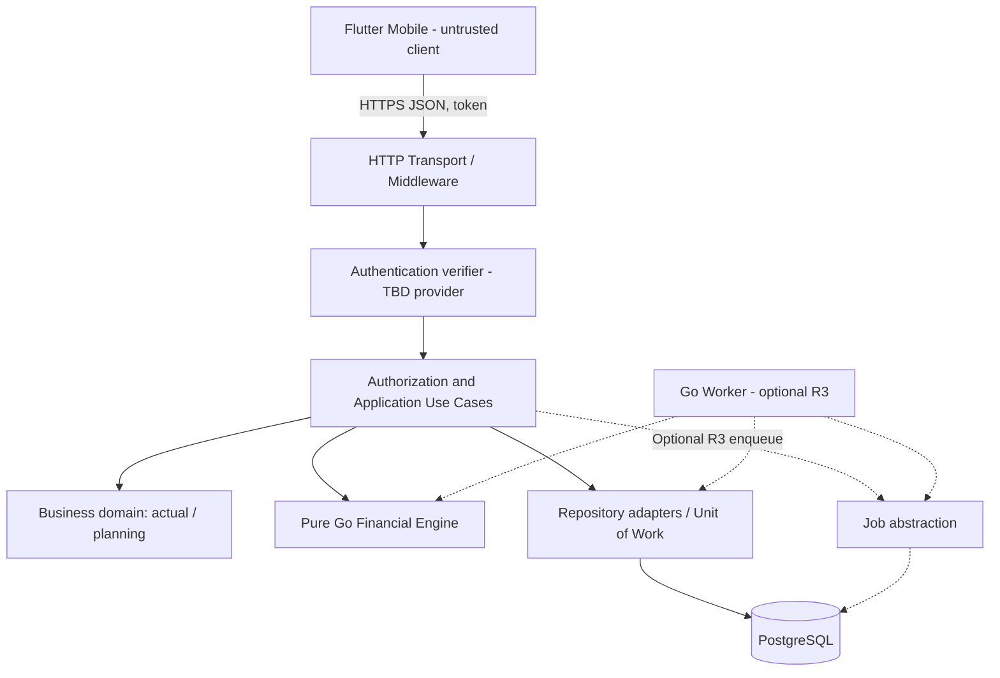
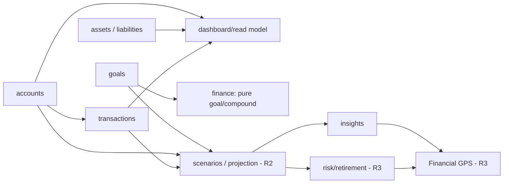
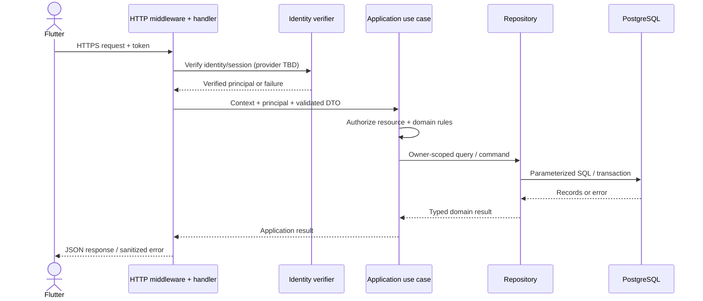
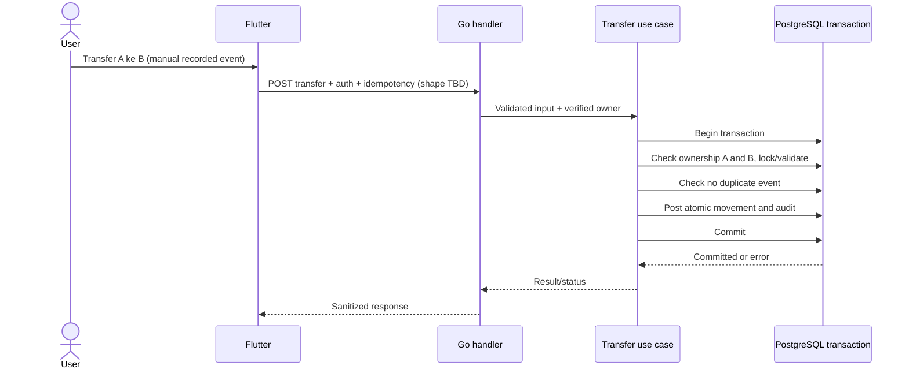
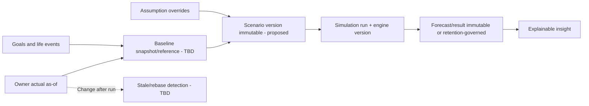
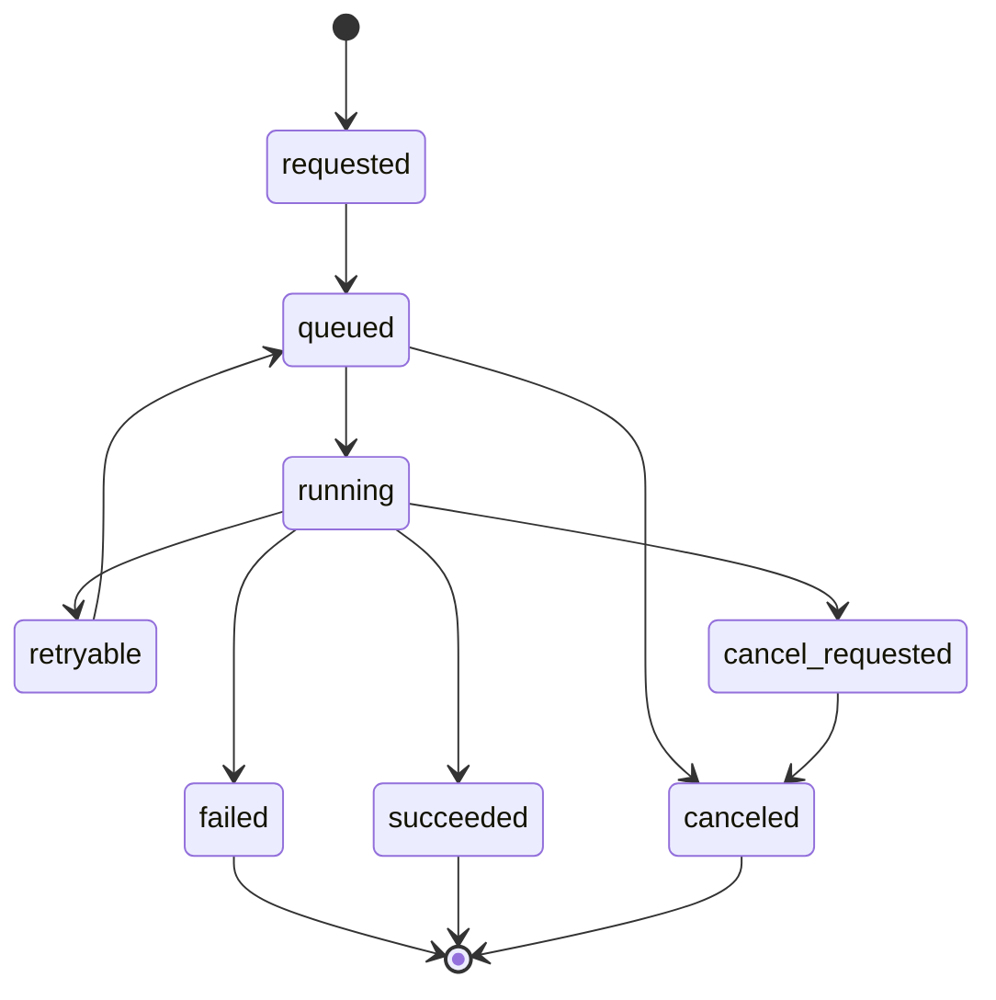

# Esokira — Backend Architecture

> **Canonical path:** `docs/architecture/BACKEND-ARCHITECTURE.md`  
> **Version:** `0.1.0`  
> **Tanggal:** 30 Oktober 2026  
> **Status:** `REVIEWED_INTERNAL — PENDING_OWNER_APPROVAL`  
> **Dokumen induk:** `SYSTEM-ARCHITECTURE.md` v0.1.0; `PRODUCT-VISION.md`, `PRD.md`, `FEATURE-MATRIX.md`, `FINANCIAL-DOMAIN-RULES.md`, `CALCULATION-SPECS.md`, dan `FINANCIAL-TEST-CASES.md` v0.1.0  
> **Scope:** R0 Foundation, R1 MVP, R2 Planning V1, R3 Advanced; R4 discovery saja  
> **Audiens:** Pemilik produk, AI coding agent, Go engineer, database engineer, reviewer keamanan dan QA  
> **Sifat:** Blueprint implementasi backend; **belum menjadi klaim bahwa kode, endpoint, atau deployment telah dibuat**.

---

## 0. Cara menggunakan dokumen ini

Dokumen ini menjabarkan **batas package Go, modul domain, use case, dependensi, keamanan, transaksi PostgreSQL, financial computation, worker, observability, dan testability**. Ini adalah turunan backend dari `SYSTEM-ARCHITECTURE.md`, bukan pengganti PRD, aturan finansial, DDL database, atau spesifikasi API formal. Tujuan utamanya: mengurangi asumsi tersembunyi ketika coding agent menyelesaikan task kecil secara bertahap.

### 0.1 Status keputusan (wajib dibedakan)

| Status | Arti | Hak AI coding agent |
|---|---|---|
| **DECIDED** | Sudah dipilih eksplisit oleh pemilik proyek. | Jadikan constraint teknis dalam planning dan task yang disetujui. |
| **REQUIRED** | Diturunkan dari keamanan, invariant domain, atau requirement yang telah ditulis. | Jangan melanggar walaupun implementasi lebih mudah. |
| **PROPOSED** | Rekomendasi untuk didiskusikan atau diprototipekan. | Tidak boleh diam-diam diperlakukan sebagai keputusan final. |
| **TBD** | Belum ada ketetapan; implementasi rinci berisiko salah. | Catat blocker dan opsi; kerjakan hanya scope yang tidak terdampak. |
| **BLOCKED** | Belum layak production karena keputusan/tes/model belum siap. | Boleh membuat desain atau eksperimen terisolasi yang diberi label, tidak boleh mengklaim ready. |
| **OUT OF SCOPE** | Tidak termasuk rilis aktif. | Tidak diimplementasikan tanpa perubahan PRD dan approval. |

Status dokumen `REVIEWED_INTERNAL` **bukan** persetujuan Product Owner. Seluruh dokumen induk masih `PENDING_OWNER_APPROVAL`. Contoh Go/SQL/path di bawah adalah *illustrative contracts*, **bukan kode yang telah dibangun, diuji, atau schema final**.

### 0.2 Urutan referensi (source of truth)

| Pertanyaan | Sumber kebenaran |
|---|---|
| Visi, target, non-goals | [`../product/PRODUCT-VISION.md`](../product/PRODUCT-VISION.md) |
| Perilaku fitur/acceptance `FR-xxx`, enabler `EN-xxx`, NFR | [`../product/PRD.md`](../product/PRD.md) |
| Dependensi, release, slice `S-00`–`S-12` | [`../product/FEATURE-MATRIX.md`](../product/FEATURE-MATRIX.md) |
| Arti actual, transfer, goal, ownership, `DR-xxx` | [`../financial/FINANCIAL-DOMAIN-RULES.md`](../financial/FINANCIAL-DOMAIN-RULES.md) |
| Rumus, aturan waktu, numerik, `CS-xxx` | [`../financial/CALCULATION-SPECS.md`](../financial/CALCULATION-SPECS.md) |
| Golden/property/integration tests (`FTC-xxx`) | [`../financial/FINANCIAL-TEST-CASES.md`](../financial/FINANCIAL-TEST-CASES.md) |
| System-level containers, boundaries, decisions `ARCH-Qxx` | [`./SYSTEM-ARCHITECTURE.md`](./SYSTEM-ARCHITECTURE.md) |
| Detail desain package, use case, worker Go | **Dokumen ini setelah mendapat approval** |
| Bentuk endpoint final setelah disepakati | `contracts/openapi.yaml` + `API-GUIDELINES.md` (belum dibuat) |
| SQL schema final setelah disepakati | Migrasi SQL versioned di `/backend/db/migrations` + `DATABASE-DESIGN.md` (belum dibuat) |

Jika terjadi konflik: **jangan memperbaiki diam-diam**. Catat nomor requirement, tempat konflik, opsi, konsekuensi, keputusan yang diperlukan; batasi blocker pada scope terdampak. Untuk sumber spesifikasi aktif, kontrak OpenAPI/migrasi harus ditelusuri ke requirement yang disetujui, bukan sebaliknya.

### 0.3 Perintah permanen untuk agent

1. Sebelum membuat atau mengubah kode, baca `AGENTS.md` minimal dan dokumen yang relevan; jika belum ada, jadikan pembuatan `AGENTS.md` minimum sebagai task R0 awal.
2. Audit keadaan repository, versi dependency, dan test yang benar-benar ada. Jangan menyatakan *sudah terimplementasi* hanya berdasarkan contoh di sini.
3. Identifikasi `FR/EN/NFR/DR/CS` dan blocker terkait untuk setiap task.
4. Tampilkan rencana perubahan, file terdampak, acceptance, dan test yang akan dijalankan. Satu task harus sekecil mungkin, dengan *bounded scope*.
5. Jangan menambah microservice, message bus, Redis, GraphQL, generic framework, AI API, integrasi bank, atau fitur R4 hanya untuk “melengkapi” arsitektur.
6. Jangan menyelesaikan policy berlabel TBD dengan asumsi tersembunyi; jangan menambah kolom, endpoint, atau konstanta default yang mengubah makna finansial tanpa approval.
7. Jangan mengubah data actual sebagai side effect dari forecasting/scenario/insight; setiap actual mutation memiliki use case eksplisit dan otorisasi.
8. Jalankan dan catat test yang relevan; **tidak boleh mengklaim test lulus bila tidak dijalankan**.

---

## 1. Keputusan dasar, constraint, dan ruang lingkup backend

### 1.1 Pilihan yang sudah ada vs desain yang diusulkan

| Topik | Pilihan/arah | Status |
|---|---|---|
| Bahasa backend | Go | **DECIDED** |
| DB utama | PostgreSQL | **DECIDED** |
| Repository | Monorepo `frontend/` dan `backend/` | **DECIDED** |
| Aplikasi utama | Flutter mobile sebagai API client | **DECIDED** |
| Bentuk deployment | Satu codebase backend / modular monolith | **PROPOSED** |
| Komunikasi | HTTPS REST/JSON, OpenAPI di `contracts/openapi.yaml` | **PROPOSED** |
| DB access | `pgx/v5`, `sqlc`, SQL eksplisit | **PROPOSED**, library belum disetujui |
| HTTP router | `net/http` modern atau `chi` | **TBD**; keduanya kandidat |
| DB migrations | `goose` atau `golang-migrate` | **TBD** |
| Background work | Go worker dan PostgreSQL-backed queue saat dibutuhkan | **PROPOSED** R3; vendor/library **TBD** |
| Authentication provider | Firebase Authentication atau penyedia OIDC lain | **TBD ARCH-Q01** |
| Money representation | Exact monetary value (bukan binary float sebagai saldo aktual) | **REQUIRED**; tipe final **TBD ARCH-Q03** |
| Ledger lifecycle | Opening/posting/reversal/audit/idempotency | Invariant **REQUIRED**, desain final **TBD ARCH-Q02** |
| Deployment platform, offline sync, retention | Ditentukan terpisah | **TBD** |

**Go bukan pengganti domain modeling yang benar.** Terlepas dari library yang dipilih, accounting invariants, keamanan akses per user, ketepatan kalkulasi, dan kelayakan model adalah persyaratan utama.

### 1.2 Architecture quality attributes

1. **Correctness dan auditability:** angka bisa ditelusuri ke sumber data, rumus, parameter, tanggal, dan versi engine (`NFR-002/003`).
2. **Privacy by default:** backend menjadi batas kepercayaan; user tidak dapat membaca/mengubah resource milik user lain (`NFR-001/007`).
3. **Transactional integrity:** mutasi actual tidak boleh sebagian atau terduplikasi saat retry (`DR-007/008/022`).
4. **Separation:** actual, plan, scenario, forecast result, dan risk result memiliki batas eksplisit (`DR-001/002/012`).
5. **Testability:** kalkulator murni tanpa DB/HTTP serta integrasi yang bisa diuji dengan PostgreSQL nyata (`EN-004`, `NFR-009`).
6. **Incremental operability:** R0–R1 cukup satu API process dan PostgreSQL; jangan memaksa worker/queue sebelum ada kebutuhan yang terukur (`EN-005`).
7. **Explainability:** error, warning, asumsi, dan insight dapat dipahami tanpa menjanjikan keuntungan (`DR-014/015/019`).

### 1.3 Non-goals di backend R0–R3

- Tidak ada transfer bank sungguhan, perdagangan aset, penerbitan kredit, payment gateway, ataupun rekomendasi instrumen investasi spesifik.
- Tidak ada koneksi PostgreSQL langsung dari aplikasi Flutter.
- Tidak ada *global financial data table* yang menggabungkan record aktual dan hasil simulasi tanpa tipe yang jelas.
- Tidak ada model Monte Carlo/default imbal hasil yang ditetapkan agent sendiri.
- Tidak ada shared goals dengan multi-user ACL atau portfolio trading model sebelum discovery R4 disetujui.
- Tidak perlu microservice, service mesh, Kafka, maupun dedicated analytics database untuk R0/R1.

---

## 2. Gambaran arsitektur backend dan trust boundary



- **Trust boundary 1 (client → API):** identitas diverifikasi di Go, semua input divalidasi ulang, dan `owner` berasal dari konteks server.
- **Trust boundary 2 (use case → DB):** operasi data harus menerapkan ownership dan concurrency control; repository hanya menjalankan SQL yang aman.
- **Trust boundary 3 (use case → engine):** engine hanya menerima input eksplisit, tidak melakukan posting aktual, tidak memanggil DB/network.
- **Trust boundary 4 (worker → data):** worker bukan layanan publik; setiap job tetap memiliki owner dan access scope, serta aman untuk retry.

Batas service/proses di diagram bersifat **logis**, bukan jumlah deployment yang diputuskan. `api` dan `worker` boleh menjadi dua executable di satu `go.mod` kelak; worker tidak wajib untuk fase awal.

---

## 3. Struktur monorepo dan package Go (PROPOSED)

```text
esokira/
├── AGENTS.md                        # Aturan root untuk coding agent; ditulis saat R0
├── README.md
├── frontend/                       # Flutter; desain rinci di FRONTEND-ARCHITECTURE.md
├── backend/
│   ├── AGENTS.md                    # Aturan khusus backend; belum ada
│   ├── cmd/
│   │   ├── api/main.go             # Binary HTTP API
│   │   └── worker/main.go          # OPTIONAL, R3; jangan dibuat pada R0 bila belum dibutuhkan
│   ├── internal/
│   │   ├── bootstrap/              # Manual wiring/dependency composition (PROPOSED)
│   │   ├── platform/
│   │   │   ├── config/             # Typed environment/config (no secret hardcode)
│   │   │   ├── httpserver/         # Router, middleware, response adapter
│   │   │   ├── identity/           # Token verification adapter, provider-agnostic
│   │   │   ├── persistence/        # pgx pool, transaction adapters
│   │   │   ├── telemetry/          # Structured logs, metrics, traces (privacy-first)
│   │   │   └── jobs/               # OPTIONAL job adapter, no external package in domain
│   │   ├── modules/
│   │   │   ├── users/
│   │   │   ├── accounts/
│   │   │   ├── transactions/
│   │   │   ├── assets/
│   │   │   ├── liabilities/
│   │   │   ├── goals/
│   │   │   ├── calculators/
│   │   │   ├── budgets/            # R2
│   │   │   ├── lifeevents/         # R2
│   │   │   ├── scenarios/          # R2
│   │   │   ├── simulations/        # R2/R3
│   │   │   ├── insights/           # R2/R3
│   │   │   └── datalifecycle/      # FR-021 export/deletion
│   │   └── finance/
│   │       ├── money/              # Exact amount + currency concepts; policy TBD
│   │       ├── compound/           # CS-005
│   │       ├── goals/              # CS-007 (pure calculations; not DB goal CRUD)
│   │       ├── projection/         # CS-009 R2
│   │       ├── amortization/       # CS-010 R2
│   │       ├── stresstest/         # CS-011 R2
│   │       ├── allocation/         # CS-013 R3 BLOCKED
│   │       ├── montecarlo/         # CS-014 R3 BLOCKED
│   │       └── retirement/         # CS-015 R3 BLOCKED
│   ├── db/
│   │   ├── migrations/             # Versioned SQL after DATABASE-DESIGN approval
│   │   ├── queries/                # Handwritten parameterized SQL (if sqlc approved)
│   │   └── generated/              # Generated by pinned sqlc version, if approved
│   ├── tests/                      # Integration fixtures/helper packages only if needed
│   ├── go.mod                       # One Go module initially
│   ├── go.sum
│   └── Dockerfile                  # Deployment candidate
├── contracts/
│   └── openapi.yaml                 # Candidate future API contract, not yet implemented
├── docs/
│   ├── product/
│   ├── financial/
│   └── architecture/
├── infra/
├── compose.yaml                    # Candidate local env
└── .github/workflows/              # CI after R0 scope approval
```

**Ini target penempatan konseptual**, bukan permintaan untuk membuat seluruh folder kosong sekaligus. Mulai dengan yang dibutuhkan slice aktif. Hindari `go.work` dan banyak `go.mod` karena hanya ada satu module Go (`backend/`) pada R0/R1. Jika banyak executable dalam module, `cmd/` dapat menampung entrypoint tanpa mengharuskan modul domain jadi service terpisah.

### 3.1 Modul feature-first, bukan folder layer global

Contoh struktur ketika modul `goals` sudah diprioritaskan:

```text
internal/modules/goals/
├── handler.go         # Transport HTTP (request/response) - illustrative
├── service.go         # Use cases: create/list/update/archive
├── domain.go          # Goal aggregate/business rules
├── repository.go      # Port/interface kecil; DB adapter bisa di subpackage
├── postgres.go        # Adapter DB bila perlu; jangan import dari domain
├── dto.go             # HTTP DTO, jangan reuse as persistence model
└── service_test.go    # Fast unit tests
```

Tidak wajib selalu enam file di atas. Bila modul sederhana, kurangi jumlah abstraksi. Bila besar, pecah ke `domain/`, `application/`, `transport/`, atau `postgres/` dengan alasan yang terdokumentasi. **Jangan menambahkan abstraksi untuk alasan estetika struktur saja**.

### 3.2 Aturan import dan kepemilikan kode

| Aturan | Penjelasan |
|---|---|
| `cmd` hanya composition | Parse config, init dependencies, router, server lifecycle; tidak ada financial formulas. |
| `internal/finance/*` murni | Boleh import standard library dan pure math/value packages; **tidak import** DB driver, HTTP, file/network access, env, queue, `time.Now()` atau global RNG tersembunyi. |
| Module service memegang use case | Validasi business workflow, ownership, transaction boundary, call engine/repository. |
| Handler bertanggung jawab transport | Decode/validate request, map HTTP errors, no SQL/no interest calculation. |
| Repository adalah DB boundary | Query, locking, persistence mapping; bukan pusat aturan finansial. |
| Package platform/adapters di pinggir | Implementasi dependency eksternal; domain tidak bergantung langsung padanya. |
| No circular imports | Dependencies mengalir ke inward domain; gunakan small interface di consumer yang perlu substitusi. |
| No universal interfaces | Jangan otomatis `Repository`, `Service`, `Factory` untuk setiap struct yang hanya memiliki satu pemakaian. |
| No hidden defaults | Jangan silently set return/inflation/rate/rounding ketika input kurang. |
| Tests follow contracts | Unit golden tests engine, integration SQL nyata, authz cross-user, worker retry bila ada. |

### 3.3 Relasi antarmodul (dependency contract)



Panah menyatakan **data atau kontrak yang dibutuhkan**; tidak berarti modul sebelah bebas membaca tabel modul lain atau mengimpor handler-nya. Untuk data lintas domain, gunakan query owner-scoped melalui application orchestration dan read model yang dirancang, bukan cyclic service calls.

---

## 4. Katalog modul, owner, dependensi, dan rilis

| Logical module | Use case / tanggung jawab | Depends on | Data class | Release |
|---|---|---|---|---|
| `users` / `identity` | External identity mapping, onboarding, profile | Auth decision `ARCH-Q01` | Owner metadata / profile | R0/R1 |
| `accounts` | Account, opening balance, account position | `users`, ledger policy `ARCH-Q02` | **ACTUAL_RECORD** | R1 |
| `transactions` | Income/expense/transfer, correction, idempotent posting | `accounts`, owner, ledger policy | **ACTUAL_RECORD** | R1 |
| `assets` / `liabilities` | Valuation as-of, outstanding balances, duplication guards | Owner, `accounts` for nonduplicate aggregation | **ACTUAL_RECORD** | R1 |
| `dashboard`/query facade | Net worth, income/expense periods, provenance | `accounts`, `transactions`, `assets`, `liabilities` | Derived actual, not forecast | R1 |
| `goals` | Goal create/update/archive; progress semantics **TBD** | Owner, `finance/goals` | **PLAN**; funded model TBD | R1 |
| `calculators` | Compound/goal contribution endpoint orchestration | `finance/compound`, money/rate policy | Stateless forecast / plan | R1 |
| `datalifecycle` | Export/delete requests, retention/consent enforcement | Resource ownership; privacy policy TBD | Sensitive operations | R1 |
| `budgets` | Budget, planned recurring expenses | `transactions` read model, explicit posting policy | **PLAN** | R2 |
| `lifeevents` | Hypothetical events and financial assumptions | `goals`, lifecycle definitions | **PLAN** | R2 |
| `scenarios` | Baseline, immutable version, compare, staleness | Accounts/goals/life events read models | **SCENARIO_INPUT** | R2 |
| `simulations` | Deterministic projection and simulation-run lifecycle | `finance/projection`, scenario versions | **FORECAST_RESULT** | R2 |
| `insights` | Rule-based interpretation, Financial GPS later | Verified projections and actual read models | **DERIVED_INSIGHT** | R2/R3 |
| `optimization` | Multi-goal optimizer; objective **BLOCKED** | Goal/scenario + validated optimizer | **RISK_MODEL_RESULT** / plan alternative | R3 |
| `montecarlo` | Stochastic runs with seed/model reproducibility **BLOCKED** | Simulation engine, job processing | **RISK_MODEL_RESULT** | R3 |
| `retirement` | Accumulation/decumulation model **BLOCKED** | Projection + stochastic engine | **RISK_MODEL_RESULT** | R3 |
| `notifications` | Opt-in reminder policy, redacted payload | goals/insights + provider TBD | System metadata | R2 |

`FR-023` (shared goals) dan `FR-024` (portfolio planning) **R4 DISCOVERY**. Jangan membuat modul atau ACL untuk keduanya sekarang. `dashboard` boleh berupa query facade dalam `accounts`/`reports` jika kecil; tidak wajib micro-module sendiri.

---

## 5. Jalur request dan dependency wiring

### 5.1 HTTP request normal



**No transport-to-SQL shortcut:** handler tidak menerima pool SQL hanya untuk “memudahkan endpoint”. Request/response DTO bukan database row dan bukan tipe input numerik tanpa validasi/konversi yang jelas.

### 5.2 Dependency injection dengan composition root

**PROPOSED:** manual constructor injection pada `cmd/api` melalui `internal/bootstrap/`, tanpa DI framework kecuali ada kebutuhan terukur. Boot sequence:

1. Load konfigurasi terstruktur; validasi variabel wajib dan environment; jangan log secret.
2. Initialize `slog`/telemetry dan error reporting yang menerapkan redaction.
3. Buat DB connection pool setelah schema readiness diverifikasi; jangan jalankan migration secara liar pada setiap startup production.
4. Wire identity verifier adapter dari provider yang disetujui.
5. Wire repository/adapters dan application services; inject pure finance calculators dari package murni.
6. Register health/readiness plus route yang telah disetujui dari OpenAPI; middleware authz pada semua private routes.
7. Mulai HTTP server dengan timeout, body size limits, graceful shutdown; tunggu transaksi in-flight sesuai kebijakan.

**Pseudocode kontrak, bukan API Go final:**

```text
config -> database pool -> repository implementations
identityVerifier -> principal middleware
repositories + financialCalculators -> application services
application services -> HTTP handlers -> router -> HTTP server
```

Gunakan interface di sisi consumer untuk kemampuan yang perlu dimock dalam tests, misalnya verifier atau `AccountReader`. Jangan membuat interface lintas modul yang sangat besar atau menyalin satu generated SQL interface ke seluruh domain.

### 5.3 Context dan ownership principal

- `context.Context` dari HTTP request membawa deadline/cancellation, request ID, dan principal hasil verifikasi; **jangan** menyisipkan account balance, password, atau seluruh payload finansial di context.
- Principal konseptual: stable internal user ID + verified external subject + status akun/izin; shape final tergantung `ARCH-Q01` dan desain keamanan.
- Service methods menerima principal/owner scoped explicitly. Tidak boleh menganggap `GET /users/{userId}/accounts/{id}` aman karena token valid.
- Background job menggunakan service principal terbatas yang terhubung ke owner terverifikasi dari job record, bukan privilege global untuk semua input user.

---
## 6. HTTP transport, kontrak API, dan error handling

### 6.1 Router (TBD) dan dependency boundary

`net/http.ServeMux` dengan route methods/wildcards (Go >=1.22) dan `chi` adalah dua opsi yang layak. **Belum ada approval memilih salah satunya**. Jangan otomatis memasang Gin/Echo/Fiber/GORM, WebSocket, atau generator besar hanya karena familiar. Versi Go dan lockfile dependency ditetapkan saat R0 dan dicatat di ADR.

**PROPOSED** middleware order logis (bukan urutan wrapper yang mutlak):

1. Panic recovery yang tidak memaparkan stack trace atau input sensitif ke user.
2. Request ID/correlation dan observability aman.
3. Security headers/transport checks sesuai deployment boundary.
4. Body size limits dan decode constraints, per-route quotas ketika ditetapkan.
5. Authenticated principal pada route privat.
6. Authorization atas object pada use case/repository, bukan hanya di middleware.
7. Routing/handler, response mapping, dan sanitasi error.

CORS tidak otomatis diperlukan untuk aplikasi Flutter native; jika ada web client pada masa depan, CORS perlu dirancang secara terpisah. CSRF bergantung pada model sesi/cookie yang dipilih; jangan mengasumsikan selalu tidak relevan atau selalu wajib.

### 6.2 Endpoint shape — ilustrasi, **bukan OpenAPI final**

```text
GET    /health/live                    # Liveness; no DB requirement
GET    /health/ready                   # Readiness; DB check only as approved
GET    /api/v1/me
GET    /api/v1/accounts
POST   /api/v1/accounts
POST   /api/v1/transactions            # Actual write; idempotency policy pending
POST   /api/v1/transfers               # Dedicated flow if approved
GET    /api/v1/financial-position
GET    /api/v1/goals
POST   /api/v1/goals
POST   /api/v1/calculators/compound    # Pure calculation; no actual mutation
POST   /api/v1/scenarios              # R2
POST   /api/v1/simulation-runs        # R2/R3, sync/async decision pending
GET    /api/v1/simulation-runs/{id}   # Owner-scoped
```

- Method/path/body/response, pagination, API version, rate limit, HTTP status, error envelope, idempotency header, and request schemas are set by `API-GUIDELINES.md` and `contracts/openapi.yaml` **after approval** (`ARCH-Q11`).
- OpenAPI adalah kontrak lintas Flutter-Go; generator client boleh digunakan setelah codegen policy/versions jelas, bukan dua definisi model yang dibiarkan drift.
- Jangan menyisipkan `user_id` request sebagai sumber ownership; jika query perlu scoped user, derive dari principal.
- JSON monetary fields membutuhkan exact serialization contract. Hindari number JS/Flutter `double` untuk balance transaksi sebelum representasi final `Q-04` disetujui.

### 6.3 Validation pipeline

| Layer | Validasi yang bertanggung jawab | Contoh |
|---|---|---|
| HTTP decode | JSON valid, type, jumlah field, payload size | Reject malformed JSON / unknown fields ketika policy menetapkan strict schema |
| Request schema | Required fields, rentang, enum, format | UUID/date/amount unit, horizon / sample count bounds |
| Authentication | Issuer/signature/audience/expiry/revoke, sesuai IdP | Missing/invalid token |
| Authorization | User boleh akses objek dan parent-child | Account B milik user lain |
| Domain | Real invariant dan lifecycle posting | Transfer source=destination bila dilarang, duplicate posting |
| Financial engine | Unit/rate/timing/overflow/insufficient assumptions | Annual effective vs nominal, zero horizon |
| Storage | Check/FK/unique/transaction constraints | Duplicate idempotency key, invalid owner linkage |

Tiap lapisan mempunyai fungsi berbeda. Validasi di Flutter meningkatkan UX, tetapi bukan enforcement keamanan. Error API harus *stable* tanpa bocor data sensitif.

### 6.4 Kategori error yang disarankan

| Category konseptual | Contoh | Ketentuan |
|---|---|---|
| `invalid_input` | Date/amount/rate salah format | Perinci field aman, jangan tampilkan data privat lengkap. |
| `unauthenticated` | Token expired/invalid | Jangan mengirim internal identity provider detail. |
| `access_denied` / `not_found` | Resource cross-user | Kebijakan anti-enumeration TBD; tidak bocorkan keberadaan objek. |
| `conflict` | Duplicate lifecycle atau retry payload berbeda | Hasil retry harus terjelaskan; bukan POST kedua. |
| `insufficient_data` | Return/goal assumption belum lengkap | Jangan isi dengan default financial yang tersembunyi. |
| `infeasible` | Capacity tidak memenuhi constraint goal | Bukan 500; sertakan reasoning yang aman bila policy setuju. |
| `calculation_error` | Numeric invalid/overflow/unsupported | Tidak simpan hasil palsu atau *NaN* sebagai angka valid. |
| `dependency_unavailable` | Postgres/Auth/Queue unavailable | Fail closed; tidak menandai actual post sukses. |
| `temporarily_unavailable` | Job/resource cap | Retry guidance tanpa menjanjikan waktu pasti. |

Typed domain errors dipetakan pada transport boundary. SQL driver error (misalnya unique constraint) diterjemahkan menjadi domain/app error; jangan mengirim stack trace, query, connection string, atau SQLSTATE mentah ke klien. Kode error final dan HTTP status adalah `ARCH-Q11`.

### 6.5 Retry dan idempotency

- **READ** dapat diulang, namun pagination/read snapshot semantics harus jelas.
- **ACTUAL WRITE** tidak aman diulang tanpa mekanisme dedup yang disetujui (`DR-008`). Propagasi `Idempotency-Key` + uniqueness per `(owner, operation, key)` adalah **PROPOSED**, bukan skema final.
- Request sama/key sama perlu mengembalikan hasil ekivalen; request beda/key sama harus ditolak secara konsisten. Rincian TTL, canonical payload hash, status response, dan penyimpanan failure masih **TBD**.
- Network timeout **tidak berarti** database rollback; klien harus mampu mengecek status commit sebelum mencoba posting ulang.
- Worker retries adalah *at least once* secara prinsip; handler job harus aman terhadap eksekusi ganda.

---

## 7. Data access dan PostgreSQL transaction architecture

### 7.1 Database boundary

**DECIDED:** PostgreSQL adalah database utama. **PROPOSED:** `pgx/v5` pool untuk koneksi dan `sqlc` untuk typed query generation; kedua pilihan belum locked sampai review dependency. Alternatif bisa dievaluasi dengan kriteria: SQL eksplisit, transactions, generated type safety, migration compatibility, observability, dan kemampuan test dengan PostgreSQL nyata.

```text
Application service -> repository port/interface (jika diperlukan)
      -> PostgreSQL adapter -> parameterized SQL -> PostgreSQL
```

Aturan `EN-002` dan `NFR-006`:

- Jangan memberikan pool/transaction DB ke handler atau pure finance engine.
- Tidak ada concatenated user input ke query SQL; gunakan positional parameters dan allowlist untuk nama kolom/order yang dinamis.
- Query privat harus owner-scoped. Jangan hanya `WHERE id = $1` tanpa ownership atau authorization yang sudah diverifikasi dalam transactional unit.
- Gunakan constraints DB (unique, FK, check) sebagai lapisan integritas kedua; domain rules tetap wajib diuji di application service.
- Jangan memodelkan full schema di file ini; DDL mengikuti `DATABASE-DESIGN.md` setelah `ARCH-Q02/03/04` terselesaikan.
- Pertimbangkan row-level security sebagai defense-in-depth **PROPOSED**; bila digunakan, perhatikan DB role, owner propagation, connection pooling, dan bypass behavior. RLS bukan pengganti object authorization aplikasi.

### 7.2 Transaction boundary diputuskan use case

Contoh operasi yang seharusnya menjadi atomic unit:

- Mem-posting income/expense dan perubahan saldo yang direpresentasikan model final.
- Transfer antara dua account milik pengguna yang sama, termasuk pencatatan kedua sisi dan status transaksi.
- Create/update goal + audit record bila kebijakan audit mewajibkannya.
- Merekam event aktual dan token idempotency/response result **dalam transaksi yang konsisten** sesuai keputusan persistence.
- Membuat simulation run + enqueue marker/outbox secara konsisten ketika worker diaktifkan.

**Illustrative Go transaction skeleton untuk adapter `pgx` (bukan kode production):**

```go
// PROPOSED: transaction orchestration example; repository and data model TBD.
tx, err := pool.Begin(ctx)
if err != nil {
    return err
}
defer func() { _ = tx.Rollback(ctx) }()

// 1. Verify ownership / lock rows as required.
// 2. Validate ledger rules and idempotency in the same unit of work.
// 3. Execute all related debit/credit effects through tx, not pool.
// 4. Persist audit evidence as approved.

if err := tx.Commit(ctx); err != nil {
    return err
}
return nil
```

**Caveat Go/pgx:** memulai transaksi dengan context tidak otomatis meng-rollback ketika context dibatalkan; explicit `Rollback/Commit` tetap tanggung jawab kode. Jangan menggunakan `pool.Exec` di tengah unit transaksi yang sama, karena dapat memakai connection berbeda. Rincian behavior diverifikasi terhadap versi `pgx` terpilih.

### 7.3 Concurrency, isolation, lock ordering

`READ COMMITTED` PostgreSQL bukan jaminan bahwa seluruh business invariants aman di bawah concurrent writes. Transaction design harus memutuskan:

1. Baris apa yang dikunci dan urutan lock yang **deterministic** untuk transfer antar dua akun (mengurangi deadlock).
2. Apakah saldo adalah derived ledger sum, snapshot/materialized balance, atau hybrid — **TBD ARCH-Q02**; tidak boleh memaksakan salah satunya.
3. Bagaimana concurrent posting ke account yang sama menjaga konsistensi dan mencegah lost update.
4. Bagaimana statement timeout, deadlock/serialization retry, idempotency, dan rollback ditangani tanpa double posting.
5. Apakah overdraft dapat terjadi per jenis account (TBD). Jika tidak, constraint harus diperiksa terhadap saldo yang aman di bawah konkurensi.

**Pilihan isolation (`READ COMMITTED`, `REPEATABLE READ`, `SERIALIZABLE`) harus berdasarkan invariant yang dapat diuji**, bukan selalu menaikkan isolation tanpa analisis dampak. Untuk `SERIALIZABLE`, aplikasi harus menyiapkan retry transaction secara aman ketika terjadi serialization failure. Jangan menambah lock global user tanpa alasan yang terukur.

### 7.4 Opening balance, audit, correction/reversal

**REQUIRED:** opening balance adalah posisi awal, bukan income; koreksi actual tidak boleh merusak saldo atau menghapus jejak yang diwajibkan. **TBD ARCH-Q02:** draft/posted/void state, editing setelah posting, reversal transactions, effective dates, backdating, audit records, dan reconciliation policy.

**PROPOSED alternatif untuk review:**

- *Immutable posted ledger + compensating reversal*: histori lebih dapat ditelusuri, tetapi UX dan migrasi lebih rumit.
- *Editable posting with audit history*: lebih sederhana untuk pencatatan manual, tetapi membutuhkan snapshot/version integrity dan rekonsiliasi kuat.

Jangan memilih salah satu hanya karena agent sudah membuat CRUD sebelumnya. Definisikan expected behavior dahulu, tulis test, baru schema dan kode.

### 7.5 Money, rounding, currencies, time

- `Money.amount` di actual harus exact; final unit IDR (`BIGINT` vs `NUMERIC`, scale) masih **TBD ARCH-Q03**.
- Display `Rp1.234.567` tidak boleh menjadi format database. JSON serialization final ditentukan setelah unit disetujui.
- Rates/percentage punya jenis (`annual effective` vs `nominal`, `monthly effective`) dan unit eksplisit; jangan pakai angka `8` lalu diam-diam dianggap `0.08`.
- `occurred_on` (effective event date), `recorded_at` (storage timestamp), dan `as_of` (valuation/reference) berbeda secara domain (`DR-018`). Periode laporan dan timezone IDR/Indonesia **belum final**.
- DB timestamp harus konsisten dan berbasis offset/timezone policy yang disetujui. Jangan mengonversi semua *business dates* ke UTC midnight tanpa menilai risiko tanggal bergeser pada aplikasi mobile.
- Multi-currency, FX conversion, dan fee cross-currency adalah scope terpisah; IDR-only masih **PROPOSED**.
- Jangan mengakumulasikan `float64` untuk saldo aktual, menghilangkan negative net worth, atau menggandakan akun investasi sebagai aset manual (`DR-004/009/010`).

### 7.6 Migration dan generated code

- Migrasi SQL harus versioned, direview, dan dapat diterapkan berurutan pada DB kosong dan DB yang mempunyai data upgrade path.
- Untuk production, migration dijalankan sebagai langkah deployment terkontrol, **bukan** otomatis oleh setiap replika API yang start bersamaan.
- `down` migration bukan jaminan rollback aman ketika ada data; gunakan strategi backward-compatible dan backup/restore sesuai risiko.
- Jika `sqlc` dipilih, query SQL berada di `backend/db/queries`, generated Go disimpan pada folder yang disetujui, dan CI membandingkan hasil regenerate agar tidak drift.
- **Stop** bila query generator tidak memahami native PostgreSQL type yang diperlukan untuk exact money; buat mapping eksplisit dan uji round-trip.
- Dokumen `DATABASE-DESIGN.md` nantinya menjelaskan foreign keys, owner indexes, unique constraints, migration naming, soft delete/reversal, retention, dan audit.

---

## 8. Use case khusus: transfer antar-account (R1)



**Invariants yang wajib:**

- A dan B ada dan milik user yang sama; external recipient transfer bukan bagian scope ini.
- Tanpa fee/FX: total saldo semua account owned tidak berubah; income/expense tidak bertambah (`DR-006`).
- Tidak pernah hanya sisi debit atau kredit ter-commit (`DR-007`).
- Request diulang karena disconnect tidak menambah mutasi kedua (`DR-008`).
- Bila `Commit` status tidak pasti karena koneksi putus, jangan kirim UI yang mengklaim sukses/gagal final tanpa recovery lookup/idempotency reconciliation.
- Struktur ledger, jenis status, validasi overdraft, dan aturan amount sudah harus diputuskan sebelum implementasi nyata (`ARCH-Q02/03`).

**Acceptance tests:** cross-owner source/destination, duplicate submit, failure between effects, concurrent transfers A↔B, network timeout after commit, opening cut-off, reversal semantics (jika sudah disetujui), and exact net-worth conservation.

---

## 9. Financial calculation architecture: pure Go engine

### 9.1 Boundary: engine tidak mengetahui akun/DB

`internal/finance/*` berisi operasi numerik murni (atau deterministik dengan input `seed`) yang menerima typed inputs, mengembalikan typed results/warnings, dan tidak melakukan side effects.

```text
HTTP DTO
  -> schema validation
  -> application use case
  -> approved domain-calculation input (typed currency, rate, dates)
  -> pure calculation engine
  -> result + assumptions + calculation version + warnings
  -> application response mapper
  -> HTTP DTO
```

Penyimpanan hasil dihitung oleh service/repository **di luar engine**. Engine tidak memanggil `context.Background()`, membaca `DATABASE_URL`, menelpon API, menggunakan `time.Now()` tersembunyi, membuat transaksi riil, atau mengeksekusi SQL. Untuk proses yang lama, aplikasi/worker dapat meneruskan cancellation melalui orchestration atau callback/checkpoint eksplisit tanpa mengubah determinisme hasil.

### 9.2 Function boundary — illustrative, bukan API final

```go
// Conceptual. Do not implement exact Money or Rate types until ARCH-Q03 approved.
type CompoundInput struct {
    Principal Money
    Contribution Money
    Rate PeriodicRate
    Periods int
    Timing ContributionTiming // Beginning or End, explicitly chosen.
}

type CompoundResult struct {
    FutureValue Money
    Contributed Money
    Growth Money
    Assumptions []Assumption
}

// Example conceptual signature only:
// func ComputeCompound(input CompoundInput) (CompoundResult, error)
```

Contoh di atas **sengaja bukan paket siap compile**, karena `Money`, `PeriodicRate`, scale, timing, dan rounding belum approved. Jika agent langsung membuat representasi `float64` demi bisa compile, berarti melanggar `DR-004`.

### 9.3 Modul per rilis dan test gate

| Package | Contract | Release | Gate |
|---|---|---|---|
| `finance/money` | `CS-001/002` | R0/R1 | Currency/precision/rate policy disetujui. |
| `finance/compound` | `CS-005` | R1 | Timing awal/akhir, zero-rate cases, golden tests. |
| `finance/goals` | `CS-007` | R1 | Required-contribution math + actual-funded model Q-11 terpisah. |
| `finance/projection` | `CS-009/012` | R2 | `SCENARIO-ENGINE.md`, baseline policy, replay tests. |
| `finance/amortization` | `CS-010` | R2/R3 | Schedule/fees/rate loan policy disetujui. |
| `finance/stresstest` | `CS-011` | R2 | Shock/time horizon/shortfall threshold policy disetujui. |
| `finance/allocation` | `CS-013` | R3 | **BLOCKED:** optimizer objective/constraints, feasible/infeasible tests. |
| `finance/montecarlo` | `CS-014` | R3 | **BLOCKED:** probabilistic model, RNG, percentile, reproducibility. |
| `finance/retirement` | `CS-015` | R3 | **BLOCKED:** decumulation and sequence-of-returns policy. |
| `finance/insight` (jika diperlukan) | `CS-016` | R2/R3 | Traceable explanations only; no financial action side effects. |

### 9.4 Numerical safety dan provenance

- Input harus membawa metadata: currency/units, `as_of`, horizon, timing, rate kind, inflation/fee assumptions, dan baseline reference jika diperlukan.
- Output harus membedakan actual/forecast/model risk (hindari field generik `balance` tanpa `source_kind`).
- Zero/negative rates, zero horizon, insufficient inputs, overflow, `NaN`, `Inf`, dan impossible constraints ditangani sesuai calculation contract.
- Rounding display berbeda dari internal precision; rounding financial engine **belum final**.
- Simulasi stochastic harus memiliki seed, model/engine version, statistical definition dan input provenance. “72% dari 1000 paths berhasil” **bukan jaminan probabilitas dunia nyata**.
- Hasil tidak boleh berubah hanya karena memakai ulang fungsi dari handler lain; algoritma terikat ke versi spesifikasi yang diuji.
- Perhitungan numerik harus diuji terhadap `FINANCIAL-TEST-CASES.md`, bukan angka fixture dummy permanen.

### 9.5 Proses pengembangan rumus baru

1. Definisikan formula dan asumsi pada `CALCULATION-SPECS.md` / dokumen advanced tersendiri.
2. Review expected outcome serta unit/rounding terhadap reference computation independen.
3. Tambah `FTC-xxx` untuk normal, batas, error, property/invariant dan regression cases.
4. Implementasikan pure Go code tanpa DB, HTTP, atau sumber acak tersembunyi.
5. Jalankan unit tests, fuzz/property tests bila cocok, dan cross-check terhadap contoh.
6. Versikan behavior yang berubah dan pastikan replay hasil lama dapat dijelaskan.
7. Barulah expose via use case dan OpenAPI setelah scope approved.

---

## 10. Scenario, projection, result, dan actual isolation (R2)

### 10.1 State classes

| Data | Penggunaan | Apakah boleh menulis saldo aktual? |
|---|---|---|
| **ACTUAL_RECORD** | Rekening, transaksi, valuasi, kewajiban yang dicatat sebagai nyata | Hanya lewat explicit actual use case |
| **PLAN** | Budget, goal, recurring rule, life event | Tidak |
| **SCENARIO_INPUT** | Baseline + assumption override + version | Tidak |
| **FORECAST_RESULT** | Prediksi deterministic multi-periode | Tidak |
| **RISK_MODEL_RESULT** | Probabilistic risk / optimizer output | Tidak |
| **DERIVED_INSIGHT** | Penjelasan atau alternatif tindakan | Tidak |
| **SYSTEM_META** | Run status, audit, provenance | Hanya metadata |

**Invariant keras:** tidak ada import atau repository write path dari scenario engine menuju actual mutation. Kode yang mengubah scenario harus dipastikan hanya memodifikasi schema/data class scenario yang relevan, bukan membuat transfer sungguhan.

### 10.2 Rancangan versi/snapshot — PROPOSED, BLOCKED pada detail



Konsep yang perlu dipastikan sebelum R2 production: baseline capture/fingerprint, ownership of all referenced data, scenario version immutability, money/date policy, how to mark stale, retention, engine version, user-visible assumption summary, and comparison compatibility. Referensi `ARCH-Q05`, `DR-016/020`, `CS-012`.

- **Do not** use live account balances implicitly while replaying an old scenario; results will change silently.
- **Do not** overwrite old scenario version to hide user adjustment; create new version or explicit approved revision flow.
- **Do not** compare two results with incompatible currencies, horizons, real/nominal definitions, or different base dates as though equivalent.
- Baseline changes may mark old results stale, but old historical run can remain inspectable according to retention.

### 10.3 Derived data dan cache

Derived dashboard/read models may be cached **only** if invalidation, provenance, ownership, and freshness are specified. **Cache is not canonical accounting truth.** Redis is not required merely to cache simple queries. Recomputing small views safely may be preferable until profiling demonstrates a bottleneck.

---

## 11. Heavy simulation dan background worker (R3, optional)

### 11.1 Jangan terlalu awal memasang queue

`compound` dan goal calculator ringan dapat dijalankan synchronous selama batas input dan latency terukur. Monte Carlo/projection yang mahal mungkin memerlukan worker, namun **worker tidak wajib pada R0/R1** (`EN-005` dibutuhkan menjelang R3/FR-018 atau job lain yang benar-benar berat).

**PROPOSED:** Go API dan Go worker adalah dua entrypoint dari module Go yang sama; queue yang memakai PostgreSQL dapat mengurangi jumlah service yang harus dikelola. `River` adalah kandidat **bukan keputusan final**. `ARCH-Q10` menentukan library, worker deployment, queue semantics, cancellation, data retention, dan resource budget.

### 11.2 Lifecycle konseptual



State names, schema, transitions, error status, attempt count dan cancellation timing adalah **PROPOSED**. Jika queue provider memberi states sendiri, adapter harus menerjemahkannya ke application lifecycle; jangan memaksakan semua state di database tanpa alasan.

### 11.3 Request → run → worker → result

1. Authenticated user meminta run dari approved, owner-scoped scenario version.
2. API mengecek input/horizon/limits/quota, menyimpan immutable request reference dan status awal.
3. API enqueue job secara **konsisten** dengan pembuatan run; transactional enqueue atau transactional outbox adalah opsi desain (TBD).
4. Worker acquire job, load input berhak, recheck cancellation/retention state, dan jalankan engine yang versinya cocok.
5. Worker persist result summary/warnings/provenance dengan atomic completion marker; jangan menyimpan jutaan paths tanpa retention policy.
6. API query status/result hanya untuk owner; jika input berubah, tampilkan stale/refresh behavior yang telah disetujui.
7. Retry setelah failure tidak boleh menduplikasi hasil, mengubah actual, atau mempublikasikan partial-result sebagai sukses.

### 11.4 At-least-once, idempotency, cancellation, quotas

- Assume **at-least-once** delivery; duplicated execution mungkin terjadi setelah crash pasca-commit. Deduplication harus berdasar `run_id` + version/attempt policy, bukan berharap queue memproses tepat sekali.
- `requested_by` adalah internal owner ID yang diperoleh dari server saat enqueue, **bukan user_id raw job payload**.
- Jalankan worker dengan bounded concurrency, input max horizon, paths, memory, deadline, dan rate limits; angka default **TBD**, berdasarkan benchmark.
- Cancellation perlu cooperative checkpoints dan status terminal yang konsisten; tidak ada penghentian goroutine paksa tanpa cleanup.
- Jika akun sedang dihapus, worker tidak boleh membuat ulang data yang telah dihapus atau mengekspor data user sesudah delete accepted.
- PostgreSQL connection pool API dan worker membagi kapasitas DB; uji max_connections, migration locks, queue contention, dan resource starvation.
- Telemetry hanya mencatat metadata teknis non-sensitif; jangan kirim scenario raw input ke exception service.

---

## 12. Authentication, authorization, privacy, secrets

### 12.1 Authentication provider-agnostic (ARCH-Q01)

Firebase Authentication dan solusi OIDC compatible adalah opsi yang belum disetujui. Backend harus memiliki **identitas internal stabil** dan adapter verifikasi untuk provider terpilih; Flutter hanya menerima sesi sesuai kontrak yang disetujui. Pemeriksaan token idealnya mencakup signature, issuer, audience, expiry, dan revoke/session policy, sesuai kemampuan IdP.

**Jangan** menyimpan password plaintext, membuat login custom seadanya, mempercayai `sub` tanpa signature verification, atau menyamakan `display_name/email` dengan identitas unik global. External provider subject sebaiknya dipetakan ke internal account owner yang stabil dengan aturan uniqueness.

### 12.2 Authorization pada setiap resource

- Auth middleware mengidentifikasi principal; **service dan repository membuktikan ownership setiap object** (accounts, transactions, goals, scenarios, simulations, exports, nested resources).
- User A tidak boleh menemukan nama/nominal/status data user B hanya dengan mengganti ID URL. Periksa akses untuk list, detail, create child, update, delete, export, dan worker results.
- Jangan mengandalkan Flutter route guard atau tebakan UUID sebagai perlindungan.
- Multi-tenant role/admin tooling dan shared goals tidak otomatis termasuk R1–R3.
- Tenant-scoped SQL dan defense in depth RLS boleh dikaji, tapi tetap harus diverifikasi integration tests dengan minimal dua user.

**Review checklist IDOR/BOLA:** ID transaksi lain, account tujuan lain, scenario versi orang lain, `simulation_run_id` orang lain, export download url orang lain, dan nested parent-child mismatch harus tidak mengungkap data. OWASP API1:2023 menempatkan broken object-level authorization sebagai risiko API utama.

### 12.3 Data privacy dan sensitive logging

- Jangan log access token, auth header, email/phone mentah, nominal, merchant/notes transaksi, goal names, saldo, scenario assumptions, atau hasil investasi personal sebagai default.
- Structured log allowlist: request ID, route template, method, status class, error code aman, duration, dependency status; user ID dapat di-hash/pseudonymize bila ada tujuan operasional yang dibenarkan.
- PII dan data finansial tidak boleh masuk exception telemetry, third-party analytics, atau AI prompts tanpa kebijakan persetujuan eksplisit.
- Secrets disimpan pada mekanisme environment/secret manager; `.env.example` tanpa nilai nyata, jangan commit `.env` atau tokens.
- Akses DB least privilege; batasi database endpoint hanya ke network backend; TLS in transit dan backup encryption sesuai deployment policy.
- R1 data export/deletion memerlukan dokumentasi `SECURITY-PRIVACY.md`: consent, format export, expiry link, retention, purge jobs, backup, legal hold, dan incident response. Jika belum ada policy, fitur production tetap **BLOCKED**.

### 12.4 Resource abuse defense

- Limit payload size, pagination, long date ranges, number of accounts/goal inputs, simulation path count, concurrency, requests per user, dan export size; angka/threshold **TBD NFR-004/ARCH-Q12**.
- Hindari request body unbounded dan unbounded goroutines, lambdas, retries, atau database connections.
- Rate limit dan quotas perlu membedakan user dan anonymous endpoints; jangan berasumsi IP rate-limit cukup untuk pengguna mobile di NAT.
- `context.Context` propagation, server timeouts, `statement_timeout` DB bila relevan, dan worker timeout menjadi kontrol layer berbeda.

---
## 13. Reliability, observability, dan operasi

### 13.1 Error recovery matrix

| Kegagalan | Expected behavior | Bukti uji yang diperlukan |
|---|---|---|
| Request mutasi dua kali | Satu financial event, bukan dua posting | Duplicate key dan concurrent duplicate test |
| Koneksi putus setelah commit | Status dapat direkonsiliasi, tidak asumsi rollback | Disconnect/timeout after DB commit |
| Salah satu sisi transfer gagal | Semua efek atomic rollback | Failure injection between transfer effects |
| DB deadlock atau serialization failure | Retry terkontrol hanya jika idempotent, tidak double posting | Concurrent A↔B transfer / contention test |
| Token expired/invalid | Tidak ada data privat yang diberikan | Expired/invalid issuer/audience tests |
| Cross-user resource access | Tidak membocorkan owner maupun data | Cross-owner tests untuk semua endpoint privat |
| Engine menerima input kurang | `insufficient_data` atau invalid, bukan default tersembunyi | Missing assumption tests |
| Overflow/NaN/unbounded inputs | Kegagalan eksplisit; tidak menyimpan hasil angka palsu | Boundary/fuzz/property tests |
| Worker crash di tengah run | Run dapat ditrace, retry/cancel aman, tidak ada duplikasi | Worker kill-and-resume tests (R3) |
| Scenario baseline berubah | Run sebelumnya stale/refresh eksplisit, tidak ditimpa | Rebase/staleness integration tests (R2) |
| Delete user saat job jalan | Worker tidak membangkitkan data yang telah dihapus | Deletion-race integration test |
| Migrasi gagal | Service tidak menganggap schema siap; ada langkah recovery | Staging migration/restore test |

### 13.2 Observability privacy-first

**PROPOSED minimal telemetry** untuk fase awal:

- Request counters dan latency histogram (route template, method, coarse status, bukan raw URL dengan ID).
- DB pool availability/waiting time; slow queries secara aman tanpa data privat.
- Error counts per kategori; recoverable failure vs domain-invalid disekat.
- Simulation queue depth, execution duration, retries, cancel/failure, resource exhaustion **hanya bila worker aktif**.
- `request_id`, optional trace/span IDs; tidak ada account IDs atau nominal mentah sebagai label metriks.

Belum ada target p50/p95, memory limit, CPU budget, scale-out trigger, atau uptime SLA final. **NFR-004** meminta benchmark serta target realistis, bukan angka buatan agent.

### 13.3 Logging dan audit dibedakan

Operational logs bukan audit ledger. Log boleh ter-rotate dan hanya berisi metadata yang diizinkan; audit actual change membutuhkan bukti yang sesuai kebijakan posting, reversal, dan retention. Audit evidence tidak otomatis harus memuat seluruh deskripsi pribadi atau payload finansial. Kebijakan audit detail **TBD ARCH-Q02/09**.

### 13.4 Backup, restore, dan disaster recovery

- PostgreSQL backups dan restore rehearsal menjadi gate sebelum production (`EN-006`, `NFR-006`).
- Target RPO/RTO dan jadwal backup **TBD** mengikuti deployment/biaya; tidak boleh mengklaim telah punya disaster recovery hanya karena backup cron ada.
- Backup memuat data finansial pribadi, sehingga enkripsi, akses terbatas, expiry, dan alur erasure/delete harus didesain.
- Migrasi yang berpotensi menghilangkan data memerlukan dry-run, backup checkpoint, dan roll-forward strategy yang tercatat.

---

## 14. Testing strategy dan quality gates Go/PostgreSQL

### 14.1 Test pyramid menurut boundary

| Test level | Scope | Dependency | Bukti minimal |
|---|---|---|---|
| Pure unit | `finance` formula, money/rate domain, validation | Tanpa DB/HTTP | Golden tests, edge cases, no NaN/overflow behavior |
| Service unit | Use case dan auth decisions | Fakes/stubs kecil | Business state transitions, errors, fail-closed |
| Repository integration | SQL, constraints, transactions | PostgreSQL test DB nyata | Owner scope, lock/concurrency, migrations, rollback |
| API contract | Handlers + OpenAPI | Test server, fake IdP/DB atau integration suite | Serialization, status, field validation, authz behavior |
| End-to-end slices | Flutter → API → PostgreSQL | Development/staging | Actual-to-goal happy path, error/retry, no mock final data |
| Worker integration (R3) | Queue, retry/cancel, results | PostgreSQL + worker runner | Crash/restart, duplicate delivery, deletion races |
| Load/performance | API and heavy compute boundaries | Staging/perf harness | p50/p95, CPU/memory, test configuration reported |

**Jangan** mengganti integration tests SQL dengan sqlite/in-memory engine karena semantik transaksi, lock, JSON, NUMERIC, dan isolation PostgreSQL tidak identik.

### 14.2 Financial golden tests

- `FINANCIAL-TEST-CASES.md` adalah sumber reference inputs/outputs, toleransi, expected errors, invariant properties.
- Financial result tests harus independen dari implementasi yang diuji; jangan memakai fungsi production yang sama untuk menghasilkan expected values.
- Property tests wajib melindungi conservation transfer, opening balance, no double-count, reproducible projection, nominal-vs-real, dan no scenario actual mutation.
- Kalau rule/timing masih TBD, test dapat ditulis sebagai **blocked spec**, tetapi jangan menganggap implementasi lulus hanya karena test di-skip.
- Test failure yang menunjukkan drift harus diperbaiki melalui review spesifikasi atau kode secara eksplisit; jangan sekadar mengubah expected number agar suite hijau.

### 14.3 Perintah Go yang direkomendasikan untuk CI (setelah repo tersedia)

Contoh gate POSIX shell setelah ada module Go; pemeriksaan `gofmt` harus **gagal** bila ada file tidak terformat:

```bash
cd backend
unformatted=$(find . -type f -name '*.go' -not -path './vendor/*' -exec gofmt -l {} +)
if [ -n "$unformatted" ]; then
  printf 'Unformatted Go files:\n%s\n' "$unformatted"
  exit 1
fi
go vet ./...
go test ./...
go test -race ./...  # Runner needs compatible CGO/race detector
```

`go test -race` mungkin lebih berat dan memerlukan environment yang sesuai. Pin Go version dan tools di CI agar hasil reproducible. Tambahkan `sqlc generate` drift check, OpenAPI validation, migration integration, secret scanning, dependency vulnerability checks ketika tools telah dipilih dan dikunci.

### 14.4 Database test and fixtures

- Test DB punya lifecycle terisolasi; jangan pernah menjalankan destructive migration/tests ke production.
- Jalankan migration dari kosong, insert data minimal dua owner, latih duplicate, FK, check, dan cross-owner policy.
- Test transactional rollback, concurrent posts, and effective-date cutoffs.
- Tidak ada financial info nyata pada fixture; gunakan data sintetis.
- Jika RLS dipakai, test dengan DB role yang sama seperti production, bukan superuser yang bypass RLS.

### 14.5 Definition of Ready untuk task backend

- [ ] Ada FR/EN/DR/CS-ID relevan, scope rilis dan acceptance.
- [ ] Domain rule/financial model yang terlibat tidak masih TBD atau memiliki approval eksplisit untuk task ini.
- [ ] Shape data dan API memiliki kontrak approved jika task menulis/membaca persistent state.
- [ ] Ownership/authorization failure scenarios ditentukan.
- [ ] Test vectors dan negative test telah disiapkan.
- [ ] Perubahan modul terdampak dan dependencies dipahami.
- [ ] Perintah test/build yang benar bisa dijalankan atau blocker dicatat.

### 14.6 Definition of Done untuk task backend

- [ ] Hanya scope task yang diimplementasikan; tidak ada fitur tambahan siluman.
- [ ] Unit tests, golden tests relevan, SQL integration, ownership, failure/retry tests **benar-benar dieksekusi**.
- [ ] Structured logging aman dan tidak bocor secret/financial PII.
- [ ] Schema migration dan OpenAPI diperbarui dalam perubahan yang sama jika kontraknya berubah.
- [ ] Error, cancellation, timeout, concurrency, dan idempotency sesuai risk level task.
- [ ] Hasil `go test`, `go vet`, format, CI dan known limitations dicatat; **tidak ada klaim test tanpa log**.
- [ ] Owner/reviewer mengonfirmasi acceptance; `PROGRESS.md` diperbarui berdasarkan fakta.

---

## 15. Environments, deployment, dan CI/CD (rancangan)

### 15.1 Local development topology (PROPOSED)

```text
Developer workstation
  Flutter device/emulator -> HTTPS or local dev API endpoint
  Go API process (hot reload optional) -> PostgreSQL local via compose
  Go worker (R3 only, optional) -> same PostgreSQL
  Database migrations -> explicit command before API startup
```

- Docker Compose membantu menjalankan PostgreSQL dan Go services lokal. Flutter tetap dapat dijalankan melalui Flutter SDK di host/emulator.
- Dev seed data harus sintetis; reset DB hanya pada environment lokal/test.
- Tidak menyatukan `.env.production` dalam repository; `.env.example` hanya daftar keys dummy.
- R0 memerlukan health/readiness plus migration discipline, bukan cloud/Kubernetes cluster.

### 15.2 CI/CD boundaries

1. `backend` build/test/format/vet dijalankan ketika scope backend atau contracts relevan berubah.
2. `frontend` test/build terpisah, plus shared OpenAPI compatibility checks saat contract berubah.
3. Migration checks dengan PostgreSQL nyata, termasuk forward migration dan upgrade path yang relevan.
4. Security checks: secret scanning, dependency audit, disallow unsafe defaults, cross-owner regression suites.
5. Artifacts dibangun dari commit teridentifikasi dan dependency/toolchain pinned.
6. Production deployment melakukan migration secara terkontrol; rollback memprioritaskan data safety.

### 15.3 Operasional dan konfigurasi

**PROPOSED typed config**: environment mode, listen address, DB URL/credentials, pool bounds, request timeouts, identity provider settings (jika disetujui), feature toggles untuk R2/R3, log levels, queue settings jika aktif. Jangan menambahkan `ADMIN_BYPASS_AUTH=true` atau default production development credentials.

Versioning: binary/backend version, migration version, API contract version, dan financial engine/model version **tidak boleh dianggap angka yang sama**; perubahan pada satu aspek tidak otomatis mengubah yang lain.

---

## 16. Delivery plan per release dan mapping slice

| Slice | Backend scope | Release | Dependency / blocker | Bukti exit |
|---|---|---|---|---|
| `S-00` | Dokumentasi/approval, agent guardrails, decisions | Planning gate | Owner approval, domain unknowns | Scope, blocker dan sources tercatat |
| `S-01` | Bootstrap Go, DB migrations, API conventions, secure config | R0; `EN-001/002/003/006` | `ARCH-Q01/02/03/11` sesuai task | Go build/tests + migration ownership tests |
| `S-02` | Identity adapter, user/profile | R1; `FR-001/002` | Auth provider approved | Authz and cross-user tests |
| `S-03` | Accounts, actual transaction posting/transfer | R1; `FR-003/004` | Ledger, exact money, audit policy | Atomic transfer + idempotency tests |
| `S-04` | Asset/liability, net worth read model | R1; `FR-005/006` | Nonduplicate definition/as-of | Domain and integration tests |
| `S-05` | Goal CRUD + pure compound engine | R1; `FR-007/008`, `EN-004` | Money/timing & funded model | Golden tests + API tests |
| `S-06` | Goal forecast + export/delete policies | R1; `FR-009/021` | `Q-11`, retention/consent | User journey + privacy suite; R1 gate |
| `S-07` | Budget and life event planning | R2; `FR-010/011` | Recurring policy | No automatic actual posting |
| `S-08` | Scenario versions + projection + cash forecast | R2; `FR-012/013/014` | `SCENARIO-ENGINE.md`, `ARCH-Q05` | Replay and scenario isolation tests |
| `S-09` | Stress test, explainable insight, reminders | R2; `FR-015/016/022` | Notification/insight policies | Stress and reminder privacy tests |
| `S-10` | Optimizer + worker foundation if needed | R3; `FR-017`, `EN-005` | Objective, queue selection | Feasible/infeasible tests + job retries |
| `S-11` | Monte Carlo + retirement | R3; `FR-018/019` | Risk/retirement policy, seeded model | Statistical and depletion tests |
| `S-12` | Financial GPS / adaptive roadmap | R3; `FR-020` | Verified engine + explainable rules | Alternative choices reproducible |

**R0 minimum vertical slice yang layak dipraktikkan setelah approval:** service starts → `GET /health/live` → DB readiness → first migration → owner-scoped data test → structured error response. Jangan memulai dengan menulis 20 route dummy. Sampai `ARCH-Q01/02/03` disetujui, beberapa scaffold dapat diuji terisolasi, tetapi posting actual dan production auth tetap blocked.

### 16.1 Urutan implementasi terarah untuk AI agent

1. Tetapkan task ID + requirement + acceptance + blockers.
2. Periksa repo dan pelajari source code yang ada, bukan asumsi berdasarkan README.
3. Buat plan dan sebutkan file yang akan diubah; diskusikan pilihan yang belum final.
4. Tulis test kecil sesuai behavior; sesuaikan kode tanpa melanggar boundary.
5. Update OpenAPI/migrations/documentation hanya jika scope mengubah contract.
6. Jalankan pemeriksaan nyata; catat command, hasil, dan blocker.
7. Review cross-module regressions; update `TASKS.md`/`PROGRESS.md` setelah sumber tracking tersedia.

---

## 17. Boundary review checklist: apa yang dilarang per layer

| Area | Pelanggaran yang wajib ditolak dalam code review |
|---|---|
| Handler | Menghitung bunga majemuk sendiri; menjalankan direct SQL untuk bypass service; menganggap `user_id` body sebagai owner. |
| Application service | Mengubah `scenario_result` menjadi transaction actual; membuat duplicate posting pada retry. |
| Repository | Query data privat tanpa owner scope; dynamic concatenated SQL; commit sebagian transfer. |
| Financial engine | Mengimpor DB HTTP/time network; memakai hidden default rate; sumber saldo dari `float64`; mutable global RNG. |
| Worker | Menganggap task exactly once; mengambil data owner lain; menghidupkan kembali data user yang dihapus. |
| API | Menampilkan stack trace/secret; field balance ambigu, tanpa actual/forecast/currency distinction. |
| Database | Duplicate asset/account representation, weak FK, owner mismatch, irreversibly deleting financial records tanpa policy. |
| Observability | Mencatat token, nominal, transaction notes, scenario personal inputs dalam log/metric labels. |
| Deployment | Menjalankan destructive migration pada startup semua replica; secrets committed; backup tidak pernah dites. |

---

## 18. Decision register backend: pertanyaan terbuka dan dampaknya

| ID | Hubungan dokumen induk | Keputusan yang diperlukan | Blocking scope |
|---|---|---|---|
| `BE-Q01` | `ARCH-Q01`, `PRD Q-02` | Identity provider, token/session lifecycle, user mapping | `FR-001` dan auth API |
| `BE-Q02` | `ARCH-Q02`, `PRD Q-03` | Ledger vs editable events, posting/void/reversal, audit model | `FR-003/004/006` |
| `BE-Q03` | `ARCH-Q03`, `PRD Q-04` | Exact money Go/PG/JSON, scale, rounding | All money writes/calculations |
| `BE-Q04` | `ARCH-Q03`, `FDR-Q06` | Effective/recorded/as-of time and timezone rules | Transactions, reports, projections |
| `BE-Q05` | `ARCH-Q04`, `PRD Q-11` | Goal funding attribution, status/progress | `FR-007/009` |
| `BE-Q06` | `ARCH-Q11`, `EN-003` | Router choice, OpenAPI generation, error envelope | Public API contract / R0 |
| `BE-Q07` | `ARCH-Q02/11` | Retry/idempotency key, uniqueness scope, TTL | Actual writes and async submit |
| `BE-Q08` | `ARCH-Q02`, `EN-002` | DB pool/query library, migrations, transaction pattern | R0 persistence layer |
| `BE-Q09` | `ARCH-Q05`, `PRD Q-06` | Scenario baseline/snapshot, versioning, stale/rebase | R2 scenario persistence |
| `BE-Q10` | `ARCH-Q10`, `EN-005` | Queue library, enqueue atomicity, retries/cancel/retention | R3 heavy simulation |
| `BE-Q11` | `ARCH-Q06`, `PRD Q-07` | Optimizer objective/constraints/penalty | R3 `FR-017` |
| `BE-Q12` | `ARCH-Q07`, `PRD Q-08` | Monte Carlo model, RNG/seed, percentile, versioning | R3 `FR-018/019` |
| `BE-Q13` | `ARCH-Q09`, `PRD Q-10` | Export/delete, data retention, backup, privacy | R1 `FR-021`; production |
| `BE-Q14` | `ARCH-Q08`, `PRD Q-09` | Notification provider, opt-in, payload | R2 `FR-022` |
| `BE-Q15` | `ARCH-Q12`, `NFR-004` | Per-endpoint timeout, quotas, load targets, p95 | Performance readiness |
| `BE-Q16` | `ARCH-Q13`, `PRD Q-01` | Owner confirmation of scope and market/locale assumptions | Owner approval gate |
| `BE-Q17` | `ARCH-Q09`, `PRD Q-10` | Hosting/deployment, backup and recovery environment | Production operations |

**Decisions not blocking unrelated work:** misalnya `BE-Q12` tidak menghalangi unit tests untuk compound engine; `BE-Q14` tidak menghalangi create goal setelah goal model disetujui. Semua perubahan status keputusan harus dicatat dalam decision log/ADR dengan alasan dan dampak referensi.

---

## 19. Traceability — Engineering Enablers dan NFR

### 19.1 Engineering enablers (`EN-001`–`EN-006`)

| ID | Responsibility backend | Evidence |
|---|---|---|
| `EN-001` | One Go module, repo structure, format/lint/test/build | CI jobs and `go test` results |
| `EN-002` | PG migrations, owner-scoped queries, transaction integrity | Migration, cross-owner, concurrency tests |
| `EN-003` | OpenAPI-aligned transport, validation, auth middleware, sanitized errors | API contract/integration tests |
| `EN-004` | Pure finance engine and golden harness | Go unit/golden/property tests without DB |
| `EN-005` | Background processing when heavy simulation ready | Retry/cancel/at-least-once tests (R3) |
| `EN-006` | Secrets, telemetry, backups, recovery, deployment | Config/security review and restore test plan |

### 19.2 Non-functional requirements (`NFR-001`–`NFR-010`)

| ID | Backend control | Gate |
|---|---|---|
| `NFR-001` | Verified identity and per-object authz | Cross-user security suite |
| `NFR-002` | Exact money, audited formula policy | Golden and financial invariant tests |
| `NFR-003` | Baseline, model versions, seed, reproducibility | Replay tests R2/R3 |
| `NFR-004` | Bounded resource use and response benchmarks | Recorded p50/p95 + memory/cpu on agreed load |
| `NFR-005` | Currency/date/actual-vs-projected metadata, structured errors | OpenAPI/Flutter integration checks |
| `NFR-006` | Atomic posting, idempotency, backup/restore | Concurrency/failure/recovery suite |
| `NFR-007` | Safe structured logs, correlation, redaction | Telemetry leak tests and review |
| `NFR-008` | Data lifecycle and consent | FR-021 privacy/retention integration tests |
| `NFR-009` | Go unit/integration, API contract, CI, SQL tests | Test evidence per task |
| `NFR-010` | Scenario engine cannot write actual | Cross-domain no-mutation tests |

---

## 20. Traceability — all functional requirements

| ID | Primary backend module(s) | Release | Gate |
|---|---|---|---|
| `FR-001` | `users`, identity adapter | R1 | `BE-Q01`, ownership tests |
| `FR-002` | `users` / financial profile | R1 | Schema and privacy rules |
| `FR-003` | `accounts` | R1 | `BE-Q02/03`, opening cut-off tests |
| `FR-004` | `transactions` | R1 | `BE-Q02/03/07`, atomic/idempotent tests |
| `FR-005` | `assets`, `liabilities` | R1 | As-of valuations and nondup tests |
| `FR-006` | Dashboard / actual read models | R1 | `CS-004`, negative NW cases |
| `FR-007` | `goals` | R1 | `BE-Q05`, plan vs actual |
| `FR-008` | `calculators`, `finance/compound` | R1 | `CS-005`, golden input/output |
| `FR-009` | `finance/goals`, goal service | R1 | `CS-007`, funding attribution |
| `FR-010` | `budgets` | R2 | Recurring not auto-posting |
| `FR-011` | `lifeevents` | R2 | Assumption and event timing policy |
| `FR-012` | `simulations`, `finance/projection` | R2 | `BE-Q09`, deterministic replay |
| `FR-013` | `scenarios` | R2 | Immutable version and staleness |
| `FR-014` | `finance/projection`, forecast read model | R2 | Cash shortfall/time conventions |
| `FR-015` | `finance/stresstest` | R2 | Stress threshold and shock cases |
| `FR-016` | `insights` | R2 | Rule explainability and no side effects |
| `FR-017` | `finance/allocation`, optimization service | R3 | `BE-Q11`; **BLOCKED** |
| `FR-018` | `finance/montecarlo`, workers | R3 | `BE-Q10/12`; **BLOCKED** |
| `FR-019` | `finance/retirement` | R3 | Decumulation policy; **BLOCKED** |
| `FR-020` | `insights` / Financial GPS | R3 | Validated engine alternatives |
| `FR-021` | `datalifecycle` | R1 | `BE-Q13`, privacy rules |
| `FR-022` | `notifications` | R2 | `BE-Q14`, opt-in |
| `FR-023` | N/A | R4 | **DISCOVERY only** |
| `FR-024` | N/A | R4 | **DISCOVERY only** |

---

## 21. Traceability — all financial rules and contracts

### 21.1 Domain invariants (`DR-001`–`DR-024`)

| ID | Backend enforcement |
|---|---|
| `DR-001` | Distinct actual/plan/scenario/result types and repos |
| `DR-002` | No scenario write path to actual mutation |
| `DR-003` | Verified principal + object-level owner-scoped access |
| `DR-004` | Exact financial amount source of truth (representation TBD) |
| `DR-005` | Opening position not income and no double-cutover |
| `DR-006` | Transfer internal not income/expense/net-worth creation |
| `DR-007` | Both sides of transfer in one SQL transaction |
| `DR-008` | Idempotent financial posting on retries |
| `DR-009` | Account balances and assets counted once |
| `DR-010` | Net worth = nonduplicated assets − liabilities, may be negative |
| `DR-011` | Planned contributions not equal funded actual |
| `DR-012` | Goals/budgets/scenarios never auto-transfer actual funds |
| `DR-013` | Recurring future plan not posted transaction |
| `DR-014` | Units/currency/date/provenance on results |
| `DR-015` | Risk/forecast not guarantee, transparent assumptions |
| `DR-016` | Replayable runs with model/seed/input version |
| `DR-017` | Missing critical input -> error, not secret defaults |
| `DR-018` | Distinguish occurred-on/recorded-at/as-of periods |
| `DR-019` | Traceable, non-acting insights |
| `DR-020` | Recompute/staleness when baseline changed |
| `DR-021` | No private details or tokens in logs/analytics |
| `DR-022` | Posting/correction consistency and approved audit |
| `DR-023` | Cash flow and net worth semantics remain different |
| `DR-024` | Advanced model blocked until approved + tested |

### 21.2 Calculation contracts (`CS-001`–`CS-016`)

| ID | Layer or package | Status |
|---|---|---|
| `CS-001` | `finance/money`, serialization | Precision policy TBD |
| `CS-002` | `finance/money`, rate conversion | Rate kinds explicit |
| `CS-003` | Actual posting service/repo | Ledger lifecycle TBD |
| `CS-004` | Actual read model: net worth | Double-count guard REQUIRED |
| `CS-005` | `finance/compound` | Formula known; timing/rounding TBD |
| `CS-006` | `finance/projection`, inflation utilities | Nominal/real assumptions explicit |
| `CS-007` | `finance/goals` | Contribution math; funding TBD |
| `CS-008` | `budgets` use case | Recurring not auto-posted |
| `CS-009` | `finance/projection` | R2, projection timing policy TBD |
| `CS-010` | `finance/amortization` | Loan timing/fees policy TBD |
| `CS-011` | `finance/stresstest` | Shock/threshold policy TBD |
| `CS-012` | `scenarios`, simulation run storage | Baseline/version TBD |
| `CS-013` | `finance/allocation` | R3 BLOCKED until optimizer spec |
| `CS-014` | `finance/montecarlo` | R3 BLOCKED until stochastic model |
| `CS-015` | `finance/retirement` | R3 BLOCKED until withdrawal policy |
| `CS-016` | `insights`, Financial GPS | Traceable, safe explanations |

---

## 22. Review internal dan persetujuan

### 22.1 Checklist dokumen sebelum dianggap approved

- [x] Flutter, Go, PostgreSQL, dan monorepo tidak diganti.
- [x] Modular monolith, REST/OpenAPI, router, `pgx`, `sqlc`, migrations, dan queue tidak dinyatakan sebagai keputusan final.
- [x] Backend masuk melalui authenticated HTTP; Flutter tidak mengakses PostgreSQL langsung.
- [x] `ACTUAL_RECORD` terpisah dari `SCENARIO_INPUT`/`FORECAST_RESULT`/`RISK_MODEL_RESULT`.
- [x] Financial engine tidak menyimpan hasil/berkomunikasi langsung dengan database dan tidak posting actual.
- [x] `DR-001`–`DR-024` dan `CS-001`–`CS-016` dipetakan ke boundary backend.
- [x] `FR-001`–`FR-024`, `EN-001`–`EN-006`, `NFR-001`–`NFR-010` dipetakan tanpa scope creep.
- [x] R0/R1/R2/R3/R4 dan `S-00`–`S-12` selaras dengan matrix.
- [x] Tidak ada asumsi Monte Carlo, optimizer, loan policy, atau rounding production yang diam-diam diputuskan.
- [x] Contoh kode/endpoint/folder secara eksplisit ilustratif, bukan klaim implementasi.
- [ ] Product Owner menyetujui blueprint dan pilihan backend yang relevan.
- [ ] `DATABASE-DESIGN.md`, `API-GUIDELINES.md`, dan `SECURITY-PRIVACY.md` mendukung task pertama.
- [ ] Keputusan `BE-Q01`–`BE-Q17` yang memblokir slice aktif sudah punya approval dan test plan.

**Hasil review internal:** dokumen dapat digunakan sebagai bahan *planning* dan desain task. **Bukan** izin otomatis untuk membuat seluruh endpoint, worker, schema, atau fitur R3.

### 22.2 Ketika owner menyetujui sebagian keputusan

Gunakan approval terbatas per keputusan. Contohnya: menyetujui `net/http` dan penggunaan `pgx` **tidak otomatis** menyetujui ledger schema, idempotency TTL, tipe uang, atau auth provider. Catat status + tanggal + alasan + konsekuensi di `DECISION-LOG.md` / ADR. Lalu perbarui hanya dokumen dan task yang terdampak.

---

## 23. Dokumen turunan dan handoff berikutnya

1. `docs/architecture/FRONTEND-ARCHITECTURE.md`: Flutter feature-first, repositories, API integration, result provenance/UI error states.
2. `docs/architecture/DATABASE-DESIGN.md`: logical-to-physical PostgreSQL design, ledger/funding decisions, constraints, indexes, migration policy.
3. `docs/architecture/API-GUIDELINES.md` + `contracts/openapi.yaml`: HTTP contract, error envelope, money wire types, pagination, idempotency.
4. `docs/security/SECURITY-PRIVACY.md`: auth provider lifecycle, storage, export/delete/retention and consent policy.
5. `docs/planning/DECISION-LOG.md` + ADR: approvals for `BE-Qxx` and `ARCH-Qxx`.
6. `docs/financial/SCENARIO-ENGINE.md`, `MONTE-CARLO.md`, `GOAL-OPTIMIZER.md`: hanya sebelum modul R2/R3 masing-masing.
7. `backend/AGENTS.md`: instruksi agent Go yang singkat dan merujuk ke dokumen ini, dibuat sebelum coding.

**Handoff to agent:** untuk task pertama, kirim `AGENTS.md`, FR/EN/DR/CS terkait, decision records yang sudah approved, rencana file terdampak, acceptance, dan test commands. Jika kebijakan baru belum approved, kembalikan daftar blocker dan opsi, bukan menulis default sendiri.

---

## Appendix A — Referensi teknis untuk diverifikasi saat coding

Berikut referensi primer/teknis. Versi paket **harus diperiksa dan dipin saat implementasi**; URL bukan persetujuan memilih dependency tertentu.

1. Go module layout: https://go.dev/doc/modules/layout
2. Go `net/http` routing (Go 1.22+): https://go.dev/doc/go1.22
3. Go database transactions: https://go.dev/doc/database/execute-transactions
4. Go race detector: https://go.dev/doc/articles/race_detector
5. `pgxpool` API: https://pkg.go.dev/github.com/jackc/pgx/v5/pgxpool
6. `sqlc` pgx/v5 code generation: https://docs.sqlc.dev/en/latest/howto/generate.html
7. PostgreSQL transaction isolation: https://www.postgresql.org/docs/current/transaction-iso.html
8. PostgreSQL row-level security: https://www.postgresql.org/docs/current/ddl-rowsecurity.html
9. PostgreSQL numeric types: https://www.postgresql.org/docs/current/datatype-numeric.html
10. OWASP API Security Top 10 (2023): https://api-security.owasp.org/editions/2023/en/0x11-t10/
11. OpenAPI specification: https://spec.openapis.org/oas/
12. River unique jobs and at-least-once semantics (candidate only): https://riverqueue.com/docs/unique-jobs

---

## Appendix B — Assumptions and document-quality notes

- Referensi source adalah **dokumen Markdown Esokira v0.1.0 yang telah direview internal**, bukan kode yang diperiksa.
- Semua route/struktur/nama modul dapat disesuaikan melalui ADR selama tetap menjaga invariants dan kesesuaian PRD.
- `R0` belum mengunci deployment cloud, observability provider, auth provider, numeric storage strategy, atau queue.
- Hasil simulasi keuangan tidak memberi kepastian atau saran investasi personal profesional.
- Scope produk dan regulasi perlu ditinjau lagi sebelum deployment ke pengguna nyata.
- Bila teknologi/library berkembang setelah tanggal dokumen, gunakan dokumentasi resmi yang berlaku saat implementasi dan dokumentasikan perubahan, bukan memaksakan versi historis.
