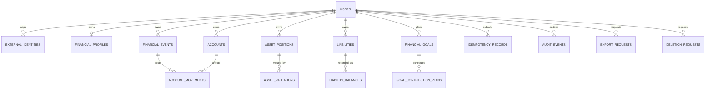
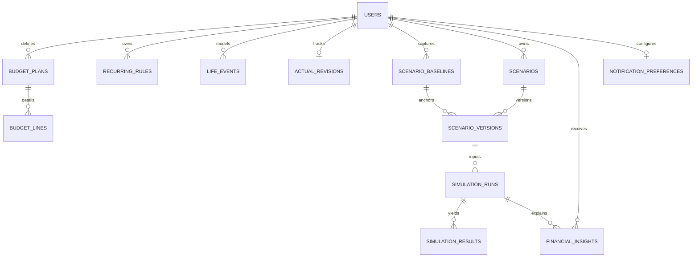
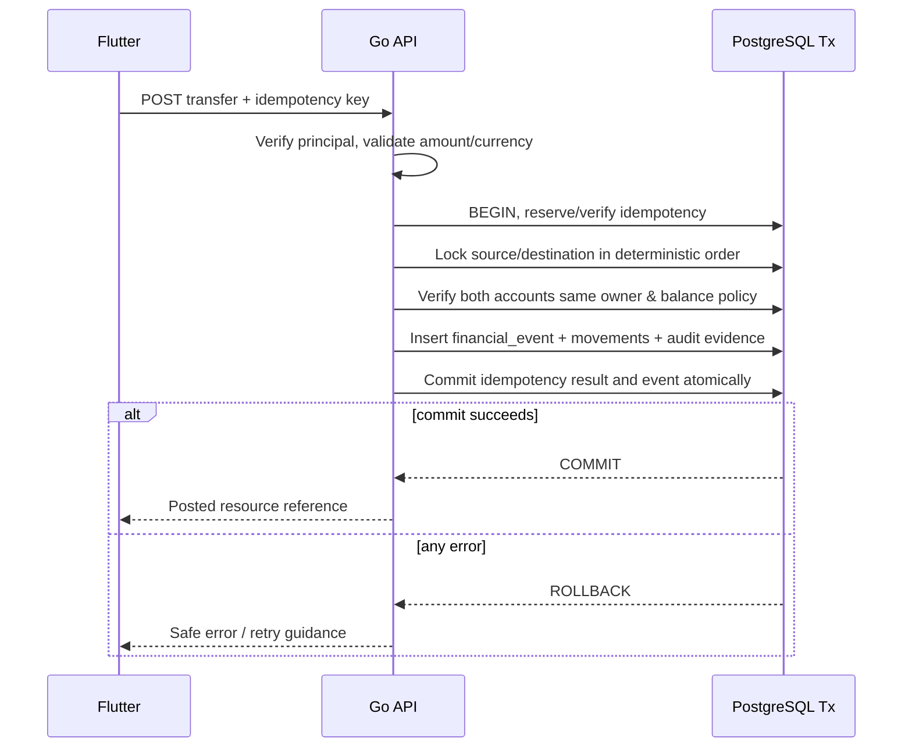

# Esokira — Database Design (PostgreSQL)

> **Canonical path:** `docs/architecture/DATABASE-DESIGN.md`  
> **Version:** `0.1.0`  
> **Tanggal penyusunan:** 30 Oktober 2026  
> **Status:** `REVIEWED_INTERNAL — PENDING_OWNER_APPROVAL`  
> **Jenis:** blueprint desain data; **BUKAN migration siap production**  
> **Scope:** R0 Foundation, R1 MVP, R2 Planning V1, R3 Advanced; R4 discovery-only  
> **Stack yang telah dipilih owner:** Flutter mobile, Go backend, PostgreSQL, monorepo `frontend/` + `backend/`  
> **Dokumen acuan:** Product Vision, PRD, Feature Matrix, Financial Domain Rules, Calculation Specs, Financial Test Cases, System Architecture, Backend Architecture, Frontend Architecture (seluruhnya v0.1.0).  
> **Pembaca:** Product Owner, AI coding agent, Go/Flutter engineer, database engineer, security reviewer, QA.

---

## 0. Cara menggunakan dokumen ini

Tujuan dokumen ini adalah merancang **model data dan aturan persistensi yang menjaga kebenaran angka keuangan, keamanan antar pengguna, pemisahan actual vs simulation, dan kemampuan reproduksi hasil kalkulasi**. Database adalah penyimpan fakta dan asumsi; **PostgreSQL tidak boleh menjadi tempat agent mengarang kebijakan keuangan**.

Dokumen memuat beberapa *candidate schema* dan *illustrative SQL* agar trade-off dapat direview sebelum menulis migration. Kode SQL di sini **bukan** skema final dan **belum dijalankan/dites terhadap aplikasi Esokira**. Migration final hanya boleh dibuat setelah blocker terkait disetujui dan dicatat pada ADR/decision log.

### 0.1 Status keputusan dan kekuatan instruksi

| Status | Makna | Tindakan agent |
|---|---|---|
| **DECIDED** | Dipilih pemilik proyek eksplisit. | Jadikan constraint saat merencanakan. |
| **REQUIRED** | Invariant yang berasal dari requirement/domain/security. | Wajib dipenuhi pada desain apa pun. |
| **PROPOSED** | Kandidat desain yang perlu dikonfirmasi. | Boleh dibahas atau diprototipekan terisolasi; **jangan diam-diam mengunci**. |
| **TBD** | Keputusan belum ada. | Catat alternatif dan dampak, jangan mengisi sendiri. |
| **BLOCKED** | Belum boleh dijadikan fitur production. | Jangan menyatakan siap implementasi/rilis. |
| **OUT OF SCOPE** | Di luar ruang lingkup release. | Jangan menambah tabel/fitur production tanpa revisi PRD. |

Dokumen pendahulu berstatus `REVIEWED_INTERNAL — PENDING_OWNER_APPROVAL`, sehingga *review internal* di sini **bukan persetujuan Product Owner**.

### 0.2 Source-of-truth hierarchy

| Topik | Referensi otoritatif |
|---|---|
| Visi dan non-goals | [`../product/PRODUCT-VISION.md`](../product/PRODUCT-VISION.md) |
| Kebutuhan fitur dan acceptance | [`../product/PRD.md`](../product/PRD.md) (`FR-xxx`, `EN-xxx`, `NFR-xxx`) |
| Dependensi/release/slice | [`../product/FEATURE-MATRIX.md`](../product/FEATURE-MATRIX.md) |
| Definisi keuangan, actual/plan, ownership | [`../financial/FINANCIAL-DOMAIN-RULES.md`](../financial/FINANCIAL-DOMAIN-RULES.md) (`DR-xxx`) |
| Rumus dan aturan numerik | [`../financial/CALCULATION-SPECS.md`](../financial/CALCULATION-SPECS.md) (`CS-xxx`) |
| Pengujian referensi | [`../financial/FINANCIAL-TEST-CASES.md`](../financial/FINANCIAL-TEST-CASES.md) (`FTC-xxx`) |
| Runtime/trust boundary | [`./SYSTEM-ARCHITECTURE.md`](./SYSTEM-ARCHITECTURE.md) |
| Go transaction/repository/worker | [`./BACKEND-ARCHITECTURE.md`](./BACKEND-ARCHITECTURE.md) |
| Flutter serialization/offline UX | [`./FRONTEND-ARCHITECTURE.md`](./FRONTEND-ARCHITECTURE.md) |
| SQL schema *setelah* approval | `backend/db/migrations/*.sql` (belum dibangun) |
| API setelah approval | `contracts/openapi.yaml` + `API-GUIDELINES.md` (belum dibuat) |

**Konflik antar dokumen:** jangan memilih sumber yang memudahkan coding. Beri `CONFLICT`, nomor ID terdampak, opsi, dan kebutuhan approval; hentikan hanya scope yang terkait.

### 0.3 Peraturan untuk AI coding agent

1. Jangan menyimpulkan tabel yang disebut di sini sudah dibuat. Audit repository dan migrasi sebenarnya terlebih dahulu.
2. Jangan membuat migration `R1 actual money` sebelum keputusan `DB-Q01/Q02/Q03/Q04` dan test terkait jelas.
3. Semua query finansial user-specific harus memverifikasi owner di server (termasuk nested resources, export, dan worker); ID acak bukan kontrol akses.
4. Jangan mengubah saldo aktual karena simulasi, goal planning, projection, atau kalkulasi; **financial goal bukan rekening uang otomatis**.
5. Jangan menggunakan binary floating-point sebagai *source of truth* saldo transaksi aktual.
6. Jangan mencatat `opening_balance` kembali sebagai income; transfer antar akun user yang sama tanpa fee harus netral terhadap net worth.
7. Pastikan idempotency dan transaksi atomik untuk operasi yang mengubah uang aktual; tidak boleh ada posting ganda akibat retry.
8. Jangan memilih distribusi Monte Carlo, objective function optimizer, autentikasi, penyimpanan consent, atau kebijakan retensi tanpa spesifikasi dan approval.
9. Tidak ada koneksi database langsung dari Flutter; query hanya melalui Go API/worker yang terotorisasi.
10. Contoh DDL/ERD bukan izin untuk menyisipkan schema R4 (shared goals/portfolio) ke production.

---

## 1. Prinsip desain dan keputusan inti

### 1.1 Keputusan yang sudah dipilih

| Area | Hasil | Status |
|---|---|---|
| Primary DB | PostgreSQL | **DECIDED** |
| Backend | Go | **DECIDED** |
| Frontend | Flutter | **DECIDED** |
| Source repository | Monorepo `frontend/` dan `backend/` | **DECIDED** |
| Financial data privacy | Private per owner; server-side authz | **REQUIRED** (`DR-003`) |
| Actual vs hypothetical | Dipisahkan sebagai domain & persistence | **REQUIRED** (`DR-001/002`) |
| Exact monetary ledger | Tidak memakai float biner | **REQUIRED** (`DR-004`) |
| Skema tunggal / PostgreSQL-backed modular monolith | Satu database logis, owner table per domain | **PROPOSED** |
| PostgreSQL type dan model ledger final | `NUMERIC`/`BIGINT`, event+movements/alternatif | **TBD** |
| DB library/migration runner | `pgx+sqlc`, `goose`/`golang-migrate` | **PROPOSED / TBD** |
| Queue/worker | Tambah hanya bila dibutuhkan R3 | **PROPOSED** |

### 1.2 Kualitas yang harus dijaga

- **Correctness:** bukan hanya SQL valid, tetapi hasil saldo, net worth, dan transfer memenuhi `DR-004`–`DR-010`, `DR-022/023`.
- **Authorization:** objek anak tidak boleh mengarah ke objek induk milik pengguna berbeda. FK dan owner-scoped query menjadi dua lapisan berbeda.
- **Atomicity:** perubahan terkait dan idempotency record harus commit atau rollback bersama.
- **Temporal consistency:** `occurred_on`, `recorded_at`, `as_of`, dan `calculated_at` menyampaikan makna berbeda.
- **Explainability:** setiap snapshot/proyeksi memiliki basis, versi engine, dan asumsi.
- **Maintainability:** schema tumbuh per rilis; belum perlu partitioning, event streaming, atau database analitik tambahan.
- **Data minimization:** jangan menyimpan salinan payload sensitif di log, audit atau hasil simulasi tanpa kebijakan retensi.

### 1.3 Database schemas versus business modules

Rancangan awal boleh menggunakan **satu namespace PostgreSQL** dan penamaan tabel deskriptif, misalnya `financial_events`, `scenario_versions`. **PROPOSED** alternatif schema Postgres `identity`, `actual`, `planning`, `simulation` dapat dipakai bila organisasi/izin membutuhkannya; **PostgreSQL schema bukan** pengganti authz dan bukan bukti microservices.

`backend/internal/modules/*` bertanggung jawab atas aturan bisnis; `backend/internal/finance/*` bertanggung jawab atas perhitungan murni; repository/adapters menjalankan query. Tidak ada akses tabel lintas modul secara liar tanpa use case dan ownership policy yang jelas. Untuk R0/R1, **jangan membuat microservices**.

---

## 2. Klasifikasi data dan isolation boundary

| Kelas data | Contoh | Perubahan yang diizinkan | Tidak boleh |
|---|---|---|---|
| `identity` | user, external identity, preferences | Operasi identitas terotorisasi | Menjadikan provider subject sebagai owner tanpa mapping |
| `actual` | account, posted event, movement, valuation, liability | Use case actual explicit | Diubah saat menjalankan skenario |
| `plan` | financial goal, planned contribution, budget, life event | Editor rencana | Menaikkan saldo aktual hanya karena dibuat |
| `scenario` | baseline, scenario, immutable version | Create/fork version; explicit rebase | Menimpa baseline lama diam-diam |
| `result` | projection/Monte Carlo run, summaries, points | Insert immutable result & lifecycle status | Dianggap transaksi nyata |
| `operations` | idempotency, audit, export, job state | Use case infrastructure | Membocorkan payload sensitif |

**REQUIRED:** setiap *result* yang bermakna angka keuangan dilabeli `actual` / `planned` / `forecast` / `risk_model_result`, mata uang/unit, tanggal as-of/period, dan provenance yang relevan (`DR-014/016/020`). `actual` berarti pengguna mencatatnya sebagai kejadian nyata, **bukan** bank telah memverifikasi.

**PROPOSED:** sebelum memasukkan kolom `money`, tetapkan satu objek domain bersama `Money(value, currency)` di Go dan satu format JSON yang disetujui. `NUMERIC` DB hanya salah satu implementasi, bukan jawaban otomatis untuk rounding/overflow.

---

## 3. Katalog entitas dan rollout per rilis

Katalog ini menyatakan *candidate tables*, **bukan permintaan untuk membuat semuanya pada R0**.

| Rilis | Candidate table / conceptual store | Tanggung jawab | Kondisi |
|---|---|---|---|
| R0 | `users` | Internal identity/owner stabil | Provider mapping TBD |
| R0 | `external_identities` | `(issuer, subject)` -> `users.id` | Provider-specific columns TBD |
| R0/R1 | `idempotency_records` | Deduplication operasi actual | TTL/replay policy TBD |
| R0/R1 | `audit_events` | Bukti perubahan berisiko | Isi/retensi TBD |
| R1 | `financial_profiles` | Locale dan input profil | Field PII minimal |
| R1 | `accounts` | Akun, saldo awal, currency, archive | Cutover/overdraft TBD |
| R1 | `financial_events` | Event transaksi aktual | Lifecycle/correction TBD |
| R1 | `account_movements` | Dampak bertanda ke saldo akun | Candidate ledger model |
| R1 | `asset_positions` | Aset non-account unik | Penghindaran duplikasi |
| R1 | `asset_valuations` | Valuasi aset per `as_of` | Basis penilaian TBD |
| R1 | `liabilities` | Entitas kewajiban | Model bunga/repayment TBD |
| R1 | `liability_balances` | Outstanding pada `as_of` | Auto-amortization TBD |
| R1 | `financial_goals` | Target dan deadline | Tidak otomatis funded |
| R1 | `goal_contribution_plans` | Setoran rencana | Atribusi actual TBD |
| R1 | `export_requests` | State ekspor user | Format dan retention TBD |
| R1 | `deletion_requests` | Data lifecycle requests | Policy legal/backup TBD |
| R2 | `budget_plans`, `budget_lines` | Batas budget per periode/kategori | Category mapping TBD |
| R2 | `recurring_rules` | Template kejadian terjadwal | Future plan != actual |
| R2 | `life_events` | Peristiwa hipotetis | Tidak mem-post actual |
| R2 | `actual_revisions` | Revision per-owner untuk staleness | Strategi revision TBD |
| R2 | `scenario_baselines` | Input dasar ber-versi/as-of | Snapshot penuh vs referensi TBD |
| R2 | `scenarios`, `scenario_versions` | Skenario dan revisi immutable | Baseline/rebase TBD |
| R2 | `simulation_runs` | Tracking run deterministik | State machine & resource quota TBD |
| R2 | `simulation_results` | Series/ringkasan proyeksi | Tidak menyimpan ulang per-user data tak perlu |
| R2 | `financial_insights` | Insight terjelaskan dengan sumber | Rules/retention TBD |
| R2 | `notification_preferences` | Pilihan notifikasi | Opt-in/provider TBD |
| R3 | `simulation_jobs` atau tabel milik queue library | Eksekusi berat retryable | **Jangan buat sebelum EN-005 disetujui** |
| R3 | `simulation_artifacts` (opsional) | Hasil besar sementara | Storage/retention TBD |
| R4 | Shared-goal membership / portfolio models | Discovery | **OUT OF SCOPE production** |

Prinsip evolusi: mulai dari jumlah tabel terkecil yang dapat menegakkan invariants. `audit_events` tidak otomatis menggantikan ledger reversal; `actual_revisions` bukan transaksi keuangan; `simulation_results` bukan tabel status uang aktual.

---

## 4. ERD konseptual: R0–R1 (candidate)

**Status semua nama tabel/relasi di diagram: PROPOSED.** Kardinalitas menunjukkan model yang direkomendasikan untuk dibahas, bukan skema yang telah disetujui.



**Penting tentang diagram:** satu posted event dalam model kandidat berisi minimal satu `account_movement`; movement income/expense satu sisi; transfer dua sisi dengan nilai neto nol untuk mata uang sama tanpa fee. Penyimpanan fee, loan drawdown, correction, dan split transactions masih membutuhkan keputusan `DB-Q01`, sehingga diagram belum membuktikan ledger final sudah lengkap.

### 4.1 ERD konseptual: R2–R3



Semua tabel R2/R3 yang menyimpan informasi pengguna harus tetap memiliki `owner_id` atau aturan akses yang sama kuat; relasi scenario child tidak otomatis menjamin ownership. Run yang dibuat dari snapshot immutable boleh tetap dibaca sebagai histori, sambil menampilkan penanda stale jika actual telah berubah.

---

## 5. Konvensi penamaan dan tipe PostgreSQL

### 5.1 Naming convention (PROPOSED)

| Konsep | Konvensi |
|---|---|
| Tabel/kolom | `snake_case`, plural table names (`financial_events`) |
| PK | `id UUID` internal; opsi `BIGINT` surrogate dibuka jika benchmark menuntut |
| Ownership | `owner_id UUID NOT NULL`, FK ke `users(id)` |
| Identitas eksternal | `issuer` + `subject`, bukan email sebagai PK |
| Uniqueness | `uq_<table>_<meaning>` (nama human-reviewable) |
| FK | `fk_<child>_<parent>_<meaning>` |
| Index | `idx_<table>_<filter_sort>` |
| Tanggal efektif | `occurred_on DATE`, `as_of DATE`, `due_on DATE` |
| Timestamp mesin | `created_at TIMESTAMPTZ`, `updated_at TIMESTAMPTZ` bila benar-benar perlu |
| State | string + `CHECK`, atau lookup/ENUM jika disetujui; hindari enum DB yang sulit berevolusi tanpa alasan |
| Atribut fleksibel | `JSONB` untuk typed versioned assumptions; jangan mengganti seluruh relational schema dengan JSONB |

**UUID:** generator/format final harus dipilih; contoh SQL menggunakan UUID yang diberikan aplikasi. Pemakaian `gen_random_uuid()` perlu dicek terhadap PostgreSQL versi yang di-deploy, bukan sekadar diasumsikan.

### 5.2 Exact money dan rates

| Kategori | Kandidat DB | Larangan/risiko |
|---|---|---|
| Uang actual (IDR) | `BIGINT` unit rupiah **atau** `NUMERIC(p,s)` | **TBD DB-Q02**; tidak memakai `REAL`/`DOUBLE PRECISION` sebagai saldo sumber kebenaran |
| Uang contoh SQL | `NUMERIC(20,2)` | **Hanya contoh review**; kebijakan scale/rounding belum approved |
| Rate annual/monthly | `NUMERIC(18,10)` atau decimal string dengan metadata kind | Tidak menganggap `8` otomatis 8% atau 0.08 |
| Probabilistic sample internal R3 | Floating point di engine Go (bila model approved) | Tidak disimpan sebagai posting actual |
| JSON ke Flutter | Decimal string + currency code (PROPOSED) | Jangan convert melalui JS/JSON number yang dapat kehilangan presisi |
| Multi-currency | Kolom `currency_code`/unit dan FX policy yang eksplisit | IDR-only awal PROPOSED, **jangan implement FX otomatis** |

`NUMERIC` di PostgreSQL menyimpan angka desimal tepat pada batas precision/scale, tetapi **dapat membulatkan saat insert sesuai scale**. Itu tidak membebaskan layer domain dari validasi dan keputusan rounding. PostgreSQL `money` type tidak direkomendasikan sebagai default karena perilaku format/locale dan unit/scale memerlukan kontrol sendiri.

### 5.3 Tanggal, waktu, zona

- `TIMESTAMPTZ` untuk *instants* yang dapat dibandingkan universal (created/posted/started/completed); pemrosesan/display timezone di aplikasi mengikuti kebijakan yang nanti disetujui.
- `DATE` untuk tanggal bisnis seperti peristiwa, deadline goal, atau valuation as-of.
- Jangan menyamakan `DATE 2026-10-30` dengan `TIMESTAMPTZ 2026-10-30 00:00 UTC`; hal itu dapat menggeser tanggal tampilan lokal.
- `opening_as_of` menentukan posisi awal pada batas waktu yang **belum final**: kejadian di hari yang sama, edit backdated, DST, leap year, dan cutover tergantung `DB-Q03`.
- Interval budget, report, recurring schedule, penutupan bulan, dan urutan akhir/awal bulan harus terdokumentasi sebelum implementasi final (`DR-018`, `CS-008/009`).

---
## 6. Identitas, user mapping, dan ownership (R0)

### 6.1 `users` dan `external_identities`

Internal UUID `users.id` merupakan owner key yang stabil jika provider autentikasi berubah. `external_identities` secara konseptual menyimpan **issuer/provider** dan **subject** hasil token yang diverifikasi server. Jangan menganggap email/nomor telepon sebagai key unik stabil antar identity provider.

| Candidate column | Type | Makna / guard |
|---|---|---|
| `users.id` | `UUID PK` | Identitas internal, tidak berasal dari request arbitrer |
| `users.created_at` | `TIMESTAMPTZ` | Kapan record dibuat |
| `users.status` | `TEXT` | Active/deletion lifecycle; nomenklatur TBD |
| `external_identities.id` | `UUID PK` | Identitas mapping row |
| `external_identities.user_id` | `UUID FK users` | Mapping hanya setelah token diverifikasi |
| `external_identities.issuer` | `TEXT NOT NULL` | Issuer yang dipercaya backend |
| `external_identities.subject` | `TEXT NOT NULL` | Subject unik dalam issuer |
| `external_identities.linked_at` | `TIMESTAMPTZ` | Bukti waktu linking |

**Candidate unique key:** `UNIQUE(issuer, subject)`. Provider selection, account linking, merging, token rotation, anonymous login, dan user deletion membutuhkan auth-specific review (`ARCH-Q01`, `BE-Q01`, `DB-Q06`). Tidak boleh membuat duplicate internal user saat identitas yang sama login ulang.

### 6.2 Ownable entities & composite owner foreign keys

**REQUIRED:** `owner_id` diset server, dan seluruh operasi `SELECT/UPDATE/DELETE` memeriksa principal. Saat child menyimpan `owner_id` dan FK ke parent user-owned, gunakan **composite foreign key** untuk mencegah child owner A menunjuk parent owner B:

```sql
-- Pola, bukan migration siap pakai.
-- Parent harus memiliki UNIQUE (owner_id, id), selain PK(id).
ALTER TABLE financial_events
  ADD CONSTRAINT uq_financial_events_owner_id
  UNIQUE (owner_id, id);

-- Child memastikan parent milik owner yang sama.
ALTER TABLE account_movements
  ADD CONSTRAINT fk_movements_event_owner
  FOREIGN KEY (owner_id, event_id)
  REFERENCES financial_events (owner_id, id);
```

Dua hal berbeda: FK mencegah **cross-owner relational link**; query API harus tetap memverifikasi **hak principal** (FK tidak mencegah user A membaca record user B dengan ID yang diketahui). Semua endpoint nested termasuk export dan worker diuji minimal dengan dua user sintetis.

### 6.3 `financial_profiles`

Candidate: `owner_id UNIQUE` ke `users.id`, minimal input yang memang dibutuhkan onboarding; misalnya `display_name` opsional, `preferred_currency`, `timezone_identifier`, tanggal basis usia hanya jika fitur perlu, `created_at`, `updated_at`. **Jangan otomatis meminta tanggal lahir lengkap** bila usia/rentang usia cukup. Sensitive fields, onboarding skip handling, dan retention perlu product/privacy review.

---

## 7. Accounts dan opening balance (R1; FR-003)

### 7.1 Candidate `accounts`

| Column | Type candidate | Constraint/semantik |
|---|---|---|
| `id` | `UUID PK` | Internal account identity |
| `owner_id` | `UUID NOT NULL` | User owner, FK + owner-scoped query |
| `name` | `TEXT NOT NULL` | Nama tampilan pribadi; bukan key bisnis |
| `kind` | `TEXT NOT NULL` | Cash/bank/savings (kategori final TBD) |
| `currency_code` | `CHAR(3) NOT NULL` | Currency yang konsisten dengan nilai uang |
| `opening_balance` | Exact money type | Posisi awal, bukan pemasukan |
| `opening_as_of` | `DATE NOT NULL` | Cutover semantik TBD |
| `archived_at` | `TIMESTAMPTZ NULL` | Account lama tidak otomatis dihapus |
| `created_at` | `TIMESTAMPTZ` | Record time |

**Tidak disarankan pada R1:** menyimpan *derived balance* sebagai kolom sumber tunggal yang terus ditambah/kurang tanpa riwayat mutasi. **PROPOSED pilihan:** hitung saldo dari posisi awal + movements posted terfilter cutover; optimasi snapshot/materialized balance dapat dilakukan setelah benchmark. Metode final masih `DB-Q01/03`.

### 7.2 Formula/guard yang tidak boleh bergeser

```text
balance(account, as_of)
  = opening_position(account, opening_as_of)
  + SUM(posted account_movements that belong in the interval)
```

Interval `opening_as_of`, event backdated, status reversal, dan *same-day ordering* **TBD**. Query SQL `SUM()` yang kebetulan memberi angka bukan bukti cutover sudah benar.

- **DR-005:** opening bukan income.
- **DR-004:** nilai exact, format/tanda konsisten.
- **DR-018:** tanggal efektif bukan timestamp penyimpanan.
- **DR-022:** koreksi posting tidak merusak histori/posisi.
- **DR-003:** tidak bisa membaca/menulis account user lain.

### 7.3 Deletion/archive

**PROPOSED:** archive account untuk mencegah posting baru, tanpa menghapus histori. Penghapusan fisik ketika ada movement akan merusak audit; jangan pasang `ON DELETE CASCADE` ke `account_movements` hanya agar endpoint DELETE mudah. Flow ekspor/penghapusan akun pengguna (`FR-021`) adalah domain lifecycle terpisah yang harus melibatkan privasi dan retensi.

---

## 8. Ledger transaksi aktual (R1; FR-004)

### 8.1 Pilihan model yang harus disetujui (`DB-Q01`)

| Opsi | Gambaran | Kelebihan | Risiko / kekurangan |
|---|---|---|---|
| **A. Typed transaction rows** | Satu row income/expense/transfer dengan account source/destination | Lebih sederhana pada kasus kecil | Transfer, fee, reversal, split, dan audit kompleks; sering menghasilkan update parsial bila service lemah |
| **B. Event + account movements** (**PROPOSED kandidat utama**) | `financial_events` mencatat operasi; `account_movements` mencatat efek per account | Satu transfer punya dua sisi; audit dan saldo dari movement; mudah diuji konservasi | Lebih banyak tabel, enforce bentuk event membutuhkan service + opsi constraint trigger |
| **C. Full double-entry general ledger** | Chart of accounts dan setiap posting seimbang antara akun akuntansi | Kuat secara akuntansi dan audit | Beban UX/model bisnis jauh lebih besar untuk tracker pribadi MVP |

Rekomendasi saya untuk review adalah **B**, bukan C secara diam-diam. **B bukan full double-entry accounting** jika income/expense hanya punya satu movement ke financial account. Agent tidak boleh mengklaim transaksi sudah *balanced ledger* sepenuhnya tanpa model akun lawan dan bukti invariant yang sesuai.

### 8.2 `financial_events` (model B — PROPOSED)

| Column | Type candidate | Aturan |
|---|---|---|
| `id` | `UUID PK` | ID event actual |
| `owner_id` | `UUID FK` | Server-derived |
| `operation_id` | `UUID` | Kelompok mutasi untuk transfer+fee/atomic operation; bukan idempotency key tunggal |
| `kind` | `TEXT` | `income`, `expense`, `transfer` untuk contoh R1; tipe lain butuh spec |
| `occurred_on` | `DATE` | Tanggal efektif financial event |
| `recorded_at` | `TIMESTAMPTZ` | Waktu database menerima/commit candidate event |
| `status` | `TEXT` | Draft/posted/reversed TBD; boleh candidate posted-only MVP |
| `notes`, `category_id` | Nullable | Hanya jika fitur PRD membenarkan; confidential |
| `reverses_event_id` | Nullable FK | Desain reversal memerlukan `DB-Q01/03` |

Event apa pun yang menjadi `posted` harus memenuhi pola jumlah movement, arah, dan ownership yang sudah disetujui. Jika diputuskan immutable posted, koreksi memakai compensating/reversal event, bukan `UPDATE delta_amount` tersembunyi.

### 8.3 `account_movements` (model B — PROPOSED)

| Column | Type candidate | Aturan |
|---|---|---|
| `id` | `UUID PK` | ID movement |
| `owner_id` | `UUID FK` | Sama owner dengan event dan account |
| `event_id` | `UUID FK` | Parent financial event |
| `account_id` | `UUID FK` | Account terdampak |
| `line_no` | `INTEGER` | Urutan unik per event untuk audit |
| `delta_amount` | Exact signed money | Positif masuk, negatif keluar |
| `currency_code` | `CHAR(3)` | Cocok dengan account dan event |

**Contoh event tanpa fee, IDR, no partial posting:**

| Jenis actual event | Account A movement | Account B movement | Income/expense eksternal | Delta total eligible assets |
|---|---:|---:|---|---:|
| Income gaji Rp3 juta | `+3.000.000` | - | Income Rp3 juta | `+3.000.000` |
| Expense konsumsi Rp200 ribu | `-200.000` | - | Expense Rp200 ribu | `-200.000` |
| Transfer A -> B Rp2 juta | `-2.000.000` | `+2.000.000` | Tidak ada income/expense | `0` |

**Fee transfer:** keputusan detail belum final. Kandidat yang lebih mudah diaudit: event `transfer` berisi `-2.000.000/+2.000.000`, dan event `expense_fee` terpisah untuk `-5.000` dalam **operasi SQL yang sama** dan terkait `operation_id`; jangan menyembunyikan fee sebagai transfer amount mismatch tanpa klasifikasi.

**REQUIRED:**

1. `owner_id` pada event, account, dan movement sama (`DR-003`).
2. Posting ke dua account satu transaksi SQL, bukan dua request independen (`DR-007`).
3. Retry operasi tidak membuat event/movement kedua (`DR-008`).
4. Transfer tanpa fee dalam satu currency net total movement = nol (`DR-006`).
5. Edit/double-post tidak boleh terjadi tanpa state transition/audit (`DR-022`).
6. Expense tidak boleh dihitung dua kali karena movement dan event sama-sama diagregasi menjadi expense.
7. Tidak boleh memasukkan movement ke event `draft` dalam saldo *posted* atau menyamakan `recorded_at` dengan `occurred_on`.

### 8.4 Batas CHECK/FK dan invariant lintas-row

`CHECK (delta_amount <> 0)` berguna tetapi **tidak menjamin** transfer mempunyai tepat dua sisi atau net sum nol. PostgreSQL `CHECK` bekerja pada row yang diperiksa; cross-row business condition membutuhkan service transaction dan, bila diputuskan, **constraint trigger yang dapat di-*defer*** atau strategi DB lain yang teruji. Jangan menggantungkan konservasi transfer hanya pada asumsi frontend.

### 8.5 Corrections, refunds, void, dan reverse

**REQUIRED:** perubahan actual harus bisa ditelusuri dan menjaga saldo. **TBD `DB-Q01/03`:**

- Apakah transaksi boleh `draft` tanpa movement?
- Apakah perubahan posted selalu menghasilkan reversal + replacement?
- Refund dicatat sebagai return event atau kontra expense?
- Bagaimana tanggal efektif reversal yang memengaruhi laporan periode lalu?
- Bagaimana history ditampilkan setelah pengguna menghapus/arsip account?

Jangan implement `DELETE financial_events` secara langsung setelah ia pernah memengaruhi saldo; desain yang disetujui harus mengatur audit/correction, bukan menghapus sejarah agar laporan tampak sesuai.

---

## 9. Idempotency, atomicity, dan transaksi konkuren

### 9.1 Candidate `idempotency_records`

| Column | Candidate | Makna |
|---|---|---|
| `owner_id` | UUID | Principal owner |
| `operation` | TEXT | Operation type yang di-scope, misal `post_transfer` |
| `idempotency_key` | TEXT | Token yang diulang untuk **logical operation yang sama** |
| `request_hash` | bytea / char digest | Hash bentuk request canonical; detail TBD |
| `status` | TEXT | In progress/completed/failed semantics TBD |
| `response_ref` | UUID nullable | Referensi event/result yang berhasil |
| `expires_at` | TIMESTAMPTZ | TTL dan cleanup TBD |
| `created_at` | TIMESTAMPTZ | Saat reserved |

**Candidate unique:** `(owner_id, operation, idempotency_key)`. Replay dengan key sama dan request body berbeda harus menghasilkan conflict aman, bukan mengubah posting sebelumnya. Jika crash setelah commit tetapi respons hilang, request replay mengembalikan hasil yang dapat direkonsiliasi. Harus ada definisi hasil untuk `in_progress`, expiry, dan rollback `DB-Q04`.

### 9.2 Atomic unit untuk posted transfer



Jika connection/response putus tepat setelah commit, client **tidak boleh** menebak commit gagal. Gunakan replay/reconciliation dengan key yang sama (jangan UUID baru untuk retry yang sama). `READ COMMITTED` bukan pengganti lock/proof terhadap *lost update*, negative balance policy, dan double posting.

### 9.3 Concurrency rules (REQUIRED secara prinsip)

- Kunci account resource yang terlibat dalam urutan tetap (misal ascending UUID) saat memutuskan posting yang bersaing. **Urutan spesifik diputuskan dan diuji**, bukan diandalkan dari urutan array request.
- `SELECT ... FOR UPDATE` hanya mengunci row yang dipilih; semua writer yang memengaruhi invariant harus memakai protokol konsisten.
- Gunakan transaction-scoped repository; tidak boleh `pool.Exec` bebas di tengah unit transaksi yang memakai `tx` berbeda.
- Isolation level dipilih berdasarkan test invariant. `SERIALIZABLE` mungkin membutuhkan retry seluruh transaksi untuk `serialization_failure` yang aman secara idempotency.
- Retry DB errors hanya pada error yang memang retryable, dengan batas attempt dan backoff; **tidak** membuat financial event baru di luar token operasi.
- Simpan audit metadata relevan dalam transaksi sama jika kebijakan audit mengharuskan.

### 9.4 Database as-of snapshot vs materialized balance

**Model rekomendasi tahap awal (PROPOSED):** source of truth adalah opening position + posted movements; query agregasi menghasilkan saldo. Jika diperlukan throughput/read optimization, gunakan `account_balance_snapshots` sebagai derived cache dengan rekonsiliasi, versi, dan replay mechanism. **Jangan** menyimpan angka `balance` yang dapat berubah tanpa movement source atau tanpa invariant rekonsiliasi.

Jika pengguna hanya ingin *manual current balance* tanpa ledger kompleks, itu alternatif produk yang harus diputuskan di `DB-Q01/03`, karena berdampak pada validitas laporan income/expense dan audit histories.

---

## 10. Aset, liabilities, dan net worth (R1; FR-005/006)

### 10.1 `asset_positions` dan `asset_valuations`

**Candidate `asset_positions`:** `id`, `owner_id`, `name`, `asset_kind`, `representation_kind`, `linked_account_id NULL`, `created_at`, `archived_at`. **Candidate `asset_valuations`:** `id`, `owner_id`, `asset_position_id`, `value_amount`, `currency_code`, `as_of`, `valuation_source`, `recorded_at`.

- **REQUIRED DR-009:** jangan menjumlahkan `account` balance dan `asset_position` lain yang sebenarnya menunjukkan uang di account yang sama.
- **PROPOSED:** pisahkan `representation_kind = independent_valuation` dari `account_backed`. Untuk `account_backed`, jangan masukkan valuation tambahan ke agregasi NW; apakah row `asset_positions` untuk account dibutuhkan sama sekali masih TBD.
- **REQUIRED DR-014/018:** setiap valuasi jelas tanggal as-of dan sumbernya. Tidak otomatis dianggap live market price.
- Perubahan nilai nonkas bukan income atau cash movement, kecuali ada kejadian domain yang disetujui.

### 10.2 `liabilities` dan `liability_balances`

**Candidate `liabilities`:** `id`, `owner_id`, `name`, `kind`, `currency_code`, `opened_on`, `archived_at`. **Candidate `liability_balances`:** `id`, `owner_id`, `liability_id`, `outstanding_principal`, `as_of`, `recorded_at`, `source_kind`.

- Outstanding principal adalah **posisi**, pembayaran bunga merupakan biaya, pembayaran pokok bukan expense konsumsi (`DR-023`).
- Untuk R1, pembaruan outstanding secara manual boleh dipertimbangkan; **jangan** otomatis mengurangi principal dari expense `cicilan` tanpa model amortisasi/loan event yang sudah disetujui.
- **TBD DB-Q07:** future schedule, annual vs monthly rate, accrued interest, penalties, prepayment, refinancing, split principal/interest, serta keterkaitan transfer cash dengan liability.
- Hindari double counting overdraft account sebagai asset negatif **dan** liability yang didaftarkan manual. Klasifikasi overdraft perlu keputusan.

### 10.3 Net worth read model

```text
net_worth(as_of) = sum(eligible account balances)
                 + sum(eligible independent asset valuations)
                 - sum(outstanding liabilities)
```

Net worth boleh negatif. **Jangan** menyimpan angka dashboard sebagai sumber absolut yang tak memiliki `as_of` dan provenance. Query agregat harus membatasi owner, memilih valuation/balance pada tanggal yang konsisten, serta melaporkan `incomplete/stale` bila data belum mencakup keseluruhan profil atau valuasi sudah lawas. Cara memilih latest-as-of dengan tie breaking dan kategori aset **TBD**.

### 10.4 Laporan income/expense bukan delta net worth

Laporan pemasukan/pengeluaran membaca `financial_events`/posting classifier yang telah disetujui. Jangan menghitung income dengan `closing_balance - opening_balance` karena transfer, pembelian aset, pinjaman, dan valuasi dapat mengubah posisi tanpa income/expense periodik. Begitu pula pembelian aset dengan nilai setara tidak langsung berarti expense konsumsi.

---

## 11. Goals dan planned contributions (R1; FR-007/009)

### 11.1 `financial_goals` (PROPOSED)

| Column | Candidate type | Makna |
|---|---|---|
| `id`, `owner_id` | UUID | Private resource |
| `name` | TEXT | Nama tujuan |
| `target_amount` | Exact money | Nilai target; currency konsisten |
| `currency_code` | CHAR(3) | Asumsi awal IDR-only proposed |
| `target_on` | DATE | Tenggat pengguna |
| `priority` | TEXT/SMALLINT | Skala/ranking final TBD |
| `status` | TEXT | Active/completed/paused; semantics TBD |
| `created_at`, `updated_at` | TIMESTAMPTZ | Waktu perubahan |

### 11.2 `goal_contribution_plans`

Candidate fields: `id`, `owner_id`, `goal_id`, `planned_amount`, `frequency`, `effective_from`, `effective_to`, `created_at`. Nilai di tabel ini **tidak meningkatkan** account balance dan tidak otomatis menjadi `funded_amount`. Kontribusi rencana berbeda dari actual event.

**Funded progress masih `Q-11 / DB-Q05` (BLOCKED):** ada beberapa opsi:

1. **Virtual envelope** atas eligible account balance (perlu anti-double-allocation constraints).
2. **Dedicated account** sebagai evidence dana tersedia (perlu hubungan goal-account dan batas satu/lebih goal).
3. **Explicit contribution allocations** ke goals berbasis actual events (perlu reversal, transfer, dan reconciliation).

Tidak boleh membangun `funded_amount = SUM(planned_contributions)` atau menganggap seluruh saldo user eksklusif untuk setiap goal. Progress UI dapat menyajikan *target/planned/forecast* secara terpisah dari *funded actual* hingga kebijakan diputuskan.

---

## 12. Planning, life events, dan scenarios (R2)

### 12.1 Budget dan recurring

| Tabel | Candidate key fields | Invariant |
|---|---|---|
| `budget_plans` | `id`, `owner_id`, `start_on`, `end_on`, `currency_code`, `status` | Budget bukan actual expense |
| `budget_lines` | `id`, `owner_id`, `budget_plan_id`, `category_key`, `limit_amount` | Owner sesuai budget parent |
| `recurring_rules` | `id`, `owner_id`, `kind`, `amount`, `schedule_spec`, `timezone`, `next_due_on`, `status` | Jadwal bukan posted event |
| `life_events` | `id`, `owner_id`, `name`, `planned_on`, `assumptions_jsonb`, `schema_version` | Event hipotetis tidak menulis actual |

**Kategori dan recurrence grammar TBD**. Hindari menggunakan string cron tanpa zona/waktu/batas kalender yang jelas. Jangan membuat worker yang mem-post transaksi setiap bulan hanya karena rule ada; `FR-010`/`DR-013` memerlukan mekanisme posting yang eksplisit jika fitur tersebut nantinya ada.

### 12.2 `scenario_baselines`

`scenario_baselines` adalah kandidat *frozen read model* yang mencatat keadaan awal agar hasil dapat direproduksi. Candidate fields:

- `id`, `owner_id`, `as_of`, `captured_at`, `actual_revision` atau input fingerprint.
- `snapshot_schema_version`, `snapshot_jsonb` (jika snapshot penuh dipilih) atau `snapshot_ref` immutable, `snapshot_hash`.
- `calculation_currency`/`scope` dan metadata freshness.

**TBD `DB-Q08`:** snapshot penuh vs versioned references/hybrid, snapshot protection, lifecycle export/delete. JSONB tidak berarti boleh menyimpan raw identity details dan seluruh transaksi tanpa pembatasan retensi. Hash bukan bukti kebenaran isi; diperlukan canonicalization yang konsisten.

### 12.3 `scenarios` dan `scenario_versions`

| Candidate table | Key fields | Aturan |
|---|---|---|
| `scenarios` | `id`, `owner_id`, `name`, `created_at`, `archived_at` | Kontainer/rencana yang user kelola |
| `scenario_versions` | `id`, `owner_id`, `scenario_id`, `version_no`, `baseline_id`, `assumptions_jsonb`, `schema_version`, `created_at`, `input_hash` | Versi immutable setelah dibuat |

**PROPOSED:** perubahan input menghasilkan `scenario_version` baru; versi lama tetap dapat diinspeksi. `UNIQUE(owner_id,scenario_id,version_no)` dan composite owner FK untuk scenario+baseline. Bila pengguna memilih rebase, buat versi/snapshot baru dan jelaskan perbedaannya—jangan menimpa run lama.

**Tidak boleh** satu kolom `is_simulated` pada table transaksi aktual dipakai sebagai pengganti seluruh isolation model jika query aggregate masih bisa mencampurnya. Hindari menaruh scenario input sebagai event yang akan diposting dengan flag yang berisiko salah diproses.

### 12.4 Actual revision dan stale detection

**PROPOSED:** `actual_revisions(owner_id PRIMARY KEY, revision BIGINT NOT NULL, changed_at TIMESTAMPTZ)` diperbarui **dalam SQL transaction yang sama** dengan mutasi yang berdampak pada baseline (account, transaction, valuation, liability, dan profile relevan). Scenario baseline mencatat revision/fingerprint input; run membandingkannya ketika user membuka hasil.

- Run lama tetap immutable dan valid sebagai hasil **asumsi lama**, bukan otomatis salah.
- Label `stale` muncul ketika underlying actual relevan berubah; deteksi konservatif "setiap actual change untuk owner" dibolehkan sebagai awal, tetapi harus dinyatakan sebagai kebijakan.
- Jangan menggunakan `updated_at` global yang mudah berubah sebagai satu-satunya revision safety; concurrent update perlu token/lock yang konsisten.
- **TBD:** apakah plan update (goal/life event) membuat snapshot version baru atau langsung menandai existing run stale; keduanya membutuhkan tes.

---

## 13. Simulation persistence, results, dan worker (R2/R3)

### 13.1 `simulation_runs`

| Candidate field | Keterangan |
|---|---|
| `id`, `owner_id`, `scenario_version_id` | Identitas dan ownership run |
| `engine_kind`, `engine_version` | Deterministic/MonteCarlo/optimizer/retirement; tepat sesuai engine yang dieksekusi |
| `algorithm_config_version`, `input_hash` | Reproducible input & model config |
| `random_seed` NULLABLE | Wajib untuk stochastic run bila ditetapkan modelnya |
| `status` | Queued/running/completed/failed/cancelled; state machine final TBD |
| `requested_at`, `started_at`, `finished_at` | Audit lifecycle pekerjaan, bukan tanggal bisnis |
| `error_code` | Safe error code; tidak menyimpan stack trace sensitif |
| `result_schema_version` | Interpretasi output yang bisa dikembangkan |

### 13.2 `simulation_results` dan penyimpanan angka

**PROPOSED:** satu row per run/metric/horizon atau hasil JSONB terstruktur dengan `result_schema_version` dan dokumentasi ukuran. Metrik yang memerlukan pencarian/agregasi sebaiknya punya kolom bertipe; chart series/percentiles boleh JSONB dengan validasi kontrak. Setiap hasil memuat unit, as-of, asumsi, warning, provenance, dan engine version (`DR-014/015/016`).

- **Deterministic projection:** simpan ringkasan dan time series yang benar-benar dibutuhkan UI.
- **Monte Carlo:** simpan parameter, seed, quantiles/success-model metrics, dan *n* simulations; jangan simpan setiap random path secara default.
- **Optimizer:** hasil alternatif dan *infeasible reasons* terstruktur; jangan mengubah financial goal actual.
- **Retirement:** nominal vs real, horizon, withdrawal policy, missing data jelas.
- **Financial GPS:** insight menunjuk `simulation_run_id`, rule-version, evidence, limitations; tidak menjalankan transfer eksternal.

### 13.3 Asynchronous jobs (R3, PROPOSED)

Bila run berat perlu worker, API mencatat run + enqueue indicator di **unit transaksi yang konsisten**, atau menggunakan transactional outbox sesuai library queue yang dipilih. Worker berjalan *at least once* secara umum pada desain retryable; output harus idempotent terhadap run ID. `queue` library, job schema, retry/backoff, cancellation, expiry, quota, dan durable failure policy **TBD DB-Q09 / BE-Q10**.

**Tidak boleh** membuat tabel custom queue bersamaan dengan tabel internal library yang berisi dua sumber kebenaran status tanpa alasan jelas. Jika library mengelola status queue, `simulation_runs` menyimpan status bisnis yang direkonsiliasi secara eksplisit.

### 13.4 Worker concurrency and deletion races

- Result insert idempotent per run/metric atau memakai *unique run result key*.
- Worker harus memeriksa ownership/resource lifecycle sebelum menulis hasil; tidak boleh menghidupkan kembali data yang sudah dihapus.
- Cancel request bersifat best-effort selama komputasi; status final harus menilai race cancel vs completion.
- Penghapusan akun saat run masih berjalan memerlukan fencing/tombstone/cancel policy yang disetujui; jangan menganggap `ON DELETE CASCADE` otomatis mengamankan worker di tengah jalan.
- Batas jumlah simulasi, parallelism, timeout, penyimpanan hasil, dan TTL adalah keputusan operasional terukur, bukan angka dibuat-buat oleh agent.

---
## 14. Contoh SQL R1 untuk review, **bukan migration final**

**PENTING: SQL di bab ini adalah model kandidat B (event + movements) dengan nominal `NUMERIC(20,2)` dan currency IDR. Kedua keputusan tersebut masih TBD (`DB-Q01/02`). Jangan jalankan langsung sebagai migration production, jangan menyimpulkan seluruh invariant lintas row telah diproteksi.** Tujuan contoh adalah memungkinkan reviewer menilai kemungkinan constraints/FK dan mendeteksi celah teknis sebelum implementasi.

### 14.1 Skeleton tabel dan owner-safe relation

```sql
-- ILLUSTRATIVE SQL ONLY — NOT APPROVED / NOT PRODUCTION MIGRATION.
CREATE TABLE users (
    id UUID PRIMARY KEY,
    created_at TIMESTAMPTZ NOT NULL DEFAULT now()
);

CREATE TABLE accounts (
    id UUID PRIMARY KEY,
    owner_id UUID NOT NULL REFERENCES users(id) ON DELETE RESTRICT,
    name TEXT NOT NULL CHECK (length(btrim(name)) > 0),
    kind TEXT NOT NULL,
    currency_code CHAR(3) NOT NULL CHECK (currency_code = 'IDR'),
    opening_balance NUMERIC(20,2) NOT NULL,
    opening_as_of DATE NOT NULL,
    archived_at TIMESTAMPTZ,
    created_at TIMESTAMPTZ NOT NULL DEFAULT now(),
    CONSTRAINT uq_accounts_owner_id UNIQUE (owner_id, id),
    CONSTRAINT uq_accounts_owner_id_currency
        UNIQUE (owner_id, id, currency_code)
);

CREATE TABLE financial_events (
    id UUID PRIMARY KEY,
    owner_id UUID NOT NULL REFERENCES users(id) ON DELETE RESTRICT,
    operation_id UUID NOT NULL,
    kind TEXT NOT NULL CHECK (kind IN ('income', 'expense', 'transfer')),
    currency_code CHAR(3) NOT NULL CHECK (currency_code = 'IDR'),
    occurred_on DATE NOT NULL,
    recorded_at TIMESTAMPTZ NOT NULL DEFAULT now(),
    CONSTRAINT uq_events_owner_id UNIQUE (owner_id, id),
    CONSTRAINT uq_events_owner_id_currency
        UNIQUE (owner_id, id, currency_code)
);

CREATE TABLE account_movements (
    id UUID PRIMARY KEY,
    owner_id UUID NOT NULL REFERENCES users(id) ON DELETE RESTRICT,
    event_id UUID NOT NULL,
    account_id UUID NOT NULL,
    line_no INTEGER NOT NULL CHECK (line_no > 0),
    currency_code CHAR(3) NOT NULL CHECK (currency_code = 'IDR'),
    delta_amount NUMERIC(20,2) NOT NULL CHECK (delta_amount <> 0),
    CONSTRAINT uq_movements_owner_event_line
        UNIQUE (owner_id, event_id, line_no),
    CONSTRAINT fk_movements_event_owner_currency
        FOREIGN KEY (owner_id, event_id, currency_code)
        REFERENCES financial_events (owner_id, id, currency_code)
        ON DELETE RESTRICT,
    CONSTRAINT fk_movements_account_owner_currency
        FOREIGN KEY (owner_id, account_id, currency_code)
        REFERENCES accounts (owner_id, id, currency_code)
        ON DELETE RESTRICT
);
```

**Apa yang contoh SQL ini jamin (dalam ruang terbatas):** owner pada movement tidak dapat mengarah ke event/account milik owner berbeda; currency movement harus cocok dengan event dan account; delta nonzero; nomor line unik per event. Karena FK ke `accounts` dan `financial_events` bersifat composite, constraint `UNIQUE(owner_id,id,currency_code)` pada parent diperlukan. Index redundan yang tercipta dari beberapa UNIQUE perlu dievaluasi saat migration final.

**Apa yang contoh ini BELUM jamin (jangan klaim aman):** JWT/authz, event hanya punya movement setelah commit, tipe income/expense memiliki arah benar, transfer tepat dua sisi/sum nol, fee lifecycle, same account source/dest, per-user overdraft, cutover event, race concurrent balance check, immutable posting, reversal, audit, idempotent operation, dan delete/retention. Semua itu memerlukan keputusan serta use case/DB test. Skeleton ini bahkan sengaja belum memiliki `status`, karena *draft/posted* masih TBD; query balance tidak boleh diberi label production sebelum status policy jelas.

### 14.2 Ilustrasi query scoped by owner

```sql
-- CONCEPTUAL QUERY ONLY. Akses selalu berdasarkan principal yang diverifikasi.
SELECT a.id, a.name, a.currency_code, a.opening_balance
FROM accounts AS a
WHERE a.owner_id = $1
  AND a.id = $2
  AND a.archived_at IS NULL;
```

Jangan membiarkan Flutter mengirim `$1` lalu langsung dipercayai. Service Go harus mengisi `$1` dari verified authenticated principal. Query penulisan memerlukan filter owner dan (jika ada) version/lock condition; jangan mengandalkan `GET` ownership check di request sebelumnya untuk mengamankan `UPDATE` berikutnya.

### 14.3 Ilustrasi balance aggregation — *cutover/lifecycle blocking*

```sql
-- BUKAN QUERY PRODUCTION. Asumsi contoh:
-- 1) Semua events pada tabel sudah posted (status belum dimodelkan).
-- 2) Hanya events setelah opening_as_of yang memengaruhi saldo.
-- 3) Tidak ada backdated/corrections yang tidak diwakili movements.
SELECT a.id,
       a.opening_balance + COALESCE(SUM(m.delta_amount), 0) AS balance
FROM accounts AS a
LEFT JOIN account_movements AS m
  ON m.owner_id = a.owner_id AND m.account_id = a.id
LEFT JOIN financial_events AS e
  ON e.owner_id = m.owner_id AND e.id = m.event_id
WHERE a.owner_id = $1 AND a.id = $2
  AND (m.id IS NULL OR e.occurred_on > a.opening_as_of)
GROUP BY a.id, a.opening_balance;
```

**Catatan semantik:** query ini hanya mendemonstrasikan rencana *derived movement balance* untuk tanggal saat ini dan mengasumsikan same-day cutover = hari berikutnya; keputusan itu **belum approved**. Jangan memakainya untuk laporan `as_of` historis, balance pada event yang pending, atau jika `opening_as_of` mewakili awal hari. Ketika ada approval, query harus memfilter `as_of`, state, cutover, dan owner secara benar lalu diuji dengan transaksi backdated dan reversal.

### 14.4 Idempotency uniqueness (illustrative)

```sql
-- Hanya bentuk key; lifecycle/retention/response schema TBD.
CREATE TABLE idempotency_records (
    owner_id UUID NOT NULL REFERENCES users(id),
    operation TEXT NOT NULL,
    idempotency_key TEXT NOT NULL,
    request_hash BYTEA NOT NULL,
    status TEXT NOT NULL,
    response_ref UUID,
    created_at TIMESTAMPTZ NOT NULL DEFAULT now(),
    expires_at TIMESTAMPTZ,
    CONSTRAINT pk_idempotency_records
        PRIMARY KEY (owner_id, operation, idempotency_key),
    CONSTRAINT ck_idempotency_nonempty
        CHECK (length(btrim(operation)) > 0
           AND length(btrim(idempotency_key)) > 0)
);
```

Unique idempotency key adalah **salah satu** lapisan. Ia tidak otomatis menyelesaikan crash sebelum commit, key replay dengan payload berbeda, TTL cleanup race, atau response recovery. Jangan simpan request body pribadi sebagai record permanen hanya untuk deduplication.

---

## 15. Integrity constraints dan ownership enforcement

### 15.1 Constraint matrix

| Invariant | Enforcement candidate | Kenapa tidak cukup satu lapisan |
|---|---|---|
| PK identity | `PRIMARY KEY` | Tidak menguji principal |
| Owned resource | `owner_id NOT NULL`, FK ke users, `WHERE owner_id` | Tidak mengamankan nested link tanpa composite FK |
| Child sama owner | Composite FK `(owner_id,parent_id)` | Tidak menggantikan handler authorization |
| Amount nonzero/exact | `CHECK`, exact type, Go input validation | DB check tidak mengatur seluruh rounding policy |
| Account currency sesuai movement | Composite FK dengan currency atau service check | FX belum didukung; mismatch harus error eksplisit |
| Transfer konservatif | Single transaction + service invariant + optional deferred constraint trigger | CHECK row tidak bisa memvalidasi SUM antarbanyak row |
| Unique operation | Unique idempotency scope | Race dan lifecycle request perlu transaksi |
| Unique scenario version | `(owner_id,scenario_id,version_no)` | Immutability/lock saat concurrent version increment perlu desain |
| Planned != actual | Pisah tabel, use case tidak membuka mutation actual | ORM/shared repository bisa melanggar tanpa test negative |
| Immutable result | Write once + read model/version metadata | UPDATE privilege & status update perlu batas akses |
| No asset duplicate | Business ownership/representation policy + checks bila bisa | Tidak semua overlap aset bisa dideteksi oleh UNIQUE sederhana |
| No orphan sensitive data | FK/restrict + lifecycle policy | Deletion perlu proses aman dan auditable |

### 15.2 CHECK, FK, UNIQUE, EXCLUDE, trigger

**Prinsip:** gunakan constraint deklaratif untuk invariant yang memang diekspresikan lokal; transaksi/unit-of-work atau constraint trigger untuk invariant lintas row. `CHECK` tidak seharusnya memanggil fungsi yang membaca tabel lain untuk memaksakan constraint lintas-row dengan asumsi tidak berubah. Jika memilih deferred constraint trigger, uji interaksi dengan pengurutan statement, retry, bulk import, dan audit.

Unique constraint pada nullable `archived_at` **tidak** otomatis berarti satu akun aktif per nama; account display name tidak harus unique. Partial unique index berguna hanya jika ada business requirement yang benar-benar membutuhkannya.

### 15.3 Foreign-key deletion rules

**Default rekomendasi:** `RESTRICT` atau `NO ACTION` pada relation actual/ledger penting, kemudian explicit lifecycle dari service. `ON DELETE CASCADE` boleh dipakai untuk hasil sementara/child yang benar-benar tidak memiliki nilai audit mandiri, **setelah** privacy/deletion policy disetujui. Jangan menambahkan cascade ke seluruh pohon agar request penghapusan terasa sederhana.

### 15.4 Optimistic concurrency

Untuk entity mutable seperti goal, profile, atau draft scenario, **PROPOSED** kolom `version INTEGER/BIGINT` dan `UPDATE ... WHERE owner_id=$1 AND id=$2 AND version=$3`, hasil nol baris -> conflict. Untuk event immutable, version bukan alasan untuk mengizinkan UPDATE posted amount. Tetapkan `409 Conflict` semantics pada kontrak API nantinya.

---

## 16. Index strategy berbasis pola query

**Jangan** membuat index untuk semua kolom. Mulai dari query aktual dan ukur menggunakan `EXPLAIN (ANALYZE, BUFFERS)` di DB pengujian dengan dataset sintetis representatif.

| Candidate index | Mendukung query | Release | Catatan |
|---|---|---|---|
| `accounts(owner_id, id)` UNIQUE | Owner-scoped lookup + composite FK | R0/R1 | Dapat redundan dengan PK; diperlukan composite owner FK |
| `financial_events(owner_id, occurred_on DESC, id)` | Feed/laporan kejadian per tanggal | R1 | Perlu cek query as-of, pagination stabil |
| `account_movements(owner_id, account_id, event_id)` | Menghitung saldo per account | R1 | Event date ada di parent; join & selectivity benchmark |
| `asset_valuations(owner_id, asset_position_id, as_of DESC, id)` | Latest approved valuation | R1 | Tie-breaking pada tanggal sama TBD |
| `liability_balances(owner_id, liability_id, as_of DESC, id)` | Latest outstanding | R1 | Perlu menentukan backdated/current semantics |
| `financial_goals(owner_id, target_on, id)` | Goals by target date | R1 | Filter status + pagination tergantung API |
| `scenarios(owner_id, created_at DESC, id)` | List scenario | R2 | Jangan reveal lintas owner |
| `scenario_versions(owner_id, scenario_id, version_no)` UNIQUE | Version ordering & idempotent creation | R2 | Transaction-safe allocator version_no |
| `simulation_runs(owner_id, requested_at DESC, id)` | List run per user | R2 | State-filter index bila query justified |
| `simulation_results(owner_id, run_id, metric_key)` UNIQUE bila hasil disimpan per metric | Idempotent result writes | R2/R3 | Bentuk result final TBD |
| `idempotency_records(owner_id, operation, idempotency_key)` PK | Replay create/post | R1 | Unique/lookup key; cleanup TTL terpisah |

**Pagination:** pakai cursor pagination dengan stable ordering untuk daftar besar; `OFFSET` boleh untuk data kecil tetapi hindari asumsi skala tanpa benchmark. Setiap index owner-first harus dievaluasi terhadap query planner; indeks dengan `owner_id` tidak otomatis menjamin authorization jika query lupa WHERE.

**Partitioning:** tidak diperlukan pada R0/R1 tanpa volume, hot query, dan maintenance plan yang terukur. Postgres partitioned tables punya batasan tertentu terhadap unique/PK lintas partisi; pertimbangkan konsekuensinya terhadap globally unique ID, FK, dan idempotency bila kelak ingin partisi per waktu. Jangan memasang partisi hanya karena desain terasa “enterprise”.

---

## 17. RLS, authorization, dan least privilege

### 17.1 Application-level object authorization (REQUIRED)

Layer Go wajib membuat principal dari token yang diverifikasi, melakukan owner-scoped read/write di SQL, dan mengecek setiap nested ownership. **Jangan pernah**:

- membaca resource dengan `WHERE id = $1` lalu menganggap UUID sulit ditebak;
- mempercayai `owner_id` dalam body/query params;
- mengirim seluruh record dari user A ke user B lalu menyembunyikannya hanya di Flutter;
- memakai DB superuser untuk API production;
- menganggap nested `scenario_version_id` sendiri membuktikan owner.

### 17.2 Row-level security (PROPOSED defense-in-depth)

RLS dapat menjadi lapisan kedua yang kuat bila dioperasikan secara benar. Namun, user mapping/pooling/session setting harus diputuskan; **RLS belum menjadi desain final `DB-Q10`**. Contoh konseptual (bukan migration):

```sql
-- Hanya pola review; butuh role dan setting lifecycle yang benar.
ALTER TABLE accounts ENABLE ROW LEVEL SECURITY;
CREATE POLICY accounts_owner_policy ON accounts
    USING (owner_id = NULLIF(current_setting('app.user_id', true), '')::uuid)
    WITH CHECK (owner_id = NULLIF(current_setting('app.user_id', true), '')::uuid);
```

Jika memakai transaction-local context, aplikasi harus mengatur `app.user_id` **setelah** memverifikasi token dan **di transaction yang sama dengan query**, misalnya via `set_config('app.user_id', verified_id, true)`, lalu bergantung pada otomatisasi reset ketika transaksi berakhir. Jangan menggunakan setting session permanen pada pooled connection yang bisa bocor ke request lain.

**Caveat yang wajib diuji:** superuser/role dengan `BYPASSRLS` dapat melewati RLS; table owner mempunyai perilaku khusus dan mungkin memerlukan `FORCE ROW LEVEL SECURITY`; SQL SECURITY DEFINER/functions dapat mengubah trust boundary. RLS yang aktif tapi tidak diuji dengan runtime DB role yang benar dapat memberi rasa aman palsu. Test negatif terhadap API dan RLS harus tetap ada.

### 17.3 DB role model (PROPOSED)

- `migration_role`: hak schema/DDL hanya saat deployment.
- `api_role`: akses terbatas untuk read/write tabel yang diperlukan, bukan superuser.
- `worker_role`: akses minimum untuk run & results, dan actual read hanya jika diizinkan.
- `read_only_reporting_role` (opsional): agregasi aman yang tidak menembus tenant boundary.

DB credentials hanya pada backend secret manager; Flutter tidak pernah menerima connection string PostgreSQL. TLS, network allowlist, backup encryption, dan secret rotation diputuskan pada deployment/security docs.

---

## 18. Privasi, audit, dan observability data

### 18.1 Privacy by design

Keuangan pribadi adalah data sensitif secara produk meskipun bukan semua field tergolong kategori khusus dalam suatu peraturan. Gunakan minimisasi: nama akun/goal, catatan transaksi, assumptions scenario, income, besaran utang, dan snapshot adalah informasi privat.

- Tidak menyimpan raw API tokens/password/refresh tokens bank di tabel Esokira tanpa desain khusus; integrasi bank sendiri bukan scope sekarang.
- Tidak mencantumkan nominal, payee, goal name, email mentah, atau scenario input dalam operational logs default.
- Nilai `snapshot_jsonb` harus memiliki schema version, validasi size, dan data minimization; jangan copy seluruh profil identitas tanpa perlu.
- `audit_events` harus mencatat aktor, tindakan, target/type, waktu, outcome, request correlation dengan redaksi yang aman. Audit tidak harus berupa salinan penuh nilai finansial.
- Data analitik produk memakai event yang telah di-allowlist, tidak mengirim deskripsi transaksi dan saldo.

### 18.2 Audit vs ledger

**Ledger/posting history** menjelaskan perubahan uang; **audit trail** menjelaskan siapa/apa/kapan operasi terjadi. Keduanya dapat saling mengacu tetapi bukan tabel yang sama. Tidak cukup menulis log info `transfer created` lalu menganggap audit/invariant transaction sudah aman.

### 18.3 Database error handling

FK/unique/check violations dipetakan ke safe domain errors tanpa membocorkan nama table/column orang lain atau SQL text. Jangan log query dengan value parameter finansial; untuk debugging gunakan event/request ID, kode error, tenant pseudonym yang aman, dan durasi query. Alat database monitoring juga harus dikonfigurasi agar tidak menangkap payload sensitif secara tidak sengaja.

---

## 19. Export, deletion, retention, dan backup (FR-021)

**Keputusan penghapusan dan retensi masih `DB-Q11` / `ARCH-Q09` / `PRD Q-10`**. Database design harus memfasilitasi kebijakan ini, tetapi tidak boleh mengaku fitur privasi telah lengkap hanya dengan membuat endpoint DELETE.

### 19.1 Export candidate flow

1. User mengajukan export setelah autentikasi yang valid.
2. Server membuat `export_requests` milik owner; request scope/format disepakati.
3. Backend/worker membaca hanya record yang owner boleh akses, dengan snapshot/cutoff dan currency jelas.
4. File export dibuat sementara pada storage privat, enkripsi & link expiry sesuai policy; akses diverifikasi kembali.
5. Log operasional menyimpan metadata aman; file export kedaluwarsa dan dihapus sesuai retention.

**TBD:** apakah format JSON/CSV/ZIP, apakah export menyertakan hasil simulasi/riwayat audit, masa berlaku file, batas ukuran dan lokasi storage, serta consent. Jangan menyimpan export sensitif ke bucket publik.

### 19.2 Account deletion candidate flow

1. Verifikasi permintaan, identitas, dan scope penghapusan (user data, metadata, auth mapping).
2. Blokir job/pencatatan baru atau fence state lifecycle; menangani worker race.
3. Proses export opsional sesuai policy, lalu hapus/anonymize seluruh resource sesuai aturan hukum dan kebijakan retensi yang disetujui.
4. Bersihkan cache, object storage dan links, outbox/simulation artifacts dengan referensi owner.
5. Catat audit penghapusan yang aman, tanpa mempertahankan data pribadi yang seharusnya dihapus.
6. Tentukan backup deletion/expiry dan legal hold dengan kebijakan yang eksplisit; tidak mengklaim restore backup otomatis menghormati delete tanpa mekanisme.

**Jangan** membuat `ON DELETE CASCADE` universal sebelum jadwal backup, retention, dan kebutuhan audit disetujui. Cascading deletion mungkin menjadi bagian implementasi nanti, tetapi bukan pengganti flow lifecycle.

### 19.3 Backup/restore baseline

- Backups terenkripsi, akses terbatas, audit penggunaan, retention, dan restore rehearsal sebelum production.
- Backup/test environment tidak memakai data user asli tanpa dasar yang sah; gunakan synthetic fixtures.
- Target RPO/RTO, lokasi backup, jadwal restore, dan biaya monitoring tetap TBD.
- Saat restore, pastikan migration versi sesuai, keys tersedia, dan data user yang telah dihapus tidak dihidupkan kembali melanggar privacy policy.

---

## 20. Migration strategy, rollout, dan reversibility

### 20.1 Lokasi dan tool

**PROPOSED:** `backend/db/migrations/` untuk SQL versions, `backend/db/queries/` untuk file SQL typed queries, `backend/db/generated/` untuk output jika `sqlc` dipilih. Migrator (`goose`, `golang-migrate`, dll.) **TBD BE-Q08**. Jangan menjalankan migration dari setiap replika API saat startup: jalankan sebagai deployment step terkontrol.

Contoh nama tanpa menetapkan runner:

```text
backend/db/migrations/
  000001_create_users_and_identities.sql
  000002_create_accounts.sql
  000003_create_financial_events_and_movements.sql
  000004_create_assets_liabilities.sql
  000005_create_financial_goals.sql
```

**Nama file contoh, bukan file yang sudah ada.** Urutan nyata ditentukan setelah approved data model; jangan membuat R2/R3 tables pada migration R0 hanya untuk menyelesaikan diagram.

### 20.2 Tahapan perubahan skema

| Tahap | Tindakan |
|---|---|
| Plan | Link requirement `FR/DR/CS`, write/read impact, security, alternate data model |
| Approve | Owner putuskan keputusan TBD, catat ADR dan schema version |
| Migration | Tulis SQL versioned + review constraints, nullable/NOT NULL, privilege |
| Test empty DB | Apply from zero dalam PostgreSQL test container |
| Test upgraded DB | Apply dari schema versi sebelumnya dengan synthetic realistic rows |
| Backfill | Bila perlu, script yang idempotent, chunked, observable; jangan mengarang zero values |
| Deploy | Expand-compatible terlebih dahulu untuk perubahan yang perlu rollout bertahap |
| Verify | Check generated query, API contracts, tests, performance, ownership |
| Contract | Remove old fields hanya setelah tidak dipakai; rollback data-loss tidak selalu aman |

### 20.3 Compatibility policies

- Mengubah tipe amount (`BIGINT` vs `NUMERIC`) setelah data tumbuh berisiko besar; putuskan sebelum R1 financial writes.
- Menambah `NOT NULL` pada kolom yang sudah berisi data memerlukan strategi backfill & validation.
- Menambahkan index besar ke live DB perlu memperhatikan locks/`CREATE INDEX CONCURRENTLY` dan batas transaksi migration tool.
- Reversing a migration tidak boleh diasumsikan bisa memulihkan data yang hilang; backup/roll-forward plan wajib.
- Perubahan event `kind` atau JSON schema version wajib disertai deserializer/backward compatibility test.

---

## 21. Database integration testing dan quality gates

**Sumber golden financial tests:** `FINANCIAL-TEST-CASES.md`; rujuk expected values yang telah ditetapkan, jangan membuat ulang expected dari kode yang diuji.

### 21.1 Suite minimum sebelum R1 database siap

| Case | Setup | Expected invariant | Source |
|---|---|---|---|
| `DBT-001` | Dua owner A/B punya account berbeda | B tidak bisa READ/UPDATE/DELETE account A | `DR-003`, `FR-001` |
| `DBT-002` | Child `owner_id=A`, parent account `owner_id=B` | FK/validation menolak | `DR-003`, `EN-002` |
| `DBT-003` | Opening Rp10 juta, income Rp2 juta | Balance Rp12 juta, period income Rp2 juta | `DR-005`, `CS-003` |
| `DBT-004` | Transfer A Rp10 juta, B Rp3 juta, Rp2 juta | A Rp8 juta, B Rp5 juta; total Rp13 juta | `DR-006`, `CS-003` |
| `DBT-005` | Gagal sebelum kedua sisi commit | Tidak ada partial movement | `DR-007`, `NFR-006` |
| `DBT-006` | Timeout setelah commit, request retry same key | Hanya satu logical event posted | `DR-008`, `NFR-006` |
| `DBT-007` | Replay key sama dengan hash payload beda | Safe conflict, tidak memodifikasi original | Idempotency design |
| `DBT-008` | Dua transfer concurrent A->B dan B->A | Konsisten, tidak lost update/double post | `DR-007/008` |
| `DBT-009` | Account represented as balance and asset | Net worth tidak menghitung ganda | `DR-009/010`, `CS-004` |
| `DBT-010` | Asset Rp8 juta, liability Rp12 juta | Net worth = -Rp4 juta | `DR-010`, `CS-004` |
| `DBT-011` | Goal planned Rp1 juta/bulan | Actual account tidak berubah; funded bukan planned | `DR-011/012` |
| `DBT-012` | Account inactive/archive dengan histori | Retained history; no unauthorized posting | `DR-022` |
| `DBT-013` | Backdated transaction crossing opening cutover | Reject/reconcile sesuai **approved policy** | `DR-005/018`, **BLOCKED** |
| `DBT-014` | User A tries nested scenario version of B | No data leak / mutation | `DR-003`, R2 |
| `DBT-015` | Actual revised after snapshot; old run reopened | Old run immutable + stale/explicit rebase | `DR-016/020`, R2 |
| `DBT-016` | Worker delivers same completed run twice | One idempotent result, not duplicates | R3, **BLOCKED queue decision** |
| `DBT-017` | User deletion while worker running | No user data resurrection | `FR-021`, R3/retention **BLOCKED** |
| `DBT-018` | DB restore rehearsal | Recoverable according to approved RPO/RTO | `NFR-006`, policy **TBD** |
| `DBT-019` | Archived/expired export URL, owner mismatch | No cross-owner download | `FR-021`, retention **TBD** |
| `DBT-020` | Invalid money string/overflow/rounding edge | Explicit validation; no silent truncation | `DR-004`, `CS-001` |

**Status `DBT` di sini = planned specs; bukan tests yang sudah dieksekusi.** Kasus BLOCKED belum dapat dinilai pass/fail sampai keputusan/rules finalized.

### 21.2 Test harness dan connection role

- Gunakan PostgreSQL nyata pada integration tests; SQLite/mock tidak menggantikan semantics FK, lock, transactions, RLS, NUMERIC, dan timestamptz.
- DDL di-apply dari migration versinya dari database kosong, bukan `CREATE TABLE` tiruan test yang bisa drift.
- Minimal dua user sintetis untuk authz; test dengan **runtime DB role yang sama seperti production**, bukan owner/superuser ketika menguji RLS.
- Isolasikan test DB untuk setiap run/parallel worker; jangan pernah menjalankan destructive fixtures pada production.
- Uji *failure injection* di tengah transaksi, network disconnect setelah commit, concurrent writes, dan cleanup jobs.
- Test money round-trip Go ↔ PostgreSQL ↔ OpenAPI/Flutter (string decimal bila dipilih) dan negatif/overflow secara khusus.
- Catat bukti: command, output, environment/PostgreSQL version, migration head, dan commit SHA. Jangan mengklaim lulus berdasarkan dokumen.

### 21.3 Test R2/R3 yang bergantung model

| Kelompok | Bukti yang wajib ada |
|---|---|
| Scenario versions | Immutable version, owner-scoped FK, per-version hash/schema, duplicate race handling |
| Baselines | Reproduction of same input and engine version; staleness after actual revision |
| Monte Carlo | Seed/config determinism setelah statistical model approved; percentile/success output versioned |
| Optimizer | Feasible/infeasible states; optimizer tidak menulis actual movement |
| Retirement | Currency, inflation, withdrawal metadata and depletion test setelah policy approved |
| Financial GPS | Insight references run + rule version + evidence; no automatic external action |

**Release gate:** R3 model probabilistik tidak boleh dilepas hanya karena schema mampu menyimpan JSONB/seed. `DR-024` mensyaratkan model dan reference tests yang disetujui.

---
## 22. Traceability: Functional Requirements `FR-001`–`FR-024`

Tabel menunjukkan *storage impact*, **bukan** jaminan fitur telah diimplementasikan atau keputusan schema telah disetujui.

| FR ID | Domain / entitas terkait | Release | Gate database |
|---|---|---|---|
| `FR-001` | `users`, `external_identities`, semua `owner_id` | R1 | Provider mapping, authz, two-user isolation |
| `FR-002` | `financial_profiles` | R1 | Privacy fields + profile update rules |
| `FR-003` | `accounts`, opening balance | R1 | `DB-Q01/02/03`, cutoff tests |
| `FR-004` | `financial_events`, `account_movements`, idempotency | R1 | Atomic posting/retry, `DB-Q01/04` |
| `FR-005` | `asset_positions`, `asset_valuations`, `liabilities`, `liability_balances` | R1 | `DB-Q07/14`, no double counting |
| `FR-006` | Net worth derived read model | R1 | As-of/negative NW, freshness |
| `FR-007` | `financial_goals`, `goal_contribution_plans` | R1 | Planned vs actual, `DB-Q05` funded blocked |
| `FR-008` | Pure Go calculator; **tidak wajib membuat table** | R1 | `CS-005`, golden tests |
| `FR-009` | Goal feasibility / optional snapshot | R1 | `CS-007`, capacity policy + funded attribution TBD |
| `FR-010` | `budget_plans`, `budget_lines`, `recurring_rules` | R2 | No auto-post from rule |
| `FR-011` | `life_events`, assumptions model | R2 | Hypothetical only |
| `FR-012` | `scenario_baselines`, `simulation_runs/results` | R2 | `DB-Q08`, deterministic replay |
| `FR-013` | `scenarios`, `scenario_versions` | R2 | Immutable versions, staleness |
| `FR-014` | `simulation_results` / projection series | R2 | Cash vs asset movement semantics |
| `FR-015` | Stressed scenario version + run comparison | R2 | Shock assumptions, no actual writes |
| `FR-016` | `financial_insights` | R2 | Evidence provenance, no auto-action |
| `FR-017` | Run + optimizer result format | R3 | Objective/constraints **BLOCKED** |
| `FR-018` | `simulation_runs`, quantiles/seed/results, worker | R3 | Probabilistic model **BLOCKED** |
| `FR-019` | Retirement run/results | R3 | Withdrawal/inflation policy **BLOCKED** |
| `FR-020` | Linked insights + alternative run references | R3 | Validated engine evidence, no auto-transfer |
| `FR-021` | `export_requests`, `deletion_requests`, owner resources | R1 | `DB-Q11`, privacy & retention **BLOCKED production** |
| `FR-022` | `notification_preferences` + delivery state optional | R2 | Consent/provider choices |
| `FR-023` | Shared goals tables | R4 | **DISCOVERY ONLY — do not migrate** |
| `FR-024` | Portfolio model | R4 | **DISCOVERY ONLY — do not migrate** |

### 22.1 Engineering enablers `EN-001`–`EN-006`

| ID | Database responsibility | Evidence required |
|---|---|---|
| `EN-001` | Monorepo supports independent schema/migrations checks | CI executes without requiring full mobile build |
| `EN-002` | Migrations, constraints, owner-scoped queries, transactional actual writes | Clean/upgrade DB migration + two-owner/concurrency tests |
| `EN-003` | API data contract and serialization exact money/error cases | OpenAPI ↔ Go ↔ DB round-trip tests |
| `EN-004` | Pure Go financial core remains independent of DB schema | Golden tests without PostgreSQL |
| `EN-005` | Optional durable background process with queue/retry | Job crash/recovery and dedup tests, only when R3 active |
| `EN-006` | Secret management, backup/recovery plan and observability | Restoration rehearsal, role checks, safe logs |

### 22.2 Non-functional requirements `NFR-001`–`NFR-010`

| ID | Storage implication | Test/decision gate |
|---|---|---|
| `NFR-001` | Server ownership, FK consistency, optional RLS | IDOR/BOLA with ≥2 users |
| `NFR-002` | Exact money & typed rate/period values | Verified financial golden cases |
| `NFR-003` | Engine version, snapshot ID, input hash, stochastic seed | Repeatable result on approved model |
| `NFR-004` | Index/query benchmarking, storage limits, quotas | p50/p95/resource budget **TBD**, measure first |
| `NFR-005` | Money/currency/time/source metadata | UI/API presentation test and accessibility |
| `NFR-006` | Atomic transfer, idempotency, backup/restore | Concurrency, failure injection, restore test |
| `NFR-007` | Privacy-aware logging/audit and restricted DB access | Secret/PII leakage tests |
| `NFR-008` | Consent, lifecycle, export/delete and retention | Policy approval and deletion/backup edge tests |
| `NFR-009` | Migration checks, integration, contract and unit tests | CI evidence and code review |
| `NFR-010` | Physical/logical separation scenario vs actual | Negative integration tests of scenario flows |

---

## 23. Traceability: domain rules `DR-001`–`DR-024`

| Rule | Database implication | Test / caveat |
|---|---|---|
| `DR-001` | Actual/plan/scenario/result stored in distinct model/table groups | No accidental actual aggregate join |
| `DR-002` | Scenario/insight repo has no write path to posted actual | Cross-domain mutation negative test |
| `DR-003` | `owner_id`, owner-scoped query, composite FK | Cross-owner nested access tests |
| `DR-004` | Exact monetary column/API type; no binary float ledger | Money roundtrip, overflow/scale tests |
| `DR-005` | Opening position and cutover separated from income event | Backdated/same-day cutoff policy gate |
| `DR-006` | Two transfer movements conserve money (no fee/FX) | Sum delta zero, income=expense=0 |
| `DR-007` | Transfer effects in single DB transaction | Failure injection rollback |
| `DR-008` | Scoped idempotency uniqueness + safe replay | Concurrent duplicate and after-commit timeout |
| `DR-009` | Account-backed asset cannot also add independent valuation | Nonduplication net worth cases |
| `DR-010` | Net worth based on asset less liability as-of | Negative net worth remains negative |
| `DR-011` | Planned contribution stored separately from actual movements | Goal plan cannot change account balance |
| `DR-012` | Goal/budget/scenario has no implicit transfer trigger | No side effect on goal create/edit |
| `DR-013` | Recurring rule separate from posted transaction | Scheduled future ≠ actual posting |
| `DR-014` | Currency, source, as-of, assumptions metadata on results | UI/API metadata verification |
| `DR-015` | Projections/results record model caveats and assumptions | No guaranteed return or success labels |
| `DR-016` | Versioned snapshot, engine/config/input hash, RNG seed if needed | Reproducible run test |
| `DR-017` | Missing critical data tracked as absent/invalid | No silent default 0/return/inflation |
| `DR-018` | Explicit `DATE` vs `TIMESTAMPTZ`; effective vs recorded | Period/leap-year/backdated cases |
| `DR-019` | Insight links to rule/source run, no posting API action | Explainability and side-effect test |
| `DR-020` | Revision/fingerprint + stale/rebase mechanism | Actual change does not mutate old run |
| `DR-021` | Minimized/secured logs, audit, exports and secrets | Log redaction and access tests |
| `DR-022` | Posting corrections preserve integrity and history | Void/reversal policy **TBD** |
| `DR-023` | Loan principal/interest, asset purchases, transfers classified correctly | Net worth ≠ period income flow |
| `DR-024` | Advanced run storage gated by approved model and reference tests | R3 not ready based on tables alone |

---

## 24. Traceability: calculation contracts `CS-001`–`CS-016`

| Contract | Database dependency / boundary | Readiness |
|---|---|---|
| `CS-001` | Exact amount + currency and overflow/roundtrip contract | Money type **TBD** |
| `CS-002` | Rate kind and frequency metadata; avoid ambiguous naked `rate` | Rate representation policy TBD |
| `CS-003` | Opening/posting/movement model and transfer sum | Lifecycle schema **TBD** |
| `CS-004` | Nonduplicated assets/liabilities read-model as-of | Invariant REQUIRED |
| `CS-005` | Compound formula pure Go; no result persistence required for R1 | Math defined, timing still TBD |
| `CS-006` | Inflation assumption must be versioned with results | Policy TBD |
| `CS-007` | Goal target + planned contribution, funded actual separate | Funding attribution BLOCKED |
| `CS-008` | Budget/recurring category, effective periods | R2 spec TBD |
| `CS-009` | Deterministic state projection from frozen input | R2 baseline/version policy TBD |
| `CS-010` | Liability snapshots + optional amortization schedule input | Loan model TBD |
| `CS-011` | Stress scenario input + comparative results | Shock/threshold policy TBD |
| `CS-012` | Immutable scenario version and reproducible run metadata | Snapshot model TBD |
| `CS-013` | Optimizer result/infeasible evidence; no actual movement | R3 BLOCKED |
| `CS-014` | Stochastic seed/model/quantile/success output | R3 BLOCKED |
| `CS-015` | Retirement horizon/withdrawal/inflation provenance | R3 BLOCKED |
| `CS-016` | Insight + rule version + links to input and run | Explainable output; no posting |

Reference numbers, numerical tolerances, and property-based test scenarios remain owned by `FINANCIAL-TEST-CASES.md`; this document does not supersede them.

---

## 25. Open decision register — keputusan yang tidak boleh dibuat agent sendiri

Setiap keputusan memerlukan status, penanggung jawab, alternatif, evaluasi risiko, dan bukti approval. Nomor `DB-Qxx` adalah anchor khusus database, ditautkan ke pertanyaan yang sudah ada; **bukan requirement produk baru**.

| ID | Links to parent | Keputusan dan alternatif penting | Memblokir |
|---|---|---|---|
| **DB-Q01** | `PRD Q-03`, `ARCH-Q02`, `BE-Q02`, `FDR-Q01–Q03` | Typed tx row vs event+movements vs double-entry; posting/reversal/split/fee | R1 `FR-003/004/006` schema & posting |
| **DB-Q02** | `PRD Q-04`, `ARCH-Q03`, `BE-Q03`, `FDR-Q04/05` | IDR-only + BIGINT rupiah vs NUMERIC(scale); JSON string, rounding/overflow | Semua money columns & API |
| **DB-Q03** | `PRD Q-03/04`, `BE-Q04`, `FDR-Q01/06` | Opening cutover, backdated, same-day order, timezone, overdraft | Account balance/report correctness |
| **DB-Q04** | `ARCH-Q02/11`, `BE-Q07` | Idempotency key scope/replay/TTL, atomic status, return response | Posted writes/retry safety |
| **DB-Q05** | `PRD Q-11`, `ARCH-Q04`, `BE-Q05`, `FDR-Q07` | Virtual envelope vs dedicated account vs actual allocation | Funded progress and goal-account relation |
| **DB-Q06** | `PRD Q-02`, `ARCH-Q01`, `BE-Q01` | Auth provider, issuer/subject mapping, linking/merge | Identity persistence, login flow |
| **DB-Q07** | `PRD Q-05`, `FDR-Q08` | Manual vs computed liability, interest/repayment policy | Liability schema + KPR rules |
| **DB-Q08** | `PRD Q-06`, `ARCH-Q05`, `BE-Q09`, `FDR-Q10` | Full immutable snapshot vs versioned ref/hybrid; stale/rebase | R2 baseline, version, run schema |
| **DB-Q09** | `ARCH-Q10`, `BE-Q10`, `EN-005` | Worker queue library, job/transaction outbox, failure recovery | R3 heavy simulation |
| **DB-Q10** | `NFR-001`, `BE-Q08` | Application authz only vs + PostgreSQL RLS; role/pooling protocol | Production security pattern |
| **DB-Q11** | `PRD Q-10`, `ARCH-Q09`, `BE-Q13/17`, `FDR-Q13` | Export/delete, retention, backup purging, audit and legal hold | `FR-021`; production readiness |
| **DB-Q12** | `ARCH-Q12`, `BE-Q15`, `NFR-004` | Benchmark workloads, quotas, p95, size constraints | Performance acceptance |
| **DB-Q13** | `BE-Q08`, `EN-002` | Migration runner, PostgreSQL target version, numeric mapping / query generator | R0 migration tooling |
| **DB-Q14** | `FR-005/006`, `DR-009/023` | Asset representation, valuation freshness, overdraft classification | Net worth attribution and duplicate defense |
| **DB-Q15** | `FR-010`, `FR-022`, `ARCH-Q08`, `BE-Q14` | Recurrence grammar, notification preferences, privacy | R2 recurring/reminders |
| **DB-Q16** | `PRD Q-07/08`, `ARCH-Q06/07`, `BE-Q11/12` | Optimizer objective, Monte Carlo RNG, results scale/model versions | R3 output schema **BLOCKED** |
| **DB-Q17** | `PRD Q-01`, `ARCH-Q13`, `BE-Q16` | Product Owner mengesahkan IDR-first/locale dan scope per release | Owner approval |

### 25.1 Urutan keputusan yang disarankan

1. **R0:** pilih strategi auth mapping (`DB-Q06`), migration/driver (`DB-Q13`), dan batas minimum otorisasi (`DB-Q10` yang relevan).
2. **R1 actual:** putuskan ledger/posting (`DB-Q01`), money representation (`DB-Q02`), cutover/temporal (`DB-Q03`), idempotency (`DB-Q04`), asset/net worth (`DB-Q14`), dan liability policy yang memang diperlukan (`DB-Q07`).
3. **R1 goals/privacy:** tetapkan funded attribution (`DB-Q05`) dan data lifecycle (`DB-Q11`) sebelum mengklaim ready.
4. **R2:** tentukan baseline/version/stale (`DB-Q08`), recurring/notification (`DB-Q15`).
5. **R3:** putuskan worker, optimizer dan statistical model (`DB-Q09/16`), ukur performance (`DB-Q12`).

**Keputusan yang tidak terkait boleh berjalan paralel:** DB-Q16 tidak menghalangi uji unit compound yang math-nya sudah ditetapkan; DB-Q15 tidak memblokir implementasi akun setelah transaksi ledger disetujui.

---

## 26. Handoff, approval, dan checklist sebelum migration pertama

### 26.1 Definition of Ready — database task

- [ ] Satu task terhubung ke `FR/EN/NFR/DR/CS` yang spesifik dan release/slice jelas.
- [ ] Semua keputusan DB-Q relevan memiliki approval atau task hanya berupa prototipe eksplisit terisolasi.
- [ ] DDL/table/model aktual ditemukan di repo; jangan membuat migration duplikat dari desain sebelumnya.
- [ ] Owner scoping, composite FK, state transitions, errors, expiry/deletion dideskripsikan.
- [ ] Query read/write yang diharapkan serta index plan ditentukan.
- [ ] Test cases untuk transfer/concurrency, exact money, privacy, dan failure tersedia.
- [ ] Migration upgrade path, deploy/rollback risk, backup checkpoint dipahami.

### 26.2 Definition of Done — database task

- [ ] SQL migration direview, diterapkan pada clean dan upgraded test PostgreSQL.
- [ ] Database integration tests dan negative owner/permission tests **benar-benar dijalankan**.
- [ ] API serialization, numeric precision, timezones, dan schema constraints sesuai kontrak approved.
- [ ] Tidak ada SQL injection, unsafe dynamic SQL, atau query tanpa owner scope.
- [ ] Transaksi atomik/retry/locks telah dibuktikan bila task menyentuh mutasi actual.
- [ ] Backup/restore dan deletion flow relevan diperiksa jika scope production.
- [ ] Query performance diperiksa bila ada workload/index change.
- [ ] Schema diagram, API spec, generated types, dan decision log diperbarui jika berubah.
- [ ] Test output, commit, migrasi head, dan known blockers dicatat; tidak mengklaim pass tanpa eksekusi.

### 26.3 Review internal dokumen v0.1.0

**Review checklist desain (bukan bukti kode telah diuji):**

- [x] Flutter–Go–PostgreSQL dan monorepo tetap pilihan owner, modular monolith/REST/library ditandai statusnya dengan benar.
- [x] R0–R4, `S-00`–`S-12`, R4 discovery-only konsisten dengan Product/Feature Matrix.
- [x] Actual, plan, scenario, run, dan result dipisahkan pada model konseptual.
- [x] Transfer atomic/idempotent, opening bukan income, net worth tidak double-count masuk ke daftar invariant dan test.
- [x] Ownership dan FK composite dibahas terpisah dari application authorization.
- [x] `BIGINT` vs `NUMERIC`, ledger lifecycle, IdP, RLS, snapshot, data retention, dan queue tidak dinyatakan approved.
- [x] Contoh SQL dilabeli *illustrative*, dengan cakupan constraint dan batasnya dituliskan eksplisit.
- [ ] Product Owner meninjau dan menyetujui keputusan yang memblokir desain database untuk slice aktif.
- [ ] Approved migration + Go repository integration telah dibuat dan diuji (**belum ada pada fase dokumentasi**).

**Status akhir dokumen:** `REVIEWED_INTERNAL — PENDING_OWNER_APPROVAL`. Dokumen siap dibaca dan dikritisi, belum boleh dijadikan mandat untuk membuat seluruh tabel dalam satu migration.

### 26.4 Dokumen berikutnya sesuai roadmap

1. [`API-GUIDELINES.md`](./API-GUIDELINES.md) (belum dibuat): shape OpenAPI, money serialization, list/error, auth, idempotency.
2. `docs/security/SECURITY-PRIVACY.md` (belum dibuat): keputusan privasi/retensi/ekspor/delete dan security operations.
3. `docs/planning/DECISION-LOG.md` + ADRs (belum dibuat): approved decisions untuk unblock migration.
4. `contracts/openapi.yaml` (belum dibuat): kontrak API machine-readable setelah money/auth status disetujui.
5. `backend/db/migrations/*`: dibuat **bertahap setelah keputusan owner**, bukan digenerate otomatis dari semua tabel kandidat.

---

## Appendix A — PostgreSQL docs untuk verifikasi saat coding

Gunakan dokumentasi resmi PostgreSQL sesuai **major version yang benar-benar dipakai di deployment**, jangan mengunci versi hanya karena link `current` diperbarui.

1. [Numeric Types](https://www.postgresql.org/docs/current/datatype-numeric.html): exact decimal, precision/scale dan rounding.
2. [Constraints](https://www.postgresql.org/docs/current/ddl-constraints.html): PK/FK/UNIQUE/CHECK dan batasan constraint.
3. [Transaction Isolation](https://www.postgresql.org/docs/current/transaction-iso.html): level isolation, serialization failure, locking semantics.
4. [Explicit Locking](https://www.postgresql.org/docs/current/explicit-locking.html): row locks dan deadlock.
5. [Row Security Policies](https://www.postgresql.org/docs/current/ddl-rowsecurity.html): bypass behavior, policy, role.
6. [Table Partitioning](https://www.postgresql.org/docs/current/ddl-partitioning.html): trade-off partisi, unique/key constraints.
7. [Indexes](https://www.postgresql.org/docs/current/indexes.html): index types dan selectivity.
8. [JSON Types](https://www.postgresql.org/docs/current/datatype-json.html): JSONB dan validasi schema di service.
9. [Date/Time Types](https://www.postgresql.org/docs/current/datatype-datetime.html): tanggal vs timestamp with time zone.
10. [EXPLAIN](https://www.postgresql.org/docs/current/sql-explain.html): inspect query plan untuk benchmark yang terukur.

Semua link adalah referensi teknis; bukan deklarasi bahwa teknologi lain (router, migration runner, queue) sudah dipilih atau diinstal.

## Appendix B — Review kata kunci sebelum agent menulis SQL

```text
1. Which approved requirement and release does this table serve?
2. Is this ACTUAL, PLAN, SCENARIO, RESULT, IDENTITY, or OPS data?
3. Who owns each row, and is the nested FK owner-consistent?
4. Does money have an approved exact unit, scale, and rounding policy?
5. Are occurred-on, as-of and recorded-at distinguishable?
6. Can this write execute twice during retry or partial failure?
7. Are cross-row accounting invariants enforced transactionally?
8. Can this aggregate double-count an account-backed asset?
9. Can a hypothetical scenario change a posted actual row?
10. Are assumptions, engine version and seed saved when relevant?
11. Can a deleted user or stale worker recreate private records?
12. Is this an approved R0/R1 migration, or only a proposed future table?
13. What negative integration test would catch the worst mistake?
14. Does the implementation match the approved OpenAPI and domain specs?
15. Was the migration actually tested, or only described in Markdown?
```

**Akhir dokumen.**
