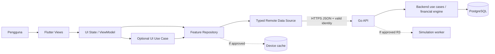
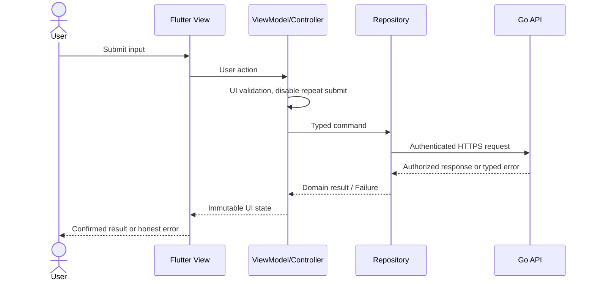
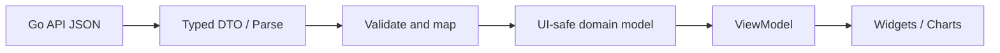
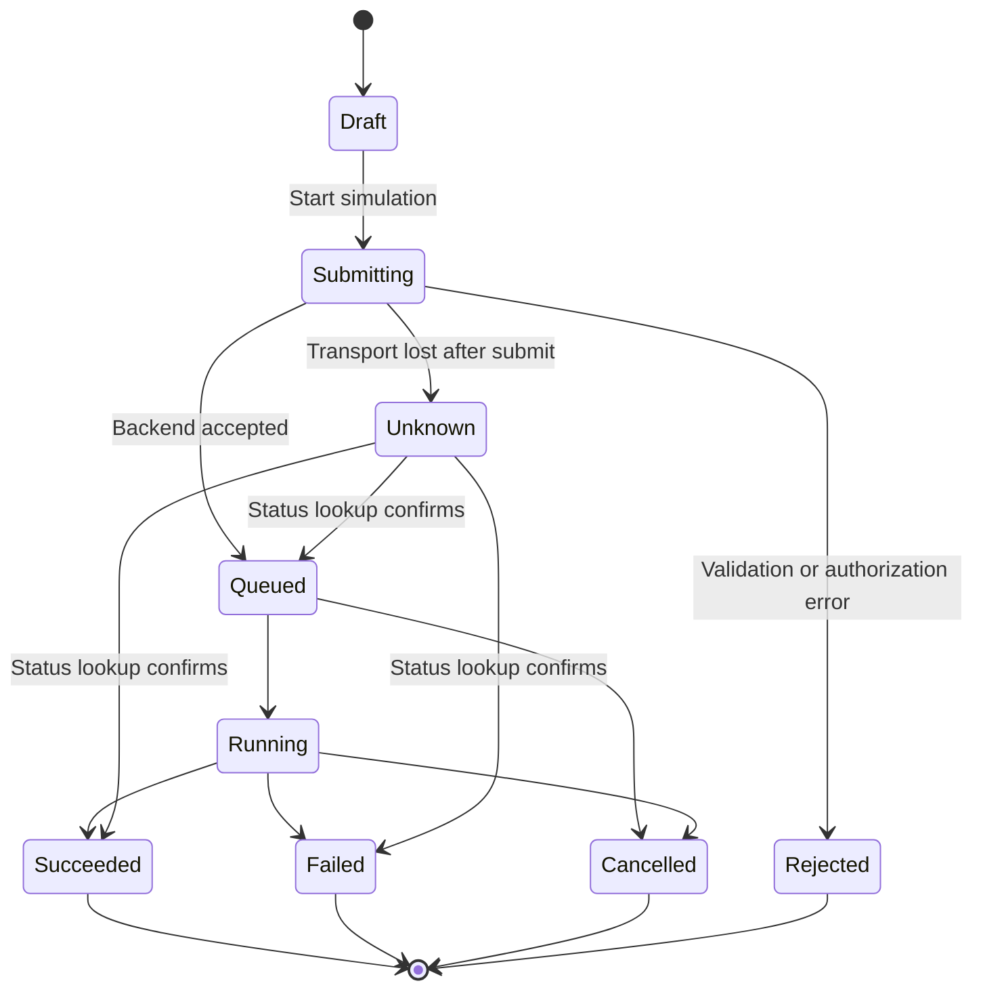
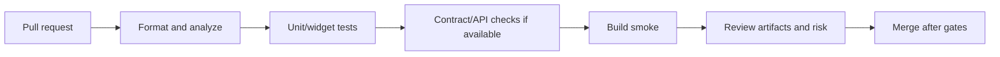

# Esokira — Frontend Architecture

> **Canonical path:** `docs/architecture/FRONTEND-ARCHITECTURE.md`  
> **Versi:** `0.1.0`  
> **Tanggal:** 30 Oktober 2026  
> **Status:** `REVIEWED_INTERNAL — PENDING_OWNER_APPROVAL`  
> **Jenis:** Blueprint arsitektur Flutter; **BUKAN** bukti repository, widget, API, maupun CI telah diimplementasikan  
> **Cakupan:** R0 Foundation, R1 MVP, R2 Planning V1, R3 Advanced. R4 discovery **bukan** scope build  
> **Dokumen induk:** `PRODUCT-VISION.md`, `PRD.md`, `FEATURE-MATRIX.md`, `FINANCIAL-DOMAIN-RULES.md`, `CALCULATION-SPECS.md`, `FINANCIAL-TEST-CASES.md`, `SYSTEM-ARCHITECTURE.md`, `BACKEND-ARCHITECTURE.md` v0.1.0  
> **Audiens:** Product Owner, Flutter engineer, UI/UX designer, backend engineer, QA, AI coding agent

---

## 0. Tujuan dokumen dan aturan membaca

Dokumen ini menetapkan rancangan **struktur aplikasi Flutter, batas UI–state–data, integrasi Go API, pengelolaan sesi, representasi uang dan hasil proyeksi, error/async workflows, privasi, performa, dan pengujian**. Tujuannya bukan membuat aplikasi lebih rumit, tetapi menghindari agent yang mengarang model keuangan, memilih library sepihak, menampilkan angka palsu, atau menyamakan hasil simulasi dengan transaksi aktual.

### 0.1 Legenda tingkat keputusan

| Label | Arti | Apa yang boleh dilakukan AI coding agent |
|---|---|---|
| **DECIDED** | Dinyatakan eksplisit oleh pemilik proyek. | Menjadi constraint saat merencanakan implementasi yang disetujui. |
| **REQUIRED** | Aturan keamanan, invariant finansial, atau acceptance requirement. | Wajib dipenuhi; tidak boleh dikompromikan demi UI cepat. |
| **PROPOSED** | Opsi desain yang direkomendasikan, belum disetujui. | Boleh didiskusikan/diteliti atau dibuat proof-of-concept terisolasi. |
| **TBD** | Perlu keputusan, kontrak, atau investigasi. | Jangan diam-diam memilih default produksi. Catat blocker. |
| **BLOCKED** | Implementasi production tidak aman/siap. | Jangan klaim selesai; batasi ke desain atau eksperimen berlabel. |
| **OUT OF SCOPE** | Tidak termasuk rilis/fitur yang aktif. | Jangan dibuat otomatis karena nama fitur muncul dalam roadmap. |

**Penting:** `REVIEWED_INTERNAL` berarti naskah telah ditinjau sebagai rancangan, **bukan** `APPROVED` dari pemilik proyek. Tidak ada kode Flutter, endpoint yang aktif, atau layar aplikasi yang dapat diasumsikan sudah ada.

### 0.2 Sumber kebenaran dan batas otoritas

| Topik | Sumber kebenaran |
|---|---|
| Visi, segmen pengguna, non-goals | [`../product/PRODUCT-VISION.md`](../product/PRODUCT-VISION.md) |
| Fitur, acceptance, ID `FR/EN/NFR` | [`../product/PRD.md`](../product/PRD.md) |
| Prioritas, dependensi, slice S-00–S-12 | [`../product/FEATURE-MATRIX.md`](../product/FEATURE-MATRIX.md) |
| Aktual, transfer, aset, goal, klasifikasi finansial `DR-xxx` | [`../financial/FINANCIAL-DOMAIN-RULES.md`](../financial/FINANCIAL-DOMAIN-RULES.md) |
| Rumus, rate, waktu, pembulatan, model `CS-xxx` | [`../financial/CALCULATION-SPECS.md`](../financial/CALCULATION-SPECS.md) |
| Referensi numerik dan golden/property/integration tests | [`../financial/FINANCIAL-TEST-CASES.md`](../financial/FINANCIAL-TEST-CASES.md) |
| Trust boundary, pilihan sistem, keputusan `ARCH-Qxx` | [`./SYSTEM-ARCHITECTURE.md`](./SYSTEM-ARCHITECTURE.md) |
| Kontrak dan perilaku backend | [`./BACKEND-ARCHITECTURE.md`](./BACKEND-ARCHITECTURE.md) |
| Bentuk API yang final saat dibuat | `contracts/openapi.yaml` dan `API-GUIDELINES.md` (**belum dibuat**) |
| Token, penghapusan/retensi, offline/privacy policy final | `SECURITY-PRIVACY.md` (**belum dibuat**) |
| Design tokens, layar, alur visual final | `DESIGN-SYSTEM.md`, `SCREEN-SPECS.md`, `USER-FLOWS.md` (**belum dibuat**) |
| Instruksi agent saat implementasi | `AGENTS.md`, `frontend/AGENTS.md`, `TASKS.md`, `PROGRESS.md` (**belum dibuat**) |

Jika ada konflik antardokumen, **jangan mengutamakan teks yang paling baru secara otomatis**. Tunjukkan konflik beserta `FR/DR/CS`, usulkan koreksi dan keputusan owner. Kontrak backend/DDL yang diterapkan harus dilacak kembali ke requirement yang telah disetujui; perubahan implementasi bukan perubahan kebijakan otomatis.

### 0.3 Instruksi non-negotiable untuk agent

1. Baca `AGENTS.md` minimal, dokumen feature relevan, dokumentasi domain dan API sebelum mengubah kode.
2. Audit file yang **benar-benar ada** di monorepo; contoh tree/file/Dart pada dokumen ini adalah usulan, bukan bukti implementasi.
3. Satu task = scope sempit, file terdampak disebutkan, acceptance jelas, tes dieksekusi dan dicatat.
4. Tidak membuat `financial_math.dart` paralel yang menjadi sumber resmi nilai compound, net worth, amortisasi, goal feasibility, atau Monte Carlo; **Go Financial Engine adalah sumber hasil perhitungan resmi**.
5. UI/client boleh menghitung **formatting dan preview interaksi yang jelas non-authoritative**, bukan membuat posted balance atau hasil finansial persisten tanpa verifikasi backend.
6. Jangan memilih auth provider, state management, offline write sync, penyimpanan token, chart package, notifikasi, atau desain warna secara diam-diam bila masih `TBD/PROPOSED`.
7. Jangan menyimpan/kirim saldo, nominal, tujuan, token, atau PII ke analytics/log/crash report tanpa kebijakan dan izin yang eksplisit.
8. Tidak boleh menampilkan data dummy sebagai data finansial pengguna, `success` palsu saat request gagal, ataupun success rate simulasi sebagai jaminan.
9. UI tidak pernah mengakses PostgreSQL langsung atau bergantung pada representasi schema database internal.
10. Perubahan skenario, life event, dan hasil Financial GPS **tidak** mengubah actuals.

---

## 1. Konteks produk dan asumsi yang boleh digunakan

| Area | Keputusan / batas | Status |
|---|---|---|
| Mobile framework | Flutter dengan Dart | **DECIDED** |
| Monorepo | `frontend/`, `backend/` | **DECIDED** |
| Backend aplikasi | Go | **DECIDED** |
| Database utama | PostgreSQL, hanya diakses dari backend | **DECIDED** DB; **REQUIRED** trust boundary |
| Nama kerja | Esokira | **PROPOSED**, clearance merek terpisah |
| Locale awal | Indonesia, IDR; kemampuan localization/extensibility | **PROPOSED** |
| Platform awal | Android dan iOS melalui Flutter | **PROPOSED** cakupan rilis; belum ada target device resmi |
| API | REST/JSON melalui TLS, kontrak OpenAPI | **PROPOSED** sampai contract disetujui |
| UI architecture | Feature-first, view + view model/controller + repository + remote data source | **PROPOSED** |
| State management | Riverpod atau BLoC, **pilih satu** melalui ADR | **TBD** |
| Navigation | `go_router` kandidat untuk guarded routes dan deep links | **PROPOSED** |
| HTTP client | `dio` atau klien lain yang cocok untuk kontrak/API | **TBD** |
| Model serialization | Typed DTO; generated serialization bila disetujui | **PROPOSED** |
| Secure token storage | OS-protected secure storage sesuai auth flow | **REQUIRED** prinsip; library **TBD** |
| Offline caching/writes | Kebijakan eksplisit (read cache, mutation, conflict) | **TBD / BLOCKED** untuk offline writes |
| Chart package | Dipilih setelah kebutuhan aksesibilitas/performa/perbandingan chart ditetapkan | **TBD** |
| Push notifications | Opt-in R2, provider/frequency belum final | **TBD** |
| App theming/branding | Menunggu design system final | **TBD** |

### 1.1 Non-goals khusus frontend

- Tidak menyediakan koneksi PostgreSQL, SQL driver, atau DB credentials dalam bundle mobile.
- Tidak membuat pembayaran bank, trading, pembelian aset nyata, atau transaksi investasi sungguhan; semua itu di luar lingkup R1–R3.
- Tidak meminta akses SMS/notifikasi/contacts/device financial data sebagai syarat onboarding tanpa kebutuhan dan consent yang disetujui.
- Tidak mengimplementasikan `FR-023` shared goals dan `FR-024` portfolio planning hanya karena muncul pada navigation mockup (R4 discovery).
- Tidak menanam AI generatif sebagai kalkulator atau penyusun rekomendasi finansial official.
- Tidak mewajibkan offline-first atau silent background refresh semua data sebelum kebijakan privacy dan conflict disetujui.

### 1.2 Keputusan visual yang sengaja belum diambil

Nama tab, navigation bar (empat/lima item), warna Esokira, font, chart library, dark mode, empty-state illustration, animasi, serta ikon adalah ruang `DESIGN-SYSTEM.md` dan `SCREEN-SPECS.md`. Dokumen ini menentukan *boundary* dan behavior, bukan mengunci UI final. Contoh layar pada §6 adalah **information architecture proposal**, bukan pixel-perfect requirement.

---

## 2. System context dan trust boundary frontend



**Boundary konseptual:**

1. **Pengguna–UI:** semua input tak tepercaya; validasi tampilan membantu UX, tetapi server tetap memvalidasi ulang.
2. **UI–repository:** view model hanya melihat data/domain state; tidak memahami HTTP header, path mentah, atau tipe SQL.
3. **Mobile–Go API:** token bisa dicabut/expired; jaringan dapat retry/time out; klien tidak punya kewenangan menentukan owner record.
4. **API–financial engine/DB:** Go menjadi sumber kebenaran untuk posted transaction, net worth, official projection, dan status simulation job.
5. **Mobile cache:** opsional dan **bukan** sumber final data keuangan atau bukti posting server.
6. **Notifikasi/deep link:** payload dianggap tidak tepercaya; navigasi ke resource tetap memerlukan pemeriksaan akses server.

### 2.1 Pola data flow



Jangan menampilkan notifikasi "Tersimpan" hanya karena tombol telah ditekan. Untuk mutasi sensitif, state akhir `success` menunggu konfirmasi API. Jika operasi timeout setelah dikirim, statusnya **unknown/pending confirmation**, bukan asumsi gagal atau berhasil; kebijakan cek ulang/idempotency disesuaikan kontrak backend.

---

## 3. Struktur folder Flutter dalam monorepo (PROPOSED)

```text
esokira/
├── AGENTS.md                          # Wajib ada sebelum coding; belum dibuat
├── frontend/
│   ├── AGENTS.md                       # Aturan khusus Flutter; belum dibuat
│   ├── android/
│   ├── ios/
│   ├── assets/
│   │   ├── fonts/                     # Jika diputuskan; jangan masukkan font proprietary sembarang
│   │   ├── images/
│   │   └── icons/
│   ├── lib/
│   │   ├── main.dart
│   │   ├── bootstrap.dart
│   │   ├── app/
│   │   │   ├── app.dart
│   │   │   ├── router/
│   │   │   ├── theme/
│   │   │   └── localization/
│   │   ├── core/
│   │   │   ├── api/                    # Typed client, auth interceptor, error mapping
│   │   │   ├── authentication/         # Session abstraction (provider-agnostic)
│   │   │   ├── failures/               # App failure taxonomy
│   │   │   ├── formatting/             # Money, percentages, dates, labels
│   │   │   ├── models/                 # Shared UI-safe value types
│   │   │   ├── security/               # Storage abstraction; policies TBD
│   │   │   ├── observability/          # Privacy-safe diagnostics
│   │   │   └── widgets/                # Reusable non-feature-specific UI
│   │   └── features/
│   │       ├── authentication/
│   │       ├── onboarding/
│   │       ├── accounts/
│   │       ├── transactions/
│   │       ├── assets_liabilities/
│   │       ├── dashboard/
│   │       ├── goals/
│   │       ├── compound_calculator/
│   │       ├── data_controls/
│   │       ├── budgeting/             # R2
│   │       ├── life_planning/          # R2
│   │       ├── scenarios/              # R2
│   │       ├── cashflow/               # R2
│   │       ├── stress_tests/           # R2
│   │       ├── insights/               # R2
│   │       ├── notifications/          # R2
│   │       ├── goal_optimizer/         # R3
│   │       ├── risk_simulation/        # R3
│   │       ├── retirement/             # R3
│   │       └── financial_gps/          # R3
│   ├── test/
│   ├── integration_test/               # Bila e2e runner dipasang
│   ├── l10n.yaml                       # Bila localization generation dipilih
│   ├── analysis_options.yaml
│   ├── pubspec.yaml
│   └── pubspec.lock
├── backend/
├── contracts/
│   └── openapi.yaml                    # Belum dibuat; bukan endpoint final di dokumen ini
├── docs/
│   └── architecture/
│       └── FRONTEND-ARCHITECTURE.md
└── ...
```

**Jangan membuat semua direktori R2/R3 di R0 hanya untuk mencocokkan diagram.** Buat modul saat task disetujui. `features/` mengikuti kemampuan produk, bukan satu folder besar berisi semua `screens/` dan satu lagi semua `providers/` lintas fitur.

### 3.1 Anatomi feature yang cukup kompleks

```text
features/goals/
├── presentation/
│   ├── screens/                        # Halaman atau responsive layout
│   ├── widgets/                        # Widget spesifik goal
│   ├── controllers/                    # View model/notifier, name final TBD
│   └── state/                          # Immutable UI state
├── domain/
│   ├── models/                         # Goal summary, money view type, errors
│   └── use_cases/                      # Hanya jika memudahkan orkestrasi client
└── data/
    ├── dto/                            # API-shaped typed response/request
    ├── mappers/                        # API DTO -> app model
    ├── repositories/                   # Source-of-truth abstraction
    └── remote/                         # HTTP/data source
```

**Folder opsional, bukan template mekanis.** Feature satu layar dengan satu request bisa lebih sederhana; jangan membuat `use_case`, interface, atau mapper tanpa kebutuhan. `data` tidak boleh mengimpor `presentation`; `domain` tidak bergantung pada framework widget/network. `presentation` mengakses repository/use-case, bukan akses raw `http`/`Dio` langsung.

### 3.2 Dependency rules

```text
app/router/theme -> presentation
presentation -> domain models / application use case / repositories
use case (optional) -> repositories + domain models
repository -> data source / DTO mapper / optional cache
remote data source -> core/api
core/api -> HTTP transport + typed API contracts

FORBIDDEN:
- widgets -> raw API path / bearer token / PostgreSQL schema
- shared core -> feature presentation (circular dependency)
- financial preview -> mutation of actual ledger
- repository A -> repository B as ad-hoc hidden dependence
- feature A -> feature B's private data implementation
```

Komunikasi lintas fitur dilakukan lewat kontrak yang eksplisit, shared domain models yang memang stabil, atau use-case komposisi pada lapisan yang tepat. Hindari global singleton mutable yang menyimpan seluruh saldo dan skenario sekaligus.

---

## 4. Pilihan UI architecture, state management, dan dependency injection

### 4.1 Rekomendasi dasar (PROPOSED)

- **Presentation:** view (`Widget`) hanya merender dan meneruskan tindakan; view model/controller menyusun UI state dan orkestrasi request.
- **Data:** repository menyajikan sumber data terstruktur; remote/local data sources membungkus akses I/O.
- **Domain:** model immutable; use-case/interactor hanya saat satu fitur membutuhkan komposisi/transformasi lintas repository yang kompleks, **bukan** kewajiban semua CRUD.
- **State:** gunakan *unidirectional data flow*. Semua perubahan state akibat user action dikelola satu titik state owner; tidak memutasi isi list/map secara diam-diam.
- **Dependency injection:** gunakan pola yang didukung state-management terpilih; jangan memasang service locator tambahan tanpa alasan.

Panduan arsitektur Flutter resmi mendukung pembagian View/ViewModel/Repository/Service dan use-case opsional. Referensi: <https://docs.flutter.dev/app-architecture/guide>, <https://docs.flutter.dev/app-architecture/concepts> (diakses saat penyusunan, bukan pin versi library).

### 4.2 State ownership matrix

| Data/state | Tempat konseptual | Aturan |
|---|---|---|
| Teks pada input dan state fokus | Widget/form controller lokal | Belum menjadi data finansial aktual. |
| Loading, validation error, success action | Screen view model | Tidak dinyatakan sukses sebelum response backend. |
| Sesi auth dan identitas terverifikasi | App/session repository | Provider/token strategy TBD; state user-scoped. |
| Account/transaction/goal dari API | Feature repository dan query/cache state | Backend sebagai source of truth; invalidate terkait setelah mutasi. |
| Draft scenario yang belum disimpan | Draft state per scenario | Tidak boleh dipakai dashboard actual. |
| Saved scenario version | Repository + server response | Sertakan versi/baseline; jangan rename sebagai actual data. |
| Simulation job | Job status state + repository polling | Memisahkan pending/running/succeeded/failed/cancelled. |
| Chart viewport, selected tab, accordion | Widget/view model | Boleh hanya state presentasional. |
| Settings lokal non-sensitif | Local preferences sesuai policy | Hindari data finansial/token dalam preferences biasa. |

### 4.3 Riverpod vs BLoC dan keputusan yang memblokir

Kedua kandidat bisa mengelola state dan testing. **Belum ada keputusan resmi** (`FE-Q01`). Sebelum menambahkan package, tulis ADR mini: kriteria (alur kompleks, testability, onboarding agent, jumlah boilerplate, cancellation/disposal, async caching), contoh kecil satu screen dan satu repository, serta konsekuensi. Pilih **satu pendekatan utama**; jangan menjalankan Riverpod dan BLoC paralel tanpa kebutuhan spesifik yang didokumentasikan.

### 4.4 UI state sebagai finite state, bukan sekadar bool

Tentukan model seperti `idle / loading / content / empty / error / submitting / awaitingConfirmation` sesuai fitur. Untuk operasi yang kompleks, gunakan union/sealed types atau enum + payload tervalidasi. **Hindari kombinasi** `isLoading=true`, `hasError=true`, `isSuccess=true` pada saat yang sama.

Contoh state conceptual:

```text
AccountListState =
  Initial | Loading | Loaded(accounts, asOf, freshness)
  | Empty | Failed(failure, retryAllowed)

MutationState =
  Idle | Validating | Submitting | Confirmed(serverResource)
  | AmbiguousOutcome(requestId) | Rejected(failure)

SimulationState =
  Draft | Submitting | Queued(runId) | Running(runId, progress?)
  | Succeeded(result, engineVersion, baselineVersion)
  | Failed(reason, retryable) | Cancelled
```

Bentuk class/factory final menunggu keputusan library dan kontrak API. **Progress persen** tidak boleh difabrikasi jika backend hanya menyediakan `queued/running`.

### 4.5 Invalidasi dan cache consistency

Setelah mencatat transaksi, setidaknya invalidasi list transaksi, saldo terkait, dan dashboard; goal-funded status mungkin juga terpengaruh (bergantung keputusan domain Q-11). Setelah mengubah baseline actual, hasil proyeksi yang bergantung padanya diberi status stale menurut backend; **jangan refresh diam-diam lalu mengganti hasil historis yang seharusnya reproducible**. Desain key cache minimal menyertakan `user/session`, jenis resource, filter/periode, dan identifier versi jika berlaku. TTL/cache policy tetap TBD.

---

## 5. API integration: kontrak, model, error, dan retry

### 5.1 Typed boundary dan OpenAPI

**Go API menjadi sumber kebenaran** untuk posted financial records dan hasil resmi financial engine. Flutter mengonsumsi kontrak ter-versioning yang nantinya tersedia pada `contracts/openapi.yaml`; sebelum kontrak formal ada, **jangan mengarang endpoint, header custom, tipe uang, success response, atau auth token semantics sebagai standar final**.

Pipeline model data:



Untuk proyek berkembang, *generated serialization* (mis. `json_serializable`) dapat mengurangi kesalahan field; verifikasi versi SDK, codegen workflow, serta hasil OpenAPI sebelum mengadopsi tool tersebut. Referensi Flutter: <https://docs.flutter.dev/data-and-backend/serialization/json>.

### 5.2 Transport responsibilities

`core/api` mengelola base URL per environment, koneksi TLS, timeout, token attachment sesuai provider, correlation/request IDs yang disetujui, response parsing, error mapping, dan pembatalan request bila relevan. Ia **tidak** melakukan net worth calculations, role authorization, pengalokasian goal, atau menulis storage cache sensitif tanpa kebijakan.

| Concern | Kontrak frontend | Status |
|---|---|---|
| Base URL | Konfigurasi build/environment publik, bukan secret | **REQUIRED**; target host **TBD** |
| HTTPS | Production TLS wajib | **REQUIRED** |
| Auth | Provider SDK/token attached sesuai spesifikasi; 401 bukan retry infinite | **REQUIRED**, provider **TBD** |
| Error envelope | Kode mesin yang stabil + aman ditampilkan | **PROPOSED**, `API-GUIDELINES.md` TBD |
| Pagination | Cursor/limit atau mekanisme yang disetujui | **TBD**, jangan default ambil seluruh transaksi |
| Timeouts | Per operasi dan berdasarkan baseline performance | **TBD**, tidak menebak SLA |
| Idempotency | Mutasi rawan duplikasi memakai key/contract jika ditetapkan | **REQUIRED** safety, format header **TBD** |
| Monetary JSON | Representasi eksak, unit & currency eksplisit | **REQUIRED**, format field **TBD** |
| Date/time | String/offset/zone sesuai kontrak yang disetujui | **REQUIRED** konsistensi, format final **TBD** |

### 5.3 DTO != presentation model

DTO hanya mencerminkan kontrak API; model UI memberikan makna ke tampilan. Hindari memakai dynamic map langsung di widget. Nilai `actual_amount`, `projected_amount`, `as_of`, `currency`, `scenario_version`, `engine_version` (nama **ilustratif**) harus diparse dengan validasi. Field yang hilang/tidak kompatibel menghasilkan error terkontrol, **bukan** fallback `0` atau tanggal hari ini.

Model conceptual (**bukan** schema JSON atau class Dart final):

```text
MoneyDisplayValue {
  exactAmount: decimal-or-integer-string (unit TBD)
  currency: ISO currency code
  source: actual | planned | forecast | model_result
  asOfOrPeriod: timestamp or interval
  isApproximate: boolean
}

SimulationResultView {
  scenarioId, baselineVersion, engineVersion
  calculatedAt, inputAssumptions, warnings
  outputSeries, percentilesIfDefined, resultStatus
}
```

Jika backend belum mengirim provenance yang diperlukan, tandai kontrak belum siap, bukan membangun label as-of atau risk probability palsu di Flutter.

### 5.4 Error taxonomy client

| Kategori | UX | Perilaku teknis |
|---|---|---|
| Invalid input / 400–422 | Tampilkan error di field yang tepat | Simpan draft tanpa mengubah actual. |
| Unauthenticated / 401 | Tawarkan pemulihan sesi/login | Hentikan retry rekursif; jangan leak token. |
| Forbidden / 403 | Pesan akses tidak tersedia | Jangan mengungkap keberadaan data owner lain. |
| Not found / 404 | Resource tidak ditemukan | Jangan ganti data lama seolah valid. |
| Conflict / 409 | Data berubah, butuh refresh/resolve | Jangan silent overwrite, terutama scenario version. |
| Rate limit / 429 | Jelaskan batas sementara | Backoff hanya untuk request aman/idempotent. |
| Server error / 5xx | Informasikan layanan bermasalah | Jangan klaim mutasi gagal pasti; cek status bila ambiguous. |
| Network unavailable / timeout | Offline/error state dan retry manual | Bedakan GET aman dari POST yang mungkin sudah diproses. |
| Contract parsing failed | Error aman + diagnostic tag | Jangan render `0` atau nilai palsu. |
| Simulation pending/failed | Status job dan opsi yang tersedia | Tidak menampilkan grafik hasil fiktif. |
| Insufficient data | Tunjukkan data apa yang perlu dilengkapi | Jangan mengarang gaji/rate/tanggal. |

### 5.5 Retry, timeout, duplicate tap, dan idempotency

- GET aman dapat diulang melalui kebijakan terbatas; fetch dari repository harus dapat dibatalkan/diabaikan ketika screen disposed.
- POST/PUT/PATCH/DELETE **tidak boleh** di-retry otomatis secara membabi buta, terlebih transaksi posting, transfer, export/delete request, atau simulation enqueue.
- Untuk mutation yang bisa memproses dua kali, gunakan kontrak idempotency yang dikoordinasikan dengan Go. Key bisa dipertahankan sampai hasil final diketahui; format final **TBD**.
- Tombol submit terkunci selama in-flight untuk meminimalkan double-tap, **namun** itu bukan pengganti idempotency server.
- Jika response hilang setelah server commit, tampilkan `awaiting confirmation` dan pulihkan melalui read-by-id/status **bila API mendukung**. Jangan otomatis mengulang transfer dengan key baru.
- Error harus dibedakan menjadi *retryable* dan *terminal* sesuai kontrak; jangan gunakan string matching pesan sebagai decision logic.

### 5.6 Form validation dan mapping

Validasi frontend hanya untuk membantu pengguna: required fields, allowed input, nominal/rate/dates, dan hubungan yang bisa diperiksa tanpa data server. Backend tetap memvalidasi owner/permissions/concurrency serta seluruh financial rules. Kirim raw amount sesuai spesifikasi exact string/integer; **jangan** menserialisasi `double` untuk saldo. Seluruh error field/multi-field diterjemahkan ke pesan Bahasa Indonesia yang dapat dipahami. Data input finansial tidak dicetak untuk debugging.

### 5.7 Contract-first change management

Jika perlu field atau endpoint baru: (1) identifikasi FR/DR/CS, (2) rancang perubahan OpenAPI, (3) review backward compatibility/error, (4) implementasi Go dan test, (5) regenerate/update typed Flutter client, (6) contract + integration tests. Jangan mengedit Flutter DTO sebagai "standar" tanpa kesepakatan API/backend. Jangan hardcode response mock sebagai solusi production.

---

## 6. Feature modules dan screen boundaries berdasarkan rilis

### 6.1 R0 — Application shell dan fondasi

| Area | Kebutuhan UI | Batas |
|---|---|---|
| Bootstrap | Environment, theme placeholder, router shell, error boundary | Tidak ada production secrets di aplikasi. |
| Session boundary | Auth state, protected screen routing, expiration/recovery | Provider TBD `ARCH-Q01`. |
| API client | Typed request, failure mapping, auth attach | Kontrak OpenAPI belum ada. |
| Design foundations | Scale/semantics, reusable loading/error/empty state | Visual tokens final menunggu design system. |
| Testing baseline | Unit, widget, analyzer, formatting, CI | Jalankan hanya terhadap repo yang sudah ada. |

R0 **tidak** memerlukan seluruh advanced screen, chart yang kompleks, atau integrasi notifikasi. Render empty state yang jujur bila belum ada data pengguna.

### 6.2 R1 — MVP feature screens

| FR | Kandidat area/layar | Perilaku & boundary wajib |
|---|---|---|
| FR-001 | Login/session/account | Token diurus provider/repository, route privat terlindungi; server tetap authz. |
| FR-002 | Onboarding & financial profile | Jelaskan field dan tujuan pemakaian; incomplete profile dapat diperbaiki. |
| FR-003 | Accounts & opening balances | Jenis account dan saldo sesuai backend; opening balance bukan income. |
| FR-004 | Transaction list, add, details, transfer | Income/expense/transfer dibedakan; posting server atomik; duplicate tap aman. |
| FR-005 | Assets and liabilities | Nilai dengan tanggal penilaian; cegah UI double-count asset. |
| FR-006 | Dashboard/net worth | Bedakan actual vs estimate; net worth negatif; last updated visible. |
| FR-007 | Goals list/detail/form | Target/tenggat/prioritas; planned contribution bukan funded amount. |
| FR-008 | Compound calculator | Form input; total kontribusi vs proyeksi; metadata asumsi; calculate via official Go result. |
| FR-009 | Goal contribution feasibility | Capacity, required contribution dan shortfall; tidak auto-edit target. |
| FR-021 | Data export/delete controls | Auth/reconfirmation, privacy copy, status proses, no false "deleted" claims. |

**R1 acceptance lintas fitur:** pengguna bisa melihat dan memperbarui keadaan aktual, membuat goal, menghitung estimasi resmi, lalu melihat progres tanpa mencampur target rencana dengan saldo yang tercatat.

### 6.3 R2 — Planning V1

| FR | Kandidat UI | Penjagaan khusus |
|---|---|---|
| FR-010 | Budget & recurring management | Anggaran dibanding actual; recurring future belum posted. |
| FR-011 | Life events timeline/form | Event hipotetis berlabel planned, tanpa perubahan actual. |
| FR-012 | Deterministic projection chart | Input baseline/assumptions/engine version/as-of ditampilkan. |
| FR-013 | Scenario editor/version compare | Perbandingan minimal dua versi; compare baseline kompatibel. |
| FR-014 | Future cash-flow view | Forecast period, future shortfall, chart historical vs projected. |
| FR-015 | Stress test scenario | Parameter shock dapat dibaca, hasil relatif terhadap baseline, bukan klaim "aman" absolut. |
| FR-016 | Explainable insights | Reason, data source, assumptions, insufficient-data handling. |
| FR-022 | Notification preferences | Opt-in granular; payload lockscreen non-sensitif default. |

**R2 gate:** skenario dan projection tidak pernah mengedit actual records. UI menampilkan *stale warning* ketika baseline aktual berubah, dan tidak menghapus hasil lama yang diperlukan untuk reproducibility tanpa kebijakan yang disetujui.

### 6.4 R3 — Advanced simulation UI

| FR | Kandidat UI | Penjagaan khusus |
|---|---|---|
| FR-017 | Multi-goal optimizer | Constraint/objective & infeasible results; priorities/trade-off; jangan menyembunyikan goal gagal. |
| FR-018 | Monte Carlo chart/distribution | Seed/run metadata, percentiles, n paths, model assumption, success rate sebagai **hasil model**. |
| FR-019 | Retirement/FIRE | Penarikan/horizon/nominal-real, depletion risk, bukan universal 4% guarantee. |
| FR-020 | Financial GPS alternatives | Opsi bukan perintah; masing-masing bisa diuji; tidak auto-post transfer/pembelian. |

R3 memerlukan kesiapan model domain, worker, dan engine backend. **Graph UI tidak boleh menjadi alasan untuk mengarang output** jika probabilistic model masih `BLOCKED`.

### 6.5 R4 — Discovery only

`FR-023` shared goals dan `FR-024` portfolio planning **tidak** dijadwalkan menjadi route/feature production. Jika muncul pada ide desain, tampilkan sebagai eksplorasi terpisah dan catat bahwa privacy/portfolio requirements belum disetujui.

---

## 7. Navigation dan route security

**Pilihan package belum final (`FE-Q02`).** Untuk aplikasi dengan onboarding, protected pages, nested navigation, deep links, dan layar scenario detail, `go_router` menjadi kandidat. Flutter documentation menyarankan routing declarative untuk kebutuhan kompleks; referensi: <https://docs.flutter.dev/ui/navigation>.

### 7.1 Rancangan information architecture (PROPOSED)

```text
Public area
  Launch / Session Restore
  Welcome / Sign-in

Authenticated R1
  Home / Dashboard
  Accounts
    Account Detail
    Transaction List / Create / Edit
    Transfer Form / Confirmation
  Goals
    Goal List / Detail / Create / Edit
  Tools
    Compound Calculator / Goal Contribution
  Profile / Settings
    Export / Delete Data / Logout

Additional R2
  Life Plan
    Timeline / Events
  Scenarios
    Draft / Versions / Compare
  Cash Flow, Stress Tests, Insights
  Notification Preferences

Additional R3
  Risk Simulations / Run Detail
  Goal Optimizer
  Retirement Planner
  Financial GPS
```

**Ini daftar area informasi, bukan keputusan jumlah tab.** R1 shell tidak wajib menampilkan route R2/R3 yang belum siap. Jangan membuat tombol "segera hadir" secara otomatis tanpa product decision dan UX rationale.

### 7.2 Route-guard rules

1. Inisialisasi auth/session memiliki state `unknown/loading`, `authenticated`, dan `unauthenticated`; jangan membuka private route saat state belum terverifikasi.
2. Login redirect menyimpan destination non-sensitif jika perlu, **bukan** access token dalam URL.
3. Setelah logout/account switch: invalidasi repository, cache, active jobs, pending navigation intent, dan draft sensitif; hapus token sesuai provider.
4. Deep link ke account/goal/scenario orang lain harus diblokir oleh server; UI tampilkan error netral, bukan menebak resource ada/tidak.
5. Nested route menampilkan `loading/not-found/forbidden` secara eksplisit; jangan otomatis mengganti ke akun pertama sehingga pengguna keliru bertindak.
6. Restore navigation setelah cold-start tidak boleh mendahului validasi identitas dan ownership.
7. Navigation saat mutation pending perlu kebijakan `discard draft / stay / save draft` yang disepakati, bukan kehilangan input mendadak.

### 7.3 Back stack dan sensitive routes

Untuk export/delete dan tindakan berisiko, pisahkan konfirmasi dari aksi final dan pertimbangkan re-authentication sesuai risk review. Jangan menyimpan nomor rekening, saldo, atau isi form sensitif pada deep link/query string/notification payload. Back stack tidak boleh membuka data user sebelumnya setelah logout.

---

## 8. Actual financial data, precision, dan rendering

### 8.1 Backend source of truth

`FR-003–FR-009`, `DR-004–DR-011`, dan `CS-001–CS-007` mengharuskan UI menghormati semantik uang dan transaksi. **Flutter tidak punya hak menggantikan logic domain** berdasarkan asumsi UI.

| Nilai | Perlakuan frontend |
|---|---|
| Account balance actual | Hanya dari backend result/approved local read cache berlabel timestamp. |
| Income/expense | Dihitung/ditampilkan sesuai klasifikasi server, tidak menyamakan transfer internal dengan expense. |
| Net worth | Gunakan angka server untuk official financial position; asset yang sudah tercakup saldo tidak dihitung ulang. |
| Goal target | Ini target, bukan uang yang tersedia. |
| Planned contribution | Ini niat/setoran rencana, bukan funded balance. |
| Goal funded progress | Menunggu model funding disetujui (`ARCH-Q04`, Q-11); tidak infer dari transfer apapun. |
| Forecast/Monte Carlo | Ditandai `estimate/model result`; tidak tercampur dalam total actual. |
| Loan | Pokok, bunga, dan pembayaran dibedakan; rate/tanggal sesuai calculation spec. |

### 8.2 Presisi dan format tampilan

- API harus mengirim representasi uang yang aman terhadap kehilangan presisi; tipe akhir `BIGINT`/`NUMERIC`, unit, dan format JSON **TBD** (`ARCH-Q03`).
- Jangan menjadikan Dart `double` sebagai sumber nilai saldo aktual, jangan `double.parse()` untuk field uang yang dikirim sebagai angka eksak lalu round-trip ke backend.
- Format jumlah dengan locale dan currency explicit. Tampilan `Rp1.000.000` **hanya formatting**, bukan nilai yang dikirim kembali ke server.
- Tampilkan mata uang dan tanggal/as-of untuk nilai penting, termasuk pada chart tooltip dan hasil export preview.
- Pemisah desimal dan rounding presentation tidak boleh mengubah nilai sumber. Jika memerlukan library decimal, pilih setelah spesifikasi nilai dan parser disetujui.
- Jangan menggunakan konversi persentase tahunan/bulanan yang dibuat ulang secara mandiri untuk output resmi. Input rate di UI harus menampilkan jenis rate dan periode dari kontrak.
- Nominal negatif termasuk net worth negatif valid; jangan diam-diam diubah menjadi nol atau disembunyikan dari chart.
- Jaga input numeric dari separator locale, minus, currency symbol, invalid range, overflow, nilai terlalu panjang, dan batas decimal yang belum final.

### 8.3 Metadata wajib pada visualisasi finansial

| Komponen | Minimal metadata terlihat/tersedia |
|---|---|
| Account balance | `actual`, currency, as-of/last updated, data source jika perlu. |
| Net worth | Valuation dates, liability coverage, completeness caveat. |
| Compound projection | Principal, recurring contributions, growth estimate, time horizon, rate convention, disclaimer. |
| Goal feasibility | Target, horizon, assigned funds policy, contribution, shortfall, assumption. |
| Scenario compare | Scenario IDs/version, baseline, changed assumptions, recalculation time, stale state. |
| Monte Carlo | Number of paths, model/seed provenance, percentile definition, simulated success rate, limits. |
| Retirement | Withdrawal assumptions, real/nominal semantics, horizon, insufficiency risk. |
| Insight/GPS | Inputs/engine evidence, reason, trade-offs, "opsi" bukan instruction. |

### 8.4 Testable visual assertions

1. Transfer Rp100.000 dari account A ke B tidak menaikkan total pengeluaran eksternal.
2. Net worth minus ditampilkan sebagai angka minus, bukan chart kosong atau clamp nol.
3. Contoh bunga nol harus tetap menyatakan hasil sebagai proyeksi dan menjelaskan kontribusi terakumulasi.
4. Scenario hasil gagal ditandai gagal; chart sebelumnya tidak dianggap hasil request baru.
5. Saat backend menyatakan baseline berubah, UI menampilkan stale indicator dan rute untuk refresh/re-run, **tanpa** memutasi actual.
6. Data aktual dari cache tidak memakai label `live`/`realtime` bila offline.

---

## 9. Calculation & scenario UX: safe interaction patterns

### 9.1 Compound calculator (`FR-008`)

Alur: pengguna memasukkan input -> form memvalidasi format -> tombol Calculate mengirim input eksplisit -> backend menjalankan `CS-005` -> response typed berisi hasil dan asumsi -> UI menampilkan komponen principal/contribution/growth, periode, dan disclaimer. Saat menunggu, UI dapat mempertahankan hasil **sebelumnya** bila jelas diberi label `hasil sebelumnya`, bukan menggantinya seolah telah dihitung ulang.

**Preview lokal:** jika benar-benar diperlukan untuk slider, preview harus menggunakan aturan yang telah disetujui dan dinyatakan `perkiraan sementara`; angka authoritative tetap dari Go. Kebijakan apakah preview boleh memiliki rumus Dart yang terduplikasi **TBD**, dan jangan menjadikannya default tanpa cross-language golden tests.

### 9.2 Goal feasibility (`FR-009`)

Tampilkan (a) target dan deadline, (b) kontribusi yang diperlukan, (c) kapasitas yang tersedia berdasarkan definisi data, (d) surplus/shortfall, dan (e) asumsi. Jika input tidak cukup, CTA melengkapi data, **bukan** `0` otomatis. Jangan membuat goal funded percentage dari target dan planned contribution tanpa keputusan funding Q-11.

### 9.3 Life events dan scenario editing (`FR-011–FR-013`)

- `Actual` data dapat dipilih sebagai baseline, lalu disalin ke plan/scenario version yang terpisah.
- Setiap perubahan parameter hanya mengubah draft hingga explicit save/recalculate; tidak ada auto-post actual.
- Scenario version memiliki identitas; compare view tidak membandingkan silently dua baseline incompatible.
- UI menampilkan *change summary*: gaji, pengeluaran, event, goal timing, asumsi inflasi/return yang berbeda (jika didukung API).
- Bila server menunjukkan versi stale, UI jangan menawarkan `overwrite anyway` tanpa conflict policy; beri opsi refresh/rebase yang eksplisit jika didukung.

### 9.4 Perbandingan hasil dan chart (`FR-014–FR-015`)

Grafik harus menampilkan axis, mata uang, satuan, interval, dan beda actual–forecast dengan label tertulis selain warna. Tabel/data alternatif wajib disediakan untuk pengguna screen reader atau yang sulit membaca grafik. Angka y-axis dapat diringkas (mis. Rp jt), tetapi tooltip/tabel tetap menyediakan presisi sesuai kebijakan.

Untuk stress test, tampilkan asumsi shock, baseline pembanding, dampak kas dan goal, serta keterbatasan. Jangan menyebut "pasti aman" hanya dari satu scenario.

### 9.5 Optimizer, Monte Carlo, retirement (`FR-017–FR-019`)

- Optimizer menjelaskan *objective* dan *constraints* yang telah disetujui, serta mana tujuan tidak feasible.
- Monte Carlo menampilkan median, rentang persentil/quantile, success rate, jumlah lintasan, distribusi/model version, input, seed bila perlu, dan peringatan *model-dependent*. Jangan menyebut `confidence interval` untuk percentile lintasan tanpa definisi statistik yang benar.
- Hasil pensiun membedakan fase akumulasi–penarikan, nilai nominal–riil, dan risiko habis dana. Jangan mengasumsikan withdrawal 4% universal.
- Jika model/algorithm policy belum disetujui, UI tidak boleh menggambar grafik fiktif dari random generator lokal.

### 9.6 Financial GPS (`FR-020`)

Insight adalah alternatif keputusan. UI harus menampilkan alasan, perubahan parameter, trade-off, dan tindakan eksplisit untuk mencoba skenario lain. Bukan tombol transfer uang atau auto-edit transaksi. Perubahan yang berdampak ke scenario version harus melalui save/recalculate kontrak yang dapat diaudit.

---

## 10. Long-running simulation jobs dan lifecycle R3

Sebelum `EN-005` dipenuhi dan backend contract tersedia, fitur job tetap `BLOCKED_BY_DOC/CONTRACT`. Jika job async digunakan, UI mendukung setidaknya status konseptual berikut:



### 10.1 Aturan polling dan cancellation

- Polling boleh dipakai bila disetujui; interval, backoff, maksimum request, dan push/stream alternatif **TBD**.
- Mulai job sekali; saat Flutter dibuka ulang, pulihkan status melalui `runId`/server jika kontrak mendukung, bukan membuat job baru otomatis.
- Batalkan polling saat route disposed atau session berubah. `cancel` UI harus meminta dan menunggu konfirmasi server; tidak sama dengan job sudah berhenti.
- Hasil job yang selesai harus terkait `owner`, `runId`, `scenarioVersion`, `baselineVersion`, `modelVersion` dan seed jika ada.
- Jika pengguna mengubah input ketika job berjalan, tandai hasil lama terkait versi sebelumnya; jangan ganti grafik yang sedang dilihat tanpa konteks.
- Jangan menyatakan progress 65% kecuali backend menyediakan progress tervalidasi; tampilkan status `sedang menghitung` bila hanya ada stage.
- Timeout/rate limit jangan memicu tak terbatas create-job baru. Batasi concurrency berdasarkan server policy.

### 10.2 Job result security

UI tidak dapat menyimpulkan kepemilikan job dari ID yang terlihat. Semua get status/result/cancel tetap server-authz. Cache hasil yang sensitif mengikuti pemisahan user dan logout purge. Jangan mengirim data job mentah ke analytics.

---

## 11. Offline, caching, lifecycle, dan data freshness

### 11.1 Kebijakan sementara hingga keputusan offline disetujui

**FE-Q05 / ARCH-Q09 masih TBD:** aplikasi boleh mempersiapkan abstraksi cache tanpa mengaktifkan offline mutation. Pada fase awal, pola paling aman adalah *online-required for financial writes* dan *explicit stale/no-network state* untuk data yang belum bisa diperbarui. Ini **PROPOSED**, bukan keputusan final produk.

| Situasi | Behavior aman saat kebijakan belum final |
|---|---|
| Tidak ada internet sebelum membaca | Tampilkan offline/error state; cache hanya jika dinyatakan aman oleh policy. |
| Offline saat form belum dikirim | Pertahankan draft dalam memori; persist lokal sensitif harus diputuskan. |
| Offline setelah POST timeout | Tampilkan outcome ambiguous; jangan auto-retry posting. |
| App restart dengan session cached | Validasi sesi dan refresh data sebelum menyatakan aktual terkini. |
| Akun/logout berganti | Bersihkan state dan cache user sebelumnya. |
| Projection tersimpan dari baseline lama | Label stale dan waktu as-of, opsi rerun. |

### 11.2 Cache/privacy guidance

- Jika cache finansial di disk disetujui, tentukan enkripsi, key management, TTL, wipe/logout, OS backup exposure, storage quota, dan mode restricted-device.
- Jangan menyimpan access token di plaintext preferences, local log, URL, atau source code.
- Remote API harus tetap melakukan verifikasi akses walaupun client memegang cache.
- Jangan menyebut data cache sebagai real-time. Komponen memiliki `lastSynced` / `asOf` yang benar dari server.
- Optimistic UI untuk transfer atau actual posting **tidak** boleh mengubah visual ledger seolah confirmed; jika digunakan visual pending, tampilkan sebagai pending jelas dan pisahkan dari posted balance.

### 11.3 App lifecycle

Saat foreground kembali, evaluasi refresh sesuai expiry dan user action; cegah request race ketika token baru/akun berganti. Saat background, hentikan request/poll tidak perlu, jangan menganggap proses client terus hidup. Untuk export/simulation server jobs, persist status di backend; aplikasi hanya viewer dan controller terotorisasi.

---

## 12. Authentication, authorization, dan keamanan perangkat

### 12.1 Provider-agnostic boundary

Identity provider belum dipilih (`Q-02`, `ARCH-Q01`). Flutter membutuhkan abstraksi `SessionRepository` konseptual dengan kemampuan `signIn`, `signOut`, `currentSession`, `refreshSession` sesuai provider final. **Tidak** boleh mengasumsikan FirebaseAuth ada hanya karena pernah direkomendasikan. Semua fitur private memerlukan token/identitas valid yang diverifikasi server.

```text
Flutter UI -> Session abstraction -> Approved Identity SDK/flow
                       |
                       v
                 Token provider
                       |
                       v
                 Authenticated Go API
                       |
                       v
                 Server authz by owner
```

### 12.2 Proteksi yang wajib direncanakan

- Token/session disimpan di mekanisme aman platform sesuai kebijakan; jangan hardcode API keys rahasia dalam aplikasi. Public config ≠ secret.
- Pengguna tidak bisa menentukan owner dengan mengirim sembarang `userId` pada body; backend menentukan dari principal terverifikasi.
- Saat 401, lakukan pemulihan token terbatas atau arahkan login; jangan loop refresh tanpa akhir.
- Saat logout: reset private navigation, cache, controllers, pending jobs, dan private screen state.
- Masking screen/app switcher dan screenshot restriction **belum otomatis diwajibkan**; evaluasi UX, aksesibilitas, platform, dan privasi untuk layar sensitif.
- Biometric app lock dapat menjadi eksperimen UX setelah threat model; bukan pengganti server authentication.
- Deep links/push payload tidak berisi token, saldo, password, atau parameter finansial personal sensitif.
- Tidak menyisipkan aplikasi ke transport HTTPS yang mematikan certificate validation untuk debugging, terutama production.

### 12.3 Error messages dan data privacy

Pesan error user harus aman dan dapat membantu recovery tanpa mengungkap API body, token, SQL error, ownership, atau data pengguna lain. Telemetry tidak mencatat full request/response. Crash reports harus disanitasi; keputusan analytics SDK, event, consent, dan retention **TBD**.

### 12.4 Export, delete, dan data lifecycle (`FR-021`)

UX menampilkan tahapan permintaan, konfirmasi, status pending/completed/failed, kebijakan retensi yang benar, dan penjelasan backup. Jika job penghapusan asynchronous, UI tidak boleh mengklaim semuanya langsung hilang setelah tombol ditekan. Download/export share sheet dan file lokal sensitif memerlukan review lokasi penyimpanan, akses aplikasi lain, dan masa retensi file di device.

---

## 13. UI design system, localization, accessibility, chart semantics

### 13.1 Design system sebagai kontrak terpisah

`DESIGN-SYSTEM.md` (**belum dibuat**) akan mengatur tipografi, warna, spacing, radii, elevation, iconography, chart styles, dark mode, motion, states, dan reusable components. File ini hanya menetapkan **prinsip teknis**:

- Gunakan theme tokens, hindari magic colors/styles per widget.
- Komponen angka uang dan chart menggunakan formatter shared, termasuk kondisi negatif, unit, locale, as-of.
- Buat reusable loading, empty, error, disabled, confirmation, and feedback components.
- Jangan membangun "AI slop" berupa dashboard menumpuk kartu besar dengan gradien/hiasan tanpa hierarchy dan density yang sesuai tugas.
- Jangan menampilkan placeholder angka/financial achievement seolah data milik user.
- Desain responsif untuk variasi ukuran layar, keyboard, font scale, dan orientasi; target device matrix TBD.

### 13.2 Localization (Proposed Bahasa Indonesia-first)

- String tampilan berasal dari resource localization, **bukan** hardcode teks berulang di widget produksi.
- Gunakan locale-aware formatting untuk IDR, persen, tanggal, waktu, dan angka; jangan menyisipkan format Rupiah dengan string concatenation yang rawan separator.
- Pertimbangkan teks yang membesar dan terjemahan panjang tanpa merusak layout.
- Pesan kesalahan dapat dibaca non-ahli, tetapi tidak menyembunyikan satuan/rate/biaya dan risiko finansial.
- Tidak mengasumsikan tanggal server mengikuti zona waktu device. Simpan/presentasikan *effective date*, timestamp, timezone sesuai backend contract.

### 13.3 Accessibility acceptance

- Nilai dan status aktual vs forecast tidak hanya berbeda warna; ada teks dan semantics label.
- Target sentuh memadai; fokus keyboard dan screen reader order diuji pada form, modal, chart, tab.
- Chart memiliki summary text atau tabel data alternatif; tooltip memungkinkan akses tanpa gesture presisi tinggi.
- Error validasi dihubungkan dengan field dan dibacakan screen reader bila perlu.
- Animasi mengikuti reduced motion bila kebijakan platform/Flutter memungkinkan; hindari animasi tanpa fungsi.
- Rasio kontras, scaling, dan dukungan TalkBack/VoiceOver diuji pada perangkat/konfigurasi yang disepakati.

### 13.4 Visual semantics matrix

| State | Harus terbaca sebagai teks | Larangan |
|---|---|---|
| Actual | `Aktual`, `per ...` / `terakhir diperbarui` | Tidak diubah ke estimasi tanpa label. |
| Planned | `Rencana`, `belum dicatat sebagai dana aktual` | Jangan ikut total kekayaan. |
| Forecast | `Proyeksi`, horizon dan asumsi | Jangan ditampilkan dengan label `saldo sekarang`. |
| Stale | `Perlu diperbarui`, baseline/as-of | Jangan memaksa refresh hasil historis. |
| Insufficient data | Informasi apa yang kurang | Jangan default nominal/rate ke nol diam-diam. |
| Model success | `Berhasil dalam X/Y simulasi model` | Jangan klaim peluang pasti di dunia nyata. |
| Pending transaction | `Menunggu konfirmasi` | Jangan menambah saldo confirmed lebih dulu. |

---

## 14. Testing frontend: unit, widget, integration, contract, privacy

Panduan Flutter resmi memisahkan unit/widget/integration tests: <https://docs.flutter.dev/testing/overview>. Test frontend tidak menggantikan `FINANCIAL-TEST-CASES.md` pada pure Go engine, tetapi memastikan hasil resmi **di-render** tanpa perubahan makna.

### 14.1 Test pyramid

| Layer | Contoh kewajiban | Runner calon |
|---|---|---|
| Unit | State transitions, retry/no duplicate, DTO parser, currency/date formatter | `flutter test` |
| Widget | Error/empty/loading states, submit lock, semantics labels, input validation | `flutter test` |
| Integration | Login → goal → calculation; transfer → dashboard; logout/cache isolation | `integration_test` bila dipasang |
| Contract | API DTO vs OpenAPI/schema; error envelope; field unknown/missing behavior | Contract test/generation pipeline TBD |
| Visual/a11y | Text scale, chart labels, contrast, TalkBack/VoiceOver smoke | Manual/automated sesuai plan |
| Privacy | No secrets/amounts in debug logs, analytics payload, notification body | Static/runtime checks |

### 14.2 R0–R1 critical tests

| Test ID | Skenario | Expected |
|---|---|---|
| `FE-T01` | Session tidak valid membuka protected route | Dialihkan ke pemulihan/login; tidak memuat data private. |
| `FE-T02` | Logout ketika dashboard cached | Semua private view/cache yang tersedia dibersihkan. |
| `FE-T03` | User mencoba membuka resource owner lain | Error netral; tidak ada data ditampilkan. |
| `FE-T04` | Transfer ditap dua kali atau timeout | Tidak ada dua request berbeda yang disubmit tanpa kebijakan; konfirmasi server diperlukan. |
| `FE-T05` | Transfer antar-account diterima server | UI menampilkan mutasi sesuai response; kategori transfer tidak dihitung income/expense. |
| `FE-T06` | Net worth negatif dari server | Tampil angka minus dan label yang benar. |
| `FE-T07` | Goal belum didanai tetapi planned contribution ada | UI tidak menampilkan planned amount sebagai actual funded. |
| `FE-T08` | Compound rate 0, output resmi server | Formatter menjaga jumlah dan label estimasi; tidak hitung ulang dengan formula UI yang berbeda. |
| `FE-T09` | API field nominal hilang/invalid | Controlled error, bukan default `0`. |
| `FE-T10` | Export/delete request gagal | Tidak ada pesan file created/data deleted palsu. |

### 14.3 R2–R3 critical tests

| Test ID | Skenario | Expected |
|---|---|---|
| `FE-T11` | Scenario disimpan | Actual account records unchanged; UI menampilkan versi scenario. |
| `FE-T12` | Baseline actual berubah | Hasil lama diberi stale badge/metadata yang benar. |
| `FE-T13` | Dua skenario punya baseline tidak kompatibel | Compare diblokir/diwarnai sesuai backend validation. |
| `FE-T14` | Future recurring belum posted | Tidak muncul sebagai transaksi aktual. |
| `FE-T15` | Forecast negatif | Shortfall terlihat, nilai minus tidak diclamp. |
| `FE-T16` | Insight kekurangan data | `Insufficient data`, bukan rekomendasi pasti. |
| `FE-T17` | Sim job queued lalu succeeded | UI tidak menunjukkan hasil sebelum server menyatakan sukses. |
| `FE-T18` | Job cancelled/failed | Status dan recovery tepat, tanpa chart "sukses" palsu. |
| `FE-T19` | Monte Carlo 70% model success | Label menyatakan `dalam model`, disertai asumsi, bukan 70% kepastian. |
| `FE-T20` | User logout sementara job running | Polling/private result diisolasi; user lain tidak melihat data. |
| `FE-T21` | Notification lock screen | Tidak menampilkan saldo/utang personal secara default. |
| `FE-T22` | Financial GPS alternative dipilih | Membuat draft/simulasi eksplisit; tidak memposting transaksi. |

### 14.4 Golden financial render contract

Pilih sebagian input/output valid dari `FINANCIAL-TEST-CASES.md`, gunakan sebagai fake API fixtures, lalu assert UI menampilkan angka, unit, label, horizon, dan warning sesuai backend reference. **Jangan** menjalankan rumus yang sama di Dart hanya untuk menyalin angka hasil yang diharapkan; fixtures referensi harus berasal dari golden specs independen.

### 14.5 Perintah validasi setelah proyek Flutter tersedia

```bash
cd frontend
flutter pub get
dart format --output=none --set-exit-if-changed lib test
flutter analyze
flutter test
# integration_test hanya jika dikonfigurasi dan ada target device / emulator
# flutter test integration_test
```

Perintah di atas **rekomendasi**, tidak berarti pengujian sudah dijalankan. Pada fase kode tersedia, CI harus memverifikasi versi SDK/dependency yang dipin, codegen jika ada, contract checks, dan tidak melewatkan tes yang relevan karena durasi.

### 14.6 Definition of Ready dan Definition of Done (frontend)

**Ready:** task punya FR/EN/NFR, screen/flow spec, API contract yang tepat, domain rule, state/error acceptance, auth/privacy implications, keputusan package yang diperlukan, dan test plan. Jika `DESIGN-SYSTEM.md`/`SCREEN-SPECS.md` belum disusun, task UI produksi yang membutuhkan keputusan visual tersebut **BLOCKED_BY_DOC** (scaffolding terbatas boleh sesuai scope disetujui).

**Done:** UI berjalan dengan backend atau test fake kontrak yang valid (bukan dummy terselubung), state error/empty/loading lengkap, authorization and data isolation tidak rusak, l10n/a11y diperiksa, unit/widget/integration test relevan lulus, format/analyze lulus, perubahan kontrak/screen docs tercatat, dan hasil pengujian dilaporkan dengan bukti. Jika hanya widget berhasil dirender, statusnya **belum DONE**.

---

## 15. Performance, memory, dan reliability

- Hindari network call atau heavy computation di `build()`; gunakan repository/view model, memoization selektif, dan lifecycle-aware cancellation.
- Large transaction lists memakai paginated/lazy rendering; jangan download semua histori untuk satu layar.
- Chart time-series di-*downsample* atau di-window sesuai kebutuhan visual, tetapi **jangan** mengubah ringkasan numerik/totals dari server demi performa.
- `const` widgets dan widget boundary dipakai saat tepat, tetapi desain UI tidak boleh bergantung pada optimasi spekulatif.
- Jangan menjalankan ribuan iterasi Monte Carlo dalam main isolate Flutter; kerja resmi berat dijalankan Go worker/API. Preview lokal berat, jika diizinkan, menggunakan isolate dan tetap non-authoritative.
- P95 startup, screen load, memory/device matrix, polling interval, dan budget ukuran app **TBD** (`NFR-004`, `ARCH-Q12`); ukur sebelum menetapkan target.
- Gunakan Flutter DevTools/profile build, bukan estimasi subjektif. Dokumen resmi: <https://docs.flutter.dev/perf/best-practices>.
- Network failure tidak boleh mengunci tombol permanen, menampilkan data user lain dari cache, atau melanjutkan polling setelah logout.

---

## 16. CI/CD, environments, konfigurasi, dan release safety

### 16.1 Environments

Disarankan `development`, `staging`, dan `production`, tetapi detail hosting, bundle identifiers, provisioning, flavor, certificate, dan environment names harus diputuskan melalui deployment/security docs. **Konfigurasi client bukan tempat menyimpan secret server.** Build mendeteksi mismatch environment backend vs mobile agar QA tidak menguji production tanpa sengaja.

### 16.2 CI pipeline conceptual



- Jangan mem-publish build production dari branch yang belum melewati review dan kebijakan signing yang disetujui.
- Pin versi Flutter/Dart SDK dan dependency sesuai project decision; jangan mengunci versi hardcode dari dokumen yang akan cepat usang.
- `pubspec.lock` untuk aplikasi harus mengikuti strategi lockfile yang disetujui dan dikomit agar reproduktibilitas build terjaga.
- Native permissions, minimum OS, network security config, privacy manifest, dan signing dikelola dalam frontend/mobile release plan; **bukan** otomatis ditambahkan oleh agent.
- Batas release: tidak ada chart probabilitas production sebelum model Monte Carlo lulus approval dan golden tests.

### 16.3 Observability privacy-first

Monitoring dapat mencatat route name (tanpa IDs sensitif), error category, latency bucket, app version, dan request correlation ID yang aman. Jangan mencatat nama goal, nominal gaji, saldo, target rumah, access token, seluruh payload API, atau raw exception yang berisi data pribadi. Crash stack dan user identifier pseudonymous memerlukan privacy review dan retention policy.

---

## 17. Delivery order dan koordinasi dengan backend

| Slice | Frontend deliverable | API/domain dependency | Exit proof minimum |
|---|---|---|---|
| S-00 | Owner-approved scope & screen/financial boundary; minimal `AGENTS.md` | PRD/domain/test docs | Blockers dinyatakan, bukan diselesaikan asal-asalan. |
| S-01 | Flutter bootstrap, router shell, error handling, API skeleton | EN-001/EN-003/EN-006; auth contract pending | `flutter analyze/test`, contract stub yang jelas. |
| S-02 | Login/onboarding | FR-001/002, auth provider resolved | Auth flow & cross-account UI privacy tested. |
| S-03 | Account and transaction forms | FR-003/004, ledger/transfer contract | Submit/retry safety and server confirmation. |
| S-04 | Asset/liability and net worth dashboard | FR-005/006 | Golden display assertions, negative net worth. |
| S-05 | Goal and compound calculator | FR-007/008; CS-005/FTC | Server-calculation fixture + actual-vs-plan labels. |
| S-06 | Goal feasibility and data controls | FR-009/021; funding/privacy policy | Shortfall UX, export/delete status. **R1 gate**. |
| S-07 | Budget and life event UI | FR-010/011 | Planned/recurring not posted. |
| S-08 | Projection/scenario/compare/cash flow | FR-012/013/014; scenario version spec | Two scenarios, baseline/stale indicators. |
| S-09 | Stress tests, insights, notification preferences | FR-015/016/022 | Reasoned insights, opt-in. **R2 gate**. |
| S-10 | Goal optimizer interface and job status shell if approved | FR-017, EN-005 | Feasible/infeasible UX; no fabricated worker. |
| S-11 | Monte Carlo & retirement UIs | FR-018/019; model approval | Model assumptions, results, testable chart labels. |
| S-12 | Financial GPS | FR-020; validated engines | Explainable alternative paths, no actual mutation. **R3 gate**. |

**Front/back collaboration:** satu vertical slice melakukan kontrak/API test dan Flutter widget/e2e test secara berpasangan. Jangan membangun semua frontend dengan dummy lalu baru menghubungkan backend di akhir. Gunakan fixtures eksplisit untuk story/preview/test, bukan sebagai fake production data.

---

## 18. Decision register khusus Flutter — PENDING OWNER APPROVAL

| ID | Pertanyaan | Opsi/kriteria evaluasi | Dependency/blocker |
|---|---|---|---|
| **FE-Q01** | State management utama: Riverpod / BLoC / lainnya? | Testability, cancellation, repository integration, learning curve | Core architecture; R0 dependency |
| **FE-Q02** | Router: `go_router` atau alternatif? | Guards, deep link, nested stacks, lifecycle | R0 navigation |
| **FE-Q03** | HTTP dan serialization: Dio/http; manual/generated? | OpenAPI compatibility, typed errors, codegen | EN-003/R0 |
| **FE-Q04** | Auth provider dan secure storage? | `ARCH-Q01`, SDK lifecycle, rotation/refresh, wipe | FR-001/S-02 |
| **FE-Q05** | Offline read/cache dan writes? | Encryption, TTL, conflict policy, device backup | R0/R1 data layer, ARCH-Q09 |
| **FE-Q06** | Amount/rate/date/timezone representation? | Exact parse/format, backend contract, locale | `ARCH-Q03`, FR-003–009 |
| **FE-Q07** | Local calculation preview diizinkan atau tidak? | Only non-authoritative, cross-language golden tests | FR-008/009 dan R2 scenarios |
| **FE-Q08** | Navigation tabs, screen hierarchy, design tokens? | Product research, user flows, accessibility | DESIGN-SYSTEM/SCREEN-SPECS |
| **FE-Q09** | Chart library dan data table pattern? | a11y, huge time-series, tooltips, negative values | R1 dashboard, R2–R3 simulation |
| **FE-Q10** | Simulation job status transport? | polling/SSE/push, resource and cancellation | EN-005, ARCH-Q10, FR-018 |
| **FE-Q11** | Notification provider & payload preferences? | Consent, lockscreen privacy, reliability | ARCH-Q08, FR-022 |
| **FE-Q12** | Export/save/share dan delete flow? | Secure file handling, reauth, retention | ARCH-Q09, FR-021 |
| **FE-Q13** | Min OS, Android/iOS rollout, device matrix? | Project reach, QA resources, security patches | Release planning |
| **FE-Q14** | Localization/currency policy final? | Indonesia/IDR initial, string resources, date zone | Q-01, ARCH-Q03 |
| **FE-Q15** | Telemetry, consent, and crash data scope? | Data minimization, privacy/legal review | NFR-007/008 |
| **FE-Q16** | Performance acceptance budgets? | Startup/p95/network, chart data scale | ARCH-Q12, NFR-004 |
| **FE-Q17** | Scenario stale/compare/rebase UX policy? | Backend snapshot/version semantics, conflict UX | ARCH-Q05, FR-013 |
| **FE-Q18** | Goal-funded status rendering policy? | Actual allocation/ledger definition | ARCH-Q04, FR-007/009 |

### 18.1 Minimal decisions needed before coding

For S-01, resolve `FE-Q01/02/03` to prevent rewrites, plus environment and basic app security; auth screen feature S-02 requires `FE-Q04`. Actual accounting screens S-03 require `FE-Q06` and model ledger/transfer; feature visuals should await `FE-Q08/09` where necessary. `FE-Q05` can remain deferred **if** offline write/cache is not implemented; `FE-Q10/11/17/18` remain deferred until corresponding release.

### 18.2 Escalation template

```text
Decision ID: FE-Qxx / related ARCH-Qxx
Affected FR / EN / NFR / DR / CS:
Problem / source conflict:
Options considered:
Benefits, trade-offs, security impact:
Proposed recommendation (not approved):
Owner decision / date:
Documentation and tests to update:
```

Jangan menulis `APPROVED` sebelum ada persetujuan eksplisit. Jika owner menyetujui sebagian, catat area mana yang masih `TBD`, bukan menaikkan status seluruh dokumen.

---

## 19. Requirement traceability — Functional Requirements `FR-001`–`FR-024`

| FR | Fokus frontend | Bagian utama | Release |
|---|---|---|---|
| FR-001 | Login/session/router guards/private state | §6.2, §7, §12, §14 | R1 |
| FR-002 | Onboarding/profile/no hidden assumptions | §6.2, §5.6 | R1 |
| FR-003 | Accounts/opening balance view | §6.2, §8 | R1 |
| FR-004 | Income, expense, transfer, atomic submit UX | §5.5, §6.2, §8 | R1 |
| FR-005 | Assets/liabilities and valuation date | §6.2, §8 | R1 |
| FR-006 | Dashboard actual/net worth metadata | §6.2, §8, §13 | R1 |
| FR-007 | Goals planned vs actual progress | §6.2, §8, FE-Q18 | R1 |
| FR-008 | Compound calculator/result provenance | §6.2, §9.1, §14 | R1 |
| FR-009 | Goal contribution/feasibility shortfall | §6.2, §9.2, §14 | R1 |
| FR-010 | Budgets and recurring state | §6.3, §8 | R2 |
| FR-011 | Life event draft/time line | §6.3, §9.3 | R2 |
| FR-012 | Projection charts and metadata | §6.3, §9.3/9.4 | R2 |
| FR-013 | Scenario versions/compare/staleness | §6.3, §9.3, §11 | R2 |
| FR-014 | Cash flow forecast, negative period | §6.3, §9.4 | R2 |
| FR-015 | Stress test hypothesis vs baseline | §6.3, §9.4 | R2 |
| FR-016 | Explainable insights, insufficient data | §6.3, §9.6 | R2 |
| FR-017 | Multi-goal allocation UX | §6.4, §9.5 | R3 |
| FR-018 | Monte Carlo distribution, job status | §6.4, §9.5, §10 | R3 |
| FR-019 | Retirement / FIRE explorer | §6.4, §9.5 | R3 |
| FR-020 | Financial GPS options, no auto action | §6.4, §9.6 | R3 |
| FR-021 | Export/delete secure UI | §6.2, §12.4 | R1 |
| FR-022 | Reminder preferences, opt-in | §6.3, §13 | R2 |
| FR-023 | Shared goal — discovery only | §6.5 | R4 |
| FR-024 | Portfolio planning — discovery only | §6.5 | R4 |

---

## 20. Traceability — Engineering Enablers & NFR

### 20.1 Engineering enablers `EN-001`–`EN-006`

| ID | Frontend responsibility | Evidence gate |
|---|---|---|
| EN-001 | Flutter skeleton, format/analyze/test/CI, boundaries | §3, §14, §16; verify after repo exists |
| EN-002 | Respect ownership, request principal, no direct DB; integration tests | §2, §7, §12 |
| EN-003 | Typed API, auth/error handling, version contract | §5, §14.4 |
| EN-004 | UI consumes authoritative Go financial result; golden render tests | §8, §9, §14.4 |
| EN-005 | Optional job UX, status/cancel/retry guard | §10, §15 |
| EN-006 | Environment config, privacy-safe logging, release safety | §12, §16 |

### 20.2 Non-functional `NFR-001`–`NFR-010`

| ID | Acceptance concern for Flutter | Section |
|---|---|---|
| NFR-001 | Authz checks server; guards/ownership error client | §2, §7, §12 |
| NFR-002 | Exact amount rendering & verified engine results | §8–9, §14 |
| NFR-003 | Version, seed, as-of, baseline metadata | §8–11 |
| NFR-004 | Measure performance, paging/chart responsiveness | §15, §18 FE-Q16 |
| NFR-005 | Locale/accessibility/error states | §5, §13–14 |
| NFR-006 | Retry and mutation confirmation safety | §5.5, §11 |
| NFR-007 | No PII/amounts/tokens in logs/analytics | §12, §16.3 |
| NFR-008 | Consent/export/deletion UI accuracy | §12.4, §16 |
| NFR-009 | Unit/widget/integration/contract test gates | §14–16 |
| NFR-010 | Never mutate actuals through simulation actions | §2, §8–10 |

---

## 21. Traceability — Financial Domain Invariants `DR-001`–`DR-024`

| DR | Frontend guard | Relevant section |
|---|---|---|
| DR-001 | Distinct actual vs simulated labels/types | §2, §8, §13 |
| DR-002 | Scenario changes not posted | §8, §9.3 |
| DR-003 | Ownership enforced server; private route/cache safety | §7, §12 |
| DR-004 | Exact money representation; no float balance | §8.2 |
| DR-005 | Opening balance not income | §6.2, §8.1 |
| DR-006 | Internal transfer not income/expense | §8.1, §14.2 |
| DR-007 | Atomic transfer confirmed by server | §5.5, §6.2 |
| DR-008 | Retry/idempotency, duplicate tap protection | §5.5, §14 |
| DR-009 | Don't duplicate account balance as asset | §8.1 |
| DR-010 | Negative net worth display | §8.2, §14 |
| DR-011 | Planned contribution != funded actual | §8.1, §9.2 |
| DR-012 | Goal/budget/scenario no transfer execution | §9.3/9.6 |
| DR-013 | Recurring future not posted | §6.3, §8 |
| DR-014 | Source/currency/as-of/assumption metadata | §8.3, §13 |
| DR-015 | No guaranteed returns/model outcomes | §9.5, §13 |
| DR-016 | Baseline/engine/seed reproducible metadata | §9, §10 |
| DR-017 | Insufficient input not silently invented | §5.6, §9 |
| DR-018 | Effective date vs created date/period clarity | §8.2, §13.2 |
| DR-019 | Explainable insights, no autonomous posting | §9.6 |
| DR-020 | Stale/rebase detection | §4.5, §9.3, §11 |
| DR-021 | Redacted logs/analytics/errors | §12, §16.3 |
| DR-022 | Correct/reverse posting with server audit | §5.5, §6.2 |
| DR-023 | Correct classification cashflow vs net worth | §8.1 |
| DR-024 | Advanced risk model not released before validation | §9.5, §14–16 |

---

## 22. Traceability — Calculation Contracts `CS-001`–`CS-016`

| CS | Meaning for frontend | Section |
|---|---|---|
| CS-001 | Money/currency precision & parser | §5.3, §8.2 |
| CS-002 | Rate kind, conversion, period shown | §8.2, §9.1 |
| CS-003 | Account/transfer response preserving posting semantics | §8.1, §14 |
| CS-004 | Net worth & asset valuation | §8.1–8.3 |
| CS-005 | Compound calculator official result | §9.1 |
| CS-006 | Inflation/real/nominal labels | §8.3, §9.5 |
| CS-007 | Goal contribution & feasibility shortfall | §9.2 |
| CS-008 | Budget/recurring not auto-posted | §6.3, §8 |
| CS-009 | Projection/future cash-flow output | §9.3/9.4 |
| CS-010 | Loan amortization term/principal/interest | §8.1, §9.4 |
| CS-011 | Stress test baseline/shock/runway | §9.4 |
| CS-012 | Scenario versioning and reproducibility | §9.3, §11 |
| CS-013 | Goal optimizer feasibility/objective | §9.5 |
| CS-014 | Monte Carlo paths, seed/model outputs | §9.5, §10 |
| CS-015 | Retirement withdrawal, nominal/real | §9.5 |
| CS-016 | Insights/GPS reasoning and guardrails | §9.6 |

Referensi ID adalah **traceability desain**, bukan klaim semua algoritma dan UI telah dibangun. Untuk angka expected, rujuk `FINANCIAL-TEST-CASES.md`, bukan tabel di sini.

---

## 23. Internal review, blockers, dan handoff

### 23.1 Review dokumen v0.1.0

- [x] Membedakan DECIDED, REQUIRED, PROPOSED, TBD, BLOCKED, OUT OF SCOPE.
- [x] Seluruh FR-001–FR-024, EN-001–EN-006, NFR-001–NFR-010, DR-001–DR-024, CS-001–CS-016 direferensikan secara eksplisit.
- [x] Boundary Flutter–Go–PostgreSQL konsisten dengan System/Backend Architecture.
- [x] Tidak menganggap Riverpod/Dio/go_router/Firebase Auth sebagai library yang telah disetujui.
- [x] Tidak mengklaim test Flutter telah dijalankan atau UI sudah ada.
- [x] Data source: actual, planned, forecast, model results dipisahkan.
- [x] R4 ditandai discovery-only.
- [ ] Product Owner mereview dan menyetujui keputusan yang akan menjadi dasar implementasi.
- [ ] Audit repository dan SDK dependency dilakukan saat coding benar-benar dimulai.

### 23.2 Risiko yang belum diselesaikan

1. Auth provider & secure storage belum disetujui → protected UI implementation `BLOCKED` hingga kontrak dipilih.
2. Ledger, exact money representation, dan goal-funded attribution belum final → actual transaction & progress UI harus mengikuti penyelesaian `ARCH-Q02/Q03/Q04`.
3. Offline caching/writes belum disepakati → jangan mengaktifkan offline writes.
4. Design System, Screen Specs, User Flows belum ada → UI final menunggu dokumen tersebut.
5. Scenario versions/staleness dan async job contract belum final → R2/R3 screen production menunggu spesifikasi.
6. Model optimizer/Monte Carlo belum disetujui → chart advanced tidak memakai data palsu.

### 23.3 Handoff ke dokumen berikutnya

Sesuai roadmap sebelumnya, dokumen setelah ini adalah **`DATABASE-DESIGN.md`**, lalu **`API-GUIDELINES.md`**. Keduanya harus merujuk source-of-truth yang sama, bukan menyalin keputusan frontend yang masih `PROPOSED` menjadi DDL/endpoint final. Setelah arsitektur teknis matang, lanjut ke Design System, User Flows, Screen Specs, `AGENTS.md`, Testing Strategy, dan implementasi per slice.

---

## Appendix A — Referensi teknis resmi (untuk validasi saat implementasi)

- Flutter App Architecture: <https://docs.flutter.dev/app-architecture/guide>
- Flutter Architecture Concepts: <https://docs.flutter.dev/app-architecture/concepts>
- Flutter Navigation: <https://docs.flutter.dev/ui/navigation>
- Flutter JSON & Serialization: <https://docs.flutter.dev/data-and-backend/serialization/json>
- Flutter Testing: <https://docs.flutter.dev/testing/overview>
- Flutter Performance: <https://docs.flutter.dev/perf/best-practices>

Dokumen resmi menjelaskan opsi teknis, **bukan** membuat library/plugin tertentu menjadi otomatis disetujui untuk Esokira. Versi SDK/paket harus diuji pada repository sebenarnya sebelum dipin.

## Appendix B — Checklist singkat sebelum agent mengerjakan screen

```text
[ ] Ada task ID dan FR/EN/NFR/DR/CS terkait.
[ ] Sudah baca parent docs, AGENTS, dan relevant feature specs.
[ ] Screen/UX states dan error/empty/loading requirements jelas.
[ ] API contract sudah ada; tidak perlu invent endpoint/payload.
[ ] Amount/date/rate semantics dan ownership diuji.
[ ] Auth, stale, retry, offline, privacy implications dipahami.
[ ] Plan file changes terbatas pada satu vertical slice.
[ ] Unit/widget/integration tests yang relevan direncanakan.
[ ] Setelah coding: command/test results dilaporkan jujur.
[ ] Update docs/task/progress berdasarkan bukti, bukan asumsi.
```

**Penutup:** fokus Flutter Esokira adalah membuat kondisi finansial dan kemungkinan masa depan **mudah dimengerti tanpa kehilangan ketepatan makna**. Backend Go tetap sumber hasil finansial resmi. Arsitektur frontend harus mendukung pengalaman yang cepat, transparan, aman, dan dapat diuji tanpa memalsukan status, model, atau data pengguna.
