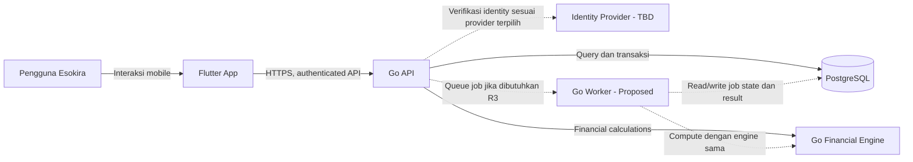
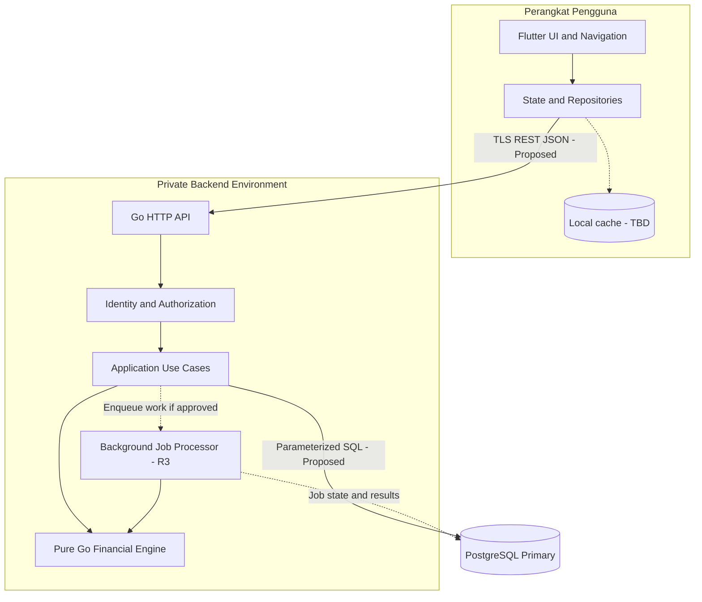
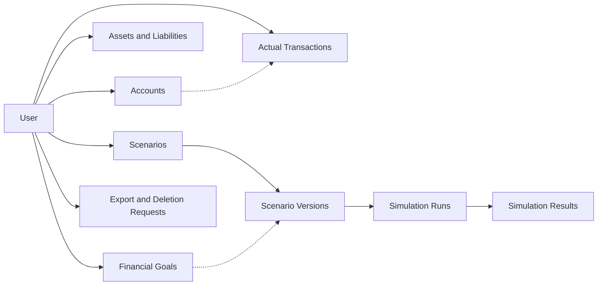
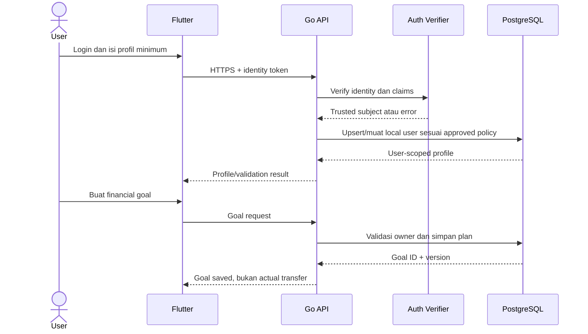
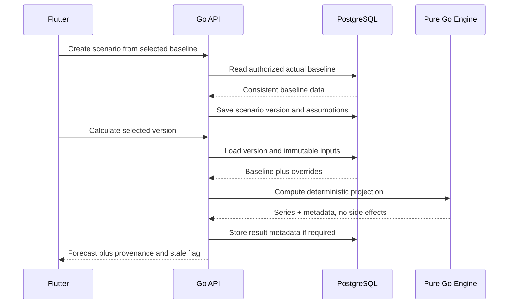
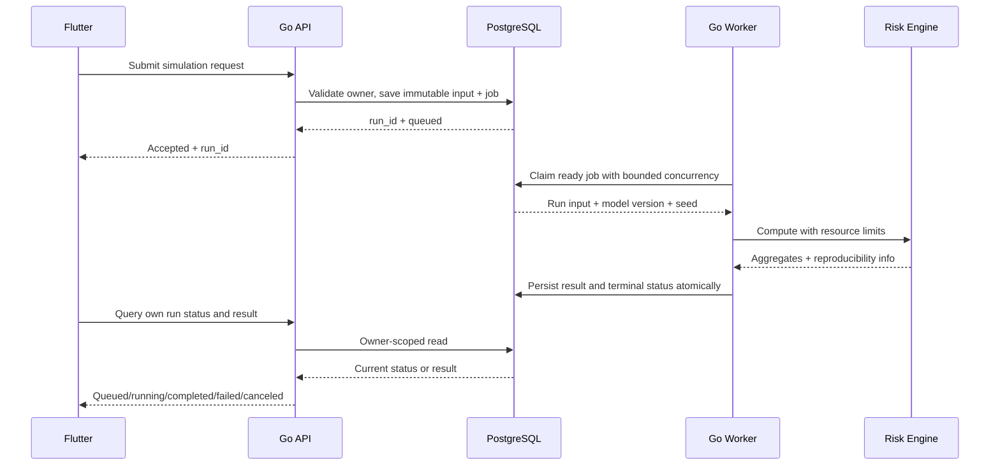
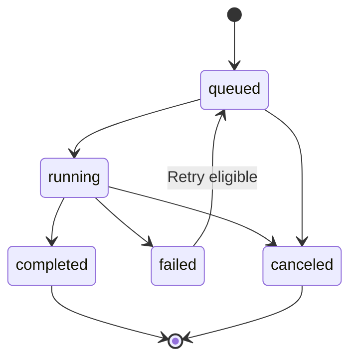
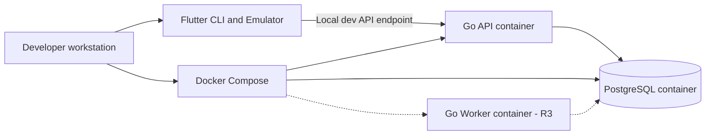

# Esokira — System Architecture

> **Path canonical:** `docs/architecture/SYSTEM-ARCHITECTURE.md`  
> **Versi:** `0.1.0`  
> **Tanggal penyusunan:** 29 Oktober 2026  
> **Status:** `REVIEWED_INTERNAL — PENDING_OWNER_APPROVAL`  
> **Tipe dokumen:** Architecture blueprint / technical boundaries; **bukan** bukti sistem sudah diimplementasikan  
> **Scope:** R0 Foundation → R1 MVP → R2 Planning V1 → R3 Advanced; R4 hanya discovery  
> **Target pembaca:** Product Owner, AI coding agent, Flutter engineer, Go engineer, database engineer, security/QA reviewer  
> **Sumber:** Product Vision, PRD, Feature Matrix, Financial Domain Rules, Calculation Specs, Financial Test Cases — semuanya v0.1.0.

---

## 0. Fungsi dokumen dan aturan pembacaan

Dokumen ini menjelaskan **bagaimana komponen Esokira dipisahkan, berkomunikasi, menyimpan data, menjalankan financial engine, menjaga keamanan, dan tumbuh sesuai fase rilis**. Tujuannya adalah memberi _system-wide architectural constraints_ sebelum perancangan detail `BACKEND-ARCHITECTURE.md`, `FRONTEND-ARCHITECTURE.md`, `DATABASE-DESIGN.md`, `API-GUIDELINES.md`, dan `SECURITY-PRIVACY.md`.

**Jangan membaca rancangan arsitektur sebagai kode yang sudah ada.** Belum ada audit implementasi atau bukti deployment. Semua struktur folder, route, tabel, komponen, dan diagram yang ditandai **PROPOSED** adalah usulan desain, bukan mandat implementasi yang telah disetujui.

### 0.1 Aturan khusus AI coding agent

1. Periksa dokumen ini **bersama** Product Vision, PRD, Feature Matrix, Financial Domain Rules, Calculation Specs, dan Financial Test Cases sesuai kebutuhan task.
2. Jangan menetapkan pilihan yang berstatus **TBD/BLOCKED** hanya agar dapat menghasilkan kode, migrasi, dependency, atau API.
3. Untuk setiap task, tulis FR/EN/NFR/DR/CS yang terdampak, keputusan yang dibutuhkan, risiko lintas modul, dan bukti uji yang harus diperoleh.
4. Jangan membuat microservice, event bus, Redis, GraphQL, WebSocket, integrasi bank, AI API, atau dashboard web kecuali spesifikasi dan approval terkait telah ada.
5. Jangan melakukan posting actual ketika memproses skenario, prediksi, optimizer, atau recommendation; **forecast adalah hasil komputasi, bukan transaksi nyata**.
6. Jangan menganggap `user_id` dari body/query/path cukup untuk otorisasi; identitas diverifikasi di backend dan kepemilikan tiap resource diperiksa.
7. Jangan menyebut arsitektur “sudah berjalan”, tes “lulus”, atau release “ready” tanpa repo, log, dan hasil pengujian yang benar-benar diperiksa.
8. Jika dokumen saling bertentangan, catat masalah dalam decision log/ADR dan hentikan hanya scope yang terdampak; jangan melakukan override diam-diam.

### 0.2 Legenda keputusan

| Label | Definisi | Boleh dilakukan agent |
|---|---|---|
| **DECIDED** | Dipilih eksplisit dalam percakapan pemilik proyek. | Dirancang dan dirujuk; implementasi tetap mengikuti task/acceptance yang disetujui. |
| **REQUIRED** | Konsekuensi keamanan, integritas, atau requirement yang sudah tertulis pada dokumen induk. | Menjadi constraint lintas implementasi. |
| **PROPOSED** | Rekomendasi arsitektur untuk dievaluasi. | Dibahas atau diprototipekan secara terisolasi; jangan dijadikan keputusan final tanpa approval. |
| **TBD / BLOCKED** | Belum diputuskan atau membutuhkan desain lebih detail. | Catat blocker dan alternatif; jangan klaim production-ready. |
| **OUT OF SCOPE** | Tidak termasuk rilis yang dimaksud. | Tidak diimplementasikan otomatis. |

### 0.3 Sumber kebenaran dan menangani konflik

| Pertanyaan | Sumber otoritatif |
|---|---|
| Mengapa produk dibuat, untuk siapa, dan batas strategisnya? | `../product/PRODUCT-VISION.md` |
| Fitur, prioritas, user journey, dan acceptance? | `../product/PRD.md` |
| Urutan/ketergantungan dan status fitur? | `../product/FEATURE-MATRIX.md` |
| Arti money, actual, transfer, goal, scenario, dan invariants? | `../financial/FINANCIAL-DOMAIN-RULES.md` |
| Rumus, rate, timing, dan batasan numerical calculation? | `../financial/CALCULATION-SPECS.md` |
| Golden test cases dan expected outcome yang ditetapkan? | `../financial/FINANCIAL-TEST-CASES.md` |
| Pembagian tanggung jawab sistem dan alur antarkomponen? | **Dokumen ini** setelah approved |
| Endpoint/schema aktual saat nantinya dibuat? | `contracts/openapi.yaml` + migrasi SQL aktual, mengikuti dokumen yang disetujui |

**Jika API/SQL implementasi menyimpang dari requirement**, implementasi tidak otomatis menjadi kebenaran. Laporkan mismatch dan minta keputusan perubahan/rollback.

---

## 1. Ringkasan eksekutif dan keputusan awal

### 1.1 Keputusan yang sudah dipilih pemilik proyek

| Aspek | Nilai | Status |
|---|---|---|
| Nama kerja | Esokira; clearance merek/domain terpisah | **PROPOSED** |
| Frontend utama | Flutter / Dart untuk aplikasi mobile | **DECIDED** |
| Backend utama | Go (Golang) | **DECIDED** |
| Database utama | PostgreSQL | **DECIDED** |
| Repository | Monorepo dengan `/frontend` dan `/backend` | **DECIDED** |
| Lokalisasi awal | Bahasa Indonesia dan IDR | **PROPOSED** |
| Pola backend | Modular monolith, modul domain yang jelas | **PROPOSED** |
| Integrasi frontend/backend | HTTPS REST + kontrak OpenAPI | **PROPOSED** |
| Financial computation | Go domain engine independen dari API/storage | **PROPOSED** untuk mekanisme, **REQUIRED** untuk testability/correctness |
| Input finansial R1 | Manual; tanpa agregasi bank sebagai dependency MVP | **PROPOSED** |
| Auth provider, libraries, hosting, worker/queue | Belum diputuskan | **TBD** |

### 1.2 Architecture drivers

| Driver | Mengapa menjadi prioritas | Referensi |
|---|---|---|
| **Financial correctness** | Salah satu angka keuangan yang salah dapat menyesatkan keputusan pengguna. | G-03/G-08, NFR-002, EN-004, DR-004/024 |
| **Actual ≠ simulated** | `what-if` tidak boleh mengubah transaksi, saldo, aset, atau utang aktual. | G-01, NFR-010, DR-001/002 |
| **Private-by-default** | Data keuangan sensitif dan setiap pengguna harus terisolasi. | G-05, FR-001/021, NFR-001/007/008, DR-003/021 |
| **Reproducibility** | Skenario harus dapat diaudit dengan baseline, asumsi, versi engine, dan seed. | NFR-003, DR-016/020, CS-012/014 |
| **Small operational surface** | Proyek awal dikembangkan secara bertahap; hindari infrastruktur yang belum dibutuhkan. | EN-001/005/006, Feature Matrix R0–R3 |
| **Incremental delivery** | Fitur advanced bergantung pada actual ledger dan deterministic projection yang teruji. | S-00–S-12, FR-003–020 |
| **Explainability** | Perhitungan dan insight harus bisa dijelaskan, bukan klaim prediksi pasti. | G-04/G-06, FR-016/018/020, DR-014/015/019 |

### 1.3 Yang sengaja tidak menjadi target sekarang

- Microservices, distributed event streaming, dan service mesh.
- Integrasi transaksi uang sungguhan, payment gateway, trading, dan eksekusi investasi otomatis.
- Sinkronisasi langsung rekening bank, broker, atau e-wallet untuk R1.
- AI generatif sebagai sumber angka/hasil engine atau pengganti rumus tervalidasi.
- Shared goals dan portfolio planning production (FR-023/024 adalah **R4 discovery**).
- Menetapkan jaminan return, keberhasilan goal, atau tingkat keamanan finansial hanya dari model.

---

## 2. System context: siapa memakai apa



**Trust boundaries:** Flutter adalah klien tidak tepercaya; perangkat bisa dimodifikasi, token bisa expired, jaringan bisa gagal. Semua operasi yang memengaruhi state actual harus divalidasi dan diotorisasi backend. Go Worker bukan endpoint publik; penyimpanan database tidak boleh diakses langsung oleh Flutter.

### 2.1 Aktor dan sistem eksternal

| Entitas | Peran | Data sensitif | Status |
|---|---|---|---|
| Pengguna mobile | Memasukkan actual data, goals, assumptions, meminta simulasi | Ya | **REQUIRED** |
| Flutter app | Pengalaman UI, input validation tambahan, visualisasi, state lokal | Mungkin | **DECIDED** platform |
| Go API | Auth verification, authorization, domain use cases, audit, orkestrasi | Ya | **DECIDED** runtime |
| PostgreSQL | Source of truth actual records, goals, metadata skenario, run status | Ya | **DECIDED** database |
| Go Financial Engine | Deterministic calculations dan model statistik yang tervalidasi | Input berasal dari data user | **PROPOSED** penempatan internal; **REQUIRED** kemurnian kalkulasi |
| Identity provider | Proses login/token issuance sesuai metode yang akan dipilih | Identitas | **TBD** Q-02 |
| Background worker/queue | Simulasi berat dan long-running jobs | Ya | **TBD** EN-005; R3 |
| Push notification provider | Pengiriman reminder yang disetujui pengguna | Metadata, mungkin | **TBD** Q-09; R2 |
| External market data / bank APIs | Tidak menjadi dependency baseline | Berpotensi tinggi | **OUT OF SCOPE** untuk R1 |

---

## 3. Arsitektur runtime yang disarankan

### 3.1 Logical containers



**Catatan:** `Go API` dan `Go Worker` boleh dikompilasi sebagai executable berbeda dari **satu Go module**, jika kebutuhan komputasi berat benar-benar muncul. R0/R1 tidak perlu worker khusus. Bila satu layanan API cukup, tidak perlu proses tambahan hanya karena diagram menampilkannya.

### 3.2 Tanggung jawab per layer

| Layer | Boleh melakukan | Tidak boleh melakukan |
|---|---|---|
| Flutter presentation | Render UI/chart, form, loading/error states, a11y | Menentukan kebenaran saldo/goal posting sendiri |
| Flutter data/client | Memanggil API, menyimpan sesi secara aman, cache dengan kebijakan | Mengakses PostgreSQL langsung atau menganggap cache sebagai server truth |
| Go HTTP transport | Parse/validate input, authenticate, map request/response | Menyimpan formula bisnis di handler |
| Go application/use cases | Otorisasi object, orkestrasi transaksi, memanggil engine dan repository | Mengganti financial rule diam-diam |
| Go financial domain | Kalkulasi murni dari input eksplisit; keluaran deterministik/seeded | Query DB, HTTP call, membaca clock/global random secara tersembunyi, posting actual |
| PostgreSQL repository | Menjalankan SQL, unit-of-work/transaction, ownership query | Menetapkan definisi finansial yang bertentangan dengan domain |
| Worker (jika ada) | Menjalankan kerja berat, status, retry, cancel, resource guard | Mengubah actual dari hasil scenario; menerima job tanpa owner scope |

### 3.3 Dependency direction

```text
Mobile UI -> Mobile feature data/repositories -> API contract
HTTP Handler -> Application Use Case -> Domain / Financial Engine
                                   -> Repository abstraction -> PostgreSQL adapter
Worker Entry -> Application/Job Orchestrator -> Financial Engine
                                       -> Persistence/Queue adapter

Financial Engine -X-> HTTP Handler / SQL driver / UI widget / notification service
```

Sebagai aturan dependency, domain/finance tidak mengimpor package `internal/platform/database` atau `net/http` hanya untuk memudahkan satu fitur. Boundary interfaces di Go harus digunakan bila ada kebutuhan substitusi/tes; **jangan membuat interface untuk setiap struct tanpa alasan**.

---

## 4. Kontrak monorepo: rancangan folder, bukan bukti implementasi

```text
esokira/
├── AGENTS.md                         # Minimal agent guardrail sebelum coding
├── README.md
├── frontend/                         # Flutter, DIPILIH
│   ├── AGENTS.md                     # Area-specific rules, disusun nanti
│   ├── lib/
│   │   ├── app/                     # Bootstrap, router, theme (PROPOSED)
│   │   ├── core/                    # Network, errors, shared facilities
│   │   └── features/                # Feature-based UI/domain/data
│   ├── test/
│   └── pubspec.yaml
├── backend/                          # Go, DIPILIH
│   ├── AGENTS.md
│   ├── cmd/
│   │   ├── api/main.go              # PROPOSED
│   │   └── worker/main.go           # R3, hanya jika EN-005 diperlukan
│   ├── internal/
│   │   ├── platform/                # Config, auth, DB, HTTP adapters
│   │   ├── modules/                 # User, accounts, transactions, goals...
│   │   └── finance/                 # Pure calculators and simulations
│   ├── db/
│   │   ├── migrations/
│   │   └── queries/
│   ├── go.mod                        # Satu module Go dulu
│   └── Dockerfile
├── contracts/
│   └── openapi.yaml                  # PROPOSED, belum tersedia
├── docs/
│   ├── product/
│   ├── financial/
│   ├── architecture/
│   │   └── SYSTEM-ARCHITECTURE.md    # Dokumen ini
│   ├── security/
│   └── planning/
├── infra/
├── compose.yaml                      # PROPOSED untuk local services
└── .github/workflows/                # CI setelah scope disetujui
```

**Aturan monorepo:** Flutter dan backend dapat diuji/build secara independen, tetapi perubahan kontrak yang menghubungkan keduanya harus diverifikasi bersama. Tidak ada alasan memecah Go menjadi multi-module atau membangun tiga repositori baru pada R0.

### 4.1 Modul bisnis tingkat tinggi (PROPOSED)

| Modul | Area data/use case | Rilis |
|---|---|---|
| `identity` / `users` | External subject mapping, user profile, sessions semantics | R0/R1 |
| `accounts` | Financial accounts, opening balance, ownership | R1 |
| `transactions` | Income, expense, transfer, edit/void/reversal setelah policy final | R1 |
| `assets` / `liabilities` | Valuations, outstanding obligation, net worth inputs | R1 |
| `goals` | Goal target/status, planned vs funded attribution TBD | R1 |
| `calculators` | Compound/future value dan goal contribution | R1 |
| `budgets` / `lifeevents` | Recurring plan dan life-event assumptions | R2 |
| `scenarios` / `projections` | Baselines, versions, deterministic simulations | R2 |
| `insights` | Explainable rule-based insight dan stress interpretation | R2 |
| `optimization` / `risk` / `retirement` | Advanced engines, setelah spesifikasi disetujui | R3 |
| `exports` / `deletion` | Data lifecycle dengan ownership, audit, retention | R1 / extended later |

Nama package dan breakdown akhir menjadi domain detail di `BACKEND-ARCHITECTURE.md`. Modul tidak harus terwujud sebagai satu folder/satu interface per baris; hindari boilerplate yang tidak dibutuhkan.

---

## 5. Data architecture: batas actual, plan, scenario, result

### 5.1 Klasifikasi data harus eksplisit

| Class | Contoh | Canonical ownership | Boleh memengaruhi actual? |
|---|---|---|---|
| **ACTUAL_RECORD** | Account, opening balance, posted transaction, asset/liability valuation | Authenticated owner | **Ya**, hanya lewat use case actual yang eksplisit dan terotorisasi |
| **PLAN** | Financial goal, planned contribution, budget, life event draft | Authenticated owner | **Tidak secara otomatis** |
| **SCENARIO_INPUT** | Baseline snapshot/reference, assumption override, scenario version | Authenticated owner | **Tidak** |
| **FORECAST_RESULT** | Time series proyeksi, goal feasibility, estimated future cash | Authenticated owner | **Tidak** |
| **RISK_MODEL_RESULT** | Monte Carlo quantiles, success rate, depletion model | Authenticated owner | **Tidak** |
| **DERIVED_INSIGHT** | Penjelasan gap, alternatif rencana, warning | Authenticated owner | **Tidak** |
| **SYSTEM_META** | Calculation version, job state, audit metadata | Service scoped to owner | **Hanya metadata; tidak merepresentasikan uang** |

**Non-negotiable:** `actual_balance` dan `projected_balance` tidak boleh ditulis ke satu field tanpa klasifikasi sumber, unit, dan waktu. `funded_goal_amount` tidak boleh dihitung dari planned contribution kecuali ada kebijakan funding aktual yang disetujui (`Q-11`, `FDR-Q07`).

### 5.2 Logical data ownership (bukan DDL)



Relasi ini **konseptual**, bukan kardinalitas final atau izin langsung membuat migration. `DATABASE-DESIGN.md` akan memutuskan tabel, foreign key, unique constraints, indeks, ownership enforcement, dan kebijakan audit sesudah blocker domain relevan terselesaikan.

### 5.3 Prinsip transaksi dan saldo aktual

- `opening_balance` mendefinisikan posisi as-of; jangan dihitung sebagai income (`DR-005`).
- Transfer antar-account milik pengguna sama tidak menambah total income/expense maupun net worth tanpa fee/FX (`DR-006`).
- Debit/kredit transfer harus atomik dalam satu unit transaksi PostgreSQL (`DR-007`).
- Retried create/post tidak boleh menggandakan kejadian finansial (`DR-008`). Idempotency token/unique constraint adalah desain **PROPOSED**, mekanisme final mengikuti `DATABASE-DESIGN.md` dan `API-GUIDELINES.md`.
- Tidak menghitung akun dan aset yang mewakili nilai yang sama dua kali (`DR-009`); net worth dapat negatif (`DR-010`).
- Edit/void/reversal dan audit trail belum final (`Q-03`, `FDR-Q02`): jangan menentukan lifecycle posting sendiri.
- Nominal actual menggunakan tipe **exact** (bukan float biner). `BIGINT` integer IDR versus `NUMERIC` decimal, bounds, dan rounding masih **TBD** (`Q-04`, `FDR-Q04/05`).

### 5.4 Source of truth untuk data lain

- Valuasi asset adalah input manual dengan `as_of`/tanggal valuasi yang jelas; jangan menampilkannya sebagai harga real-time.
- Recurring rule tidak otomatis menciptakan actual posted transaction (`DR-013`).
- Semua simulation runs harus dapat direproduksi dari baseline, asumsi, versi engine, parameter (dan seed bila stokastik) (`DR-016`).
- Perubahan actual setelah run perlu menandai hasil lama sebagai *stale* atau membutuhkan refresh eksplisit (`DR-020`); strategi deteksi stale **TBD** `Q-06/FDR-Q10`.
- Identitas `occurred_on`, `recorded_at`, `as_of`, dan period cut-off tidak dapat saling ditukar (`DR-018`).

### 5.5 Staleness dan immutable simulation evidence

**PROPOSED state model:** satu skenario memiliki beberapa *immutable versions*. Setiap `simulation_run` mengacu ke satu versi dan snapshot input yang jelas. Bila actual pengguna berubah, run lama tetap dapat dilihat sebagai hasil historis, diberi label bahwa baseline-nya lama; rebase menghasilkan versi baru **atas aksi eksplisit**, bukan mengedit input lama tanpa jejak.

**TBD:** fingerprint algorithm, snapshot vs immutable reference, version retention, hasil yang disimpan, dan cara deteksi perubahan input (`Q-06`, `CALC-Q10`). Jangan membangun persistence final berdasarkan format `hash` atau `run.version` arbitrer.

---

## 6. Financial computation architecture

### 6.1 Pure calculation core

Interface konseptual:

```text
CalculationInput (typed, explicit units, validated assumptions)
    -> FinancialEngine.Compute(input)
    -> CalculationResult (numeric outputs, assumptions, warnings, provenance)
```

**REQUIRED properties:**

1. Untuk input, versi algoritma, serta seed yang sama (jika acak), hasil memenuhi reproducibility policy yang disetujui.
2. Tidak melakukan query DB, memanggil API eksternal, atau mengubah actual data.
3. Tidak membaca konfigurasi rate/default dari global state yang tersembunyi.
4. Tidak melakukan pengubahan `planned` menjadi `actual` atau `estimated` menjadi `guaranteed`.
5. Memvalidasi currency, unit, rate, waktu, overflow, dan batas input sesuai kontrak `CS-001`–`CS-016`.
6. Diuji dengan golden dan property tests `FINANCIAL-TEST-CASES.md`, bukan hanya memeriksa respon sukses.

### 6.2 Engine rollout menurut rilis

| Engine | Rilis | Cara menjalankan | Gate |
|---|---|---|---|
| Actual balance + net worth semantics | R1 | Use case + database transaction, **bukan** simulation engine bebas side effect | `CS-003/004`, Q-03, transfer/ownership tests |
| Compound/future value | R1 | Go pure function, synchronous jika aman | `CS-001/002/005`, Q-04/05, golden tests |
| Goal contribution/feasibility | R1 | Go pure function + approved goal state | `CS-007`, Q-11, golden tests |
| Deterministic projection | R2 | Go service; sync/async menurut profiling | `CS-009/012`, `SCENARIO-ENGINE.md`, Q-06 |
| Stress test & insights | R2 | Comparison run + rule explanations | `CS-011/016`, approved insight rules |
| Multi-goal allocation | R3 | Pure optimizer; worker jika berat | `CS-013`, Q-07, `GOAL-OPTIMIZER.md` |
| Monte Carlo risk | R3 | Worker/controlled job jika beban menuntut | `CS-014`, Q-08, `MONTE-CARLO.md` |
| Retirement/FIRE | R3 | Projection + decumulation + risk analysis | `CS-015`, policy pensiun tervalidasi |
| Financial GPS | R3 | Explanation/comparison layer dari hasil engine tervalidasi | `CS-016`, FR-016/020, review safety |

### 6.3 Output metadata minimal secara konseptual

| Field konsep | Tujuan |
|---|---|
| `output_kind` | `actual_position`, `forecast_deterministic`, atau `risk_model_result` (nilai enum final di OpenAPI). |
| `currency` / `unit` | Mencegah salah satuan rupiah/persen dan cross-currency implisit. |
| `as_of` / `period` / `horizon` | Waktu posisi dan rentang proyeksi jelas. |
| `input_reference` / `baseline_version` | Menelusuri sumber data dan snapshot. |
| `engine_version` / `model_version` | Mengetahui versi formula/perangkat lunak yang menghasilkan output. |
| `assumptions` | Return, inflasi, fee, tax, timing, dan lainnya yang benar-benar dipakai. |
| `seed` | Hanya bila stochastic; menyimpan versi algoritma RNG sesuai spesifikasi. |
| `status` / `warnings` | Insufficient data, stale, infeasible, canceled, error, hasil parsial. |

Ini adalah **pemetaan informasi**, bukan JSON response schema final. Nama, optionality, dan tingkat detail akan ditetapkan dalam kontrak API setelah keputusan domain tersedia.

### 6.4 Batas numeric correctness

- Rate tahunan efektif dan rate nominal tidak dapat dikonversi dengan cara yang sama tanpa menyatakan konvensinya (`CS-002`).
- Perhitungan compound R1 membutuhkan aturan awal/akhir periode, scale, dan rounding final sebelum production (`CS-005`, `CALC-Qxx`).
- Net worth bukan dana kas yang tersedia; liquidation dan retirement harus menggunakan likuiditas/aset yang sesuai (`CS-004/015`).
- Monte Carlo **tidak** boleh mengarang distribusi return, korelasi, quantile method, probability threshold, atau default volatility; status tetap **BLOCKED** sampai policy dan model disetujui.
- Goal optimizer **tidak** boleh memilih objective function/priority weights secara tersembunyi; status tetap **BLOCKED** sebelum `GOAL-OPTIMIZER.md` approved.
- Insight tidak boleh memiliki side effect aktual (`DR-019`); AI generatif bila ada kelak hanya boleh menjelaskan angka dari engine tervalidasi.

---

## 7. Alur inti end-to-end dan consistency boundaries

### 7.1 R1: onboarding dan membuat goal



**Invariants:** endpoint tidak menerima `user_id` bebas sebagai izin; goal baru tidak otomatis menambah saldo atau menciptakan funded progress (`DR-003/011/012`). Identity provider belum diputuskan; diagram tidak mengesahkan SDK tertentu.

### 7.2 R1: posted transfer antar-account

```mermaid
sequenceDiagram
    participant App as Flutter
    participant API as Go API
    participant UC as Transfer Use Case
    participant DB as PostgreSQL
    App->>API: Post transfer + idempotency reference
    API->>UC: Verified principal + validated request
    UC->>DB: BEGIN; lock/validate owned accounts
    UC->>DB: Check dedupe; post debit and credit
    UC->>DB: COMMIT all or ROLLBACK
    DB-->>UC: Committed transfer or safe error
    UC-->>API: Canonical result
    API-->>App: Posted or validation/conflict/error
```

**Transaction requirement:** debit dan kredit ditulis atomik. Model storage dapat berupa ledger entries atau representasi posting yang dirancang kemudian; diagram **tidak** memutuskan ledger final, isolation level, exact lock query, atau API status codes (`Q-03`, `DATABASE-DESIGN.md`).

### 7.3 R1: compound calculator

```text
Flutter collects explicit input
  -> Go HTTP validates input and identity/rate limits as applicable
  -> Financial Engine computes CS-005 under approved convention
  -> Go API returns result + units + assumptions + warnings
  -> Flutter labels it 'estimasi' and renders chart

No balance posting; no mandatory database write for a stateless preview.
```

**Preview** yang boleh dihitung di perangkat harus jelas *non-authoritative* dan tidak menjadi duplikasi rumus finansial dengan nilai yang berbeda. Keputusan preview lokal/offline masih **TBD**.

### 7.4 R2: scenario version dan deterministic projection



**Required:** data aktual tidak diubah (`DR-001/002`). Pembacaan baseline harus konsisten sebagai *as-of*; cara snapshot/materialize dan pengaturan concurrency perlu dispesifikasikan di `SCENARIO-ENGINE.md` dan database design. Perubahan actual berikutnya tidak mengubah run lama secara diam-diam.

### 7.5 R3: asynchronous heavy simulation (PROPOSED)



Diagram adalah target behavior, **bukan** pilihan final library queue. Kebutuhan transactional enqueue, outbox, lease, and retry semantics harus dijabarkan pada `BACKEND-ARCHITECTURE.md` dan diputuskan sebelum EN-005. Progres dan result read hanya bagi pemiliknya.

### 7.6 R1: data export dan penghapusan

```text
Authenticated request -> re-verification/authorization if appropriate
  -> export/delete orchestrator -> policy-defined scope
  -> bounded processing and audit metadata -> secure delivery/confirmation

No silent user data sharing; no file available to another user; no
indefinite public URL; deletion and backup retention are policy-dependent.
```

**TBD:** apakah ekspor kecil disiapkan sinkron, apakah ekspor besar via job, format data, audit retention, deletion grace period, backup retention dan legal hold. Perlu `SECURITY-PRIVACY.md` sebelum FR-021 rilis.

---

## 8. API boundary, kontrak, dan error model

### 8.1 Gaya integrasi yang disarankan

**PROPOSED:** JSON REST melalui TLS, route versioning `/api/v1`, OpenAPI sebagai kontrak API canonical. Tidak harus memakai framework khusus; standar Go `net/http` atau router ringan dapat dibandingkan pada `BACKEND-ARCHITECTURE.md`.

**Bukan final endpoint list:**

```text
/api/v1/me
/api/v1/accounts
/api/v1/transactions
/api/v1/assets
/api/v1/liabilities
/api/v1/goals
/api/v1/calculators/compound
/api/v1/scenarios
/api/v1/simulation-runs
/api/v1/insights
/api/v1/data-export
/api/v1/data-deletion
```

Endpoint selain R1 **tidak boleh dibuat otomatis**. Detail method, JSON schema, parameter, pagination, scopes dan error codes ditentukan oleh `contracts/openapi.yaml`, `API-GUIDELINES.md`, dan acceptance per FR.

### 8.2 API design constraints

- **Authentication:** verifikasi issuer/signature/audience/expiry dan token lifecycle sesuai provider yang akhirnya dipilih; jangan memakai hasil `decode JWT` tanpa validasi.
- **Authorization:** setiap read/write berbasis owner atau izin yang disetujui; object-level checks juga berlaku pada nested resource, job result, export, dan deletion.
- **Input validation:** format amount exact, currency, rate, date, max horizon, horizon nonnegative, serta mencegah overflow dan invalid resources.
- **Idempotency:** mutasi penting seperti transfer/posting dan job submission aman terhadap retry; mekanisme key, scope, TTL dan uniqueness **TBD**.
- **Concurrency:** optimistic version/check-and-set atau locking sesuai resource; stale update tidak overwrite data lain secara diam-diam.
- **Error handling:** kode stabil secara semantik; jangan membocorkan eksistensi resource milik pengguna lain, token, SQL detail, atau nominal sensitif.
- **Consistency:** transaksi aktual menerima hasil hanya setelah commit berhasil; timeout client tidak membuktikan server rollback, sehingga recheck/dedupe perlu tersedia.
- **Provenance:** angka actual/planned/forecast punya source, as-of, unit, dan asumsi, termasuk stale/insufficient-data states.
- **Versioning:** incompatible change memerlukan versioning/migration strategy, contract tests, dan compatibility review mobile app yang belum update.
- **Resource usage:** pagination, limits dan quota untuk input, result sets, serta sim-heavy endpoints; nilai limit masih **TBD**.

### 8.3 High-level error categories (PROPOSED)

| Category | Contoh pemicu | Respons yang diinginkan |
|---|---|---|
| Validation | Currency mismatch, format uang salah, rate invalid | Safe validation details, no mutation |
| Authentication | Expired/invalid identity | Reauthenticate flow, no PII |
| Authorization/resource not found | Resource ID milik orang lain | Tidak membocorkan identitas/metadata owner |
| Conflict/idempotency | Duplicate mutation dengan payload konflik | Safe conflict + deterministic request identity |
| Insufficient data | Proyeksi kekurangan data wajib | Sebut input yang perlu dilengkapi, bukan angka palsu |
| Stale baseline | Hasil tidak sesuai actual yang terbaru | Stale label dan opsi refresh eksplisit |
| Infeasible plan | Constraints tidak memungkinkan target | Return infeasible outcome, bukan error server generik |
| Infrastructure failure | DB/job unavailable | Retry guidance tanpa klaim posting sukses |
| Model unavailable | Risk model belum approved | Capability disabled/blocked, bukan distribusi dummy |

HTTP status, code strings, envelope, dan retry semantics akan dispesifikasikan di `API-GUIDELINES.md`. Tabel ini **bukan** izin untuk menghasilkan OpenAPI final saat desain domain masih TBD.

---

## 9. Identity, authorization, dan trust boundaries

### 9.1 Provider-agnostic login architecture

```text
Flutter sign-in via approved IdP
  -> receives short-lived identity credential per provider
  -> calls Go API over TLS
  -> Go API verifies identity and resolves local user
  -> Go use case applies resource ownership checks
  -> PostgreSQL queries scoped to principal/owner
```

**Q-02 masih TBD:** Firebase Authentication vs OIDC provider vs mekanisme lain. Tidak mengunci provider, token claims, local subject mapping, lifecycle, refresh, MFA, atau session storage sampai keputusan/security design di-approve. Go dan PostgreSQL tetap menjadi source of truth **financial authorization**; token valid saja tidak cukup untuk akses objek.

### 9.2 Server-side enforcement

- Principal yang dipercaya berasal dari verification middleware, **bukan** input `owner_id` dari client.
- Untuk operasi terhadap `accounts/{id}`, `goals/{id}`, atau `simulation-runs/{id}`, pastikan resource milik principal dan hubungan nested resource juga benar (`DR-003`).
- Semua query dengan resource finansial mempunyai owner predicates dan/atau mekanisme policy database yang disetujui; jangan hanya mengandalkan filter di Flutter.
- Pertimbangkan PostgreSQL Row Level Security sebagai defense-in-depth **PROPOSED**, tetapi jangan memperlakukan RLS sebagai pengganti pemeriksaan authorization di use case; risiko connection pooling dan setelan role/session harus diuji.
- Admin/service operator tidak otomatis boleh membaca data finansial pengguna; butuh use case, izin, audit, serta least-privilege policy tersendiri.
- Testing wajib mencoba ID milik dua pengguna untuk list, get, update, delete, nested resource, export, dan run status.

### 9.3 Data privacy dan mobile device

- Simpan token/session di storage aman yang sesuai platform; jangan log credential atau menyimpannya sebagai plaintext di shared preferences.
- Cache lokal **TBD**; bila ada, minimisasi data sensitif, pertimbangkan enkripsi, masa retensi, wipe on sign-out, dan proteksi perangkat bersama.
- Jangan memasukkan data finansial ke analytics, crash reporting, push payload, atau log secara default.
- Transport internet wajib TLS; validasi konfigurasi sertifikat dan hindari debug logging sensitif pada build release.
- Tinjau privasi/consent, ekspor/hapus, retention, incident response, serta kewajiban regulasi sebelum publikasi, bukan hanya saat produk sudah besar.

---

## 10. Background processing dan simulation job lifecycle

### 10.1 Kapan worker diperlukan

| Tugas | Rilis | Default awal | Kapan pindah ke worker |
|---|---|---|---|
| Compound calculation | R1 | In-process sync | Hanya bila profiling menunjukkan alasan nyata |
| Goal contribution | R1 | In-process sync | Bila butuh batch yang berat |
| Small deterministic projection | R2 | Sync kandidat | Setelah batas latency/resource disepakati |
| Monte Carlo / heavy optimizer | R3 | Background job **PROPOSED** | Bila computation melampaui safe request budget |
| Export large dataset | R1+ | Sync atau job, **TBD** | Jika ukuran, privasi, atau latency memerlukan |

### 10.2 Job state model (PROPOSED)



**Minimum job contract sebelum release EN-005:**

1. Satu `run_id` memiliki immutable input reference, owner, calculation/model version, dan seed (jika acak).
2. Worker menerima budget concurrency/CPU/memory/time serta akses untuk menghentikan pekerjaan yang dibatalkan.
3. Perubahan state job terkoordinasi; failed worker tidak boleh menghasilkan `completed` palsu.
4. Retry aman terhadap duplikasi; result commit mempunyai guard yang memastikan idempotency/at-least-once worker tidak menciptakan dua hasil berbeda tanpa penjelasan.
5. User tidak boleh membaca status/progress/output job user lain.
6. Job result tidak menulis actual table, tidak menghapus baseline run sebelumnya, dan memiliki retention policy.
7. Idempotent enqueue tidak boleh kehilangan request akibat proses mati di antara commit dan enqueue; pilih transaksi queue atau outbox setelah design review.
8. Hasil partial dan hasil yang tidak memenuhi model validity tidak ditampilkan sebagai `completed`.

**Queue technology TBD:** PostgreSQL-backed queue merupakan kandidat untuk meminimalkan service tambahan; Redis atau managed queue hanya bila beban/operasi menuntutnya. Jangan memilih library job tertentu sebelum keputusan architecture review.

---

## 11. Consistency, availability, offline, dan failure recovery

### 11.1 Data consistency

- **Actual posting:** single logical transaction dengan atomic commit/rollback; retried command harus aman terhadap duplikasi (`DR-007/008`).
- **Read model/dashboard:** jika ada cache/derived summary, jelaskan refresh timing dan last updated; jangan menampilkan angka lama sebagai real-time.
- **Scenario input:** snapshot/version semantics menjaga repeatability; tidak melakukan implicit mutation actual (`DR-002/016`).
- **Background runs:** eventual consistency pada status/result diterima hanya dengan state jelas (`queued/running/...`) dan tidak mengubah ledger.

### 11.2 Offline behavior (TBD)

Flutter dapat menampilkan data cached **hanya jika** kebijakan offline, retensi, stale label, dan keamanannya telah ditetapkan. **R1 tidak otomatis menjanjikan offline edits atau automatic merge sync.** Jika offline writes dibuka, desain konflik, idempotency, deduplication, dan audit harus dijelaskan sebelum implementasi. Tanpa policy, tampilan dapat menunjukkan unavailable state alih-alih menyimpan transaksi lokal dan mengirimnya tanpa rekonsiliasi.

### 11.3 Error and recovery scenarios

| Failure | Required system behavior | Acceptance test idea |
|---|---|---|
| Koneksi putus sebelum/selama transfer | Tidak ada posting parsial; retry/reconciliation aman | Disconnect pada boundary commit |
| User klik submit dua kali | Tidak membuat dua actual records | Duplicate request key/payload |
| DB deadlock/lock timeout | Transaksi rollback atau replay aman sesuai policy | Inject contention |
| HTTP response hilang setelah commit | Client tidak boleh mengasumsikan gagal = rollback | Re-query dengan idempotency reference |
| Provider auth tidak tersedia | Access fail closed; data cache sesuai approved policy | Invalid/expired token |
| Worker mati saat Monte Carlo | Job tetap trackable; retry/cancel policy dihormati | Kill worker mid-job |
| Actual berubah setelah simulation run | Hasil ditandai stale atau menawarkan rebase eksplisit | Modify account after baseline |
| Data penting kosong | `insufficient_data`, bukan assumed return default | Missing critical scenario fields |
| Ekspor data gagal | Tidak ada temporary public artifact yang dapat dibuka user lain | Permission/expiry tests |
| Penghapusan saat ada pending job | Job tidak boleh meregenerasi data yang sudah dihapus | Cancellation + delete race |

---

## 12. Security, secrets, dan privacy requirements

### 12.1 Ancaman yang perlu dimodelkan

| Threat | Defense minimum | Traceability |
|---|---|---|
| IDOR / user A membaca data user B | Object-level authorization, owner-scoped queries, cross-user tests | FR-001, NFR-001, DR-003 |
| Manipulasi amount/ID dari mobile | Server input validation, strict schema, deny mass assignment | FR-004, NFR-002 |
| Duplicate transfer karena retry | Atomic transaction + approved idempotency | DR-007/008 |
| Token bocor | Secure client storage, token validation, log redaction | FR-001, NFR-007 |
| Data finansial muncul di logs/analytics | Redaction allowlist, privacy review untuk event | DR-021, NFR-007 |
| Run berat menyedot resource | Input bounds, quotas, concurrency and timeout | EN-005, NFR-004 |
| Broken tenant isolation pada worker | Owner-bound job, scoped result queries | DR-003, FR-018 |
| SQL injection | Parameterized queries dan least-privilege DB role | EN-002/003 |
| Data hilang/terhapus tanpa recovery | Backup/restore testing, retention policy | EN-006, NFR-006/008 |

### 12.2 Operational guardrails

- Secrets hanya dari environment/secret manager, tidak boleh di-commit ke repo, screenshot, atau telemetry.
- Separate credentials/least-privilege role untuk API, migrasi, dan worker jika kebutuhan operasional mendukung.
- PostgreSQL tidak diekspos langsung ke internet publik; batasi network dan kredensial.
- Security headers, CORS (jika ada web client kelak), request body limits, brute-force controls, dan dependency scanning disesuaikan dengan ancaman aktual.
- Kejadian sensitif diaudit melalui metadata minimal: siapa, aksi, target resource, timestamp, outcome, correlation ID — **bukan** seluruh body data keuangan.
- Encryption at rest, key rotation, backup storage, retention, legal review dan incident response harus ditetapkan dalam `SECURITY-PRIVACY.md` sebelum production.

---

## 13. Reliability, observability, dan operasi

### 13.1 Observability minimum tanpa membocorkan data

**PROPOSED structured logging fields:** `timestamp`, `severity`, `service`, `request_id`, `route_template`, `operation`, `error_code`, `duration_ms`, `status_class`. Hindari menyimpan email, nama, nama goal, raw request/response, nominal, account numbers, identity token, dan full SQL parameters dalam log rutin.

Metric konseptual yang berguna (threshold **TBD**):

- Latency p50/p95 per route dan error rate.
- Database connection pool saturation, transaction rollback, deadlock/lock-wait rate.
- Job queue depth, age, retries, failure rate dan waktu eksekusi.
- Financial golden test pass/fail pada CI, bukan produksi dengan data user.
- Scenario-result staleness dan kesalahan validasi input secara agregat, dengan privacy review.

**Traceability:** gunakan correlation/request ID tanpa mengekspos detail finansial; security event dan financial audit memiliki kebijakan akses/retensi berbeda dari logs umum.

### 13.2 Backup dan restore

- PostgreSQL: strategi backup otomatis, enkripsi, akses minimum, dan restorasi di lingkungan terisolasi.
- Uji restore sebelum rilis production; keberhasilan backup command saja **tidak** membuktikan restore berhasil.
- Putuskan **RPO, RTO, frekuensi, retention, dan lokasi backup** melalui `EN-006`/`Q-10`.
- Migration SQL harus diuji dengan snapshot test DB; rollback schema ketika data sudah berubah bisa memerlukan forward-fix, tidak semua migrasi aman di-down otomatis.
- Pastikan retensi hasil simulasi, export sementara, dan data pengguna yang dihapus sejalan dengan backup/legal policy.

### 13.3 Performance dan scaling

**Tidak ada target SLA numerik yang sudah disetujui.** Mulai dengan pengukuran yang dapat direplikasi, bukan angka target yang dikarang. Performance budget untuk R0/R1: p50/p95 route, load test sederhana, ukuran query, memori Go, latensi database, dan ukuran payload chart. R3: throughput Monte Carlo, per-job RAM/CPU, queue age, batas horizon/path count dan cancel responsiveness.

**Scaling path PROPOSED:** optimasi query + index → workload profile → tune connection pool/pagination → pisahkan Go worker jika diperlukan → horizontal scale API bila deployment mendukung → pertimbangkan service tambahan hanya berdasarkan metrik.

---

## 14. Development, environments, deployment

### 14.1 Lingkungan

| Environment | Tujuan | Ketentuan |
|---|---|---|
| Local | Flutter + Go + PostgreSQL untuk developer | Data dummy saja; secret contoh tanpa kredensial asli |
| Test/CI | Unit, integration, contract, lint, security checks | Database test terisolasi; reset seed terkontrol |
| Staging | Validasi integrasi dan deployment | Data sintetis; kontrol akses sama seperti production |
| Production | Pengguna nyata jika sudah disetujui | Security review, backup/restore, observability, incident/retention policy |

### 14.2 Local development topology (PROPOSED)



Flutter boleh dijalankan di host agar emulator/hot reload lebih mudah. Go API/DB bisa melalui Docker Compose, atau Go di host, selama `.env.example`, network endpoints dan migrasi konsisten. Dokumentasi lokal harus menjelaskan host mapping untuk Android emulator, iOS simulator, dan physical device **tanpa** membocorkan alamat layanan development ke build production.

### 14.3 Deployment principles

- Tidak ada pilihan provider production yang sudah final (VM, managed container, Cloud Run, dan lain-lain masih opsi).
- Gunakan environment-specific config; staging dan production tidak berbagi database credential.
- API stateless sejauh mungkin; state finansial persisten di PostgreSQL, bukan memori proses API.
- Worker dapat dibangun dari kode Go yang sama namun dijalankan sebagai process terpisah jika EN-005 sudah ready.
- Schema migration dijalankan secara terkontrol sebelum rollout fitur yang memerlukannya. Gunakan pola perubahan yang kompatibel dengan versi mobile yang masih aktif.
- Rollout dan rollback harus mempertimbangkan perubahan skema irreversible serta job yang sedang berjalan.

---

## 15. Quality gates dan testing architecture

### 15.1 Lapisan pengujian

| Test layer | Sasaran | Bukti sebelum Done |
|---|---|---|
| Go pure unit tests | Formula, signed money, rate, scenario invariants | `CS-001`–`CS-016` yang relevan; test cases terverifikasi |
| Go property/metamorphic | Konservasi nilai, no double count, reproducibility | `FINANCIAL-TEST-CASES.md` property specs |
| PostgreSQL integration tests | Atomic transfer, ownership, idempotency, migration | Multi-user data dan concurrent posting cases |
| API contract tests | OpenAPI schema, errors, auth, stale response | Request/response dan backward compatibility |
| Flutter unit/widget tests | Validasi UI, formatting, state, accessibility | Empty/loading/error/forecast labels |
| Flutter/backend E2E | Real journeys UJ-01..UJ-04 sesuai rilis | Successful + failed user paths |
| Security tests | IDOR, mass assignment, token errors, data export controls | NFR-001/007/008, DR-003/021 |
| Operational tests | Backup restore, job crash/retry, deployment | EN-005/006, NFR-006 |
| Performance tests | p50/p95, resource limits, payload sizes | NFR-004; targets approved sebelum release |

### 15.2 Source-of-truth golden testing

Semua numeric expected harus berasal dari `FINANCIAL-TEST-CASES.md`, yang mencakup `FTC-*`, `PROP-*`, dan `INT-*`, tidak diganti hanya karena implementasi aktual tidak lulus. Bila test vector salah, perbaiki referensi lewat review independen dan catat revision. Jika ada test berlabel `BLOCKED`, jangan membuat dummy angka supaya status hijau.

### 15.3 Definition of Ready untuk coding suatu feature

- [ ] Product Owner menyetujui requirement/acceptance dan dependencies yang terdampak.
- [ ] `AGENTS.md` minimum tersedia; scope task terdefinisi.
- [ ] Modul mengetahui data ownership, actual/plan/scenario category, API boundary.
- [ ] Semua Q/FDR-Q/CALC-Q yang memblokir task sudah mendapat keputusan terdokumentasi.
- [ ] Migrasi, kontrak API, serta risiko keamanan telah direview untuk perubahan data.
- [ ] Rumus/references test validated bila task menyangkut financial numbers.
- [ ] Tidak memperluas scope ke R3/R4 tanpa approval.

### 15.4 Definition of Done untuk coding suatu feature

- [ ] Implementasi sesuai FR/NFR/DR/CS acceptance dan tidak melanggar arsitektur.
- [ ] Unit/integration/contract/UI test yang relevan benar-benar dijalankan dan lulus.
- [ ] Ada bukti *failure behavior* dan cross-user authorization test.
- [ ] Tidak ada actual mutation dari preview/simulation, tidak ada duplicate financial posting.
- [ ] Logging dan telemetry sudah direview agar tidak membocorkan data sensitif.
- [ ] Dokumentasi, task/progress log, migrations, dan kontrak diperbarui secara konsisten.
- [ ] Known limitations dan unresolved blockers dilaporkan, tidak disembunyikan.

---

## 16. Delivery sequence dan architecture gates per rilis

| Release/slice | Komponen yang dibutuhkan | Architectural exit evidence |
|---|---|---|
| `S-00` | Approval dokumen, basic `AGENTS.md`, golden test planning | Scope dan blocker tercatat, tanpa mengklaim repo siap |
| `S-01` / R0 | Monorepo, CI, DB migrations, API/authz skeleton, secrets | EN-001/002/003/006 checks, isolate two test users |
| `S-02`–`S-04` / R1 | Identity, accounts/transactions, assets/liabilities, dashboard | Atomic posting, no double count, owner-scope, net worth tests |
| `S-05`–`S-06` / R1 | Finance core, goals/compound/feasibility, data export/delete | Golden vectors, UI assumptions, deletion/export policy tests |
| `S-07`–`S-09` / R2 | Budget, life event, deterministic scenario, stress, insights | Replay tests, two-scenario compare, no actual write |
| `S-10`–`S-12` / R3 | Worker if needed, optimizer, Monte Carlo, retirement, GPS | Seeded reproducibility, bounded resources, model review |
| R4 | Shared goals/portfolio discovery | **Tidak boleh langsung implementasi production** |

Lihat `FEATURE-MATRIX.md` sebagai sumber urutan dependensi dan persyaratan readiness. Urutan ini tidak menentukan tanggal rilis atau memaksakan seluruh advanced scope untuk MVP.

---

## 17. Traceability checklist ke dokumen induk

### 17.1 Engineering enablers EN-001–EN-006

| ID | Desain utama dalam arsitektur | Area verifikasi |
|---|---|---|
| EN-001 | Monorepo layout, independent Flutter/Go CI | §4, §14, §15 |
| EN-002 | PostgreSQL transactional data, owner scope, migration discipline | §5, §7.2, §9 |
| EN-003 | HTTPS API boundary, OpenAPI, validation, authz, error model | §8, §9 |
| EN-004 | Pure Go finance package dan golden testing | §6, §15 |
| EN-005 | Resource-controlled optional worker, retry/idempotent job | §7.5, §10 |
| EN-006 | Secrets, logs, backup/restore, deployment | §12–§14 |

### 17.2 NFR-001–NFR-010

| NFR | Coverage utama | Belum terputuskan |
|---|---|---|
| NFR-001 | §8–§9, §12, §15 | Provider auth & detailed policy |
| NFR-002 | §5–§6, §15 | Money representation, rounding, formula policy |
| NFR-003 | §5.5, §6.3, §7.4–7.5 | Baseline snapshot/version schema |
| NFR-004 | §10, §13.3 | Numeric SLO/SLA and load profile |
| NFR-005 | §3, §6.3, §8, §15 | Concrete screen and accessibility specs |
| NFR-006 | §5.3, §11, §13.2 | Transaction lifecycle, RPO/RTO |
| NFR-007 | §9.3, §12, §13.1 | Observability retention & privacy review |
| NFR-008 | §7.6, §9.3, §12–§13 | Export/delete/retention policy |
| NFR-009 | §15 | CI/test tooling specifics |
| NFR-010 | §5–§7, §11 | Scenario snapshot implementation |

### 17.3 Release functional coverage

| Rilis | Requirement ID | Domain modules referenced |
|---|---|---|
| R1 | FR-001–FR-009, FR-021 | Auth, profile, actual, accounts, asset, goal, calculator, export/deletion |
| R2 | FR-010–FR-016, FR-022 | Budgets, life events, deterministic scenario, stress, insights, reminders |
| R3 | FR-017–FR-020 | Optimizer, Monte Carlo, retirement, GPS |
| R4 | FR-023–FR-024 | Discovery only; no implementation gate passed |

---

## 18. Open decisions register — jangan dijawab diam-diam oleh agent

| Architecture ID | Relasi ke keputusan induk | Pertanyaan yang perlu dijawab | Menghambat |
|---|---|---|---|
| **ARCH-Q01** | PRD `Q-02` | Pilihan IdP, token/session lifecycle, user mapping, revoke, reauth | FR-001/R0 auth implementation |
| **ARCH-Q02** | `Q-03`, `FDR-Q01–Q03` | Posting/ledger, reversal, overdraft, isolation dan dedup strategy | Actual transaction/transfer schema |
| **ARCH-Q03** | `Q-04`, `FDR-Q04–Q06`, CALC-Q01/02 | Exact money type, unit, decimals, rounding, dates/timezones | DB/API and financial engine integration |
| **ARCH-Q04** | `Q-11`, `FDR-Q07` | Model goal funding dan actual vs planned attribution | Goal progress & feasibility |
| **ARCH-Q05** | `Q-06`, `FDR-Q10` | Baseline snapshot, version policy, staleness/rebase, retention | Scenario/projection persistence |
| **ARCH-Q06** | `Q-07`, CALC-Q12 | Optimizer objective, constraints dan policy | FR-017 |
| **ARCH-Q07** | `Q-08`, CALC-Q13/15 | Monte Carlo RNG/model, reproducibility, percentile, resource limit | FR-018/019 |
| **ARCH-Q08** | `Q-09` | Reminder provider, opt-in, payload, delivery controls | FR-022 |
| **ARCH-Q09** | `Q-10`, `FDR-Q13` | Export/delete, retention/backup, hosting, legal, offline policy | FR-021; production |
| **ARCH-Q10** | `EN-005` | Queue and worker technology, transactional enqueue, cancellation | Heavy simulation R3 |
| **ARCH-Q11** | `EN-003` | OpenAPI version/toolchain, error envelope, idempotency key, pagination | API contract implementation |
| **ARCH-Q12** | `NFR-004` | Actual p50/p95 latency, resource budgets, throttles, capacity | Performance acceptance |
| **ARCH-Q13** | Product Vision `Q-01` | Nama kerja, users/locale IDR dan MVP scope disetujui? | Owner approval of architecture context |

**Catatan:** jika keputusan nonblocking belum disetujui, bagian yang tidak terdampak boleh tetap didesain; jangan menahan seluruh proyek secara global. Namun FR production yang terpengaruh tetap `BLOCKED` sampai kebijakannya eksplisit.

---

## 19. Review internal, kriteria approval, dan batasan

### 19.1 Review konsistensi dengan enam dokumen sebelumnya

- [x] Frontend Flutter, backend Go, PostgreSQL, dan monorepo dipertahankan sebagai pilihan yang sudah dibuat.
- [x] Modular monolith, REST/OpenAPI, Go worker, dan pustaka tertentu tidak salah dicatat sebagai keputusan final.
- [x] R0/R1/R2/R3/R4 serta S-00–S-12 tidak digeser diam-diam.
- [x] FR-001–FR-024, EN-001–EN-006, NFR-001–NFR-010 memiliki referensi arah arsitektur.
- [x] `DR-001`–`DR-024` tidak bertentangan dengan pembagian actual/plan/scenario/result.
- [x] Engine tidak melakukan DB/HTTP/posting; pure computations didasarkan pada `CS-001`–`CS-016` dan golden tests.
- [x] Auth provider, money model, goal funded model, baseline version, stochastic assumptions, dan queue tetap terbuka.
- [x] Tidak mengklaim migrasi, CI, worker, endpoint, atau UI sudah dibuat.
- [ ] **Pemilik produk menyetujui arah dan keputusan arsitektur.**
- [ ] Keputusan blocker R0/R1 tercatat dengan approval yang dapat ditelusuri.

**Hasil:** dokumen layak untuk **review internal sebagai blueprint awal**, tetapi tidak menggantikan approval pemilik proyek dan tidak menjadi mandat coding untuk area berstatus TBD.

### 19.2 Kriteria arsitektur siap dijadikan referensi implementasi

- Seluruh keputusan yang relevan untuk slice aktif mempunyai `DECIDED/APPROVED` dengan sumber.
- Diagram dan folder dipetakan ke `BACKEND-ARCHITECTURE.md`, `FRONTEND-ARCHITECTURE.md`, dan `DATABASE-DESIGN.md` tanpa kontradiksi.
- Owner/resource security dan schema/migration telah direview dengan test plan.
- API transport contract dan numeric money contract disetujui jika fitur yang dibangun membutuhkannya.
- Financial golden tests terkait telah dibahas dan baseline independent verifier tersedia.
- Rencana deployment, secrets, backup, dan data lifecycle minimum disetujui sebelum production.

### 19.3 Batasan eksplisit

Dokumen ini **tidak** memberi nasihat investasi, menjamin ketahanan keuangan, mendefinisikan model probabilitas final, atau memastikan kewajiban hukum terpenuhi. Keputusan legal/regulasi, kebijakan privasi, dan persyaratan third-party harus mendapat penilaian tersendiri sebelum rilis untuk pengguna nyata.

---

## 20. Dokumen turunan dan handoff berikutnya

1. **`docs/architecture/BACKEND-ARCHITECTURE.md`** — detail module ownership, Go package boundaries, transaction handling, background job interfaces, error propagation, dependency wiring dan test seams.
2. **`docs/architecture/FRONTEND-ARCHITECTURE.md`** — Flutter feature-first, state management, API client, auth UX, cache policy, chart/result presentation dan loading/error flow.
3. **`docs/architecture/DATABASE-DESIGN.md`** — conceptual → logical → physical schemas setelah ledger/money model approved, key/constraint/index, migration and ownership design.
4. **`docs/architecture/API-GUIDELINES.md`** + `contracts/openapi.yaml` — endpoint standards, errors, types, pagination, idempotency, response provenance.
5. **`docs/security/SECURITY-PRIVACY.md`** — auth/ownership/retention/export/deletion policies dan operational security.
6. **`docs/planning/DECISION-LOG.md`** + ADRs — memisahkan approved decisions dan unresolved questions.
7. `docs/financial/SCENARIO-ENGINE.md`, `MONTE-CARLO.md`, dan `GOAL-OPTIMIZER.md` **nanti**, sebelum fitur terkait diimplementasikan.

**Handoff minimum ke AI coding agent:** tampilkan FR/EN/DR/CS scope dan dependency dokumen, buka hanya file yang relevan, hasilkan plan + daftar blocker, kemudian implementasikan task kecil setelah gate siap. Jangan mengklaim fitur selesai berdasarkan scaffolding atau demo berisi angka dummy permanen.

---

## Appendix A — Referensi eksternal normatif (untuk verifikasi teknis; bukan keputusan produk)

1. Go documentation, *Organizing a Go module*: https://go.dev/doc/modules/layout
2. PostgreSQL, *Numeric Types*: https://www.postgresql.org/docs/current/datatype-numeric.html
3. PostgreSQL, *Transaction Isolation*: https://www.postgresql.org/docs/current/transaction-iso.html
4. PostgreSQL, *Row Security Policies*: https://www.postgresql.org/docs/current/ddl-rowsecurity.html
5. OWASP API Security Top 10 (2023): https://api-security.owasp.org/editions/2023/en/0x11-t10/
6. OpenAPI specification index: https://spec.openapis.org/oas/
7. Flutter architectural guidance: https://docs.flutter.dev/app-architecture

Tanggal/versi tool, deployment provider, dan library spesifik harus diverifikasi lagi **pada saat implementasi**, bukan dianggap terkunci hanya karena referensi di atas dicantumkan.

## Appendix B — ID-by-ID architecture traceability for automated reviews

Tabel ini membantu agent dan reviewer mengecek bahwa **setiap ID dari dokumen induk** dipertimbangkan; kemunculan dalam tabel bukan indikasi fitur sudah ada atau keputusan teknis sudah approved.

### B.1 Functional requirements (FR-001–FR-024)

| FR ID | Arah arsitektur | Referensi bagian |
|---|---|---|
| `FR-001` | Auth + object ownership | §7.1, §9 |
| `FR-002` | Profil finansial dan onboarding | §4.1, §7.1 |
| `FR-003` | Account dan saldo awal aktual | §5.3, §7.2 |
| `FR-004` | Income, expense, transfer atomik | §5.3, §7.2 |
| `FR-005` | Asset, liability, valuasi as-of | §5.1–5.4 |
| `FR-006` | Net worth dan data provenance | §5.3, §6.3 |
| `FR-007` | Financial goal sebagai plan, bukan actual | §4.1, §5.1, §7.1 |
| `FR-008` | Pure Go compound calculator | §6.2, §7.3 |
| `FR-009` | Contribution/feasibility dengan Q-11 | §5.1, §6.2 |
| `FR-010` | Budgets/recurring tanpa auto-posting | §4.1, §5.4 |
| `FR-011` | Hypothetical life events | §4.1, §7.4 |
| `FR-012` | Deterministic financial projection | §6.2, §7.4 |
| `FR-013` | Scenario versions dan compare | §5.5, §7.4 |
| `FR-014` | Future cash-flow forecasts | §6.2, §7.4 |
| `FR-015` | Stress test yang berasal dari baseline | §6.2, §11.3 |
| `FR-016` | Explainable insights tanpa auto-action | §6.2, §8.3 |
| `FR-017` | Optimizer dengan objective yang masih BLOCKED | §6.2, §18 ARCH-Q06 |
| `FR-018` | Stochastic simulation dengan worker bila perlu | §7.5, §10 |
| `FR-019` | Retirement model perlu policy/review | §6.2, §18 ARCH-Q07 |
| `FR-020` | Financial GPS dari engine tervalidasi | §6.2 |
| `FR-021` | Data export/deletion dengan privasi | §7.6, §9.3 |
| `FR-022` | Reminder opt-in dan delivery policy | §2.1, §18 ARCH-Q08 |
| `FR-023` | Shared goal, discovery only | §1.3, §16 |
| `FR-024` | Portfolio planning, discovery only | §1.3, §16 |

### B.2 Financial domain invariants (DR-001–DR-024)

| ID | Fokus arsitektur | Bagian |
|---|---|---|
| `DR-001` | Pisah actual dan simulation | §5.1 |
| `DR-002` | Scenario tidak memodifikasi actual | §5.5, §7.4 |
| `DR-003` | Per-resource ownership | §9.2 |
| `DR-004` | Exact financial value | §5.3, §6.4 |
| `DR-005` | Opening balance bukan income | §5.3 |
| `DR-006` | Internal transfer netral | §5.3 |
| `DR-007` | Transfer atomik | §7.2 |
| `DR-008` | Idempotent posting | §5.3, §8.2 |
| `DR-009` | Hindari duplikasi aset | §5.3 |
| `DR-010` | Net worth sah termasuk negatif | §5.3 |
| `DR-011` | Planned contribution bukan real funding | §5.1, §6.4 |
| `DR-012` | Goal/budget/scenario tidak otomatis memindah uang | §5.1, §7.1 |
| `DR-013` | Recurring future bukan posted actual | §5.4 |
| `DR-014` | Data provenance/unit/as-of | §6.3 |
| `DR-015` | Hasil model bukan jaminan | §6.4 |
| `DR-016` | Version/seed reproducibility | §5.4–5.5 |
| `DR-017` | Input tidak lengkap, jangan default tersembunyi | §6.4, §8.3 |
| `DR-018` | Bedakan effective/recorded/as-of time | §5.4 |
| `DR-019` | Insight terlacak tanpa side effects | §6.4 |
| `DR-020` | Mark stale atau explicit refresh | §5.4–5.5 |
| `DR-021` | Sensitive-data redaction | §12–§13 |
| `DR-022` | Koreksi transaksi konsisten dan auditabel | §5.3, §18 ARCH-Q02 |
| `DR-023` | Arus kas vs net worth tidak disamakan | §5.3, §6.4 |
| `DR-024` | Advanced models blocked until validated | §6.4, §15 |

### B.3 Calculation contracts (CS-001–CS-016)

| ID | Engine/system boundary | Status/kondisi |
|---|---|---|
| `CS-001` | Money/currency/precision | R1; policy still TBD |
| `CS-002` | Rate conversion | R1; correct rate kind required |
| `CS-003` | Actual posting/transfer | R1; Q-03 pending |
| `CS-004` | Net worth/nonduplication | R1; invariant required |
| `CS-005` | Future value / compound | R1; timing/rounding pending |
| `CS-006` | Inflation nominal/real | Model math known, product policy TBD |
| `CS-007` | Goal required contributions | R1; goal funding Q-11 pending |
| `CS-008` | Budget and recurring | R2; recurring actual gate |
| `CS-009` | Deterministic projection | R2; scenario engine needed |
| `CS-010` | Loan amortization | R2/R3; loan policy TBD |
| `CS-011` | Stress tests | R2; shock/threshold semantics TBD |
| `CS-012` | Scenario version/replay | R2; baseline policy TBD |
| `CS-013` | Multi-goal optimization | R3; **BLOCKED** model objective |
| `CS-014` | Monte Carlo risk model | R3; **BLOCKED** stochastic policy |
| `CS-015` | Retirement/FIRE | R3; **BLOCKED** policy/model |
| `CS-016` | Explainable financial GPS | R2/R3; derived from validated engine |

**Audit instruction:** bila sebuah ID ditambah, dihapus, atau dipindah rilis di dokumen induk, perbarui tabel ini, referensi scope, dan dokumentasi turunan pada perubahan yang sama. Jangan hanya mengubah tabel tanpa meninjau konsekuensi implementasinya.
