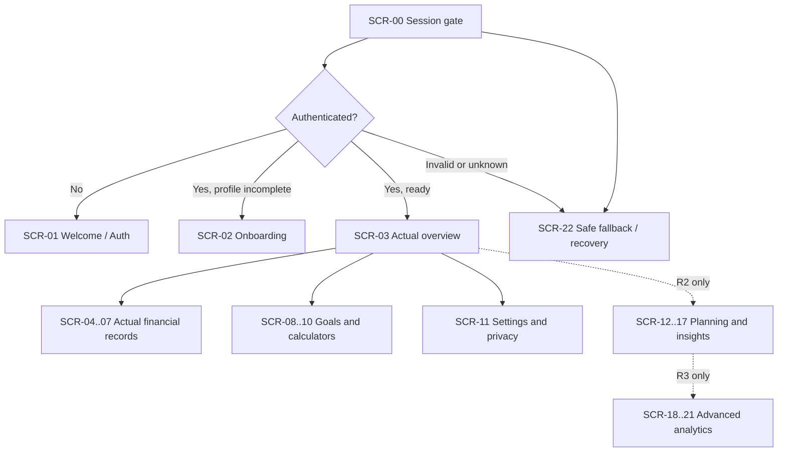
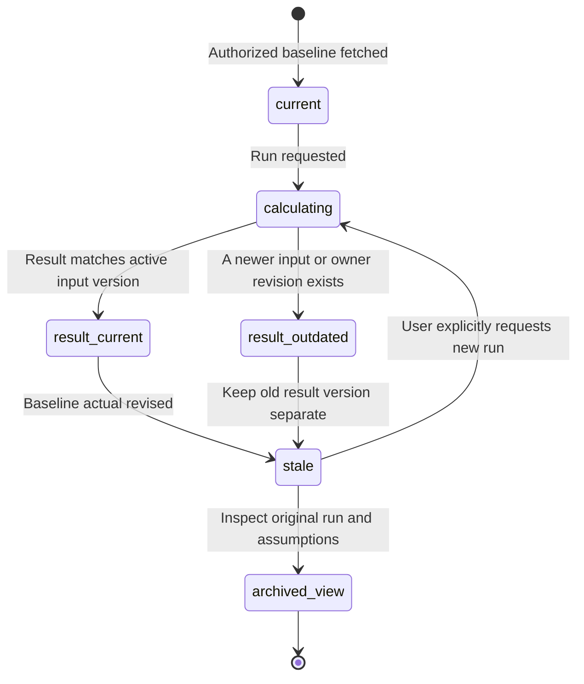
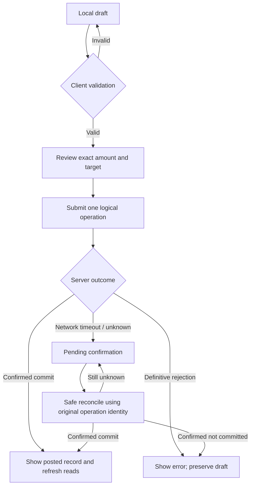

# Esokira — Flutter Screen Specifications & UI Interaction Contracts

> **Canonical path:** `docs/design/SCREEN-SPECS.md`  
> **Version:** `0.1.0`  
> **Date:** 30 October 2026  
> **Status:** `REVIEWED_INTERNAL — PENDING_OWNER_APPROVAL`  
> **Document type:** Proposed screen-level product/UX/Flutter implementation specification, **not** implemented UI, approved wireframe, API schema, or executable code.  
> **Platform:** Flutter mobile (Android/iOS); Indonesia-first locale; Go/PostgreSQL authoritative backend.  
> **Coverage:** R0 foundation, R1 MVP, R2 Planning V1, R3 Advanced. R4 Discovery is out of scope for implementation.  
> **Screen IDs:** Reuses the 23 canonical conceptual IDs `SCR-00`–`SCR-22` from `USER-FLOWS.md`; subviews use provisional `.Vxx` suffixes **without defining production route names**.  
> **Audience:** Product Owner, UI/UX designer, Flutter agent/engineer, Go API engineer, QA, security reviewer.

---

## 0. Purpose, boundaries, and authoritative references

This file answers **which screens and subviews exist, what each shows, which actions are possible, which states and restrictions apply, and how an agent can verify the UI**. It **must not** invent product capabilities, wire payload fields, numerical formulas, authentication flows, ledger semantics, or approved color decisions. The screen inventory and sample copy are implementation **proposals**, subject to review.

| Source of truth | Path relative to this file | Owns |
|---|---|---|
| Product vision | [`../product/PRODUCT-VISION.md`](../product/PRODUCT-VISION.md) | Why Esokira exists, audience, non-goals. |
| Product requirements | [`../product/PRD.md`](../product/PRD.md) | `FR-001`–`FR-024`, release boundary, user outcomes. |
| Feature dependencies | [`../product/FEATURE-MATRIX.md`](../product/FEATURE-MATRIX.md) | R0–R4 and prerequisite gates. |
| Financial domain | [`../financial/FINANCIAL-DOMAIN-RULES.md`](../financial/FINANCIAL-DOMAIN-RULES.md) | `DR-001`–`DR-024` and actual/planned separation. |
| Calculation contracts | [`../financial/CALCULATION-SPECS.md`](../financial/CALCULATION-SPECS.md) | `CS-001`–`CS-016`; numbers, assumptions, rate/time policy. |
| Golden test vectors | [`../financial/FINANCIAL-TEST-CASES.md`](../financial/FINANCIAL-TEST-CASES.md) | Test vectors, accuracy, properties, numerical edge cases. |
| System architecture | [`../architecture/SYSTEM-ARCHITECTURE.md`](../architecture/SYSTEM-ARCHITECTURE.md) | Trust boundaries and system roles. |
| Backend architecture | [`../architecture/BACKEND-ARCHITECTURE.md`](../architecture/BACKEND-ARCHITECTURE.md) | Backend business logic, authorization, financial engine and worker. |
| Frontend architecture | [`../architecture/FRONTEND-ARCHITECTURE.md`](../architecture/FRONTEND-ARCHITECTURE.md) | Flutter dependency direction, state/cache, auth and navigation boundaries. |
| Database design | [`../architecture/DATABASE-DESIGN.md`](../architecture/DATABASE-DESIGN.md) | Candidate financial schema, constraints, owner isolation and unresolved model choices. |
| API guidelines | [`../architecture/API-GUIDELINES.md`](../architecture/API-GUIDELINES.md) | HTTP conventions; examples are **not** approved OpenAPI operations. |
| Design system | [`./DESIGN-SYSTEM.md`](./DESIGN-SYSTEM.md) | Proposed semantic tokens, common components, typography, chart and accessibility language. |
| Task-level user flows | [`./USER-FLOWS.md`](./USER-FLOWS.md) | Canonical `UF-00`–`UF-31`, alternative paths, `UXT-01`–`UXT-40`, conceptual screen IDs. |
| Wire contract after approval | `../../contracts/openapi.yaml` (future) | Only an **approved** OpenAPI operation/JSON schema authorizes real API DTOs or endpoint wiring. |

**Precedence for conflicts:** product behavior -> `PRD` / `USER-FLOWS`; financial meaning -> domain / calculation specifications; structure/state -> frontend architecture; styles -> design system; wire payloads -> approved OpenAPI; data persistence -> migrations when ultimately approved. Report precise conflict and block affected implementation rather than silently selecting one interpretation.

### 0.1 Decision strength

- **DECIDED:** Flutter, Golang, PostgreSQL, monorepo (`/frontend`, `/backend`), personal financial planning/simulation positioning.
- **REQUIRED:** Ownership/security, no mutation of actual balances by a scenario, non-deceptive financial labels, no fabricated figures, loading/errors/empty handling, precise monetary meaning, accessible navigation.
- **PROPOSED:** Screen composition, subview names, navigation grouping, exact CTA text, page hierarchy, component splits, visual density and layout examples.
- **TBD:** Untaken Product Owner decision; UI can be designed for review but cannot silently decide behavior.
- **BLOCKED:** A screen path cannot become a production flow until its financial, API, security, or model gate is approved and tested.
- **OUT_OF_SCOPE:** R4 shared goals (`FR-023`) and portfolio planning (`FR-024`) are exploratory, **not** shippable screens or routes.

No document-wide `REVIEWED_INTERNAL` status approves individual `TBD/BLOCKED` decisions. Sample UI strings and examples are not evidence of real customer data, user research, backend behavior, or design usability results.

### 0.2 Hard constraints for AI coding agents

1. Do not change or reuse `SCR-00`–`SCR-22` with a different primary meaning. `.Vxx` subview IDs are proposed; production route identifiers remain TBD.
2. Do not create R2/R3 navigation items in R1 pretending they function. No fake-success graphs, demo balances or fabricated personal histories in production.
3. Do not write investment rates, Monte Carlo percentiles, goal-funded progress, net worth, mortgage totals, or risk scores using undocumented Flutter-only formulas. Render Go results and explicit provenance.
4. Never interpret planned contributions as confirmed account balance or actual goal funding. Funded-progress policy (`PRD Q-11`) is `BLOCKED`.
5. Never submit actual transfers, delete operations or corrections solely because a plan/scenario UI suggested one. All financial writes require dedicated authorized flows.
6. Hiding a screen is not authorization: Go checks resource ownership; the UI also guards entry and clears state across logout/account switches.
7. If a write times out after sending, keep its outcome **unknown**, do not show success/failure and do not re-create a new independent transaction.
8. Do not invent default return, inflation, exchange rate, retirement rule, tax, risk distribution or completion probability. Undefined or missing values remain `unknown`.
9. Do not invent endpoint paths, request/response fields or Flutter package decisions. Names in this document identify **data needs** and **UI responsibilities**, not a new wire API.
10. Implement only screens requested by an approved task and release, after resolving relevant blockers and creating tests. Do not scaffold every future R3 screen for R0.

---

## 1. Release and information architecture

### 1.1 Release boundary

| Release | What users can do | Required screen groups | Production caveat |
|---|---|---|---|
| **R0 Foundation** | Safe launch, session gate, error shell, minimal privacy-safe UI scaffolding. | `SCR-00`, cross-cutting `SCR-22`; `SCR-01` stub only if auth contract agreed. | Infrastructure readiness is not a working finance app. |
| **R1 MVP** | Profile, actual accounts/transactions, net worth, assets/loans, goals, compound and contribution calculators, data controls. | `SCR-01`–`SCR-11`, `SCR-22`. | Ledger, auth, money precision, export/deletion and funded progress gates matter. |
| **R2 Planning V1** | Budgets, recurring rules, life events, deterministic projection, scenario versions/comparison, forecast, stress testing, explainable insights, notifications. | `SCR-12`–`SCR-17`. | Baseline/versioning and deterministic models must be approved. |
| **R3 Advanced** | Multi-goal optimization, Monte Carlo runs, retirement, Financial GPS. | `SCR-18`–`SCR-21`. | Optimizer/model policy, provenance, numerical tests and async safety required. |
| **R4 Discovery** | Shared goals, portfolio planner as research only. | **None**. | Do not expose as a functioning feature. |

### 1.2 Candidate navigation: not an approved route map

| Destination (PROPOSED) | R1 content | R2 addition | R3 addition |
|---|---|---|---|
| **Beranda** | `SCR-03` actual overview, actionable next steps | Status from forecast/insights with correct source labels | Explicit entry to modeled decisions if shipped |
| **Keuangan** | `SCR-04`, `SCR-05`, `SCR-06`, `SCR-07` | `SCR-12` | No automatic scope expansion |
| **Tujuan** | `SCR-08`, `SCR-09`, `SCR-10` | Goal links to scenario | `SCR-18` optimizer |
| **Rencana** | **Not present in R1** | `SCR-13`–`SCR-16` | `SCR-19`–`SCR-21` if approved |
| **Profil / Pengaturan** | `SCR-11` | Notification preferences in `SCR-17` | Privacy controls remain available |

Candidate R1 primary nav: `Beranda / Keuangan / Tujuan / Profil`. R2 may introduce `Rencana` after usability review; R3 features should be reachable from their owning section and must **not** create a sixth tab by default. `DESIGN-SYSTEM.md` and `USER-FLOWS.md` expressly leave final information architecture unresolved. Use explicit empty-state entry links rather than silent route changes.



### 1.3 Route security and back-navigation requirements

- **Session tri-state:** `unknown/restoring`, `authenticated`, `unauthenticated`. Do not show user amounts during `unknown`.
- **Private deep links:** store only a non-sensitive intended destination; authenticate, authorize resource via Go, then open; neutral fallback on foreign/deleted/unavailable resources.
- **Back behavior:** preserve navigation hierarchy; dirty financial form prompts a discard confirmation or applies an approved draft policy; neither discards data silently nor posts automatically.
- **Session switch/logout:** cancel/ignore in-flight responses from previous session; clear user-scoped caches, drafts, pending private deep links and polling; prevent back navigation to stale private UI.
- **Modal and sheet:** cannot become a security bypass or consume an ambiguous pending-operation state without warning.
- **Unknown write state:** may require a dedicated recovery surface (within `SCR-22`) rather than a generic retry button. No automatic second POST with a new idempotency identity.
- **Navigation library:** `go_router` or alternatives remain a library selection; route names and URL schema are not ratified by this document.

---

## 2. Design and interaction patterns shared by all screens

### 2.1 Proposed page anatomy

```text
SYSTEM SAFE AREA / PLATFORM STATUS
┌───────────────────────────────────────┐
│ Screen title        Contextual action │  <- semantics, back, no financial data in OS preview
│ Source / as-of / plan version         │  <- Actual / Rencana / Proyeksi / Model
├───────────────────────────────────────┤
│ Key amount, target or decision        │  <- only when backed by real authorized data
│ Main content / chart / list / form    │
│ Empty / partial / stale disclosure    │
│ Explanation + alternative access path │
├───────────────────────────────────────┤
│ Contextual action / confirmation      │  <- no hidden commit
└───────────────────────────────────────┘
BOTTOM NAV only on designated primary destinations
```

Use the existing `DESIGN-SYSTEM.md` semantic tokens. `space.4=16`, `space.6=24`, `radius.md=14` logical px, `type.display=32`, `type.headline=24` are **PROPOSED** starting points; do not replace approved theme values with scattered hex literals. Prefer light/off-white data-reading surfaces, restrained midnight/deep teal identity, and explicit source labels rather than decoration. Respect system safe areas, portrait/landscape, dynamic type, display cutouts and keyboard insets. Never disable text scaling to preserve screenshot fidelity.

### 2.2 Candidate reusable UI building blocks

| Component concept (PROPOSED) | Used by | Behaviors that must be testable |
|---|---|---|
| `EsAppScaffold` / `EsPageHeader` | All | Guest/protected shell, safe area, navigation/exit label. |
| `EsAsyncContent` | Any server data view | `initial/loading/content/empty/partial/error/stale`, retry only for safe reads. |
| `EsFinancialSourceLabel` | Dashboard, goal, projection, chart | `Aktual/Rencana/Proyeksi/Simulasi`, timestamp, warning without color-only cue. |
| `EsCurrencyText` | Monetary summaries, tables, forms | Exact value formatting, sign, currency, selectable/full accessible value. |
| `EsAmountField` | Account, transaction, transfer, goal, calculators | Locale-aware input, exact decimal handling, ambiguous paste detection. |
| `EsDateField` | Effective date, goals, events | Distinguish effective/due/as-of; clear display in Bahasa Indonesia. |
| `EsRateField` | Calculator, stress, retirement | Visible unit and basis (annual/monthly; effective/nominal per approved model). |
| `EsAccountPicker` | Transaction/transfer | Only owned eligible accounts; account label + currency, no foreign entries. |
| `EsGoalCard` / `EsGoalStatus` | Goals/dashboard | Plan status vs funded status, no fabricated achievement percent. |
| `EsActualForecastChart` | Dashboard, projection, scenario | Different line patterns and accessible table, tooltip units/source. |
| `EsScenarioComparator` | R2/R3 | Version/period/assumption provenance, stale badges, no actual mutation. |
| `EsSimulationStatus` | R3 jobs | Queued/running/succeeded/failed/cancelled, progress only when reported. |
| `EsConfirmationSheet` | Writes/deletion/logout | Explain consequence and target; cancel accessible; no silent destructive action. |
| `EsInfoDisclosure` | Rate/loan/insight/model | Explain assumptions, missing data, uncertainty and caveats in plain language. |

Component names are candidates, **not a mandate to create a widget for each line**, nor a claim these classes already exist.

### 2.3 Screen states and required copy semantics

| UI state | Visible treatment | Action policy | Never do this |
|---|---|---|---|
| `initial` | Neutral shell, no user figures | Begin authorized fetch only | Render placeholder as a real balance |
| `loading` | Skeleton/progress and accessible label | Cancel query if owner/session changed | Call null data an empty account |
| `content` | Confirmed, dated, source-labeled data | Navigate/action per permissions | Equate user-entered actual to bank verified |
| `empty` | Explicit empty explanation + valid setup CTA | Create only after auth | Fill with fictitious transactions |
| `partial` | Missing facts warning and subset provenance | Link to fill relevant details | Turn missing into zero |
| `stale` | Old version/time label + update/compare choice | Re-run explicitly via authorized operation | Secretly replace a prior result |
| `submitting` | Lock duplicate click; retain draft | Wait for Go confirmation | Show success on tap |
| `pending_confirmation` | Neutral unresolved status and safe reconciliation | Status lookup / same operation identity if approved | Retry with new independent transfer |
| `error` | Human-readable, no sensitive debug detail | Retry only when action safe | Show raw SQL/stack/token |
| `forbidden_or_not_found` | Neutral unavailable resource | Back to safe root | Reveal foreign resource name/existence |
| `offline` | Network unavailable, optional unsynced draft label | No false sync/commit | Claim transaction recorded |
| `queued/running` | Job lifecycle, optional server-supported progress | Poll with ownership checks; cancel only if supported | Display invented percent complete |
| `succeeded/failed/cancelled` | Terminal result with provenance | View/retry new job only under approved policy | Render partial failed output as success |

**Copy candidates:** `Aktual · Dicatat pengguna`, `Rencana · Belum menjadi saldo aktual`, `Proyeksi · Berdasarkan asumsi`, `Simulasi risiko · Hasil model`, `Perlu diperbarui`, `Status pencatatan belum dapat dipastikan`, `Data belum cukup`, `Tidak bisa membuka data ini`. Hard-code none of these across widgets; use localization resources.

### 2.4 Forms, keyboard and validation behavior

1. Every field has visible label, data type, unit, required/optional status, helper text and error state when applicable.
2. Monetary amount parsing/serialization is **not decided here**. Do not use binary floating-point as the stored authoritative value for recorded balances, round silently, or treat an empty field as `0`.
3. For Indonesian formatting, test `1.250.000`, paste with separators, negatives, scale differences and invalid ambiguous values; final parser is governed by `PRD Q-04` and API contract.
4. Dates must state their meaning: `Tanggal efektif`, `Tanggal target`, `Per tanggal penilaian`, `Tanggal simulasi`; avoid ambiguous `01/02/26` for important actions.
5. Rate inputs specify unit and compounding basis; never insert a guessed investment return or inflation default.
6. Prevent accidental double-taps locally, but rely on backend-safe idempotency/atomicity for actual writes. If outcome unknown, preserve original operation identity and draft.
7. Provide field-level accessible validation and an error summary for longer forms; focus on first invalid field after submit.
8. Unsaved changes use confirmed discard/draft behavior on back, modal dismissal, logout or app interruption.

### 2.5 Charts and analytics, data provenance and uncertainty

- Actual history: labeled `Aktual`, solid line; forecast: `Proyeksi`, dashed; alternative: `Skenario B`, dotted. Pattern + text are mandatory beyond color.
- Monetary and percentage axes identify currency, time unit, relative/absolute scale, and assumptions where relevant. Tooltips must give complete values, not just `1.2M` without context.
- Provide screen-reader summary and an accessible tabular alternative for all meaningful charts. Avoid unreadable twelve-year monthly x-axis labels.
- Scenario/risk views visibly show snapshot/as-of, version, engine version where provided, input assumptions, and run time.
- Model probabilities are conditional outputs, not promises; avoid success-colored green for an estimated probability without explanation.
- For missing/invalid inputs show `Belum dapat dihitung` rather than substituting default assumptions or fabricated forecasts.

### 2.6 Responsive, dark mode, localization and privacy

- **Layout classes (proposed for testing, not hard breakpoints):** compact phone ~320–390 logical px; regular phone ~390–480; expanded phone/foldable ≥480; tablet/landscape wider. Test actual content constraints, not screen-size-specific hardcoding.
- Prefer one column on compact phones, adaptive two-panel list/detail when real estate supports it; no graph should clip its labels at larger text scale.
- Support both system light/dark visual variants per proposed semantic tokens; verify contrast/labels in context instead of assuming palette alone guarantees accessibility.
- All copy in Bahasa Indonesia, stored in localization resources; date/unit formatting per approved locale and precision. Leave English brand/product technical names where appropriate.
- Never leak names, amounts, tokens or sensitive plans to notifications, logs, screenshots, crash breadcrumbs or analytics without explicit approved privacy controls.
- Default to privacy-safe splash and neutral app-switcher previews where technically feasible; exact screen-capture policy is a security/privacy decision, not a claim of current implementation.
- No bank import, AI financial advice automation, or social/shared financial access screens are authorized by this document.

---

## 3. Canonical screen inventory and subview boundaries

**ID stability rule:** `SCR-00` through `SCR-22` were assigned as **conceptual screen areas** in `USER-FLOWS.md`. A group can contain list/detail/form/result subviews without creating a new unrelated `SCR` identity. `.Vxx` names below are provisional within that group; not URL paths, Flutter routes, backend operation IDs or class names.

| Screen | Release | Proposed principal subviews | Primary flows | Main product purpose |
|---|---|---|---|---|
| `SCR-00` | R0 | Launch, session gate | `UF-00`, `UF-30` | Safe authentication restoration. |
| `SCR-01` | R1 | Welcome, sign-in, auth error | `UF-01` | Authenticated entry. |
| `SCR-02` | R1 | Profile fields, review | `UF-02` | Minimal financial setup. |
| `SCR-03` | R1 | Actual dashboard, net worth drilldown | `UF-08` | Inspect confirmed user-recorded financial position. |
| `SCR-04` | R1 | Account list, account form, detail | `UF-03`, `UF-05` | Manage owned financial accounts. |
| `SCR-05` | R1 | Transactions, income/expense form, record detail | `UF-04`, `UF-06` | Record and correct actual activity. |
| `SCR-06` | R1 | Transfer form, review, result | `UF-05`, `UF-31` | Safe internal transfer. |
| `SCR-07` | R1 | Assets, liabilities, valuation/edit | `UF-07`, `UF-08` | Manual non-cash positions and obligations. |
| `SCR-08` | R1 | Goals, goal editor, goal detail | `UF-09`, `UF-12` | Goal plan and honest progress. |
| `SCR-09` | R1 | Compound inputs, results | `UF-10` | Transparent illustrative growth calculation. |
| `SCR-10` | R1 | Goal contribution inputs, feasibility result | `UF-11`, `UF-12` | Goal affordability and shortfall. |
| `SCR-11` | R1 | Settings, data export, deletion, logout | `UF-13`, `UF-14`, `UF-15` | Privacy and lifecycle controls. |
| `SCR-12` | R2 | Budget list/editor, recurring list/rule | `UF-16`, `UF-17` | Budget and scheduled intentions. |
| `SCR-13` | R2 | Life timeline, event form | `UF-18` | Planned life events, not actual transactions. |
| `SCR-14` | R2 | Scenario library, editor, version detail | `UF-20` | Immutable modeled scenario versions. |
| `SCR-15` | R2 | Scenario pair comparison, stale dialog | `UF-21` | Meaningful apples-to-apples comparison. |
| `SCR-16` | R2 | Projection, cash-flow timeline, stress test | `UF-19`, `UF-22`, `UF-23` | What-if and future liquidity. |
| `SCR-17` | R2 | Insights, reminder preferences | `UF-24`, `UF-25` | Explainable review and consent. |
| `SCR-18` | R3 | Optimizer inputs, feasible/infeasible result | `UF-26` | Alternative goal allocation. |
| `SCR-19` | R3 | Risk run setup, run queue, distributions | `UF-27` | Bounded, explainable Monte Carlo. |
| `SCR-20` | R3 | Retirement inputs, drawdown results | `UF-28` | Conditional retirement readiness. |
| `SCR-21` | R3 | Financial GPS alternatives, decision detail | `UF-29` | Compare actionable paths, never auto-post. |
| `SCR-22` | R0–R3 | Neutral unavailable, offline, unknown-write recovery | `UF-30`, `UF-31` | Honest failure/recovery without leaking private data. |


---

## 4. Detailed screen contracts — R0 / R1

The following sections use: **entry and purpose**, **suggested subviews**, **visual hierarchy**, **data/validation**, **states and edge cases**, **navigation and acceptance**, and **blocking decisions**. Any form field listed as a candidate is not a new mandatory database column or API property. `Vxx` variants belong to their canonical `SCR-xx` group.

### SCR-00 — Launch and protected session gate (R0)

- **Refs:** `UF-00`, `UF-30`; `FR-001`, `EN-001/003`, `NFR-001/007`; `UXT-01/02/35`.
- **Entry:** App start, resume, private deep link; device session may be `unknown`.
- **Subviews:** `SCR-00.V01` privacy-safe launch; `SCR-00.V02` session verification / temporary verification outage.
- **Composition (top-down):** approved wordmark or neutral app title → unobtrusive activity state → short non-sensitive message (`Memeriksa sesi…`) → safe retry/help only if verification genuinely failed. No financial dashboard skeleton with synthetic digits.
- **Data source:** auth session repository + server principal mapping. Never rely on cached `user_id` alone; must verify access before rendering private details.
- **State contract:** restoring → verified user and onboarding decision → `SCR-02` or `SCR-03`; unauthenticated → `SCR-01`; verification unavailable → `SCR-22` / retry; expired → invalidate private caches and show auth; foreign deep link → `SCR-22` neutral fallback.
- **Navigation:** no back to stale private page from guest route. Private deep-link destination stays pending until verified identity and server resource access.
- **Accessibility/QA:** status announced once; avoid rapid route loops/flash of old account; test cold start/offline/expired token/account switch. Never expose private values in splash or recent-app preview.
- **Blockers:** provider and token lifecycle `PRD Q-02`; offline private-cache access policy `UF-Q08`.

### SCR-01 — Welcome, sign-in and authentication recovery (R1)

- **Refs:** `UF-01`, `UF-30`; `FR-001`; `UXT-02/17/35`.
- **Subviews:** `SCR-01.V01` welcome; `SCR-01.V02` approved sign-in method; `SCR-01.V03` recoverable auth failure/cancel.
- **Hierarchy:** Esokira identity + one sentence of product purpose → approved sign-in choices → privacy/data-use explanation → secondary help link. If credentials flow is not approved, **do not fabricate email-password, Google, Apple or OTP screens**.
- **Data/actions:** sign-in starts provider-controlled flow; only verified backend session unlocks data. Cancel leaves visitor unchanged. If user has a safe pending private destination, ownership is resolved before navigating to it.
- **States:** idle, provider-in-progress, cancelled, invalid credentials, provider offline/rate limited, backend mapping failure, authenticated. A partial provider success is **not** proof of authorized Go session.
- **UI rules:** no sign-up count, award, simulated account assets or misleading security certifications. Error copy excludes raw tokens and internal provider responses.
- **QA:** login cancel, back, double tap, token expiry, switch accounts, screen-reader focus, unauthenticated deep links.
- **Blockers:** `PRD Q-02`, provider-specific privacy/consent, account merge policy (`UF-01 A04`).

### SCR-02 — First financial profile and onboarding (R1)

- **Refs:** `UF-02`; `FR-002`, `DR-017`, `NFR-008`; `UXT-03/38`.
- **Subviews:** `SCR-02.V01` minimum profile fields; `SCR-02.V02` review/what is missing; `SCR-02.V03` next-step chooser.
- **Hierarchy:** heading `Mulai dari kondisi keuanganmu` → why each item helps planning → approved required/optional fields → `Tinjau` → save acknowledgment → `Buat akun keuangan` or `Buat tujuan` (depending on prerequisites).
- **Candidate fields:** currency preference, user-entered monthly income/expenses, planning horizon and relevant date/age **only if approved by PRD/consent review**. Do not require salary or birth date by assumption; unknown ≠ zero.
- **Data boundary:** values supplied by user are not independently verified bank data. Onboarding must not create actual transactions merely from a profile estimate. Saving must be confirmed by Go.
- **States:** unstarted, partial-valid, local-invalid, submitting, confirmed, ambiguous, offline draft-only (if permitted), missing data with honest explanation.
- **Navigation:** skip only optional fields, preserve unsaved input according to approved local storage, no route trap when user chooses limited functionality.
- **QA:** optional blank, invalid numeric parse, privacy disclosure, back while dirty, session change during submit. No sensitive data in analytics.
- **Blockers:** `UF-Q03` exact field/required matrix, `PRD Q-04`, draft persistence `UF-Q08`.

### SCR-03 — Actual overview and net worth (R1)

- **Refs:** `UF-08`; `FR-006`, `FR-003`–`FR-005`; `DR-005/006/009/010/014`, `CS-004`; `UXT-09/10/37`.
- **Subviews:** `SCR-03.V01` overview; `SCR-03.V02` net worth breakdown / as-of detail.
- **Hierarchy:** `Kondisi Keuangan` → `Aktual · Dicatat pengguna · per [tanggal]` → primary net worth with explicit sign → assets/debt breakdown → cash/account summary → period income vs expense (excluding transfers) → recent user-entered activity → actionable empty-data guidance.
- **Data:** server-authorized aggregation; account cash, asset valuations and liabilities may have different dates. A manual asset already represented by an account balance must not be counted twice. Show `Data belum lengkap` for gaps.
- **Chart:** use source-labeled solid historical series **only if historical values are actually available**; do not draw invented growth trends or treat planned contribution as a real gain. Text table or accessible breakdown required.
- **States:** loading, no accounts/transactions, partial valuations, all-current, stale as-of, error, disconnected. Negative net worth is valid and not displayed as a rendering error.
- **Actions:** open account, transactions, assets/liabilities, goals; refresh confirmed data; optional period filter if approved.
- **QA:** opening amount not income; transfers do not affect income/expense or net worth absent fees/FX; negative value and big-number accessibility; response arriving after logout discarded.
- **Blockers:** ledger/accounting `PRD Q-03`, currency/rounding `Q-04`, asset valuation / consolidation policy.

### SCR-04 — Financial accounts and opening balances (R1)

- **Refs:** `UF-03`, `UF-05`; `FR-003/004`; `DR-004/005`, `CS-003`; `UXT-04/06/38`.
- **Subviews:** `SCR-04.V01` owned accounts list; `SCR-04.V02` add account / opening balance form; `SCR-04.V03` account detail/activity.
- **Hierarchy (list):** total owned-account position with as-of qualifier → account cards (name, type, currency, last known amount) → add CTA; empty view explains no account data yet.
- **Candidate form:** account display name; category; approved currency; opening amount; opening effective date/as-of; optional note. Show warning `Saldo awal bukan pemasukan periode berjalan` prior to confirmed posting.
- **Validation:** name nonempty per approved model; valid category/currency; exact amount/scale; calendar date; duplicates and negative balance based on policy. Never infer bank integration from account picker.
- **States:** creating, editing allowed-only fields, confirmed, retry unknown, archived/deleted, error. Historic opening correction is **blocked** until ledger audit policy selected.
- **Actions:** add; view activity; initiate transfer through `SCR-06`; open actual transaction form `SCR-05`. No optimistic balance increment before backend commit.
- **QA:** opening counted once, cross-user list/resource deny, duplicate submit, as-of vs posting date, accessible account selection.
- **Blockers:** `PRD Q-03/Q-04`, `DB-Q01` model, account archival/correction rules, API operationId.

### SCR-05 — Actual transactions and correction lifecycle (R1)

- **Refs:** `UF-04`, `UF-06`, `UF-31`; `FR-004`, `DR-004/008/018`; `UXT-05/08/36/38`.
- **Subviews:** `SCR-05.V01` transaction history; `SCR-05.V02` income/expense editor; `SCR-05.V03` posted record detail/correction; `SCR-05.V04` unresolved submission status.
- **Hierarchy (history):** period selector if supported → clear `Pemasukan` / `Pengeluaran` summary → dated list grouped by effective date → explicit type, account, exact amount, category/status. Internal transfers should be labeled separately, not counted in total spending.
- **Candidate form:** mutually exclusive income or expense; owned account; positive magnitude; category (if supported); effective date; optional note. Review type/account/amount before final confirmation.
- **Data/action:** creates a user-recorded **actual** event only after Go validates and posts; approved correction may update/reverse with audit trail. No generic hard delete of posted financial history without policy.
- **Critical state machine:** editing → validating → submitting → `confirmed` OR `rejected` OR `pending_confirmation`; unknown result goes to safe status reconciliation, not a fresh POST with a new identity.
- **Errors:** expired identity, account not owned, precision invalid, concurrent update conflict, offline, duplicate request, posting rules conflict; keep draft and explain recovery.
- **QA:** timeout after commit produces exactly one logical event; reversal/linked transfer integrity; no sensitive raw payload logs; range/date and empty-list tests.
- **Blockers:** `PRD Q-03/Q-04`, correction semantics, API idempotency/reconciliation contract.

### SCR-06 — Internal transfer and review (R1)

- **Refs:** `UF-05`, `UF-31`; `FR-004`, `DR-006/007/008`, `CS-003`; `UXT-06/07/36`.
- **Subviews:** `SCR-06.V01` transfer input; `SCR-06.V02` pre-submit review; `SCR-06.V03` committed or unresolved outcome.
- **Hierarchy:** heading `Transfer antarakun` → `Dari akun` and `Ke akun` owner-filtered pickers → amount/currency → effective date → neutral explanation `Bukan pemasukan atau pengeluaran` → review exact movement of funds → explicit `Konfirmasi transfer`.
- **Validation:** source/destination both owned, distinct, supported currencies, allowed balance rule, positive exact amount, supported fee/FX policy. Do not quietly convert currency or impose arbitrary insufficient-funds rule.
- **Atomic semantics:** two linked sides posted or neither; backend enforces. The UI must not mutate both balance widgets locally as final truth before confirmation.
- **Unknown outcome:** show `Status transfer belum dapat dipastikan`; retain original operation identity; safe status inquiry first; do not offer `Kirim lagi` that creates a different transfer.
- **Error/QA:** cross-user destination must be rejected neutrally; concurrent transfer and double tap; fee impact explained if ever approved; screen reader announces both accounts and transfer distinction.
- **Blockers:** ledger model, multi-currency/fee policy, idempotency contract and reconciliation read operation.

### SCR-07 — Assets, liabilities and valuations (R1)

- **Refs:** `UF-07`, `UF-08`; `FR-005/006`, `DR-009/010`, `CS-004`; `UXT-09/10`.
- **Subviews:** `SCR-07.V01` grouped asset/liability overview; `SCR-07.V02` manual asset/valuation editor; `SCR-07.V03` debt/outstanding liability editor.
- **Hierarchy:** summary separated into `Aset di luar saldo akun` and `Kewajiban` → rows with type, valuation/as-of, outstanding principal if relevant → form-entry disclosure → cross-check with net worth.
- **Candidate inputs:** asset name/type, valuation amount and valuation date; liability name/type, outstanding principal and as-of date; payment/interest data only if domain contract approves. No automatic market prices or amortization from unexplained defaults.
- **Semantics:** distinguish cash balance, separate manual asset, outstanding debt, and future scheduled debt payment; loan proceeds do not become earnings. Duplicate representation of same asset is flagged or governed by approved model.
- **States:** no asset, only liabilities, stale valuation, partial account ownership, invalid principal/currency, save pending/ambiguous; explanatory negative net worth remains allowed.
- **Actions:** add/edit/archive according to final data policy; inspect valuation source/date; return to `SCR-03` net worth breakdown.
- **QA:** duplicate asset aggregation check; debt payoff accounting; stale date label and accessible difference between value and principal.
- **Blockers:** position/valuation rules, amount storage/FX, historical balance correction, liability schema.

### SCR-08 — Financial goals: plan versus funding (R1)

- **Refs:** `UF-09`, `UF-12`; `FR-007/009`, `DR-011/012`, `CS-007`; `UXT-11/14/38`.
- **Subviews:** `SCR-08.V01` goal list; `SCR-08.V02` goal editor; `SCR-08.V03` goal detail / target timeline.
- **Hierarchy:** goal title and target date → target **planned** amount → editable priority if supported → calculation and feasibility links → **clearly named** funding status area (only if backend can substantiate actual attribution).
- **Candidate goal fields:** label, target nominal, target date, optional starting allocation/source, priority as approved; separate planned contribution field where relevant. User-entered target is an intention, not bank-verified funds.
- **Prohibition:** do **not** show a `75% terkumpul` ring calculated from planned contributions or from one account's total without approved goal funding attribution. Prefer `Target Rp…`, `Setoran rencana Rp…`, `Pendanaan aktual belum tersedia` until `PRD Q-11` is resolved.
- **States:** empty, goal saved, feasible estimate, infeasible estimate, invalid date, actual linkage unknown, completed/cancelled only with approved lifecycle semantics.
- **Actions:** create/update goal, launch `SCR-10` contribution estimator and `SCR-09` compound calculator, review timeline. No automatic transfer or account debit upon selecting `Simpan rencana`.
- **QA:** funded/planned distinction, goals with past deadlines, unsaved edits, cross-user goal link, screen reader goal semantics.
- **Blockers:** `PRD Q-11` goal funding model; target future-value policy/precision; completion/status lifecycle.

### SCR-09 — Compound interest illustration (R1)

- **Refs:** `UF-10`; `FR-008`, `CS-005/006`, `DR-015/017`, `NFR-002`; `UXT-12/13/37`.
- **Subviews:** `SCR-09.V01` calculator inputs; `SCR-09.V02` results and breakdown.
- **Hierarchy:** brief educational purpose → fields with visible units and timing → `Hitung estimasi` → dominant future-value estimate **labeled Proyeksi** → contribution vs estimated growth → chart/table over time → assumptions and limitations.
- **Candidate inputs:** initial capital, periodic contribution, number of periods/years, return input with rate basis and period, optional inflation when approved, contribution timing at beginning/end per `PRD Q-04`.
- **Data rule:** Go engine owns results. May use locally computed preview only if independently specified/validated, visibly preliminary, and never mistaken for a saved financial result. Rate zero and zero horizon are valid mathematical cases governed by `CS-005`.
- **No invented values:** blank input stays missing; do not pre-fill annual return with guessed `8%`, or claim projected growth is guaranteed. A `Hitung` result includes assumptions/version/context supplied by API.
- **States:** untouched, invalid input, submitting calculation, result, failed with editable draft, stale result when inputs differ from the displayed calculation, offline unavailable if no approved local contract.
- **QA:** golden reference zero rate, contribution timing, annual-effective conversion, value breakdown, accessibility chart table, locale paste errors.
- **Blockers:** `PRD Q-04/Q-05`, approved `CS-005/006` convention, live OpenAPI calculation contract, calculator guest access `UF-Q17`.

### SCR-10 — Required contribution and goal feasibility (R1)

- **Refs:** `UF-11`, `UF-12`; `FR-009`, `FR-007`, `CS-007`, `DR-011/017`; `UXT-13/14`.
- **Subviews:** `SCR-10.V01` goal contribution inputs; `SCR-10.V02` feasibility result and alternatives.
- **Hierarchy:** selected goal/time horizon → current **goal-relevant** starting amount if defined → capacity to contribute → explicit growth assumptions → `Hitung kebutuhan` → estimated required contribution → feasible/infeasible with shortfall → user-controlled alternatives.
- **Data input:** selected goal target/date; income/expense-based saving capacity if sufficiently known; currently attributed goal funds only when Q-11 model is approved. Unknown cash flow must be labeled unknown, not treated as unlimited capacity.
- **Result:** show assumptions, frequency, amount units, clear determination of infeasibility. Do not silently extend deadline, overwrite saved goal, assign future salary increases, or transfer actual funds.
- **States:** incomplete, infeasible, feasible-under-assumptions, zero/expired horizon, API error, inputs changed and prior result needs recomputation.
- **Actions:** inspect breakdown, edit draft assumptions, explicitly save a proposed plan/version according to final product policy; return to goal detail.
- **QA:** distinguish `kebutuhan setoran` from actual account transfer; negative/zero horizon, rate uncertainty, shortfall explanation, result not guaranteed.
- **Blockers:** goal attribution `PRD Q-11`, rate basis `Q-04/Q-05`, feasibility/required savings contract.

### SCR-11 — Settings, privacy and account data lifecycle (R1)

- **Refs:** `UF-13`, `UF-14`, `UF-15`; `FR-001/021`, `NFR-001/008`; `UXT-15/16/17/35`.
- **Subviews:** `SCR-11.V01` settings/privacy overview; `SCR-11.V02` export request/status; `SCR-11.V03` account/data deletion confirmation/status; `SCR-11.V04` logout and session switch.
- **Hierarchy:** account identity (minimal safe info) → privacy and data controls → export action → account deletion, visually distinct destructive action → logout. Notifications preference is R2 `SCR-17`, not silently enabled in R1.
- **Export:** show approved scope and file format; authenticate/authorize owner; `request accepted` vs `file ready` must be separate; secure download expiry/availability must follow backend privacy contract. No foreign user export.
- **Deletion:** explicit consequence and re-authentication if required; pending/processing/completed/error are distinct states; never claim deletion completed on an initial asynchronous acknowledgment.
- **Logout:** end valid session, clear private caches/drafts/polling/pending route and prevent back-stack exposure. Do not cache financial PDFs/exports in unprotected locations by default.
- **QA:** export other account denied; deleted data absent after confirmed completion; back after logout; accidental deletion; screen reader destructive action semantics.
- **Blockers:** `SECURITY-PRIVACY.md` not yet approved, `UF-Q07`, provider/session Q-02, retention policy, export contract and secure delivery.


---

## 5. Detailed screen contracts — R2 Planning V1

All R2 pages are conditional on the actual-data baseline and their approved scenario/forecast models. Nothing in the following sections permits agent to generate a financial projection with hand-picked rates, silently mutate R1 records, or introduce live R2 navigation in R1.

### SCR-12 — Budgets, recurring rules and monthly reviews (R2)

- **Refs:** `UF-16`, `UF-17`; `FR-010`, `DR-006/008/012/013`, `CS-008`; `UXT-18/19`.
- **Subviews:** `SCR-12.V01` budget overview; `SCR-12.V02` budget editor; `SCR-12.V03` recurring schedule list; `SCR-12.V04` recurring rule editor/history.
- **Budget hierarchy:** selected period → planned limits → **actual spending only** per category → remaining/exceeded status → transactions behind totals. Expenses exclude internal transfer principal.
- **Candidate fields:** category, budget amount, start/end period and recurrence details when approved. Show planned limit and recorded actual side-by-side, never conflate a scheduled recurring entry with a posted transaction.
- **Recurring lifecycle:** user edits a schedule; schedule remains `Rencana` until Go confirms actual posting, if automated posting is later approved. No silent auto-debit assumptions or duplicate occurrence after worker retry.
- **States:** no budgets, partial account/category mapping, over-budget, scheduled only, posted instance exists, conflict, editing, ambiguous write. Allow unsaved-change confirmation and accessible date recurrence labels.
- **Actions:** create/edit limit, inspect source expenses, configure recurring behavior, disable/archive rules under approved semantics.
- **QA:** transfer not counted as spend; periods at month boundary; repeated recurring execution does not duplicate transactions; no retroactive total mutation without clear policy.
- **Blockers:** `UF-Q10` auto-post vs reminder-only, categories/timing and ledger policies; API recurrence contract.

### SCR-13 — Life timeline and life-event editor (R2)

- **Refs:** `UF-18`; `FR-011`, `DR-001/002/012`, `CS-009`; `UXT-20/38`.
- **Subviews:** `SCR-13.V01` timeline of planned life events; `SCR-13.V02` add/edit event; `SCR-13.V03` event impact preview.
- **Hierarchy:** title `Rencana hidup` → scenario/baseline label → timeline ordered by event date → event cards (type, financial effect, time, assumptions) → `Tambah peristiwa` → impact disclosure before saving.
- **Candidate event inputs:** label/category (education, house, family, career as examples), future date/range, optional one-time or periodic modeled effect; specific categories and cost basis remain approved product/domain decisions.
- **Boundary:** a future home purchase event must stay hypothetical; creating it does **not** create an actual home asset, debt, expense, loan or bank transfer.
- **States:** no future events, incomplete cost assumptions, overlapping dates, historical effective-date mismatch, draft/save conflict, scenario version immutable rules.
- **Actions:** add, edit draft event, inspect referenced scenario and launch deterministic projection via `SCR-16`; edits to an immutable version require new version, never rewrite prior validated run.
- **QA:** amount/date consistency, ordering and accessible timeline, no actual ledger changes, changed baseline gets stale treatment.
- **Blockers:** scenario baseline/version policy `PRD Q-06`, event cost model `Q-05`, domain timing conventions.

### SCR-14 — Scenario library, builder and immutable versions (R2)

- **Refs:** `UF-20`; `FR-013`, `DR-001/002/014/016`, `CS-012`; `UXT-22/24/40`.
- **Subviews:** `SCR-14.V01` scenario list; `SCR-14.V02` scenario draft/editor; `SCR-14.V03` saved immutable version detail; `SCR-14.V04` new version confirmation.
- **Hierarchy:** scenarios list with names and revision/as-of → selected baseline snapshot → editable assumption deltas with source/magnitude/date → before-save review → immutable version detail with `Dibuat`, `Asumsi`, `Versi baseline`, `Versi engine` if present.
- **Model:** scenario inputs are **overlays** over a chosen verified baseline, not a second mutable actual ledger. A saved version retains its original assumptions; a change creates a new version.
- **States:** no baseline, draft, initial/saved version, insufficient inputs, stale version after actual update, conflict, error, unauthorized version.
- **Actions:** create from current baseline, inspect existing version, duplicate into a new draft, submit version, open projection or comparison. Never silently refresh existing versions when actual data changes.
- **Accessibility:** label each change vs baseline; announce version number and stale status as text, not only a visual badge.
- **QA:** version A unaffected after creating B; same immutable version retrievable; cross-owner access denied; version list remains coherent during back navigation.
- **Blockers:** `PRD Q-06`, `SCENARIO-ENGINE.md` future approval, API version/snapshot schema, cache revision semantics.

### SCR-15 — Scenario comparison and stale baseline handling (R2)

- **Refs:** `UF-21`; `FR-013/014`, `DR-014/016`, `CS-012`; `UXT-23/24/37/40`.
- **Subviews:** `SCR-15.V01` select comparable scenario pair; `SCR-15.V02` comparison results; `SCR-15.V03` stale/incompatible assumptions notice.
- **Hierarchy:** `Bandingkan skenario` → version selectors → **compatibility summary** (baseline, as-of, currency, horizon, engine) → key deltas with units and dates → side-by-side graph → chart data table → explanation of differences and assumptions.
- **Validation:** reject or explicitly normalize incompatible currency/time horizon/valuation definitions using an approved rule; do not compare figures merely because both are numeric.
- **Stale:** old results remain inspectable with `Perlu diperbarui`, timestamp and original baseline details. Offer `Buat perhitungan baru` as an explicit action, preserving old versions/results.
- **States:** select pending, insufficient data, compatible result, incompatible pair, stale A/B, loading rerun, network error, old result arriving after newer version (must not overwrite).
- **Actions:** swap selected order, show assumptions, request new version/run, navigate to scenario editor. Never change actual accounts.
- **QA:** mismatched horizon refused/clearly explained; stale badge persists; accessible series distinction; no graph with fabricated historical returns.
- **Blockers:** `UF-Q09`, scenario schema, comparison normalization and engine baseline semantics.

### SCR-16 — Deterministic life projection, cash-flow and stress test (R2)

- **Refs:** `UF-19`, `UF-22`, `UF-23`; `FR-012/014/015`, `CS-009/011`, `DR-014/015/017`; `UXT-21/25/26/37/40`.
- **Subviews:** `SCR-16.V01` projection assumptions and run; `SCR-16.V02` deterministic projection result; `SCR-16.V03` monthly/periodic cash-flow forecast; `SCR-16.V04` stress-test setup and baseline-vs-shock result.
- **Hierarchy (projection):** baseline/scenario identifier → explicit time horizon and assumptions → `Hitung proyeksi` → chart with `Aktual` boundary and future `Proyeksi` segment → dated milestones → summary of limitations.
- **Hierarchy (cash flow):** period selector → starting cash position → modeled inflows/outflows and obligations by period → shortfall periods **clearly labeled future** → table describing causes and assumptions.
- **Stress inputs:** an explicitly hypothetical shock type/duration/magnitude (e.g. income disruption), using approved model; show `Tanpa perubahan` and `Dengan skenario` side by side.
- **Boundary:** deterministic projections are **not actual records** and must never post events into financial accounts. Reproducible outputs reference baseline, model version, input assumptions and as-of. Missing variables lead to partial/unavailable results, not automatically filled defaults.
- **States:** draft, validating, run computing, content, incomplete assumptions, stale baseline, failed computation, no cashflow data, negative projected balance, outdated response.
- **QA:** deterministic same-input reproducibility; stress vs baseline with actual unchanged; negative projected cash recognized as a shortfall; chart accessibility and unit/source/time axes.
- **Blockers:** `PRD Q-05/Q-06`, future `SCENARIO-ENGINE.md`, approved numerical/time-step ordering `CS-009/011` and API contracts.

### SCR-17 — Explainable insights and notification preferences (R2)

- **Refs:** `UF-24`, `UF-25`; `FR-016/022`, `DR-003/015/017/019`, `CS-016`, `NFR-008`; `UXT-27/28/39`.
- **Subviews:** `SCR-17.V01` insights list; `SCR-17.V02` insight evidence/explanation; `SCR-17.V03` notification/reminder preferences and permission outcomes.
- **Insight hierarchy:** actionable text (e.g. insufficient goal capacity) → evidence source and date → calculation/scenario link → trade-off and uncertainty disclosure → user-selected next action. **Evidence must match an approved rule**, not a generative guess.
- **States:** no insight because no evidence, data insufficient, dated/stale insight, content, revoked consent, notification permission denied, provider unavailable.
- **Notification controls:** distinct app preference vs OS permission. Opt-out cannot block core planning; sensitive amounts/accounts should not appear in push body by default. No repeated nagging prompt.
- **Actions:** inspect evidence, navigate to source goal/scenario, opt in/out to approved reminder categories and cadence; never instruct automated real investment trade from an insight.
- **QA:** insufficient evidence yields `Belum cukup data`; permission denied but core app functional; no private amount in notification preview or telemetry.
- **Blockers:** rule-based insight policy, `UF-Q14`, consent/retention and notification provider/cadence, approved permission copy.

---

## 6. Detailed screen contracts — R3 Advanced

The following R3 screens are **design proposals only**. Their algorithms are `BLOCKED` until the dedicated optimizer, stochastic simulation, and retirement model specifications are approved and their numerical tests pass. Do not generate artificial risk probabilities merely to fill a chart.

### SCR-18 — Multi-goal contribution optimizer (R3)

- **Refs:** `UF-26`; `FR-017`, `CS-013`, `DR-011/015`; `UXT-29/37`.
- **Subviews:** `SCR-18.V01` select eligible goals and constraints; `SCR-18.V02` proposed allocation plan; `SCR-18.V03` infeasible explanation.
- **Hierarchy:** goals and priorities from approved current plans → available periodic saving capacity → hard constraints/time horizon → `Cari alternatif` → per-goal proposed contributions by period → explicit unmet targets and trade-offs → option to inspect another draft.
- **Model:** objective function and tie-breaking are not selected here. Do not label allocation as `optimal` until the method and objective are approved; candidate copy `Alternatif pembagian dana` is safer.
- **States:** constraints missing, inconsistent capacities, calculation pending, feasible candidate, infeasible with reasons, outdated source goals, error.
- **Actions:** adjust **proposed** priorities/capacity, compare alternatives, save plan as draft/version if supported. Must not automatically debit an account, reassign actual funds, or mark goals funded.
- **QA:** aggregate scheduled contributions never exceed modeled capacity; infeasibility is honest; no hidden goal dropped; results and solver version traceable.
- **Blockers:** `PRD Q-07/Q-11`, future `GOAL-OPTIMIZER.md`, solver/reference test approval.

### SCR-19 — Monte Carlo risk simulation runs (R3)

- **Refs:** `UF-27`; `FR-018`, `CS-014`, `NFR-003/004/006`; `UXT-30/31/32/37/40`.
- **Subviews:** `SCR-19.V01` run setup and assumptions; `SCR-19.V02` queued/running run monitor; `SCR-19.V03` terminal result: percentiles and goal success; `SCR-19.V04` failed/cancelled result detail.
- **Hierarchy:** scenario/goal chosen → model assumptions (return distribution, volatility, asset correlation, inflation, number of paths/seed if exposed and approved) → contextual warning → `Jalankan simulasi` → status/result with baseline revision, model version, run time and sample count → percentiles + accessible table/uncertainty caveat.
- **Request lifecycle:** initial submit may only return accepted/queued. Show `Diterima` or `Sedang dihitung`, then server-confirmed terminal state. Progress percent is only shown when backend publishes supported progress.
- **Result semantics:** e.g. `72% lintasan model memenuhi target`, **never** `72% pasti berhasil di dunia nyata`. Display model, seed, path count, assumptions and risk limitations. Any percentiles are from Go result, not randomized by Flutter.
- **States:** quota exceeded, invalid risk inputs, accepted, queued, running, succeeded, failed, cancelled (only when supported), expired/unavailable result, stale baseline, interrupted connection. Polling stops after logout and respects resource ownership.
- **Actions:** inspect saved results, show full assumption disclosure, rerun explicitly (not automatic silent recomputation), request cancellation only if supported; cancelled/failed partial paths never presented as completed.
- **QA:** `202 Accepted` != complete; no invented progress; seeded reproducibility within approved tolerance; authorized job/status/result access; cancellation and network reconciliation.
- **Blockers:** `PRD Q-08`, future `MONTE-CARLO.md`, worker/queue/idempotency policy, quota and retention model, chart methodology.

### SCR-20 — Retirement and financial independence planner (R3)

- **Refs:** `UF-28`; `FR-019`, `CS-015`, `DR-015/017`; `UXT-33/37`.
- **Subviews:** `SCR-20.V01` retirement input and timeline; `SCR-20.V02` estimated retirement runway and scenarios.
- **Hierarchy:** separate target retirement age vs estimated financial independence milestone → current positions and periodic contributions (user-authorized) → future spending and withdrawal assumptions → `Hitung skenario` → modeled portfolio/cash runway and depletion point if any → readable explanation of uncertainty.
- **Candidate inputs:** retirement target/date, time horizon, modeled post-retirement expenses and other income; inflation, return sequence and withdrawal rules only from approved calculation spec.
- **Semantics:** do not use the `4% rule` as a universal built-in truth. A model result depends on assumptions; output is not advice to stop working, sell assets or buy an investment product.
- **States:** inputs incomplete, no eligible balance, computing, estimate with caveats, modeled depletion, model invalid/unavailable, stale profile/baseline.
- **Actions:** edit forecast assumptions, compare drafts where supported, inspect the contribution/withdrawal timeline; never move real funds.
- **QA:** depletion visibly called out, assumptions and time units accessible, output not presented as guaranteed.
- **Blockers:** retirement/withdrawal model policy `UF-Q13`, `CS-015` approval, longevity/horizon and tax treatment.

### SCR-21 — Financial GPS: explainable alternative paths (R3)

- **Refs:** `UF-29`; `FR-020`, `FR-016/017/018`, `CS-016`, `DR-019/020`; `UXT-34/37`.
- **Subviews:** `SCR-21.V01` goal/risk summary and alternatives; `SCR-21.V02` selected path details, evidence and comparison; `SCR-21.V03` user-approved draft next step.
- **Hierarchy:** specific user-selected goal/issue → concise evidence and source confidence → 2–3 **actual computed** alternative scenario paths if available → differences in timelines/capacity/risk → trade-off explanation → `Bandingkan` / `Simpan sebagai rencana` (if supported).
- **Rules:** no generic AI-generated prescriptions, no hidden rank pretending universal best, no automated real money transfer, loan application or trade. If model output is unavailable or inconsistent, show `Belum ada dasar yang cukup untuk memberi alternatif` and a transparent missing-data action.
- **States:** no valid evidence, available alternatives, conflicting constraints, old/stale run, requested alternative not feasible, cancelled/failed prerequisite simulation.
- **Actions:** inspect model evidence, open underlying scenario or optimizer result, choose a **draft plan**, compare what changed, explicitly confirm save when available. Ledger remains unchanged.
- **QA:** selecting a suggested path creates or selects a hypothetical version only; current actual balances/transactions unaffected; comparison values come from valid same-basis calculations.
- **Blockers:** approved insight policy/model outputs, goal solver and Monte Carlo dependences, future Financial GPS explanation specification and owner review.

### SCR-22 — Safe fallback, private resource unavailable and offline reconciliation (R0–R3)

- **Refs:** `UF-30`, `UF-31`, plus auth/private write flows; `FR-001/004`, `NFR-001/006/007`; `UXT-02/17/35/36/39`.
- **Subviews:** `SCR-22.V01` neutral unavailable/not found; `SCR-22.V02` session-expired re-auth; `SCR-22.V03` offline read and draft notice; `SCR-22.V04` unknown write outcome reconciliation; `SCR-22.V05` generic safe error state.
- **Hierarchy:** neutral icon/title (`Data tidak dapat dibuka`) → short explanation without resource details → safe primary action (`Kembali ke beranda`, `Masuk kembali`, `Periksa status pencatatan`) → optional support/error reference with no PII.
- **Unauthorized link:** respond the same whether resource is forbidden or nonexistent where policy requires indistinguishability. Do not leak account names, IDs, private goal details, ownership, or authorization mechanism.
- **Unknown write:** retain the original operation identity and request fingerprint securely according to approved policy; show `Belum dapat dipastikan`; allow only safe status reconciliation. Do not mark failed when server may have committed, do not create a second event by retrying a fresh POST.
- **Offline:** user may view previously approved safe cached content **only if** device/cache privacy controls have been accepted; otherwise use non-sensitive unavailable UI. Unsynced edits are clearly labeled drafts and never counted as committed.
- **Session switch:** dispose old route/data subscriptions and ignore delayed HTTP response; no private flash when back gesture or system app switcher is used.
- **QA:** foreign/deleted links, expired token, interrupted transfer after server commit, airplane mode, wrong-device session, error messaging/analytics leakage.
- **Blockers:** auth `Q-02`, offline cache `UF-Q08`, idempotency and retry status endpoint, secure local draft/retention policy.


---

## 7. Cross-screen data contract and state ownership (UI-level only)

### 7.1 Display model: distinguish source, ownership and financial meaning

| Displayed concept | Data source / semantic class | Required annotation | Forbidden assumption |
|---|---|---|---|
| Account balance | User-recorded actual; authorized Go aggregation | Currency, as-of, recording source | Real-time bank verified |
| Net worth | Actual position derived from owned accounts/assets/liabilities | As-of, input completeness, negative sign | Growth = income; overlapping assets double counted |
| Income/expense | Confirmed actual posted events | Effective date, type, account, status | Internal transfer = income/expense |
| Goal target | User-selected plan | Target date and currency | Target amount currently available |
| Goal funding | Actual attributed funds, **when model approved** | Attribution source and date | Sum of planned contributions = funded |
| Compound estimate | Deterministic calculation output | Rate basis, timing, contribution assumptions, model date | Future guaranteed return |
| Life event | Hypothetical planned effect | Event date, scenario/version | Actual liability/expense automatically created |
| Scenario comparison | Stored immutable modeled versions | Baseline, engine version, horizon, stale status | Comparing incomparable horizons as if identical |
| Future cash-flow | Projection, not actual cash | Period and shortfall assumptions | Negative forecast is posted overdraft |
| Monte Carlo success | Conditional proportion of modeled paths | Model, seed/path count, risk caveats | Promise of real-world success |
| Financial GPS alternative | Explainable modeled decision path | Trade-off + evidence and origin | Auto-executed transfer/trade/recommendation certainty |

### 7.2 Ownership and UI repository boundaries

- `SessionRepository` (candidate) owns verified session state; screens observe but cannot manufacture authentication status.
- Accounts, transactions, goals and settings read via their feature repositories; backend authorizes every resource. Local filtering alone does not provide ownership security.
- Scenario drafts are separate from saved immutable versions and from actual account records. No cross-feature direct mutation of DTOs.
- Read cache keys must include **user/session identity**, resource, filters, as-of/revision where relevant. On logout or owner change, clear/rotate keys, stop polling and discard delayed responses.
- Server-derived finance outputs store provenance (`calculated_at`, `baseline_revision`, `model_version` and `seed` when supplied), never only a naked chart series.
- Error models should preserve a safe machine-readable category and correlation reference; do not expose private request bodies or internal stack traces.
- The eventual approved `contracts/openapi.yaml` is required to define serialization, operation IDs, date and money types. **This UI document intentionally defines none of them as production JSON.**

### 7.3 Staleness and race-condition contract



Every result view must compare **the identifier/version from the request** with its currently selected input/version context. If mismatched, do **not** overwrite currently displayed authoritative data with an older response, even if it finishes last (`UXT-40`). When an actual baseline changes, previously stored scenario result remains reproducible and is labeled stale; do not silently invalidate its historical provenance.

### 7.4 Financial mutation lifecycle and UI integration



This state graph is a **design requirement**, not evidence that a status endpoint exists. If the required reconciliation contract is not implemented, affected actual-write flows remain **BLOCKED**, rather than adding a misleading generic `Coba lagi` action.

---

## 8. Validation, navigation and empty-state decision matrix

### 8.1 High-impact forms and their acceptance gates

| Entry surface | Minimum user-facing checks | Backend must decide | Failure/outcome handling |
|---|---|---|---|
| `SCR-02` Profile | Required vs optional, date, amount locale, consent | Valid profile shape/ownership | Partial data stays missing; save can be ambiguous |
| `SCR-04.V02` Account | Name, category/currency, opening date and exact amount | Owner, ledger opening rules, allowed balance | No income inflation, safe duplicate prevention |
| `SCR-05.V02` Income/expense | Positive magnitude, type, owned account, effective date | Posting rules, precision, idempotency | Reconcile unknown; never auto-repost |
| `SCR-06.V01` Transfer | Distinct accounts, positive exact amount, dates | Ownership of both, atomic two-sided posting | Neutral denial, unknown status tracking |
| `SCR-07.V02/03` Asset/liability | Valuation/principal units, as-of, duplicates | Position model and uniqueness/valuation rules | Partial or stale valuation labeled |
| `SCR-08.V02` Goal | Target amount, time, explicit plan vs actual | Goal lifecycle/attribution | No percent funded until Q-11 approved |
| `SCR-09.V01` Compound | Rate *basis*, timing, amount, horizon | `CS-005/006`, rounding and errors | Keep inputs, no fabricated projected result |
| `SCR-10.V01` Contribution | Goal, horizon, approved assumptions/capacity | `CS-007`, feasibility and funding | Explain infeasible, no auto-edit |
| `SCR-11.V03` Deletion | Deliberate confirmation, context, re-auth if required | Identity, deletion job and retention | Accepted != complete; status stays visible |
| `SCR-12` Budget/recurrence | Period, amount, category, schedule | Posting policy/recurrence uniqueness | Planned != posted; no double budget spending |
| `SCR-13.V02` Life event | Future date, event effect, source scenario | Baseline/scenario constraints | No actual account changes |
| `SCR-14.V02` Scenario | Baseline/version, explicit assumption deltas | Immutable version snapshot | Conflict/stale detection |
| `SCR-16` Projection/stress | Valid model parameters and time axes | `CS-009/011`, deterministic outputs | Partial/stale or unavailable, not guessed |
| `SCR-18` Optimizer | Eligible goals, capacity, priority constraints | `CS-013`, objective/solver | Infeasible candidate explicitly explained |
| `SCR-19.V01` Monte Carlo | Model/paths/parameters within approved limits | `CS-014`, quota, authorized worker | Accepted/queued not success |
| `SCR-20` Retirement | Target date/age, explicit withdrawal basis | `CS-015` model | Explain modeled depletion, no universal 4% assumption |

### 8.2 Screen-by-screen safe empty-state actions (copy proposals)

| Screen | Honest empty/unavailable message | Safe CTA when possible |
|---|---|---|
| `SCR-03` | `Belum ada data keuangan untuk ditampilkan.` | `Tambahkan akun` → `SCR-04` |
| `SCR-04` | `Belum ada akun yang kamu catat.` | `Buat akun` |
| `SCR-05` | `Belum ada transaksi pada periode ini.` | `Catat transaksi` |
| `SCR-07` | `Belum ada aset atau kewajiban yang dicatat.` | `Tambah aset` / `Tambah kewajiban` |
| `SCR-08` | `Belum ada tujuan keuangan.` | `Buat tujuan` |
| `SCR-09/10` | `Isi asumsi yang diperlukan untuk menghitung.` | Focus missing field |
| `SCR-12` | `Belum ada anggaran untuk periode ini.` | `Buat anggaran` |
| `SCR-13` | `Belum ada peristiwa hidup di rencana ini.` | `Tambah peristiwa` |
| `SCR-14` | `Belum ada skenario tersimpan.` | `Buat skenario` only if baseline valid |
| `SCR-15` | `Pilih dua skenario yang dapat dibandingkan.` | Open selector |
| `SCR-16` | `Data atau asumsi belum cukup untuk proyeksi.` | Open required input fields |
| `SCR-17` | `Belum cukup data untuk menghasilkan insight yang dapat dijelaskan.` | View relevant input or actual source |
| `SCR-18` | `Belum ada solusi yang memenuhi semua batasan.` | Inspect blockers / adjust **draft** constraints |
| `SCR-19` | `Belum ada simulasi risiko yang selesai.` | Create run **only if model approved** |
| `SCR-20` | `Tambahkan asumsi pensiun sebelum menghitung.` | Open model inputs |
| `SCR-21` | `Belum ada dasar yang cukup untuk menyusun alternatif.` | View evidence prerequisites |
| `SCR-22` | `Data ini tidak dapat dibuka.` | `Kembali ke beranda` / sign in safely |

Empty state CTA must never bypass authorization, mock a result, or imply a future feature is already released. On R0/R1, R2/R3 rows above are specification artifacts only.

### 8.3 Transition map: cross-screen jump contract (candidate)

| Origin | User intent | Destination | Verification |
|---|---|---|---|
| `SCR-00` | Session verified, profile incomplete | `SCR-02` | No financial data flash pre-auth |
| `SCR-00/01` | Verified returning user | `SCR-03` | Authorized owner, no stale previous-user cache |
| `SCR-03` | Understand position | `SCR-04` or `SCR-07` | Same owner and date/provenance |
| `SCR-04` | Record account activity | `SCR-05` | Owned source account preselected only after authorized lookup |
| `SCR-04/05` | Transfer | `SCR-06` | Clear transfer semantics, no expense double count |
| `SCR-08` | Estimate contribution | `SCR-10` | Goal draft/ID context, no paid progress assumption |
| `SCR-08/10` | Explore compound growth | `SCR-09` | Rate basis explicit, no hidden carried-over stale result |
| `SCR-11` | Logout | `SCR-01` via session gate | Old private stack and caches cleared |
| `SCR-13` | View effect of life event | `SCR-16` | Planned event exists in matching scenario context |
| `SCR-14` | Compare versions | `SCR-15` | Version compatibility checked |
| `SCR-15` | Inspect cash shortfall | `SCR-16` | Same model/version/horizon; no cross-version values |
| `SCR-17` | Act on explainable insight | Relevant `SCR-08/14/16` | Evidence link, not actual posting |
| `SCR-18/19` | Inspect advanced risk/optimization | `SCR-21` only if published | Valid corresponding model result |
| Any protected screen | Foreign/deleted resource | `SCR-22` | No owner or existence leakage |
| Any actual-write screen | Unknown server outcome | `SCR-22.V04` | Original operation identity preserved and reconciled |

All destinations and route keys remain `PROPOSED`; security policy supersedes route convenience.

---

## 9. Flutter implementation boundaries (agent handoff; not source code)

### 9.1 Candidate file ownership for screen components

```text
frontend/lib/
  app/
    router/                   # route entry and session/deep-link guards
    theme/                    # semantic tokens from DESIGN-SYSTEM.md
  core/
    ui/                       # reusable components; do not over-generalize
    network/                  # typed API transport after approved OpenAPI
    errors/                   # safe mapped error states
    formatting/               # amounts/dates; representation policy TBD
    privacy/                  # user/session scoping and safe content
  features/
    authentication/presentation/  # SCR-00/01
    profile/presentation/         # SCR-02, SCR-11 profile portion
    dashboard/presentation/       # SCR-03
    accounts/presentation/        # SCR-04
    transactions/presentation/    # SCR-05/06
    positions/presentation/       # SCR-07
    goals/presentation/           # SCR-08/10
    calculators/presentation/     # SCR-09
    settings/presentation/        # SCR-11
    budgeting/presentation/       # SCR-12 (R2)
    life_planning/presentation/    # SCR-13 (R2)
    scenarios/presentation/       # SCR-14/15 (R2)
    projection/presentation/      # SCR-16 (R2)
    insights/presentation/        # SCR-17 (R2)
    goal_optimizer/presentation/  # SCR-18 (R3)
    risk_simulation/presentation/ # SCR-19 (R3)
    retirement/presentation/      # SCR-20 (R3)
    financial_gps/presentation/   # SCR-21 (R3)
  shared/safe_error/             # SCR-22 surface, if justified
```

Folder names are **illustrations only**. Follow `FRONTEND-ARCHITECTURE.md` for actual dependency layout; domain and DTO layers may be added per feature as complexity warrants. Do not create every folder at R0, or force one widget class per provisional subview.

### 9.2 Presentation controller and repository boundary

For each implemented screen: widget consumes an immutable screen state; controller coordinates user action, request cancellation, validation and state transitions; repository exposes typed authorized data after approved API contract. Widgets must not import SQL schema, construct raw wire payloads, invent financial formulas, or hold bearer tokens. Cross-feature navigation carries stable **authorized identifiers** and non-sensitive context, not entire private object graphs in route parameters.

### 9.3 Recommended screen-state interface (concept only)

```text
ScreenLoadState:
  Initial | Loading | Empty | Content(source, asOf, completeness)
  | Partial(missingFields) | Stale(sourceVersion, currentVersion)
  | Failure(safeError)

WriteState:
  Editing(draft) | Validating | Submitting(operationIdentity)
  | Confirmed(authoritativeRecord) | Rejected(safeError, draft)
  | PendingConfirmation(operationIdentity, draft)

SimulationRunState:
  Draft | Submitting | Queued(runId) | Running(runId, progress?)
  | Succeeded(result, provenance) | Failed(safeError)
  | Cancelled(runId)
```

These shapes are documentation conventions; package/classes are not committed. Do not turn the enum into a second backend state machine. UI respects exact server-confirmed status and version data, while preserving view-only filters/chart viewport locally.

---

## 10. Accessibility, usability and visual QA matrix

| Test domain | Critical screens | Required observable evidence |
|---|---|---|
| Dynamic text and screen-reader headings | All | Reading order sensible; headings announced; amounts not clipped or truncated silently. |
| Monetary units and provenance | `SCR-03`–`SCR-10`, `SCR-16`–`SCR-21` | Currency, magnitude, sign, date, source and time basis readable, not color only. |
| Tap target, scroll and keyboard | All forms | Reachable submit/discard, no obscured field above keyboard, focus after invalid submit. |
| RTL/locale and long copy resilience | All | Indonesian text wraps; no forced abbreviation that hides financial meaning. |
| Light/dark contrast | All | Semantic tokens, graph series, validation states checked in actual screenshots. |
| Financial chart alternative | `SCR-03`, `SCR-09`, `SCR-15/16`, `SCR-19/20/21` | Chart has accessible summary/table with series, unit, range and assumption context. |
| Reduced motion | Charts and step transitions | Information available with animation disabled; no essential content conveyed via motion only. |
| Screen rotation/keyboard split | Forms, compare, chart | Navigation and table/graph remain usable and scrollable. |
| Privacy on app switch | Auth, dashboard, settings | No unintended old-user render, safe sensitive content policy followed. |
| Distinguish success vs pending | `SCR-04`–`SCR-07`, `SCR-11`, `SCR-19/22` | Test recognizes server committed, queued, unknown and failed as distinct states. |

**Candidate screenshot validation devices:** one compact Android emulator, one regular Android emulator, one iOS simulator, plus an expanded/layout-width viewport, light/dark, text scaling, offline and screen reader test modes. Exact device matrix is `UF-Q16`/owner approval; do not falsely claim it has already been tested.

---


## 11. UX acceptance cases (`UXT-01`–`UXT-40`) linked to screens

These are **specifications imported from the previously reviewed `USER-FLOWS.md`**, not test executions. An agent must implement automated/widget/integration coverage after the relevant feature is approved. UXT identifiers keep their canonical meaning; the last column adds screen ownership.

| Test | Flow | Scenario | Expected observable result | Primary screens |
|---|---|---|---|---|
| `UXT-01` | `UF-00` | Start app with unknown auth state | No private balance/name rendered before verification | `SCR-00` |
| `UXT-02` | `UF-01/30` | Foreign user resource link | Neutral unauthorized/unavailable UI, API denies ownership | SCR-01 / SCR-22 |
| `UXT-03` | `UF-02` | Incomplete optional profile | Missing data labeled, no default salary silently injected | `SCR-02` |
| `UXT-04` | `UF-03` | Save opening amount once | Opening does not appear as period income | `SCR-04` |
| `UXT-05` | `UF-04` | Submit twice / time out after commit | One logical transaction, UI reconciles truthfully | SCR-05 / SCR-22 |
| `UXT-06` | `UF-05` | Transfer between own accounts | Two sides atomic, aggregate net worth unchanged without fees/FX | `SCR-06` |
| `UXT-07` | `UF-05` | Transfer to foreign account | No partial posting, access denied without owner disclosure | SCR-06 / SCR-22 |
| `UXT-08` | `UF-06` | Reverse approved posted transfer | Both linked movements follow final correction policy | SCR-05 / SCR-06 |
| `UXT-09` | `UF-07/08` | Asset duplicates account balance | Duplicate not counted in net worth | SCR-07 / SCR-03 |
| `UXT-10` | `UF-08` | Net worth negative | Negative sign and explanation preserved | `SCR-03` |
| `UXT-11` | `UF-09/12` | Planned amount but no funded attribution | Never show planned sum as actual-funded percentage | `SCR-08` |
| `UXT-12` | `UF-10` | Zero rate/zero horizon | Golden expected outputs with documented timing | `SCR-09` |
| `UXT-13` | `UF-10/11` | Missing or inconsistent rate units | Explicit validation; no guessed result | SCR-09 / SCR-10 |
| `UXT-14` | `UF-11` | Goal mathematically infeasible | Valid shortfall insight, no hidden auto-edit | `SCR-10` |
| `UXT-15` | `UF-13` | Export foreign user's data | Request/download denied; no leaked file | `SCR-11` |
| `UXT-16` | `UF-14` | Data deletion request accepted, work pending | UI shows processing, not falsely complete | `SCR-11` |
| `UXT-17` | `UF-15` | Logout then back gesture | No prior financial content visible | SCR-11 / SCR-00 |
| `UXT-18` | `UF-16` | Budget total includes internal transfers in raw ledger | Transfer excluded from spending report | `SCR-12` |
| `UXT-19` | `UF-17` | Recurring job executed twice | No duplicate posted occurrence (if auto-post approved) | `SCR-12` |
| `UXT-20` | `UF-18` | Add life event and save | Actual transaction/account unchanged | `SCR-13` |
| `UXT-21` | `UF-19` | Same baseline + assumptions + engine version | Same deterministic output and provenance | `SCR-16` |
| `UXT-22` | `UF-20` | Create second scenario version | First immutable version retained | `SCR-14` |
| `UXT-23` | `UF-21` | Attempt inconsistent horizon comparison | Visible blocker or approved normalization explanation | `SCR-15` |
| `UXT-24` | `UF-21` | Actual source changes after run | Old scenario marked stale; not silently rewritten | SCR-15 / SCR-14 |
| `UXT-25` | `UF-22` | Forecast cash becomes negative | Labeled future shortfall and cause; no actual posting | `SCR-16` |
| `UXT-26` | `UF-23` | Run income-loss shock | Stress vs baseline explicit; no actual mutation | `SCR-16` |
| `UXT-27` | `UF-24` | Evidence insufficient for insight | `Belum cukup data` and no unsupported claim | `SCR-17` |
| `UXT-28` | `UF-25` | Notification permission denied | Core planning still works; preference state truthful | `SCR-17` |
| `UXT-29` | `UF-26` | Goal constraints infeasible | Explain infeasibility; do not omit goal or hide deficit | `SCR-18` |
| `UXT-30` | `UF-27` | Request async run returns 202 | UI shows queued/accepted, not succeeded | `SCR-19` |
| `UXT-31` | `UF-27` | Same seed/model/inputs and supported deterministic environment | Defined seeded reproducibility tolerance passes | `SCR-19` |
| `UXT-32` | `UF-27` | Job fails or user cancels | No partial result presented as successful | `SCR-19` |
| `UXT-33` | `UF-28` | Retirement model projects depletion | Explain conditional depletion and model assumptions | `SCR-20` |
| `UXT-34` | `UF-29` | User selects suggested alternative | Only scenario version changes; actual ledger untouched | `SCR-21` |
| `UXT-35` | `UF-30` | Switch account during fetch | Response from old session discarded, cache isolated | SCR-00 / SCR-22 |
| `UXT-36` | `UF-31` | Timeout just after actual write commit | Unknown state reconciled; no duplicate create | SCR-05 / SCR-06 / SCR-22 |
| `UXT-37` | All chart flows | Use screen reader / large text | Text/table equivalent exists; units and source announced | SCR-03 / SCR-09 / SCR-15 / SCR-16 / SCR-19 / SCR-20 / SCR-21 |
| `UXT-38` | All write flows | Close screen with unsaved inputs | Confirm discard or approved draft behavior | SCR-02 / SCR-04 / SCR-05 / SCR-06 / SCR-08 / SCR-13 / SCR-14 |
| `UXT-39` | All flows | Error includes financial details server-side | UI/log/telemetry does not expose secrets or private raw payload | All |
| `UXT-40` | All R2/R3 flows | Backend response contains older input revision | Current result does not get overwritten with older response | SCR-14 / SCR-15 / SCR-16 / SCR-19 / SCR-21 |

### 11.1 Test type and evidence expectations

- **Flutter unit:** format/parse and state transitions from typed view models; no unapproved financial calculations.
- **Flutter widget/golden:** each enabled screen at loading, empty, content, error, dark/light, text scaling, and where relevant stale/pending_confirmation.
- **Flutter integration:** onboarding, actual transaction/transfer, goals, scenario comparison; verify the real backend response and session cleanup.
- **Backend/DB:** ownership, atomic transfer, idempotency, no duplicates and stable version/provenance. UI tests alone cannot prove these.
- **Financial engine golden vectors:** Go `CS-xxx` tests, as documented in `FINANCIAL-TEST-CASES.md`. A screenshot of a correct-looking number is not numeric validation.
- **Accessibility/usability:** reading order, size, chart table alternative, focus/error recovery, screen reader semantics.

Every test execution record must include test ID, release, device/environment, commit/revision, input fixture, observed result, pass/fail/blocked, and remaining issue. Do not mark tests **passed** merely because they have an acceptance definition.

---

## 12. Decision register — what the agent must NOT decide alone

All items below remain pending unless the Product Owner explicitly approves an update in the authoritative source. `DESIGN-SYSTEM.md` color tokens and user flow layout ideas are proposals, **not** self-approving defaults. The `SS-Qxx` IDs only identify screen-specific review questions; they are not substitute requirement IDs.

| Screen decision | Current status | Affected screens | Upstream decision / required next step |
|---|---|---|---|
| `SS-Q01` Final R1 primary navigation count, labels and exact route names | `PROPOSED` | `SCR-00`–`SCR-11` | Review `UF-Q01`, `DS-Q04`, prototype usability and owner sign-off. |
| `SS-Q02` Authentication provider, supported login methods, session expiry/re-auth | `TBD` | `SCR-00/01/11/22` | Approve `PRD Q-02`; security review before production login UI. |
| `SS-Q03` Required onboarding data, skip policy, consent | `TBD` | `SCR-02` | Approve `UF-Q03`, data minimization and PRD. |
| `SS-Q04` Ledger/opening/transfer/correction model | `BLOCKED` | `SCR-03/04/05/06/07` | Approve `PRD Q-03`, database ledger alternative and accounting tests. |
| `SS-Q05` Monetary units, precision, validation, effective dates, rounding | `BLOCKED` | `SCR-02`–`SCR-21` | Approve `PRD Q-04` + relevant `CS` and test vectors. |
| `SS-Q06` Goal actual-funding attribution and completion labels | `BLOCKED` | `SCR-08/10/18/21` | Approve `PRD Q-11` and linked domain/storage policy. |
| `SS-Q07` Compound calculator assumptions, public access, draft policy | `TBD` | `SCR-09/10/22` | `PRD Q-04/Q-05`, `UF-Q17`; approve calculator UX and API. |
| `SS-Q08` Exports, data deletion, delivery format, retention and status | `BLOCKED` | `SCR-11/22` | Draft/review `SECURITY-PRIVACY.md`, `UF-Q07`, API/job policies. |
| `SS-Q09` Safe offline cache, local draft encryption and unknown-write recovery | `TBD` | `SCR-00/02/04/05/06/22` | Review `UF-Q08` + approved operation reconciliation contract. |
| `SS-Q10` Final R2 `Rencana` navigation, scenario view hierarchy | `PROPOSED` | `SCR-12`–`SCR-17` | Owner IA review after R1 navigation evidence. |
| `SS-Q11` Recurring transaction auto-post vs reminder-only | `TBD` | `SCR-12` | Approve `UF-Q10` and backend schedule semantics. |
| `SS-Q12` Scenario baseline, immutable versions, comparison compatibility and stale rules | `BLOCKED` | `SCR-13/14/15/16/21` | Approve `PRD Q-06`, future `SCENARIO-ENGINE.md`, API contracts. |
| `SS-Q13` Projection/loan/inflation assumption policy | `BLOCKED` | `SCR-09/10/16/20` | Approve `PRD Q-05`, numerical definitions and reference tests. |
| `SS-Q14` Insight evidence rules and financial GPS recommendation wording | `BLOCKED` | `SCR-17/21` | Review explainable insight contracts and safe decision framing. |
| `SS-Q15` Notification opt-in, permission UX, cadence and safe copy | `TBD` | `SCR-17` | Approve `UF-Q14`, provider/consent/privacy choices. |
| `SS-Q16` Goal-optimizer objective, constraints and feasibility labels | `BLOCKED` | `SCR-18/21` | Approve `PRD Q-07`, future `GOAL-OPTIMIZER.md`, tests. |
| `SS-Q17` Monte Carlo distribution, model provenance, async job progress/cancel | `BLOCKED` | `SCR-19/21` | Approve `PRD Q-08`, future `MONTE-CARLO.md`, workers and quota policy. |
| `SS-Q18` Retirement / FIRE withdrawal, inflation, horizon and risk model | `BLOCKED` | `SCR-20` | Approve `UF-Q13`, `CS-015` policy, risk disclosures. |
| `SS-Q19` Theme palettes, typography, component dimensions and chart variants | `PROPOSED` | All | Visual review of `DESIGN-SYSTEM.md`, then device-based accessibility QA. |
| `SS-Q20` Supported devices, localization, test matrix, gesture/accessibility targets | `PROPOSED` | All | Approve `UF-Q16`, update frontend implementation gates. |
| `SS-Q21` Approved API operation IDs, error schemas, decimal serialization | `BLOCKED` | All API-backed screens | Approve `contracts/openapi.yaml` for each implemented release; do not derive it from UI examples. |
| `SS-Q22` Real UI copy and translations for money/risk/privacy/disclosures | `PROPOSED` | All | Product and privacy content review before release. |

**Review order for minimum productive development:** decide `SS-Q01/02/03` for R0/R1 shell; `SS-Q04/05/21` before R1 actual writes; `SS-Q06/07` before goal/calculator production; `SS-Q08/09` before data lifecycle/offline features; R2/R3 gates can stay blocked until their implementation phase. Decisions can be approved **one at a time**, without requiring immediate agreement on every advanced model.

---

## 13. Traceability to requirements and financial contracts

### 13.1 Functional requirements to canonical screen areas

| PRD ID | Primary screen(s) | Release / readiness note |
|---|---|---|
| `FR-001` | `SCR-00/01/11/22` | R1 identity, session/ownership TBD |
| `FR-002` | `SCR-02` | R1 onboarding field policy TBD |
| `FR-003` | `SCR-04` | R1 ledger opening model BLOCKED |
| `FR-004` | `SCR-05/06`, fallback `SCR-22` | R1 actual write/idempotency BLOCKED |
| `FR-005` | `SCR-07` | R1 valuation and liability policy pending |
| `FR-006` | `SCR-03/07` | R1 aggregation must use approved ledger/valuation model |
| `FR-007` | `SCR-08` | R1 goal plan allowed; funded-percent BLOCKED |
| `FR-008` | `SCR-09` | R1 exact calculation convention approval required |
| `FR-009` | `SCR-10/08` | R1 feasibility; funded attribution unresolved |
| `FR-010` | `SCR-12` | R2 schedule posting semantics TBD |
| `FR-011` | `SCR-13` | R2 life event model/planning only |
| `FR-012` | `SCR-16` | R2 deterministic engine and baseline approval |
| `FR-013` | `SCR-14/15` | R2 versioning, stale comparison approval |
| `FR-014` | `SCR-16/15` | R2 forecast source/period semantics |
| `FR-015` | `SCR-16` | R2 shock/stress model approval |
| `FR-016` | `SCR-17/21` | R2 rule-based insight, R3 GPS explanation |
| `FR-017` | `SCR-18` | R3 optimizer model BLOCKED |
| `FR-018` | `SCR-19` | R3 Monte Carlo model BLOCKED |
| `FR-019` | `SCR-20` | R3 retirement model BLOCKED |
| `FR-020` | `SCR-21` | R3 GPS depends on approved models |
| `FR-021` | `SCR-11/22` | R1 export/deletion privacy policy BLOCKED |
| `FR-022` | `SCR-17` | R2 opt-in/notification semantics TBD |
| `FR-023` | **No production screen** | R4 shared goals discovery only |
| `FR-024` | **No production screen** | R4 portfolio planning discovery only |

### 13.2 Financial calculation contracts to presentation surfaces

| Contract | UI consequence / screen mapping |
|---|---|
| `CS-001` Money/currency | Exact formatting across `SCR-02`–`SCR-21`; no hidden round/FX. |
| `CS-002` Rate/time normalization | Rate/period field behavior `SCR-09/10/16/19/20`. |
| `CS-003` Actual posting and transfer | `SCR-04/05/06`, authoritative result and unknown status. |
| `CS-004` Net worth | `SCR-03/07` position integrity and debt signs. |
| `CS-005` Compound/future value | `SCR-09`; timing and zero-rate behavior. |
| `CS-006` Inflation/real | `SCR-09/10/16/20` nominal vs real clearly labeled. |
| `CS-007` Goal contribution/feasibility | `SCR-08/10/18`; funded vs planned separation. |
| `CS-008` Budgets/recurring | `SCR-12`; scheduled vs posted. |
| `CS-009` Deterministic projection/cash flow | `SCR-13/16`; version/time-step provenance. |
| `CS-010` Amortized loan illustrative | `SCR-07/13/16/20` only when loan UI model approved. |
| `CS-011` Stress test | `SCR-16`; shock vs baseline and negative cash. |
| `CS-012` Scenario versioning/comparison | `SCR-14/15`; immutable/stale semantics. |
| `CS-013` Goal optimization | `SCR-18/21`; constraints and infeasible result. |
| `CS-014` Monte Carlo | `SCR-19/21`; conditional distribution and model provenance. |
| `CS-015` Retirement | `SCR-20`; withdrawal/horizon and depletion. |
| `CS-016` Explainable insights/GPS | `SCR-17/21`; evidence and trade-offs. |

**Financial rule contract:** `DR-001`–`DR-024` remain governed by `FINANCIAL-DOMAIN-RULES.md`. Screens explicitly require no actual/scenario mixing, owner isolation, transfer neutrality, non-duplicative asset treatment, missing-data honesty, and traceability, without redefining those rules.

### 13.3 Engineering/NFR crosscutting rules

| ID | Screen-level obligation |
|---|---|
| `EN-001` | Flutter source only inside `/frontend`; isolated screen tasks and testable CI. |
| `EN-002` | Every user-owned data screen depends on safe PostgreSQL ownership/integrity via Go. |
| `EN-003` | Typed API errors, authorization, OpenAPI; no raw endpoint guesswork. |
| `EN-004` | Finance results in Go and golden reference vectors; Flutter formats/renders. |
| `EN-005` | R3 long jobs show only real queue states; bounded/cancellable if supported. |
| `EN-006` | Privacy-aware logs, environment configuration and safe failure handling. |
| `NFR-001` | Never expose another user's content, including via route/back-stack/cached data. |
| `NFR-002` | No fabricated mathematical values or unsupported rate/rounding. |
| `NFR-003` | Show reproducible inputs/baseline/model/seed when relevant. |
| `NFR-004` | Avoid UI stalls and unbounded charts/polling; performance targets still TBD. |
| `NFR-005` | Locale, source labels, screen reader, dynamic type, light/dark. |
| `NFR-006` | Atomic actual writes, safe retries, transparent pending state. |
| `NFR-007` | Redact sensitive telemetry/error text; use safe correlation reference. |
| `NFR-008` | Privacy notices, export/delete lifecycle and opt-in consent. |
| `NFR-009` | Widget/integration/contract/accessibility tests per released feature. |
| `NFR-010` | Simulation planning never mutates actual ledger. |

---

## 14. Delivery slices: how AI agents should implement screens incrementally

| Slice (candidate) | Scope of a single reviewable implementation increment | Gate before work | Expected evidence |
|---|---|---|---|
| `UI-00` | Theme tokens preview, safe error shell and session placeholder (`SCR-00/22`) | Visual direction scoped, session policy identified | Widget/golden privacy-safe states; no backend fake claims |
| `UI-01` | Authentication entry and onboarding (`SCR-01/02`) | Auth/consent fields approved | Real auth integration and denied/error tests |
| `UI-02` | Owned account list/form (`SCR-04`) | Ledger + money policy and API approved | Account create/empty/duplicate/missing owner tests |
| `UI-03` | Actual transaction form/history and transfer (`SCR-05/06`) | Atomic posting/idempotency and status reconciliation ready | Unknown-write and no-duplicate integration evidence |
| `UI-04` | Actual dashboard and positions (`SCR-03/07`) | Authorized account/valuation aggregation available | Net worth/transfer/negative/stale tests |
| `UI-05` | Goals + calculators (`SCR-08/09/10`) | `CS-005/006/007` and Q-11 UI policy | Golden reference and UI assumptions/shortfall tests |
| `UI-06` | Privacy controls (`SCR-11`) | Data lifecycle/retention/export contracts approved | Export/delete/log-out tests, no owner leakage |
| `UI-07` | Budget/recurring (`SCR-12`) | R2 feature/dependency and recurrence behavior | Transfer exclusion and no duplicate posting |
| `UI-08` | Life timeline and scenario versions (`SCR-13/14`) | Scenario engine/versioning rules approved | No actual mutation and immutable version tests |
| `UI-09` | Projection/compare/forecast/stress (`SCR-15/16`) | Deterministic engine and compare basis approved | Stale, mismatched horizon, shortfall tests |
| `UI-10` | Rule-based insights + notification preferences (`SCR-17`) | Evidence/consent/cadence reviewed | Insufficient evidence and permission denied tests |
| `UI-11` | Goal optimizer (`SCR-18`) | Optimizer specification and reference solutions | Infeasible explanation, no actual debit |
| `UI-12` | Monte Carlo job UI (`SCR-19`) | Risk model/worker/run quotas and test vectors | Accepted/queued/succeeded/failed/cancelled tests |
| `UI-13` | Retirement and GPS (`SCR-20/21`) | Model and explanation approval | Depletion, trade-off, no actual mutation |

These slices **must not supersede** `FEATURE-MATRIX.md` or `MASTER-ROADMAP.md`. Scope the active ticket to one coherent flow or smaller; a `UI-xx` grouping is not a command to implement its entire release in one agent turn.

### 14.1 Standard implementation prompt contract for an individual screen

An approved task given to a coding agent should contain:

```text
Task ID / release:
Screen ID and subview(s): SCR-xx.Vxx
Related UF and FR:
Financial contracts DR / CS:
Approved owner decisions / blockers resolved:
Relevant reviewed Design System sections:
Approved OpenAPI operationIds / schemas (if networked):
Exact file scope and out-of-scope restrictions:
Required screen states and localization strings:
Acceptance tests (UXT + widget/integration cases):
Validation commands and expected evidence:
Privacy and security checks:
Definition of Done:
```

If a field such as an `operationId`, owner decision, or model contract is unknown, mark task `BLOCKED` instead of fabricating its value.

---

## 15. Definition of Ready, Definition of Done and review outcome

### 15.1 Definition of Ready — one production UI task

- [ ] Scope, release, `SCR-xx` and `UF-xx` identified, and feature exists in approved PRD/Feature Matrix.
- [ ] Relevant `SS-Qxx`, `UF-Qxx`, financial/domain and design decisions are approved **for this task**; unrelated future decisions may remain open.
- [ ] Approved or explicitly reviewed screen hierarchy, form fields, content labels, actions and states are available.
- [ ] Approved OpenAPI contract covers all real network-bound flows and error models.
- [ ] Security/ownership policy, monetary/time convention and necessary Go calculation/ledger semantics are documented.
- [ ] UI has meaningful loading, empty, error, partial/stale/unknown as applicable, including recovery path.
- [ ] Test IDs and data fixtures include success, invalid, retry, security and accessibility.
- [ ] Any mock/synthetic content is explicitly isolated as **prototype**, never presented as a personal actual result.

### 15.2 Definition of Done — one implemented screen

- [ ] It renders approved UI with semantic tokens rather than scattered colors/styles.
- [ ] All relevant states and alternate flows are implemented; no no-op buttons or fake API success.
- [ ] Authorized Go/API semantics respected; no critical calculation authored independently in Flutter.
- [ ] Correct data provenance, currency, signs, as-of date, scenario/model version and limitations appear.
- [ ] Private data clears on logout/account switch; cross-user routes are neutral and denied.
- [ ] Actual-write ambiguous outcomes are handled via approved reconciliation, with no duplicate event.
- [ ] Widget tests, integration/security/financial golden tests as applicable were **actually run** and results recorded.
- [ ] Accessibility and layout tested in approved viewports/light-dark/text scales; charts have accessible alternatives.
- [ ] No accidentally shipped R2/R3/R4 routes and no placeholder personal finance figures in production.
- [ ] Product Owner confirms UX and release behavior; docs/decision log updated where needed.

### 15.3 Internal document review checklist (documentation, not app testing)

- [x] Preserved all 23 conceptual `SCR-00`–`SCR-22` identities from `USER-FLOWS.md`; no conflicting renumbering.
- [x] Described subviews as **provisional**, not real navigation route keys or Flutter class contracts.
- [x] Covered all named `UF-00`–`UF-31` flows by direct screen mapping.
- [x] Mapped `FR-001`–`FR-024` with R4 `FR-023/024` explicitly excluded from production screens.
- [x] Linked the 16 `CS-001`–`CS-016` calculation contracts with correct specific meanings.
- [x] Included all 40 `UXT-01`–`UXT-40` acceptance specifications **without claiming tests executed**.
- [x] Distinguished actual, planned, projected and stochastic outcomes; modeled paths never post money.
- [x] Specified offline, dirty draft, stale data, ambiguous writes and denied-resource neutral UX.
- [x] Maintained open decisions for ledger, money precision, auth, goal-funded attribution, scenarios, optimizer, risk, privacy and theme.
- [x] Kept R1 navigation free of nonfunctional R2/R3 feature tabs and R4 scope out of build.
- [ ] Product Owner approves screen hierarchy, copy, initial navigation and visual direction.
- [ ] Related upstream/derivative decisions are explicitly approved for implementation slices.
- [ ] Flutter screens, visual screenshots, assistive-technology behavior and backend integration are tested in actual application code.

**Review disposition:** `REVIEWED_INTERNAL — PENDING_OWNER_APPROVAL`. Internal checks confirm structural alignment of documentation and intended contracts; this is **not** a claim that the product, code, API or UI currently exists. The following artifact should be a security/privacy specification or narrowly-scoped agent governance/task plan as the agreed roadmap requires, not unrequested implementation.

---

## 16. Implementation handoff and reference notes

The next document in the existing staged documentation plan is ordinarily **`SECURITY-PRIVACY.md`** (or an owner-approved `AGENTS.md` minimal governance file before coding), followed by testing/workflow and task planning. To start coding responsibly, select `UI-00`/R0, resolve its active decisions, and issue a scoped agent task. **Do not** treat this file as authorization to implement the entire mobile application.

This specification is derived exclusively from the Esokira local documentation listed in Section 0. No external usability study, user research, live API introspection, stock-market dataset, Flutter device run or production security audit was performed in this document creation. UI copy, candidate component/route identifiers and illustrative diagrams are proposals pending review.
