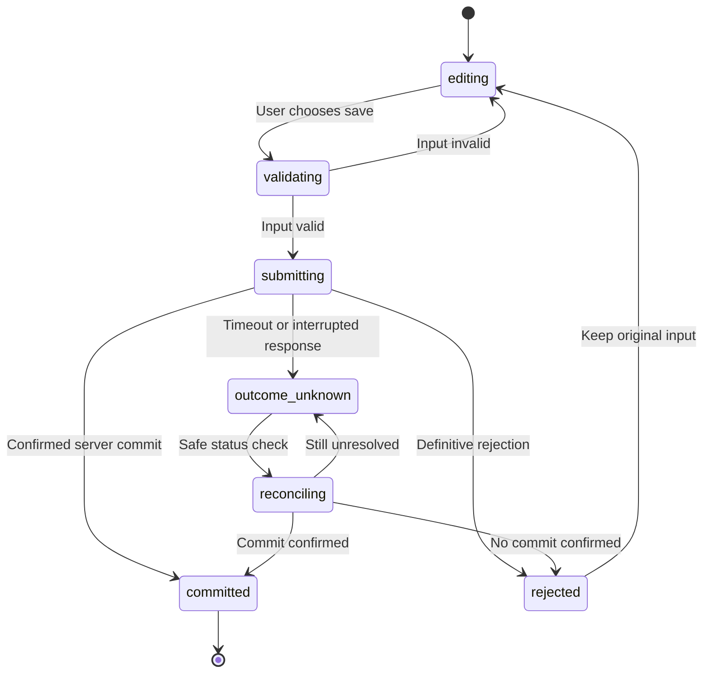
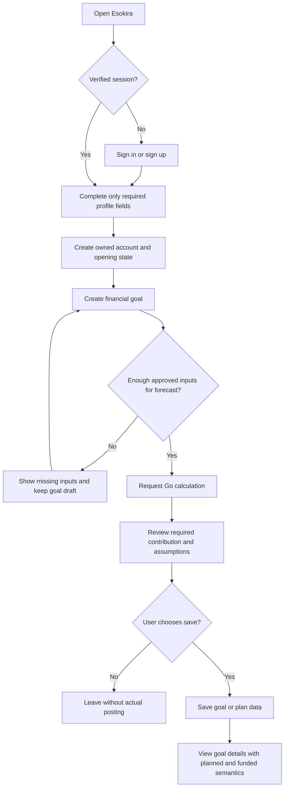
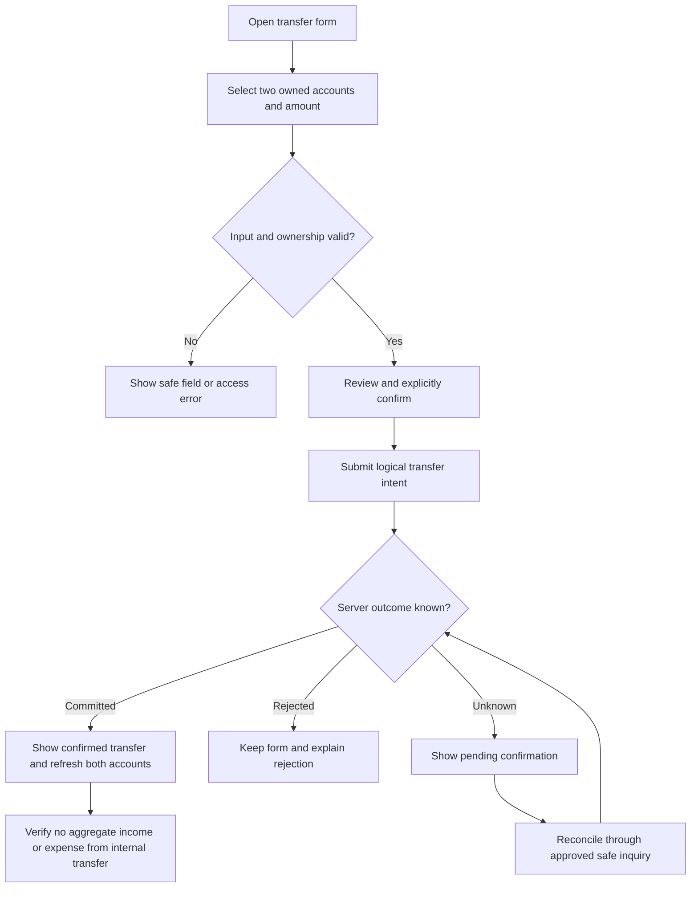
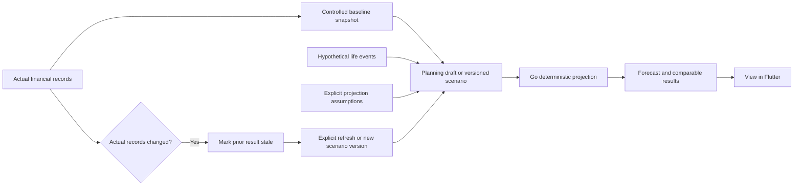
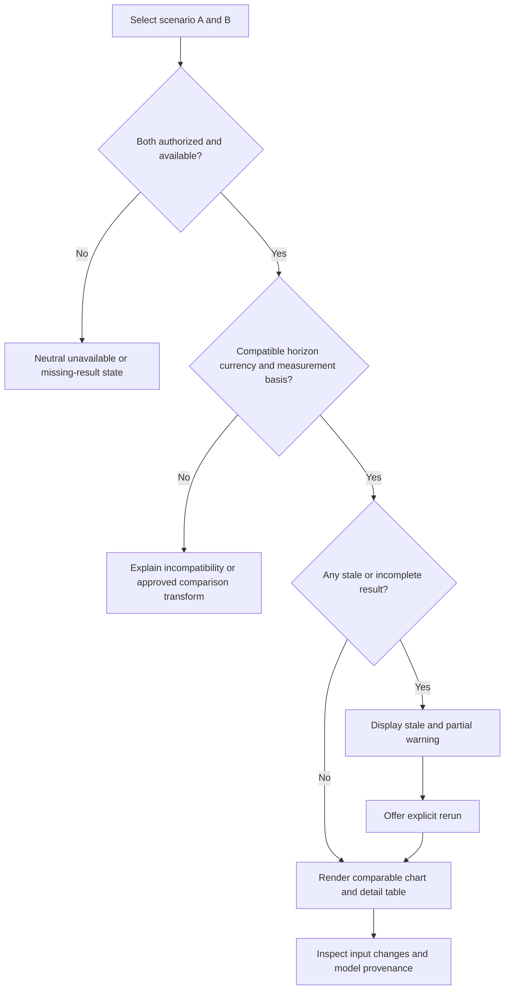
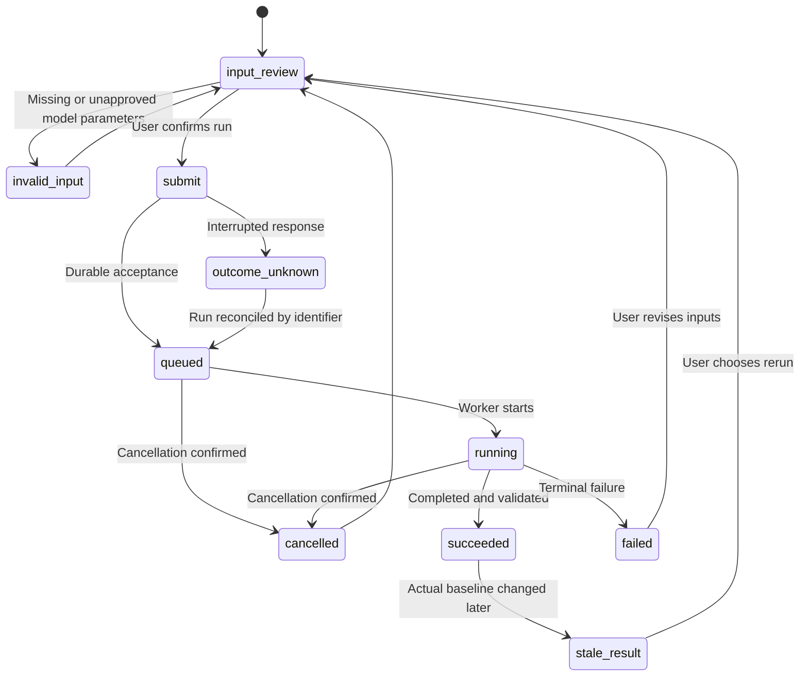
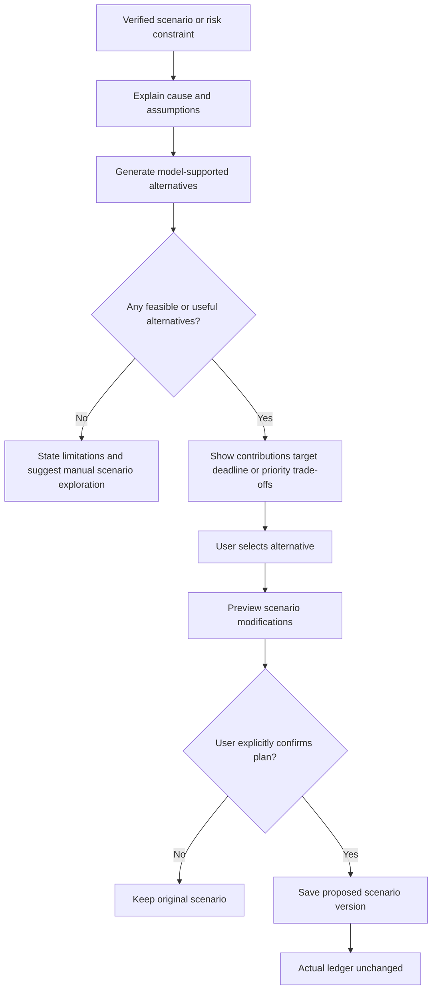
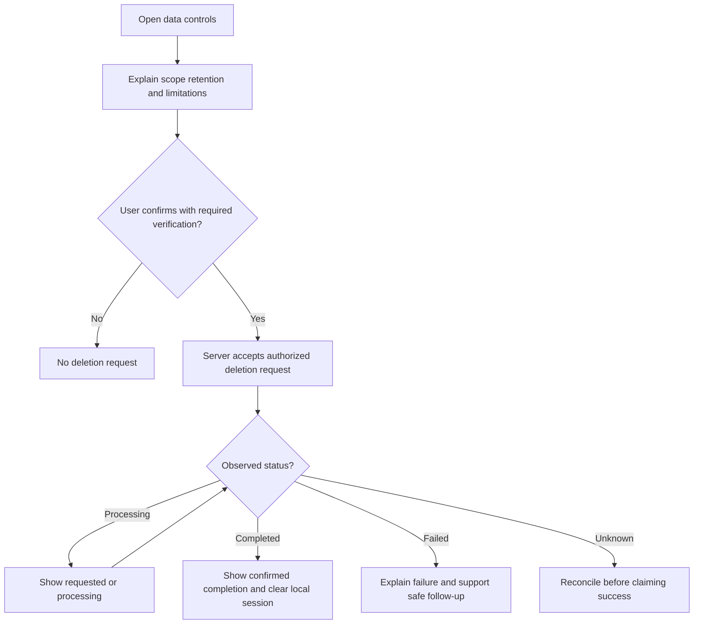

# Esokira — User Flows & Interaction Contracts

> **Canonical path:** `docs/design/USER-FLOWS.md`  
> **Version:** `0.1.0`  
> **Date:** 30 October 2026  
> **Status:** `REVIEWED_INTERNAL — PENDING_OWNER_APPROVAL`  
> **Type:** Product UX flow specification; **not** a claim that routes, screens, APIs or backend functions have been implemented.  
> **Audience:** Product Owner, product designer, Flutter engineer, Go engineer, QA, AI coding agent.  
> **Scope:** R0 foundation, R1 MVP, R2 planning, R3 advanced. R4 is **DISCOVERY ONLY**.  
> **Next artifact:** `docs/design/SCREEN-SPECS.md`, after reviewing and resolving applicable flow decisions.

---

## 0. Purpose, authority, and execution guardrails

Esokira is a mobile application for **personal financial reality, goal-based planning, life-event/scenario simulation, risk understanding, and explainable financial alternatives**. This file defines **how users move through tasks**: entry conditions, actions, system response, alternate paths, recovery, and testable completion criteria.

This document does **not** decide financial formulas, final HTTP schemas, SQL tables, provider-specific authentication, or navigation package. Those decisions belong to their authoritative source. Flow names and screen IDs in this file are conceptual, and **should not be treated as production routes until screen specifications and OpenAPI are approved**.

### 0.1 Source-of-truth chain

| Concern | Authority | Agent rule |
|---|---|---|
| Product purpose and non-goals | [`../product/PRODUCT-VISION.md`](../product/PRODUCT-VISION.md) | Do not extend product mission silently. |
| Feature behavior and acceptance | [`../product/PRD.md`](../product/PRD.md) | `FR-001`–`FR-024` define what is in scope. |
| Release/dependency planning | [`../product/FEATURE-MATRIX.md`](../product/FEATURE-MATRIX.md) | Do not build R3 as R1 or R4 as approved. |
| Financial meaning/invariants | [`../financial/FINANCIAL-DOMAIN-RULES.md`](../financial/FINANCIAL-DOMAIN-RULES.md) | Actual, planned, projected, modeled are distinct. |
| Calculation algorithm and assumptions | [`../financial/CALCULATION-SPECS.md`](../financial/CALCULATION-SPECS.md) | Do not invent financial calculations in Flutter. |
| Numerical test evidence | [`../financial/FINANCIAL-TEST-CASES.md`](../financial/FINANCIAL-TEST-CASES.md) | Golden cases must pass before finance features ship. |
| Trust boundaries | [`../architecture/SYSTEM-ARCHITECTURE.md`](../architecture/SYSTEM-ARCHITECTURE.md) | Protect user ownership and calculation provenance. |
| Go responsibilities | [`../architecture/BACKEND-ARCHITECTURE.md`](../architecture/BACKEND-ARCHITECTURE.md) | Write/calculate/validate server-side. |
| Flutter state/navigation | [`../architecture/FRONTEND-ARCHITECTURE.md`](../architecture/FRONTEND-ARCHITECTURE.md) | Handle auth, async states, routes, caching and retries safely. |
| Database meaning/schema design | [`../architecture/DATABASE-DESIGN.md`](../architecture/DATABASE-DESIGN.md) | Do not assume a final ledger/goal-funding design. |
| HTTP contracts | [`../architecture/API-GUIDELINES.md`](../architecture/API-GUIDELINES.md), later approved `contracts/openapi.yaml` | Candidate endpoints in documents are not live API. |
| Theme/components/content | [`./DESIGN-SYSTEM.md`](./DESIGN-SYSTEM.md) | Financial labels, accessibility and semantic tokens. |
| Screen-by-screen specifications | Future [`./SCREEN-SPECS.md`](./SCREEN-SPECS.md) | Derive from reviewed flows; do not contradict them. |

**Conflict protocol:** (1) identify the exact source documents and `FR`/`DR`/`CS`/flow IDs; (2) tag the affected flow `BLOCKED` or `PROPOSED`; (3) record an open decision; (4) request Product Owner review before implementing that affected production behavior. Other independent flows may continue.

### 0.2 Status vocabulary

| Status | Meaning |
|---|---|
| `DECIDED` | Explicit user choice: Flutter frontend, Go backend, PostgreSQL, monorepo `/frontend` + `/backend`. |
| `REQUIRED` | Behavior established by source requirements, financial invariants, privacy/security principles. |
| `PROPOSED` | Recommended route, navigation, copy or interaction pattern; review required. |
| `TBD` | Product or implementation question not decided. |
| `BLOCKED` | Cannot claim production readiness until dependency/decision/test is resolved. |
| `OUT_OF_SCOPE` | Not a committed feature for the release. |

`REVIEWED_INTERNAL` means the document has been checked for internal consistency. It **does not** mean the Product Owner approved the UX, nor that app/device/usability tests occurred. Earlier documents are also pending owner approval; an unchecked owner decision does not become approved merely by being repeated here.

### 0.3 Non-negotiable user-facing invariants

1. **A hypothetical scenario, goal, reminder or insight does not execute a real money transfer or alter the actual ledger.** (`DR-001`, `DR-002`, `DR-012`, `NFR-010`)
2. **Actual = user-recorded real state, not bank-verified.** Show provenance and as-of date; never fabricate live account balances.
3. **Income, expense and internal transfer have different semantics.** No total income/expense inflation through internal transfers. (`DR-005`–`DR-010`)
4. **Planned contributions are not confirmed funded progress.** A percent-funded UI is `BLOCKED` until `Q-11` goal funding rules are approved. (`DR-011`)
5. **Go financial engine owns authoritative numerical results.** Flutter may format numbers, preserve form state and visualize approved results; it must not silently replace official values with independent calculations. (`EN-004`)
6. **Money/rates/timing are explicit.** No silent annual/monthly rate conversion, inflation default or rounding assumptions. (`PRD Q-04/Q-05`)
7. **All private reads/writes require valid identity + server-side ownership checks.** Hiding UI controls is insufficient. (`FR-001`, `NFR-001`)
8. **Pending, committed, failed and ambiguous financial writes are different outcomes.** Never say “berhasil dicatat” solely because the user tapped Save. (`NFR-006`)
9. **Stale scenario results are visibly identified.** A new actual revision does not silently overwrite previous scenario inputs/results; compare and refresh explicitly. (`FR-012/013`, `NFR-003`)
10. **Risk outputs are model-dependent, not guarantees.** No unsupported “pasti berhasil” / “aman 100%” claims. (`DR-015`)
11. **R4 shared goals and portfolio planning are discovery only.** No production tabs, onboarding steps, permissions or routes. (`FR-023/024`)
12. **No fake user data.** Loading/empty screens must not display invented salaries, returns, goal success rates or account balances as fact. (`DESIGN-SYSTEM.md`)

### 0.4 Flow specification syntax

Every `UF-xx` entry in this document contains: **release, linked FR, entry, preconditions, primary path, alternate/failure paths, postcondition, UX contract, and verification**. Optional routes, control labels, progress indicators and API paths remain candidates until reviewed. The labels below are human-readable and should become localized strings (not hardcoded business logic).

All future Flutter screens should cite at least one `UF-xx` and relevant `FR-xxx`. All backend endpoints should cite `FR-xxx` and approved OpenAPI, **not derive new payload schemas solely from these flows**.

---

## 1. Users, boundaries, and task journeys

### 1.1 Actors

| Actor | Meaning | Access/limitations |
|---|---|---|
| `Visitor` | Has not established a valid app session. | May see welcome/login and non-personal product information only. Public calculator access is **TBD**. |
| `AuthenticatedUser` | A user whose session is verified for the intended request. | May access only their own authorized resources; ownership is always checked server-side. |
| `ReturningUser` | Previously authenticated person reopening the app. | Must pass session restoration before private views or caches reappear. |
| `GoAPI` | Backend boundary, not a human actor. | Authoritative validation, user ownership, confirmed writes and financial calculations. |
| `SimulationWorker` | Optional R3 processing component. | Processes jobs under verified ownership and bounded resources; not a UI identity. |

There is no confirmed administrator, financial adviser, partner, shared-goal co-owner or third-party banking actor for R0–R3. Do not add such flows without Product Owner scope approval.

### 1.2 Four canonical product journeys

| Journey | Start | Core tasks | End condition | Release |
|---|---|---|---|---|
| `J-01` First financial plan | First authenticated visit | Profile → account/actual basics → goal → calculation | Saved goal with clearly labeled required contribution; no fictitious funded status | R1 |
| `J-02` Keep actual finances current | Existing account | Record income/expense/transfer → inspect financial position | Confirmed actual entry and reconciled dashboard | R1 |
| `J-03` Compare futures | Existing actual state + plan | Life event → snapshot → scenario A/B → projection → comparison | Two comparable scenario outcomes with assumptions and staleness | R2 |
| `J-04` Evaluate difficult choices | Multiple goals/scenarios | Optimize → model risk → review alternatives → choose plan | Actionable **proposed** roadmap, not automated money movement | R3 |

Journey sequencing represents information and feature dependencies, **not mandatory onboarding screens**. A user should not have to invent salary/assets to reach features that do not require those fields.

### 1.3 Release gates

- **R0:** secure session shell, validated navigation behavior, error states, test harness scaffolding; no invented dashboard state.
- **R1:** `UF-00`–`UF-15`, `UF-30`–`UF-31` where relevant; actual data, goals, calculators, data controls.
- **R2:** `UF-16`–`UF-25`; budget, recurring, life events, projections, scenarios, cash flow, stress, insights, reminders.
- **R3:** `UF-26`–`UF-29`; optimization, risk/Monte Carlo, retirement, Financial GPS. All are `BLOCKED` until their model contracts are approved.
- **R4:** `FR-023` shared goals and `FR-024` portfolio planning remain `DISCOVERY`, **not** flows ready for screen implementation.

---

## 2. Proposed information architecture and navigation

`DESIGN-SYSTEM.md DS-Q04` and `FRONTEND-ARCHITECTURE.md` explicitly leave final tab count and routes unresolved. The following is a **conceptual screen inventory**, not fixed Flutter route names.

| Area / candidate Screen ID | Responsibility | Release | Entry path | Private? |
|---|---|---|---|---|
| `SCR-00` Launch/session gate | Restore session before showing private data | R0 | App open | Gate |
| `SCR-01` Welcome/auth | Welcome, login, auth error | R1 | No session | Public |
| `SCR-02` Profile onboarding | Minimum profile and disclosure | R1 | Successful auth / profile incomplete | Yes |
| `SCR-03` Financial overview | Actual net worth, income/expense periods, data freshness | R1 | Primary area candidate `Beranda` | Yes |
| `SCR-04` Accounts/list/detail | Account setup, as-of balances | R1 | Candidate `Keuangan` | Yes |
| `SCR-05` Transaction list/form | Income, expense, correction/review | R1 | Keuangan or account detail | Yes |
| `SCR-06` Transfer form/review | Atomic internal transfer | R1 | Keuangan | Yes |
| `SCR-07` Assets/liabilities | Valuations, obligations, as-of | R1 | Keuangan | Yes |
| `SCR-08` Goal list/detail/form | Goal target and plan status | R1 | Candidate `Tujuan` | Yes |
| `SCR-09` Compound calculator | Illustration with assumptions | R1 | Goal tools/secondary action | Policy TBD |
| `SCR-10` Goal contribution result | Required contribution, feasibility, shortfall | R1 | Goal detail or calculator | Yes |
| `SCR-11` Settings/privacy | Consent, export, deletion, logout | R1 | Profile/settings | Yes |
| `SCR-12` Budgets/recurring | Budget vs actual and recurring rules | R2 | Keuangan or Rencana | Yes |
| `SCR-13` Life timeline/event editor | Future life events and financial effects | R2 | Candidate `Rencana` | Yes |
| `SCR-14` Scenario editor/version list | Snapshot and hypothetical inputs | R2 | Rencana | Yes |
| `SCR-15` Scenario comparison | Same-unit/horizon comparison | R2 | Rencana | Yes |
| `SCR-16` Cash-flow/stress | Future cash timeline, shortfall and shocks | R2 | Rencana | Yes |
| `SCR-17` Insights/preferences | Explainable insights, notifications preferences | R2 | Beranda/Settings | Yes |
| `SCR-18` Goal optimizer | Constraint and allocation alternatives | R3 | Rencana/Tujuan | Yes |
| `SCR-19` Simulation runs | Queue/running/result + model provenance | R3 | Rencana | Yes |
| `SCR-20` Retirement planner | Retirement horizon and drawdown | R3 | Rencana | Yes |
| `SCR-21` Financial GPS | Alternative future paths/trade-offs | R3 | Rencana / insights | Yes |
| `SCR-22` Private error/fallback | Not found/no access, re-auth, offline/unknown result | R0–R3 | Deep link/error | Policy-dependent |

Navigation candidates for R1: **Beranda / Keuangan / Tujuan / Profil**, with calculator reachable from Goals/Tools; R2 may introduce **Rencana**. **Do not render R2/R3 items as functioning menu entries before release.** A fifth tab, navigation rail, nested stacks, or deep-link URL scheme must be designed in `SCREEN-SPECS.md` and confirmed by owner. Breadcrumbs, tab selection and back behavior must not expose unauthenticated content.

### 2.1 Navigation state contract

- App start has three auth states: **unknown/restoring**, **authenticated**, **unauthenticated**. No private data shown while unknown.
- Private deep link after cold start waits for verified identity and server authorization; preserve only a safe non-sensitive destination identifier if necessary.
- Back from dirty form requires confirmation or clear draft policy; never silently post or discard financial changes.
- Unauthorized/not-found resource gives neutral fallback; do not reveal whether another user's account/goal exists.
- Logout/account change invalidates private caches, pending navigation, user-scoped subscriptions, and active polling.
- Retry on network recovery is controlled by operation safety; never blindly replay a potentially posted financial request.

---

## 3. Global interaction states and UX response contract

### 3.1 Standard states for data-backed screens

| UI state | Trigger | Required user-visible behavior | Prohibited behavior |
|---|---|---|---|
| `initial` | Screen opened; no data requested | Context/placeholder; fetch begins if valid | Treat as empty dataset prematurely |
| `loading` | Initial read/refresh in progress | Progress and accessible label | Fabricated balances/goals |
| `content` | Confirmed authorized data | Show source, amount units, as-of/freshness | Treat estimates as actual |
| `empty` | Confirmed zero records | Explain what is missing and offer valid create path | Dummy transactions/suggested personal values |
| `partial` | Some financial facts unknown | Show known subset plus incomplete-data warning | Claim net worth/forecast complete |
| `stale` | Baseline revision or time changed | Label old result, show inspect/refresh choices | Silently substitute new baseline |
| `submitting` | Write request initiated | Lock duplicate tap; keep draft and operation identity | Announce committed success immediately |
| `pending_confirmation` | Server outcome unknown | Reconcile status via safe inquiry before retry | Repost the same transaction with a new key |
| `error` | Validated failure | Safe explanation, retry only if appropriate | Raw SQL, token, internal stack traces |
| `forbidden_or_not_found` | Server denied/obscured resource | Neutral unavailable UI and safe return | Leak owner or resource existence |
| `offline` | No reliable network | Honest availability, optionally approved local draft | Assume write was synced |
| `queued` / `running` | R3 durable simulation job | Show status, progress only if supported | Call 202 response "simulasi selesai" |
| `succeeded` / `failed` / `cancelled` | Server-confirmed terminal job state | Clear outcome, timestamp, provenance/error | Show partial failed result as success |

### 3.2 Data-source labels (copy candidates)

- `Aktual · Dicatat pengguna · per <tanggal>` — user-recorded actual state; not automatically verified by institution.
- `Rencana · Belum tercatat sebagai saldo aktual` — intention only.
- `Proyeksi · berdasarkan asumsi · sampai <tahun>` — deterministic output.
- `Simulasi risiko · <jumlah> lintasan model` — model-dependent distribution (R3).
- `Perlu diperbarui · menggunakan data sebelumnya` — stale result.
- `Belum lengkap · tambahkan data yang relevan` — partial dataset.
- `Menunggu konfirmasi pencatatan` — ambiguous actual write.

Actual/plan/forecast/model must be distinguished by **text and semantics**, not merely different colors; monetary display must use consistent currency and precise values. Chart alternatives need data tables/accessible summaries per Design System.

### 3.3 Global write lifecycle



This is an **interaction state model**, not a promise of a particular HTTP endpoint or an automatic retry algorithm. For idempotent create/transfer, reuse the appropriate operation identity when server contract allows it. Do not invent a negative confirmation after a timeout.

---

## 4. R0–R1: identity, actual data, goals and basic planning

### UF-00 — Launch, session restoration and protected entry

- **Release / links:** R0 foundation + R1; `FR-001`, `NFR-001`, `NFR-007`.
- **Entry / precondition:** App launched, resumed, or opened from a deep link; authentication state may be unknown.
- **Primary flow:** (1) Show privacy-safe splash/skeleton without user amounts; (2) initialize authentication/session provider (TBD); (3) verify session status; (4a) route verified user to safe requested private destination (subject to ownership) or dashboard; (4b) route unauthenticated user to welcome/login; (5) load authorized resource only after session confirmed.
- **Alternates:** A01 session expired → clear sensitive state and request login; A02 provider temporarily unreachable → explain cannot verify and do not reveal cached private data unless future offline security policy permits; A03 deep link to deleted or foreign resource → neutral not-found/unavailable screen; A04 guest from fresh install → public welcome.
- **Postcondition:** No private content appears during unknown/invalid session, even briefly.
- **Verification:** Cold-start auth/no-auth, expired token, deep link to foreign ID, logout then back-stack; no cross-user cache flash. **Provider-specific UI remains TBD.**

### UF-01 — Sign in, sign up, failed authentication

- **Release / links:** R1; `FR-001`, `FR-002`.
- **Entry / precondition:** `SCR-01`, no confirmed valid session.
- **Primary flow:** (1) Show approved authentication methods with clear data-use disclosure; (2) user chooses supported login method; (3) auth provider completes identity proof; (4) Go maps validated principal to application user; (5) app enters authenticated session and checks onboarding state.
- **Alternates:** A01 canceled third-party login → unchanged guest state; A02 provider error/rate limit → friendly error, no raw token detail; A03 existing user already has data → go to safe previous location; A04 duplicate identity/merge → **BLOCKED** pending identity policy; A05 lost connectivity → no login success claim.
- **Postcondition:** User authenticated and authorized via server. No owner ID is trusted solely from Flutter input.
- **Verification:** Bad/expired session, token error, canceled flow, double tap, account switch, cross-user API request. **Choice of Firebase Auth/OIDC/etc. is `PRD Q-02 (TBD)`**.

### UF-02 — First-time financial profile onboarding

- **Release / links:** R1; `FR-002`, `DR-017`.
- **Entry / precondition:** Authenticated user has incomplete financial profile.
- **Primary flow:** (1) Explain why each necessary field helps planning; (2) collect only approved required fields, clearly indicating optional fields; (3) user reviews entered data; (4) client validates format; (5) Go validates semantic fields and confirms save; (6) UI offers next action: create financial account or first goal, if prerequisites met.
- **Alternates:** A01 user skips optional inputs → store missing/unknown, not silent zero; A02 field missing for calculation → explain unavailable results rather than invent rate/income; A03 invalid date/amount → inline error; A04 save timeout → preserve draft and reconcile; A05 changing profile later → results dependent on old baseline may become stale.
- **Postcondition:** Saved profile fields have source/ownership and can be edited; incomplete profile remains explicit.
- **Verification:** Empty/partial valid profile, localization, numeric parse, abort/retry, no sensitive profile in telemetry. **Required field list/consent policy TBD; do not implement arbitrary mandatory salary entry.**

### UF-03 — Create account and record opening balance

- **Release / links:** R1; `FR-003`, `DR-004/005`, `PRD Q-03/Q-04`.
- **Entry / precondition:** Authenticated user on account list; backend ownership validation.
- **Primary flow:** (1) Tap add account; (2) select supported account category and enter name, currency/as-of/opening amount as approved; (3) review details and opening-balance semantics; (4) submit exactly once with confirmed identity; (5) refresh account list/summary after confirmed server result.
- **Alternates:** A01 invalid or unsupported currency/precision → field error; A02 duplicate submission/timeout → `pending_confirmation` and safe reconcile; A03 edit opening balance after posting history → **BLOCKED** until correction/audit model approved; A04 offline → optional local draft only, never “account synced”.
- **Postcondition:** Opening balance contributes to position according to final ledger model but **never counts as period income**.
- **Verification:** Opening counted once, no premature commit, no cross-owner account, date boundary tests. **Ledger and monetary storage decisions remain blocked for production (`Q-03`, `Q-04`).**

### UF-04 — Record income or expense

- **Release / links:** R1; `FR-004`, `DR-004/008/018`.
- **Entry / precondition:** Owned financial account exists; user chooses income **or** expense.
- **Primary flow:** (1) Select type; (2) choose owned account; (3) enter exact amount, effective date, optional category/note; (4) preview type/account/amount; (5) confirm; (6) server validates/post transaction atomically; (7) show confirmed entry and updated account/report after authoritative refresh.
- **Alternates:** A01 invalid amount/date/account → inline error; A02 malformed currency precision → show allowed precision without silent rounding; A03 token expired/foreign account → abort safely; A04 timeout after submit → show ambiguous outcome and reconcile before retry; A05 concurrently changed account → conflict review and refresh.
- **Postcondition:** One user-recorded actual event, not duplicated by repeated tap/network retry; UI never adds optimistic amount to official balance without policy.
- **Verification:** Duplicate requests, exact decimals, timezone-effective date, category period, retry, and cross-owner rejection. Correction policy in `UF-06` TBD.

### UF-05 — Internal transfer between own accounts

- **Release / links:** R1; `FR-004`, `FR-006`, `DR-006/007/008`.
- **Entry / precondition:** At least two eligible owned accounts; owner/session valid.
- **Primary flow:** (1) Choose transfer, source and destination (different owned accounts); (2) enter amount and effective date; (3) show explicit preview “Perpindahan antar-akun; bukan pemasukan/pengeluaran”; (4) confirm; (5) backend posts linked movement atomically; (6) refresh both balances from server, with unchanged aggregate net worth absent fee/FX.
- **Alternates:** A01 same source/destination → reject; A02 unowned target → neutral access denial; A03 insufficient balance if negative-balance policy prohibits → prevent posting; A04 timeout → never issue second independent transfer, reconcile using approved idempotency policy; A05 transfer fee or FX → **TBD** per financial/ledger policy.
- **Postcondition:** Both sides succeed together or neither succeeds. Total income/expense unaffected by internal transfer (unless separately specified fee).
- **Verification:** Atomicity on simulated failure, duplicate-submit behavior, concurrent transfer, no owner leakage, unchanged aggregate across two accounts.

### UF-06 — Correct, cancel, or reverse an actual record

- **Release / links:** R1; `FR-004`, `DR-008/018`, `PRD Q-03`.
- **Entry / precondition:** User opens an owned previously posted transaction or account opening entry.
- **Primary flow (PROPOSED):** (1) Open detail with type, effective date, source and status; (2) choose available correction action; (3) explain resulting change and audit consequence; (4) collect revised data/reason if policy requires; (5) confirm; (6) backend applies approved edit/reversal semantics; (7) display linked record/status and recalculate impacted summaries.
- **Alternates:** A01 already reversed/deleted → show current state; A02 conflict with concurrent changes → stop and refresh; A03 reversing transfer → must reverse both legs atomically; A04 unknown API outcome → reconcile, not duplicate correction; A05 historic report impacts → clarify restated vs original report semantics.
- **Postcondition:** Audit trail and balances remain consistent, under chosen correction policy.
- **Verification:** Correction, reversal and data retention tests only after final ledger choice. **PRODUCTION BLOCKED until actual mutation/reversal policy approved; an agent must not invent PATCH/DELETE behavior.**

### UF-07 — Add/update assets and liabilities

- **Release / links:** R1; `FR-005`, `DR-009/010/018`.
- **Entry / precondition:** Authenticated user visits asset/liability area.
- **Primary flow:** (1) Choose asset or liability category; (2) enter owned asset value or outstanding obligation and valuation/as-of date; (3) review whether this value is already represented by an account; (4) submit, receive authoritative confirmation; (5) inspect item and resulting financial position.
- **Alternates:** A01 an account balance is being re-added as separate asset → warn/block based on approved classification; A02 dated appraisal → display as-of rather than “live”; A03 negative/zero/unsupported input → validate according to item type; A04 liability payments require separate actual posting rules, never silently reduce principal on entry; A05 incomplete values → financial overview marked partial.
- **Postcondition:** Report can show total non-duplicated assets minus outstanding liabilities, even if net worth negative.
- **Verification:** Double-count tests, negative net worth, stale valuation badge, owner isolation, unknown values handling.

### UF-08 — Inspect actual dashboard and net worth

- **Release / links:** R1; `FR-006`, `DR-005/006/009/010/014`.
- **Entry / precondition:** Authenticated user opens `Beranda`; some actual data may be missing.
- **Primary flow:** (1) Load authoritative financial-position summary; (2) show assets, obligations and net worth with clear date/source label; (3) show income and expense for explicit reporting period, excluding internal transfers; (4) show updated-at and partial-data indicators; (5) offer relevant drill-down and create paths.
- **Alternates:** A01 no accounts → meaningful empty state with “Tambahkan akun”; A02 no asset valuation → report scope incomplete, not universal zero; A03 data previously cached → label freshness and refresh if allowed; A04 net worth below zero → preserve sign and explain assets minus obligations; A05 API/server error → do not replace with fabricated charts.
- **Postcondition:** User can identify what is known, missing and current; no forecast displayed as confirmed balance.
- **Verification:** Invariants for transfers/duplicates, period date boundaries, incomplete state, extreme amounts, screen-reader labels.

### UF-09 — Create, edit and organize financial goals

- **Release / links:** R1; `FR-007`, `DR-011/012`.
- **Entry / precondition:** Authenticated user visits `Tujuan`; profile prerequisites only if legitimately necessary.
- **Primary flow:** (1) Create goal with name, target amount, target date and priority; (2) explain whether baseline funds/allocated amount is known; (3) validate and save; (4) show goal detail with target, deadline and planning status; (5) allow edits, archive/mark achieved only under approved lifecycle rules.
- **Alternates:** A01 past/invalid target date → field error; A02 conflicting goal changes → refresh; A03 funded attribution unavailable → **withhold funded percent**, show target/remaining estimate if valid; A04 planned set-aside is recorded → label as `rencana`, never actual funding; A05 archived goal → view history and clear status.
- **Postcondition:** Goal is a **planning object**, not an account, actual transfer or automatic investment.
- **Verification:** Create/edit/archive, invalid dates, no phantom balance, status semantics, funded attribution blocked until `Q-11` approval.

### UF-10 — Calculate compound interest illustration

- **Release / links:** R1; `FR-008`, `CS-005`, `CS-006`, `DR-015/017`.
- **Entry / precondition:** User opens calculator from goal/tools; eligibility as public vs private is TBD.
- **Primary flow:** (1) Enter initial principal, periodic contribution, horizon and rate with explicit units; (2) inspect assumptions including contribution timing and effective/nominal rate conversion; (3) submit to Go calculation contract; (4) show estimated future value, total contributions and estimated gains; (5) show chart/table and disclaimer; (6) optionally prefill a **draft goal**, never post money.
- **Alternates:** A01 zero rate/zero horizon → defined mathematical case; A02 negative rate → handle only as allowed by approved contract; A03 inconsistent annual vs monthly units → confirm conversion; A04 missing required rate/timing → block result rather than fill hidden default; A05 response stale/outdated when input changes → dismiss old result or label prior inputs.
- **Postcondition:** Pure model output (`forecast/simulation`); **no persisted actual transaction**.
- **Verification:** `FINANCIAL-TEST-CASES.md` compound golden cases, timing variants, precision, chart labels, absent data. **Production BLOCKED until timing/rate/rounding policy (`Q-04`) approved.**

### UF-11 — Calculate goal contribution and feasibility

- **Release / links:** R1; `FR-009`, `CS-007`, `DR-011/017`.
- **Entry / precondition:** Goal exists with target/date; starting funds, capacity and assumptions may be unknown.
- **Primary flow:** (1) Choose goal and calculation settings; (2) enter/confirm eligible starting funds, saving capacity and assumptions; (3) show required periodic contribution and horizon; (4) compare with available capacity if known; (5) show shortfall or feasibility with explanation; (6) allow user to **manually** adjust target/date/saving plan through separate goal edit action.
- **Alternates:** A01 insufficient actual data → `Data belum cukup` with action; A02 infeasible target → valid calculation result with shortfall, not crash; A03 zero time horizon → explain immediate funding requirement; A04 missing funded attribution → do not treat account balance as goal-funded; A05 changes from scenario assumptions → label projected basis.
- **Postcondition:** User understands cost/constraints; goal values change only through explicitly confirmed goal edit.
- **Verification:** Rate=0, target achieved on eligible funds, infeasible, partial inputs, no automatic goal mutation. **`Q-11` goal funding rule remains a blocker for funded progress.**

### UF-12 — Review goal lifecycle and funded/planned distinction

- **Release / links:** R1; `FR-007`, `FR-009`, `DR-011/012`.
- **Entry / precondition:** Owned goal exists and its status is available.
- **Primary flow:** (1) Open detail; (2) inspect target/deadline/priority; (3) inspect planned contribution schedule and calculation metadata; (4) if an approved attribution model exists, see **confirmed** funded progress with source; otherwise see `Progres dana aktual belum tersedia`; (5) explicitly choose edit/archive/complete where supported.
- **Alternates:** A01 user wants to mark complete manually → semantics of completed vs fully funded must be documented; A02 linked account changed → refresh availability; A03 archived goal reopened → preserve history; A04 target date passed → state missed/late without fabricated funds.
- **Postcondition:** No planned amount is reclassified as deposited money by changing labels.
- **Verification:** Planned-only vs funded UI, long goal names, historical status, missing data, user actions preserve actuals. **Actual funding model `PRD Q-11 / DS-Q10` remains TBD.**

### UF-13 — Export owned financial data

- **Release / links:** R1; `FR-021`, `NFR-001/008`.
- **Entry / precondition:** Authenticated owner opens privacy/data controls.
- **Primary flow (PROPOSED):** (1) Explain export scope, format and sensitivity; (2) user explicitly requests export; (3) server authorizes and prepares allowed data (possibly asynchronous); (4) app shows requested/processing/completed state; (5) download/share through approved secure mechanism without publishing a predictable URL or exposing other users' data.
- **Alternates:** A01 no data → valid empty export with explanation; A02 session expired → reverify; A03 long-running process → job status, not false download success; A04 preparing failed → show retry guidance; A05 user changed data after export request → describe snapshot date and export scope.
- **Postcondition:** Export is restricted to authorized data and labeled with as-of/scope; does not modify actual data.
- **Verification:** Authorization of export creation and retrieval, no logging raw export, expiration/retention checks. **Export format, delivery, retention and possibly reauthentication: `PRD Q-10`/privacy review TBD.**

### UF-14 — Request account/data deletion

- **Release / links:** R1; `FR-021`, `NFR-008`, `NFR-010`.
- **Entry / precondition:** Owner in sensitive settings, authenticated under approved freshness/reauth policy.
- **Primary flow (PROPOSED):** (1) Show precisely what deletion affects and what may be retained; (2) explain irreversible effects, in-flight exports/jobs and backup policy; (3) require deliberate confirmation, with reauthentication if policy demands; (4) server records/executes authorized deletion lifecycle; (5) show **requested / processing / confirmed** accurately; (6) invalidate app session and cached financial data when appropriate.
- **Alternates:** A01 cancellation → nothing deleted; A02 invalid session → reauthenticate; A03 background job active → cancellation/fencing policy, no resurrection; A04 service timeout → status unknown, no claim of completed erasure; A05 backup retention → disclose approved schedule, never promise instant removal everywhere.
- **Postcondition:** User receives an accurate status and next step, consistent with documented deletion policy.
- **Verification:** Wrong-owner deletion denied, double request, job race, cache/session wipe, error copy. **Do not ship until `SECURITY-PRIVACY.md` and retention policies are approved.**

### UF-15 — Logout, account switch, and local privacy

- **Release / links:** R1; `FR-001`, `FR-021`, `NFR-001/007`.
- **Entry / precondition:** Verified user opens session controls.
- **Primary flow:** (1) User taps logout; (2) app initiates approved provider sign-out/invalidation; (3) removes or isolates private local memory/cache, draft, subscription and simulation polling; (4) returns to public screen; (5) cannot navigate back to prior private user content.
- **Alternates:** A01 provider revocation network failure → safe local-session lock and truthful status; A02 another user signs in → no old user's balances appear; A03 a draft contains unsaved changes → inform before action when possible, but never keep prior user's private cache accessible; A04 pending write outcome → provide safe guidance, never replay in new session.
- **Postcondition:** Current user data inaccessible locally without renewed authorization.
- **Verification:** Logout/back stack, memory isolation, resumed app, account switching, long-running poll cancellation and sensitive logs.

---
## 5. R2: budget, life planning, deterministic scenarios and insights

These flows are **not R1 onboarding requirements**. They depend on stable R1 actual data semantics and an approved deterministic scenario model. Any sample figures used during design review must be marked synthetic; they must never be presented as the user's finances.

### UF-16 — Create budget and review budget vs actual

- **Release / links:** R2; `FR-010`, `DR-006/012`, `CS-008`.
- **Entry / precondition:** Authenticated user has an explicit budget period; spending categories may be absent.
- **Primary flow:** (1) Select budget period and eligible category; (2) enter budget amount and optional reminder policy; (3) review and save; (4) fetch actual spending for the exact same period/category from backend; (5) show remaining/overspent with label `Budget` vs `Aktual`; (6) allow a deliberate budget edit.
- **Alternates:** A01 category has no actual transactions → show zero recorded amount with scope, not claim no spending occurred in reality; A02 internal transfer encountered → exclude it from expense-based budget; A03 duplicate period/category rule → explain conflict; A04 time-zone boundary/month-end → honor approved reporting period; A05 unknown data → partial budget comparison.
- **Postcondition:** Budget is a plan; creating/updating it **does not create an account transaction or cash obligation**.
- **Verification:** Budget period changes, transfer exclusion, over-budget calculation, zero spending, formatting and no accidental posting. **Recurring policy remains separate.**

### UF-17 — Configure recurring transaction rules

- **Release / links:** R2; `FR-010`, `DR-008/013`, `CS-008`.
- **Entry / precondition:** Authenticated user chooses a recurring income/expense concept.
- **Primary flow (PROPOSED):** (1) Choose recurrence category/type, amount, frequency, start and end conditions; (2) preview projected occurrences; (3) explicitly confirm rule; (4) system saves recurrence definition; (5) show next occurrence and its status; (6) allow pause/edit/stop according to approved recurring policy.
- **Alternates:** A01 invalid date or impossible monthly day → require a calendar convention; A02 occurrence rule edited after earlier occurrences posted → do not rewrite historical actual events silently; A03 duplicate scheduler execution → same logical occurrence must not post twice; A04 provider failure → show rule status without claiming transaction occurred; A05 user desires automatic posting → **TBD** whether supported or requires individual confirmation.
- **Postcondition:** A future schedule **is not itself** a posted transaction. If posting is approved later, each occurrence must have stable identity/idempotency.
- **Verification:** Month-end, leap year, stop date, repeated jobs, pause/resume, no duplicate actual. **Recurring auto-post policy is blocked pending domain/architecture approval.**

### UF-18 — Add a life event to a planning draft

- **Release / links:** R2; `FR-011`, `DR-001/002/012`, `CS-009`.
- **Entry / precondition:** User has a planning draft or can start one; scenario baseline model may be incomplete.
- **Primary flow:** (1) Open `Rencana` timeline; (2) choose a future event (e.g. career change, marriage, home purchase) without presuming the event is true; (3) enter effective date and explicit one-off/recurring financial impacts; (4) inspect source/assumptions; (5) save to **planning draft**; (6) see event on timeline marked `Rencana`.
- **Alternates:** A01 date overlaps another event → warn if model finds conflict; A02 missing required amounts → `Needs input`, no silent estimate; A03 user mistakes event for transaction → explicit disclaimer `Tidak mengubah saldo aktual`; A04 user exits before save → unsaved-draft choice; A05 event deleted → planning only, actual history unaffected.
- **Postcondition:** Only the planning artifact changes. A life event never posts a future income/expense automatically.
- **Verification:** Past vs future effective date, one-off vs recurring, overlapping events, precision, actual-state nonmutation. **Draft/baseline model remains `Q-06` until approved.**

### UF-19 — Run deterministic life projection

- **Release / links:** R2; `FR-012`, `CS-009`, `NFR-002/003/010`.
- **Entry / precondition:** Identifiable baseline/as-of, valid approved model, complete necessary inputs or explicit missing-data status.
- **Primary flow:** (1) Select approved baseline/scenario draft, horizon, projection assumptions and life events; (2) review input summary; (3) initiate Go projection; (4) receive period-level results and provenance; (5) show chart/table, nominal/real labels and periods; (6) offer save/recompute with new version where supported.
- **Alternates:** A01 missing income/expenses or inconsistent cash-flow data → block with specific missing fields; A02 stale baseline → show prior result and offer explicit refresh/new version; A03 projection overflow/invalid rate → safe error, no fabricated output; A04 changed controls while calculating → prevent old response from replacing newest result; A05 calculation unavailable → retain draft, distinguish `error` from valid low/negative outcome.
- **Postcondition:** A reproducible forecast is available with baseline identity, assumptions, engine version and date; **all actual records unchanged**.
- **Verification:** Same inputs yield same output, nonmutation, event ordering, date/rate units, provenance, stale indicators. **Production blocked until `SCENARIO-ENGINE.md` and model policies approved.**

### UF-20 — Create scenario and immutable version

- **Release / links:** R2; `FR-013`, `DR-001/002/016`, `CS-012`.
- **Entry / precondition:** User has a legitimate baseline reference and/or existing planning draft.
- **Primary flow (PROPOSED):** (1) Choose `Buat skenario` from approved baseline; (2) name scenario and inspect what is inherited; (3) modify goal timing, income/expense assumptions or event inputs; (4) preview differences; (5) save a new scenario version; (6) return to version detail, not mutate prior immutable version.
- **Alternates:** A01 no actual baseline → explain what starting data is missing; A02 conflicting edit from another device → create safe conflict flow, not overwrite; A03 change scenario name vs model parameters → separate metadata policy; A04 delete scenario → explicit confirmation and policy for linked results; A05 refresh baseline after actuals change → creates new version or explicit input revision, not silent overwrite.
- **Postcondition:** Scenario versions can be revisited and identified; actual account, transaction, liability and valuations are unaffected.
- **Verification:** Original baseline unchanged, two versions coexist, cross-user access forbidden, stale detection and conflict UX. **Baseline snapshot/versioning `PRD Q-06 / DB-Q08` TBD.**

### UF-21 — Compare scenarios and handle stale results

- **Release / links:** R2; `FR-013`, `FR-014`, `CS-012`, `DR-014/016`.
- **Entry / precondition:** Two or more authorized scenario results with compatible metrics, units and time horizons.
- **Primary flow:** (1) Pick scenario A and B by identifiable version; (2) show comparison criteria (horizon, currency, nominal/real, baseline); (3) if compatible, plot same-axis comparison and result table; (4) explain key differences and source assumptions; (5) allow user to rerun one alternative explicitly.
- **Alternates:** A01 baseline or horizon incompatible → display comparison blocker or a clearly labeled normalization strategy **only after policy approval**; A02 one result stale → banner `Perlu diperbarui` and exact revision; A03 one run failed → show available result without pretending it is a valid pair; A04 selected comparison changed mid-request → ignore obsolete response; A05 model/version incompatible → explain limitations.
- **Postcondition:** User can identify exactly which versions are compared, what changed, and whether comparisons are current.
- **Verification:** Same units/scales, stale reason, missing pair, version names, chart accessibility and no manipulation of actual data.

### UF-22 — Review future cash-flow forecast and shortfall

- **Release / links:** R2; `FR-014`, `CS-009`, `DR-014/017`.
- **Entry / precondition:** Valid deterministic projection result exists and contains period cash-flow series.
- **Primary flow:** (1) Open forecast from Rencana or scenario result; (2) select period range; (3) see estimated inflows, outflows and closing cash with `Proyeksi` label; (4) highlight projected negative cash/shortfall periods; (5) inspect relevant assumptions/events that drive shortfall; (6) optionally open scenario editor to **propose** changes.
- **Alternates:** A01 actual data ends before chart → show labeled transition `Awal proyeksi`; A02 missing liabilities/expenses → incomplete forecast warning; A03 changing period filter → recalculate/display matching time basis; A04 no shortfall → `Tidak ditemukan shortfall dalam model ini`, not `Keuangan pasti aman`; A05 stale revision → show old result status and offer rerun.
- **Postcondition:** A forecast explanation is viewed, not a real payment or budget adjustment.
- **Verification:** Period/date alignment, negative cash marker, actual-vs-forecast chart legend, accessible table, incomplete data and nonmutation.

### UF-23 — Run parameterized financial stress test

- **Release / links:** R2; `FR-015`, `CS-011`, `DR-015/017`.
- **Entry / precondition:** Chosen baseline/scenario with usable cash-flow model.
- **Primary flow:** (1) Choose a shock type such as reduced income or sudden expense; (2) set magnitude, start, duration and affected categories; (3) confirm shock is **hypothetical**; (4) call backend calculation; (5) show base vs stress outcomes, cash runway and affected goals; (6) offer alternative inputs/rerun without changing actuals.
- **Alternates:** A01 unsupported shock/negative value or contradictory input → validated error; A02 partial actual information → limits explained; A03 zero runway or depletion → factual conditional model result, not personal diagnosis; A04 user reuses scenario but actual changed → stale marker; A05 failed calculation → preserve shock draft.
- **Postcondition:** A reversible hypothetical stress outcome, not an actual account adjustment.
- **Verification:** Baseline vs shock reproducibility, no account updates, source label, runway definition, clear limitation and contrast-safe warnings.

### UF-24 — Read explainable rule-based insights

- **Release / links:** R2; `FR-016`, `DR-015/017/019`, `CS-016`.
- **Entry / precondition:** User opens Insights, goal/forecast detail, or a contextual alert.
- **Primary flow:** (1) Retrieve approved insight derived from actual data or verified calculation; (2) show conclusion with **source class** and severity without alarmist language; (3) offer `Mengapa?` to inspect evidence, inputs, assumptions and as-of; (4) show optional user actions that lead to ordinary editing/simulation flows; (5) allow dismiss/acknowledge only if supported.
- **Alternates:** A01 data insufficient → `Belum cukup data untuk menyimpulkan` with missing-input action; A02 stale underlying simulation → warn and disable definitive conclusion; A03 rule invalid/not approved → do not publish; A04 negative outlook → explain constraints, not promise or investment instruction; A05 privacy restriction → no raw amounts in push preview/logs.
- **Postcondition:** User sees **reasoned explanation**, not opaque authoritative advice or automated money movement.
- **Verification:** Rule provenance, missing data, disabled stale insight, no invented facts, opt-out behavior if applicable. **No generative AI dependency required for R2.**

### UF-25 — Notification permission and reminder preferences

- **Release / links:** R2; `FR-022`, `NFR-008`, `DR-003`.
- **Entry / precondition:** Authenticated user opens settings or an explicitly offered reminder opt-in.
- **Primary flow (PROPOSED):** (1) Explain reminder purpose and example notification content; (2) user enables a defined reminder type/frequency; (3) request OS permission only when appropriate; (4) store preferences with server confirmation; (5) allow user to disable or adjust; (6) notifications open a safe authorized destination.
- **Alternates:** A01 denied OS permission → respectful non-blocking state; A02 user disables reminder → stop future delivery according to approved policy; A03 notification received while logged out → no private content disclosed; A04 offline setting save → state unconfirmed, not “tersimpan”; A05 delivery failure → no change to goal/actual state.
- **Postcondition:** Notifications are opt-in and user-controlled, with lock-screen payload non-sensitive by default.
- **Verification:** Permission denied/revoked, double toggle, logout from notification, provider outage, no sensitive amount shown. **Provider, cadence and payload policy (`PRD Q-09`) TBD.**

---

## 6. R3: advanced optimization, risk and financial decision support

These features are **not approved production models**. They are flow designs to inform later `GOAL-OPTIMIZER.md`, `MONTE-CARLO.md`, scenario modeling, risk review and implementation. They must not fabricate model success percentages or investment performance in production.

### UF-26 — Optimize contributions across multiple goals

- **Release / links:** R3; `FR-017`, `CS-013`, `DR-011/015`.
- **Entry / precondition:** Multiple eligible goals; confirmed time horizon, capacity and constraints; reviewed objective/priority semantics.
- **Primary flow:** (1) Select goals and define capacity by period; (2) review goal dates, targets, eligibility and priority assumptions; (3) run optimization; (4) receive feasible allocation schedule or **infeasible** explanation with shortfalls; (5) inspect trade-offs and constraints; (6) save a proposed plan/scenario version only after explicit confirmation.
- **Alternates:** A01 missing priority/capacity → explain what is needed; A02 all goals impossible → show infeasible result as valid conclusion, not error-only screen; A03 optimizer times out → job/failure state without invented plan; A04 user edits result → treat as new proposed input, recompute; A05 some goals excluded → must be explicit and justified.
- **Postcondition:** Proposed allocation **never posts automatic transfers** or changes funded balances.
- **Verification:** Constraint sum, feasibility/infeasibility, omitted goals, deterministic repeat, goal nonmutation, equivalent target dates. **BLOCKED pending `PRD Q-07` and `GOAL-OPTIMIZER.md`.**

### UF-27 — Launch and inspect Monte Carlo risk simulation

- **Release / links:** R3; `FR-018`, `CS-014`, `NFR-003/004/006`.
- **Entry / precondition:** Approved stochastic model; eligible versioned scenario; input volatility/correlations/inflation policies known.
- **Primary flow:** (1) Select scenario/version and risk settings; (2) view assumptions including model, horizon, seed policy, run count, success criterion; (3) initiate authorized run; (4) receive durable acceptance/queued status if async; (5) show running/cancel if supported; (6) retrieve terminal result; (7) display percentiles, model success fraction, sample count, model/engine versions and explanatory limitations.
- **Alternates:** A01 429 or quota reached → wait/backoff, not create unbounded runs; A02 network disconnect after submit → use run identity/status lookup before retry; A03 job failed/cancelled → do not display incomplete result as success; A04 logout/account deletion → no polling, owner-scoped result; A05 changed baseline → result remains historical and is marked stale, rerun explicitly; A06 empty/mismatched model parameters → block and explain.
- **Postcondition:** Reproducible, owner-scoped **model** result, not bank balance or a guaranteed success probability.
- **Verification:** Same seed/model/inputs within defined tolerance, job state transitions, resource quotas, rejection of foreign run ID, stale detection, accessible uncertainty copy. **BLOCKED until `MONTE-CARLO.md`, `PRD Q-08`, queue/resource policy approved.**

### UF-28 — Plan retirement/FIRE and withdrawal runway

- **Release / links:** R3; `FR-019`, `CS-015`, `DR-015/017`.
- **Entry / precondition:** Approved retirement/decumulation model; user can provide target retirement age, spending, other income, and horizon.
- **Primary flow:** (1) Set retirement and financial-independence milestones separately; (2) enter spending needs, future income sources, funding assumptions and horizon; (3) inspect inflation nominal/real treatment and withdrawal rules; (4) run projection and eligible risk simulation; (5) see runway, possible depletion and scenario trade-offs; (6) choose to save new scenario plan.
- **Alternates:** A01 date/age inconsistency → inline error; A02 unknown lifespan/horizon → explicit choice/assumption, not hidden default; A03 fixed 4% rule requested → explain it as an assumption, **never guaranteed safe**; A04 incomplete investment/withdrawal data → limits or missing-data state; A05 high uncertainty → show model range rather than a single confident age.
- **Postcondition:** Explained hypothetical retirement plan; no automated sale, withdrawal or payment.
- **Verification:** Real vs nominal, withdrawal order, depletion, source clarity, data gaps, no guaranteed phrasing. **BLOCKED on approved decumulation specification and validated model inputs.**

### UF-29 — Financial GPS: compare alternative future paths

- **Release / links:** R3; `FR-020`, `FR-016/017/018`, `CS-016`, `DR-019/020`.
- **Entry / precondition:** User has a verified constraint/risk result tied to known scenario and model version(s).
- **Primary flow:** (1) Surface a clear issue (e.g. a goal falls short under chosen assumptions); (2) expose evidence and source; (3) present alternatives such as modify contribution, amount, deadline or goal priority; (4) compare projected trade-offs using the **same approved engines**; (5) let user deliberately inspect and choose a plan; (6) save as **scenario change**, not actual posting.
- **Alternates:** A01 no mathematically supported alternatives → state limitation and invite manual scenario exploration; A02 contradictory goals → show conflicts, no silent omission; A03 stale engine/baseline → refresh required before framing as current; A04 user chooses alternative → request explicit confirmation of scenario edit, not actual transaction; A05 lack of data → avoid prescriptive verdict; A06 suggestions depend on unapproved risk model → suppress specific probability advice.
- **Postcondition:** User understands options with assumptions/trade-offs; no real-world financial decision has been executed by Esokira.
- **Verification:** Same engine inputs, transparent alternatives, infeasible cases, no forced recommendation, risk copy reviewed. **BLOCKED until optimizer/risk/insight model dependencies are approved and tested.**

---

## 7. Cross-cutting exceptional journeys

### UF-30 — Private deep link, ownership denial and session switching

- **Release / links:** R0–R3; `FR-001`, `NFR-001/007`, `DR-003`.
- **Entry / precondition:** App receives a deep link to account, goal, scenario, simulation run or export, possibly while logged out.
- **Primary flow:** (1) Defer route until session is verified; (2) resolve route safely with minimal identifiers; (3) fetch via backend ownership check; (4) if authorized show content, else neutral unavailable page; (5) after switching accounts, discard previous navigation and cache scope before fetching again.
- **Alternates:** A01 invalid/deleted resource ID → neutral unavailable; A02 external notification carries sensitive payload → reject design; A03 insufficient role/ownership → `403/404` policy without enumeration; A04 app resumed mid-request after logout → discard response; A05 previously cached private screen → no flashed content after account switch.
- **Postcondition:** Deep links and caches do not bypass API authorization or disclose other-user financial data.
- **Verification:** Intent injection, foreign ID, revoked session, logout/relogin, cached response race, background-to-foreground.

### UF-31 — Offline, ambiguous write and recovery after interruption

- **Release / links:** R0–R3; `FR-004`, `NFR-006/007`, `DR-007/008`.
- **Entry / precondition:** User edits/submits a form while connection is unstable, device backgrounded or process killed.
- **Primary flow:** (1) Before submitting, preserve input only under an approved secure local draft policy; (2) signal operation type as read, pure calculation, or actual financial write; (3) for writes send request under appropriate idempotency contract; (4) after interruption, inspect known server outcome/status before resending; (5) display confirmed success only with server evidence; (6) guide user to review existing transaction when outcome remains uncertain.
- **Alternates:** A01 offline before send → draft may remain local, not synced; A02 disconnected after API accepted write → `outcome_unknown`, not failed; A03 repeated Save tap → one logical intent; A04 app terminated and reopened → correct user identity and operation reconciliation needed; A05 calculation GET/POST pure result → may be recomputed if safe; A06 R3 queued job persists server-side, local polling can resume if authorized.
- **Postcondition:** UI tells the truth about what is and is not confirmed. No deliberate duplicate transaction/posting or simulation job avalanche.
- **Verification:** Fault injection before/during/after commit; duplicate keys; process recreation; offline draft privacy and ownership tests. **Local queue/automatic offline writes are TBD; never claim supported by default.**

---
## 8. Cross-journey diagrams (logical, not implemented routes)

These diagrams show **workflow meaning**, not an approved Go API contract, database transaction implementation or final screen map. Mermaid nodes intentionally use neutral human-readable labels rather than pretending the application is already built.

### 8.1 J-01: first useful financial plan (R1)



`J-01` does **not** require users to fabricate a salary or balance. An incomplete goal forecast is valid UX if information is missing. Funded progress stays unavailable until `Q-11` is resolved.

### 8.2 J-02: safe actual transfer and uncertain outcome (R1)



The **server** enforces atomic debit/credit and ownership, and remains the authoritative source. `Pending confirmation` must not automatically generate a new transfer intent.

### 8.3 J-03: actual versus planning boundaries (R2)



There is intentionally **no arrow from planning result back to actual records**. Only a separate approved actual-entry flow may change the ledger.

### 8.4 R2: scenario comparison quality gate



`I --> H` assumes a **successful** rerun; implementation must still handle failed/cancelled rerun separately. Never compare differently defined values with identical-looking labels.

### 8.5 R3: Monte Carlo async lifecycle (illustrative)



Queue/retry internals, resource quotas, cancel semantics and server state names remain **PROPOSED** in architecture/API documents. R3 cannot ship before the probabilistic model is reviewed.

### 8.6 R3: Financial GPS alternatives are *choices*, not operations



### 8.7 Data deletion with truthful status



All deletion process mechanics are **blocked pending retention/privacy policy**. A user request is not proof every backup copy has been erased.

---

## 9. UI behavior matrices across flows

### 9.1 Write safety and retry classification

| Operation class | Example flows | Safe client handling | What is forbidden |
|---|---|---|---|
| Pure read | `UF-08`, `UF-12`, `UF-22`, `UF-24` | Retry bounded reads with auth and freshness handling. | Show cached user A state to user B. |
| Pure calculation (non-posting) | `UF-10`, `UF-11`, `UF-19`, `UF-23` | Recalculate after input changes under contract; drop obsolete responses. | Insert synthetic actual ledger events. |
| Actual write | `UF-03`–`UF-07` | Disable duplicate submit, preserve operation identity, reconcile unknown result. | Assume timeout equals rollback and create a new post. |
| Planning write | `UF-09`, `UF-18`, `UF-20`, `UF-26`, `UF-29` | Require confirmation, version/concurrency checks. | Silently change original scenario or actual balances. |
| Long-running job | `UF-27`, possibly `UF-13` | Durable run ID, authorized status polling, bounded retry/backoff. | Infer completed simulation from `202 Accepted`. |
| Destructive privacy action | `UF-14` | Separate explanation, explicit confirmation, secure status, reauth if approved. | Claim immediate complete erasure without evidence. |
| Notification preference | `UF-25` | Persist opt-in/out and reflect OS permission status. | Send sensitive balances on lock screen by default. |

### 9.2 Critical error-recovery matrix

| Failure | User-facing state | Recovery | Evidence needed before success |
|---|---|---|---|
| Invalid financial input | Inline validation with affected fields | Correct input; preserve unaffected fields | Go calculation/post validation succeeds |
| Missing critical assumption | `Belum cukup data` | Complete missing values or adjust scope | Explicit validated assumption set |
| `401` or expired session | Session expired | Safe login/reverification | Verified identity; no old-cache flash |
| Foreign/deleted resource | Neutral unavailable | Return to authorized list | Authorized server fetch |
| `409`/`412` edit conflict | Existing version changed | Reload and decide whether to reapply changes | Conflict resolution confirmed |
| Financial post timeout | `Menunggu konfirmasi` | Reconcile by approved operation identity | Server-confirmed status/ledger event |
| `422` infeasible model result | Depends on endpoint contract; generally display valid shortfall when calculation itself is valid | Explain trade-off or user adjusts inputs | Structured `feasible=false` or approved result semantics |
| `429` simulation quota | `Batas permintaan sementara` | Respect retry limits, postpone | New job accepted durably |
| `503` database/backend outage | Service unavailable | Safe retry for read/pure calc only; writes require reconciliation | Confirmed server state |
| Partial data | `Ringkasan belum lengkap` | Fill data and inspect source | Data completeness rules satisfied |
| Scenario staleness | `Hasil menggunakan data sebelumnya` | Explicitly choose new baseline/version and rerun | New provenance valid |
| Failed/cancelled Monte Carlo | Terminal failure/cancellation | Adjust input or rerun as separate intended operation | New `succeeded` run under reviewed model |
| Notifications disabled by OS | Reminders not deliverable | Open OS settings if user chooses | Permission + preference consistent |
| Export/deletion status unknown | Pending status | Check request state safely | Confirmed server terminal state |

**API response codes above are candidates** aligned with `API-GUIDELINES.md`; actual frontend branches must map to approved OpenAPI error codes rather than parsing error message text.

### 9.3 Sensitive confirmation requirements

| Action | Minimal confirmation content | No-go |
|---|---|---|
| Post income/expense | Type, source account, full amount, effective date | Unclear whether `expense` or `transfer`. |
| Internal transfer | Source, destination, amount, effective date; possible fees only if supported | One-tap transfer followed by fake local success. |
| Reverse/correct posted record | Which event, potential effect, consequences/audit semantics | Silent history rewrite without approved policy. |
| Archive/complete goal | Which goal and meaning of status | Interpreting completed plan as actual funded. |
| Replace scenario baseline | Old/new baseline and effect on stale results | Retroactively overwrite historical model provenance. |
| Delete private data | Scope, irreversibility, retention limitations, reauth if required | Single ambiguous confirm, or promise all backups vanish immediately. |

---

## 10. Forms, financial semantics and content rules

### 10.1 Money and rate forms

- Display currency unambiguously; preserve exact entered value and parse only by **approved** decimal locale policy (`PRD Q-04`, `API-Q03`, `DS-Q09`). Do not infer or round a binary float balance.
- A comma or dot can be a decimal/grouping separator depending on locale; do not silently reinterpret e.g. `1.500` as both 1.5 and 1500. UI validation must be consistent with approved precision.
- Use the same rate basis throughout a calculation; label `per tahun efektif`, `per tahun nominal`, or `per bulan` if available/approved.
- Dates must distinguish `tanggal efektif` from `tanggal dicatat` and `tanggal target`; as-of date cannot be silently replaced with device-local `now`.
- Nonzero-negative money may be valid for **balances/results**, but an input amount may be prohibited by its domain type. Do not apply blanket “negative disallowed” to all outputs.
- Percent progress, confidence distributions and money amounts must have separate semantic formatting rules; percent of **planned contributions** is never necessarily funded percentage.

### 10.2 Data provenance surface

Every user-visible money chart/summary/calc outcome shall make available, as appropriate:

| Data class | Visible minimum | Inspectable detail |
|---|---|---|
| `actual` | `Aktual`, currency, period/as-of, user-recorded/source note | Account/transaction/value sources, missing/last-updated info |
| `planned` | `Rencana`, goal/event name, date | Allocations, unsaved/saved state, not a cash transfer |
| `forecast` | `Proyeksi`, horizon, starting baseline | Input assumptions, inflation/rate, calculation timestamp, engine version |
| `model_risk` | `Simulasi model`, sample count/metric definition | Distribution/model version, seed where relevant, success/failure criterion, limitations |
| `stale` | Prominent prior-result status | Old baseline revision, as-of, rerun choice |
| `partial` | What is known and what is missing | Data fields and acquisition path |

### 10.3 Chart and scenario comparison contracts

1. Actual history uses labeled actual series, and future path has a **clearly marked projection starting boundary**.
2. Never use incompatible y-axis units or baselines to imply a larger difference; comparisons must disclose normalization/compatibility.
3. A selected chart point shows full period, units, source and correct scenario version; tables provide accessible alternatives.
4. A percentiles band in R3 needs a statistically approved model, not an arbitrary shaded region.
5. Preview controls (sliders) must not perform unbounded API calls. Use deliberate submit or controlled debounce only after frontend/service policies reviewed.
6. Do not let an old asynchronous request overwrite a newer set of inputs/results. Request identity/version should guard response acceptance.
7. Avoid language claiming probabilities as guarantees. Examples: `Berhasil dalam 720 dari 1.000 lintasan model` is a **hypothetical example**, not verified output or a promised probability.

### 10.4 Privacy-first interaction copy

- Error, notification, share/export and OS lock screen must avoid sensitive amounts by default.
- Do not put full financial profile, token or private memo in deep link/query params or telemetry.
- Preferences and consent need clear action and a reversal path; **do not pre-enable notifications** without user choice.
- Never imply that AI sees verified bank data when the user has manually entered amounts.
- A missing feature must not be represented as a functional control. If a release does not include Financial GPS, it should not be an inert primary navigation item.

---

## 11. Accessibility and responsive behavior contract

Apply `DESIGN-SYSTEM.md` accessibility principles to every flow; final implementation must be tested, not assumed.

| Surface | Required behavior | Test idea |
|---|---|---|
| Auth/onboarding | Text scaling, logical focus, explicit required/optional info | Screen reader from first field to submit; error announced |
| Transaction forms | Amount, currency, type and account announced correctly | Tab/semantics order; duplicate submit prevented |
| Goal status | Actual funding/planned distinction readable without color | Turn on grayscale; read semantics labels |
| Cash/forecast charts | Accessible summarized text + data table; marker and legend text | Operate without chart pointer/hover |
| Scenario compare | Consistent scenario identities in labels; no color-only A/B | Screen reader reads which series belongs to which scenario |
| Monte Carlo | Explain confidence metric and distribution in text | Alternative table for percentiles/quantiles |
| Destructive dialogs | Meaningful focus, cancel, explicit destructive CTA | Keyboard/assistive control, back gesture behavior |
| Error/empty/stale | Guidance includes clear next action | Offline/error spoken before action control |
| Narrow/expanded mobile | No clipped amounts, scaled text or hidden primary CTA | Small widths, large fonts, landscape and keyboard |
| Reduced motion | No essential information available only through animation | OS reduced motion flag and visual difference check |

Candidate responsive buckets and visual tokens are owned by `DESIGN-SYSTEM.md`, not finalized here. Flow order must remain valid on tablets/landscape when navigation adapts.

---

## 12. Minimal event instrumentation proposal (privacy review required)

These represent **product interaction events to consider**, not permission to deploy analytics or collect financial data. Event naming, retention, lawful basis and consent remain `TBD` in PRD/privacy governance.

| Proposed event | Trigger | Allowable high-level payload candidate | Forbidden payload |
|---|---|---|---|
| `first_profile_saved` | First profile save confirmed | Boolean success flag, release, anonymous aggregate | Raw salary, birth date, full profile |
| `account_created` | Account creation confirmed | Non-sensitive category if justified | Account number, exact balance/name |
| `first_goal_created` | Goal saved | Only coarse event metadata | Goal name, amount and target date |
| `compound_result_viewed` | Valid result seen | Calculator type only | Principal, rate/returns, actual values |
| `scenario_compared` | Valid comparison rendered | Feature version and generic success | Detailed scenario assumptions |
| `simulation_run_completed` | R3 run terminal success | Non-identifying performance aggregate if allowed | User inputs, seed linked to identifiable private financial record |
| `export_requested` | Data export initiated | Security audit reference under restricted access, not generic analytics | Download URL/file content |
| `delete_requested` | Deletion confirmed | Restricted audited status only | Financial data or sensitive identifiers in analytics |

Operational security audit records are separate from optional product analytics. All telemetry needs explicit privacy/security review and constrained retention.

---
## 13. Traceability: requirements → user flows

The tables below make product coverage inspectable; **a reference does not mean that the feature is implemented or approved**. IDs are stable link anchors for later `SCREEN-SPECS.md`, test names and task tracking.

### 13.1 Functional requirements (`FR-001`–`FR-024`)

| Requirement | Release | Primary flow(s) | Main gate or caveat |
|---|---|---|---|
| `FR-001` | R1 | `UF-00`, `UF-01`, `UF-15`, `UF-30` | Auth provider TBD, server-side authorization required |
| `FR-002` | R1 | `UF-02` | Required profile fields/consent TBD |
| `FR-003` | R1 | `UF-03`, `UF-08` | Opening balance/ledger policy TBD |
| `FR-004` | R1 | `UF-04`, `UF-05`, `UF-06`, `UF-31` | Atomic transfer and correction policy |
| `FR-005` | R1 | `UF-07`, `UF-08` | Asset valuation and no double counting |
| `FR-006` | R1 | `UF-08` | Actual as-of and period semantics |
| `FR-007` | R1 | `UF-09`, `UF-12` | Goal funded progress `Q-11` |
| `FR-008` | R1 | `UF-10` | Approved rate/timing and golden cases |
| `FR-009` | R1 | `UF-11`, `UF-12` | Feasibility vs funded attribution |
| `FR-010` | R2 | `UF-16`, `UF-17` | Recurring posting semantics TBD |
| `FR-011` | R2 | `UF-18` | Planning-only event model |
| `FR-012` | R2 | `UF-19`, `UF-22` | Scenario engine + deterministic golden tests |
| `FR-013` | R2 | `UF-20`, `UF-21` | Immutable version/baseline `Q-06` |
| `FR-014` | R2 | `UF-21`, `UF-22` | Forecast, time basis and shortfall explanation |
| `FR-015` | R2 | `UF-23` | Approved shock inputs/runway model |
| `FR-016` | R2 | `UF-24`, `UF-29` | Explainable rule source and insufficient data |
| `FR-017` | R3 | `UF-26`, `UF-29` | `GOAL-OPTIMIZER.md`, objective `Q-07` BLOCKED |
| `FR-018` | R3 | `UF-27`, `UF-29` | `MONTE-CARLO.md`, statistical `Q-08` BLOCKED |
| `FR-019` | R3 | `UF-28` | Retirement/withdrawal model BLOCKED |
| `FR-020` | R3 | `UF-29` | All underlying models + review required |
| `FR-021` | R1 | `UF-13`, `UF-14`, `UF-15` | Retention/privacy policy and security review |
| `FR-022` | R2 | `UF-25` | Explicit opt-in, provider/cadence TBD |
| `FR-023` | R4 | **No production flow** | Shared goals discovery only; no production UI |
| `FR-024` | R4 | **No production flow** | Portfolio planning discovery only; no production UI |

### 13.2 Engineering enablers and non-functional requirements

| ID | Relevant interaction area | UX validation implication |
|---|---|---|
| `EN-001` | All flow shells | Flutter and Go test/build scaffolding must exist before completed-feature claims |
| `EN-002` | `UF-03`–`UF-08`, `UF-30` | Owned resources, constraints and DB transaction safety |
| `EN-003` | `UF-00`–`UF-31` where API-backed | Typed contract, consistent errors, authorization and request provenance |
| `EN-004` | `UF-10/11/19/22/23/26/27/28/29` | Engine-generated official numbers and golden tests |
| `EN-005` | `UF-27`, potentially `UF-13` | Durable async status, quotas, cancellation and recovery |
| `EN-006` | `UF-00/13/14/15/30/31` | Secrets/privacy, health, backup/restore readiness |
| `NFR-001` | Auth and every private flow | Cross-user denial and deep-link/cache isolation |
| `NFR-002` | Money display and financial flows | Correct numeric basis and reference cases |
| `NFR-003` | `UF-19/20/21/23/27/28/29` | Input, baseline and model version provenance |
| `NFR-004` | Large results and R3 jobs | Performance measurement before target/SLA promises |
| `NFR-005` | Every screen | Loading, empty, error, semantics, source labels, responsive UI |
| `NFR-006` | All financial writes and async jobs | Atomicity, idempotency, retry reconciliation |
| `NFR-007` | Session/error/analytics | Safe copy/logging and request correlation |
| `NFR-008` | `UF-13/14/25` | Consent, export, deletion and retention controls |
| `NFR-009` | All release flows | Testing evidence before marking Done |
| `NFR-010` | `UF-09`–`UF-12`, `UF-18`–`UF-29` | Planned or simulated data cannot mutate actual data |

### 13.3 Financial domain and calculation anchors

| Domain rule | Primary flow(s) | UX consequence |
|---|---|---|
| `DR-001` | `UF-18`–`UF-29` | Actual and hypothetical information are separate |
| `DR-002` | `UF-18/20/23/29` | Scenario changes never mutate actual financial records |
| `DR-003` | `UF-00/01/13/14/30` | Backend owner checks for every private resource |
| `DR-004` | `UF-03/04/05/07` | Preserve exact money precision |
| `DR-005` | `UF-03/08` | Opening balance is not period income |
| `DR-006` | `UF-05/08/16` | Internal transfer neutral to income and expense |
| `DR-007` | `UF-05` | Both transfer movements commit or fail together |
| `DR-008` | `UF-04/05/17/31` | Duplicate requests/jobs do not double post |
| `DR-009` | `UF-07/08` | Account-derived assets cannot be counted twice |
| `DR-010` | `UF-07/08` | Honest net worth including negative values |
| `DR-011` | `UF-09/11/12/26` | Planned contribution is not confirmed funded amount |
| `DR-012` | `UF-09/16/18/26/29` | Plans and goals never auto-transfer money |
| `DR-013` | `UF-17` | Future recurring rules are not posted actuals by default |
| `DR-014` | `UF-08/19/21/22/27` | Show source, date, unit and assumptions |
| `DR-015` | `UF-10/23/27/28` | No guarantee language for simulation/return |
| `DR-016` | `UF-19/20/21/27` | Baseline and engine provenance are reviewable |
| `DR-017` | `UF-02/11/19/24` | Insufficient input is honestly labeled |
| `DR-018` | `UF-03/04/06/08/16` | Effective date and recorded-at/report date remain distinct |
| `DR-019` | `UF-24/29` | Insight source and trade-off must be explainable |
| `DR-020` | `UF-19/20/21/27` | Changed actual baseline makes prior result stale |
| `DR-021` | `UF-00/01/13/15/25/30` | Privacy applies to messages, logs, notifications and telemetry |
| `DR-022` | `UF-04/05/06/31` | Actual corrections and reversals preserve audit consistency |
| `DR-023` | `UF-04/05/07/08` | Classification of cash flow and net worth differs |
| `DR-024` | `UF-26/27/28/29` | Advanced models remain blocked without validation |

| Calculation contract | Relevant flow(s) | Readiness note |
|---|---|---|
| `CS-001` Money precision | `UF-03/04/05/07/08/10/11` | Serialization/rounding policy TBD |
| `CS-002` Rate normalization | `UF-10/11/19/28` | Rate kind must be visible |
| `CS-003` Opening/transfer | `UF-03/04/05/06` | Ledger posting model TBD |
| `CS-004` Net worth | `UF-07/08` | Correct invariants required |
| `CS-005` Compound future value | `UF-10` | Timing/rate golden tests required |
| `CS-006` Inflation | `UF-10/11/19/28` | Real/nominal policy disclosed |
| `CS-007` Goal contribution | `UF-11/12` | Funded attribution separate |
| `CS-008` Budget/recurring | `UF-16/17` | Period/posting policy TBD |
| `CS-009` Deterministic projection | `UF-18/19/22` | `SCENARIO-ENGINE.md` before production |
| `CS-010` Loan amortization | `UF-18/19/23/28` | No standalone production mortgage feature promised |
| `CS-011` Stress test | `UF-23` | Shock/threshold definitions needed |
| `CS-012` Scenario reproducibility | `UF-20/21` | Baseline snapshot policy needed |
| `CS-013` Multi-goal optimizer | `UF-26` | R3 BLOCKED on model approval |
| `CS-014` Monte Carlo | `UF-27` | R3 BLOCKED on model validation |
| `CS-015` Retirement/FIRE | `UF-28` | R3 BLOCKED on decumulation policy |
| `CS-016` Insights/GPS | `UF-24/29` | Rule explanations and source-backed alternatives |

---

## 14. UX and acceptance test charter

Each specification below is a **test to be implemented later** (e.g., Flutter widget/integration tests, Go/API contract tests, security tests), **not a passing test report**. IDs `UXT-xx` can be used as task/test anchors in planning.

| Test ID | Flow(s) | Given / When | Expected evidence |
|---|---|---|---|
| `UXT-01` | `UF-00` | Start app with unknown auth state | No private balance/name rendered before verification |
| `UXT-02` | `UF-01/30` | Foreign user resource link | Neutral unauthorized/unavailable UI, API denies ownership |
| `UXT-03` | `UF-02` | Incomplete optional profile | Missing data labeled, no default salary silently injected |
| `UXT-04` | `UF-03` | Save opening amount once | Opening does not appear as period income |
| `UXT-05` | `UF-04` | Submit twice / time out after commit | One logical transaction, UI reconciles truthfully |
| `UXT-06` | `UF-05` | Transfer between own accounts | Two sides atomic, aggregate net worth unchanged without fees/FX |
| `UXT-07` | `UF-05` | Transfer to foreign account | No partial posting, access denied without owner disclosure |
| `UXT-08` | `UF-06` | Reverse approved posted transfer | Both linked movements follow final correction policy |
| `UXT-09` | `UF-07/08` | Asset duplicates account balance | Duplicate not counted in net worth |
| `UXT-10` | `UF-08` | Net worth negative | Negative sign and explanation preserved |
| `UXT-11` | `UF-09/12` | Planned amount but no funded attribution | Never show planned sum as actual-funded percentage |
| `UXT-12` | `UF-10` | Zero rate/zero horizon | Golden expected outputs with documented timing |
| `UXT-13` | `UF-10/11` | Missing or inconsistent rate units | Explicit validation; no guessed result |
| `UXT-14` | `UF-11` | Goal mathematically infeasible | Valid shortfall insight, no hidden auto-edit |
| `UXT-15` | `UF-13` | Export foreign user's data | Request/download denied; no leaked file |
| `UXT-16` | `UF-14` | Data deletion request accepted, work pending | UI shows processing, not falsely complete |
| `UXT-17` | `UF-15` | Logout then back gesture | No prior financial content visible |
| `UXT-18` | `UF-16` | Budget total includes internal transfers in raw ledger | Transfer excluded from spending report |
| `UXT-19` | `UF-17` | Recurring job executed twice | No duplicate posted occurrence (if auto-post approved) |
| `UXT-20` | `UF-18` | Add life event and save | Actual transaction/account unchanged |
| `UXT-21` | `UF-19` | Same baseline + assumptions + engine version | Same deterministic output and provenance |
| `UXT-22` | `UF-20` | Create second scenario version | First immutable version retained |
| `UXT-23` | `UF-21` | Attempt inconsistent horizon comparison | Visible blocker or approved normalization explanation |
| `UXT-24` | `UF-21` | Actual source changes after run | Old scenario marked stale; not silently rewritten |
| `UXT-25` | `UF-22` | Forecast cash becomes negative | Labeled future shortfall and cause; no actual posting |
| `UXT-26` | `UF-23` | Run income-loss shock | Stress vs baseline explicit; no actual mutation |
| `UXT-27` | `UF-24` | Evidence insufficient for insight | `Belum cukup data` and no unsupported claim |
| `UXT-28` | `UF-25` | Notification permission denied | Core planning still works; preference state truthful |
| `UXT-29` | `UF-26` | Goal constraints infeasible | Explain infeasibility; do not omit goal or hide deficit |
| `UXT-30` | `UF-27` | Request async run returns 202 | UI shows queued/accepted, not succeeded |
| `UXT-31` | `UF-27` | Same seed/model/inputs and supported deterministic environment | Defined seeded reproducibility tolerance passes |
| `UXT-32` | `UF-27` | Job fails or user cancels | No partial result presented as successful |
| `UXT-33` | `UF-28` | Retirement model projects depletion | Explain conditional depletion and model assumptions |
| `UXT-34` | `UF-29` | User selects suggested alternative | Only scenario version changes; actual ledger untouched |
| `UXT-35` | `UF-30` | Switch account during fetch | Response from old session discarded, cache isolated |
| `UXT-36` | `UF-31` | Timeout just after actual write commit | Unknown state reconciled; no duplicate create |
| `UXT-37` | All chart flows | Use screen reader / large text | Text/table equivalent exists; units and source announced |
| `UXT-38` | All write flows | Close screen with unsaved inputs | Confirm discard or approved draft behavior |
| `UXT-39` | All flows | Error includes financial details server-side | UI/log/telemetry does not expose secrets or private raw payload |
| `UXT-40` | All R2/R3 flows | Backend response contains older input revision | Current result does not get overwritten with older response |

### 14.1 Explicit prerequisites to test execution

1. A real Flutter/Go repository and executable tests must exist before checking a test as passed.
2. Financial expectations must be taken from reviewed `FINANCIAL-TEST-CASES.md`, not guessed by the UI implementer.
3. Auth/ledger/goal funding/scenario models must be approved for corresponding integration tests to become release gates.
4. UI checks require user-visible **content**, **empty**, **loading**, **partial**, **stale**, **error**, and relevant **submitting/pending** states—not just one screenshot.
5. Performance and job concurrency expectations need a benchmark/workload decision; do not invent p95/SLA numbers.
6. Tests involving private data must use synthetic data in controlled test environments.

---

## 15. Product Owner decisions and unresolved blockers

`UF-Qxx` IDs are local to this document; upstream `PRD Q-xx`, `DS-Qxx`, `API-Qxx` and backend/database decisions remain authoritative for their own subjects.

| ID | Open decision | Suggested next action | Affected flows | Status |
|---|---|---|---|---|
| `UF-Q01` | Final R1 navigation tabs, routes and calculator entry | Review IA and first prototype | `UF-00`–`UF-15` | `PROPOSED` |
| `UF-Q02` | Chosen auth provider and reauthentication boundaries | Approve identity/security approach | `UF-00/01/13/14/15/30` | `TBD` |
| `UF-Q03` | Exact required onboarding fields and skip rules | Define minimum personal data | `UF-02` | `TBD` |
| `UF-Q04` | Ledger opening/edit/reversal/negative balances and fees | Approve domain + database decisions | `UF-03`–`UF-08` | `BLOCKED` |
| `UF-Q05` | Monetary decimal parsing, effective date, rate timing, rounding | Approve Q-04 + financial reference tests | `UF-03/04/10/11/19` | `BLOCKED` |
| `UF-Q06` | Goal funded attribution/status vs manually completed | Approve `PRD Q-11` | `UF-09/11/12` | `BLOCKED` |
| `UF-Q07` | Export formats, retention, delivery and deletion status | Complete `SECURITY-PRIVACY.md` review | `UF-13/14` | `BLOCKED` |
| `UF-Q08` | Offline data storage/draft encryption and safe retry UX | Decide device/cache policy | `UF-00/15/31` | `TBD` |
| `UF-Q09` | Scenario baseline, immutable versions and stale revision design | Approve `SCENARIO-ENGINE.md` and DB contract | `UF-18`–`UF-23` | `BLOCKED` |
| `UF-Q10` | Recurring transaction posting and month-end convention | Decide whether schedules post actuals | `UF-17` | `TBD` |
| `UF-Q11` | Risk/distribution model, engine provenance, job quota and cancel policy | Approve `MONTE-CARLO.md` and worker plan | `UF-27` | `BLOCKED` |
| `UF-Q12` | Allocation objective and infeasible explanation policy | Approve `GOAL-OPTIMIZER.md` | `UF-26/29` | `BLOCKED` |
| `UF-Q13` | Retirement/withdrawal assumptions and disclosure | Validate `CS-015` methodology | `UF-28` | `BLOCKED` |
| `UF-Q14` | Notification opt-in, cadence/provider, safe content | Review notification/privacy contract | `UF-25` | `TBD` |
| `UF-Q15` | Chart/timeline/screen detail and final component boundaries | Derive and review `SCREEN-SPECS.md` | All visual flows | `PROPOSED` |
| `UF-Q16` | Product localization and accessible UX baseline devices | Decide languages, test device matrix, UI QA | All flows | `PROPOSED` |
| `UF-Q17` | Whether calculator requires login and whether unsaved drafts persist | Decide public access and draft policy | `UF-10/11/31` | `TBD` |

**Blocking behavior:** a document may show an illustrative path while the flow is `BLOCKED`; that **does not** authorize the agent to implement this path as a fully functioning production feature. Prototype only if explicitly scoped, labeled demo/synthetic, and isolated from actual financial data.

---

## 16. Definition of Ready / Done for UX implementation

### 16.1 Definition of Ready: implementing a single flow

- [ ] `FR-xxx`, release and acceptance criteria are identified.
- [ ] The applicable upstream decisions show approved status, or the task is explicitly a non-production prototype.
- [ ] User flow and relevant `DR-xxx`/`CS-xxx` rules have been read by the implementing agent.
- [ ] Screen routes, controls and states appear in reviewed `SCREEN-SPECS.md`.
- [ ] The API endpoint/request/response is defined in an **approved** OpenAPI contract where required.
- [ ] Data/database behavior is decided for actual financial writes.
- [ ] Error/empty/loading/stale/unknown-outcome cases are specified.
- [ ] Acceptance and unit/widget/integration test cases are assigned in task tracking.
- [ ] No unresolved privacy/authorization issue affects the feature.

### 16.2 Definition of Done: implementing a single flow

- [ ] Happy path works end-to-end with real intended backend behavior, not unapproved permanent mocks.
- [ ] Data provenance, amounts, dates, units and assumptions are correctly displayed.
- [ ] Screen covers relevant loading, error, partial, empty, stale and unknown states.
- [ ] Backend ownership and idempotency/transaction integrity tests pass where relevant.
- [ ] Financial engine golden tests relevant to the flow pass.
- [ ] Flutter widget/integration/accessibility tests pass on the agreed devices/configurations.
- [ ] Cross-user, logout/cache and deep-link regression tests pass when relevant.
- [ ] API contract version matches Flutter data mapping.
- [ ] Documentation/task status records exact test evidence; never claim a test was executed when it was not.
- [ ] Product Owner approves applicable behavior and release scope.

### 16.3 Release-specific ready-to-ship checklist

| Release | Required journey evidence | Must not be claimed before |
|---|---|---|
| `R0` | Session gating, project structure, test harness, safe error shell | Identity and storage access boundaries are tested |
| `R1` | First goal and actual-data journey from `UF-01` to `UF-15` | Ledger/precision policy, security and golden finance tests approved/passing |
| `R2` | Two reproducible, meaningfully comparable scenarios with safe stale handling | Scenario/baseline model + deterministic projection tested |
| `R3` | Validated optimization, risk and GPS explanations with async safety | Stochastic/optimization/retirement models, resource quotas and owner review |
| `R4` | No ship checklist | Shared goals and portfolio planning are *not approved* features |

---

## 17. Handoff contract for `SCREEN-SPECS.md`

To keep AI coding agents consistent, the next document should **not** rewrite all narratives here. It should refer to canonical `UF-xx` and describe UI concretely.

For each relevant screen, include:

```text
Screen ID: SCR-xx
Release: R1 / R2 / R3
Primary linked flows: UF-xx, UF-yy
Primary requirements: FR-xxx
Purpose / entry path:
Required data and source: actual / planned / forecast / model
State mapping: initial / loading / content / empty / partial / stale / error
User actions: preconditions, confirmation, navigation result
Form fields: types, labels, validation, formatting (approved semantics only)
Layout: content hierarchy and responsive behavior
Components: reuse from DESIGN-SYSTEM.md
Accessibility: focus, semantics, chart alternative
API: approved OpenAPI operationId (if/when available)
Financial boundary: DR-xxx / CS-xxx
Blocking decisions: UF-Qxx and upstream Q IDs
Acceptance tests: UXT-xx
```

Suggested starting order for screens: `SCR-00/01` session shell → `SCR-02` onboarding → `SCR-04/05/06` actual setup and writes → `SCR-03/07` actual overview → `SCR-08/09/10` goals/compound → `SCR-11` privacy → R2/R3 screens only after the relevant models are ready. **This order is an implementation hypothesis, not permission to skip security/finance approval gates.**

Maintain one source of truth per topic: `USER-FLOWS.md` owns task-level paths; `SCREEN-SPECS.md` will own actual screen hierarchy/forms; `DESIGN-SYSTEM.md` owns design tokens/components; approved OpenAPI owns wire schemas; domain/calculation files own financial semantics. If a route is renamed, update route/screen spec without redefining a financial formula here.

---

## 18. Internal review checklist (documentation only)

- [x] Covers **32 named flows** (`UF-00`–`UF-31`) with entry, primary behavior, alternate/error paths, postcondition and verification.
- [x] Keeps R0/R1/R2/R3/R4 release definitions consistent with PRD; R4 is discovery only.
- [x] Links all `FR-001`–`FR-024` explicitly, with `FR-023/024` intentionally having no production flow.
- [x] Links `EN-001`–`EN-006` and `NFR-001`–`NFR-010` to meaningful interaction/test implications.
- [x] Preserves actual vs planned vs forecast vs risk distinctions and prevents scenario mutations of actual data.
- [x] Distinguishes **confirmed actual writes**, **ambiguous network outcomes**, and **pure calculations**.
- [x] Treats progress funding, ledger, auth, money precision, scenario versioning, probabilistic models and privacy retention as unresolved where upstream documents do.
- [x] Includes accessible chart fallback, privacy-first error handling and cross-owner deep-link behavior.
- [x] References `CS-001`–`CS-016` accurately and does not redefine financial formulas.
- [x] Includes `UXT-01`–`UXT-40` as **test specifications**, not executed tests.
- [x] Explicitly separates logical Mermaid diagrams from implemented contracts/screens.
- [ ] Product Owner approves the proposed information architecture and flow behavior.
- [ ] Pending blocking decisions are resolved for features actually entering implementation.
- [ ] Approved Screen Specs and OpenAPI are written before relevant production UI is built.
- [ ] Flutter widget/integration, security and usability tests run against real code.

**Review outcome:** `REVIEWED_INTERNAL — PENDING_OWNER_APPROVAL`. This draft defines the next UX specification work and is **not evidence of a working application**.

### 18.1 Recommended next documentation sequence

1. Review `USER-FLOWS.md` for navigation, onboarding minimal-data policy, transfer correction semantics and blocking decisions.
2. Draft `SCREEN-SPECS.md` one release group at a time, beginning with R0/R1 core screens.
3. Before any production code task, create minimal root and feature-specific `AGENTS.md`, approved task scope, and a traceable decision log; follow the roadmap's document gates.
4. Write scenario/optimizer/Monte Carlo model specifications before corresponding R2/R3 implementation tasks.

---

## References and scope notes

All references are local project documentation already created in earlier Esokira documentation stages. External benchmarks, usability interviews, production usage analytics, application screenshots and backend behavior **were not independently collected or verified** for this UX artifact. Illustrative dates, labels, routes and sample phrases are UX proposals until formally reviewed.

Do not replace this file with agent-generated screen code without Product Owner approval of the applicable implementation task.
