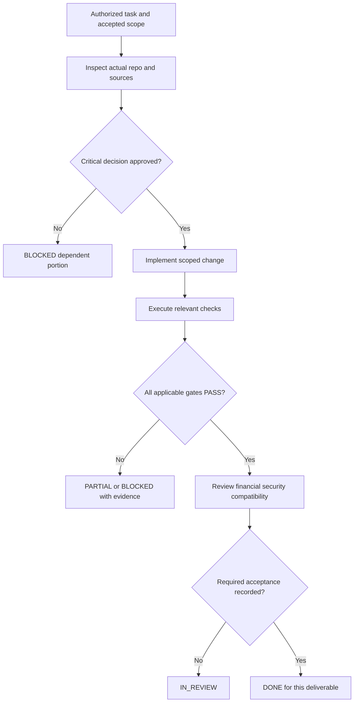

# Esokira - Definition of Done (DoD) & Delivery Acceptance Gates

> **Document ID:** ESOKIRA-DEFINITION-OF-DONE  
> **Version:** 0.1.0  
> **Date:** 2026-10-30 (Asia/Jakarta)  
> **Status:** `REVIEWED_INTERNAL - PENDING_OWNER_APPROVAL`  
> **Target path:** `docs/development/DEFINITION-OF-DONE.md`  
> **Scope:** Esokira monorepo: Flutter (`frontend/`), Go (`backend/`), PostgreSQL, `contracts/`, documentation, infrastructure, and deployment preparation.  
> **Audience:** Product Owner, AI coding agents, reviewers, contributors, QA, and maintainers.  
> **Type:** Proposed acceptance standard; **not** proof that application code, CI, DB schemas, or deployments already exist.

---

## 0. Executive contract: what DONE means

**Esokira** is a mobile financial life-planning and simulation product. The owner has selected **Flutter/Dart + Go + PostgreSQL** with a monorepo containing `frontend/` and `backend/`. Other architecture details and several financial policies remain `PROPOSED`, `TBD`, or `BLOCKED`. This DoD defines when an *authorized deliverable* may be marked `DONE`; it does not silently approve any unresolved decision.

A deliverable is **DONE only when every applicable gate is satisfied and its evidence is recorded**. A feature cannot be marked `DONE` simply because its screen renders, its endpoint returns `200`, it compiles, a Markdown file exists, or an AI agent says the task is finished. A single test run is insufficient when financial, database, API, user-isolation, or lifecycle behavior also applies.

**Five non-negotiable outcomes:**

1. **Correct scope:** the implementation matches an authorized task, its target release/slice, the PRD, and explicit acceptance criteria. No extra product or architecture decisions were smuggled in.
2. **Financial integrity:** actual and hypothetical data are separated. A transfer is not automatically income/expense; recorded account balances are exact, and simulations never silently post actual money.
3. **Security and privacy:** authenticated ownership is enforced server-side for private resources; sensitive data and secrets are not leaked; destructive and export actions have validated controls.
4. **Reproducible verification:** required checks **actually executed**, with truthful outcomes and sanitized evidence. `NOT_RUN`, `SKIPPED`, `FAILED`, and `BLOCKED` are not `PASS`.
5. **Honest handoff:** status, affected files, requirement IDs, test results, known risks, and remaining approvals are accurately recorded before an owner/reviewer can accept the deliverable.

**This document coordinates** `AGENTS.md`, `frontend/AGENTS.md`, `backend/AGENTS.md`, `docs/development/DEVELOPMENT-WORKFLOW.md`, and `docs/development/TESTING-STRATEGY.md`. It does not replace their requirements or any domain-owning specification. Conflicts are escalated with exact document/section IDs; agents never choose a new policy based on convenience.

---

## 1. Status model and approval semantics

A completion state belongs to a **specific object** (task, feature, release, documentation artifact), not automatically to its parent. A finished Markdown is not a finished feature; a finished feature is not an approved production release.

| Term | Meaning | Permitted evidence / transition |
|---|---|---|
| `UNVERIFIED` | Actual repository state has not been inspected or cannot be proven. | Inspect code, history, and environment before claiming `NOT_STARTED` or `DONE`. |
| `NOT_STARTED` | Inspected and no implementation for the defined task is present. | DoR can later move it to `READY`. |
| `READY` | Scope, dependencies, critical approvals, acceptance, and verification plan are sufficient to start. | Must satisfy task-specific Definition of Ready, not necessarily every future release decision. |
| `IN_PROGRESS` | Authorized implementation is underway. | Partial artifacts are not completion. |
| `IN_REVIEW` | Implementation/evidence available; final review or acceptance pending. | Reviewer checks this document and all applicable gates. |
| `DONE` | Acceptance AND all relevant evidence gates satisfied, with no task-blocking issue. | Record evidence plus review/approval appropriate to risk. |
| `PARTIAL` | Some deliverables completed, but specified acceptance is missing. | List exact unfinished conditions and next safe work. |
| `BLOCKED` | A required owner decision, specification, dependency, or critical validation prevents completion. | Record blocker ID, impact, responsible decision-maker, and unblocked work. |
| `CANCELLED` | Owner has explicitly stopped the task. | Record reason; do not erase history. |

The **handoff** may say `DONE | PARTIAL | BLOCKED | UNVERIFIED` as defined in `DEVELOPMENT-WORKFLOW.md`, while an implementation tracker can additionally track `READY | IN_PROGRESS | IN_REVIEW` and related states. Do not silently equate one taxonomy to another.

### 1.1 Three distinct approval concepts

- **Task authorization:** the owner approves doing a particular scoped action; this does not approve every `TBD` in the repo.
- **Decision approval:** the owner explicitly chooses a sensitive policy or requirement (e.g., ledger representation, auth provider, rounding, stochastic model); record the decision and affected documents.
- **Acceptance/release approval:** a reviewer/owner accepts the evidenced task or releases software in an identified environment. Internal review of documentation is not release approval.

A prompt such as **"gas buat markdown selanjutnya" authorizes only the requested documentation artifact**, not irreversible database changes, external integrations, real-data processing, or production deployment.

### 1.2 `N/A` is not a loophole

A gate is `N/A` **only when logically inapplicable** and its reason is recorded. A test that should run but could not because the environment was unavailable is `NOT_RUN` or `BLOCKED`, not `N/A`. Never turn a failed financial/security gate into `N/A` to close a task.

---

## 2. Documentation authority and traceability

Agents must read the **root `AGENTS.md`**, applicable nested instructions, then **only relevant sections** of the source-of-truth documents. Avoid loading the entire knowledge base into every task prompt.

| Topic / authoritative source | File | Primary identifiers |
|---|---|---|
| Product identity, user value | `docs/product/PRODUCT-VISION.md` | Vision pillars |
| Functional and nonfunctional requirements | `docs/product/PRD.md` | `FR-001`-`FR-024`, `EN-001`-`EN-006`, `NFR-001`-`NFR-010` |
| Release and dependency mapping | `docs/product/FEATURE-MATRIX.md` | `R0`-`R4`, `S-00`-`S-12` |
| Financial meaning and invariants | `docs/financial/FINANCIAL-DOMAIN-RULES.md` | `DR-001`-`DR-024` |
| Formula contract / source of numeric semantics | `docs/financial/CALCULATION-SPECS.md` | `CS-001`-`CS-016` |
| Financial golden test catalog | `docs/financial/FINANCIAL-TEST-CASES.md` | `FTC-*` |
| Trust boundaries / system composition | `docs/architecture/SYSTEM-ARCHITECTURE.md` | Architecture sections and open decisions |
| Go package boundaries / worker | `docs/architecture/BACKEND-ARCHITECTURE.md` | `BE-Q01`-`BE-Q17` |
| Flutter feature layers | `docs/architecture/FRONTEND-ARCHITECTURE.md` | `FE-Q01`-`FE-Q18` |
| DB design and database data model | `docs/architecture/DATABASE-DESIGN.md` | `DB-Q*`, proposed entities |
| REST/API design rules | `docs/architecture/API-GUIDELINES.md` | `API-Q*`, proposed conventions |
| Visual/UI component design | `docs/design/DESIGN-SYSTEM.md` | Design tokens and components |
| Interaction paths | `docs/design/USER-FLOWS.md` | `UF-00`-`UF-31`, `UXT-*` |
| Screens and acceptance | `docs/design/SCREEN-SPECS.md` | `SCR-00`-`SCR-22`, `UXT-*` |
| Security/privacy and threat tests | `docs/security/SECURITY-PRIVACY.md` | `ST-001`-`ST-075` |
| Agent rules / domain instructions | `AGENTS.md`, `frontend/AGENTS.md`, `backend/AGENTS.md` | Nested scope-specific rules |
| Task process and expected handoff | `docs/development/DEVELOPMENT-WORKFLOW.md` | DoR, DoD, `DW-Q*` |
| Test planning and execution policy | `docs/development/TESTING-STRATEGY.md` | `TS-001`-`TS-040`, `TS-Q01`-`TS-Q16` |

**When present and approved, the live machine-readable contracts take precedence for what is deployed:** `contracts/openapi.yaml` for exact API schema and `backend/db/migrations/` for applied DB schema. Their existence or approval must be verified, not inferred from documentation examples. If code and approved intent disagree, classify this as **drift**; do not overwrite the approval with observed code by default.

### 2.1 Precedence when sources disagree

1. Identify **which topic** owns the decision, and the exact conflicting passages (path + section/ID).
2. Identify the observed repository state separately from approved product intent.
3. Stop only the implementation dependent on the conflict; continue unrelated safe work if authorized.
4. Propose options and impact (API, DB, financial result, UX, security, compatibility).
5. Obtain owner decision and update **owning source first**, then derived docs/contracts/tests.

The owner must not be asked to reapprove a decision already clearly approved in applicable project context; however, a document marked `REVIEWED_INTERNAL - PENDING_OWNER_APPROVAL` is **not** in itself that approval.

---

## 3. Definition of Ready is a separate start gate

A task cannot become `DONE` unless it was appropriate to implement in the first place. The following is a **DoR checklist**, *not* a substitute for the completion checks that follow:

- [ ] Task identifier exists in approved `TASKS.md`, **if that file exists**; otherwise mark temporary ID as `DRAFT-*` and do not claim backlog approval.
- [ ] Owner request, release (`R0`-`R3`), slice, objective and in/out-of-scope behaviors are explicit.
- [ ] Applicable `FR/EN/NFR`, `DR/CS/FTC`, UX and security references were found.
- [ ] Task-critical policies and dependencies have explicit owner approval or the task is limited to safe proposal/documentation work.
- [ ] Relevant real repository paths, build scripts, tool versions and existing tests were inspected.
- [ ] Acceptance includes at least normal, invalid/error, and risk-specific cases as applicable.
- [ ] Financial expected values and unit/timing/rate semantics come from authoritative references, not the code being tested.
- [ ] Test infrastructure exists or limitations are recorded; absence of test environment does not authorize false success.
- [ ] Schema/API/deployment effects, rollback, and migration/backward compatibility are considered where applicable.

A documentation-only task can have different start conditions: source files, requested artifact path, validation rules, output package, and owner request. It does **not** require completed Go/Flutter implementation as long as it accurately states that implementation is unverified.

---

## 4. Universal DoD: ten mandatory completion gates

All implementation tasks must evaluate these ten gates. Mark a gate `PASS`, `FAIL`, `NOT_RUN`, `BLOCKED`, or `N/A` with an evidence link or explanation. A task is `DONE` only if every *applicable* gate is `PASS`, no disqualifying blocker remains, and the required reviewer/owner acceptance is recorded according to the task risk.

| Gate | Definition | Examples of acceptable evidence | If missing |
|---|---|---|---|
| `DOD-G01` Authorized scope | Diff implements only defined requirements and no unapproved decisions | Task ID, PRD IDs, reviewed diff | `PARTIAL` / `BLOCKED` |
| `DOD-G02` Functional behavior | Positive, invalid, edge and recovery behavior match acceptance | Unit, integration, UI and reproducible manual cases | `PARTIAL` |
| `DOD-G03` Financial semantics | `DR/CS/FTC` invariants, units, provenance and independent expected values respected | Golden cases, DB reconciliation, domain invariants | `BLOCKED` on critical failures |
| `DOD-G04` Security/privacy | Auth, ownership, secure handling, export/delete, secrets as applicable | Adversarial tests, threat review, sanitized logs | `BLOCKED` on critical gaps |
| `DOD-G05` API/DB/client consistency | Contract, migrations, validation, affected callers and old versions considered | Contract checks, migration integration and client tests | `PARTIAL` / `BLOCKED` |
| `DOD-G06` UX/usability | Required screens, states, copy, accessibility and locale coherent | Widget/E2E or reviewed screen evidence | `PARTIAL` |
| `DOD-G07` Reliability/operations | Retry, failure, timeout, concurrency, recoverability and resource limits handled | Fault/concurrency/restore tests when relevant | `BLOCKED` if data-at-risk |
| `DOD-G08` Verification evidence | Applicable checks actually run; environment, commit, result and exclusions recorded | CLI output, test logs, screen evidence, reviewer notes | `UNVERIFIED` / `PARTIAL` |
| `DOD-G09` Documentation/traceability | Source-of-truth docs, decision records, test indexes and task status synchronized | Changed references + traceability review | `PARTIAL` |
| `DOD-G10` Review/handoff | Review matched risk, changes and residual risks transparently reported | Reviewer/owner decision, handoff template | `IN_REVIEW` / `PARTIAL` |

Do **not** infer numeric test coverage targets (80%, 90%, etc.), latency thresholds, device support versions, CI provider, or statutory compliance from this table. Approval of measurable performance, coverage and release criteria is tracked separately (`TS-Q04`, `TS-Q05`, `TS-Q06`, and related decisions).

### 4.1 The minimum evidence object

Capture per relevant check:

```yaml
# Example evidence shape for documentation; not a production logging schema.
gate: DOD-G03
requirement_refs: [DR-006, DR-007, FTC-ACT-02]
commit: "<actual repository commit or NOT_AVAILABLE>"
environment: "<tool versions / OS / test DB / synthetic dataset>"
command_or_steps: "<actual command or reproducible manual steps>"
outcome: PASS  # PASS | FAIL | NOT_RUN | SKIPPED | BLOCKED | N/A
summary: "<observed behavior, not a hoped-for result>"
evidence_path: "<sanitized artifact or PR link, if available>"
reviewer: "<actual person or SELF_REVIEWED>"
```

`SKIPPED` is a **test execution result**, not a universal completion pass. A *mandatory skipped test* leaves the corresponding gate unfulfilled. Evidence with passwords, access tokens, raw financial records or customer identifiers must never be stored in public artifact logs.

### 4.2 Risk-adaptive verification, not arbitrary perfection

| Work class | Minimum expected acceptance layers | Escalation criteria |
|---|---|---|
| Documentation-only | Content integrity, source consistency, link/reference validation, file/ZIP verification, owner-review status | Conflicts with approved domain policy or security wording |
| UI copy/layout (no money behavior) | Widget/layout review, locale/accessibility as relevant, no regression in source labels | Misleading investment guarantee, missing actual/forecast distinction |
| Pure Go math | Independent `FTC-*` vectors, edge/property tests, deterministic replay where applicable | New formula, changed rounding/temporal semantics |
| Actual money / ledger / data integrity | Real PostgreSQL transaction/integration, concurrency/retry, reconciliation, authorization, migration if needed | Any double posting, data loss, incorrect ownership, reversal inconsistency |
| Auth / privacy / export / delete | Negative cross-user and session tests, privacy policy review, lifecycle and logging tests | Exposure/leak/deletion without authorization or policy |
| API/database contract | Contract tests, backward compatibility, consumer review, up/down migration and rollback plan as relevant | Breaking schema/API, immutable stored history changes |
| R2/R3 scenario and simulations | Financial/domain tests, isolation and staleness, model validation, job lifecycle/statistical tests when applicable | Unapproved stochastic model or optimizer objective |
| Production rollout | All inherited release gates, deploy/recovery evidence, owner approval | Live data change, legal/privacy exposure, unsupported rollback |

A low-risk documentation edit does not require a Monte Carlo load test. Conversely, a high-risk money mutation cannot become `DONE` from a green Go unit-test suite alone.

---

## 5. Task-level DoD by deliverable type

### 5.1 Documentation-only tasks (`.md`, diagrams, specs)

- [ ] File exists at the intended canonical path; title, version, date, status and audience are explicit.
- [ ] Statements are traceable to consulted documents, observed code, or clearly labeled proposal/assumption.
- [ ] Referenced requirement IDs, document paths and diagram/code fences were checked for consistency.
- [ ] No `PROPOSED` / `TBD` / `BLOCKED` item is silently changed to `DECIDED`.
- [ ] Examples are not falsely presented as compiled code, applied migration or approved API contract.
- [ ] If packaged: ZIP path, contents, CRC and byte-for-byte equivalence to original are verified.
- [ ] Documentation artifact status is **`REVIEWED_INTERNAL - PENDING_OWNER_APPROVAL`** unless owner approval exists.
- [ ] Handoff says `Implementation tests: NOT_RUN (documentation-only)` unless actual code tests were independently run and recorded.

**Distinction:** the *artifact* may be completed and delivered while the *proposed policy itself* is still pending approval. Do not report a product feature/release as `DONE` on this basis.

### 5.2 Go API/backend task

- [ ] Task-specific Go handler/use case/repository boundaries follow the existing approved structure; no unsupported dependency introduced.
- [ ] Request validation, status/error codes and resource ownership checks covered where applicable.
- [ ] Domain rules reside in services/financial engine, not hidden inside HTTP response formatting.
- [ ] Tests cover successful behavior, invalid input, not-found/not-owned, and server/dependency failures.
- [ ] Context cancellation, timeout, error mapping, logging redaction and database resource cleanup checked.
- [ ] If request mutates financial actuals, the stricter ledger gates in Section 6 also pass.
- [ ] Actual `go test` / build / lint/race results recorded where the tooling exists; unavailable checks are not labelled `PASS`.

### 5.3 Flutter client task

- [ ] `SCR-*` / `UF-*` acceptance criteria and the applicable `DESIGN-SYSTEM.md` guidance are respected.
- [ ] Widget and state layers do not silently create authoritative balances or financial rules divergent from Go.
- [ ] Happy, empty, loading, invalid, permission, offline/timeout, unknown-write, and stale states are assessed; irrelevant states marked `N/A` with reason.
- [ ] User-visible numbers show currency, correct locale, provenance (`actual/planned/forecast`) and assumptions where required.
- [ ] Sensitive screens do not leak private content in debug logs, notifications or unsafe persistence.
- [ ] Navigation and accessibility checks use the actual widget/device situation, not only a screenshot.
- [ ] For mutations, duplicate submission prevention and uncertain-commit recovery are verified against the API behavior.
- [ ] Relevant Flutter unit/widget/integration tests executed and reported; a design mock alone is not done.

### 5.4 API contract task

- [ ] Exact request/response schema, authorization, money/date serialization and error semantics have **approved** contract definitions (OpenAPI when created).
- [ ] Backend behavior and generated/handwritten client agree; examples in `API-GUIDELINES.md` remain *non-binding* until approved.
- [ ] Breaking-change impact, compatibility, versioning, pagination and idempotency considered.
- [ ] Contract lint/parser, integration tests, negative cases and permission boundaries executed where relevant.
- [ ] If the contract requires an undecided policy, the dependent implementation is `BLOCKED`; a speculative draft can be a completed documentation task only.

### 5.5 Database schema/migration task

- [ ] Schema comes from an approved decision; illustrative SQL in `DATABASE-DESIGN.md` was not auto-promoted to production migration.
- [ ] Ownership FKs/uniqueness/constraints, precision, index usage and transaction boundaries were reviewed.
- [ ] Forward migration exercised on disposable PostgreSQL; backwards/roll-forward plan tested as relevant to risk.
- [ ] No destructive data operation performed without explicit scope, rollback/recovery and approval.
- [ ] Anonymized/synthetic data migration test covers nulls, duplicates, old versions, integrity and backfill where relevant.
- [ ] Real query logic, transactions and concurrency tested (not merely successful migration parsing).

### 5.6 Background job / worker task

- [ ] Job lifecycle, tenant ownership, retry limits, idempotency, cancellation, timeouts and resource budgets are specified and implemented.
- [ ] Simulations are reproducible with stored approved model parameters, version, seed and baseline references where applicable.
- [ ] Failed or canceled jobs never mutate actual money records or expose another user's result.
- [ ] Worker restarts, duplicate delivery, stuck jobs, poison inputs and expiration/retention are exercised.
- [ ] Worker/provider choices and retention policies required for the scope are approved (otherwise `BLOCKED`).

---

## 6. Financial data integrity: mandatory hard-stop gates

These gates apply whenever a task reads, writes, aggregates, calculates or visualizes sensitive financial values. Use `FINANCIAL-DOMAIN-RULES.md`, `CALCULATION-SPECS.md` and `FINANCIAL-TEST-CASES.md` as authoritative domain and numeric sources; see `DR-001`-`DR-024`.

| Boundary | Required observed behavior before `DONE` | Minimum evidence |
|---|---|---|
| **Actual vs hypothetical** | Scenario, life event, budget, goal, or simulation does not silently modify actual ledger (`DR-001`, `DR-002`, `DR-012`). | Before/after database snapshot + scenario integration test. |
| **Exact money** | Recorded balances use approved exact representation; no binary float as ledger source (`DR-004`). | DB schema check + round-trip + golden cases. |
| **Opening balance** | Opening balance does not falsely count as income (`DR-005`). | Period report and balance reconciliation. |
| **Transfer** | Zero-fee same-currency transfer is neither income nor expense and retains total holdings (`DR-006`). | Paired posting, period report, net-worth reconciliation. |
| **Atomicity** | Transfer/financial write either fully commits or fully rolls back (`DR-007`). | Real DB fail-injection + transaction test. |
| **Deduplication** | Repeated request, timeout and concurrent retry do not double-post (`DR-008`). | Same/different idempotency key and conflict tests. |
| **Asset valuation** | Account balances not double-counted in assets/net worth (`DR-009`, `DR-010`). | Golden and integration reconciliation. |
| **Goal funding** | Planned contribution is not shown as actual-funded progress (`DR-011`). | UI/backend tests with differing planned/actual values. |
| **Correction/reversal** | Existing posting correction preserves integrity and audit semantics (`DR-022`) **under an approved policy**. | Real DB/reconciliation/replay evidence. |
| **Provenance and timing** | Values have source kind, currency, reference date/period, rate and assumptions as applicable (`DR-014`, `DR-018`). | API/Flutter contract and semantic UI tests. |
| **Staleness** | Baseline changes invalidate or label older scenario results appropriately (`DR-020`). | Revision/version comparison + stale UI behavior. |

**Hard stop:** if any financial write duplicates funds, creates an unbalanced transfer, loses an entry, alters another user's money, or silently updates hypothetical values as actual, the task is **not DONE**, regardless of unit-test coverage, UI polish or deadline. Do not merge/release that path without remediation and successful regression tests.

### 6.1 Independently verified financial numbers

1. Link to `CS-*` contract with full formula, unit, time convention and approved input assumptions.
2. Use matching `FTC-*` golden expected values **derived independently** from a trusted calculation or verified manual derivation, not copied from output of the function under test.
3. Separate integer/exact-decimal financial values from approximate stochastic/irrational calculations. Tolerances must be approved and justified; no agent-defined arbitrary epsilon for money.
4. Test zero rate, negative permissible rates, zero periods, boundary magnitudes, invalid input, contribution timing, inflation and rounding cases as applicable.
5. After any numeric formula, rounding or precision change, rerun relevant `FTC-*` plus consumers (goals, charts, forecasts, retirement), and request owner review for changed golden values.
6. If expected values or model choices are `TBD/BLOCKED`, mark production calculation **blocked**, rather than inventing "reasonable" defaults.

### 6.2 No accidental future action

Financial GPS and insights may explain alternatives, not autonomously purchase products, transfer funds or place investments. A suggestion must identify assumptions, trade-offs and limitations. User-triggered *actual* financial recording follows a separate, approved write flow.

---

## 7. API and PostgreSQL consistency gates

### 7.1 Actual-write transaction acceptance

For each actual money mutation:

1. Validate authenticated principal and resource ownership on the server, not a freely supplied `user_id`.
2. Validate monetary amount, currency, account state, reference entities, time semantics and supported operation.
3. Use an approved transaction/ledger scheme and atomic PostgreSQL transaction. Define isolation/locking as needed for concurrent operations.
4. Enforce and test idempotency for retryable posting according to a documented approved contract; never blindly resend after unknown commit.
5. Verify database uniqueness, foreign keys, constraints, and business invariants after commit/rollback.
6. Confirm API response, activity history, UI and reconciliation agree on outcome.
7. Test timeout **after possible commit**, retry with same key, concurrent duplicate and conflicting payload cases.

**No approval shortcut:** ledger shape, rounding, correction/reversal, idempotency semantics and exact API payloads remain candidates until owner-approved, even if an illustrative example compiles.

### 7.2 API compatibility and deployment sequencing

- For a new or modified endpoint, identify existing producers and consumers; update approved contract, Go validation, Flutter decoding, mock/stub contracts, and tests coherently.
- Maintain safe error classification and avoid private resource enumeration. Distinguish domain validation errors from permission, missing resource and system failure without leaking sensitive details.
- When a DB change is required, describe migration/backfill, old/new service compatibility, rollback or forward recovery, and deployment order.
- Do not declare completed API integration from successful mock server tests alone. A real backend integration layer must be exercised where the task requires it.
- Correct error body syntax is not a substitute for verified authorization and transaction safety.

---

## 8. Flutter and UX acceptance gates

| UX state / rule | When mandatory | Pass condition |
|---|---|---|
| `loading`, `empty`, `success`, `error` | All data-driven screens | No stuck spinner, misleading blank state, fabricated success or lost unsaved input. |
| `invalid`, `permission` | Forms and private views | Clear action and safe error messaging; unauthorized data hidden. |
| `offline`, `timeout`, `unknown commit` | Network mutations | No automatic double financial posting; user can safely reconcile status. |
| `stale` | R2/R3 scenarios or cached financial comparisons | Clearly visible outdated baseline and re-run/rebase action according to policy. |
| `queued/running/failed/cancelled/succeeded` | Approved R3 simulation jobs | Real status from backend; no fake progress percentages; safe polling cancellation. |
| `actual/planned/forecast` | Financial summaries and charts | Every value's provenance is legible, including as-of date and currency/units. |
| `goal planned/actually funded` | Goal progress | Plans never inflate achieved actual funding. |
| `dark/light`, text scale, localization | Applicable approved screens | Consistent tokens, no clipping, usable semantics and IDR rendering. |

Required linkage: `SCREEN-SPECS.md` (`SCR-00`-`SCR-22`), `USER-FLOWS.md` (`UF-00`-`UF-31`, `UXT-*`), and `DESIGN-SYSTEM.md`. Existing designs are reviewed proposals until approved. The agent may implement a limited authorized widget without approving the full design system, but cannot describe it as a finalized production UI.

**Accessibility DoD:** meaningful semantic labels, readable and contrast-appropriate financial data, focus/touch reachability, screen-reader ordering, and independent non-color chart distinctions. Device matrix and target accessibility policy require their own approval (see `TS-Q06`, `TS-Q15`).

---

## 9. Security and privacy acceptance gates

Security-sensitive tasks require relevant `ST-*` cases from `SECURITY-PRIVACY.md`, threat review, and proof under appropriate synthetic identities. A simple login happy path does not establish secure multitenancy.

- [ ] **Authentication**: missing/expired/malformed token, sign-out, session refresh and denied requests behave safely.
- [ ] **Authorization/ownership**: user A cannot read, edit, export, poll or delete user B's accounts, goals, scenarios, jobs, snapshots or artifacts; object IDs cannot bypass scope checks.
- [ ] **Server trust**: privileged identity comes from verified server-side authentication, not client-provided owner fields.
- [ ] **Secrets**: no private credentials in repository, CI logs, build assets, client bundle, crash payloads or URL query strings.
- [ ] **Client storage**: sensitive cache/token handling respects approved mobile storage and sign-out rules.
- [ ] **Privacy**: export and deletion require proper authentication, confirmed scope, user guidance, and approved retention/recovery behavior.
- [ ] **Observability**: request traces and job metrics are useful while suppressing raw financial inputs, sensitive identifiers and tokens.
- [ ] **Abuse/availability**: bounded request sizes, heavy job budgets, reasonable denial of unauthenticated access, and safe retry/queue behavior where applicable.
- [ ] **Recovery**: backup restore is tested in an isolated environment before production release when relevant; backups do not silently undermine deletion policy.
- [ ] **Supply chain**: dependency/configuration review, secret scanning and release artifact integrity undertaken for intended deployment.

A checklist is a plan, **not a certification**. Legal obligations (including Indonesia's personal-data and applicable registration/compliance requirements) need a separate scoped legal/privacy review, not an AI-generated conclusion of compliance.

**Critical stop conditions:** any cross-user financial data exposure, unrestricted administrative operation, public secrets, unauthorized deletion, or unreconciled actual funds prevents `DONE` for the affected release path. Security exceptions cannot be silently accepted by an agent.

---

## 10. Testing evidence and CI gates

Canonical test strategy: `docs/development/TESTING-STRATEGY.md` (`TS-001`-`TS-040`, `TS-Q01`-`TS-Q16`). Financial test catalog: `FTC-*`; UX tests: `UXT-*`; security tests: `ST-001`-`ST-075`.

### 10.1 Test-layer expectations

| Layer | Example scope | Proof needed for a related task |
|---|---|---|
| Go unit/table-driven | Pure calculations, validation, decisions, formatting helpers | Real `go test` run; expected inputs/outputs trace to spec. |
| Go race/property | Concurrent behavior and broad invariants | Real race/property execution with reproducible seed/setup where possible. |
| PostgreSQL integration | Transfer, money writes, rollback, concurrent requests, constraints, migrations | Real disposable DB; inspect committed state, not just HTTP response. |
| Contract tests | OpenAPI schema, errors, money/date JSON, compatibility | Approved contract + executed parser/lint/consumer-provider tests as applicable. |
| Flutter unit/widget | Rendering, accessibility, state transitions, validation | Actual `flutter test`/widget evidence for relevant screens. |
| End-to-end | Login to goals, transfers, simulations, user isolation | Integrated Go + PostgreSQL + Flutter or equivalent real integration, synthetic users. |
| Security & privacy | Tenant isolation, export/delete, logging, secrets | Targeted adversarial cases and inspection evidence. |
| Stochastic/model | Seeded replay, Monte Carlo outputs, optimizer infeasibility | Approved model/tolerance plus statistical/reference checks. |
| Operations | Health, recovery, worker restart, resource bounds | Staging or disposable environment measurements and recovery steps. |

### 10.2 Test outcome semantics

- `PASS`: test actually executed and assertions satisfied in the declared environment.
- `FAIL`: executed but assertion or environment failure occurred; root cause is not yet acceptance.
- `NOT_RUN`: test not executed; state exact reason (tool missing, code absent, not configured, blocked).
- `SKIPPED`: runner intentionally skipped; include reason and whether the skip leaves a mandatory gate unmet.
- `BLOCKED`: test cannot be meaningfully run until policy/specification or prerequisite exists.
- `N/A`: only for truly inapplicable test types with explicit rationale.

**A command's existence or a prepared test plan is not execution proof.** Never fabricate CI URLs, passing test counts, screenshots, benchmark numbers or device sessions.

### 10.3 CI policy and tool verification

- Inspect actual repository manifests before choosing commands or claiming CI exists: `backend/go.mod`, `frontend/pubspec.yaml`, root scripts, the actual CI configuration and environment.
- Formatting, linting, unit tests and selected contract/integration tests are proposed baseline checks; gate enforcement and coverage thresholds require approval (`TS-Q04`, `TS-Q11`).
- Run a focused suite during small task development and relevant regression suites before review/release; record exclusions.
- Financial golden changes, migration edits, authorization changes and model parameter modifications need additional independent review appropriate to risk.
- Sanitize CI artifacts and define retention/access (`TS-Q12`) before collecting real user data; use synthetic test datasets by default.
- Do not claim cross-device or production behavior from a single local emulator run.

---

## 11. End-to-end, regression, and defect gates

### 11.1 Regression closure

A bug fix is not `DONE` until the observed defect is reproduced or otherwise convincingly characterized, the fix addresses its cause, relevant regression tests are added/updated, and the affected surrounding behavior is rechecked. A flaky test must be investigated; turning it off is not proof that the regression is fixed.

### 11.2 Failure triage

1. Record affected task/requirement/test ID, observed vs expected, environment and reproduction steps.
2. Classify implementation defect, spec conflict, test defect, environment issue, flaky behavior or decision blocker.
3. If money integrity, cross-user access or sensitive leakage is implicated, stop affected merge/release; preserve sanitized evidence.
4. Fix according to authoritative specification or request specification change; do not quietly edit golden expected values to match buggy implementation.
5. Run focused test and adjacent regressions; add independent review for high-risk changes.
6. In handoff distinguish **resolved**, **deferred with approval**, **blocked** and **unverified**. Do not claim full completion with an unresolved critical failure.

### 11.3 Waiver/exception policy (proposed)

- Waivers must be narrow, documented, owner/reviewer-approved, time-bounded, and linked to a tracked remediation task.
- A waiver cannot turn an unexecuted test into `PASS`, nor certify finance/security behavior.
- Critical ledger loss, cross-user data leakage, unauthorized deletion or knowingly false financial results are **non-waivable for declaring the affected feature/release DONE**.
- If the feature remains incomplete due to a requirement, report `PARTIAL` or `BLOCKED`. Business acceptance of a reduced scope needs a formal change of requirements and acceptance criteria, not a silent exception.

---

## 12. Definition of Done by release

Release-level `DONE` is stricter than task-level `DONE`. Each release inherits all relevant gates of earlier releases. The release mapping below follows `FEATURE-MATRIX.md`; it is a **proposed release scope, not evidence of completed code**.

### 12.1 R0 - Engineering Foundation (EN-001 to EN-004 and EN-006)

- [ ] Monorepo structure `frontend/` and `backend/` exists, is reproducible, and builds/tests where in scope (`EN-001`).
- [ ] Required PostgreSQL migration lifecycle, ownership/tenant boundaries and disposable integration tests are available after schema policy approval (`EN-002`).
- [ ] Approved API schema/validation/auth middleware foundation and negative access tests exist (`EN-003`).
- [ ] Financial engine is independently testable without HTTP and database dependencies (`EN-004`).
- [ ] Secrets, privacy-safe logging, observability and recovery baseline are reviewed (`EN-006`).
- [ ] CI/workflow checks run, with real evidence and known constraints; no assumed provider, thresholds or fake `PASS`.
- [ ] Environment variables and local setup are documented without embedding secrets.
- [ ] Product Owner has approved release-critical architecture and R0 scope; R0 acceptance review is recorded.

**Note:** `EN-005` is an R3 enabler and must not become an R0 dependency by accident.

### 12.2 R1 - MVP (S-02 through S-06)

- [ ] R0 gates remain satisfied and relevant regressions pass.
- [ ] `FR-001`/`FR-002`: authenticated ownership, session lifecycle, profile/onboarding and privacy controls behave correctly.
- [ ] `FR-003`/`FR-004`: account/opening balances and income/expense/transfers pass real DB atomicity/idempotency, concurrency and cross-user tests.
- [ ] `FR-005`/`FR-006`: assets, liabilities and net worth reconcile with non-duplicated totals.
- [ ] `FR-007`/`FR-008`/`FR-009`: goals, compound calculator and feasibility use approved assumptions, independently verified golden values and honest progress labels.
- [ ] `FR-021`: data export/deletion controls follow approved policy and have permission, retention, and recovery tests.
- [ ] Core `SCR-*`/`UF-*` flows pass selected widget/E2E/accessibility tests on approved targets.
- [ ] Security cases for authenticated personal financial data and critical money writes pass; no critical unknown findings.
- [ ] Required operations, backups/restore verification and deployment-specific policy approvals are complete before production release.

### 12.3 R2 - Planning V1 (S-07 through S-09)

- [ ] R1 regression/gates remain satisfied.
- [ ] `FR-010`: budgets and recurring plans do not duplicate actual financial postings.
- [ ] `FR-011`: life events are hypothetical until separately recorded through approved actual flow.
- [ ] `FR-012`/`FR-013`: projections and comparisons are deterministic, versioned and never silently mutate actual data.
- [ ] `FR-014`: cash flow and forecast have correct time, currency, actual/forecast distinction and shortfall semantics.
- [ ] `FR-015`: stress tests use defined shocks/assumptions, communicate constraints and validate edge cases.
- [ ] `FR-016`: explainable insights show source rules, missing-data behavior, and no unsupported automated action.
- [ ] `FR-022`: if included in approved release scope, notification permissions/preferences and private preview behavior are tested.
- [ ] Baseline revision/staleness behavior and UI recovery states are tested with real changing data.

### 12.4 R3 - Advanced (S-10 through S-12)

- [ ] R2 regression/gates remain satisfied.
- [ ] `FR-017`: optimizer objective, constraints, priority/tie-break and infeasibility behavior explicitly approved and tested against reference cases.
- [ ] `FR-018`: stochastic model, seeded replay, statistics/limitations and acceptance bands approved; no financial guarantee implied.
- [ ] `FR-019`: retirement/FIRE decumulation, inflation, sequence-of-returns and depletion cases independently reviewed.
- [ ] `FR-020`: Financial GPS suggestions are grounded in model outputs, alternatives and trade-offs without executing real transfers/investments.
- [ ] `EN-005`: background job statuses, retry/deduplication, cancellation, tenant isolation, worker crashes and resource controls pass tests.
- [ ] Performance/resource budget measured under an **approved** workload; unknown target is a release decision blocker, not an automatic pass.
- [ ] User-facing model assumptions, forecast provenance, limitations, and job failure/stale states are understandable and accessible.

### 12.5 R4 - Discovery only

`FR-023` (shared goals) and `FR-024` (portfolio planning) remain **discovery**, not implementation scope. Research, decision proposals and artifacts may be documented under distinct tasks; no production readiness or release-completion claim is allowed without a new approved PRD and gates.

---

## 13. Requirement-to-evidence traceability

This table is a **DoD routing index**, not a claim that tests passed. Each requirement must have a trace entry to task(s), evidence and reviewer sign-off in a future tracker, when created.

### 13.1 Functional requirements `FR-001` to `FR-024`

| Requirement | Release | Primary DoD proof |
|---|---|---|
| `FR-001` | R1 | Identity/token lifecycle, server ownership, cross-user negative access |
| `FR-002` | R1 | Profile/onboarding validation, consent, error/retry UI |
| `FR-003` | R1 | Account/opening-balance DB integration and exact money |
| `FR-004` | R1 | Income/expense/transfer atomicity, idempotency, concurrency |
| `FR-005` | R1 | Asset/liability valuations, reconciliation, no double count |
| `FR-006` | R1 | Net worth golden vectors, dashboard provenance and dates |
| `FR-007` | R1 | Goal CRUD, authorization, planned vs actual-funded semantics |
| `FR-008` | R1 | Compound formula, assumptions and `FTC-*` golden tests |
| `FR-009` | R1 | Contribution feasibility, period/capacity and infeasibility cases |
| `FR-010` | R2 | Recurring/budget source distinction, duplicate prevention |
| `FR-011` | R2 | Life event drafting, no actual mutation |
| `FR-012` | R2 | Deterministic projection golden and scenario isolation |
| `FR-013` | R2 | Baseline snapshot, versioning and comparison/stale state |
| `FR-014` | R2 | Cash-flow shortfall, calendar boundary and labels |
| `FR-015` | R2 | Shock cases, resilience metrics and failure messaging |
| `FR-016` | R2 | Rule traceability, explainable insights, insufficient-data behavior |
| `FR-017` | R3 | Approved optimizer objective/constraints, infeasible reference tests |
| `FR-018` | R3 | Approved Monte Carlo model/seed/statistics, worker isolation |
| `FR-019` | R3 | Retirement withdrawal/sequence tests, assumption disclosures |
| `FR-020` | R3 | Financial GPS alternatives, causal/source explanation, no money action |
| `FR-021` | R1 | Export/delete authorization, lifecycle, retention and recovery checks |
| `FR-022` | R2 | Notification preferences, permission and privacy-preserving display |
| `FR-023` | R4 discovery | Discovery decision only; not production-ready |
| `FR-024` | R4 discovery | Discovery decision only; not production-ready |

### 13.2 Engineering enablers and nonfunctional requirements

| ID | Minimum acceptance evidence |
|---|---|
| `EN-001` | Build/test commands on actual monorepo; CI logs when configured |
| `EN-002` | PostgreSQL migrations + ownership and rollback tests |
| `EN-003` | Approved API contract and middleware negative cases |
| `EN-004` | Pure financial engine testable independently; linked `FTC-*` |
| `EN-005` | Durable bounded jobs, retry, cancellation and ownership (R3) |
| `EN-006` | Secret handling, observability, backup/restore strategy |
| `NFR-001` | Security isolation and threat-risk controls |
| `NFR-002` | Financial numeric integrity/reconciliation and tests |
| `NFR-003` | Reproducible simulation with input, baseline, engine version and seed when relevant |
| `NFR-004` | Performance p50/p95/memory measured under an agreed workload; numerical SLA remains TBD |
| `NFR-005` | UX clarity, money formatting, actual-vs-forecast, error states and accessibility |
| `NFR-006` | Reliability, atomic transfers, safe retries, and tested restore procedure |
| `NFR-007` | Observability with correlation IDs and redacted sensitive logs |
| `NFR-008` | Consent, export, deletion and verified retention/lifecycle policies |
| `NFR-009` | Quality gates: executed backend, frontend, contract, migration and security tests |
| `NFR-010` | Data boundary: plans, scenarios and insights never silently write actual ledger |

These are verification summaries of the corresponding requirements in `PRD.md`; consult the PRD for the complete normative wording.

### 13.3 Domain rules `DR-001` to `DR-024`

| Rule IDs | Main evidence focus |
|---|---|
| `DR-001`, `DR-002`, `DR-012`, `DR-013`, `DR-020` | Actual vs hypothetical/recurring, immutable simulation results, staleness |
| `DR-003`, `DR-021` | Server ownership and sensitive-data-safe logs |
| `DR-004`, `DR-005`, `DR-006`, `DR-007`, `DR-008` | Exact money, opening balance, transfer, atomicity and deduplication |
| `DR-009`, `DR-010`, `DR-023` | Asset valuation and reporting reconciliation |
| `DR-011` | Goal actual-funding separation |
| `DR-014`, `DR-015`, `DR-018` | Unit/time/provenance and forecast disclosure |
| `DR-016`, `DR-017`, `DR-024` | Model traceability, refusal on incomplete assumptions, approvals |
| `DR-019` | Explainable insights without real-world money action |
| `DR-022` | Correction/reversal consistency under approved policy |

For exact named assertions and case IDs, refer to `TESTING-STRATEGY.md` Section 20 and `FINANCIAL-TEST-CASES.md`; do not derive `PASS` from this table alone.

---

## 14. Completion templates for agents and reviewers

### 14.1 Task acceptance sheet (copy; fill with actual evidence)

```markdown
# Acceptance - [TASK-ID]

- Release / slice: R? / S-??
- Requirements: FR-..., EN-..., NFR-..., DR-..., CS-...
- User request / scope: ...
- Owner-decided policies used (decision refs): ...
- Reviewer: ... (or SELF_REVIEWED, if accurate)
- Current implementation state: NOT_STARTED | READY | IN_PROGRESS | IN_REVIEW | DONE | PARTIAL | BLOCKED | UNVERIFIED

| Gate | Applicable? | Result | Evidence | Reviewer note |
|---|---|---|---|---|
| DOD-G01 | Yes | NOT_RUN | - | - |
| DOD-G02 | Yes | NOT_RUN | - | - |
| DOD-G03 | TBD | NOT_RUN | - | - |
| DOD-G04 | TBD | NOT_RUN | - | - |
| DOD-G05 | TBD | NOT_RUN | - | - |
| DOD-G06 | TBD | NOT_RUN | - | - |
| DOD-G07 | TBD | NOT_RUN | - | - |
| DOD-G08 | Yes | NOT_RUN | - | - |
| DOD-G09 | Yes | NOT_RUN | - | - |
| DOD-G10 | Yes | NOT_RUN | - | - |

- Executed commands (exact): ...
- Environment / commit / fixtures: ...
- PASS / FAIL / NOT_RUN / SKIPPED / BLOCKED: ...
- Evidence artifacts (sanitized): ...
- Dependencies and residual risks: ...
- Final status: IN_REVIEW | DONE | PARTIAL | BLOCKED | UNVERIFIED
- Acceptance record (who, what, when): ...
```

### 14.2 Documentation-only acceptance sheet

```markdown
Artifact: docs/development/DEFINITION-OF-DONE.md
Version: 0.1.0
Status: REVIEWED_INTERNAL - PENDING_OWNER_APPROVAL
Sources consulted: AGENTS.md, DEVELOPMENT-WORKFLOW.md, TESTING-STRATEGY.md, plus relevant specs
Checks: headings/fences, link/path and ID references, semantics and decision statuses
Archive: name/path/content/checksum verified (only if actually done)
Implementation tests: NOT_RUN (docs-only)
Known open decisions: DOD-Qxx, any referenced owner decision sets
Owner review: PENDING
```

### 14.3 Implementation handoff (match existing workflow)

```markdown
# Handoff - [TASK-ID]
Status: DONE | PARTIAL | BLOCKED | UNVERIFIED

## Delivered behavior
- ...

## Files changed
- ...

## Verification evidence
- Test IDs + commands actually executed: ...
- Environment / version / commit / output summary: ...
- Failures, skipped and not-run checks: ...

## Open decisions and risks
- Approved decisions used: ...
- TBD/BLOCKED items affecting this scope: ...
- Security / financial / API / DB compatibility notes: ...

## Review and acceptance
- Reviewer: ...
- Result: ...

## Next authorized step
- ...
```

---

## 15. Review patterns: examples and disqualifiers

| Scenario | Correct status or decision | Why |
|---|---|---|
| Flutter expense screen looks finished, no backend call | `PARTIAL` | User-visible UI alone does not make the financial feature functional. |
| Go unit test returns green for transfer, DB rollback never tested | `PARTIAL` / `BLOCKED` | Atomicity cannot be proven without real PostgreSQL integration. |
| Timeout returns success toast despite unknown commit | `BLOCKED` for actual posting acceptance | Risk of double transaction and false financial state. |
| Compound calculator compiles, monthly rate convention unapproved | `BLOCKED` for authoritative release | Mathematical result depends on an unresolved domain decision. |
| Scenario preview writes into actual account balance | `BLOCKED` | Violates hard domain invariant `DR-002`. |
| Monte Carlo seed replay works, model distribution unapproved | `PARTIAL` / `BLOCKED` | Reproducibility does not validate a model's assumptions or risk disclosures. |
| UI test passes, user B can fetch user A's simulation by ID | `BLOCKED` | Cross-user ownership is a critical security failure. |
| Documentation file created and ZIP verified; no code exists | Artifact `DONE`, content `PENDING_OWNER_APPROVAL` | Docs-only completion is not feature/release completion. |
| Agent could not run tests because CI is not configured | `PARTIAL` / `UNVERIFIED` as appropriate | `NOT_RUN` must be disclosed; completion cannot be invented. |
| Owner approves a reduced release scope explicitly | Re-scope and rerun relevant gates | Never mark original unfulfilled acceptance as done. |

### 15.1 What reviewers should explicitly reject

- "It should work" without run evidence.
- "100% complete" without mapping of acceptance criteria and unexecuted tests.
- API examples misrepresented as deployed routes, migrations or published contracts.
- A dependency change or security exemption introduced without request/approval.
- A mocked source treated as an actual bank/account balance.
- Numeric expected results copied only from the same algorithm being tested.
- A permanent TODO, fake progress bar, or placeholder result silently shipped as production behavior.
- An "approved" label inferred from a prior document's internal review or owner's generic "gas".

---

## 16. Completion review protocol



**Review owner:** Product Owner (or an explicitly delegated reviewer) controls final acceptance of high-impact requirements and releases. Agent self-review may be reported, but does not substitute for owner decision approval or external security/legal certification.

The reviewer should compare the diff to the task card; inspect evidence and important negative tests; re-check financial/security invariants; verify contracts/docs; and record acceptance with reviewer/date/version or a concrete remediation request. Final status should be mirrored in `TASKS.md` / `PROGRESS.md` **only when these files exist and are authorized to be updated**.

---

## 17. Exceptions, documentation drift and ongoing maintenance

1. **Document drift:** when requirements, financial formula, schema, API or UX flow changes, edit the owning source first with authorization, then update derived diagrams, specs, tests, code and decision log as applicable.
2. **Verified code state vs approved intent:** code is evidence of current behavior, not automatic approval to redefine requirements. Discrepancy requires explicit resolution.
3. **Third-party risk:** changes involving dependencies, identity provider, notifications, analytics, backup/storage provider, or paid infrastructure require impact and cost/security review.
4. **No invisible scope expansion:** an "easy" related refactor should be a separate approved task if it changes unrelated modules, domain rules or public contract.
5. **Reopen, do not overwrite:** regressions in completed features become tracked fixes/new tasks; preserve previous acceptance history.
6. **Asynchronous work:** do not claim an unfinished job/report will be completed later unless an actual scheduled or background execution mechanism exists and is authorized.
7. **Production evidence:** test/staging evidence does not automatically establish live deployment; record actual environment.

---

## 18. Open DoD decisions and policy gaps

All items here are **proposed decisions**, not accepted outcomes. They must be resolved as needed, not necessarily all before an independent documentation task.

| ID | Decision to be approved | Initial status | Depends on / consequences |
|---|---|---|---|
| `DOD-Q01` | Who can formally accept low-risk tasks vs high-risk financial/security tasks? | `TBD` | Reviewer roles, evidence and owner sign-off |
| `DOD-Q02` | Which CI provider and mandatory branch checks are enforced? | `TBD` | `TS-Q11`, `EN-001` |
| `DOD-Q03` | Exact financial golden reference approval and exception protocol | `TBD` | `TS-Q08`, `TS-Q13`, `CALC-Q*` |
| `DOD-Q04` | Minimum coverage/quality thresholds by component and release | `TBD` | `TS-Q04` |
| `DOD-Q05` | Supported device/platform/OS matrix and test evidence standard | `TBD` | `TS-Q06`, `TS-Q15` |
| `DOD-Q06` | Performance and heavy job budgets/measurement methodology | `TBD` | `TS-Q05`, `TS-Q10`, `TS-040` (testing work package) |
| `DOD-Q07` | CI artifact/report storage, access and retention | `TBD` | `TS-Q12`, security and privacy |
| `DOD-Q08` | Release sign-off format and environments (internal beta / public / production) | `TBD` | Release authority, rollback rehearsals |
| `DOD-Q09` | Restore rehearsal, disaster-recovery acceptance criteria | `TBD` | `TS-Q14`, `TS-038` |
| `DOD-Q10` | How to track task/release status in `TASKS.md` and `PROGRESS.md` | `TBD` | `TS-Q16`, `DEVELOPMENT-WORKFLOW.md` |
| `DOD-Q11` | Acceptance of changed API/schema plus migration compatibility window | `TBD` | `API-Q*`, `DB-Q*`, contract checks |
| `DOD-Q12` | Final money representation, ledger, ownership and retry policies | `BLOCKED` for production monetary writes | `FDR-Q*`, `DB-Q*`, `API-Q*`, `BE-Q*` |
| `DOD-Q13` | Approval of R3 model methodology, statistics and risk disclosures | `BLOCKED` for R3 production claim | `TS-Q10`, financial modeling decisions |
| `DOD-Q14` | Who approves security/privacy exceptions and what cannot be waived? | `TBD` | `SECURITY-PRIVACY.md`, owner security review |

**Note:** `TS-040` is the strategy work package for performance and abuse/resource checks. Do not confuse test ID `TS-040` with a decision ID such as `TS-Q10`.

---

## 19. QA of this documentation artifact

A reviewer checking **this Markdown** must confirm:

- [ ] Paths for all referenced canonical docs correspond to actual intended project layout.
- [ ] Root/nested AGENTS rules and Development Workflow status semantics are consistent.
- [ ] All 10 `DOD-G01`-`DOD-G10` gates have clear passing evidence expectations.
- [ ] Functional `FR-001`-`FR-024`, enablers `EN-001`-`EN-006`, `NFR-001`-`NFR-010`, and domain `DR-001`-`DR-024` are represented without duplicate row identifiers.
- [ ] Financial `CS-*`/`FTC-*`, testing `TS-*`, security `ST-*`, user flow `UF-*`, screen `SCR-*`, and UX `UXT-*` references are consistent.
- [ ] Markdown fences, tables and Mermaid syntax pass structural checks; examples are labelled illustrative.
- [ ] All 14 `DOD-Q01`-`DOD-Q14` remain pending; no implied Product Owner authorization.
- [ ] ZIP contains **only** `docs/development/DEFINITION-OF-DONE.md` and exactly matches the Markdown bytes.
- [ ] No claim that Go, Flutter, database, security penetration tests, or deployment was executed.

**Review status for v0.1.0:** `REVIEWED_INTERNAL - PENDING_OWNER_APPROVAL`. This file establishes a proposed process for completing work; it is **not** itself proof that code, tests, or release gates have passed.

---

## 20. Source documents and next work

Source-of-truth inputs reviewed for this proposal (paths relative to monorepo root):

- `AGENTS.md`, `frontend/AGENTS.md`, `backend/AGENTS.md`
- `docs/development/DEVELOPMENT-WORKFLOW.md`, `docs/development/TESTING-STRATEGY.md`
- `docs/product/PRODUCT-VISION.md`, `docs/product/PRD.md`, `docs/product/FEATURE-MATRIX.md`
- `docs/financial/FINANCIAL-DOMAIN-RULES.md`, `docs/financial/CALCULATION-SPECS.md`, `docs/financial/FINANCIAL-TEST-CASES.md`
- `docs/architecture/SYSTEM-ARCHITECTURE.md`, `docs/architecture/BACKEND-ARCHITECTURE.md`, `docs/architecture/FRONTEND-ARCHITECTURE.md`, `docs/architecture/DATABASE-DESIGN.md`, `docs/architecture/API-GUIDELINES.md`
- `docs/design/DESIGN-SYSTEM.md`, `docs/design/USER-FLOWS.md`, `docs/design/SCREEN-SPECS.md`
- `docs/security/SECURITY-PRIVACY.md`

Planning artifacts `docs/planning/MASTER-ROADMAP.md`, `docs/planning/TASKS.md`, `docs/planning/PROGRESS.md`, and `docs/planning/DECISION-LOG.md` are planned until verified as existing. After this DoD document is reviewed, create the **next single requested Markdown** according to the owner-approved sequence (usually `MASTER-ROADMAP.md`), preserving this DoD and the relevant source-of-truth boundaries.

**End of document.**
