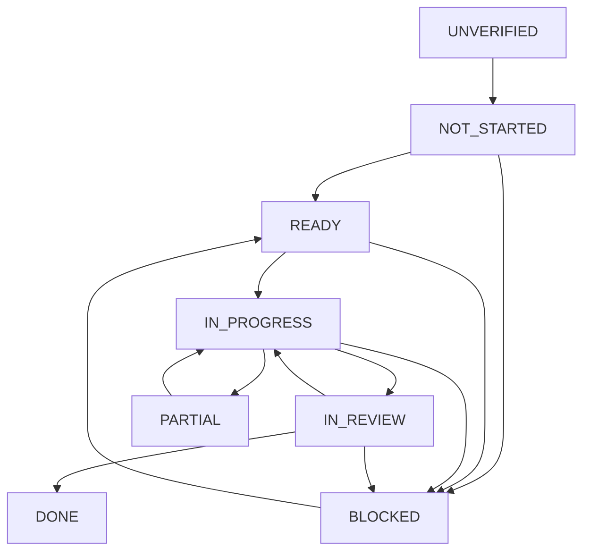

# Esokira — Development Workflow for AI Coding Agents

> **Document ID:** ESOKIRA-DEVELOPMENT-WORKFLOW  
> **Version:** 0.1.0  
> **Date:** 2026-10-30 (Asia/Jakarta)  
> **Status:** `REVIEWED_INTERNAL — PENDING_OWNER_APPROVAL`  
> **Target path:** `docs/development/DEVELOPMENT-WORKFLOW.md`  
> **Applies to:** Esokira monorepo (`frontend/`, `backend/`, `contracts/`, `docs/`, and relevant infrastructure)  
> **Audience:** Product Owner, human reviewers, AI coding agents, QA, and contributors  
> **Nature:** Process guideline; **not** an approval for pending technical decisions and **not** evidence of existing implementation.

---

## 0. Executive contract — mandatory reading

Esokira is a mobile **financial life-planning and simulation** product. The **selected** stack is **Flutter/Dart + Go + PostgreSQL** in a monorepo. The existing architecture documents propose modular boundaries and tools, but many implementation details remain `PROPOSED`, `TBD`, or `BLOCKED` pending Product Owner approval.

**Agent operating principle:** inspect the real repository, read only applicable specifications, identify decision gates, plan one small verified slice, implement only the authorized scope, run appropriate checks, then report verifiable evidence. The workflow is:

```text
REQUEST → INSPECT → TRACE → PLAN → DECISION GATE → IMPLEMENT
        → VERIFY → REVIEW → HANDOFF → NEXT TASK
```

**Absolute constraints:**

1. Do not invent requirements, numeric assumptions, statistical methods, API contracts, database migrations, implementation progress, approvals, or test results.
2. **Actual financial data must never be silently modified by plans, projections, goals, or simulations.** Planned contributions are not actual-funded goal progress. Transfers without fees are not income/expense.
3. Backend verifies user identity and resource ownership for every private data operation. Flutter must not be trusted as an authorization boundary.
4. Financial source-of-truth monetary balances use **exact representation**, not binary floating point; the precise scheme and rounding policy still require approval.
5. No unapproved framework/library, provider, service, destructive migration, real-data import, analytics collection, permissions, or external integration.
6. A successful build, passing UI snapshot, parsed JSON example, or response `200` is **not** evidence of complete financial correctness or security.
7. “Gas” or “lanjut” authorizes the **requested next task**, **not** all unresolved product/architecture/policy decisions.
8. Use Indonesian for owner-facing progress and handoffs; retain canonical English code names, IDs, and file paths.

**Workflow authority:** root `AGENTS.md` remains the global instruction layer. `frontend/AGENTS.md` and `backend/AGENTS.md` add area-specific rules without weakening it. This document describes the process that coordinates them; it does not supersede the owning product, financial, security, or architecture specifications. All previously prepared source documentation is currently reviewed internally but **pending owner approval**.

---

## 1. Roles, responsibilities, and permission boundaries

| Actor | Responsibility | What it cannot silently do |
|---|---|---|
| **Product Owner (user)** | Approve requirements, scope, risk acceptance, releases, architecture policies, critical dependencies and trade-offs | Owner approval must not be inferred from silence or from an unrelated instruction |
| **AI Coding Agent** | Inspect, propose scoped plan, implement authorized slice, test, disclose failures, hand off evidence | Invent sign-off, mark unexecuted tests `PASS`, or make cross-scope modifications |
| **Human Reviewer / QA** (if available) | Review design, diffs, financial vectors, privacy/security behavior and release evidence | Claim external certification or legal compliance based solely on a checklist |
| **CI / automated checks** (when implemented) | Execute deterministic checks and produce logs/exit codes | Replace domain review, threat modeling, or live-system validation |

A single person may fill multiple roles. If no independent reviewer exists, agent output must explicitly say **self-reviewed**, not “independently approved.” If an action can delete data, leak sensitive data, change money records, introduce infrastructure cost, change external integration, or break contracts, get specific owner approval before executing.

### 1.1 What an ordinary task authorization covers

A clear instruction to create an individual Markdown, an isolated non-destructive test, or an approved UI component permits only that scope. It does **not** authorize changing authentication, ledger policy, database schema, API payloads, billing, deployment, release status, or other modules. Some tasks are safe to complete while other design decisions remain blocked.

### 1.2 Do not confuse permission with readiness

Even if the owner asks the agent to implement a feature, missing required financial semantics or security decisions may make **production behavior** `BLOCKED`. The agent should explain the missing decision and continue only independent work that remains authorized, such as drafting a proposed schema or writing golden-test scaffolding with no guessed expected values.

---

## 2. Documentation map and source-of-truth precedence

Read **root instructions**, the **affected nested instructions**, and then **only relevant owner documents and sections**. Do not load every long file blindly.

| Subject / single topic owner | Canonical source |
|---|---|
| Product vision and target audience | `docs/product/PRODUCT-VISION.md` |
| Functional/engineering/nonfunctional requirements `FR-*`, `EN-*`, `NFR-*` | `docs/product/PRD.md` |
| Release scope R0–R4 and slices S-00–S-12 | `docs/product/FEATURE-MATRIX.md` |
| Actual vs planned, balances, goals, transfer, domain invariants `DR-*` | `docs/financial/FINANCIAL-DOMAIN-RULES.md` |
| Formula definitions, units, timing and assumptions `CS-*` | `docs/financial/CALCULATION-SPECS.md` |
| Financial golden/edge/property/integration cases `FTC-*` | `docs/financial/FINANCIAL-TEST-CASES.md` |
| Global application/trust boundaries | `docs/architecture/SYSTEM-ARCHITECTURE.md` |
| Go backend and worker architecture, `BE-Qxx` | `docs/architecture/BACKEND-ARCHITECTURE.md` |
| Flutter architecture and client decisions, `FE-Qxx` | `docs/architecture/FRONTEND-ARCHITECTURE.md` |
| Proposed database entities/migrations decisions, `DB-Qxx` | `docs/architecture/DATABASE-DESIGN.md` |
| REST conventions, serialization, idempotency, `API-Qxx` | `docs/architecture/API-GUIDELINES.md` |
| Visual tokens and components | `docs/design/DESIGN-SYSTEM.md` |
| User interaction flows `UF-00`–`UF-31` | `docs/design/USER-FLOWS.md` |
| Screen groups `SCR-00`–`SCR-22` and UX acceptance | `docs/design/SCREEN-SPECS.md` |
| Security, privacy, access, threat model, `ST-*` | `docs/security/SECURITY-PRIVACY.md` |
| How agents must work globally | `AGENTS.md` |
| Area-specific agent constraints | `frontend/AGENTS.md` / `backend/AGENTS.md` |
| **This** lifecycle and evidence process | `docs/development/DEVELOPMENT-WORKFLOW.md` |

**Future authoritative artifacts, only if present and explicitly approved:**

- `contracts/openapi.yaml`: machine-checkable API operations and schemas, rather than Markdown examples.
- `backend/db/migrations/`: versioned, applied database schema, rather than illustrative `CREATE TABLE` examples.
- `docs/planning/TASKS.md`, `PROGRESS.md`, `DECISION-LOG.md`, `MASTER-ROADMAP.md`: task, progress and owner-approved decision logs. These files are **planned**, not assumed to exist.
- `docs/architecture/ADR/`: documented decisions, when created/approved.
- `docs/INDEX.md`: navigation, when created.

**Conflict protocol:** present conflicting **file paths + sections/IDs**, explain their impact, recommend a resolution, and request approval for the affected choice. Do not assume that a recently generated document outranks a domain owner. The real code/deployed schema reflects observed state, **not permission to override an approved requirement**. If both are inconsistent, report drift.

---

## 3. Decision gates — binding vs candidate

| Status | Agent response |
|---|---|
| `DECIDED` | Explicitly selected or confirmed by owner; follow within task scope. |
| `REQUIRED` | Financial/domain/security invariant; cannot be weakened. |
| `PROPOSED` | Candidate design; may evaluate, compare or document; no silent production lock-in. |
| `TBD` | Decision absent. Report alternatives, pros/cons, affected tasks, and owner action required. |
| `BLOCKED` | Do not implement/release the dependent production feature. Independent tasks can proceed. |
| `REVIEWED_INTERNAL` | Document reviewed for internal consistency, **not** owner approval. |
| `UNVERIFIED` | No sufficient evidence about code, behavior, acceptance or test status. |

**Examples of gating decisions** (not their approval): auth provider/session policy; transfer/ledger strategy; monetary storage, rounding, and time semantics; idempotency protocol; SQL/Flutter framework choices; exact OpenAPI operations; scenario snapshot/staleness; queue and retention; Monte Carlo distribution and random process; goal optimizer objective; privacy deletion/retention and production operations.

Record applicable owner-document IDs such as `FE-Qxx`, `BE-Qxx`, `DB-Qxx`, `API-Qxx`, `SEC-Qxx`, `DR-*` and `CS-*` instead of creating a duplicate global decision status list. Do **not** renumber existing decision IDs.

### 3.1 Decision request template

```markdown
Decision needed: [owner-doc ID and name]
Current status: TBD / PROPOSED / BLOCKED
Affected task(s), release and FR IDs: ...
What is already decided: ...
Why this decision blocks behavior: ...
Option A: ... (trade-offs / risk)
Option B: ... (trade-offs / risk)
Recommendation: ... (not approval)
Requested Product Owner action: approve one, revise, or defer
Safe independent work that can continue: ...
```

After explicit approval, update the owning decision record and affected contracts/tests **only as authorized**. Keep the approving user statement, date, rationale and effects in the decision log if it exists; never invent a historical approval. A document-only change may be `DONE` while its underlying architecture decision remains `PROPOSED`.

---

## 4. Release policy, dependency order and workload limits

Release names represent **scope**, not actual implementation status or committed delivery dates.

| Phase | Product/engineering boundary | Gate before completion |
|---|---|---|
| `R0` | Monorepo/tooling, test harness, planned API/DB/auth foundations | Scope and applicable foundational choices approved; reproducible builds/tests where implemented |
| `R1` | Account/profile, transactions, assets/debts, net worth, goals, compound, export/delete | Money/ledger, auth, ownership, idempotency, privacy and numeric golden cases validated |
| `R2` | Budgets, life events, projections, scenarios, cash flow, stress, rules-based insights | Actual vs scenario isolation, versioning/staleness and deterministic replay validated |
| `R3` | Goal optimizer, Monte Carlo, retirement, Financial GPS, workers | Model assumptions approved; resource limits, security, replay, and risk validation proven |
| `R4` | Shared goals / portfolio | **Discovery only** until separately approved |

Follow `FEATURE-MATRIX.md` slices `S-00` to `S-12`; those are **proposed dependency slices**, not sprint deadlines or a claim that anything exists. `S-00` is the approval/documentation gate. Split one slice into small tasks that each provide a meaningful, testable behavior. Prefer one vertical slice (contract + backend + frontend + tests where appropriate) over many unrelated empty packages.

**Hard stop for release claims:** no release may be called done solely because a Markdown is written, an endpoint returns placeholder data, a build succeeds, or only happy-path unit tests run.

---

## 5. Task lifecycle and allowed status transitions

Each implementation task must be identified by a stable task ID from an actual `TASKS.md` if it exists. If planning files do not exist, use a **temporary proposal ID** (example `DRAFT-S03-TRANSFER-01`), clearly marked as non-canonical; do not imply tasks have been formally entered or approved.



| Status | Evidence needed |
|---|---|
| `UNVERIFIED` | Code/repo state not inspected. Never automatically equate to `NOT_STARTED`. |
| `NOT_STARTED` | Relevant repository examined; task implementation absent. |
| `READY` | Scope, dependencies, applicable owner decisions, acceptance and tests identified. |
| `IN_PROGRESS` | Authorized work started; no done claim. |
| `IN_REVIEW` | Implementation and tests assembled, final checks/review pending. |
| `DONE` | Required acceptance, verification and evidence recorded; no unresolved blocker for that deliverable. |
| `PARTIAL` | Some work complete, specific remaining scope/validation listed. |
| `BLOCKED` | Explicit blocker, affected task, required owner action and next safe task recorded. |
| `CANCELLED` | Requires explicit owner decision; record why. |

`PARTIAL` and `BLOCKED` may describe a handoff result even if the tracker uses another lifecycle state. Keep status changes auditable; do not mark a feature `DONE` because only UI, documentation or database tables exist. Changes to `DONE` features are new tasks or formally reopened bugs, never hidden status rewrites.

---

## 6. End-to-end agent execution protocol

### Step A — INSPECT (read-only reconnaissance)

1. Confirm actual checkout and root: `pwd`, `git status --short --branch`, project file tree and nested instruction files **if a Git repo exists**. If no repo is present, report that fact and limit actions to authorized scaffolding/docs.
2. Inspect only relevant existing code, dependencies, database migrations, API schemas, tests and CI. Do not assume `backend/go.mod`, `frontend/pubspec.yaml`, Compose, `.github/workflows`, SDK, PostgreSQL, or a configured test runner exists.
3. Read root and affected nested `AGENTS.md` (root + frontend or backend as relevant), then relevant sections from topic owners.
4. Capture the existing behavior, relevant worktree changes, potential overlap with another agent, and the actual stage of implementation.
5. **Do not reset, stash, rebase, overwrite or delete another contributor’s files** without explicit authorization.

### Step B — TRACE (requirements and dependencies)

1. Identify `R*`, `S-*`, `FR-*`, `EN-*`, `NFR-*` and affected `DR-*`, `CS-*`, `FTC-*`, `UF-*`, `SCR-*`, `ST-*` as applicable.
2. Verify prerequisite tasks; mark absent specs as **documentation blockers**, not as blanks to improvise.
3. Determine which single document owns each unsettled financial/API/DB/security decision; do not promote a suggestion to approval.
4. List affected boundaries: frontend state, HTTP contract, Go domain, database, worker, export/delete, and ops.

### Step C — PLAN (before material edits)

Prepare a small implementation plan covering precise outcome, in/out-of-scope, expected files, acceptance, tests, authorization boundaries, risks, rollback and blockers. Get owner approval for substantial/breaking/destructive or policy-setting changes; a small authorized change may proceed under the existing request.

### Step D — DECISION GATE

- **All task-critical choices approved:** proceed within scope.
- **Only optional choices pending:** isolate and proceed with independent approved behavior; explicitly label the deferred part.
- **Core financial/security semantics missing:** stop the affected production path, provide precise options and ask owner to decide.
- **No source code yet:** scaffold only what the current authorized R0 task genuinely needs; no large speculative project tree.

### Step E — IMPLEMENT (smallest coherent slice)

- Follow selected stack, approved design and existing conventions. Never replace the architecture wholesale without an explicit approved task.
- Keep Flutter UI/state separated from Go-authoritative business computation; keep Go financial engine independent from HTTP/database; use repository/transaction boundaries for actual writes.
- Avoid unrelated cleanup, global formatting, arbitrary package upgrades, hardcoded third-party endpoints, generated fake responses and permanent seed data.
- Add the smallest necessary tests and documentation/contract updates within authorized scope.
- Apply database changes only through approved versioned migrations with a rollback/recovery plan and isolated environment verification. A proposed SQL example in the docs is **not** an approved migration.
- Stop on evidence of sensitive data exposure, unexpected data loss, cross-tenant access or numerical contradiction. Report the issue rather than patching around it silently.

### Step F — VERIFY (real evidence, not intuition)

1. Format/lint/build/test with tools proven to exist. Capture **exact commands**, relevant output, environment and exit status.
2. Check functionality against acceptance criteria, golden vectors, error cases, privacy boundaries and release-specific gates.
3. Test money-moving operations for duplicate-submit, unknown-outcome timeout, rollback, cross-user reference and concurrent writers in a disposable database. Do **not** use production financial data for testing.
4. Inspect the diff for unrelated changes, secret leakage, unreviewed configuration, stale mocks, dependency drift, and contract compatibility.
5. Classify verification clearly: `PASS`, `FAIL`, `SKIPPED`, `BLOCKED` or `NOT_RUN`. Never treat skipped checks as passing.

### Step G — REVIEW and HANDOFF

- Compare observed behavior with requirements and owner decisions; request targeted review for financial/security/contract/deployment changes.
- Report files changed, feature and IDs, command evidence, verified and unverified outcomes, failed/skipped tests, risks, open decisions and next safe task.
- Update `TASKS.md`, `PROGRESS.md`, decision records or ADR **only if those files exist and modification is authorized**. If absent, supply an update proposal, not fabricated repository updates.
- Never silently combine implementation with release/deployment; release is a distinct authorized gate.

---
## 7. Definition of Ready (DoR) — start gate

A task is `READY` only after these conditions are satisfied **for the task being started** (not necessarily every future feature):

| Check | Required evidence | Failure handling |
|---|---|---|
| Scope | Named behavior, release, requirement IDs, in/out boundaries | Draft a narrower task |
| Dependency | Upstream features, contracts and test prerequisites known | Block dependent portion |
| Owner decisions | Task-critical choices explicitly approved | Submit decision request; do not guess |
| Actual repository | Relevant code, tests, scripts and environment inspected | Mark `UNVERIFIED` |
| Acceptance | Positive, negative and error cases written | Complete acceptance before implementation |
| Financial correctness | Applicable domain rules, formulas, expected values and units documented | Block authoritative calculation if absent |
| Security/privacy | Authentication, ownership and data sensitivity identified | Block privileged operation until resolved |
| API/DB effect | Contract/migration expectations and compatibility assessed | Request coordinated changes or split task |
| Testability | Meaningful tests can be run or limitations known | Note missing infrastructure explicitly |

For a **documentation-only** task, DoR can be met with relevant source files, a defined output path, consistency criteria and an owner request. The document may be complete even if feature implementation is blocked.

### 7.1 Task card template (copy into an approved backlog when it exists)

```markdown
## [TASK-ID] Short action-oriented title
Status: NOT_STARTED | READY | IN_PROGRESS | IN_REVIEW | DONE | BLOCKED
Release / slice: R* / S-*
Related: FR-..., EN-..., NFR-..., DR-..., CS-..., FTC-..., UF-..., SCR-...

### Objective
A user-observable or objectively testable result, not just “create files”.

### In scope
- ...

### Out of scope
- ...

### References and approved decisions
- [file section/ID] — [status; approval evidence if decided]

### Dependencies and blockers
- ...

### Expected edits / API / DB effects
- ...

### Acceptance criteria
- [ ] Positive behavior ...
- [ ] Invalid/error behavior ...
- [ ] Privacy/ownership behavior where relevant ...
- [ ] Numeric golden-case behavior where relevant ...

### Verification plan
- Tool/command or manual reproduction: ...
- Test data: synthetic; environment: ...
- Failure/rollback approach: ...

### Handoff evidence
- Changed files: ...
- Test commands/results and logs: ...
- Unverified cases: ...
- Reviewer/owner sign-off if required: ...
```

Do not create 50 speculative tasks in one session; first identify an approved slice and break only its next dependencies into actionable tickets.

---

## 8. Change-type workflow matrix

| Change type | Read at minimum | Must verify | Special gate |
|---|---|---|---|
| Documentation only | Root instructions + changed document + affected owners | Cross-file references, ID accuracy, Markdown links, decision labels, archive integrity if packaged | No implementation claim |
| Flutter screen/UI | Nested frontend AGENTS, Screen Specs, User Flows, Design System, relevant API | Layout, loading/empty/error, validation, accessibility, locale and privacy | Never mock successful financial writes |
| Flutter API integration | Frontend Architecture, API Guidelines, Security, approved OpenAPI | Serialization, auth expiry, retry/unknown states, offline/stale handling | Approved operation + money/time format required |
| Go HTTP endpoint | Backend Architecture, API Guidelines, Security, PRD | Validation, status codes, ownership, safe errors, handler/service unit tests | No inferred request/response contract |
| PostgreSQL schema/query | Database Design, Domain Rules, Security, Backend Architecture | Migration on disposable DB, FK/unique/check, indexing, rollback, tenant isolation | Owner-approved ledger/precision/retention policy |
| Actual transfer/posting | Domain Rules, DB Design, API, Security, Golden Tests | Atomicity, conservation, fee behavior, parallel writes, idempotency and timeout reconciliation | High-risk review before merge/release |
| Calculation algorithm | Calculation Specs, Golden Tests, Domain Rules, Backend Architecture | Known vectors, zero/negative/edge cases, units, rounding, repeatability | No self-invented financial assumptions |
| R2 scenarios | PRD, Scenario Engine specification **if present**, Domain Rules, API/DB, UX | No mutation to actuals; baseline pinning, version, stale/rebase behavior | Do not start production R2 if required spec absent |
| R3 Monte Carlo/optimizer | Approved model spec **when created**, Calc Specs, risk/security docs | Seed reproducibility, bounded compute, statistical validation, infeasible cases | Model-selection and worker policies approved |
| Auth/export/deletion | Security & Privacy, PRD, related contracts | Token/session failure, cross-user, lifecycle/export/delete policy and audit | Privacy policy/retention decision approved |
| Deployment/CI | System Architecture, Security, approved ops plan | Environment separation, rollback, backup/restore checks, secrets, reproducible pipeline | Separate owner authorization for production |

If a referenced dedicated feature specification (`SCENARIO-ENGINE.md`, `MONTE-CARLO.md`, `GOAL-OPTIMIZER.md`) has not been created, record `BLOCKED_BY_DOC` in the task rather than inventing the missing algorithm.

---

## 9. Verification playbook — commands must be discovered

**The following are examples, NOT assumptions that source, toolchains or commands exist.** First inspect actual manifests and repository. Replace or omit checks that are unavailable; report `NOT_RUN`/`BLOCKED` with reason. A command's zero exit code only supports the behavior actually tested.

| Artifact | Possible check if configured | What it does **not** prove alone |
|---|---|---|
| Go code with existing `go.mod` | `cd backend && go test ./...`; `go vet ./...` | Complete financial correctness, DB atomicity or authorization |
| Changed Go files | `gofmt -l <changed-files>`; review nonempty output | No data leakage or hidden logic errors |
| Concurrency paths | `cd backend && go test -race ./...` if supported | Deterministic prevention of all races/deadlocks |
| Flutter with real `pubspec.yaml` | `cd frontend && flutter analyze`; `flutter test` | End-to-end API auth, proper retry outcomes or all accessibility cases |
| Changed Dart source | `dart format --output=none --set-exit-if-changed <changed-files>` if SDK available | Correct money semantics |
| OpenAPI when approved and created | Run existing OpenAPI validation + client/contract tests | Endpoint implementation is correct without service tests |
| SQL migrations | Apply migrations on **disposable** PostgreSQL, run integration tests, inspect resulting schema | Production rollback/recovery guarantees |
| Golden financial vectors | Execute applicable `FTC-*` test suite; compare independent known outputs | Accuracy outside model assumptions or future market guarantees |
| Security tests | Execute relevant `ST-*` cases and authorization tests against isolated fixtures | Legal/PDP compliance or independent penetration-test certification |
| Markdown/ZIP | Check referenced paths/IDs, closed fences, archive CRC, byte identity | That Flutter/Go code exists or passes tests |

### 9.1 Evidence ledger — must capture actual outputs

For each executed test, record:

```text
Test ID / requirement:
Environment / tool version (if relevant):
Command or exact manual steps:
Fixture / test-data class:
Timestamp:
Exit code / observed result:
Expected result:
PASS | FAIL | SKIPPED | BLOCKED | NOT_RUN:
Relevant error/trace (redacted):
Follow-up action:
```

Only assert `PASS` after the specific test ran and matched the expected result. A written test specification that has not run remains **SPECIFIED**, not **PASSED**. `TESTING-STRATEGY.md` may later refine how to execute the checks; until then, this evidence rule still applies.

### 9.2 Golden numeric rules

- Use verified input/output and stated tolerances from `FINANCIAL-TEST-CASES.md`, not output invented by the tested implementation.
- Never alter expected outputs solely to turn a failing implementation green.
- Identify currency, units, percentage convention, time step, payment timing, rounding and compounding conversion explicitly.
- Include at least zero-return, negative-return where meaningful, near-boundary dates, large numbers, and insufficient-funding cases when relevant.
- Store model version/seed for stochastic algorithms once approved. Statistical outputs require a separate test strategy; do not demand identical Monte Carlo outcomes across unspecified model/RNG changes.

### 9.3 Integration, regression and end-to-end tests

- Integration tests that rely on PostgreSQL must use disposable schema/database and synthetic data, not customer data.
- Regression test modified code plus adjacent invariants, especially ledger conservation, goal progress attribution, derived net worth, scenario baseline and account ownership.
- When a Go API response changes, test Flutter parsing and UI state transitions at the same contract version.
- A “complete vertical slice” requires evidence at boundaries affected by that slice, not necessarily every app screen.

---

## 10. Actual financial-write safety protocol

Any backend change capable of recording a real account, balance, transaction, correction/reversal, asset/debt valuation or goal funding needs a stricter procedure.

**Before:** confirm approved transaction semantics (`DR-*`, ledger model, currency/time rules), verified ownership, existing database constraints and idempotency contract. Identify what happens on duplicate taps, lost response, timeout and concurrent requests.

**During:** validate authoritative identity server-side; apply owner filters and authorization to source and destination; use an approved atomic database transaction for multi-step writes; validate invariants before commit. Do not emit fake success while the server result is ambiguous.

**After:** read back or otherwise reconcile confirmed status with the same approved idempotency protocol. On timeout, the UI must display **unknown/pending** until confirmed; it must not blindly resubmit as a new financial event. Test rollback and two concurrent writers on a real disposable PostgreSQL instance.

**Never:** calculate current net worth by double counting the same balance as both account cash and stand-alone asset; recognize an opening balance as income; treat a transfer without fees as expense/income; mark a planned contribution as funded; update actual records during a scenario simulation.

If financial policy is unspecified, the safe output is a proposal or blocked task—not a guessed production path.

---

## 11. Scenario, stochastic model, and heavy-job safety protocol

These are future gates for R2/R3; not proof that a worker, database queue or engine has been implemented.

### 11.1 Deterministic R2 scenarios

- Input must identify an **actual baseline** at a known revision/snapshot and an independent scenario definition/version.
- No scenario may mutate actual accounts, transactions, goals' real funding or debts by side effect.
- Store forecast assumptions, engine version, date/time semantics and calculation provenance. Surface `stale` when real baseline changes according to approved rules.
- Compare only like-for-like dates, units, currencies and definitions; do not silently compare an old result to an updated baseline.

### 11.2 R3 asynchronous simulations

- Require an approved model/algorithm, cost and time budgets, per-user job ownership, queue, retry/deduplication, cancellation and retention policies before production.
- Jobs must have an auditable lifecycle, e.g. **proposed** `queued → running → succeeded/failed/cancelled`. Exact API/job states belong to approved contracts.
- User inputs and resource ownership must be validated when submitted and when results are retrieved. Avoid leaking raw financial inputs into worker logs/metrics.
- Avoid unlimited goroutines, non-bounded simulations, nonreproducible random streams and persisted millions of raw trajectories without explicit policy.
- Monte Carlo success fractions are outcomes *under the chosen model*, never guarantees. Optimizer outputs must explain constraints, trade-offs and infeasibility.

---

## 12. API, schema and client contract-change protocol

**Before API change:** confirm owning requirement and authorized contract task; inspect actual OpenAPI file if one exists. If `contracts/openapi.yaml` does not exist or is not approved, an endpoint example in `API-GUIDELINES.md` is still **illustrative**.

1. State the proposed operation and what changes: path, method, authorization, request, response, error, monetary values, dates, pagination, retry/idempotency and versioning.
2. Analyze API compatibility, current Go handler/use case, Flutter DTO/repository/state and tests.
3. Obtain owner approval for breaking changes or changes introducing new business semantics.
4. Make approved contract and implementation updates together, or clearly mark any partial cross-repository state.
5. Run schema validation and service/client contract checks with real tools.
6. Document migration/rollout and backward-compatibility strategy before release.

**Before DB change:** confirm schema policy, backup/rollback, data ownership, exact amounts, dates and proper constraints; create versioned migration only after approval. Use no irreversible production migration without explicit deployment authorization and recovery procedure. A historical migration should be treated as immutable once deployed; follow approved forward-migration policy.

---

## 13. Security, privacy and secrets gates

- Identity must come from a verified auth principal; `owner_id` from client body/query/header is **not** an authorization source.
- Validate tenant isolation for list, detail, nested resources, exports, deletes and background jobs. Test unauthorized/mismatched-resource behavior.
- Handle tokens and sensitive preferences with approved secure storage; never put real secrets in source, fixtures, screenshots, telemetry, or prompts.
- Use fake/synthetic financial profiles for demos and tests. If logs or traces accidentally include private data, stop, redact and report.
- Data export and account deletion require approved retention, backup and audit policies, not just a UI button.
- A release checklist does **not** mean the app passed a penetration test or automatically complies with Indonesian PDP/PSE obligations. Legal/privacy review remains separate as applicable.
- Prohibit unauthorized integrations with banking, payments, trading, external account aggregation, analytics/AI APIs or push providers.

**Critical escalation:** evidence of cross-user access, secrets exposure, wrong balance mutations or irreversible data loss must immediately block the affected path and be reported to owner; do not suppress the bug, change tests to green, or deploy while unresolved.

---

## 14. Git, branches, diffs, and concurrent agent coordination

The project may initially be documentation-only. Do not presume a Git repo, remote, branch convention, CI, or PR system already exists.

**Once Git exists:**

- Check `git status` and current branch before edits. Respect pre-existing uncommitted work.
- Prefer one coherent task/branch/change set; one agent owns a file/module at a time where possible.
- Separate architectural migrations from unrelated cosmetic refactors; review generated/lock changes instead of committing them blindly.
- Do not force push, hard reset, rebase shared branches, delete untracked work, or make releases without explicit authorization.
- Use human-readable commit summaries if asked to commit; **do not commit or push automatically** merely because this workflow mentions Git.

### 14.1 Parallel agents — ownership and integration

Parallelize **independent** tasks only after interface and file ownership is clear. Example: one agent develops golden Go tests while another drafts Flutter empty-state UI, provided neither assumes an unapproved API contract. Cross-boundary changes need a named integration owner (which can be the Product Owner).

Handoff between agents must include:

```text
Task / release / requirement IDs:
Owned files, edits made, files deliberately untouched:
Observed repository state and base revision if Git exists:
Approved decisions used and pending blockers:
API/DB/schema compatibility assumptions:
Tests actually run, commands/results:
Unverified cases and known failures:
Next agent's bounded task and prerequisites:
```

An agent must **not** trust another agent's `DONE` label without reading implementation evidence appropriate to the task.

---

## 15. Handling defects, surprises and failed tests

1. **Reproduce** using synthetic data and record the actual command/steps/observed vs expected result.
2. **Classify**: financial correctness, authorization/privacy, contract mismatch, concurrency/data integrity, UX/accessibility, performance or documentation drift.
3. **Contain**: halt or block affected paths if the defect threatens money accuracy, ownership or data safety. Do not treat all UI imperfections as security incidents.
4. **Identify smallest responsible scope** and relevant reference docs; do not rewrite unrelated modules to obscure the cause.
5. **Fix + regression test**; preserve original bug as a test where appropriate.
6. **Report** failed checks, unrun tests, remaining risk and whether deployment/release is safe.

If a failing test stems from an unapproved specification, request an owner decision rather than changing expected outputs and silently declaring one interpretation correct. Never disable a failing security test to pass CI.

---

## 16. Definition of Done (DoD) and review quality gates

A task may be `DONE` only when all **applicable** conditions below are supported by evidence:

- The delivered behavior matches the approved/authorized task, release and acceptance criteria.
- Relevant `FR/EN/NFR`, `DR/CS/FTC`, UI/UX and security requirements have been checked.
- No fabricated API, mocked production success, undefined financial assumption or hidden user-data mutation remains.
- Appropriate unit/integration/contract/UI/golden/ownership tests actually ran and their results are reported; unavailable tests are not marked as passing.
- Error, invalid input, timeout/unknown, retry, empty, permission and stale states are handled as relevant.
- No unexplained secret exposure, unapproved dependency or unrelated destructive change in the diff.
- Approved changes to OpenAPI, migrations, documentation, snapshots and generated clients are synchronized when needed.
- Any financial/security/breaking-change review and separate deployment approval are obtained where required.
- Final status includes files touched, observable proof, commands, failed/not-run checks, open risks, outstanding decisions and next step.

**For documentation-only tasks**, `DONE` means the **file** was created, sources/references and internal consistency checked, archive integrity tested if packaged, and approval remains explicitly pending. It never means the financial feature or application is implemented.

If only some acceptance criteria are met, use `PARTIAL`. If a critical decision prevents completing the requested behavior, use `BLOCKED`. If existing functionality cannot be inspected or verified, use `UNVERIFIED`.

### 16.1 Reviewer checklist

```markdown
- [ ] Task scope and owner request match the diff.
- [ ] No unauthorized decisions, packages or infrastructure.
- [ ] Domain invariants and exact-money policy respected.
- [ ] Privacy and cross-user isolation verified where applicable.
- [ ] Errors, timeout/retry and stale states addressed where relevant.
- [ ] API/DB/Flutter contracts match the approved source.
- [ ] Test evidence includes real commands, output and exclusions.
- [ ] No secret, unsafe log, fake PASS or permanent placeholder data.
- [ ] Docs and tracked task/decision status accurate.
- [ ] Next action and remaining risks clear.
```

---

## 17. Required planning and handoff formats

### 17.1 Pre-work implementation plan

```markdown
# Implementation Plan — [TASK-ID or DRAFT-ID]
Status: PROPOSED (not approval)
Release / slice: R* / S-*
Requirement and flow IDs: ...

## Observed repository state
- Existing files/tests/contracts: ...
- Related uncommitted changes: ...

## Goal and acceptance
- Expected user-visible or testable behavior: ...
- Positive / error / boundary criteria: ...

## Boundaries
- In scope: ...
- Out of scope: ...
- Files/modules/API/DB affected: ...

## Source documents and decisions
- Exact document paths + sections/IDs: ...
- Approved decisions: ... (with evidence)
- TBD/blocked choices: ...

## Execution steps
1. ...
2. ...
3. ...

## Verification and safety
- Tests/commands actually available: ...
- Financial/security/rollback risks: ...
- External permissions or owner decisions required: ...
```

### 17.2 Final implementation handoff

```markdown
# Handoff — [TASK-ID]
Status: DONE | PARTIAL | BLOCKED | UNVERIFIED
Release / slice / FR, EN, NFR IDs: ...

## Delivered behavior
- ...

## Files changed
- path — purpose

## Evidence
- Command/manual steps: ...
- Actual result/exit code: ...
- Relevant test IDs: ...
- Screenshots/trace or logs (redacted): ...

## Not verified / not run
- ... (why)

## Decisions / risks
- Approved used: ...
- Remaining TBD/BLOCKED: ...
- Compatibility/security/financial caveats: ...

## Next authorized step
- ...
```

### 17.3 Documentation-only handoff

```markdown
Artifact: [path, version]
Status: REVIEWED_INTERNAL — PENDING_OWNER_APPROVAL
Sources consulted: [existing file paths]
Consistency checks: [IDs, refs, decisions, fences, etc.]
Archive checks (if any): [contents, CRC, exact byte match]
Implementation tests: NOT_RUN (docs-only; implementation not established)
Owner decisions still needed: [...]
```

---

## 18. Documentation maintenance and approval propagation

When a requirement changes, update the **owning source first** with owner authorization, then the derived artifacts that depend on it. Examples:

```text
Product requirement approved
  → PRD / FEATURE-MATRIX
  → impacted financial/domain/UX/architecture docs
  → OpenAPI / SQL migration / implementation (when authorized)
  → relevant tests and task tracker
  → agent instructions only if the permanent process changed
```

```text
Financial calculation policy approved
  → FINANCIAL-DOMAIN-RULES / CALCULATION-SPECS
  → FINANCIAL-TEST-CASES golden vectors
  → Go engine and approved API semantics
  → Flutter labels/validation where relevant
  → regression evidence
```

Use decision records for **what was decided and why**; use progress notes for **what actually happened**. Do not keep duplicate competing master lists of pending decisions. If a source document is still `REVIEWED_INTERNAL`, a downstream document's stronger wording does **not** upgrade its status.

If `docs/INDEX.md`, `docs/planning/DECISION-LOG.md`, `docs/planning/TASKS.md`, or `docs/planning/PROGRESS.md` are absent, **do not invent their content as historical fact**. Propose their creation through the next explicitly authorized documentation task.

---

## 19. Practical examples — expected behavior

### Example A — “Buat UI compound calculator sekarang”

**Agent should:** inspect Flutter setup, `SCR-*`/`UF-*`, financial terminology and existing approved API/calculation sources. If API/preview policy is unresolved, propose a form/layout and states without faking a production calculation. No guessed interest convention; do not mark feature `DONE` because a form renders.

### Example B — “Implement transfer antar akun”

**Agent should:** identify `FR-003/FR-004`, domain transfer invariants, ledger, precision, time, idempotency and authorization decisions. If critical model policy is still `TBD`, stop the actual posting path, request a precise decision and continue safe isolated tests/spec drafts only when authorized. Do not write a simplistic two-update implementation with no transaction/retry safety.

### Example C — “Buat Monte Carlo 10.000 simulasi”

**Agent should:** check release `R3`, approved model distribution, asset assumptions, seed/RNG, computational limits, baseline/provenance and result retention. Without them, produce a design/verification plan rather than a pretend statistical forecast with arbitrary normal return assumptions.

### Example D — “Review project dan lanjut task berikutnya”

**Agent should:** first inspect the actual repo and tracker. If planning files exist, choose the next approved, unblocked task according to `FEATURE-MATRIX.md` dependencies. If they are absent, propose a bounded task and record that execution status is unverified; do not create a fake completion history.

### Example E — “Buat Markdown berikutnya”

**Agent should:** read the prior approved/reviewed source docs, create **one** targeted Markdown at its documented monorepo path, run reference/structure checks, package a ZIP if requested, verify the exact file and archive, then distinguish document completion from pending Product Owner approval.

---

## 20. Workflow QA checklist for this document

- [x] Root, frontend and backend agent responsibilities represented without creating conflicting sources of truth.
- [x] R0–R4 and S-00–S-12 referenced as **planned** rather than completed.
- [x] `DECIDED/REQUIRED/PROPOSED/TBD/BLOCKED/REVIEWED_INTERNAL/UNVERIFIED` semantics preserved.
- [x] Actual vs hypothetical money, transfer invariants, exact amounts and funding semantics retained.
- [x] Backend authorization, idempotency, unknown-outcome retries, tenant separation and private data handling mandatory.
- [x] Goldens, PostgreSQL integration, UI state and security evidence separated.
- [x] Source files, runnable commands, CI, tracker, OpenAPI and migrations **never assumed to exist**.
- [x] Agent status/handoff and owner approval clearly separated.
- [x] No new technology or architecture option implicitly approved by this workflow.

These checkboxes summarize **document intent** only. Actual cross-document consistency and ZIP integrity must be checked on the generated artifact; runtime code and production compliance cannot be certified by this Markdown.

---

## 21. Open workflow decisions (proposed; do not self-approve)

These questions concern **development process**, not substitutes for existing `BE/FE/API/DB/SEC` decisions:

| ID | Proposed decision / question | Current status |
|---|---|---|
| `DW-Q01` | Select primary coding agent(s) and which instruction-file formats are actually loaded by them | `TBD` |
| `DW-Q02` | Confirm whether implementation requires a separate owner-approved plan per task or per significant slice | `PROPOSED` |
| `DW-Q03` | Choose branch/PR/commit conventions after Git repository and remote are configured | `TBD` |
| `DW-Q04` | Choose final test commands, CI environment and required checks after toolchains exist | `TBD` |
| `DW-Q05` | Decide whether a separate reviewer is required for financial/security/breaking changes | `PROPOSED` |
| `DW-Q06` | Select task/progress format and approve the planned planning-doc files | `TBD` |
| `DW-Q07` | Define deployment promotion, owner sign-off and rollback authority | `TBD` |
| `DW-Q08` | Decide evidence retention policy (logs, sanitized screenshots and CI artifacts) | `TBD` |

**Next recommended documentation task:** `docs/development/TESTING-STRATEGY.md` to operationalize quality gates **after** reviewing this workflow, or the planned `docs/planning/TASKS.md` if the owner prioritizes setting up execution backlog. Do not infer approval of either from this sentence.

---

## 22. References within the Esokira repository

- Root and nested agent instructions: `AGENTS.md`, `frontend/AGENTS.md`, `backend/AGENTS.md`.
- Product: `docs/product/PRODUCT-VISION.md`, `docs/product/PRD.md`, `docs/product/FEATURE-MATRIX.md`.
- Financial: `docs/financial/FINANCIAL-DOMAIN-RULES.md`, `docs/financial/CALCULATION-SPECS.md`, `docs/financial/FINANCIAL-TEST-CASES.md`.
- Architecture: `docs/architecture/SYSTEM-ARCHITECTURE.md`, `BACKEND-ARCHITECTURE.md`, `FRONTEND-ARCHITECTURE.md`, `DATABASE-DESIGN.md`, `API-GUIDELINES.md`.
- UX: `docs/design/DESIGN-SYSTEM.md`, `docs/design/USER-FLOWS.md`, `docs/design/SCREEN-SPECS.md`.
- Security: `docs/security/SECURITY-PRIVACY.md`.

**Document disposition:** `REVIEWED_INTERNAL — PENDING_OWNER_APPROVAL`. This workflow is a reviewed process proposal. It does not approve pending technical decisions, authorize production releases, or certify implementation.
