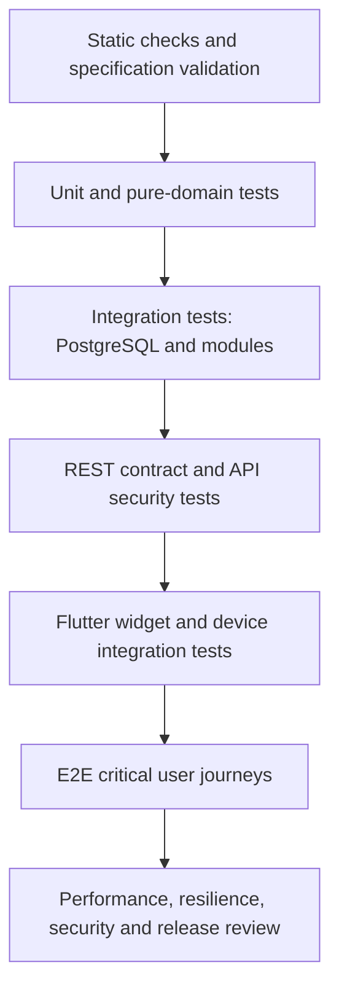
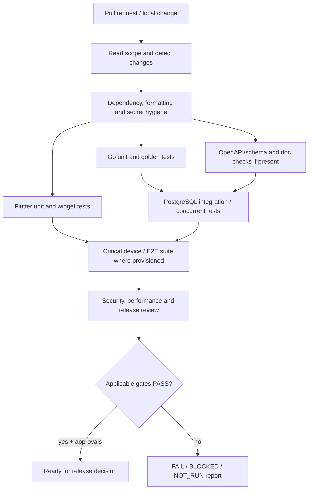

# Esokira — Testing Strategy & Quality Assurance

> **Canonical path:** `docs/development/TESTING-STRATEGY.md`  
> **Version:** `0.1.0`  
> **Date:** 30 October 2026 (Asia/Jakarta)  
> **Status:** `REVIEWED_INTERNAL — PENDING_OWNER_APPROVAL`  
> **Applies to:** Flutter mobile frontend; Go API, domain engine and worker; PostgreSQL; OpenAPI and CI/CD  
> **Releases:** `R0` Foundation, `R1` MVP, `R2` Planning V1, `R3` Advanced. `R4` is discovery only.  
> **Document type:** test policy and implementation guidance; **not** a claim that tests, repository code, CI or infrastructure exist  
> **Parent:** `docs/development/DEVELOPMENT-WORKFLOW.md` v0.1.0 and `AGENTS.md` at repository root

---

## 0. Executive contract — read before implementation

Esokira processes sensitive personal-finance data and mathematical projections. A green build is not evidence of financial correctness; a screenshot is not evidence of API correctness; and passing isolated unit tests is not evidence that real transactions are atomic or that users are isolated. This document establishes **what to test, when to test, how to record evidence, and what prevents a release**.

**Hard rules:**

1. **Observe the real repository before running or claiming any command.** At document creation, Flutter/Go/PostgreSQL implementation and CI execution are `UNVERIFIED`. Commands below are *candidates* and must be adapted to the actual environment.
2. **Never invent expected financial results.** Use independently verified cases from `docs/financial/FINANCIAL-TEST-CASES.md` (`FTC-*`), formulas from `CALCULATION-SPECS.md` (`CS-*`), and invariants from `FINANCIAL-DOMAIN-RULES.md` (`DR-*`).
3. **Do not mark `CONDITIONAL`, `BLOCKED`, or unapproved models as production-approved.** Mathematical reference examples do not decide monetary units, rounding, timing, ledger or stochastic parameters.
4. **Do not create test fixtures with real user data, tokens, screenshots or transaction exports.** Synthetic data only, including CI logs and bug reports.
5. **Financial writes, cross-user data access, privacy controls, and scenario isolation require integration-level proof.** Mocked repositories alone are insufficient.
6. **Evidence is execution-dependent.** A test is `PASS` only when the actual command or manual procedure ran and the result was captured. `NOT_RUN`, `BLOCKED`, `FAIL`, and `UNVERIFIED` must be reported honestly.
7. **No silent weakening of tests to make CI green.** Changing expected values, removing assertions, updating snapshots, bypassing security, or raising limits requires a defensible change request.
8. **Feature delivery requires approved scope and applicable acceptance criteria.** Completing this document is not an authorization to build undecided R3 models or to deploy.

### 0.1 Authoritative documentation by topic

| Topic | Canonical source and use |
|---|---|
| Product scope, FR/EN/NFR, releases | `docs/product/PRD.md`, `docs/product/FEATURE-MATRIX.md` |
| Definition and classification of finance data | `docs/financial/FINANCIAL-DOMAIN-RULES.md` (`DR-001`–`DR-024`) |
| Math, units, assumptions, model boundaries | `docs/financial/CALCULATION-SPECS.md` (`CS-001`–`CS-016`) |
| Golden vectors, exact/conditional/blocked tests | `docs/financial/FINANCIAL-TEST-CASES.md` (`FTC-*`) |
| System, module and dependency boundaries | `docs/architecture/SYSTEM-ARCHITECTURE.md`, `BACKEND-ARCHITECTURE.md`, `FRONTEND-ARCHITECTURE.md` |
| PostgreSQL constraints, transaction model | `docs/architecture/DATABASE-DESIGN.md`; **applied migrations once approved and present** |
| API conventions | `docs/architecture/API-GUIDELINES.md`; **approved `contracts/openapi.yaml` once it exists** |
| UI standards and screens | `docs/design/DESIGN-SYSTEM.md`, `USER-FLOWS.md` (`UF-00`–`UF-31`, `UXT-01`–`UXT-40`), `SCREEN-SPECS.md` (`SCR-00`–`SCR-22`) |
| Privacy and security | `docs/security/SECURITY-PRIVACY.md` (`ST-001`–`ST-075`) |
| Agent behavior, work authorization and handoff | `AGENTS.md`, `frontend/AGENTS.md`, `backend/AGENTS.md`, `docs/development/DEVELOPMENT-WORKFLOW.md` |

Planned but **not presumed to exist**: `docs/planning/TASKS.md`, `PROGRESS.md`, `DECISION-LOG.md`, `docs/INDEX.md`, `contracts/openapi.yaml`, `backend/db/migrations/`, Flutter test files, Go test packages and CI workflows. Follow applicable root/nested agent instructions. Never reinterpret a proposed schema/API example as deployed code.

### 0.2 Approval and readiness vocabulary

| Label | Meaning for test implementation |
|---|---|
| `DECIDED` | Explicit owner-selected direction; use within agreed scope. |
| `REQUIRED` | Security/domain invariant or hard no-go that cannot be waived casually. |
| `PROPOSED` | Candidate strategy or threshold; no implicit owner approval. |
| `TBD` | A decision is missing; make a focused decision request if it affects implementation. |
| `CONDITIONAL` | Test works only when stated assumptions are supplied; not an app-wide default. |
| `BLOCKED` | Do not implement or claim success for the affected production behavior. Independent work may proceed. |
| `REVIEWED_INTERNAL` | Documentation quality review; NOT Product Owner approval. |
| `UNVERIFIED` | No accessible evidence of implementation, execution or correctness. |

---

## 1. Quality goals, risks, and testing philosophy

### 1.1 Prioritized failure classes

| Priority | Failure | Why severe | Primary defense |
|---|---|---|---|
| P0 | Cross-account or cross-user financial data disclosure | Breaches confidentiality and trust | Authz integration, adversarial API tests, least privilege |
| P0 | Double posting, lost transfer side or inconsistent balance | Corrupts the source of truth | DB transaction, concurrent integration and idempotency tests |
| P0 | Simulation changes actual balance or ledger | Creates fictitious financial transactions | Write-isolation integration and regression tests |
| P0 | Incorrect time/rate/rounding/precision at actual-value boundary | Produces materially misleading calculations | Exact-money unit tests and golden references |
| P0 | Exposed keys, tokens, logs or backups | Exposes financial/identity information | Secret scans, log review, storage/restore checks |
| P1 | Wrong goal-funded progress, double counted assets | Misstates financial position | Domain invariants, service and SQL reconciliation |
| P1 | Stale or mislabelled projection shown as actual | Distorts decisions | Provenance/revision assertions and widget tests |
| P1 | API timeout interpreted as mutation failure or success | Creates duplicates or false confirmations | Fault injection, status reconciliation and UX tests |
| P1 | Nondeterministic simulations presented as reproducible | Hinders audit and comparison | Seed/model-version replay tests |
| P2 | Poor contrast, layout overflow, confusing empty states | Reduces usefulness or accessibility | Widget, visual and device tests |

P0/P1/P2 are **recommended triage labels**, not automatic production severity policy. Priorities for release decisions should be confirmed by the owner and security review.

### 1.2 Defense-in-depth test layers



Tests at a higher layer **complement**, not replace, lower layers. The opposite is equally true: a rich E2E suite is too slow and fragile to replace targeted financial-domain invariants.

### 1.3 One source of truth for expected values

- `FTC-*` owns expected numeric reference vectors. Test code should reference stable case IDs rather than copy unexplained numbers into many places.
- `ST-*` owns security test intentions; implementation may split one specification into many executable cases without renumbering the canonical specification.
- `UXT-*` owns UX acceptance intentions. `SCR-*` and `UF-*` connect coverage to screens and journeys.
- This document defines the **execution strategy** and new strategy-only case IDs `TS-*`. It must not overwrite or renumber those existing IDs.
- Approved OpenAPI and applied migrations, when present, are machine-checkable *implementation contracts*. They cannot silently override a product/domain invariant.

---

## 2. Test taxonomy and expected artifacts

| Layer | Runs against | Preferred artifact | What it proves | What it cannot prove alone |
|---|---|---|---|---|
| Static/format/lint | Source and config | `go test` discovery, `go vet`, `flutter analyze`, formatting | Basic hygiene | Business correctness |
| Go unit | Pure functions and domain services | `_test.go`, table-driven assertions | Correctness for covered examples | Database behavior |
| Property/metamorphic | Generative domain inputs | Bounded generators, reproducible seeds | General invariants over many cases | Requirements beyond tested range |
| Go service | Use cases with fakes | Repository and clock abstractions | Orchestration and errors | Real DB locking and constraint semantics |
| PostgreSQL integration | Disposable actual PostgreSQL | Migrations + SQL assertions | Constraints, atomicity, concurrency | Every app/device path |
| API contract | Running Go API or schema validators | OpenAPI validation, schema/behavior checks | Request/response compatibility | Domain truth without independent assertions |
| API security | Running Go API + multiple synthetic users | Authentication/authorization probes | Data ownership and access boundaries | Mobile storage policy |
| Flutter unit | Formatters, controllers, models | Dart tests | Presentation/state transformations | Rendering and API integration |
| Flutter widget | Individual widget trees | `flutter_test` | Layout/semantics/states/input behavior | Native OS, real backend behavior |
| Device integration | App + test backend on emulator/device | `integration_test` where configured | Real navigation/network workflow | All OS-native permission flows |
| End-to-end | Flutter → API → PostgreSQL | Synthetic seeded test environment | Critical business journey | All corner cases or statistical truth |
| Security/privacy | Mobile, API, DB, CI | `ST-*` suite, threat reviews and manual assessments | Specific security controls | Automatic legal compliance |
| Performance/reliability | Instrumented staging/CI | Timings, memory, load and recovery reports | Behavior under measured test load | Production SLA without agreed targets |

Prefer a **test pyramid based on risk and execution cost**, not arbitrary percentages of unit/widget/E2E count.

### 2.1 Fixture boundaries

- Use two or more synthetic owners for authorization tests: e.g. `test-user-alpha` and `test-user-beta`.
- Test database, object storage, worker queues and auth credentials must be isolated from production. Never run destructive integration/restore checks against a production endpoint.
- Capture fixture version, migration revision, timezone, currency and numeric assumptions. Reset/rollback/clean each test's data or allocate an ephemeral database per suite.
- Freeze time using an injected clock where needed. Do not rely on the developer's local timezone or wall-clock sleeps for deterministic expectations.
- Any seed for random input or stochastic simulation is **test metadata**, not a secret and not a substitute for an approved financial model.
- Keep potentially identifying values synthetic, and scan collected logs/screenshots for sensitive data leakage.

---

## 3. Test identity and evidence lifecycle

### 3.1 Canonical IDs versus executable test names

| Family | Source | Example | Policy |
|---|---|---|---|
| `FTC-*` | Financial Test Cases | `FTC-FV-02`, `FTC-ACT-02` | Do not rename golden references. |
| `CALC-REF-*` | Calculation Specs | `CALC-REF-05` | Math verification reference, not test execution. |
| `CS-*` / `DR-*` | Financial specs | `CS-005`, `DR-006` | Calculation contract / domain invariant. |
| `ST-*` | Security & Privacy | `ST-001`–`ST-075` | Security specification, not automatic pass record. |
| `UXT-*` | User Flows | `UXT-01`–`UXT-40` | UX acceptance specification. |
| `FR-*`, `EN-*`, `NFR-*` | PRD | `FR-004`, `NFR-002` | Requirement, not independent test. |
| `TS-*` | This strategy | `TS-001`–`TS-040` | Test work packages; may map to multiple executable tests. |

Example executable Go name: `TestCompound_FTC_FV_02_EndOfPeriod`; record canonical ID in the test description or metadata. Never fabricate a new `FTC-xxx` to make an unapproved model seem covered.

### 3.2 Status machine

`PLANNED → IMPLEMENTED_UNRUN → PASS / FAIL / BLOCKED / NOT_RUN / INCONCLUSIVE`. A regression after PASS reopens the result; prior PASS does not transfer automatically to a new commit, binary, migration or environment. `FLAKY` is a **defect annotation**, not a passing state.

- **PASS:** assertion and environment valid; command executed; exit status and evidence recorded.
- **FAIL:** test executed and a required assertion/condition failed. Do not ignore or quietly skip.
- **BLOCKED:** cannot run or define reliably due to a prerequisite or unresolved decision.
- **NOT_RUN:** runnable test not executed; reason is required.
- **INCONCLUSIVE:** runtime/setup/probe failure prevents a trustworthy conclusion; rerun after repair.
- **UNVERIFIED:** code, test or environment may not exist or its current status cannot be established.

### 3.3 Minimum execution evidence

For each applicable gate record: commit SHA / working tree state, task ID, test ID and requirement refs, exact command (or manual procedure), environment/build/tool versions, fixture and migration IDs, exit code, number passed/failed/skipped, redacted log or artifact location, date, and reviewer. **Do not print credentials, full private request bodies or real financial data.**

---

## 4. Financial golden test policy (`CS-*` / `FTC-*`)

The backend **Go financial engine** is authoritative for stored or comparable financial results. Flutter may format values or show a clearly labelled local preview only within an approved, independently tested precision policy. A formatter is not a financial solver.

### 4.1 Calculation contract coverage matrix

| Contract | Topic | Golden/reference intent | Minimum test style | Gate |
|---|---|---|---|---|
| `CS-001` | Exact money and units | `FTC-*` money/normalization | Exact boundary and invalid input tests | R0/R1; money policy TBD |
| `CS-002` | Rates and normalization | Annual/monthly and rate-kind cases | Exact decimal where possible, high precision when needed | R1; conversion policy TBD |
| `CS-003` | Opening balance, posting, transfer | `FTC-ACT-*` | Unit + database integration | R1; ledger model TBD |
| `CS-004` | Net worth and liabilities | `FTC-NW-*` | Exact sum and no-double-count tests | R1 |
| `CS-005` | Compound interest/future value | `FTC-FV-*` | Table-driven / numeric golden tests | R1; timing/rounding TBD |
| `CS-006` | Inflation/real values | `FTC-INF-*` | Unit/rate conversion, monotonic relationships | R1–R3 |
| `CS-007` | Goal contribution and feasibility | `FTC-GOAL-*` | Feasibility, infeasibility and funded-vs-planned | R1; attribution policy TBD |
| `CS-008` | Budget and recurring items | `FTC-*` budget cases | Calendar boundary, duplicate recurring, reconciliation | R2 |
| `CS-009` | Projection/cash flow | `FTC-CASH-*` | Event ordering, conservation, horizon, baseline | R2; ordering TBD |
| `CS-010` | Loan amortization | `FTC-LOAN-*` | Balance/interest/principal reconciliation | R2/R3; rate and rounding TBD |
| `CS-011` | Financial stress/runway | `FTC-*` stress cases | Cash exhaustion and zero-cost guard | R2; treatment of liquidity TBD |
| `CS-012` | Scenario versioning and comparison | `FTC-*` scenario cases | Determinism, immutable version, stale marking | R2 |
| `CS-013` | Multi-goal optimization | `FTC-ALLOC-*` | Constraint satisfaction, feasible/infeasible sanity | R3; optimizer objective BLOCKED |
| `CS-014` | Monte Carlo | `FTC-MC-*` | Aggregation exactness, seed/replay, distribution diagnostics | R3; stochastic model BLOCKED |
| `CS-015` | Retirement/FIRE | `FTC-*` retirement cases | Withdrawal schedule, depletion, inflation | R3; withdrawal policy TBD |
| `CS-016` | Explainable insights / Financial GPS | `FTC-*` insight cases | Explainability, provenance, no hallucinated actions | R2/R3 |

The rows above **map existing specifications**; they do not imply all tests are approved or executable. Consult the readiness label on every `FTC-*` record.

### 4.2 Exact values, approximate values and tolerance

1. **Actual balances and integer/decimal financial postings:** exact equality in the **approved unit representation**. Never use floating-point epsilon to accept balance mismatches.
2. **Symbolic or irrational conversions** (e.g. effective annual-to-monthly): compare to an independently calculated high-precision reference; tolerance, ULP policy and rounding are `TBD` until `CALC-Q*` decisions are approved.
3. **Displayed money:** test source value and formatted text separately. UI rounding never mutates the authoritative underlying value.
4. **Model outputs:** verify valid input domain, no NaN/Infinity, overflow behavior, rate units, contribution timing, base currency, horizon and visible assumption labels.
5. **Golden test changes:** changes to a reference require an explanation citing the canonical formula/assumption, independent recalculation, and approval. Updating a test because the implementation output changed is prohibited.
6. **Property-based fuzzing:** only assert properties valid for the specified model and parameter range. E.g., compounding monotonically with a nonnegative return **under fixed contribution, no withdrawals, no fees and nonnegative cash flows**; not universally.

### 4.3 Example reference binding (NOT ready-to-compile code)

```text
TEST-ID: FTC-FV-02
CONTRACT: CS-005
GIVEN:
  opening_principal = 0 IDR
  contribution_per_period = 100000 IDR
  period_count = 2 months
  effective_return_per_period = 0.01
  contribution_timing = end
  fees = taxes = 0
WHEN: Calculate fixed-rate future value
THEN: unrounded value = 201000 IDR (exact decimal)
POLICY-GATE: CALC-Q01, CALC-Q02, CALC-Q04
STATUS: reference arithmetic available; production policy pending
```

The example must **not** silently become the application's global rate, compounding convention, rounding policy or default investment promise.

### 4.4 Mandatory financial invariants

- **Transfer conservation:** for a zero-fee transfer between two included accounts in the same currency, `sum(balance_before) == sum(balance_after)` and no income/expense postings arise from the transfer.
- **Atomicity:** either all intended transfer postings commit together or none do, including when a constraint or timeout occurs.
- **No double posting:** identical approved idempotency key + logical request cannot create a second actual mutation; conflicting payload reuse must fail according to the approved contract.
- **Opening balance:** a starting balance is not an income event counted twice.
- **Net worth:** `assets - liabilities`, with each included economic asset counted once; do not count internal transfers as growth.
- **Funded progress:** planned contributions, simulator returns and goals' target balances are not actual saved money unless linked via an approved real funding rule.
- **Scenario isolation:** changes to `SCENARIO` or `FORECAST` cannot update `ACTUAL` records or balance revision absent a separate authorized actual-write workflow.
- **Reproducibility:** equivalent deterministic inputs and approved model version produce the same canonical result; stochastic runs require controlled seed/parameters and version, where specified.
- **Units/timing:** negative values, zero rates, missing months, leap/period boundaries, overflow, end-of-month timing, and ambiguous timezone must be handled explicitly.
- **Provenance:** charts and responses distinguish actual, planned, deterministic forecast, and stochastic results.

Tie each invariant to relevant `DR-*` and `FTC-*` in the test implementation; do not invent a database ledger schema from these statements.

---

## 5. Go unit, table-driven, and property-based tests

### 5.1 Organization (proposed, not existing paths)

```text
backend/
  internal/finance/<engine>/*_test.go
  internal/modules/<feature>/*_test.go
  internal/platform/<component>/*_test.go
  testdata/                  # synthetic fixtures only
```

- Favor Go's standard `testing` package for core unit tests, test helpers with `t.Helper()`, `t.Cleanup()` and `t.Run()`.
- Inject clock, RNG or seed, repository, external API boundary and identity source instead of mutating global process state.
- Test domain pure functions with no database, network, file, or Flutter dependency.
- Use table-driven input/output cases referenced by `FTC-*` IDs. Cover positive, negative, zero, missing, maximum, and infeasible values.
- Reject invalid rates, unsupported currency/units, invalid durations, NaN/Inf, overflows and inconsistent assumptions as the approved domain specification requires.
- Add mutation/regression cases for every resolved defect (test fails before fix, passes after fix).

### 5.2 Financial engine property tests

| Property | Preconditions | Rejection / counterexample |
|---|---|---|
| Zero return: balance is principal plus admitted contributions minus withdrawals/fees | All timing and charges explicit | Uses an undocumented extra period |
| Increasing nonnegative fixed contribution cannot lower terminal value | Fixed horizon and nonnegative fixed return, no other changes | Fails if investment returns negative or fee structure changes |
| Moving a single end-period contribution to beginning can only improve terminal value | Nonnegative rate, same input amount and horizon | Do not assert for negative period return |
| A zero-fee internal transfer cannot increase net worth | Same currency, no external party or FX | Fee/FX paths need separate expected accounting |
| Conservation across monthly projection | All cash inflows/outflows and transfers modelled once | Missing event, duplicated transfer or hidden side effect |
| Goal target not reported funded by hypothetical allocation | Actual funding semantics supplied | Planned-only contribution reflected in actual funded |
| Scenario recomputation does not mutate baseline | Snapshot/version exists and run is read-only | Baseline revision or actual state changes after simulation |

Use deterministic and bounded generators. Preserve failing seeds and shrink/minimal counterexamples. A property test that has never been executed is not evidence of coverage.

### 5.3 Concurrency tests and race detector

For packages using goroutines, shared caches or worker state, run `go test -race ./...` **when the Go toolchain and source tree exist**. The Go race detector finds races exercised by the test workload; a passing run **does not prove absence of all races**. Test shutdown, cancellation, context propagation, timeout, worker retry and idempotency independently.

---

## 6. PostgreSQL integration and transaction safety

**Use real PostgreSQL for database-dependent behavior.** An in-memory fake or SQLite cannot prove PostgreSQL isolation, indexes, constraints, locks, ON CONFLICT semantics or migration behavior. Choose testcontainers or a disposable Compose service only after the test infrastructure is agreed; no dependency is auto-approved.

### 6.1 Minimum database integration cases

| ID | Given / action | Expected |
|---|---|---|
| `TS-001` | Apply all migrations from an empty disposable PostgreSQL instance | Schema applies cleanly; constraints/indexes match approved design |
| `TS-002` | Re-run migrations through normal tool semantics | No unintended duplicate application; migration state consistent |
| `TS-003` | Create a financial record for owner A, query using owner B | No cross-user financial record returned |
| `TS-004` | Attempt cross-user foreign key to account/goal/scenario | Ownership rule prevents association; no leak |
| `TS-005` | Start two-sided transfer; force failure before final commit | Entire transfer rolls back; source/target balances unchanged |
| `TS-006` | Execute competing transfers against limited balance | No lost update/invalid balance under approved posting rule |
| `TS-007` | Submit identical actual-write request twice concurrently | Approved idempotency behavior: at most one ledger effect |
| `TS-008` | Reuse idempotency key with different payload | Safe rejection; no hidden duplicate write |
| `TS-009` | Cancel client/request during commit boundary | Outcome reconciled by server state; no fabricated failure or extra posting |
| `TS-010` | Apply opening balance plus history | No double counted income or asset |
| `TS-011` | Scenario version write/update while actual baseline changes | Scenario version preserved; staleness tracked; actual unchanged |
| `TS-012` | Large user data volume under query/pagination limits | Queries remain bounded and scoped to authenticated owner |
| `TS-013` | Simulate serialization/deadlock errors at transaction boundary | Only safe whole-transaction retries per approved policy; invariant intact |
| `TS-014` | Restore from disposable backup to fresh disposable instance | DB recoverable, owner constraints and financial totals consistent |

Implementation details for rows TS-005–TS-010 are **blocked until** ledger, money scale, conflict and time model decisions (`DB-Q*`, `BE-Q02/03/04/07`, related `CALC-Q*`) are approved. This does not block synthetic migration harness development.

### 6.2 Concurrency harness rules

- Use **separate connections/transactions**; synchronize via explicit barriers or channels rather than `sleep()` as the basis for correctness.
- Verify committed database state **after all contenders finish**, not only HTTP status codes or mock call counts.
- Confirm at least two real simultaneous requests; verify expected row count, posting pair linkage and balances.
- Test transaction isolation, unique constraints and deadlock/serialization failures relevant to the approved implementation. PostgreSQL transaction isolation rules differ by level; if using `SERIALIZABLE`, `serialization_failure` may require safe retry of the **whole transaction**, not an arbitrary statement.
- Retries must respect context cancellation, max attempts and idempotency; record each test's transaction isolation setting.
- Assert every mutation belongs to a verified owner; RLS (if adopted) is defense in depth, not a substitute for application authorization.

### 6.3 Migration and data evolution tests

1. Start with a disposable empty DB and apply all approved migrations.
2. Load synthetic R1 fixtures with representative relationships and constraints.
3. Apply a new migration: verify existing records remain readable and approved financial invariants hold.
4. If a rollback is supported, test it on disposable DB only; a rollback script is **not** a guarantee that a destructive migration is reversible.
5. Validate indexes, uniqueness, delete behavior, constraints, timezone types and money precision once the schema is approved.
6. Review SQL `EXPLAIN (ANALYZE, BUFFERS)` only on **synthetic test data** and never infer production performance from one small fixture.
7. Run data migration rehearsals before production upgrades; require backup/restore and a documented recovery path.

---

## 7. REST API and OpenAPI contract testing

`docs/architecture/API-GUIDELINES.md` documents candidate conventions. `contracts/openapi.yaml` is planned; **no concrete endpoint is authoritative until the schema is approved and implemented**.

### 7.1 Contract-test scenarios

| ID | Case | Expected behavior |
|---|---|---|
| `TS-015` | Request schema has missing required fields | Rejected with contract-defined safe error |
| `TS-016` | Unsupported currency/rate, invalid number, oversized payload | Rejected; no actual mutation |
| `TS-017` | Caller A requests caller B's resource by guessed ID | Owner isolation enforced; no sensitive metadata leak |
| `TS-018` | Missing/expired/invalid credential | Denied according to approved auth/error policy |
| `TS-019` | Actual write is replayed with same idempotency context | No duplicate posting; consistent status/reconciliation |
| `TS-020` | Network timeout or connection closure near commit | Client can check final state; no automatic unsafe repost |
| `TS-021` | Compare server response with approved OpenAPI | Valid content type, schema, required fields, enums and errors |
| `TS-022` | Client generated/typed from approved contract | Flutter request and response schema compatible |
| `TS-023` | Scenario result returned with newer baseline revision | Stale provenance/warning is presented; no overwrite of actual |
| `TS-024` | API request exposes unexpected sensitive data in logs/errors | Test/inspection detects and fails evidence review |

**Proposed contract checks:** schema lint, backward-compatible spec diff, synthetic request/response checks, error taxonomy, pagination boundaries, idempotency and authorization pairs. A schema validator can only prove the schema is syntactically acceptable; it cannot prove that the Go handler implements the domain correctly.

### 7.2 Mock servers and client tests

- Use a generated or typed client only once an approved OpenAPI artifact exists. If no contract exists, do not fabricate hardcoded endpoints in Flutter under the guise of a production-ready implementation.
- Mock API fixtures must be tagged `TEST_ONLY`. Production builds may never silently fall back to mock success responses.
- Test body/error parsing, HTTP status handling, cancellation and UI error recovery, but also run tests against the **real Go API + real PostgreSQL** for the critical actual-money flows.
- Preserve API compatibility tests when changing field names, nullability, money representation, error codes, pagination or rate units.

---

## 8. Flutter unit, widget and integration testing

### 8.1 Frontend test matrix

| Test area | Representative behavior | Mapping |
|---|---|---|
| Route and session guard | Expired token, unauthorized navigation, back stack | `FR-001`, `SCR-00/01`, `UXT-01/02/17` |
| Onboarding and input | Empty/invalid values, save errors, explanation of assumptions | `FR-002`, `SCR-02`, `UXT-03/38` |
| Financial account / transfer | Precision, pending timeout state, duplicate tap guard | `FR-003/004`, `UXT-04`–`UXT-08` |
| Net worth dashboard | As-of time, actual label, asset/loan double count prevention | `FR-005/006`, `UXT-09/10` |
| Goals | Planned vs funded progress, stale goal calculation | `FR-007/009`, `UXT-11/13/14` |
| Compound calculator | Input units, return kind, timing, explanation, errors | `FR-008`, `UXT-12/13` |
| Privacy/export/deletion | Step-up, confirmation, status, no private preview | `FR-021`, `UXT-*` relevant cases |
| Scenario and projection | Baseline revision, compare versions, labels and warnings | `FR-011`–`FR-015`, R2 |
| Advanced jobs | Queued/running/succeeded/failed/cancelled, saved result/provenance | `FR-017`–`FR-020`, R3 |
| Global interaction | Loading, empty, offline, error, semantic labels, text scale | `NFR-005`, `SCR-00`–`SCR-22` |

Consult **the exact `SCR-*` screen specification** when implementing widget tests; this table is deliberately high-level. Actual mapping of all 40 `UXT-*` cases belongs to `USER-FLOWS.md` and `SCREEN-SPECS.md`.

### 8.2 Mandatory state variants per screen

For every screen or view-state that supports it, include test coverage for:

- **Initial/loaded:** no hidden network request, no fabricated actual amounts.
- **Loading:** progress and skeleton avoid accidental double submit; screen remains accessible.
- **Empty/incomplete:** clear reason and next action; do not replace unknown financial data with zero.
- **Invalid input:** field-level explanation, no server mutation, preserved user entry.
- **Offline/network failure:** transparent state, retry only when safe, no stale data represented as current.
- **Authorization/session expiry:** private data hidden or removed on sign-out; proper navigation.
- **Unknown mutation outcome:** transaction not marked success or definite failure when server result was not observed.
- **Stale projection:** baseline revision and result timestamp are visible as defined; user can recompute.
- **Long-running simulation:** queued/running/progress/succeeded/failed/cancelled states when a worker exists.
- **Large text/contrast/semantics:** no clipping or meaning conveyed only by color; graphs provide textual equivalents.

### 8.3 Test organization (candidate)

```text
frontend/
  test/
    core/
    features/
    widgets/
  integration_test/           # after real app and integration_test setup
  test/fixtures/             # synthetic only; choose one canonical location
```

`flutter test` exercises unit/widget tests; `flutter test integration_test` applies only after Flutter SDK integration testing is configured and supported test targets exist. Native OS dialogs or permission sheets may need manual/device-specific coverage rather than expecting `integration_test` alone to operate the platform UI. Flutter's official guide distinguishes unit, widget and integration tests.

### 8.4 Visual regression tests: avoid brittle snapshots

- Use golden/screenshot tests for **stable** reusable components and critical finance charts after font, DPI, locale, theme and device dimensions are controlled.
- Do not approve golden changes merely because images differ; review intent, colors, numeric labels, clipping, accessibility and actual-vs-forecast legends.
- Test IDR display, negative amounts, very large values, tiny decimals where allowed, long user-provided goal names, and screen-reader content.
- Golden images are presentation evidence only: never infer financial accuracy from them.

---
## 9. End-to-end journeys and user acceptance

E2E tests should be **few, high-value, and fully synthetic**. They should use a running Go API with disposable PostgreSQL and a controlled Flutter test client/device. Stub external identity providers only using an approved non-production strategy; do not bypass authorization or reuse real tokens. The flow must verify observable server state, not just UI success banners.

| ID | Release | Critical user journey | Required assertions |
|---|---|---|---|
| `TS-025` | R0/R1 | User authenticates; another user's resource exists | Owner A cannot read or mutate owner B data through UI or direct API |
| `TS-026` | R1 | Onboard → create account → opening balance → dashboard | Opening balance shown once and as actual; no implicit income |
| `TS-027` | R1 | Record income and expense → transfer between owned accounts | Sum of included balances reconciles; transfers not treated as external income/expense |
| `TS-028` | R1 | Create goal → use compound/goal forecast → view goal progress | Forecast assumptions visible; planned amount not shown as actually funded |
| `TS-029` | R1 | Trigger uncertain transfer outcome, reconnect and reconcile | No duplicate posting; UI shows pending until verified |
| `TS-030` | R1 | Export personal data and request account deletion | Auth checked; no other user's data; approved retention workflow followed |
| `TS-031` | R2 | Create baseline → scenario A/B → compare results | Versions remain intact; actual records unaffected; source/baseline visible |
| `TS-032` | R2 | Change actual data after a saved projection | Old projection explicitly stale/reviewable; refreshed result uses new revision |
| `TS-033` | R2 | Add life event → stress test → inspect insight | Inputs and trade-offs traceable, no automatic actual transaction |
| `TS-034` | R3 | Submit approved heavy run → poll status → inspect results | Worker/run ownership, durable state, reproducibility metadata and limits |
| `TS-035` | R3 | Multi-goal optimizer detects infeasibility | Does not fabricate a feasible solution or force allocation |
| `TS-036` | R3 | Financial GPS suggests alternatives → re-evaluate option | Recommendations anchored in engine results and do not initiate external writes |

R2/R3 cases remain *implementation blocked* until their relevant financial algorithms, schema, security and UI are approved. R4 shared-goal/portfolio testing is **discovery only**; not a production acceptance plan.

### 9.1 E2E test resilience

- Seed known data through approved test-only setup with per-test namespaces and cleanup. Do not expose backdoor endpoints in public deployments.
- Drive UI with accessibility identifiers or semantic selectors rather than fragile pixel positions.
- Await **observable state or server response** rather than fixed sleeps. Avoid unlimited polling; enforce bounded timeouts.
- Capture sanitized network traces for diagnosed failures without logging raw bearer tokens, names, balances, or user-entered notes.
- On failure, determine whether it is application behavior, fixture/environment setup, test flakiness or a missing decision; keep those categories separate.

---

## 10. R2/R3 modeling and stochastic simulation tests

Advanced simulation testing cannot be reduced to “the chart looks smooth.” A model that returns plausible-looking numbers without a validated stochastic specification must remain `BLOCKED`.

### 10.1 Deterministic scenario engine (R2)

Test the following **only after** event-ordering, baseline revision, time rules and goal accounting decisions are approved:

1. **Replay:** same scenario version, initial state, parameters and engine version → identical output.
2. **Versioning:** creating B from A never silently modifies A; later edits to B do not rewrite A.
3. **Read-only boundary:** scenario projection does not change actual postings, account valuation or source revision.
4. **Date precedence:** future events, recurring items, loan schedules and contributions apply once at specified periods.
5. **Event conflicts:** missing, overlapping, duplicate, or contradictory life events produce explicit validation or defined precedence.
6. **Staleness:** baseline changes after a run; old run is still traceable but not labelled current.
7. **Cash conservation:** actual/forecast cash flows reconcile under the approved transaction and allocation model.
8. **Error propagation:** incomplete critical inputs produce `insufficient_data` or approved equivalent, not a fabricated successful forecast.

### 10.2 Multi-goal optimizer (R3)

**Before approving test or algorithm:** document objective function, hard/soft constraints, priority weights, tie-breakers, rounding, time horizon and infeasible-case behavior in planned `docs/financial/GOAL-OPTIMIZER.md`.

| Category | Test specification |
|---|---|
| Feasible witness | Independent manually constructed allocation satisfies all approved constraints |
| Infeasible witness | Prove a capacity/timing contradiction; solver reports infeasible, not best-guess success |
| Budget safety | For every period, allocations do not exceed available approved saving capacity |
| Nonnegative allocations | No negative transfers/contributions unless explicitly supported by model |
| Deadline safety | A later goal cannot silently consume funds earmarked by an approved higher-priority hard constraint |
| Determinism | Same inputs, parameters, solver version and tie-break rules → same canonical result |
| Explanation | Output includes objective/constraints actually evaluated, infeasible reason and trade-offs |
| Scale/resource control | A too-large problem is bounded, rejected or queued per approved limits |

Never assert that **one optimized allocation is universally correct** when multiple optimal solutions exist; test objective value and constraints, with a documented tie-break only if required.

### 10.3 Monte Carlo (R3)

**Blockers:** planned `docs/financial/MONTE-CARLO.md`, decisions `CALC-Q13` and `BE-Q12`, approved investment/volatility model, correlations, return distribution, inflation treatment, percentile definition, risk metric and seed strategy.

After approval, evaluate in separate categories:

- **Deterministic RNG:** same seed, model version and inputs produce the same complete result within the approved platform/numeric policy.
- **Aggregation math:** using a small *known synthetic list*, verify success count, success rate, mean and percentile according to the approved percentile algorithm. `FTC-MC-*` reference tests are **aggregation references**, not validation of return distributions.
- **Sanity cases:** zero volatility (if supported) collapses the random component to the defined deterministic case; intentionally impossible target yields the model-defined failure result.
- **Distribution diagnostics:** evaluate whether sampled moments/correlation lie inside the statistically justified acceptance bands for the approved generator and seed set. Define significance, sample size and test repetitions in the model spec; do not invent universal tolerances here.
- **Sequence risk:** for retirement/withdrawals, different return sequences with identical summary averages may produce different depletion outcomes; ensure order is not accidentally erased.
- **Performance/resource budget:** cap simulations, horizons, retained detail and memory; test cancellation, timeouts and partial failure.
- **Interpretation:** labels say “modelled simulation success rate” and name assumptions. Never present a stochastic frequency as a certainty or guaranteed investment return.

### 10.4 Retirement/FIRE and Financial GPS (R3)

- Withdrawal timing, earnings-after-retirement, inflation, taxes/fees and terminal horizon must be defined in the approved model.
- Test negative and depleted portfolios; no invisible borrowing or negative balance continuation if model forbids it.
- Compare financial-plan alternatives with a consistent baseline and scenario assumptions; changed assumptions must be shown, not hidden behind generated advice.
- Financial GPS suggestions must cite the approved engine findings (gap, trade-off, assumptions); suggestions must remain **informational**, never auto-post transactions or execute investments.

---

## 11. Security and privacy testing strategy

Use `docs/security/SECURITY-PRIVACY.md` as canonical home of `ST-001`–`ST-075`; do not copy the 75 cases into conflicting local definitions. OWASP ASVS is a useful service/API verification framework, and OWASP MASVS/MASTG cover mobile app security; they do **not** confer certification simply by being referenced. Legal/PDP and PSE review require separate real-world validation.

### 11.1 Security suite groups

| Canonical range | Coverage intent | Test environment / proof |
|---|---|---|
| `ST-001`–`ST-019` | Credentials, session, resource ownership and cross-user isolation | Real API + synthetic users; token variants; negative resource probes |
| `ST-020`–`ST-028` | Posting, idempotency, transfer, scenario isolation | Disposable PostgreSQL with API and concurrent requests |
| `ST-029`–`ST-039` | Mobile local persistence, logging, telemetry and previews | Android/iOS test devices, build artifacts and log audit |
| `ST-040`–`ST-050` | Export, deletion, retention and sensitive-data lifecycle | Isolated end-to-end jobs, object storage and verified deletion behavior |
| `ST-051`–`ST-067` | Worker abuse, quotas, infra, secrets, backup and supply chain | Fault injection, secret scanners, job tests, recovery rehearsal |
| `ST-068`–`ST-075` | Model integrity, consent, disclosures and financial trust | Model/UX review, evidence of assumptions and user-facing warnings |

### 11.2 Required adversarial conditions

1. Invalid bearer token, expired session, malformed token and missing auth; reject access even if Flutter appears authenticated.
2. User A attempts read/update/delete, pagination/filter or nested-link traversal against owner B financial objects; deny without existence disclosure as defined by the approved contract.
3. Client supplies another `user_id`/`owner_id` in query, body or header; server ownership comes from verified identity, not untrusted input.
4. Reject unauthorized worker job reads, polling, cancellation and result/download access; verify background processing retains user scope.
5. Attempt duplicate actual write via repeated click, concurrent requests, gateway retry and network timeout; verify no double posting.
6. Attempt to pass secrets/PII into app logs, HTTP errors, traces, crash reports, screenshots, analytics or exported debug bundles; fail security review if exposure is found.
7. Search mobile application storage/backup and test logout/account switch cache invalidation; native secure-storage controls require device-level verification.
8. Exercise export/delete when an asynchronous job is running; avoid data resurrection or unauthorized lingering download links.
9. Probe oversized requests, deep nested input, extreme simulation counts and cancellation to detect unbounded resource work.
10. Verify secrets are provided through approved environmental/secret management, never embedded in Flutter bundles, example configs or CI artifacts.

### 11.3 Security tooling policy

- Dependency auditing, secrets detection, static analysis and optional DAST/mobile assessment must be chosen after repository, deployment and threat model are available.
- Scanners do not replace negative authorization tests or review of domain-specific financial issues.
- High-risk failures block the affected release; do not use superficial “passed OWASP” statements.
- Never run active probing against unknown, public or third-party systems without authorization. Use owned test environments.

---

## 12. Nonfunctional testing: performance, stability and accessibility

### 12.1 Performance measurement plan

| System | Measure | Test workload | Approval needed |
|---|---|---|---|
| Go API | p50/p95/p99 response, error rate, request throughput | Mix of authorized reads and writes; synthetic dataset | Per-route budgets (`NFR-004`, `BE-Q15`) |
| PostgreSQL | Query latency, lock wait, deadlock/serialization rate | Concurrent owned-account operations and pagination | Dataset size, isolation and index targets |
| Financial engine | Time per scenario/horizon, CPU, allocations | Deterministic workloads and input ceilings | Duration/horizon caps and allowed precision |
| Worker | Queue wait, execution time, retries, peak memory | Approved Monte Carlo counts & simultaneous users | Job quota, concurrency and cancellation policy |
| Flutter | First meaningful render, frame jank, memory | Representative low-/mid-range devices and large lists | Device matrix and budget |
| Export/deletion | Completion, retry and failure recovery | Synthetic accounts with many records | Retention and operational targets |

**Do not invent absolute SLA thresholds** such as “all requests <200 ms”, “99.9% uptime”, fixed CPU limits or arbitrary simulation counts. For R0, capture reproducible baselines. Propose budgets based on measured data and obtain approval before enforcing production release thresholds.

A benchmark must report tool/device/OS/DB versions, warmup, concurrency, data size, sampling method, measurement period, environment and uncertainty. Separate throughput tests from correctness tests and never expose real customer data.

### 12.2 Reliability, failure and recovery

- Inject API restart while a request is in flight; verify final state can be reconciled.
- Inject PostgreSQL connection loss during an in-progress transaction; verify rollback/unknown outcome safely handled.
- Stop worker during active R3 job; verify durable status, bounded retry and no duplicated side effects or lost ownership.
- Test network offline/online transitions in Flutter, retry safety and cache invalidation across sign-out.
- Rehearse database backup and restore **to a fresh disposable environment** before any production claim.
- Test disk pressure, queue saturation and workload caps in staging when configured. No unbounded retries.

### 12.3 Accessibility and localization

- Test text scale, screen reader semantics, button targets, focus order, color contrast, readable labels and landscape/compact screens where supported.
- Every chart must provide a noncolor-only distinction and accessible textual summary. Convey actual vs forecast in text, not solely a color legend.
- Validate Rupiah/Indonesian number formatting without altering stored numerical values; test negative, zero, large and missing figures.
- Date inputs must expose timezone/as-of context to avoid changing financial periods inadvertently.
- Test privacy-friendly notification previews and accessible confirmation for destructive operations.

Design-specific acceptance is in `DESIGN-SYSTEM.md` and `SCREEN-SPECS.md`; a “looks good” manual review does not replace test cases.

---

## 13. CI quality gates and proposed pipeline

At document time the monorepo's GitHub Actions, Flutter toolchain, Go module, migration tool, OpenAPI artifact and services may not exist. The following is **an implementation plan**, not an existing workflow or command guarantee.



### 13.1 Proposed PR checks

1. **Scope/documentation:** modified files belong to assigned task; required docs, migrations and OpenAPI changes are synchronized.
2. **Formatting and static analysis:** Go/Dart formatting, static diagnostics, lints, secrets and dependency policy (after tools installed).
3. **Backend fast:** unit tests and golden references relevant to changed packages; race tests for concurrent code.
4. **PostgreSQL disposable integration:** migrations, owner isolation, actual-write atomicity and affected query behavior.
5. **API contract:** check versioned spec and Go/Flutter schema compatibility when a canonical contract exists.
6. **Flutter:** unit and widget tests, UI accessibility regressions where automated; device suite when available.
7. **Review evidence:** sanitized logs with exit codes and test IDs; blocked cases recorded, not silently skipped.

### 13.2 Proposed release/staging checks

- Execute full applicable regression suite for selected release; rerun concurrency and end-to-end flows.
- Security testing by actual trust boundary (API + mobile + DB + workers); review critical findings and sensitive data leakage.
- Backup/restore rehearsal and failure-recovery tests, before any public launch.
- Measure performance with agreed workloads and budgets; document if still `TBD`.
- Review release notes, migrations, rollback/recovery procedure, versioned model contracts and owner approvals.
- Tests must run on the artifact intended for release (or its reproducibly built equivalent), not only on a developer workspace snapshot.

### 13.3 Failure policy and branch protection

**Proposed:** a PR cannot merge if an applicable mandatory gate fails, is bypassed, or has no trustworthy result. Tests blocked by a **product decision** prevent release of the affected feature, not all unrelated documentation/foundation work. Temporary waivers for noncritical tests, if adopted, must be owner-authorized, time-bound, risk-documented and visible. Do not waive financial-integrity or cross-user isolation failures.

### 13.4 Conditional command reference

Use only after confirming the real file paths/toolchain, and record exact outputs. These are **candidate commands**, not proof of execution:

```bash
# Go (run only if backend/go.mod exists)
cd backend
go test ./...
go test -race ./...
go vet ./...

# Format check for changed Go files (if Go installed)
gofmt -l path/to/changed.go

# Flutter (run only if frontend/pubspec.yaml exists)
cd ../frontend
flutter pub get
flutter analyze
flutter test

# Check Dart format without changes (if Dart installed)
dart format --output=none --set-exit-if-changed lib test

# Flutter device integration test (after integration_test setup)
flutter test integration_test
```

**Not yet specified:** migration tool name, PostgreSQL startup command, testcontainers library, OpenAPI validator, frontend package set, CI provider/workflow, performance/load harness, and any exact working directory beyond the agreed monorepo roots. Do not invent `make test`, `docker compose up`, or a package script until it is actually present and inspected.

### 13.5 CI security precautions

- Use restricted permissions for CI credentials and temporary nonproduction secrets.
- Never print connection strings with passwords or token contents; sanitize test failure payloads.
- Do not run destructive migrations against production as a test.
- Pin chosen build action/dependencies according to approved supply-chain policy; treat untrusted PRs carefully.
- CI logs and artifacts need retention/access controls decided in `DW-Q08` / `TS-Q12`.

---

## 14. Release gates: R0, R1, R2, R3

Each gate is cumulative: relevant earlier controls must keep passing after later changes. All production gates also require owner authorization, security review, and unresolved decisions closed for the affected feature.

### R0 — Foundation

- [ ] Flutter and Go manifests exist; formatter, analyzer/linter and unit harness execute.
- [ ] PostgreSQL disposable test DB and initial migrations work; schema review completed.
- [ ] Authentication provider and server principal/owner mapping approved for implementation; missing tokens denied.
- [ ] API error, logging and ownership boundaries have contract/integration tests.
- [ ] Financial test harness is ready; conditional vectors are not represented as production policy.
- [ ] Secrets scanning, safe config and nonproduction CI authentication in place.
- [ ] Failed or missing checks are labelled accurately; no fake green status.

### R1 — MVP (S-02 through S-06)

- [ ] R0 requirements still satisfied.
- [ ] FR-001/002 session/onboarding and cross-user isolation pass in API and UI.
- [ ] FR-003/004 actual account, opening balance, income/expense/transfer pass PostgreSQL integration with atomicity and idempotency.
- [ ] FR-005/006 assets, debts and net worth reconcile without double counting.
- [ ] FR-007/008/009 goal and compound pass applicable `FTC-*` and show assumptions/funding classification.
- [ ] FR-021 export/deletion paths validated against approved policy.
- [ ] Relevant `UXT-*` and `ST-*` cases executed; failures/security blockers closed.
- [ ] Backup/restore and privacy handling have a reviewed plan and required rehearsal for intended deployment.

### R2 — Planning V1 (S-07 through S-09)

- [ ] R1 suite remains green.
- [ ] Budgets, recurring items and life events do not silently post actual transactions.
- [ ] Projection/scenario comparison is reproducible and versioned; stale results detected.
- [ ] Forecast and cash-flow results show actual/planned/forecast labels and meaningful assumptions.
- [ ] Stress test and insights correctly handle infeasible/incomplete cases; no executable financial action is generated.
- [ ] Notification preference, permissions and privacy-safe previews tested where implemented.

### R3 — Advanced (S-10 through S-12)

- [ ] R2 suite remains green.
- [ ] Optimizer objective, constraints, infeasibility and tie-break model **approved** and tested.
- [ ] Monte Carlo stochastic parameters and model limitations **approved**; seeded replay, aggregation and statistical checks run.
- [ ] Retirement assumptions and withdrawal policies independently reviewed.
- [ ] Worker durability, retries, cancellation, tenant isolation, resource bounds and abusive-input handling tested.
- [ ] Financial GPS explanations reflect source engine and show trade-offs without posting actual money.
- [ ] Performance and operational budgets evaluated under approved workload, not invented targets.

**R4:** shared goals and portfolio planning remain **discovery only** until separate requirements, privacy/security model and explicit owner authorization are recorded.

---

## 15. Test failure, regression, flakiness, and issue handling

### 15.1 Failure triage

1. Record test ID, scenario, observed result, expected result, execution evidence and source commit.
2. Classify: product bug, test bug, environment defect, missing decision, flaky behavior, or insufficient test data.
3. If financial integrity, cross-user isolation or sensitive-data exposure is implicated, stop the affected release path and escalate.
4. Reproduce with minimal synthetic inputs. For concurrency include timeline/transaction IDs and isolation level; for stochastic include seed/model version.
5. Create or update a regression test that demonstrates the defect without leaking real data.
6. Correct implementation or approved specification through change control; rerun relevant fast and integration suites.
7. Close only with actual proof. Never mark fixed based solely on agent explanation.

### 15.2 Flaky test policy

- A flaky test signals **unreliable evidence**; rerun to diagnose but do not convert a red gate into green by repeated attempts until lucky.
- Eliminate timing assumptions, nondeterministic shared fixtures, locale differences and environmental dependency.
- If quarantining is necessary, document owner, reason, affected requirement, replacement coverage, remediation deadline and release impact. Critical financial/security paths cannot be quietly quarantined.
- Preserve the first failure artifact alongside later rerun results.

### 15.3 Snapshot and golden reference changes

Snapshot diffs require human examination of intended UI change; **financial golden values require mathematical review and approved assumption changes**. Both need linked change records. A code agent may propose updates, but must not silently approve them.

---

## 16. Test data management and privacy-safe observability

- Keep fixtures in synthetic namespaces (`test-user-*`, random synthetic goal labels). Do not base fixtures on actual transaction exports or personal screenshots.
- Avoid committing bearer tokens, refresh tokens, credentials, private keys or complete nonredacted HTTP dumps.
- Use parameterized synthetic data builders rather than huge opaque JSON blobs; make currency/unit explicit.
- Distinguish data setup, test operation and assertion: a test should not pass merely because a setup stub returned what the test expected.
- Configure cleanup and teardown even after failure; never let one test pollute another user's fixture.
- If a test requires a log, validate redaction as an assertion. Logs should include safe correlation IDs, operation class and error code rather than amount/PII by default.
- Review retention of CI artifacts, screenshot/golden images and debug reports under the approved privacy policy.

---

## 17. Per-task testing workflow for AI coding agents

### 17.1 Inspect → plan → implement → verify → report

**Before changing code:**

1. Read root `AGENTS.md`, nested area `AGENTS.md`, assigned task and the smallest relevant canonical documents.
2. Inspect real repository (`go.mod`, `pubspec.yaml`, migration files, OpenAPI, existing tests, scripts, CI configuration). No assumptions about existence.
3. Identify impacted requirement IDs and mandatory tests. Classify readiness and open decisions.
4. Propose acceptance cases and execution plan before implementation. If a blocker affects only a subpart, isolate it.

**While coding:**

5. Implement the narrowest authorized slice with tests; use synthetic fixtures and approved policies.
6. Add regression tests for changed behavior; preserve old golden and API contract cases.
7. Avoid unrelated changes and do not introduce unapproved tool dependencies or code generators.

**After coding:**

8. Run available relevant static, unit, integration, security and UI tests. Capture actual command/output.
9. Review code and test quality; confirm no accidental production secrets, schema drift or fake success states.
10. Report `DONE`, `PARTIAL`, `BLOCKED` or `UNVERIFIED` according to the workflow. `PASS` is test-level, not automatically task-level completion.
11. Update existing progress/task tracking when authorized; never claim a nonexistent `PROGRESS.md` was edited.
12. Include outstanding owners/decisions, skipped tests and the next dependency.

### 17.2 Mandatory implementation handoff schema

```markdown
## Verification Handoff — TASK-ID
- Repository/commit: <observed SHA or uncommitted state>
- Release/slice: R?/S-??
- Requirement refs: FR-..., EN-..., NFR-..., DR-..., CS-...
- Test refs: FTC-..., ST-..., UXT-..., TS-...
- Files changed: <exact paths>
- Environment: <Go/Flutter/PostgreSQL/OS versions actually observed>

| Check | Command/procedure | Executed? | Result | Evidence |
|---|---|---|---|---|
| Go unit | <actual command> | YES/NO | PASS/FAIL/NOT_RUN | <redacted log> |
| DB integration | <actual command> | YES/NO | PASS/FAIL/BLOCKED | <log> |
| Flutter widget | <actual command> | YES/NO | PASS/FAIL/NOT_RUN | <log> |

- Unverified / blocked: <precise reason and impacted behavior>
- Known risk: <severity and owner>
- Decisions needed: <document + ID + options>
- Final task status: DONE / PARTIAL / BLOCKED / UNVERIFIED
```

### 17.3 Regression review checklist

- [ ] A newly added test would fail for the behavior it is intended to catch.
- [ ] Expected values came from independent references, not copied from code output.
- [ ] Scope includes negative/timeout/ownership paths, not just a successful API response.
- [ ] Assertions inspect actual DB state for financial writes and read-only state for simulation.
- [ ] No permission bypass or hidden global test fixture was introduced.
- [ ] Deterministic seeds/timezones/fixtures are recorded where needed.
- [ ] No test status is claimed without execution evidence.

---
## 18. Traceability: functional requirements `FR-001`–`FR-024`

A requirement mapped below is **covered in the testing plan**, not necessarily implemented or passed. Use this as an index; acceptance criteria in `PRD.md` remain authoritative. Individual `FTC-*`, `ST-*` and `UXT-*` case identifiers must be selected from the canonical files during task planning.

| FR | Feature | Primary tests / layers | Release |
|---|---|---|---|
| `FR-001` | Identity/session/isolation | `TS-017/018/025`, `ST-001`–`ST-019`, auth UI | R1 (identity baseline R0) |
| `FR-002` | Financial profile/onboarding | `TS-026`, `UXT-03`, validation and incomplete profile | R1 |
| `FR-003` | Accounts/opening balance | `TS-001/010/026`, DB integrity, `FTC-ACT-*` | R1 |
| `FR-004` | Income/expense/transfers | `TS-005`–`TS-009`, `TS-027/029`, atomic + retry | R1 |
| `FR-005` | Assets/liabilities | `FTC-NW-*`, DB ownership and reconciliation | R1 |
| `FR-006` | Dashboard/net worth | `FTC-NW-*`, `TS-026/027`, widget actual provenance | R1 |
| `FR-007` | Goals | `FTC-GOAL-*`, `TS-028`, funded-vs-planned test | R1 |
| `FR-008` | Compound calculator | `FTC-FV-*`, `TS-028`, numeric/time/rate tests | R1 |
| `FR-009` | Goal feasibility | `FTC-GOAL-*`, `TS-028`, infeasible/unknown inputs | R1 |
| `FR-010` | Budgets/recurring | `CS-008`, domain event/date tests, recurring UI | R2 |
| `FR-011` | Life events | `TS-033`, event ordering and scenario nonposting | R2 |
| `FR-012` | Deterministic projection | `CS-009`, `TS-031/032`, deterministic replay | R2 |
| `FR-013` | Scenario builder/versioning | `CS-012`, `TS-011/031/032`, immutable versions | R2 |
| `FR-014` | Future cash-flow | `FTC-CASH-*`, `TS-031`, cash conservation | R2 |
| `FR-015` | Stress test | `CS-011`, `TS-033`, exhaustion/edge guards | R2 |
| `FR-016` | Rule-based insights | `CS-016`, `TS-033`, explanation/source truth | R2 |
| `FR-017` | Goal optimizer | `FTC-ALLOC-*`, `TS-035`, objective/constraints | R3 |
| `FR-018` | Monte Carlo | `FTC-MC-*`, `TS-034`, seeded/statistical checks | R3 |
| `FR-019` | Retirement/FIRE | `CS-015`, depletion/withdrawal tests, `TS-034` context | R3 |
| `FR-020` | Financial GPS | `CS-016`, `TS-036`, explainability/nonposting | R3 |
| `FR-021` | Export/deletion | `TS-030`, `ST-040`–`ST-050`, privacy lifecycle | R1 |
| `FR-022` | Reminders/preferences | Notification privacy/device/consent tests | R2 |
| `FR-023` | Shared goals | Discovery threat model only; **no implementation gate** | R4 discovery |
| `FR-024` | Portfolio planning | Discovery model/permissions only; **no implementation gate** | R4 discovery |

## 19. Traceability: enablers and nonfunctional requirements

### 19.1 Engineering Enablers `EN-001`–`EN-006`

| EN | Verification focus | Minimum evidence when implemented |
|---|---|---|
| `EN-001` | Monorepo/toolchain/test harness | Actual Flutter/Go format, static and test commands running in CI |
| `EN-002` | PostgreSQL migrations/ownership/integrity | `TS-001`–`TS-014` relevant cases on disposable DB |
| `EN-003` | Versioned API/error/authz boundaries | `TS-015`–`TS-024`, schema and safe logging checks |
| `EN-004` | Independent financial engine | `FTC-*` golden and domain property tests; no HTTP/DB coupling |
| `EN-005` | Heavy background processing | R3 worker ownership, retry, cancellation and bounded resources |
| `EN-006` | Config/observability/backup | Secrets hygiene, safe logs, restore rehearsal and deployment evidence |

### 19.2 Nonfunctional Requirements `NFR-001`–`NFR-010`

| NFR | Test approach | Release implication |
|---|---|---|
| `NFR-001` | Cross-user isolation at API, DB, worker and exports | Private-data access must fail closed |
| `NFR-002` | Golden numeric, exact posting, approved units/rounding | Block money release if required cases fail |
| `NFR-003` | Scenario replay, provenance/seed/baseline version | Block relevant projection release if unreproducible |
| `NFR-004` | p50/p95/memory/throughput on approved workload | Targets **TBD**, do not invent SLA |
| `NFR-005` | Widget/integration accessibility, correct source labels | Critical screens and states verified |
| `NFR-006` | Atomic transfers, retries, backup/recovery | Corruption or duplicate posting blocks release |
| `NFR-007` | Tracing/log scrubbing, safe errors, telemetry | Sensitive data exposure blocks release |
| `NFR-008` | Export/deletion, consent and retention scenarios | Product/legal/owner review before publication |
| `NFR-009` | CI and executed unit/integration/contract/security/UX suites | Missing mandatory gate is not PASS |
| `NFR-010` | Scenario not posting actual records | Hard invariant throughout R2/R3 |

## 20. Traceability: domain invariants `DR-001`–`DR-024`

Every domain rule must have an **executable proof location** after the respective module exists. Until then this matrix is a planning index.

| DR | Invariant shorthand | Primary test location / coverage |
|---|---|---|
| `DR-001` | Actual distinct from hypothetical | Financial domain, DB and scenario integration |
| `DR-002` | Scenario must not modify actual | `TS-011`, `TS-031/032`, database revision invariants |
| `DR-003` | Server-verified ownership | `TS-003/004/017/025`, `ST-001`–`ST-019` |
| `DR-004` | Exact money for actual values | `CS-001`, `FTC-*` money cases and DB serialization |
| `DR-005` | Opening balance not income | `TS-010/026`, account reconciliation |
| `DR-006` | Same-currency zero-fee transfer neutral | `TS-005`–`TS-010`, `FTC-ACT-02` |
| `DR-007` | Transfer atomic | `TS-005/006`, real DB transaction |
| `DR-008` | No duplicate postings from retry | `TS-007/008/009/019/020/029` |
| `DR-009` | No duplicated account balance in assets | `FTC-NW-*`, `TS-026/027` |
| `DR-010` | Net worth assets less liabilities | `FTC-NW-*`, widget summary reconciliation |
| `DR-011` | Planned savings not actual funding | `FTC-GOAL-*`, `TS-028` |
| `DR-012` | Goals/budgets/scenarios do not move cash | `TS-028/031/033`, DB write isolation |
| `DR-013` | Future recurring event not automatically actual | R2 recurring event/actual posting tests |
| `DR-014` | Financial provenance/units/period visible | `TS-023`, Flutter widget/source label tests |
| `DR-015` | Forecasts not guarantees | UI copy/model disclosure, R3 review |
| `DR-016` | Model/version/seed traceability | `TS-031/034`, reproducibility metadata |
| `DR-017` | No invented assumptions on incomplete inputs | Golden invalid-input, UI/API negative tests |
| `DR-018` | Effective/recorded/report periods distinguished | Date/time and reporting boundary tests |
| `DR-019` | Insights linked to engine; no external action | `TS-033/036`, insights inspection |
| `DR-020` | Baseline changes mark results stale | `TS-011/023/032`, UI stale tests |
| `DR-021` | No sensitive data in logs/telemetry | `TS-024`, `ST-029`–`ST-039` |
| `DR-022` | Transaction correction preserves consistency | Ledger correction/reversal integration when approved |
| `DR-023` | Classification preserves cash flow/net worth | `FTC-ACT-*`, `FTC-NW-*`, `TS-027` |
| `DR-024` | Advanced models need approval and references | R3 model and release gate; `BLOCKED` otherwise |

**Test completeness condition:** even if a table row exists, it is not `COVERED_EXECUTED` until the implementation exposes a real test with evidence that exercises the rule in the relevant boundary.

## 21. Strategy work packages `TS-037`–`TS-040`

These additional cases close operational/release gaps without replacing canonical `ST-*`/`FTC-*`/`UXT-*`.

| ID | Category | Expected proof | Timing |
|---|---|---|---|
| `TS-037` | CI coverage | Required change-specific checks execute and publish sanitized evidence; blocked or skipped is not labelled PASS | R0 onward |
| `TS-038` | Recovery/restore | Synthetic backup restores into disposable PostgreSQL; ownership and totals reconcile | Before production |
| `TS-039` | Accessibility/visual | Financial chart semantics, text scale, locale and contrast inspected against approved design | R1 onward |
| `TS-040` | Performance and rate/abuse | Measured workload respects approved budgets or shows explicit blocker; oversized jobs rejected/controlled | R0 baseline, R3 heavy jobs |

---

## 22. Coverage reporting and thresholds

### 22.1 Metrics to record

- **Requirement coverage:** number of applicable approved requirement IDs with executed passing tests / number of applicable approved requirement IDs; **exclude only documented not-applicable**, not failures or blockers.
- **Risk coverage:** P0/P1 failure modes with at least one valid negative/path test and current evidence.
- **Golden case coverage:** executed passing *applicable, approved* `FTC-*` cases / approved applicable golden cases, split by `CS-*`, release and readiness.
- **Security coverage:** `ST-*` executed/blocked/not-run per selected release and threat surface.
- **UX coverage:** `UXT-*` executed/blocked/not-run per applicable screens/flows; distinguish manual from automated checks.
- **Changed-code coverage:** line/branch coverage can be monitored but must not substitute for invariant or integration tests.
- **Reliability of evidence:** flaky count, nondeterministic failures, environment failures, and percentage of mandatory checks with valid artifacts.

### 22.2 Threshold policy

No universal numerical thresholds (e.g., 80% lines, 100% assertions on all code, p95 latency) are **approved**. `TS-Q04` and `TS-Q05` govern specific coverage and performance budgets. Nevertheless, **all applicable P0 financial/security invariants must have explicit current evidence for the release**, and unresolved critical failures block the affected feature. This is an intent to enforce risk, not a claim of a currently configured CI gate.

---

## 23. Decisions still open — do not self-approve

This register introduces *testing-process decisions* only. It does **not** override `DW-Q01`–`DW-Q08`, `BE-Q*`, `FE-Q*`, `DB-Q*`, `API-Q*`, `SEC-Q*` or `CALC-Q*`. These must be resolved in their canonical owner documents.

| ID | Decision / required input | Status | Blocks |
|---|---|---|---|
| `TS-Q01` | Choose test runner and project-wide dependency policy once actual manifests exist | `TBD` | Executable suite scaffolding |
| `TS-Q02` | Choose PostgreSQL integration isolation (testcontainers / disposable Compose / CI service) | `PROPOSED` | DB integration implementation |
| `TS-Q03` | Select canonical fixtures, synthetic ID setup and teardown strategy | `TBD` | Reproducible tests |
| `TS-Q04` | Approve coverage targets and risk-based minimum test granularity | `TBD` | Numeric release metric |
| `TS-Q05` | Approve test workload, performance budgets and device matrix | `TBD` | Performance release thresholds |
| `TS-Q06` | Define platform support versions for Android/iOS and Flutter toolchain | `TBD` | Device integration matrix |
| `TS-Q07` | Define API contract lint/diff tooling after OpenAPI approval | `TBD` | Formal contract CI |
| `TS-Q08` | Define expected tolerance/reference decimal precision only after CALC decisions | `BLOCKED` | Floating/irrational production numeric acceptance |
| `TS-Q09` | Decide selection/schedule of security reviews, mobile device assessments and optional pentest | `TBD` | Public beta release review |
| `TS-Q10` | Approve R3 stochastic/optimizer statistical validation design and acceptance bands | `BLOCKED` | Monte Carlo/optimizer production claims |
| `TS-Q11` | Set critical release criteria and branch protections once CI platform is chosen | `PROPOSED` | Enforced merge/release gates |
| `TS-Q12` | Decide sanitized evidence location, access and retention with privacy owner | `TBD` | Auditable CI artifacts |
| `TS-Q13` | Decide who may approve golden-output, snapshot and migration-test changes | `PROPOSED` | Change authorization |
| `TS-Q14` | Define backup/restore rehearsal cadence and disaster-recovery targets | `TBD` | Production operations |
| `TS-Q15` | Establish a real-device accessibility/native permission test plan | `TBD` | Full mobile acceptance |
| `TS-Q16` | Confirm how task IDs, `TEST_RESULT` logs and requirement status are tracked in planned planning docs | `TBD` | Automated progress rollup |

A request to write the next Markdown **does not approve** any `TS-Q*` value. If an undecided item prevents an implementation, report the exact required decision and continue only independent work.

---

## 24. Suggested implementation sequence after approval

| Order | Deliverable | Dependency | Acceptance evidence |
|---|---|---|---|
| 1 | Test inventory and manifest inspection | Real repo created; owner task | Observed tool versions and existing commands |
| 2 | Go/Dart test harness, formatting, lint | R0 scope and selected packages | CI/local commands execute and report results |
| 3 | Disposable PostgreSQL + migration harness | Approved DB schema/migration mechanism | `TS-001`–`TS-004` relevant cases pass |
| 4 | Domain/golden test loader for R1 | `CALC-Q*`, money and timing choices | `FTC-*` applicable cases run, refs verified |
| 5 | Ownership, actual write and timeout tests | Approved auth/ledger/idempotency | `TS-005`–`TS-010`, `TS-017`–`TS-020` |
| 6 | Flutter widget and selected E2E R1 tests | Approved API/screens, synthetic env | `UXT-*`, `TS-025`–`TS-030` |
| 7 | R2 deterministic scenario tests | Scenario Engine spec and baseline semantics | `TS-011`, `TS-031`–`TS-033` |
| 8 | R3 worker/optimizer/stochastic model tests | Model specs, queue and owner signoff | `TS-034`–`TS-036`, reproducibility/limits |
| 9 | Release metrics and recovery rehearsals | Workload, environment and retention decisions | `TS-037`–`TS-040` and release review |

Do not create fictitious `make test` scripts solely to make this table look implemented. Each deliverable must be attached to an authorized, scoped coding task.

---

## 25. Definition of Ready and Definition of Done for testing

### 25.1 Definition of Ready — adding an executable test

- [ ] The feature/task is authorized and correctly classified R0/R1/R2/R3.
- [ ] The applicable FR/EN/NFR, DR/CS/FTC and security/UI references are identified.
- [ ] The expected behavior and classification of numeric result are explicit.
- [ ] Any relevant auth, money, rounding, time, ledger, API, model and deployment decisions are approved or the test is scoped as conditional reference only.
- [ ] The repository and test environment have been inspected, including real commands and tools.
- [ ] Fixtures contain only synthetic data; source-of-truth boundaries are known.
- [ ] The test's failure would indicate a real regression, not merely unstable timing or a copied implementation output.

### 25.2 Definition of Done — for an executable test suite

- [ ] Tests execute in the real target environment and produce captured evidence.
- [ ] Test assertions cover expected and relevant negative/edge behavior.
- [ ] Golden values and assumptions correspond to canonical documented references.
- [ ] Integration tests inspect actual committed DB state where money is written.
- [ ] UI assertions distinguish actual, planned and forecast states and handle errors.
- [ ] Test data cleanup, secret redaction and CI artifact access are verified.
- [ ] Failures, skipped tests and unresolved blockers are reported openly.
- [ ] Changes to specs/migrations/fixtures are synchronized and reviewed.
- [ ] Status of the feature matches *all* applicable gates rather than one test file existing.

### 25.3 Documentation-only completion

For **this document**, completion means the Markdown exists; its structure, reference IDs, assumptions and status were reviewed; and the ZIP byte integrity was checked if packaged. **It never means Go tests, Flutter tests, CI, database migrations, security assessment or legal review were executed.** Owner approval remains outstanding.

---

## 26. Internal review / compatibility checklist

| Review item | Expected result for v0.1.0 |
|---|---|
| References root/nested AGENTS and Development Workflow | No conflicting authority or implied approval |
| Product release mapping R0/R1/R2/R3, R4 discovery | No R3 work silently promoted into R1 |
| Financial references `DR-001`–`DR-024`, `CS-001`–`CS-016` | All correctly classified and mapped |
| Existing golden `FTC-*`, UX `UXT-*`, security `ST-*` | Canonical IDs unchanged; readiness preserved |
| Proposed numeric thresholds, auth, ledger, model assumptions | Explicit TBD/BLOCKED; never invented |
| CI commands | Conditional only; no false execution claims |
| Data privacy and cross-user isolation | No real user data or unsupported security certification claims |
| Markdown structure and ZIP | Verify programmatically at packaging time |

**Initial document review status:** `REVIEWED_INTERNAL — PENDING_OWNER_APPROVAL`. A Product Owner can review this policy without approving unresolved stack, numeric, security or release decisions. To approve it, record the owner/date/revision and define the relevant testing blockers separately.

---

## Appendix A — Synthetic, tool-agnostic test case template

```yaml
# Documentation template: not a deployable fixture schema or API payload.
test_id: TS-NEW-NOT-ASSIGNED
release: R1
requirement_refs: [FR-004, NFR-002, DR-007, DR-008]
canonical_reference: FTC-ACT-02
readiness: CONDITIONAL
synthetic_data_only: true
given:
  owner: test-user-alpha
  source_account: synthetic-account-a
  destination_account: synthetic-account-b
  currency: IDR
  opening_balance_unit: APPROVED_UNIT_REQUIRED
  ledger_model: APPROVAL_REQUIRED
when:
  action: concurrent_transfer_or_retry
then:
  both_sides_atomic: true
  no_duplicate_posting: true
  no_cross_user_access: true
  no_hidden_income_or_expense: true
execution:
  environment: NOT_CONFIGURED
  command: NOT_RUN
  result: UNVERIFIED
policy_gates: [BE-Q02, BE-Q03, BE-Q07]
```

**Note:** `TS-NEW-NOT-ASSIGNED` is a placeholder label *inside a template*, not a new registered ID. Select an existing `TS-*` or define an extension through review. No fixture may be considered a real test until executable assertions, environment and evidence exist.

## Appendix B — Example test results log (empty initial state)

| Test family | Current state at authoring | Evidence |
|---|---|---|
| Go unit, race detector, vet | `UNVERIFIED` | No source execution observed |
| PostgreSQL integration | `UNVERIFIED` | No test DB/migrations execution observed |
| OpenAPI contract | `UNVERIFIED` | No approved `contracts/openapi.yaml` execution observed |
| Flutter unit/widget/integration | `UNVERIFIED` | No app test execution observed |
| Security `ST-*` | `SPECIFIED_ONLY` | Security spec is documentation, not execution |
| Financial `FTC-*` | `REFERENCE_ONLY` | Expected numbers/specifications do not equal executed tests |
| UX `UXT-*` | `SPECIFIED_ONLY` | Screen flows are documentation, not device evidence |
| CI pipeline and release gate | `UNVERIFIED` | No workflow execution observed |

This table is **not a retrospective test report**. Fill actual results per task when implementation starts.

## Appendix C — References and further reading

**Internal:**

- `AGENTS.md`, `frontend/AGENTS.md`, `backend/AGENTS.md`
- `docs/development/DEVELOPMENT-WORKFLOW.md`
- `docs/product/PRD.md`, `docs/product/FEATURE-MATRIX.md`
- `docs/financial/FINANCIAL-DOMAIN-RULES.md`, `CALCULATION-SPECS.md`, `FINANCIAL-TEST-CASES.md`
- `docs/architecture/SYSTEM-ARCHITECTURE.md`, `BACKEND-ARCHITECTURE.md`, `FRONTEND-ARCHITECTURE.md`, `DATABASE-DESIGN.md`, `API-GUIDELINES.md`
- `docs/design/DESIGN-SYSTEM.md`, `USER-FLOWS.md`, `SCREEN-SPECS.md`
- `docs/security/SECURITY-PRIVACY.md`

**External primary documentation (reference only; library versions and exact tools must be verified when installing):**

- Flutter official testing overview: https://docs.flutter.dev/testing/overview
- Flutter official integration testing concepts: https://docs.flutter.dev/cookbook/testing/integration/introduction
- Go official testing tutorial: https://go.dev/doc/tutorial/add-a-test
- Go race detector: https://go.dev/doc/articles/race_detector
- PostgreSQL transaction isolation: https://www.postgresql.org/docs/current/transaction-iso.html
- OWASP ASVS: https://asvs.owasp.org/
- OWASP MASVS: https://mas.owasp.org/MASVS/
- OWASP MASTG: https://mas.owasp.org/MASTG/

**Next possible document:** `docs/development/DEFINITION-OF-DONE.md` to refine cross-team release acceptance **after Product Owner review**, or approved planning documents (`docs/planning/MASTER-ROADMAP.md`, `TASKS.md`, `PROGRESS.md`). This sentence does not authorize their creation or approve outstanding decisions.
