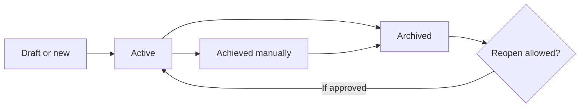

# Esokira - Financial Goals, Compound Calculator & Goal Feasibility Specification

> **Canonical path:** `docs/features/FINANCIAL-GOALS.md`  
> **Version:** `0.1.0`  
> **Prepared:** 30 October 2026 (Asia/Jakarta)  
> **Documentation status:** `REVIEWED_INTERNAL — PENDING_OWNER_APPROVAL`  
> **Implementation status:** `UNVERIFIED`; source-code repository has not been audited.  
> **Test execution status:** `NOT_RUN` for Flutter, Go, PostgreSQL, APIs, and CI. Numerical reference vectors cited below are **specification examples**, not executed implementation tests.  
> **Primary releases:** R1, slices S-05 (FR-007 and FR-008) and S-06 (FR-009). R2/R3 relationships are documented as boundaries, not implementation approval.  
> **Source-of-truth:** [Product PRD](../product/PRD.md), [Financial Domain Rules](../financial/FINANCIAL-DOMAIN-RULES.md), [Calculation Specifications](../financial/CALCULATION-SPECS.md), [Financial Test Cases](../financial/FINANCIAL-TEST-CASES.md), [Decision Log](../planning/DECISION-LOG.md).  
> **Audience:** Product Owner, AI coding agents, Flutter/Go engineers, database reviewers, QA and security reviewers.

---

## 0. Executive contract: read before implementing

**Financial goal adalah rencana masa depan, bukan saldo account, instruksi transfer, bukti investasi, atau catatan uang yang telah diterima.** Esokira wajib membedakan secara eksplisit:

1. **Target**: jumlah yang ingin dicapai pada tenggat, dengan currency dan basis nominal/real yang jelas.
2. **Rencana kontribusi**: nominal/frekuensi yang *akan* disisihkan, tetapi belum merupakan uang aktual atau kontribusi terkonfirmasi.
3. **Pendanaan aktual teratribusi**: dana aktual yang sudah memenuhi aturan atribusi ke suatu goal; **belum dapat diklaim** sebelum pemilik proyek memutuskan `PRD Q-11`.
4. **Estimasi pertumbuhan**: hasil rumus dengan asumsi return, tanggal, dan timing; bukan realisasi atau jaminan.
5. **Kapasitas kontribusi**: estimasi jumlah yang sanggup disisihkan berdasarkan data dan kebijakan yang jelas; bukan otomatis `income - expense`.
6. **Feasibility**: apakah sebuah target dapat ditopang oleh **model dan asumsi yang dinyatakan**; bukan janji target akan tercapai.

**Hard stops:**

- Jangan tampilkan `80% terkumpul` dari penjumlahan rencana kontribusi. Jika funded attribution belum disetujui, tampilkan `Pendanaan aktual belum tersedia`.
- Jangan anggap saldo seluruh account, return simulator, atau nilai net worth sebagai `funded_amount` suatu goal tanpa bukti/aturan yang disetujui.
- Jangan memindahkan uang, membuat transaksi, atau mengubah actual ketika pengguna membuat goal, mengedit target, menekan `Hitung`, menjalankan estimasi, atau menandai goal tercapai.
- Jangan otomatis memilih virtual envelope, dedicated account, atau explicit contribution event. `Q-11` adalah keputusan yang **BLOCKED**, bukan tugas implementasi bebas.
- Jangan memilih return default 8%, setoran awal/akhir, annual vs monthly convention, skala integer minor units, atau metode pembulatan tanpa keputusan `Q-04/Q-05` dan kontrak terkait.
- Jangan memperlakukan contoh route, nama tabel, field JSON, dan state pada dokumen ini sebagai kontrak production. `contracts/openapi.yaml` serta migration yang telah direview harus menjadi sumber konkret sebelum coding.
- Jangan menyatakan `DONE` untuk `FR-007/008/009` sebelum golden financial tests, authz, DB integration, UI, quality gates, dan owner approval yang relevan lolos dengan **bukti eksekusi**.

**Keputusan dasar yang sudah dipilih pemilik proyek:** Flutter/Dart, Go, PostgreSQL, monorepo `frontend/` dan `backend/`. Implementasi modular monolith serta HTTP/queue/state-management masih mengikuti keputusan arsitektur dan ADR. Tidak ada akses langsung dari Flutter ke database production.

### 0.1 Label kekuatan keputusan

| Label | Makna operasional | Boleh dilakukan agent? |
|---|---|---|
| `REQUIRED` | Invariant yang sudah ditetapkan dokumen domain/PRD. | Implement jika dependensi dan kontrak lokal jelas; harus diuji. |
| `DEFINED_MATH` | Identitas matematis pada input dan asumsi eksplisit. | Implement oracle terisolasi; tidak mengunci policy produk. |
| `PROPOSED` | Contoh desain/aturan yang belum disetujui. | Boleh buat spike/dokumen, jangan klaim sebagai kontrak final. |
| `TBD` | Pilihan belum diputuskan. | Cari owner decision; batasi scope. |
| `BLOCKED` | Kebutuhan produksi belum boleh diimplementasikan/diklaim selesai. | Laporkan blocker dan kerjakan subtask independen yang aman. |
| `UNVERIFIED` | Kondisi repository belum diaudit. | Inspeksi kode sebelum menebak komponen sudah/belum ada. |

### 0.2 Routing dokumentasi yang harus dibaca per perubahan

| Saat mengubah | Baca minimum | Bukti hasil |
|---|---|---|
| Goal lifecycle & planning | [PRD](../product/PRD.md) FR-007, [Domain Rules](../financial/FINANCIAL-DOMAIN-RULES.md) DR-011/012, [DB Design](../architecture/DATABASE-DESIGN.md) section 11, [Decision Log](../planning/DECISION-LOG.md) Q-11. | Domain, DB, API, widget, owner-scoping tests. |
| Compound math | [Calculation Specs](../financial/CALCULATION-SPECS.md) CS-001/002/005/006, [Golden Cases](../financial/FINANCIAL-TEST-CASES.md) FTC-FV and FTC-INF, [Testing Strategy](../development/TESTING-STRATEGY.md). | Pure-Go exact oracle and edge tests. |
| Goal feasibility | CS-007, FTC-GOAL, Q-04/Q-05/Q-11, [Transactions](TRANSACTIONS.md). | Capacity provenance, shortfall tests, no actual mutations. |
| Flutter goals screens | [Screen Specs](../design/SCREEN-SPECS.md) SCR-08/09/10, [User Flows](../design/USER-FLOWS.md) UF-09/10/11/12, [Design System](../design/DESIGN-SYSTEM.md), [frontend instructions](../../frontend/AGENTS.md). | Widget, a11y, stale/error-state tests. |
| Backend/API/data | [Backend Architecture](../architecture/BACKEND-ARCHITECTURE.md), [API Guidelines](../architecture/API-GUIDELINES.md), [Database Design](../architecture/DATABASE-DESIGN.md), [backend instructions](../../backend/AGENTS.md). | Authz, contract, concurrency, migration evidence. |
| Sensitive fields/exports | [Security & Privacy](../security/SECURITY-PRIVACY.md), [Development Workflow](../development/DEVELOPMENT-WORKFLOW.md), [DoD](../development/DEFINITION-OF-DONE.md). | Negative authorization tests, privacy review. |

`AGENTS.md` at the repository root applies first; scope-specific instructions add constraints. This document is a specification, **not an authorization to begin work** independent of `TASKS.md` readiness gates.

---

## 1. Scope, requirements and release boundary

### 1.1 In-scope for R1

| Anchor | Product behavior | Delivery | Explicit acceptance |
|---|---|---|---|
| `FR-007` | Create, read, edit, mark achieved, archive individual goals with target, date, priority and non-ambiguous progress. | S-05 | Owner-scoped persistence, honest status/labels, no actual posting on goal edits. |
| `FR-008` | Illustrative compound interest / future value calculator. | S-05 | Transparent rate/timing, estimated contribution/growth breakdown, zero-rate and zero-horizon behavior, independent golden cases. |
| `FR-009` | Single-goal required contribution and feasibility estimate. | S-06 | Required contribution, capacity if known, shortfall on infeasible result, transparent assumptions, no hidden goal edit. |
| `EN-004` | Independent financial calculation engine + golden test harness. | R0 foundation; realized for compound in S-05 | Pure Go financial engine tests without HTTP/DB; correct math does not imply production policy approval. |
| `FR-021` | Data export/deletion includes goal data in supported R1 scope. | S-06, **separate task track** | Owner authorization and approved retention/deletion rules; no unsupported deletion claims. |

Additional constraints: `DR-001/002/003/004/011/012/014/015/016/017/018/020/021/024`, `NFR-001/002/003/005/006/007/008/009/010`, `CS-001/002/005/006/007` and security controls relevant to private financial data.

### 1.2 Explicitly out-of-scope for this document's R1 implementation

- Multi-goal optimizer (`FR-017`), global allocation objectives, investment recommendation or auto-execution (R3, specification and owner approval pending).
- Probabilistic investment returns, Monte Carlo success rate, confidence intervals (`FR-018`, R3, model **BLOCKED**).
- Retirement/FIRE and withdrawal optimization (`FR-019`, R3); Financial GPS (`FR-020`, R3).
- Persistent life-event scenario versions, shared/collaborative goals (`FR-023`, R4 discovery), portfolio planning (`FR-024`, R4 discovery).
- Integration with banks, auto-debit, automatic transfer, securities purchase, real-time asset valuation, or unapproved push notifications.
- Authoritative return assumptions, inflation, fee, tax, FX, or debt policy not yet approved by the Product Owner.

R2 may **consume** R1 goals as planning inputs in `FR-011/012/013`; it must not mutate actual goal funding or silently overwrite the saved R1 goal.

### 1.3 Primary success criterion

A user can save an honest financial goal, understand which values are *plan*, which are *actual*, and run a clearly labeled mathematical illustration **only when required decisions are approved and relevant integration tests are evidenced**. A sophisticated graph cannot substitute for correct financial semantics.

---

## 2. Canonical concepts and type boundaries

| Concept | Class | Provenance / persistence | What it does not mean |
|---|---|---|---|
| `GoalTarget` | Planned | Goal record, owner input | Existing cash; obligation or invoice. |
| `GoalDueDate` | Planned | Goal record | A guaranteed date of availability. |
| `GoalPriority` | Planned preference | Goal record; enumeration policy TBD | Automatic optimization order or exclusive funding right. |
| `ContributionPlan` | Planned | Proposal/frequency effective dates | Ledger posting, account transfer, salary received. |
| `AccountBalance` | Actual record | Posted ledger or account position under approved model | Money attributed to a particular goal. |
| `GoalFundedAmount` | Actual-derived **conditional** | Only approved attribution and reconciliation policy | Sum of schedules or independent asset on balance sheet. |
| `CurrentValueUsedForForecast` (`P_g`) | Calculation input | Only explicitly approved eligible goal allocation, else separate illustrative input with non-actual label | All assets, whole account balance, or arbitrary default. |
| `ProjectedFutureValue` | Forecast | Engine result, assumptions and as-of | Actual money held. |
| `RequiredContribution` | Forecast/planning | CS-007 result, recurrence/timing/precision | Successful transfer or available cash. |
| `AvailableCapacity` | Derived estimate | Explicit cash-flow/obligations model or approved user input | Guaranteed monthly surplus. |
| `GoalLifecycleStatus` | Record state | Explicit user event and approved state machine | Automatic proof that target has been funded. |
| `FeasibilityLabel` | Model outcome | CS-007 comparison under known assumptions | Investment advice or certainty. |

**Actual** in Esokira means user-entered/posted as real, **not** bank verified. Flutter must not fabricate `GoalFundedAmount`, and the backend must not trust a client field stating `funded: true`.

### 2.1 Cross-aggregate ownership

A goal belongs to exactly one authenticated owner under R1. Referenced account, funding source, contribution event or calculation result must either be explicitly public/non-sensitive or match that same authenticated owner. Query `goalId` alone is insufficient; enforce owner scope on every read/write and nested lookup (`DR-003`). R4 shared goals are **not** authorized.

### 2.2 Conceptual model: not a physical database schema

```text
Authenticated owner
  |-- Actual financial accounts -- posted actual transactions
  |                                      (source of account balances)
  |-- Goals (planned)
  |    |-- target/priority/date/status
  |    |-- Planned contribution schedule (no posting side effect)
  |    |-- [OPTIONAL/BLOCKED] Approved funding attribution
  |    +-- Calculation requests/results (forecast with assumptions)
  +-- Assets, liabilities, financial profile (actual/derived)

R2 planning scenarios --> snapshots and projections (never mutate actual)
R3 optimizer          --> suggested allocations (never post money)
```

No new balance-sheet asset or income item arises from tagging existing funds for a goal. A funding assignment and an actual transfer are separate concepts unless explicitly joined by a future approved policy.

---

## 3. Financial invariants: enforce in Go, storage and UI

| ID | REQUIRED invariant | Failure prevented | Primary anchor |
|---|---|---|---|
| `FG-I01` | Creating/editing/archiving a goal does not change account balances, posted transactions or net worth. | Phantom cash / hidden debit. | `DR-001/012` |
| `FG-I02` | Planned contribution does not increase confirmed funded amount. | Misleading progress. | `DR-011` |
| `FG-I03` | No exclusive attribution of the same eligible money to multiple goals beyond actual available capacity. | Double-funded goals. | `DR-009/011`, Q-11 |
| `FG-I04` | A goal is private to its owner; nested funding/account references cannot cross owners. | Cross-tenant leakage. | `DR-003`, NFR-001 |
| `FG-I05` | Exact stored money uses approved safe representation, not binary float for balances. | Rounding/drift. | `DR-004`, Q-04 |
| `FG-I06` | Simulation and estimates have source, currency, period, as-of, assumptions and limitations. | Forecast mistaken for actual. | `DR-014/015/016` |
| `FG-I07` | Missing critical inputs produce an explicit incomplete/blocked result. | Fake feasibility. | `DR-017` |
| `FG-I08` | Stale projections are invalidated/labeled when actual baseline changes. | Misleading old advice. | `DR-020` |
| `FG-I09` | Updating target or priority never silently changes an actual contribution/history event. | Accidental ledger rewrite. | `DR-022` |
| `FG-I10` | Marking achieved is not equivalent to proof of funded progress unless a policy explicitly defines it. | Overstated financial position. | FR-007, Q-11 |
| `FG-I11` | One successful actual write must not become two postings on client retry. | Double transfer or funding. | `DR-008` |
| `FG-I12` | Money amounts from a currency cannot be mixed with another without approved conversion model. | Incorrect goal progress. | CS-001, Q-04/Q-05 |
| `FG-I13` | Estimated gain never appears as an actual deposit or stored account balance. | Phantom investment returns. | `DR-001/015` |
| `FG-I14` | Multi-goal financial advice never circumvents an approved R3 optimizer model. | Unexplained prioritization. | `DR-024`, FR-017 |
| `FG-I15` | Account/source changes that affect funded attribution require consistent recomputation or authoritative state. | Stale/falsely funded goal. | DR-018/020/022 |
| `FG-I16` | Goal data in exports/deletions follows owner-scoped, approved security/data lifecycle. | Data leak/incomplete privacy claim. | FR-021, Q-10 |

Implementation tests should cite each applicable `FG-I` and its upstream `DR-*`; these `FG-I` labels are local readability anchors, **not new domain rules overriding `DR-*`**.

---

## 4. Goal definition, validation and persistence

### 4.1 Minimum R1 user-facing goal record

| Field concept | R1 semantics | Validation boundary | Decision state |
|---|---|---|---|
| ID | Opaque owned identifier. | Server-generated or equivalent non-predictable ID per approved schema. | Architecture choice. |
| Owner | Authenticated principal. | Derived by backend; never accepted as arbitrary client ownership. | `REQUIRED`. |
| Name | Human-readable purpose, e.g. emergency fund. | Trim, nonempty; max bytes/chars, normalization and duplicates policy TBD. | Partial. |
| Target amount | Positive monetary target for a currency. | Exact monetary input; no NaN/Inf; maximum/scale policy Q-04. | `REQUIRED` meaning; encoding TBD. |
| Target date | Date goal should be achieved. | Calendar interpretation and past-date policy must be explicit. | Q-04/TBD. |
| Priority | User preference for importance. | Allowed ordering/enum and uniqueness TBD. | `TBD`; do not invent priority weight. |
| Target basis | Future nominal vs current real purchasing power. | Do not auto-inflate without explicit basis and inflation policy. | Q-05/TBD. |
| Goal lifecycle | Active/achieved/archived candidate. | Transition, manually achieved flag and history policy TBD. | `PROPOSED`. |
| Planned schedule | Optional amount, frequency and effective range. | Never posts actual money. | Model candidate. |
| Funded attribution | Optional only after policy approval. | Must reconcile with owned actual money under Q-11. | `BLOCKED`. |
| Created/updated | Audit timestamps under server policy. | Distinguish `occurred_on` from `recorded_at` if relevant. | Exact schema TBD. |

The [Database Design](../architecture/DATABASE-DESIGN.md) section 11 mentions `financial_goals` and `goal_contribution_plans` as **PROPOSED** tables. They are not approved SQL migrations. No column names, enum values or indexes should be inferred solely from this section.

### 4.2 Input acceptance principles

- For `name`, empty/whitespace-only is invalid; no arbitrary 255-char rule until approved. Reject or safely normalize dangerous/control characters without modifying the meaning silently.
- A user-entered target must express amount and currency. Do not parse locale `Rp1.000.000` in Go domain from a display string without an approved input layer; Flutter can show localized formatting while sending machine-safe structured values.
- Negative target is not a conventional savings goal; reject until the product explicitly defines a debt-repayment goal type. Zero target is subject to lifecycle/meaning policy, not a cue to silently mark the goal funded.
- Date-only targets must not drift across timezone conversion. Interpret as a calendar date under approved user/application zone, rather than UTC midnight automatically.
- A target in the past requires a deliberate state/validation policy (past-date rejection for creation, historical goals, or overdue read). Never shift target to today without user consent.
- Priority cannot silently reorder multi-goal funds or create exclusive claims over a bank account; it is a descriptive preference in R1.
- Optional fields remain explicitly absent, not `0` by default unless the approved contract says the absence means zero. This is critical for unknown funded and unknown capacity.
- Optimistic concurrency/versioning for edits is a candidate; if simultaneous editors or retries exist, conflict must not silently overwrite ownership/history.

### 4.3 State and edit semantics

**State machine below is only a PROPOSED review aid.** Product Owner must approve status labels, reopening, archive effects, and difference between `achieved` and fully funded.



| User action | Allowed domain effect | Disallowed implied effect | Gate |
|---|---|---|---|
| Create | Persist planning object for owner. | Deposit to account or add to net worth. | FR-007, Q-11. |
| Edit target/date | Update goal plan with concurrency safeguards. | Rewrite historical transactions or auto-reallocate funded money. | Q-04/Q-11. |
| Edit planned schedule | Update plan/suggestion. | Perform transfer or declare contribution received. | DR-011/012. |
| Mark achieved | Record explicitly requested lifecycle status if approved. | Infer funded percent 100%, generate return or payment automatically. | FG-Q04. |
| Archive | Hide from active planning subject to history policy. | Delete ledger events or release allocations without approved procedure. | FG-Q04/FG-Q05. |
| Delete | Only if product/data lifecycle allows it; handle retained history/export. | Cascade delete actual transfer without audit/reversal. | Q-10/Q-11. |

If Q-11 remains open, users may still see and edit **target, date, name, priority and plan**, but any production UI that claims actual funded progress or percent completion must be blocked. A field displayed as `0 dana aktual` would also be misleading when the truth is *unknown*.

---

## 5. Goal target value, currency, inflation and dates

### 5.1 Basis nominal vs real

A goal named `Rumah Rp500 juta` could mean IDR 500m at the target date or today's purchasing power of IDR 500m. These differ when inflation is applied. Require explicit basis before inflating; never assume because the date is in the future.

For an approved effective annual inflation rate `pi` and `y` years using a matching time convention:

```text
future_nominal_target = today_real_target * (1 + pi)^y
present_real_equivalent = future_nominal_target / (1 + pi)^y
```

These equations are **defined mathematical references** in `CS-006`, not permission to insert a hidden inflation assumption into R1. Refer to `FTC-INF-01..08` for mixed period, zero inflation, already-future-nominal and invalid-rate tests. A UI label like `Nominal pada tanggal target` or `Nilai uang hari ini` should be explicit only once the product target-basis policy is approved.

### 5.2 Cross-currency and FX

- R1 currency scope and storage encoding follow `Q-04`; no automatic FX conversion from one goal currency to an account currency without an approved rate source, as-of and conversion policy.
- A funding link across mismatched currencies should reject/flag incomplete until rules exist; no silent `1:1` conversion.
- Monetary display formatting does not justify lower-precision storage. Currency symbols and separator formats are view-level decisions.
- Multi-currency totals and FX gains/losses are not invented in the goal feature.

### 5.3 Time and contribution period semantics

| Boundary | Safe treatment | Open policy |
|---|---|---|
| Day vs month period | Count periods under explicit calendar algorithm; show count and date. | `Q-04`, leap day/month-end. |
| Target equals today | Remaining periods `n=0`; contribution recurring `N/A`. | Deadline status semantics. |
| End of month | Do not shift contribution date into next month silently. | Roll convention. |
| Biweekly vs monthly | Normalize schedules explicitly; never divide annual by 12 unconditionally for a biweekly plan. | Schedule granularity. |
| DST/timezone | Date-only goal targets must remain stable. | User zone, device-zone changes. |
| Recorded date vs effective date | Distinct for historical corrections. | DR-018 and event policy. |
| Mid-period contribution | Model requires event ordering and partial-period convention. | Outside simple CS-007 constant-period case. |

The ability to select a distant date without crashing is not the same as having an approved mathematical horizon model.

---

## 6. Planned contributions: intention without financial posting

### 6.1 Candidate schedule semantics

A planned schedule can describe `100,000 IDR/month starting 2027-01` with effective date and edit history. **It is not a recurring actual transaction**. The following are logically separate:

```text
User sets goal              -> store planning goal
User sets monthly plan      -> store planning schedule
User receives salary        -> actual income event, if user records/posts it
User moves money            -> actual transfer event, only if user explicitly initiates it
Approved funding assignment -> goal attribution record, only under Q-11
Simulation assumes deposit  -> projected contribution, no actual event
```

Even when a schedule is expressed as `100,000 x 12 = 1,200,000`, this is an **intended cumulative contribution**, not a funded balance. It can appear in a summary labeled `Total setoran yang direncanakan`, never as `Sudah terkumpul`.

### 6.2 Schedule lifecycle questions

- Does editing a planned amount replace future periods only or rewrite the entire plan? TBD.
- Can users pause/skip schedules; how does it affect feasibility? TBD.
- How are missed months shown, without creating an expense/income event? TBD.
- Can a user enter historical planned contributions? If yes, label as plan history rather than actual receipts. TBD.
- Must schedules be per-account, per-goal or general? TBD Q-11.
- Should reminders be sent? Only later under `FR-022`, opt-in and security review; never implied by creating a plan.

### 6.3 No hidden execution

Creation/update of a goal or plan should generate **zero** rows in actual transaction/posting tables (except separate explicitly requested/authorized posting operations once approved). The agent must include this as a database-level regression assertion; widget-only mock tests are insufficient.

---

## 7. Goal actual funding: owner decision Q-11 is a hard gate

### 7.1 Competing funding models (all PROPOSED)

| Model | Evidence | Main risk | Necessary controls before production |
|---|---|---|---|
| A. Virtual envelope | Earmark part of current eligible owned cash. | Double allocation; overcommitment; account spend after earmark. | Owner-scoped allocation, limits, concurrency, withdrawal/unlink/rebalance, as-of reconciliation. |
| B. Dedicated/linked account | Associate account(s) or eligible share with goal. | Multiple goals claim same balance; linked account changes; cross-currency. | Exclusive/partial link rule, net-worth nonduplication, source movement and pending transfer policy. |
| C. Explicit contribution allocation events | Confirmed goal contribution events tied to eligible actual funds. | Events mistaken for cash transfers; corrections leave orphan funded amount. | Source-of-funds proof, reversible allocation, no double posting, linkage to account/ledger and audit. |

Source: [Financial Domain Rules section 7.2](../financial/FINANCIAL-DOMAIN-RULES.md), [DB Design section 11](../architecture/DATABASE-DESIGN.md), [Decision Log Q-11](../planning/DECISION-LOG.md). **Do not blend these models into an unapproved hybrid.** The model selected may affect schema migrations, transaction corrections, UI, net worth, and accounting invariants.

### 7.2 Approval checklist before actual funded amount

Product Owner and financial-domain reviewer must decide and record:

1. What qualifies as eligible funds? Liquid cash only? Specific account types? Pending transactions? Overdraft?
2. Is attribution exclusive, partial, shared, or merely informational? Can one account support multiple goals, and under what limit?
3. Is it an *earmark* of existing money, a transfer to a dedicated account, or both?
4. Who can assign/unassign, and does it require explicit confirmation?
5. How do incoming/outgoing transactions, returns, fees, withdrawal, account deletion, and corrections change funded attribution?
6. How are non-owned, closed and cross-currency accounts handled?
7. What is `funded_amount(as_of)` and how is history preserved when actual data is corrected?
8. What is the meaning of `percent_funded` when funded exceeds target, target decreases, or data goes stale?
9. Can a manually achieved goal be financially underfunded, and how is that disclosed?
10. Does unassigning funds free the attribution only or initiate a real transfer? (**No implicit transfer**).
11. How do multiple simultaneous allocations prevent overcommitment under concurrency?
12. Which migrations, events, permissions, reconciliation jobs and negative tests prove the chosen model?

No amount of naming a table `goal_funding` substitutes for answering these questions.

### 7.3 Account funding reconciliation invariant

Once **exclusive** attribution is approved, the model must enforce (by appropriate DB locking/constraints and transactional service logic):

```text
sum(exclusive_allocations_to_goals for account A at as_of T)
  <= eligible_unencumbered_balance_of_account_A at T
```

The exact definition of `eligible_unencumbered_balance` (pending transactions, holds, reservations, negative balances) is **TBD**. The same rupiah may not create two independent assets when linked to two goals. Reconciliation must be auditable, including backdated writes and account edits. `DR-006/007/008/009/010/022` continue to apply.

### 7.4 Example: planned versus funded

| Real/plan events | Goal target | Planned monthly | Funded amount | What can be shown now |
|---|---:|---:|---|---|
| User creates IDR 10m goal and plans IDR 1m/month; no account action. | 10m | 1m | **UNKNOWN under Q-11** | Target and planned monthly only; no percent ring. |
| A user has IDR 5m in account A, but has not linked it to goal. | 10m | 1m | **UNKNOWN under Q-11** | Separate actual account balance; don't label goal 50% funded. |
| Account A has IDR 1m and goal A + goal B each request IDR 1m exclusive allocation. | 2m each | varies | **BLOCKED / invalid under exclusive model** | Allocation validation error, never IDR 2m total exclusive funded. |
| User marks goal achieved manually. | 10m | 1m | **UNKNOWN unless approved evidence** | Lifecycle status only; don't fabricate funds or transaction. |

**Important:** Unknown is not zero. In test fixtures with `P_g=0` explicitly declared, zero is a **mathematical premise**, not an inference from missing account data.

### 7.5 Backdated transactions and recalculation

An actual correction, reversal, ownership-safe account closure, or change to eligible source balance may invalidate the previously computed funded result. If the selected funding model derives from current balances, recompute under consistent `as_of`; if it uses allocation events, apply approved reconciliation policy. The UI must not show a fresh-looking stale result. A queue/background job cannot be assumed reliable without a durable state model and retry evidence.

---

## 8. Funded progress, target progress, and lifecycle labels

### 8.1 Do not calculate a percentage until the numerator is defined

Only **after** Q-11 resolves `funded_amount`, and only when target is valid and currency aligned, may production compute a candidate ratio:

```text
funded_progress_raw = funded_amount / target_amount
funded_progress_percent_raw = funded_progress_raw * 100
```

This is not a final UI rule. Rounding, display clamp, denominator zero, more-than-100% progress, stale value, multi-currency, changes to target and manual completed flag require explicit approval (`FG-Q06`). Do not create a gauge by dividing a forecast future value by goal target and labeling it `Terkumpul`.

### 8.2 Four distinctly named progress concepts

| UI concept | Meaning | Label example | May be shown before Q-11? |
|---|---|---|---|
| Target | Desired nominal/real future amount. | `Target Rp10.000.000` | Yes, if basis/currency known. |
| Planned contribution | User intended future installments. | `Rencana setoran Rp500.000/bulan` | Yes, with schedule policy. |
| Estimated trajectory | Engine future value using assumptions. | `Estimasi pada Desember 2028` | After calc policy approved, label forecast. |
| Actual-funded amount | Proven eligible funds attributed to goal. | `Dana aktual teralokasi Rp...` | **No, until Q-11 approved and evidence available.** |

### 8.3 Avoid misleading completion semantics

- `Achieved` is a user-managed lifecycle notion unless the Product Owner defines an objective money threshold; it should never silently create deposits.
- `Target reached according to model` is a forecast statement and must not overwrite manual goal status.
- `Overdue` means date passed under approved policy, not proof funds disappeared.
- `Archived` removes a goal from active planning only if that behavior is approved, not from user data export obligations.
- Color/percentage alone cannot encode actual vs forecast: include text and accessibility labels.

---

## 9. Pure-Go compound calculator (FR-008, CS-005)

### 9.1 Purpose and prohibited side effects

The compound calculator models future value from principal and **hypothetical** contributions with a declared rate and time convention. It neither posts transactions nor recalculates actual account balance. The Go financial engine should remain pure and unit-testable without DB or HTTP (`EN-004`). The Flutter layer collects inputs and displays results; it is not the authority for financial arithmetic.

### 9.2 Reference definitions (not an approved default)

For initial principal `P`, contribution `C` each period, `n` whole periods, fixed effective periodic rate `i` and payments at the **end** of each period:

```text
A(i,n) = ((1+i)^n - 1)/i     if i != 0
A(0,n) = n
FV_end = P*(1+i)^n + C*A(i,n)
FV_begin = P*(1+i)^n + C*A(i,n)*(1+i)

if n == 0: FV = P, no future contribution paid
if i == 0: FV = P + C*n, both timings agree
```

The annual-effective-to-periodic conversion follows `CS-002`; nominal-rate conversion requires an explicit different convention. `FV_begin` vs `FV_end` are **two examples**, not approval to choose one automatically. A user-selected timing, rate class and period count must be present in the normalized calculation request/contract. At negative rates, domain and numerical safety constraints apply; do not assume every negative rate is valid.

### 9.3 Result meaning and provenance

A valid result (if policy has been approved) should distinguish:

- Principal at time zero `P` (whether this is real goal-attributed money vs scenario input must be labeled).
- Total *hypothetical* contributions, e.g., `C*n` for fixed schedule; not realized transfer totals.
- Estimated future value `FV`.
- Estimated growth or loss `FV - (P + C*n)`; a negative result may occur.
- Effective periodic rate, input rate basis, annual/monthly conversion rule, timing, currency, calendar period count, engine/formula version and rounding method.
- State `forecast`, a non-guarantee disclaimer and data source `illustrative` or approved attributed baseline.

Do not take the rounded UI result, divide by a number of periods, and feed it back as the next authoritative engine input. Use exact internal calculation and approved rounding rules.

### 9.4 Numerical and validation edge cases

| Case | Required safe behavior | Reference |
|---|---|---|
| `i=0`, `n>0` | Use `FV=P+C*n`; no division by zero. | `FTC-FV-01/08/14` |
| `n=0` | `FV=P`; no future deposits. | `FTC-FV-05` |
| `P=C=0` | `FV=0`; don't invent interest. | `FTC-FV-06` |
| `i<0` and allowable | Correct negative growth/loss, not guaranteed positive return. | `FTC-FV-07` |
| Timing omitted | Explicit `UNAPPROVED_CONVENTION` or request validation, not hidden beginning/end choice. | `FTC-FV-09` |
| Negative or fractional period `n` in discrete formula | Reject or use approved distinct partial-period model; no truncation. | `FTC-FV-10/11` |
| `i<=-1` in candidate recurrence | Follow approved error/model limits; don't allow unstable/invalid exponent semantics. | `FTC-FV-12` |
| Very small `i` | Avoid catastrophic cancellation; verify against high-precision oracle. | `FTC-FV-13` |
| Overflow, NaN/Inf, unsafe magnitude | Explicit controlled errors, never silently clamp. | `FTC-MONEY-04`, CS-001/002 |
| Annual vs monthly units mismatch | Normalize via approved rule; show normalized assumptions. | `CS-002` |
| User updates inputs after result | Mark previous calculation stale/clear it. | `UF-10`, `SCR-09` |

### 9.5 Small reference vectors (not production return assumptions)

| Input | Expected unrounded mathematical value | Test anchor |
|---|---|---|
| P=1,000,000; C=100,000; n=12; i=0; end | FV=2,200,000, gain=0. | `FTC-FV-01` |
| P=0; C=100,000; n=2; i=1% per period; end | FV=201,000. | `FTC-FV-02` |
| Same, contributions at start of period | FV=203,010. | `FTC-FV-03` |
| P=1,000,000; C=0; n=2; i=1% per period | FV=1,020,100. | `FTC-FV-04` |
| P=1,000,000; C=100,000; n=2; i=-10% per period; end | FV=1,000,000; contributions=1,200,000; loss=-200,000. | `FTC-FV-07` |

**Note:** The 1% and -10% rates are explicitly chosen teaching/test fixtures. No implied market return prediction; formula output is not yet a production-accepted wire contract.

---

## 10. Required contribution & single-goal feasibility (FR-009, CS-007)

### 10.1 One-goal fixed-contribution reference

For target nominal at goal date `T_n`, already eligible and correctly attributed goal principal `P_g`, `n > 0` whole periods, fixed periodic rate `i` and **end-of-period** contributions:

```text
A(i,n) = ((1+i)^n - 1)/i       for i != 0
A(0,n) = n

required_C_raw = (T_n - P_g*(1+i)^n) / A(i,n)
required_C = max(0, required_C_raw)

For beginning-of-period contributions:
A_begin(i,n) = A(i,n)*(1+i)
required_C_begin = max(0, (T_n - P_g*(1+i)^n) / A_begin(i,n))
```

Conditions: `n>0`, valid periodic return, strictly positive annuity factor, consistent currency/time units, and an approved `P_g` interpretation. Rounding up the required amount to supported money steps is a **policy TBD**: do not commit to a specific minor unit or display round-half rule as an approved default.

### 10.2 Zero horizon / target already achieved

```text
if n == 0:
    shortfall_now = max(0, T_0 - P_g)
    goal_met_now = (P_g >= T_0)
    required_recurring_contribution = NOT_APPLICABLE
```

If `P_g` is UNKNOWN due to Q-11, do not calculate goal-met status. `NOT_APPLICABLE` differs from `0`: when no periods remain, zero per-period contribution is **not** an assertion that an unfunded goal is feasible. A past target date requires an approved historical/overdue status, not a negative `n` inserted into the formula.

### 10.3 Explicit capacity and shortfall

Once `available_capacity` is *known on the same time basis* as `required_C`:

```text
capacity_gap = required_C - available_capacity
mathematical_feasible = (available_capacity >= required_C)
periodic_shortfall = max(0, capacity_gap)
```

`available_capacity` must have provenance. Candidate components: verified within-app net cash inflow per period, debt principal obligations, scheduled outflows, emergency buffer requirement, user-defined commitment to other goals, and assumptions about recurring events. Whether these are included in R1 and how they are ranked is **TBD**. Using `monthly_income - monthly_expenses` alone could overstate feasibility. If data are incomplete, output `INSUFFICIENT_DATA`, not a made-up boolean or an unbounded maximum capacity.

### 10.4 Interpret result states precisely

| State | Meaning | Safe UI response | Should not do |
|---|---|---|---|
| `FEASIBLE_UNDER_ASSUMPTIONS` (candidate) | Required <= known capacity under explicit assumptions. | `Menurut asumsi yang dipilih, rencana ini mungkin dapat didanai.` | Say `Pasti tercapai`. |
| `INFEASIBLE_UNDER_ASSUMPTIONS` | Required > known capacity. | Show required, capacity and periodic shortfall; suggest user-controlled hypothetical edits. | Auto-extend date or reduce target. |
| `INSUFFICIENT_DATA` | Capacity, P_g, rate, target basis or dates not reliably defined. | Explain exact missing inputs/policy. | Treat unknown as zero or unlimited. |
| `DEADLINE_REACHED` | No contribution periods remain. | Show shortfall/current funding if known; recurring amount `N/A`. | Divide by zero. |
| `INVALID_INPUT` | Invalid money, date, rate or impossible period. | Field-level errors and retry/edit. | Return plausible-looking calculation. |
| `UNAPPROVED_CONVENTION` | Underlying numerical/funding policy not approved. | Display clear unavailable state and trace decision. | Pick defaults hidden in implementation. |
| `STALE_RESULT` | Inputs/baseline changed. | Mark stale/recalculate deliberately. | Present as live recommendation. |
| `FORBIDDEN` | Owner/resource validation failed. | Safe generic denial; avoid enumeration. | Leak foreign user's goal/amount. |

The enum strings above are **conceptual**, not final API error codes. Final operation/status/error semantics belong to reviewed OpenAPI.

### 10.5 Reference vectors and what they do NOT prove

| Inputs | Math outcome under stated premise | Reference / caveat |
|---|---|---|
| T=210,000; P_g=0; n=2; i=10%/period; end | Required=100,000/period. | `FTC-GOAL-01` (illustrative rate, Q-11 scope conditional). |
| T=1,200,000; P_g=0; n=12; i=0; end | Required=100,000/period. | `FTC-GOAL-02`. |
| T=1,210,000; P_g=1,000,000; n=2; i=10%/period | Required=0 in that model. | `FTC-GOAL-03` (P_g premise, not inferred cash). |
| T=1,000,000; P_g=1,500,000; n=12; i=0 | Required=0, not negative. | `FTC-GOAL-04`. |
| T=500,000; P_g=200,000; n=0 | Shortfall=300,000; recurring contribution N/A. | `FTC-GOAL-05`. |
| Required=100,000, capacity=80,000/period | Infeasible by 20,000/period under these assumptions. | `FTC-GOAL-07`. |
| T=210,000; P_g=0; n=2; i=10%/period; beginning | Unrounded required=210,000/2.31 ~ 90,909.090909... | `FTC-GOAL-12`, **rounding TBD**. |

These vectors validate **mathematics only** when input conventions are explicit; they do not resolve `Q-11` nor establish investable return or future income. Never copy them to live user records as seed balances.

### 10.6 Feasibility is not optimizer

R1 may estimate one goal in isolation (or simply state that other commitments were not included). It may NOT automatically claim optimal contribution allocation across goals with different priorities, deadlines, risks and caps. That belongs to `FR-017` (R3, objective function and constraints pending approval).

---

## 11. Calculation input/output contracts (conceptual only)

### 11.1 Three distinct operations

| Operation | Side effects | Authoritative unit of work | Requires |
|---|---|---|---|
| Create/update goal | Goal planning record only. | Owner-scoped business transaction. | Approved data schema, lifecycle and authorization. |
| Compound illustration | None on actual; optionally no persistence. | Pure calculation, reproducible input. | CS-005, approved rate/timing/currency convention. |
| Required contribution/feasibility | None on actual or saved goal. | Pure calculation + optional scoped read of owned goal/approved funding. | CS-007, Q-11 for P_g and capacity policy. |

### 11.2 Candidate calculation request envelope

The following JSON is **a conceptual example**, **not** an approved REST schema or permission to add an endpoint:

```json
{
  "goal_ref": "opaque-owned-goal-id-or-null",
  "calculation_kind": "required_contribution",
  "target": {"amount": "1200000", "currency": "IDR", "basis": "future_nominal"},
  "attributed_start_amount": {"status": "unknown", "amount": null},
  "periods": {"count": 12, "unit": "month"},
  "return": {"value": "0", "kind": "effective_periodic", "unit": "month"},
  "contribution_timing": "end_of_period",
  "capacity": {"status": "unknown", "amount": null, "currency": "IDR"}
}
```

**Warning:** Even though this shows a `0` return explicitly, the **real user's input** must not be auto-filled from this fixture. `amount` as decimal string is a presentation of an exact-number *candidate* only, not an approved money wire format; IDR-only is a candidate constraint. Actual API shape must be generated from approved `contracts/openapi.yaml` when it exists.

### 11.3 Candidate response structure

```json
{
  "kind": "forecast",
  "status": "insufficient_data",
  "required_contribution": null,
  "feasibility": null,
  "missing": ["approved_goal_funding_model", "available_capacity"],
  "source": "planned_goal_and_assumptions",
  "assumptions": {
    "period_count": 12,
    "contribution_timing": "end_of_period",
    "return_kind": "effective_periodic"
  },
  "as_of": null,
  "engine_version": "unassigned"
}
```

Do **not** hardcode example `engine_version: unassigned` as a release label. A production implementation should use the approved version/provenance mechanism, plus request correlation for error diagnosis without leaking private numbers.

### 11.4 Error/result classification

- **Validation errors:** malformed target, unsupported currency, unsafe money scale, invalid date/horizon, rate outside approved bounds, unapproved convention.
- **Business results:** infeasible goal is typically a **valid computation outcome**, not necessarily a server failure; exact HTTP policy must follow approved API guidelines.
- **Authorization failures:** unauthenticated/foreign goal or source refs; never enumerate existence.
- **Conflict failures:** stale goal version/duplicate write/changed account attribution; preserve client draft, show refresh.
- **Temporary failures:** backend/database/network timeout; for pure reads/calculations safe bounded retry may be allowed; for write requests use approved idempotency/version semantics.
- **Data-incomplete states:** missing capacity or blocked funding attribution; may be successful domain responses, not fabricated outputs.

### 11.5 Proposed API routes, not endpoints to create automatically

`API-GUIDELINES.md` currently lists **candidate** routes:

```text
GET/POST  /api/v1/goals
GET/PATCH /api/v1/goals/{goalId}
POST      /api/v1/calculators/compound
POST      /api/v1/calculators/goal-contribution
```

Only a reviewed OpenAPI contract should determine operation IDs, authentication, payloads, response codes, versioning, money field serialization, request IDs, and update semantics. Do not add speculative `POST /goals/{id}/fund` because the funded model is still blocked.

---

## 12. Go backend: service boundaries and integrity

### 12.1 Preferred logical separation, not mandatory packages

```text
HTTP handler / request validation
       |
       v
Authenticated owner-scoped application service
       |-- Goal planning domain service
       |     |-- Goal repository (PostgreSQL)
       |     +-- Goal policy (lifecycle, ownership)
       |
       |-- Approved funded-attribution service  [BLOCKED Q-11]
       |     +-- Actual account/ledger read boundary
       |
       +-- Pure Go financial engine
             |-- CS-001/002 money/rate/time normalization
             |-- CS-005 compound calculation
             +-- CS-007 required contribution/feasibility
```

Final Go module names, router, SQL access library (`pgx`, `sqlc`, etc.) and dependency injection style remain the responsibility of repository review and architecture approval. **Never write DB calls directly inside a numerical pure function**.

### 12.2 Persistence requirements

| Concern | Implementation responsibility | Failure case to test |
|---|---|---|
| Owner scoping | Goals and nested account/plan refs authorized at service/query layer. | User A requests User B goal/account. |
| Referential integrity | Same-owner linkage, consistent optional plan relation. | Goal deleted/archived with dependent plans. |
| Exact money | Approved decimal/integer money class and currency code. | Repeated decimal arithmetic / overflows. |
| Consistent `as_of` | Results with relevant owner snapshot and currency. | Backdated actual correction while displaying progress. |
| Atomic writes | If a permitted goal and allocation mutation is combined, both succeed/fail transactionally. | Partial plan write or ghost funding event. |
| Concurrency | Lock/version around exclusive allocations and goal edits as approved. | Two writers spend same eligibility. |
| Audit | Created/updated, manual achieved, archive and future allocation changes traceable. | No provenance after correction. |
| Idempotency | Actual posting must remain safe under retry; goal write semantics are endpoint-specific. | Timeout after commit and duplicate mutation. |
| Delete/export | Policy-governed owner-scoped goal data included in rights operations. | Export foreign goal or retain unapproved cache. |

### 12.3 Concurrency and double-counting

After Q-11 approval, two concurrent requests assigning all of an account's funds to separate goals cannot both succeed if funding is defined as exclusive. A read-then-write in separate transactions is insufficient; choose the locking/constraint strategy under DB review, test interleavings on real PostgreSQL, and verify totals after rollback. This requirement does not mean all goal writes should create transfers: attributing funds and transferring funds remain separate operations.

### 12.4 Reproducibility and persistence of calculations

A calculator need not persist every run to be reproducible, provided inputs and formula/configuration can be reconstructed as approved. If results are stored for history, they must be versioned by baseline, engine, timing/rate conventions and source. Personal data retention approval (`Q-10`) precedes adding persistent result history or detailed financial telemetry.

### 12.5 Financial engine implementation quality

- Go domain input types must prevent ambiguity between currency amount, percent input, annual/periodic rate, time horizon and timing option.
- Avoid `float64` as authoritative actual money; use explicitly approved exact representation. Numerical algorithm internal precision must meet approved error budget, not arbitrary decimal rounding.
- Table-driven golden tests should compare against independent oracle vectors; code output must not be used to generate its own expected values.
- Handle `n=0`, `i=0`, negative rates, overflow, `NaN/Inf`, invalid rates and limit cases deliberately.
- Return provenance and *status* separately from numerical result; an unknown input should not be replaced with zero in coercion helpers.
- Do not silently auto-allocate `P_g` from account net worth; require approved attribution read boundary or an explicitly labeled illustrative input.

---

## 13. Flutter UX and interaction contracts

### 13.1 Screen and flow mapping

| Screen | Subviews | User flows | Primary acceptance |
|---|---|---|---|
| `SCR-08` | `.V01` goals list, `.V02` editor, `.V03` detail | `UF-09`, `UF-12` | Create/edit/archive, honest planned-vs-funded labels and lifecycle. |
| `SCR-09` | `.V01` calculator inputs, `.V02` result/breakdown | `UF-10` | Rate/period/timing explicitly visible; estimated growth separate from principal. |
| `SCR-10` | `.V01` contribution inputs, `.V02` feasibility & alternatives | `UF-11`, `UF-12` | Required periodic contribution, shortfall, incomplete/expired state, no silent plan rewrite. |

Follow [Screen Specs](../design/SCREEN-SPECS.md) for screen inventory and [User Flows](../design/USER-FLOWS.md) for exceptional journeys. Screen IDs and routes are not equivalent: use the repository's approved navigation map, not an invented route string.

### 13.2 Required visual hierarchy

1. **Goal detail:** user-saved target and date first; planned monthly contribution separate; conditional funding area only with approved source/provenance.
2. **Compound result:** forecast headline, total hypothetical deposits, hypothetical growth/loss, unit/time assumptions, non-guarantee note, optional chart with accessible table.
3. **Feasibility:** chosen target, eligible start amount if known, required periodic saving, available capacity if known, gap/shortfall, clear `under assumptions` label.
4. **Action area:** edit/save plan only through explicit confirmation; no `Deposit now` unless a real independent transfer feature exists and has its own consent/confirmation.

### 13.3 Recommended Indonesian microcopy (PROPOSED)

| Condition | Suggested copy | Must avoid |
|---|---|---|
| No funding model | `Pendanaan aktual belum tersedia. Anda tetap bisa menyusun target dan rencana setoran.` | `0% terkumpul`. |
| Planned contribution | `Rencana setoran: Rp500.000 setiap bulan` | `Dana berhasil ditabung`. |
| Compound forecast | `Estimasi nilai masa depan menurut asumsi yang dipilih; hasil tidak dijamin.` | `Keuntungan pasti`. |
| Infeasible | `Dengan kapasitas saat ini, masih ada kekurangan Rp... per bulan.` | Automatic change of deadline. |
| Capacity unknown | `Data kapasitas setoran belum cukup untuk menentukan kelayakan.` | `Kamu pasti sanggup`. |
| Deadline now/expired | `Tidak ada periode setoran tersisa. Periksa status target dan kekurangannya.` | Required `Rp0/bulan` shown as feasible. |
| Stale result | `Input berubah. Hitung ulang untuk melihat estimasi terbaru.` | Display previous result as current. |
| Cross-owner denied | `Tujuan tidak dapat diakses.` | Confirm existence/owner details. |

Amounts in microcopy are illustrative, not seed user data. All accessible text must differentiate *plan*, *actual* and *forecast* with words, not just color or progress bar.

### 13.4 UI state handling matrix

| State | Screen behavior | Retry/save behavior |
|---|---|---|
| Empty goal list | Explain no goal, show create CTA. | No fake onboarding goal. |
| Form invalid | Field errors without losing user inputs. | No network mutation. |
| Saving goal | Disable duplicate submit, keep draft. | Ambiguous write result reconciled under approved ID/version. |
| Saved goal | Read authoritative result before showing success. | No synthetic funded amount. |
| Auth/session expired | Remove sensitive view, reauthenticate. | Re-fetch under current owner; don't show prior owner's data. |
| Goal not found/forbidden | Generic safe fallback. | No owner enumeration. |
| Calculator loading | Show pending state and input summary. | Drop obsolete response if inputs change. |
| Calculation unavailable due to decisions | Show non-numeric explanation; keep draft inputs. | Do not fabricate default. |
| Feasible/infeasible | Show assumptions and capacity data status. | No auto-goal mutation. |
| Offline | Read-only previously permitted data only under approved privacy/cache policy. | Do not queue money-changing operation blindly. |
| Stale | Label result with as-of and new baseline mismatch. | Explicit refresh/recompute. |
| Archive/achieved | Show confirmed result and history status. | Never imply bank action. |

### 13.5 Accessibility, charts, locale and privacy

- Support dynamic text scaling, focus order, keyboard/screen-reader labels and contrast per [Design System](../design/DESIGN-SYSTEM.md); don't rely exclusively on color or chart area.
- Charts of compound growth should include a text/table equivalent listing period, hypothetical principal, contributions, projected growth, and caveats.
- Show IDR format only for known IDR inputs; avoid assuming all future goals are IDR when currency scope is TBD.
- Sanitize display of long goal titles and private notes, including app switcher/screenshot behavior where security policy requires it.
- Prevent stale asynchronous response A (from earlier goal/input) overwriting the latest response B.
- Never display source user A's private cached goal after user B logs in on the same device.
- Avoid nonspecific confidence badges or fake percentage rings before a rigorous funded model exists.

---

## 14. Security, privacy and audit obligations

### 14.1 Authentication and authorization

- Every private goal, plan and funding-related request requires a verified server principal; never trust a `userId`/`ownerId` supplied in payload as authority.
- Nested references must be verified against owner; foreign account IDs are invalid even if the goal belongs to the caller.
- Return safe `not found`/`forbidden` behavior per approved API policy, without exposing another user's target, notes or balance.
- Cross-tenant leaks can occur in exports, background jobs, caches and analytics as well as HTTP response; testing must cover those boundaries.

### 14.2 Sensitive information

- Goal labels can reveal private intentions (health, housing, education, family); avoid plaintext body/amount/goal name in ordinary logs and telemetry.
- Correlation IDs should not be raw IDs containing PII or self-describing bank information.
- If result history is persisted, define retention/subject access/deletion before implementation (`Q-10`).
- Finance data is never included in crash breadcrumbs, deep links, screenshots or notification bodies by accident.
- Protect stored user tokens and clear owner-bound app state on logout/account switch.

### 14.3 Side-effect and abuse control

- Calculation endpoints must have input-size/horizon/rate bounds, timeout, and rate limiting as approved; malformed requests must not consume unlimited CPU or expose stack traces.
- Goal writes should use DB transactions appropriate to chosen model and safe retry semantics. Actual transfers, if ever integrated, must use the independently approved transaction idempotency contract.
- Repeated calculate calls have no financial side effects; request/response logging must not disclose amounts without explicitly approved safeguards.
- Requesting export/deletion cannot automatically reveal hidden archived goal records of other users.

---

## 15. Dependencies and interaction with other financial modules

### 15.1 Actual accounts and transaction ledger

`FR-003/004` and [Transactions Specification](TRANSACTIONS.md) provide account and posting semantics; `FR-005/006` provide assets, liabilities and net worth. This feature **consumes** verified actual data via approved service boundaries but does not mutate that data. A transfer between owned accounts does not create income/expense and is net-worth neutral absent fee/FX (`DR-006/007`). Tagging a balance for a goal does not create an additional asset.

### 15.2 Income, expenses, debt and capacity

A user's true contribution capacity may be less than apparent `income - expense` because of planned obligations, principal repayment, emergency reserves or multiple goals. Any prefilled estimate must show data provenance, effective period and known exclusions. Data incompleteness is a valid result.

### 15.3 R2 planning integration

- `FR-011` life events may change planned future costs; never mutate R1 goal or actual ledger automatically.
- `FR-012` deterministic projections may consume a **versioned snapshot** of goals and assumptions.
- `FR-013` scenario comparison should distinguish projected goal success from confirmed goal funding; the baseline can become stale after actual changes.
- `FR-014/015` forecasting/stress tests must use approved event order, cash shortfall and source metadata; goal contributions are planned model events, not duplicate actual cash flow.
- `FR-022` reminders/notifications require separate opt-in/privacy policy.

### 15.4 R3 advanced features

- `FR-017` multi-goal optimizer defines objective and constraints (still TBD); do not implement a priority-based splitter in this module as if optimal.
- `FR-018` Monte Carlo risk success probability is **not** the same as R1 mathematical feasibility.
- `FR-019` retirement and `FR-020` Financial GPS must reuse approved contracts but require their own model validation.
- `FR-023/024` R4 discovery is non-committed and should not introduce shared ownership or portfolio-goal funding into R1.

---

## 16. Testing strategy and independent reference requirements

### 16.1 Test layers that cannot replace one another

| Layer | Critical coverage | Evidence |
|---|---|---|
| Pure Go calculation unit/golden | CS-005/007 math, zero rate/time, invalid inputs, negative rate, precision. | Test command, output, oracle source, coverage of relevant cases. |
| Go domain tests | Create/edit/archive/achieved state, no posting, required owner, unknown vs zero. | Table-driven tests and return assertions. |
| PostgreSQL integration | Persistence, same-owner nested reference, constraints, concurrency/rollback, no phantom ledger. | Real isolated PostgreSQL integration logs. |
| REST/OpenAPI contract | Validation, money encoding, errors, scoped read/write, timeout, no leaked data. | Schema validation and HTTP tests against approved spec. |
| Flutter widget | Goal forms, planned labels, no funded gauge, shortfall, chart accessibility. | Widget test output and visual/a11y review. |
| Flutter<->Go E2E | Create goal, edit plan, calculate, see result, logout/account switch, stale response. | Synthetic test accounts and artifacts. |
| Security/privacy | Foreign owner refs, export data, deletion, logs, privacy cache. | Negative tests, redaction review and data lifecycle evidence. |
| Release regression | FR-003/004/005/006 actuals unchanged by goal actions; FR-021 data rights. | Re-run R1 acceptance suite and explicit owner signoff. |

### 16.2 Test data rules

- Use synthetic users and synthetic account values; never use bank statements, production credentials or real financial history as fixtures.
- Exact numerical results must be compared with reference cases from [Financial Test Cases](../financial/FINANCIAL-TEST-CASES.md), not hardcoded from the Go implementation under test.
- Floating numerical tolerance and stored-money rounding are decision-gated; don't insert a global `1e-6` tolerance as an unapproved rule.
- Test fixture `P_g=0` is an explicitly set premise; missing goal funding remains *UNKNOWN*.
- Security and concurrency tests must execute on realistic PostgreSQL constraints; in-memory mocks cannot prove transaction locking.
- A test can be `PASS` only after executed with evidence. Documentation authoring alone does not change `PROGRESS.md` task execution status.

### 16.3 Core upstream test packs

| Reference pack | Scope | Primary use |
|---|---|---|
| `FTC-FV-01..14` | Compound/future-value arithmetic. | FR-008. |
| `FTC-GOAL-01..12` | Required contribution, capacity, funding integrity. | FR-007/009. |
| `FTC-INF-01..08` | Nominal/real and inflation basis. | Conditional Q-05. |
| `FTC-MONEY-01..04` | Exact money/currency/rejection. | All financial goals. |
| `UXT-11/12/13/14/37/38` | Planned/funded UX, zero horizon, invalid rates, infeasible, accessibility, unsaved edits. | SCR-08/09/10. |
| `DBT-011` | Planned goal not actual funded. | PostgreSQL persistence. |

`FGT-*` below are **local integration/acceptance coverage IDs** proposed in this feature document. They do not supersede or renumber authoritative `FTC-*`, `UXT-*`, `DBT-*`, `ST-*` or `TS-*`.

---

## 17. R1 task implementation order (aligned to TASKS.md)

**Don't invent completion:** all task statuses are `UNVERIFIED`, all expected tests `NOT_RUN` until code inspection and actual test execution. The authoritative task register is [TASKS.md](../planning/TASKS.md); update [PROGRESS.md](../planning/PROGRESS.md) only with concrete evidence and owner decision references.

| Task ID | Specific output of this document | Depends on / gate | Expected proof |
|---|---|---|---|
| `TK-S05-01` | Owner-scoped goal model, lifecycle and Q-11 funding semantics. | `TK-S02-06`, `TK-S00-04`, `TK-S03-08`; Q-11. | DB/domain tests, planned != funded. |
| `TK-S05-02` | Approved Go goals API and validation. | `TK-S05-01`; approved OpenAPI. | Contract, ownership negative tests. |
| `TK-S05-03` | `SCR-08` goal UI and truthful progress. | `TK-S05-02`, `TK-S01-04`; funded rule. | Widget/state tests, missing-funding UI. |
| `TK-S05-04` | Approve financial oracle, rate/time conventions, rounding. | `TK-S00-05`, `TK-S00-08`, `TK-S01-10`; Q-04. | Decision reference, independent golden review. |
| `TK-S05-05` | Pure Go CS-005 calculator. | `TK-S05-04`; approved numeric profile. | FTC-FV golden/unit/property tests. |
| `TK-S05-06` | Approved compound calculation API. | `TK-S05-05`, `TK-S01-07`; API contract. | Contract, validation, no sensitive logs. |
| `TK-S05-07` | `SCR-09` Flutter compound UI. | `TK-S05-06`, `TK-S01-04`; UI contract. | Widget/golden binding and accessibility. |
| `TK-S05-08` | E2E S-05 integration review. | `TK-S05-03`, `TK-S05-07`; all S-05 gates. | Synthetic journey, integration & regression. |
| `TK-S06-01` | Pure Go CS-007 contribution/feasibility. | `TK-S05-08`, `TK-S03-08`; Q-04/Q-11/capacity. | FTC-GOAL, missing data and edge tests. |
| `TK-S06-02` | Approved feasibility API and response provenance. | `TK-S06-01`, `TK-S05-02`; API source. | Contract, cross-owner negative tests. |
| `TK-S06-03` | `SCR-10` UI for feasibility and user-chosen alternatives. | `TK-S06-02`, `TK-S05-03`; status policy. | Widget/E2E, shortfall, no auto-save. |

`TK-S06-04/05/06` implement FR-021 data export/deletion and privacy controls; they must include goals, but their **full** requirements belong to `TASKS.md` and [Security & Privacy](../security/SECURITY-PRIVACY.md). `TK-S06-07` is the complete R1 release gate. Do not claim S-06 or R1 done after only the financial-goals subtrack passes.

### 17.1 Suggested agent work slices inside the canonical tasks

1. Inspect existing repo, migrations, Go packages, Flutter app, OpenAPI and test framework; write a concise discrepancy report. If files absent, record fact rather than infer.
2. Review Q-11 and Q-04/05; propose decision options with tradeoffs. Only accept approval with traceable owner evidence.
3. Implement independent planning-only goal operations and their tests **if** required goal lifecycle/data contract choices are approved.
4. Build pure Go compound golden-test harness once numeric profile is approved; don't couple it to PostgreSQL.
5. Connect approved API and Flutter screens, proving no phantom-funded values and no actual ledger writes.
6. Implement feasibility with explicit `P_g`/capacity provenance; if blockers remain, report `BLOCKED` for affected operations and keep unrelated verified work intact.
7. Run negative owner tests, financial regression, UI/a11y and release acceptance; record actual logs and scope in PROGRESS.

### 17.2 Blocker-safe partial delivery

Examples of potentially useful partial work while Q-11 is unresolved: inspect code, add draft target-form validation, document funding decision alternatives, implement pure calculation tests for explicit `P_g` *as a mathematical fixture*, and build mock UI copy that says funded is unknown. **These are not proof of a production-ready FR-007/009** and must not be marked `DONE` under release DoD.

---

## 18. Acceptance test catalogue (`FGT-001` through `FGT-040`)

Each proposed test should declare its applicable `FR/DR/CS/FTC/UXT` refs, fixture owner, setup/teardown, expected side effects, and real evidence location. `PASS` requires execution; here every case is `NOT_RUN`. Cases with production policies still pending remain **CONDITIONAL/BLOCKED** as indicated.

| ID | Layer | Given / action | Expected assertion | Policy gate |
|---|---|---|---|---|
| `FGT-001` | DB+Go | Create owned goal with valid target and date | Goal owner/plan persisted; no actual account posting | Goal schema/lifecycle approval |
| `FGT-002` | DB+Go | Create goal and contribution plan | Actual balance and net worth identical before/after | REQUIRED DR-011/012 |
| `FGT-003` | Go | Try goal name blank/whitespace | Validation rejects; does not persist | Field limit TBD |
| `FGT-004` | Go | Target negative, malformed decimal, NaN/Inf | Safe invalid amount error; no write | Q-04 amount encoding |
| `FGT-005` | Go+DB | Edit target/date after creation | Approved version semantics; no ledger rewrite | Goal edit policy TBD |
| `FGT-006` | Go+DB | Archive goal with recorded contribution plan | History preserved as approved; actual unchanged | Lifecycle Q-11/Q-10 |
| `FGT-007` | Go+DB | Mark goal manually achieved | State change only; no inferred funding/cash posting | Manual achieved semantics TBD |
| `FGT-008` | HTTP | User B requests User A goal by ID | Denied without goal amount/name leak | REQUIRED DR-003 |
| `FGT-009` | HTTP+DB | User B supplies User A account as source | Nested owner check fails | REQUIRED DR-003 |
| `FGT-010` | UI | Plan exists but no approved funded attribution | Show unknown funded, never 0% or 100% ring | Q-11 BLOCKED |
| `FGT-011` | DB | Two goals claim same exclusive account funds | No exclusive sum greater than eligible money | Q-11 BLOCKED |
| `FGT-012` | DB | Concurrent exclusive allocations use one account | At most eligible balance attributed under transaction lock | Q-11 BLOCKED |
| `FGT-013` | DB | Backdated actual correction reduces eligible balance | Funding reconciles or becomes stale; no false fresh value | Q-11 reconciliation policy |
| `FGT-014` | Go | Future nominal target already specified | No second inflation pass | CS-006 target basis |
| `FGT-015` | Go | Target marked real today, inflation input explicit | Future nominal result matches FTC-INF-01 | Q-05 policy |
| `FGT-016` | Go | Missing currency/target basis for mixed input | INSUFFICIENT_DATA or validation, no invented conversion | Q-04/Q-05 |
| `FGT-017` | Go | Compound P=1m,C=100k,n=12,i=0,end | FV=2.2m exact; gain=0 | FTC-FV-01 |
| `FGT-018` | Go | Compound P=0,C=100k,n=2,i=.01,end | FV=201k exact | FTC-FV-02 |
| `FGT-019` | Go | Same compound beginning timing | FV=203010 exact, not end result | FTC-FV-03 |
| `FGT-020` | Go | Compound n=0 with nonzero principal | FV=P and total future contribution zero | FTC-FV-05 |
| `FGT-021` | Go | Compound small i near zero | Independent high-precision oracle within approved tolerance | FTC-FV-13; CALC-Q15 |
| `FGT-022` | Go | Compound timing absent | No silently chosen beginning/end timing | Q-04 |
| `FGT-023` | Go | Compound invalid horizon/rate/magnitude | Controlled error, no NaN/Inf/overflow leaks | FTC-FV-10/11/12 |
| `FGT-024` | Go | Goal T=1.2m,P_g=0,n=12,i=0,end | Required=100k/period mathematical fixture | FTC-GOAL-02; Q-11 |
| `FGT-025` | Go | Goal T=210k,P_g=0,n=2,i=.10,end | Required=100k/period mathematical fixture | FTC-GOAL-01; Q-11 |
| `FGT-026` | Go | Goal n=0, P_g below T | Shortfall reported, recurring amount N/A | FTC-GOAL-05 |
| `FGT-027` | Go | Goal n=0, P_g equals T | Met-now under premise; recurring amount N/A | FTC-GOAL-06 |
| `FGT-028` | Go | Required=100k, known capacity=80k | Infeasible-under-assumptions; shortfall=20k | FTC-GOAL-07 |
| `FGT-029` | Go | Capacity unknown | INSUFFICIENT_DATA; not feasible true/false | FTC-GOAL-08 |
| `FGT-030` | Go | Begin-of-period goal contribution fixture | Unrounded ~90909.090909, rounding not invented | FTC-GOAL-12; Q-04 |
| `FGT-031` | UI | Create/edit/archiving forms invalid and unsaved draft | Proper errors, discard confirmation and recovery | SCR-08, UXT-38 |
| `FGT-032` | UI | Calculator rate=0 or unit mismatch | Explicit assumptions, no guessed return, readable results | SCR-09, UXT-12/13 |
| `FGT-033` | UI | Feasibility shortfall and missing capacity | Shortfall/incomplete copy, no auto-goal modification | SCR-10, UXT-14 |
| `FGT-034` | UI | Input changed while previous request in flight | Outdated response not displayed as current | UF-10/11 |
| `FGT-035` | UI | App logout/account switch | No previous-owner cached goals on next session | DR-003, privacy |
| `FGT-036` | HTTP | Private calculation goal reference forged | No cross-owner read or response enumeration | NFR-001 |
| `FGT-037` | HTTP | Goal POST timeout and retry | Approved idempotency/conflict contract prevents duplicate writes | API contract pending |
| `FGT-038` | E2E | Create plan, run calc and feasibility | No actual transactions inserted; provenance preserved | S-05/S-06 gate |
| `FGT-039` | Security | Errors/logs/traces inspected under malformed requests | No raw balances, goal names, tokens or PII leakage | SEC policy |
| `FGT-040` | Release | R1 owner acceptance, export/deletion included | No missing FR-021, all relevant gates verified | TK-S06-07 |


### 18.1 Priority negative tests

**P0 - blocking before release:** FGT-002, 008/009, 010/011/012, 017/018/019, 024/026/028/029, 035/036/038/039. These protect financial correctness, attribution and private ownership. P0 does not mean each test can execute before its policy gate is approved; it means R1 cannot claim readiness without their applicable verified outcomes.

**P1 - boundary integrity:** FGT-004/005/006/007, 013/014/015/016, 020/021/022/023, 025/027/030/031/032/033/034/037/040. These cover recovery, edge inputs, UI and release criteria.

The labels and exact regression scope are candidates until the [Testing Strategy](../development/TESTING-STRATEGY.md) owner defines CI gates. Never write fake `PASS` entries into `PROGRESS.md`.

### 18.2 Detailed scenario: incomplete funding attribution

```text
Given  User A has actual account balance IDR 5,000,000.
And    User A saves a goal target IDR 10,000,000.
And    User A plans a recurring IDR 1,000,000 per month.
And    Product Owner has not approved Q-11 funding attribution.
When   User A opens goal details.
Then   target and planned monthly contribution may be shown distinctly.
And    actual-funded money is UNKNOWN/unavailable.
And    no `50% funded` progress ring is displayed.
And    actual account/ledger/net worth remain unchanged.
```

### 18.3 Detailed scenario: ambiguous response after goal write

```text
Given  a goal create/edit request has been submitted.
And    the network fails before response is received.
When   client attempts recovery.
Then   it does not blindly repeat a non-idempotent write.
And    it uses approved idempotency/reconciliation/read-back semantics.
And    user draft input remains available without duplicate goal creation.
And    a previous owner's resource is never read after session switch.
```

### 18.4 Detailed scenario: deadline zero

```text
Given  goal T = IDR 500,000 and approved illustrative P_g = IDR 200,000.
And    no contribution periods remain (n = 0).
When   CS-007 reference calculation is evaluated.
Then   shortfall = IDR 300,000.
And    required contribution per future period = NOT_APPLICABLE.
And    output must NOT say feasible because contribution is `0 per month`.
```

This `P_g` is a fixture assumption; when Q-11 is not approved, user-specific funded `P_g` remains unavailable.

---

## 19. Release acceptance and Definition of Done

### 19.1 Definition of Ready for a production task

- [ ] Actual repository relevant directory, migrations, OpenAPI, tests and scripts inspected; discrepancies recorded.
- [ ] Exact task ID, release slice, FR/DR/CS/FTC links and acceptance criteria identified.
- [ ] Relevant Product Owner decisions approved **with traceable evidence**, or the scope is explicitly reduced to an independent non-blocked piece.
- [ ] Authenticated owner and nested resource validation strategy understood.
- [ ] Money/currency, effective dates, return timing and rounding conventions resolved for the operation.
- [ ] Input validation, result error taxonomy and empty/stale/offline states specified.
- [ ] Tests and independent reference oracle planned **before** implementing the math.
- [ ] Privacy and data-retention impact reviewed; no real user data used as test fixtures.

### 19.2 Definition of Done per layer

| Layer | Done requires | Not sufficient |
|---|---|---|
| Goal domain | Lifecycle and owned persistence tested; planned-only no actual side effect. | CRUD endpoints return 200 on happy path. |
| Funding attribution | Explicit Q-11 approval, reconciliation, concurrency test, no double allocation. | A `funded_amount` database column. |
| Compound engine | Approved CS-005 conventions, golden references, edge/precision tests run. | Flutter displays plausible graph. |
| Feasibility engine | Approved CS-007 capacity/P_g contract, infeasible & insufficient states tested. | Required contribution formula compiled. |
| API | Reviewed OpenAPI and live contract/security tests. | Example route listed in a Markdown. |
| Flutter | Correct source labels, validation, error/stale/offline/a11y widget and E2E tests. | Screens resemble a mockup. |
| Release | Regression, data export/deletion, privacy, owner acceptance and DOD gates. | S-05 tasks individually merged. |

**Never mark FR-007/008/009 or R1 DONE with an unresolved `BLOCKED` decision** unless Product Owner explicitly revises scope and acceptance in the PRD, Decision Log and backlog. Status reporting follows [Development Workflow](../development/DEVELOPMENT-WORKFLOW.md), [Definition of Done](../development/DEFINITION-OF-DONE.md) and [Progress](../planning/PROGRESS.md).

### 19.3 Minimum handoff evidence template

```text
Task: TK-S05-0X or TK-S06-0X
Scope and FR/DR/CS references:
Decisions approved: [owner record / none]
Files changed: [real repository paths]
Migration/OpenAPI changes: [exact versions or none]
Financial oracle cases: [FTC IDs, command, actual outcomes]
Security ownership cases: [test IDs, command, actual outcomes]
Flutter widget/E2E cases: [test IDs, command, outcomes]
Not run / blocked tests: [reason and required approval]
Actual ledger effects: [database assertion evidence]
Current task status: UNVERIFIED | BLOCKED | IN_PROGRESS | PARTIAL | DONE
Risks, debt, next action:
Approval/sign-off: [real record; do not infer]
```

---

## 20. Feature-local open decisions: `FG-Q01` through `FG-Q16`

These are **subquestions and implementation checkpoints** grouped under existing parent decisions. They do not create approvals, supersede the 11 canonical parent Q-items, or imply that the [Decision Log](../planning/DECISION-LOG.md) already contains these new IDs. Record actual decisions centrally and update dependent documents.

| Local ID | Parent | Decision needed | Gate / affected area | Current state |
|---|---|---|---|---|
| `FG-Q01` | Q-11 | Funding attribution: virtual envelope, linked account or actual allocation events? | FR-007/009, migrations/UI | `BLOCKED` |
| `FG-Q02` | Q-11 | Exclusive vs partial/multiple goal claims, eligible balance and account closure. | Anti-double-counting | `BLOCKED` |
| `FG-Q03` | Q-11/Q-03 | Funding corrections, reversal, actual writes and historical reconciliation. | Consistency/concurrency | `BLOCKED` |
| `FG-Q04` | Q-11/Q-01 | Goal lifecycle: achieved/manual vs funded, archive, reopen, overdue/delete. | FR-007 | `TBD` |
| `FG-Q05` | Q-11/Q-10 | Funded history, source lineage, retention and audit of allocations. | DB/security | `TBD` |
| `FG-Q06` | Q-11/Q-04 | `percent_funded` formula, >100%, zero target, display rounding and staleness. | SCR-08 | `BLOCKED` |
| `FG-Q07` | Q-04 | Money API encoding, allowed currencies, amount scale and maximum. | FR-007/008/009 | `BLOCKED` |
| `FG-Q08` | Q-04/Q-05 | Rate class, period, contribution beginning/end, precise rounding. | CS-002/005/007 | `BLOCKED` |
| `FG-Q09` | Q-04/Q-05 | Goal target nominal/future vs present real; inflation policy. | CS-006, SCR-08/10 | `TBD` |
| `FG-Q10` | Q-04/Q-05 | Horizon, timezone, leap dates, monthly schedules, partial periods. | R1 time consistency | `TBD` |
| `FG-Q11` | Q-05/Q-11 | Capacity calculation, debt, buffers, existing commitments and missing data. | FR-009 | `BLOCKED` |
| `FG-Q12` | Q-01/Q-10 | Goal name, priority taxonomy, metadata, archive/deletion and data export scope. | FR-007/021 | `TBD` |
| `FG-Q13` | Q-02/Q-10 | Auth/privacy, guest calculator, cache and saved calculation retention. | API/UI, privacy | `TBD` |
| `FG-Q14` | Q-04/Q-01 | Goal write/update idempotency, conflict/versioning, approved OpenAPI. | Backend/Flutter | `TBD` |
| `FG-Q15` | Q-06/Q-11 | Baseline invalidation and goal snapshot semantics for R2 scenarios. | R2 integration | `TBD - R2` |
| `FG-Q16` | Q-07/Q-08 | Optimizer, probability and goal success risk definitions. | R3 only | `BLOCKED - R3` |

### 20.1 Suggested decision sequence

1. **Before FR-007 production funding claims:** FG-Q01/02/03/04/06/07/12, with Q-11/Q-04 approvals and DB/API review.
2. **Before FR-008 production:** FG-Q07/08/10/13, plus independent FV golden oracle and calculation contract approval.
3. **Before FR-009 production:** all needed funding questions plus FG-Q09/10/11, CS-007 math/capacity and provenance response approval.
4. **Before R2/R3 consumers:** FG-Q15/16 only when corresponding release is approved and model definitions are ready.

A subtask should be marked `BLOCKED` only if it truly needs an unresolved decision; independent review or test-harness tasks may continue without guessing.

---

## 21. Traceability matrix

| Requirement / invariant | User flow/screen | Financial contract | Test proof candidates | Task slice |
|---|---|---|---|---|
| `FR-007` create/edit/archive goal | `UF-09/12`, `SCR-08` | `DR-003/011/012/017`; Q-11 | `FGT-001..013/031/035`, `UXT-11/38`, `DBT-011` | `TK-S05-01..03/08` |
| `FR-008` compound illustration | `UF-10`, `SCR-09` | `CS-001/002/005/006`; Q-04/Q-05 | `FTC-FV-01..14`, `FGT-017..023/032`, `UXT-12/13/37` | `TK-S05-04..08` |
| `FR-009` contribution/feasibility | `UF-11/12`, `SCR-10` | `CS-007`; Q-11, `DR-017` | `FTC-GOAL-01..12`, `FGT-024..030/033`, `UXT-14` | `TK-S06-01..03` |
| `EN-004` engine isolation | Backend pure Go boundary | `CS-001/002/005/007` | Pure-Go tests, independent oracle | R0 and `TK-S05-04/05` |
| `NFR-001`, `DR-003` owner isolation | All private flows | Owned goal, nested refs | `FGT-008/009/035/036` and security regression | S-05/S-06 |
| `NFR-002`, `DR-004/014/015` finance accuracy | All calculation screens | Money, rate, source, precision | `FTC-MONEY`, `FTC-FV`, `FTC-GOAL`, `FTC-INF` | S-05/S-06 |
| `NFR-010`, `DR-001/002/012` no actual mutation | Create/edit/estimate/simulate | Zero ledger side effects | `FGT-002/038`, financial regression | S-05/S-06 |
| `FR-021`, `NFR-008` data rights | Goal settings/privacy | Retention and owner scope | Export/delete negative/E2E and security evidence | `TK-S06-04..07` |
| `FR-011/012/013` planning consumption | R2 flows and screens | Versioned baseline/CS-009/012 | Future scenario tests (not run) | S-07/S-08 |
| `FR-017/018/019/020` advanced | R3 flows and screens | CS-013/014/015/016 | Model approval/golden/worker tests (not run) | S-10/S-12 |

Traceability ID ranges in this table refer to existing upstream documents. The new `FGT-*` catalogue supplements coverage but does not claim any test exists in the repository.

---

## 22. Documentation review and quality gate (v0.1.0)

### 22.1 Review performed on this **document** only

- [x] Mapped FR-007/008/009 and EN-004 to R1 S-05/S-06; kept FR-021 as separate required R1 track.
- [x] Compared planned/funded/actual rules with DR-011/012 and Q-11.
- [x] Cross-checked compound and contribution examples against CS-005/007 and FTC-FV/GOAL reference vectors.
- [x] Cross-checked UX mapping with UF-09/10/11/12 and SCR-08/09/10.
- [x] Did not approve any backend schema, endpoint, return model, money scale, goal status enum or funding mechanism.
- [x] Included negative cases for foreign ownership, double attribution, no phantom ledger, unknown capacity, timing and deadline zero.
- [x] Kept R2/R3/R4 boundaries explicitly separate.
- [ ] Run Go/Flutter/PostgreSQL/API/CI tests on actual repository (**NOT_RUN**; outside document-writing scope).
- [ ] Obtain Product Owner approvals for Q-11, Q-04/Q-05 and dependent choices (**PENDING**).

### 22.2 Evidence and document update rules

Before implementation, the agent must inspect actual repo and record discrepancies. After an actual approval, update [Decision Log](../planning/DECISION-LOG.md), the owning domain/calculation/API/DB docs, and this file only for affected sections. Reconcile [Tasks](../planning/TASKS.md) and [Progress](../planning/PROGRESS.md) with concrete evidence. Avoid silently changing frozen financial golden vectors when implementation results differ.

If a new policy conflicts with an established domain invariant, **stop and escalate**; don't use a lower-level feature document to override PRD, Domain Rules or approved ADR.

---

## 23. Source directory and pending successor documents

### Existing canonical references

- [Documentation Index](../INDEX.md), [Root README](../../README.md), [Root agent instructions](../../AGENTS.md).
- [Product Vision](../product/PRODUCT-VISION.md), [PRD](../product/PRD.md), [Feature Matrix](../product/FEATURE-MATRIX.md).
- [Financial Domain Rules](../financial/FINANCIAL-DOMAIN-RULES.md), [Calculation Specifications](../financial/CALCULATION-SPECS.md), [Financial Test Cases](../financial/FINANCIAL-TEST-CASES.md).
- [System Architecture](../architecture/SYSTEM-ARCHITECTURE.md), [Backend Architecture](../architecture/BACKEND-ARCHITECTURE.md), [Frontend Architecture](../architecture/FRONTEND-ARCHITECTURE.md), [Database Design](../architecture/DATABASE-DESIGN.md), [API Guidelines](../architecture/API-GUIDELINES.md), [Technology ADR-0001](../architecture/ADR/0001-TECH-STACK.md).
- [Design System](../design/DESIGN-SYSTEM.md), [User Flows](../design/USER-FLOWS.md), [Screen Specs](../design/SCREEN-SPECS.md), [Security & Privacy](../security/SECURITY-PRIVACY.md).
- [Transactions Feature](TRANSACTIONS.md), [Development Workflow](../development/DEVELOPMENT-WORKFLOW.md), [Testing Strategy](../development/TESTING-STRATEGY.md), [Definition of Done](../development/DEFINITION-OF-DONE.md), [Local Setup](../development/LOCAL-SETUP.md).
- [Master Roadmap](../planning/MASTER-ROADMAP.md), [Tasks](../planning/TASKS.md), [Progress](../planning/PROGRESS.md), [Decision Log](../planning/DECISION-LOG.md).

### Planned follow-on specs (NOT YET CREATED; avoid broken links)

- `docs/features/LIFE-PLANNING.md`: life events, deterministic life-planning journeys (R2).
- `docs/features/SIMULATIONS.md`: scenario simulation product contract (R2/R3 boundary).
- `docs/financial/SCENARIO-ENGINE.md`: engine reproducibility and deterministic execution.
- `docs/financial/MONTE-CARLO.md`: R3 stochastic methodology pending approval.
- `docs/financial/GOAL-OPTIMIZER.md`: R3 multi-goal objective/constraints pending approval.
- `docs/operations/DEPLOYMENT.md`: future deployment, retention, observability and incident controls.

**End of document.** This is reviewed specification material, not evidence that any application task has passed, or that open decisions have been approved.
