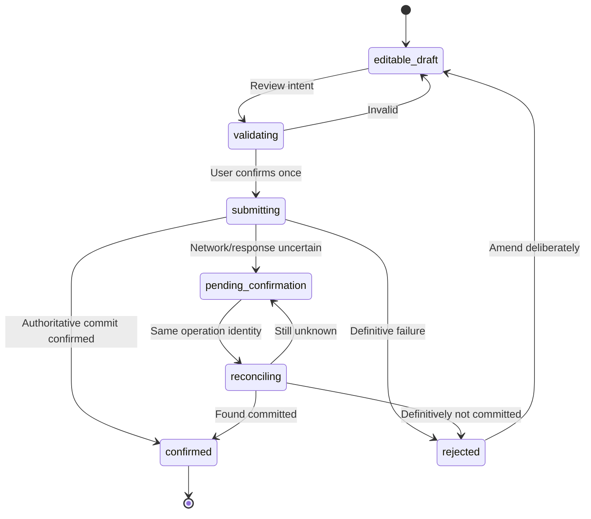

# Esokira — Transactions & Financial Accounts Specification

> **Path kanonis:** `docs/features/TRANSACTIONS.md`  
> **Versi:** `0.1.0`  
> **Tanggal:** 30 Oktober 2026  
> **Status dokumen:** `REVIEWED_INTERNAL — PENDING_OWNER_APPROVAL`  
> **Domain:** actual financial accounts, opening position, income, expense, internal transfers, corrections, reconciliation  
> **Target delivery:** `R1 / S-03` (setelah fondasi identitas dan database yang disyaratkan)  
> **Implementasi:** `UNVERIFIED`; **test aplikasi:** `NOT_RUN`  
> **Keputusan induk terkait:** `Q-02`, **`Q-03`**, **`Q-04`**, `Q-10`; berdampak pada `Q-11`  
> **Persyaratan:** `FR-001`, `FR-003`, `FR-004`, `FR-006`, `FR-021`; `NFR-001/002/003/005/006/007/010`; `DR-001/003/004/005/006/007/008/009/010/011/012/013/014/017/018/020/021/022/023`; `CS-001/003/004`

> **PERINGATAN IMPLEMENTASI:** File ini adalah *feature contract*, **bukan** persetujuan skema SQL, REST endpoint, teknologi library, format money JSON, atau kebijakan ledger. Bagian yang diberi label `PROPOSED`, `CANDIDATE`, `TBD`, atau `BLOCKED` tidak boleh diangkat menjadi aturan production tanpa keputusan tertulis pada [`DECISION-LOG.md`](../planning/DECISION-LOG.md). **Jangan menjalankan migrasi atau mem-post transaksi aktual** berdasarkan contoh dalam file ini sebelum gate yang relevan disetujui.

---

## 0. Cara membaca, sumber kebenaran, dan tingkat kepastian

Urutan pembacaan yang disarankan bagi AI coding agent untuk task `S-03`:

1. [`../../AGENTS.md`](../../AGENTS.md), lalu [`../../backend/AGENTS.md`](../../backend/AGENTS.md) atau [`../../frontend/AGENTS.md`](../../frontend/AGENTS.md) sesuai folder yang diubah.
2. [`PRD.md`](../product/PRD.md), khususnya `FR-001/003/004/005/006/021`; [`FEATURE-MATRIX.md`](../product/FEATURE-MATRIX.md) dan [`MASTER-ROADMAP.md`](../planning/MASTER-ROADMAP.md).
3. [`FINANCIAL-DOMAIN-RULES.md`](../financial/FINANCIAL-DOMAIN-RULES.md), terutama `DR-003`–`DR-010`, `DR-018`, `DR-022/023`.
4. [`CALCULATION-SPECS.md`](../financial/CALCULATION-SPECS.md), khususnya `CS-001/003/004`; [`FINANCIAL-TEST-CASES.md`](../financial/FINANCIAL-TEST-CASES.md), khususnya `FTC-ACT-*`.
5. [`DATABASE-DESIGN.md`](../architecture/DATABASE-DESIGN.md), [`API-GUIDELINES.md`](../architecture/API-GUIDELINES.md), [`BACKEND-ARCHITECTURE.md`](../architecture/BACKEND-ARCHITECTURE.md), dan [`SECURITY-PRIVACY.md`](../security/SECURITY-PRIVACY.md).
6. [`USER-FLOWS.md`](../design/USER-FLOWS.md), `UF-03`–`UF-06`; [`SCREEN-SPECS.md`](../design/SCREEN-SPECS.md), `SCR-04`–`SCR-06`, `SCR-22`; [`DESIGN-SYSTEM.md`](../design/DESIGN-SYSTEM.md).
7. [`TASKS.md`](../planning/TASKS.md), `TK-S03-01`–`TK-S03-08`; [`TESTING-STRATEGY.md`](../development/TESTING-STRATEGY.md), [`DEFINITION-OF-DONE.md`](../development/DEFINITION-OF-DONE.md), dan [`PROGRESS.md`](../planning/PROGRESS.md).

**Prioritas ketika ada konflik:** keputusan owner yang benar-benar tercatat dan requirement produk disetujui; domain/calculation invariants dan security; kontrak OpenAPI serta migration yang *benar-benar telah disahkan*; dokumen arsitektur/UX; terakhir ilustrasi dari dokumen ini. Jangan menafsirkan contoh kandidat sebagai overriding requirement. Bila sumber bertentangan, catat konflik dan hentikan **bagian yang terdampak**, tidak perlu menghentikan pekerjaan independen yang aman.

| Label | Makna operasional |
|---|---|
| `REQUIRED` | Invariant yang sudah dinyatakan wajib pada domain/keamanan, tetap harus dipenuhi oleh desain final. |
| `PROPOSED` | Usulan untuk dibahas/dipilih owner; tidak otomatis mengotorisasi implementasi production. |
| `CANDIDATE` | Bentuk teknis ilustratif yang dapat diganti saat keputusan dan kontrak resmi disahkan. |
| `BLOCKED` | Tidak boleh diputuskan/diaktifkan production tanpa approval, spesifikasi, serta pengujian sesuai gate. |
| `UNVERIFIED` | Belum ada inspeksi atau bukti implementasi dalam repository. Bukan sinonim `NOT_STARTED`. |
| `NOT_RUN` | Pengujian implementasi belum dieksekusi. Bukan sinonim `PASS`. |

Dokumen ini **tidak** mengubah `FR-*`, `DR-*`, `CS-*`, atau membuat nomor keputusan baru yang bersaing dengan register induk.

---

## 1. Tujuan produk, batas domain, dan non-goals

Esokira membantu pengguna mencatat **posisi uang yang benar-benar dimiliki** serta **peristiwa keuangan aktual** secara manual. Modul ini menjadi landasan dashboard aktual (`FR-006`), laporan periode, financial goals, dan snapshot data untuk simulasi masa depan. Kebenaran aktual berasal dari backend Go dan PostgreSQL setelah commit berhasil; Flutter adalah antarmuka, bukan sumber buku besar.

**In scope R1 / S-03:**

- Mengelola **financial accounts** milik principal terautentikasi dan saldo awal (*opening position*).
- Mencatat pemasukan dan pengeluaran aktual, dengan tanggal efektif, akun, dan kategori/notes bila telah disetujui.
- Memindahkan uang **antar akun sendiri** dengan posting atomik, tanpa mengubah pemasukan/pengeluaran eksternal.
- Menampilkan riwayat yang dapat ditelusuri serta koreksi/pembatalan sesuai kebijakan audit yang **belum final**.
- Memastikan owner isolation, uang presisi exact, idempotency, retry aman, konsistensi agregat, dan UX outcome belum pasti.
- Menyediakan data aktual yang dapat dihitung kembali untuk laporan saldo/financial position serta export setelah kontraknya tersedia.

**Out of scope sampai ada spesifikasi/approval tersendiri:**

- Integrasi bank, pembacaan rekening otomatis, payment gateway, debit bank nyata, transfer uang sungguhan, kartu, atau e-wallet provider.
- Split transaction, transfer lintas pemilik, FX/multi-currency conversion, reconciliation ke bank, bulk import, auto-categorization, atau scheduled auto-posting secara implisit.
- Budget dan recurring transactions (`FR-010`, R2), life events dan scenario (`FR-011`–`FR-016`, R2), optimasi/Monte Carlo (`R3`).
- Full double-entry chart of accounts **jika tidak disetujui**; event+movement bukan otomatis general ledger akuntansi.
- Menjadikan perpindahan ke goal atau planning draft sebagai transaksi aktual (`DR-011/012`).
- Penghapusan permanen catatan posted, audit, atau data pengguna tanpa kebijakan lifecycle/retensi `Q-03/Q-10`.

> `Account` dalam modul ini berarti **akun pencatatan keuangan**, bukan akun login pengguna dan bukan rekening bank yang dikendalikan Esokira. Tombol "Transfer" berarti **mencatat transfer yang telah terjadi di luar aplikasi**, bukan mengirim uang melalui Esokira.

---

## 2. Traceability: requirement, journey, dan delivery

| Kebutuhan | Realisasi konseptual | Gate / bukti minimum |
|---|---|---|
| `FR-001` | Trusted principal dan owner-scoped accounts/transactions | Cross-user isolation, token invalid, nested ownership tests. |
| `FR-003` | Account create/read/update, posisi awal, saldo dan arsip | Opening bukan income; cutover/as-of; schema/account owner review. |
| `FR-004` | Income, expense, transfer, correction lifecycle | Atomic posting, duplicate suppression, reversal audit, retry/unknown-outcome. |
| `FR-005/006` | Posisi aktual dan neraca kekayaan bersih | Tidak menduplikasi aset account; transfer netral tanpa fee. |
| `FR-021` | Export/delete khusus data pribadi | Ownership, retention, audit, dan backup policy saat tersedia. |
| `DR-004/005/006/007/008` | Presisi uang, opening, transfer, satu posting per intent | Exact numerical + integration + concurrency tests. |
| `DR-018/022/023` | As-of, koreksi, pemisahan posisi/arus | Golden cases dan historical report/regression tests. |
| `CS-001/003/004` | Money, saldo/transfer, net worth | `FTC-ACT-*`, `FTC-NW-*`; kalender dan rounding diputuskan. |
| `UF-03/04/05/06` | Pengguna membuka akun, mencatat, mentransfer, mengoreksi | Flow sukses, invalid, offline, conflict, timeout, akses tidak sah. |
| `SCR-04/05/06/22` | Account screens, transaksi, transfer, fallback | Widget, accessibility, locale, session-switch tests. |
| `S-03` | `TK-S03-01`–`TK-S03-08` | Semua task terkait melewati DoD, tidak cukup compile/UI. |

**Dependency:** `S-03` mengikuti trusted identity (`S-02`), baseline migration/contract (`S-01`) dan keputusan prioritas awal (`S-00`). `S-04` memakai posisi accounts yang valid untuk net worth, tetapi tidak mengubah definisi transaksi ketika aset/liability ditambahkan.

---

## 3. Istilah domain dan semantik

| Istilah | Definisi yang wajib dibedakan |
|---|---|
| `user / principal` | Identitas terverifikasi oleh backend untuk keputusan izin akses. |
| `financial account` | Wadah pencatatan posisi uang milik user; kategori display dan policy final TBD. |
| `opening balance / opening position` | Nilai posisi awal pada cutoff tertentu; **bukan** pemasukan periode. |
| `actual event` | Kejadian keuangan riil yang sudah dicatat sesuai lifecycle yang disahkan. |
| `account movement` | Dampak signed pada saldo satu financial account **jika model event+movements dipilih**. |
| `posted` | State yang dinyatakan final dan memengaruhi saldo aktual berdasarkan policy. |
| `draft/planned` | Intent/hipotesis yang tidak boleh memengaruhi saldo actual. |
| `income` | Arus masuk dari luar kumpulan account pribadi yang diakui sebagai income; bukan opening/transfer. |
| `expense` | Pengeluaran yang diakui sesuai klasifikasi ekonominya; tidak sama dengan semua debit account. |
| `internal transfer` | Pergeseran nilai antar financial account milik user sama, mata uang cocok, tanpa FX. |
| `correction/reversal` | Tindakan yang memperbaiki event posted dengan menjaga integritas dan jejak sesuai audit policy. |
| `effective date` / `occurred_on` | Tanggal ekonomi peristiwa; **berbeda** dari saat record disimpan (`recorded_at`). |
| `as_of` | Batas waktu/tanggal snapshot pelaporan atau saldo yang ditampilkan. |
| `idempotency identity` | Identitas **satu intent** untuk mendeteksi retry, tidak menyamakan dua transaksi yang nominalnya sama. |
| `pending_confirmation` | Outcome jaringan tidak pasti; server mungkin sudah commit, mungkin belum. |
| `source=actual` | Informasi dari posisi/posting riil, tidak boleh disamakan dengan `planned` atau `forecast`. |

**Pemisahan stock vs flow:** balance adalah **posisi pada as-of**; income/expense adalah **flow dalam periode**. Mengambil selisih balance sebagai income/expense tanpa mengklasifikasi event adalah bug domain. Perubahan net worth adalah konsep lain lagi (`DR-023`).

---

## 4. Aturan tidak boleh dilanggar (invariants)

| Kode lokal untuk pembacaan | Invariant dan anchor sumber |
|---|---|
| `INV-OWN` | Seluruh account, event, movement, agregat dan nested lookup milik trusted principal (`DR-003`, `FR-001`). |
| `INV-MONEY` | Actual amounts **exact**, mata uang/satuan terdefinisi, tidak ada source-of-truth float (`DR-004`, `CS-001`). |
| `INV-OPEN` | Opening adalah stock; tidak pernah dihitung lagi sebagai income (`DR-005`). |
| `INV-XFER` | Transfer same-currency tanpa fee/FX mengubah A `-x`, B `+x`, sum `0`, income/expense `0` (`DR-006`, `CS-003`). |
| `INV-ATOMIC` | Kedua sisi transfer serta audit/idempotency yang diperlukan commit/rollback bersama (`DR-007/022`). |
| `INV-ONCE` | Satu logical posting intent maksimal satu efek meskipun request dikirim ulang (`DR-008`). |
| `INV-STATUS` | Draft/forecast/planned tidak ikut official balances (`DR-001/012/013`). |
| `INV-TIME` | Effective/recorded/as-of tidak saling menggantikan tanpa aturan tanggal disetujui (`DR-018`). |
| `INV-AUDIT` | Koreksi posted tidak menghilangkan jejak dan tidak menyisakan saldo/riwayat inkonsisten (`DR-022`). |
| `INV-NW` | Account yang sudah counted tidak diduplikasi sebagai asset; net worth boleh negatif (`DR-009/010/023`). |
| `INV-TRUST` | Jumlah/status official hanya setelah backend confirmed commit; timeout ≠ failed ≠ successful (`DR-008`, `UF-31`). |
| `INV-PRIVATE` | Tidak ada token, amount, note, owner private data di log/telemetry umum (`DR-021`, `SEC-*`). |

### 4.1 Persamaan posisi (semantik, bukan SQL final)

```text
balance(account, as_of)
 = opening_position(account, opening_as_of)
 + SUM(eligible posted inflows after approved opening cutover up to as_of)
 - SUM(eligible posted outflows after approved opening cutover up to as_of)
 + SUM(approved adjustments in eligible interval)
```

Agar rumus dapat dieksekusi: tentukan tepat apakah `opening_as_of` inklusif/eksklusif, cara same-day ordering, backdated posting, reversal, timezone dan mata uang. Semua ini **`Q-03/Q-04`, `DB-Q03`, `CALC-Q09` = belum final**. Tanpa keputusan, rumus adalah invariant konseptual, **bukan** izin menerapkan filter `date > opening_date` sembarangan.

### 4.2 Persamaan internal transfer tanpa fee/FX

```text
A_after = A_before - x
B_after = B_before + x
A_after + B_after = A_before + B_before
external_income_delta  = 0
external_expense_delta = 0
net_worth_delta        = 0
```

Jika kelak fee `f` disetujui dan dibebankan ke A: `A_after = A_before - x - f`, `B_after = B_before + x`, `recognized_expense_delta = +f`, `net_worth_delta = -f`. Pencatatan fee dan linkage event **masih TBD**; jangan mengaktifkan fitur hanya karena contoh hitungannya tersedia.

---

## 5. Financial account: kepemilikan, metadata, dan lifecycle

### 5.1 Data konseptual yang perlu dipertimbangkan

| Atribut | Semantik | Kepastian |
|---|---|---|
| Stable account ID | Identifier untuk referensi, tidak berubah akibat rename | `REQUIRED` secara desain. |
| Owner/principal key | Ditentukan oleh server, bukan input body Flutter | `REQUIRED`. |
| Display name | Label privat; tidak dipakai untuk unique business identity | `PROPOSED`, validasi disahkan. |
| Account kind | Contoh: cash/bank/savings; tidak otomatis linked bank | `PROPOSED`, enum final TBD. |
| Currency | Currency yang sama dengan setiap amount terkait | `REQUIRED` semantic; allowed currencies TBD. |
| Opening position | Exact amount dengan cutover/as-of | `REQUIRED` untuk model yang menggunakan opening. |
| Archived status | Menahan posting baru sesuai policy tanpa menghapus history | `PROPOSED`, detail TBD. |
| Timestamps | Created/updated/recorded dengan timezone jelas | `REQUIRED` traceability; encoding TBD. |

Tampilan `bank` sebagai kategori akun **bukan** janji bank feed, open banking, atau kemampuan melakukan transfer bank nyata.

### 5.2 Operasi dan guard

- **Create:** authenticated; owner server-derived; nama/kategori/currency/amount/tanggal divalidasi; idempotency create direkomendasikan untuk menangani timeout; saldo awal tidak membuat income report.
- **Read/list:** semua query termasuk summary dan pagination terfilter owner; ID milik user B tidak boleh muncul di hasil, jumlah, search, atau metadata user A.
- **Update:** rename dan metadata dapat direncanakan; mengubah opening yang sudah memiliki posting perlu action koreksi yang **`BLOCKED Q-03`**. Jangan `PATCH opening_balance` generik tanpa audit/recompute.
- **Archive:** candidate untuk menolak posting baru sambil menyimpan historis; aturan akun bersaldo tidak nol, transfer historis, dan restore TBD.
- **Delete:** hapus user-level data melalui data lifecycle `FR-021/Q-10`, bukan SQL cascade otomatis pada akun yang memiliki posting.
- **Account switch / logout:** UI/cache harus menghapus atau memisahkan data by owner; stale response dari session A tidak boleh mengisi session B.

### 5.3 Kontrol kondisi khusus

- Saldo awal `0`, saldo negatif, overdraft, jenis akun utang/kredit dan ledger liability membutuhkan keputusan produk terpisah. Jangan menyatakan saldo negatif selalu valid ataupun selalu invalid.
- Aset investasi dan liability memiliki domain lain (`FR-005`); jangan mengonversi semua liabilities menjadi akun kas.
- Jika account diarsipkan, historical reporting *as-of* lama harus tetap dapat direkonstruksi sesuai policy.
- ID yang valid tetapi bukan milik user harus gagal dengan respons netral sesuai pilihan 403/404 `API-Q06`; jangan mengungkap nama/saldo account lain.

---

## 6. Opening balance dan cutoff (P0 financial correctness)

### 6.1 Alur pengguna

1. Pengguna memilih membuat akun finansial (`UF-03` / `SCR-04`).
2. Memilih kategori yang didukung, memberi nama dan currency berdasarkan policy.
3. Menetapkan **saldo posisi awal** dan tanggal *as-of/cutover* yang disetujui.
4. UI menampilkan keterangan: **“Saldo awal bukan pemasukan periode berjalan.”**
5. Pengguna meninjau angka exact dan konfirmasi.
6. Backend mengesahkan principal, memvalidasi input, menyimpan data menurut model terpilih, dan mengembalikan hasil resmi.
7. UI menampilkan saldo setelah confirmed response/reconciliation, bukan memutasi total sebagai asumsi.

### 6.2 Kesalahan penting yang harus dicegah

| Kesalahan | Akibat | Perlakuan yang disyaratkan |
|---|---|---|
| Membuat opening sebagai `income` | Laporan income dan cash flow overstated | Record opening sebagai posisi/source yang berbeda. |
| Mengagregasi transaksi sebelum cutoff tanpa aturan | Saldo double counting | Tahan sampai kebijakan cutover/backdated jelas. |
| Mengubah opening setelah posted history dengan overwrite | Saldo historis dan audit tidak dapat dijelaskan | Wajib flow koreksi yang disetujui. |
| Menganggap retry `POST account` menciptakan akun baru | Account ganda, total inflated | Idempotency/dedup creation policy dan recovery. |
| Menggunakan `DateTime.now` sebagai tanggal ekonomi untuk semua event | Laporan periode salah | Pisahkan effective date dengan record time. |

**Contoh angka (`FTC-ACT-01`, bersyarat cutoff yang benar):** opening Rp10.000.000, posted income Rp2.000.000 sesudahnya → closing Rp12.000.000; **income periode Rp2.000.000**. Ini contoh oracle *setelah* aturan tanggal dan unit disahkan, bukan contoh payload production.

### 6.3 Keputusan yang perlu dituntaskan

- `Q-03`/`FDR-Q01`: opening disimpan sebagai field posisi, event tersendiri, atau migration balance? Bagaimana opening correction?
- `DB-Q03`/`CALC-Q09`: cutoff inklusif/eksklusif, backdating, same-day ordering, timezone, overdraft.
- `Q-04`/`DB-Q02`/`API-Q03`: unit uang, serialisasi dan rounding; tidak boleh dianggap semua nominal dua digit desimal.
- `API-Q05`/`DB-Q04`: penanganan retry pembuatan akun dan outcome tak pasti.

---

## 7. Income dan expense: event classification

### 7.1 Field dan validasi konseptual

| Input | Aturan `REQUIRED` | Detail yang belum disahkan |
|---|---|---|
| `kind` | Income **atau** expense eksplisit; bukan infer dari sign | Enum API/DB final. |
| Account reference | Harus ada, eligible, dan owner sama | Archived/draft account policy. |
| Amount | Exact, currency jelas, tidak NaN/Infinity, sesuai approved range | `amount > 0` adalah `PROPOSED`; zero/negative adjustment policy TBD. |
| Effective date | Valid, tidak berubah diam-diam menjadi record timestamp | Timezone, backdating, future date. |
| Category | Tidak boleh mengubah klasifikasi transfer menjadi expense | Category hierarchy dan required/optional TBD. |
| Notes | Data privat, sanitasi dan pembatasan ukuran | Max length/normalization dan retention TBD. |
| Operation identity | Sama untuk retry intent yang sama | Format header/key, TTL, replay contract TBD. |
| Status | Hanya posted eligible mengubah posisi | Draft/posted/reversed model TBD. |

**Jangan** menghitung laporan pengeluaran dari seluruh movement negatif: debit karena transfer internal, pembelian aset, dan pembayaran pokok utang punya klasifikasi berbeda. Sebaliknya, income report harus berasal dari event yang diakui sebagai income, bukan setiap movement positif.

### 7.2 Posting satu income/expense

- Autentikasi dan verifikasi token/subject di backend.
- Validasi account ownership/nested references dan status eligibility.
- Validasi amount exact, currency, effective date, kategori semantik dan guard posting.
- Tangani idempotency dan concurrent intent pada satu batas transaksi database yang konsisten.
- Simpan event, movement/position effect, audit metadata minimal dan canonical result secara atomik menurut model terpilih.
- Sesudah commit, baca lagi official posting/result; jangan mengklaim sukses jika hanya sebagian langkah berhasil.
- Perubahan akibat posted event harus tercermin di account balance, history, period reports, dan freshness baseline pada tahap downstream (`DR-020`).

### 7.3 Kasus yang perlu tetap dibedakan

- Mengoreksi expense yang salah kategori **tidak** boleh menjadi transfer tersembunyi; jika koreksi mengubah account, amount, date, atau type, audit/period impact harus disetujui.
- Refund dari merchant dapat diklasifikasikan sebagai contra-expense atau event tersendiri **hanya setelah** policy final (`Q-03`). Jangan otomatis hitung sebagai income.
- Pembelian aset nonkas dan pelunasan pokok utang tidak boleh selalu dianggap expense konsumsi; lihat `DR-023` dan `FTC-NW-04/07`.
- Cash-out yang belum diklasifikasi harus memunculkan status/report semantics yang jujur, tidak otomatis dikategorikan.

---

## 8. Internal transfer: atomic posting dan conservation

### 8.1 Alur fungsional (UF-05)

1. Pilih dua akun **milik user yang sama** dan **berbeda** (`source != destination`).
2. Periksa currency yang kompatibel sesuai kebijakan R1; tidak ada FX otomatis.
3. Isi exact amount dan effective date; jelaskan bahwa ini **bukan income/expense**.
4. Tampilkan preview angka/kedua akun dan efeknya, gunakan angka dari backend jika preview semantik memerlukan aturan domain.
5. Konfirmasi satu logical intent dengan idempotency identity yang stabil.
6. Backend memvalidasi ulang semua syarat, kemudian mem-post kedua sisi dalam **satu transaksi PostgreSQL**.
7. Jika commit dipastikan sukses, tampilkan referensi event dan refresh balance kedua akun; jika hasil tidak diketahui, masuk `pending_confirmation`.

### 8.2 Guard dan out-of-scope

- Transfer dari/ke akun user lain **ditolak** tanpa data disclosure; tidak boleh dua request independen untuk debit dan kredit.
- Overdraft/insufficient-funds policy **TBD**. Jangan otomatis menolak karena balance turun di bawah nol jika ada jenis akun yang memang mengizinkan, dan jangan mengizinkan bila tidak disetujui.
- Fee, tax, FX, transfer lintas owner, split/multi-leg, self transfer, dan partial reversals **belum boleh** dicoba sebagai production behavior tanpa model khusus.
- Jika ada concurrent transfer, semua penulis harus menggunakan lock/isolation protocol yang konsisten agar saldo dan invariant tetap benar.
- Transfer hanya pencatatan perpindahan yang dilakukan di dunia nyata; **tidak** menginisiasi pembayaran melalui bank.

### 8.3 Atomicity contract

```mermaid
sequenceDiagram
    participant M as Flutter
    participant H as Go handler
    participant U as Authorized transfer use case
    participant D as PostgreSQL transaction
    M->>H: Submit one transfer intent + stable identity
    H->>U: Verified principal + validated request
    U->>D: BEGIN; detect idempotent replay
    U->>D: Lock affected owned accounts (deterministic order)
    U->>D: Validate balance/currency and posting policy
    U->>D: Write both effects + audit + idempotency result
    alt All writes valid
      U->>D: COMMIT
      U-->>H: Canonical posted result
      H-->>M: Confirmed success
    else Any write or validation fails
      U->>D: ROLLBACK
      H-->>M: Safe rejected or recoverable result
    end
```

**Test yang membuktikan perilaku:** `FTC-ACT-02/05/08/09/11`, `ST-020`–`ST-024`, dan transfer concurrency di `TESTING-STRATEGY.md`. Mermaid ini bukan bukti endpoint/DB function sudah diimplementasi.

---

## 9. Koreksi, void, reversal, dan audit trail

`FR-004` mengharuskan kemampuan mengubah atau membatalkan catatan, tetapi **mekanisme tepatnya `Q-03`, `FDR-Q02`, `DB-Q01/03` belum disetujui**. Modul tidak boleh memutuskan sendiri antara mutable posted rows, immutable posting + reversal, compensating event, atau state lain.

### 9.1 Prinsip apa pun model finalnya

- Koreksi tidak boleh menghilangkan jejak yang diperlukan audit dan tidak boleh mengubah saldo secara tak terlacak.
- Jika transfer dikoreksi/dibalik, dampak kedua akun harus diperlakukan sebagai satu unit atomik.
- Tindakan koreksi memiliki ownership, concurrency guard, dan semantik replay yang sama kuatnya dengan pencatatan awal.
- Status original, reference to correction, reason bila diperlukan, actor, dan effective/recorded dates harus dapat dijelaskan.
- Historical aggregates yang berubah harus dihitung ulang atau diberi versi sesuai aturan reporting yang disetujui.
- Koreksi yang mengubah actual revision harus membuat dependent simulations menjadi *stale* ketika R2/R3 tersedia (`DR-020`).

### 9.2 Candidate lifecycle untuk didiskusikan, **bukan state machine final**

```text
local_draft (not actual)  ->  submitting
                              |-- definitive rejection -> editable_draft
                              |-- confirmed commit     -> posted
                              |-- timeout/connection   -> pending_confirmation
posted -- approved domain action --> reversed / corrected-linked-event
```

**Larangan:** jangan menghapus posted movement dengan `DELETE` langsung hanya agar UI "hapus transaksi" terlihat bekerja. User-facing action sebaiknya menjelaskan dampak koreksi dan audit bila diputuskan. `FTC-ACT-12` tetap `BLOCKED` sampai model reversal disetujui.

---
## 10. Amount, currency, date, dan period reporting

### 10.1 Exact money contract

`Q-04`, `FDR-Q04/05`, `DB-Q02`, `API-Q03`, dan `CALC-Q01/02` harus diputuskan bersama. Hingga disetujui:

- Tidak ada **angka floating-point biner** sebagai sumber kebenaran saldo aktual di Go, PostgreSQL, atau Dart.
- Jangan menyimpan nominal dari UI yang sudah diformat (`Rp1.234,56`) sebagai string perhitungan; parsing dan formatting harus memisahkan locale dari nilai domain.
- Jangan memilih `NUMERIC(20,2)`, `BIGINT` rupiah, `DECIMAL`, integer minor unit, ataupun JSON decimal string sebagai kebijakan final hanya dari sebuah contoh.
- Penambahan atau pembandingan hanya dilakukan pada currency/unit yang sama. Perubahan currency memerlukan review data historis.
- Batas maksimum/minimum amount, currency availability, scale, rounding, overflow, dan handling zero/negative wajib didokumentasikan dan diuji di seluruh lapisan Flutter → HTTP → Go → DB → read-back Flutter.
- Rounding nilai tampilan berbeda dari rounding ledger; tampilan yang lebih pendek tidak boleh menimpa stored amount.

**Contoh parsing lokal (perilaku, bukan library):** pengguna memilih nominal 1.500.000 dalam tampilan IDR, backend menerima nilai exact sesuai wire contract yang disahkan. Nilai tidak boleh berubah menjadi 1.499.999,999 atau 1.500.000,01 karena `double` atau penyesuaian skala diam-diam.

### 10.2 Effective date, record time, dan as-of

| Waktu | Digunakan untuk | Tidak boleh diasumsikan |
|---|---|---|
| `occurred_on` / effective date | Periode ekonomi kejadian | Sama dengan saat record dibuat. |
| `recorded_at` / commit time | Trace urutan pencatatan/forensik | Menentukan income periode tanpa aturan. |
| `opening_as_of` | Posisi awal dan cutover | Otomatis mencakup semua event pada hari yang sama. |
| Reporting start/end | Rentang flow dan as-of posisi | Semua client memakai UTC day tanpa timezone policy. |
| Server revision/updated_at | Konsistensi snapshot dan stale marking | Setara dengan tanggal ekonomi. |

`DR-018`, `FDR-Q06`, `DB-Q03`, dan `CALC-Q03/09` menjadi gate untuk kasus lintas bulan/tahun, leap day, backdated event, future-dated entry, dan effective date vs timestamp penulisan. Laporan harus menyebut **periode** dan **as-of**. Jika data belum konsisten, tampilkan status incomplete/stale, bukan mengisi nol tersembunyi.

### 10.3 Policy klasifikasi per periode

- `income(period)` = total event yang **diakui** income, memiliki tanggal efektif dalam periode sesuai policy, dan berstatus eligible.
- `expense(period)` = total event yang **diakui** expense (ditambah fee jika sudah ada approved model), bukan semua outflow account.
- `internal_transfer(period)` = kategori tampilan terpisah; tidak dihitung ke income/expense.
- `net_external_flow(period)` = income dikurangi expense **yang telah diklasifikasi sesuai model**; bukan selalu `balance_end - balance_start` karena ada transfer antar kelas asset, asset purchase, loan principal, valuation, dan correction.

**R1 tetap IDR-first sebagai usulan produk**; jangan menyatakan multi-currency cash consolidation tersedia sebelum FX policy dan provenance disahkan.

---

## 11. Idempotency, retry, dan uncertain outcome

### 11.1 Identitas satu logical operation

**REQUIRED:** satu intent finansial yang sama tidak boleh menjadi dua posting (`DR-008`). Protokol teknis seperti `Idempotency-Key` direkomendasikan pada `API-GUIDELINES.md` §10, tetapi status, TTL, hashing dan return contract masih `API-Q05/DB-Q04`.

**Candidate protocol untuk direview:**

1. Flutter membuat satu opaque, unguessable operation identity saat pengguna *mengonfirmasi* satu intent.
2. Saat retry karena timeout atau gangguan, client mengirim **identity dan payload semantik yang sama**.
3. Go mengikat `(trusted_owner, operation_type, operation_identity)` pada fingerprint payload canonical.
4. Identity sama + payload sama dengan operasi committed → kembalikan hasil yang sama atau ekuivalen **tanpa posting kedua**.
5. Identity sama + payload berbeda → conflict netral (`409` hanya jika dipilih di OpenAPI), **tanpa mutasi**.
6. Jika original masih berjalan → hasil *processing/pending* sesuai policy; jangan mulai posting paralel kedua.
7. Status terminal dan referensi event didokumentasikan secara atomik dengan actual write; crashed response setelah commit bisa direkonsiliasi.
8. TTL, expiry, request canonicalization, key reuse, in-progress timeout, dan retention **TBD**.

**Penting:** dua transaksi yang kebetulan bernominal sama, pada tanggal yang sama, dapat benar-benar dua kejadian berbeda. De-duplication berdasarkan nominal+tanggal saja **tidak boleh** dijadikan aturan bisnis tanpa review.

### 11.2 Matriks outcome client

| Situasi | Interpretasi | UI/agent harus melakukan |
|---|---|---|
| Response resmi + committed reference | `confirmed` | Refresh authoritative account/transaction query. |
| Response definitif berupa validation/auth rejection | `rejected` | Tampilkan pesan aman, simpan draft yang tidak sensitif sesuai policy; tidak ada optimistic posting. |
| Timeout/connection drop setelah submit | `pending_confirmation` / unknown | Jangan klaim sukses/gagal; reconcile dengan identity awal bila kontraknya tersedia. |
| Duplicate tap saat in-flight | Tetap **satu intent** | Disable repeat-submit di UI **dan** server tetap melindungi idempotency. |
| Replay same identity, same payload setelah commit | Existing posted event | Tampilkan canonical result, tidak ada efek baru. |
| Replay same identity, different payload | Conflict | Tahan mutasi, jelaskan perubahan perlu intent baru setelah outcome lama jelas. |
| Response datang setelah logout/user switch | Tidak dapat dipercaya untuk session baru | Abaikan/discard; jangan masukkan data A ke cache B. |
| Result reconciliation API belum disetujui/tersedia | Recovery belum bisa dilakukan aman | **BLOCKED** untuk flow actual-write production yang memerlukannya. |

### 11.3 State diagram mutation yang aman



**Syarat Go/backend:** jika response hilang setelah COMMIT, retry dengan identity sama tidak boleh menulis ulang. Jika DB gagal sebelum commit, tidak ada efek account/ledger. Cancellation HTTP dari client tidak membuktikan bahwa database belum commit.

---

## 12. Model data: pilihan, bukan keputusan final

### 12.1 Tiga alternatif yang ada pada desain database

| Opsi | Ringkasan | Trade-off penting | Status |
|---|---|---|---|
| A — Typed transaction rows | Income/expense/transfer disimpan sebagai row bertipe | Ringkas, tetapi audit, fee, split, transfer/reversal dapat rumit | `CANDIDATE`, `DB-Q01`. |
| B — Financial event + account movements | Parent operation dengan efek per account | Memisahkan event dan position movement; perlu transaksi/constraint lintas row | `PROPOSED` kandidat utama, **belum disetujui**. |
| C — Full double-entry general ledger | Chart of accounts dan posting seimbang ke akun akuntansi | Audit kuat, model produk/UX lebih kompleks untuk MVP | `CANDIDATE`, tidak boleh diklaim otomatis. |

Jika memilih B, **jangan** menyebutnya full double-entry accounting tanpa chart of accounts akun lawan yang benar. Income/expense bisa berupa satu movement pada financial account dan karenanya bukan general ledger seimbang menurut akuntansi.

### 12.2 Candidate logical entities (jika B disetujui)

```text
users / identity_mapping [owned principal]
  |
  +-- accounts [id, owner_id, kind, currency, opening_position, opening_as_of, archived_at]
  |
  +-- financial_events [id, owner_id, operation_id, kind, occurred_on,
  |                      recorded_at, status, reverses_event_id?]
  |       |
  |       +-- account_movements [id, event_id, account_id, owner_id,
  |                              line_no, signed_exact_delta, currency]
  |
  +-- idempotency_records [owner_id, operation_type, key, request_digest,
                            status, response_reference, expiry?]
```

**Keterangan:** nama field, tabel, jenis data, FK, indeks, nullable, sequence, TTL dan status di atas **hanya ilustrasi**. Source detail ada pada [`DATABASE-DESIGN.md`](../architecture/DATABASE-DESIGN.md) §§7–9. SQL illustratif di sana juga **bukan migrasi production**.

### 12.3 Invariant persistence dan constraints yang harus dievaluasi

- `account.owner == event.owner == movement.owner` diverifikasi oleh backend dan, bila memungkinkan, diperkuat melalui FK komposit/constraints sesuai desain approved.
- Unique logical operation identity per owner+operation menurut idempotency contract.
- No orphan movement; no silent cascade delete posted history.
- Unique event line sequence jika event+movement dipilih; currency movement sama dengan account/event.
- Event status eligible saja masuk official balance.
- Transfer no-fee same-currency memiliki dua efek dengan total net movement nol. PostgreSQL row-level `CHECK` **tidak dapat** menjamin kondisi lintas-row; perlu transaction/service validation dan mungkin deferred trigger yang ditinjau.
- Audit/event/replay result tidak boleh commit terpisah yang meninggalkan mutasi tanpa status idempotency.
- Indeks harus membantu owner filtering, `(account_id, occurred_on)` report, event reference/history, dan idempotency lookup; desain final perlu `EXPLAIN` serta benchmark sintetis, bukan asal indeks semua kolom.
- Table constraints, authenticated principal mapping dan keputusan Row-Level Security (`DB-Q10`) harus mematuhi permission/connection pooling yang dipilih; RLS bukan alasan menghapus checks pada aplikasi.

### 12.4 Snapshot atau derived balance

**PROPOSED:** opening + eligible posted movements adalah data dasar saldo; derived/materialized account balance hanya optimasi yang dapat direkonsiliasi dan direkonstruksi. Jika produk memilih stored balance sebagai desain lain, keputusan tersebut wajib membuktikan race safety, audit dan correctness sebelum disebut final. Jangan menghitung dari cache Flutter sebagai official total.

### 12.5 Migrasi dan rollback

- Tool runner, PostgreSQL version, driver, query generator **TBD `DB-Q13/BE-Q08`**; jangan memaksa `goose`, `golang-migrate`, `sqlc`, atau `pgx` sebelum approval.
- Migrasi versioned diuji pada database PostgreSQL disposable dari nol, termasuk FK, money precision, owner indexes, unique idempotency, dan rollback sesuai policy.
- Hindari destructive migration dan `ON DELETE CASCADE` universal yang merusak audit/history.
- Tidak boleh membuat tabel production dari contoh skema yang diberi label PROPOSED tanpa review desain.

---

## 13. Backend Go: batas modul dan unit of work

### 13.1 Alur layering (konseptual)

```text
HTTP handler (parse, auth boundary, safe errors)
  -> authenticated application use case
       -> exact money / account / transfer validation
       -> transactional repository unit-of-work
            -> PostgreSQL account/event/movement/idempotency
       -> safe canonical result
  -> API response (contract OpenAPI yang disetujui)
```

- Handler **tidak** boleh menyisipkan posting SQL dari request body tanpa service invariant.
- Business rules kritis tetap ada dalam Go use case/domain dan/atau DB constraints yang ditinjau, tidak hanya form Flutter.
- Repository interface dan naming menyesuaikan arsitektur backend yang disahkan; tidak perlu memaksakan package baru jika repo punya pola sah yang sudah digunakan.
- HTTP request context cancellation, DB tx cancellation, dan retry tidak otomatis menyatakan commit gagal; lihat unknown-outcome.
- Semua write harus memerlukan verified principal dan scoped repository access; `owner_id` tidak boleh diambil dari JSON mutasi pengguna.

### 13.2 Pseudocode contoh operasi transfer — **NOT EXECUTABLE**

```text
function postInternalTransfer(ctx, verifiedPrincipal, intent):
    assertApprovedMoneyCurrencyDateContracts()
    assertValidatedAndOwnedDistinctAccounts(intent, verifiedPrincipal)

    begin PostgreSQL transaction
        previous = reserveOrGetIdempotency(
            verifiedPrincipal, 'internal_transfer', intent.identity, intent.digest)
        if previous is final:
            return previous canonical response WITHOUT new posting
        if previous is conflicting or processing:
            return approved safe conflict/pending response WITHOUT new posting

        lock involved accounts in approved deterministic order
        re-check owner, currency, active status, balance/overdraft policy
        insert event and BOTH position effects as one atomic operation
        persist required audit and idempotency result in same consistency boundary
    commit
    return canonical confirmed result

on any failure before committed outcome:
    roll back, return sanitized error
on uncertain commit/connection outcome:
    reconcile original operation identity (never invent second transfer)
```

Pseudocode sengaja tidak memilih isolation level, driver, database table names, error codes, atau `idempotency` response lifecycle karena semuanya membutuhkan review. Semua writer yang memengaruhi posisi harus berbagi concurrency protocol; lock deterministik tidak cukup jika ada codepath lain yang menulis tanpa lock. Jika `SERIALIZABLE` dipilih, retry untuk `serialization_failure` harus terbatas dan tetap memakai identity operasi yang sama.

### 13.3 Error taxonomy konseptual

| Kelas | Contoh | Penanganan |
|---|---|---|
| `VALIDATION` | Amount/date/currency tidak valid | Form field error, tidak posting. |
| `UNAUTHORIZED` / `FORBIDDEN_OR_NOT_FOUND` | Token invalid / account foreign | Stop, error netral; tidak bocorkan metadata user lain. |
| `CONFLICT` | Reuse identity berbeda payload, stale version | Stop, refresh/resolve, no silent overwrite. |
| `NOT_ALLOWED` | Account archived, self-transfer, overdraft policy | Jelaskan pembatasan yang boleh diungkap; no mutation. |
| `UNKNOWN_OUTCOME` | Network timeout setelah submit | Pending confirmation + safe reconciliation. |
| `TEMPORARY_FAILURE` | DB connection issue | Retry terbatas **hanya** sesuai contract dan idempotency. |
| `INTERNAL` | Invariant DB/service violated | Fail closed, sanitized response, correlation ID non-sensitive; alert operasional. |

HTTP status, error envelope dan machine-readable codes **mengikuti `API-Q04`/OpenAPI resmi**, bukan tabel ini.

---

## 14. REST API coverage (candidate only)

Belum ada bukti file `contracts/openapi.yaml` resmi telah disetujui ataupun endpoint production sudah tersedia. Katalog di bawah **hanya merujuk** daftar kandidat yang sudah ada pada `API-GUIDELINES.md`, tidak menambahkan endpoint final.

| Capability | Contoh route kandidat existing | Required behavior |
|---|---|---|
| Account listing/create | `GET/POST /api/v1/accounts` | Owner scoped, opening as stock, exact money. |
| Account detail/metadata update | `GET/PATCH /api/v1/accounts/{accountId}` | Nested ownership dan guarded mutability. |
| Income/expense listing/posting | `GET/POST /api/v1/transactions` | Event classification, owner and idempotency. |
| Transaction detail | `GET /api/v1/transactions/{transactionId}` | No foreign record access, audit policy. |
| Internal transfer | `POST /api/v1/transfers` | Atomic, same-owner, no fee/FX by default; production BLOCKED. |
| Actual financial position | `GET /api/v1/financial-position` | `source=actual`, as-of, nonduplicated balances. |

**Penting:** koreksi/reversal dan status polling/reconciliation **belum memiliki endpoint yang disahkan**. Jangan mengarang `/status`, `/reverse`, atau `DELETE` dan mengklaim sudah production. Apabila API ingin menyatukan transaksi dan transfer dalam satu resource, dokumentasikan alternatif serta perbarui OpenAPI/decision/UX bersama-sama.

### 14.1 Kontrak yang harus disahkan sebelum mengimplementasi API

- Resource naming, operation IDs, URL base, serialization (`API-Q01/02`).
- Exact money wire encoding, currency dan rounding metadata (`API-Q03`).
- Error envelope serta 401/403/404 semantics (`API-Q04/06`).
- Operation identity, request hash, replay/timeout recovery, TTL (`API-Q05`).
- Pagination, `as_of`, effective date filters dan ordering (`API-Q07`).
- Version/conflict guard untuk account metadata/correction jika berlaku (`API-Q08`).
- Contract diff dan consumer test dengan Flutter; sensitive data minimization.

### 14.2 Ownership matrix untuk seluruh permukaan

| Permukaan | Perlindungan minimum |
|---|---|
| List accounts | Query `WHERE owner = trusted principal` pada setiap path. |
| Account detail/update | Validate account belongs to verified principal, including archived state. |
| Create income/expense | Validate target account owner **inside** write consistency boundary. |
| Transfer | Validate **both** source and destination owner, including if one ID refers to a valid foreign account. |
| Transaction detail/correction | Validate event owner dan related accounts; no leaked existence. |
| Aggregated report | Hanya account/events yang eligible untuk user dan tanggal. |
| Export/delete | Periksa owner sebelum query job, generate file, download, dan purge sesuai retention. |
| Logs/errors | Jangan bocorkan body, token, notes, amounts dan account balances. |

---

## 15. Flutter UI contract dan state ownership

### 15.1 Mapping layar

| Screen ID | User-facing feature | Wajib tampil jelas |
|---|---|---|
| `SCR-04` | Daftar akun, saldo awal, account detail | Currency, as-of, empty/archived, opening bukan income. |
| `SCR-05` | Riwayat dan form income/expense serta correction | Jenis transaksi, effective date, amount exact, posting state. |
| `SCR-06` | Transfer antar akun dan review | Akun asal/tujuan, transfer bukan income/expense, pending recovery. |
| `SCR-03` | Financial dashboard | Ringkasan actual, periode/as-of dan net-worth reconciliation. |
| `SCR-22` | Unavailable/private/offline fallback | Tanpa klaim sukses atau saldo palsu, opsi pemulihan aman. |

Detail komponen, visual hierarchy, copy, design tokens, dan accessibility mengikuti `SCREEN-SPECS.md`, `USER-FLOWS.md`, dan `DESIGN-SYSTEM.md`—bukan ditetapkan ulang di sini.

### 15.2 Tiga state yang tidak boleh disamakan

1. **Local draft:** data form belum dikirim atau hasil commit belum ada; tidak boleh mengubah saldo resmi.
2. **Pending/unknown:** sudah submit, belum ada hasil server yang pasti; jangan perlihatkan sukses atau gagal palsu.
3. **Confirmed posted:** server sudah mengonfirmasi record; refresh melalui repository untuk saldo/history final.

Client-side double-tap protection penting untuk UX, **tetapi bukan pengganti backend idempotency**. Optimistic *balance* hanya boleh dilakukan jika design contract eksplisit mendefinisikan bagaimana menandai provisional dan memastikan tidak disajikan sebagai authoritative; pilihan default aman adalah **tidak** menaikkan/menurunkan saldo official sampai server mengonfirmasi.

### 15.3 Input money dan informasi privasi

- Parse input localized secara ketat; simpan di domain/application layer sebagai exact representation yang telah disahkan, tidak `double` raw sebagai nilai actual.
- Bedakan `Rp 0` dari `belum ada data` dan `belum dapat dihitung`; field required tidak boleh diisi asumsi diam-diam.
- Form menyebut apakah tindakan hanya mencatat event eksternal, bukan benar-benar memindahkan uang antar bank.
- Pastikan text scaling, screen readers, target interaksi, negative value, panjang angka, dan pengumuman state `pending_confirmation` bekerja.
- Jangan menyimpan access token dalam penyimpanan biasa atau mencatat nominal/note privat dalam analytics/crash reporter.
- Cache dan request invalidated ketika owner session berubah; late response dari akun sebelumnya wajib dibuang.

### 15.4 Tindakan UI saat terjadi timeout

**Copy kandidat untuk review UX:**

> "Status transaksi belum dapat dipastikan. Kami akan memeriksa catatan sebelumnya sebelum mencoba lagi agar transaksi tidak tercatat dua kali."

Ini contoh copy, **bukan** klaim bahwa mekanisme reconciliation server sudah tersedia. Bila server belum mempunyai kontrak pemulihan, tombol `Coba lagi` yang memunculkan intent baru tidak boleh ditampilkan pada posting aktual.

---

## 16. Laporan aktual, net worth, dan dampak downstream

### 16.1 Read model yang harus konsisten

| Output | Sumber informasi | Aturan |
|---|---|---|
| Account balance | Opening + eligible posted effects | Rekonstruktibel untuk as-of yang disetujui. |
| Income period | Recognized income events | Exclude opening dan transfers. |
| Expense period | Recognized expense events | Exclude principal transfers dan utang pokok. |
| Transaction history | Event sumber, bukan sekadar saldo berubah | Detail type, effective date, status, audit policy. |
| Total assets | Eligible account values + other nonduplicated assets | No double count (`DR-009`). |
| Net worth | Total nonduplicated assets minus outstanding liabilities | Boleh negatif (`DR-010`). |
| Scenario baseline | Actual snapshot/version yang dilabeli | Later simulations tidak pernah menulis ke actual. |

### 16.2 Event classification vs real economic effect

| Kegiatan | Account cash | Income report | Expense report | Net-worth effect tanpa faktor lain |
|---|---|---|---|---|
| Gaji masuk | Bertambah | Bertambah | Tidak | Naik. |
| Belanja konsumsi | Berkurang | Tidak | Bertambah | Turun. |
| Transfer A ke B sendiri | A turun, B naik | Tidak | Tidak | Tetap jika no fee/FX. |
| Transfer dengan fee (future approved model) | Bersih turun sebesar fee | Tidak | Fee | Turun sebesar fee. |
| Pembelian aset nonkas bernilai setara | Cash turun, asset lain naik | Tidak | Bukan konsumsi pokok | Tetap, fee terpisah. |
| Bayar pokok pinjaman | Cash turun, utang turun | Tidak | Bukan pokok expense | Tetap, bunga/biaya terpisah. |
| Planned recurring / life event | Tidak ada actual posting | Tidak | Tidak | Tidak berubah. |

**Sumber rujukan:** `DR-006/009/010/011/012/013/023`, `CS-003/004`, `FTC-ACT-*`, `FTC-NW-*`. Kebijakan pencatatan pembelian aset, utang dan fee yang lebih kompleks tidak boleh diimplementasikan hanya berdasarkan tabel semantik ini.

### 16.3 Revisions, stale scenarios, dan goal funding

- Sesudah posted event aktual berubah, dashboard/list/report perlu invalidation/refresh dan snapshot downstream yang terkait dapat menjadi *stale* ketika R2 tersedia (`DR-020`).
- Data aktual yang dipakai snapshot adalah versi/as-of konsisten, tidak boleh berubah selama hasil simulasi ditafsirkan sebagai snapshot yang sama.
- Goal plan contributions tidak otomatis funded (`Q-11/DR-011`); transaksi antar akun tidak boleh otomatis menambah jumlah "tabungan goal" tanpa model atribusi yang disetujui.
- Jika nilai aset bergantung pada harga manual lama, tampilkan tanggal valuasi dan kelengkapan; jangan menutupinya dengan angka total yang tampak real time.

---

## 17. Security, privacy, dan data lifecycle

| Risiko | Kontrol minimum | Bukti uji |
|---|---|---|
| Akses lintas owner | Verified subject, owner scoped SQL, nested authorization | Foreign account ID/list/detail/aggregate reject (`FTC-ACT-11`, `ST-*` access cases). |
| Forged `owner_id` | Abaikan owner yang dikirim client; derive principal server-side | Tidak ada perubahan owner/movement ketika spoofed payload. |
| Replay/double posting | Idempotency + atomic DB consistency | `FTC-ACT-09`, `ST-020/021/023`. |
| Partial transfer | Single PostgreSQL transaction | `FTC-ACT-08`, `ST-022`. |
| Concurrency race | Lock/isolation/version policy pada semua write paths | `ST-024`, Pg concurrency integration. |
| Token/financial data di logs | Sanitized logs, safe error envelope, privacy-safe correlation | `ST-029/030`, logs redaction review. |
| Device/session switch | Secure local token storage, scoped cache, late-response discard | `ST-033/035`, Flutter tests. |
| Destructive delete tanpa policy | Data lifecycle `FR-021`, owner confirmation dan retention review | Export/delete flow tests, `Q-10`. |

**Audit logging ≠ finance ledger:** log observability biasa tidak boleh berisi amounts, token, notes atau full transaction bodies. Jika audit finansial perlu retained records yang sensitif, lokasi, akses, enkripsi dan retention harus disetujui. Request bodies, SQL bind values, traces, crash reports dan app analytics harus ditinjau semuanya.

**Regulasi:** Esokira adalah perencana/pencatat keuangan, bukan platform bank yang menyelenggarakan transfer dana. Peninjauan legal, privacy notice, tujuan pemrosesan dan retensi masih membutuhkan approval `Q-10`; file ini bukan pendapat hukum.

---

## 18. Reliability, offline, performance, dan observability

- **Offline tanpa approved sync:** hanya simpan draft lokal non-authoritative jika kebijakan privasi dan storage mendukung. Jangan mengantre actual transfer untuk auto-replay ketika online sebagai operation baru tanpa desain dedup yang disahkan.
- **Server-authoritative read-after-write:** confirmed mutation diikuti refresh account dan history; jika read backend tertunda, tampilkan status sinkronisasi yang jujur.
- **Pagination/filtering:** period, account, sort, cursor, as-of harus ditetapkan di `API-Q07` agar hasil konsisten lintas layar/perangkat.
- **Performa:** pengukuran query owner-scoped, tanggal effective, history pagination dan account summary; kapasitas, benchmark, p95 dan rate limits mengikuti `NFR-004`, `DB-Q12`, `API-Q12`.
- **Observability:** safe request/correlation IDs, operation type, sanitized result category, latency dan SQL error class. Jangan log saldo, note, amount, token, full owner metadata atau idempotency secret mentah.
- **DB failure:** PostgreSQL commit/rollback adalah boundary. `5xx` setelah commit tidak membuktikan gagal; client reconcile; operator dapat melihat safe event references melalui tooling internal yang diotorisasi.
- **Degraded mode:** jika actual query tidak tersedia, tampilkan unavailable/last verified as-of jika disetujui, jangan mengarang angka kosong sebagai balance 0.

---
## 19. Test strategy, golden oracle, dan defect classes

Dokumen ini menguraikan *acceptance* tambahan, tetapi **angka oracle tetap di** [`FINANCIAL-TEST-CASES.md`](../financial/FINANCIAL-TEST-CASES.md) dan aturan eksekusi ada di [`TESTING-STRATEGY.md`](../development/TESTING-STRATEGY.md). Gunakan fixture sintetis, PostgreSQL sungguhan yang disposable untuk integrasi, dan hasil test yang direkam, bukan hanya mock.

### 19.1 Reference numeric cases `FTC-ACT-01`–`FTC-ACT-12`

| Reference | Setup/aksi ringkas | Expected domain assertion | Gate |
|---|---|---|---|
| `FTC-ACT-01` | Opening A Rp10 juta + eligible posted income Rp2 juta | A Rp12 juta; **income Rp2 juta** | `CONDITIONAL` cutoff policy. |
| `FTC-ACT-02` | A Rp5 juta, B Rp2 juta; transfer Rp1 juta, no fee | A Rp4 juta, B Rp3 juta, total Rp7 juta, income/expense=0 | `DOMAIN-INVARIANT`. |
| `FTC-ACT-03` | Kasus `02` dengan fee Rp10 ribu dari A | A Rp3,99 juta, B Rp3 juta, total Rp6,99 juta, fee expense Rp10 ribu | `CONDITIONAL` fee model. |
| `FTC-ACT-04` | Opening Rp2 juta, income Rp800 ribu, expense Rp300 ribu | Closing Rp2,5 juta, external flow Rp500 ribu | `CONDITIONAL` eligibility. |
| `FTC-ACT-05` | Transfer A→B Rp100 ribu, lalu B→A Rp100 ribu | Kedua saldo kembali; report external flow=0 | `DOMAIN-INVARIANT`. |
| `FTC-ACT-06` | Planned expense Rp200 ribu belum diposting | **Tidak** ada perubahan actual balance/expense | `DOMAIN-INVARIANT`. |
| `FTC-ACT-07` | SQL rollback pada transaksi yang belum commit | Posisi aktual tetap seperti sebelum request | `INTEGRATION-SPEC`. |
| `FTC-ACT-08` | Salah satu sisi transfer gagal saat SQL transaction | **Kedua** akun tetap; tidak ada partial commit | `INTEGRATION-SPEC`. |
| `FTC-ACT-09` | Same operation identity dikirim dua kali | Maksimal satu logical posting; replay response konsisten | `INTEGRATION-SPEC`; key policy TBD. |
| `FTC-ACT-10` | `occurred_on` berbeda dengan `recorded_at` | Report mengikuti approved date basis, bukan otomatis insert timestamp | `BLOCKED` date policy. |
| `FTC-ACT-11` | Transfer ke account milik owner lain | Rejected, no balance mutation, no private disclosure | `INTEGRATION-SPEC`. |
| `FTC-ACT-12` | Reverse/void posted transaction | Saldo dan audit konsisten | `BLOCKED` reversal policy. |

**Catatan:** angka adalah contoh IDR sesuai oracle existing, **bukan** keputusan fixed DB scale atau aturan mata uang yang baru. Jangan mengubah expected values ketika agent gagal menjalankan test; inspeksi penyebab atau ajukan perubahan oracle melalui review.

### 19.2 Cross-layer test matrix minimum

| Test suite | Contoh kasus | Tingkat & bukti |
|---|---|---|
| `MoneyValidation` | Separator locale, precision, min/max, overflow, unsupported currency, negative amount | Go unit + Flutter form tests + API contract, setelah representation approved. |
| `OpeningCutover` | Same-day posting, backdated, edit opening, as-of batas awal | PostgreSQL integration + golden; **conditional** Q-03/Q-04. |
| `TransactionPosting` | Income/expense positif, no partial writes, canonical receipt | Pg integration, status/response contract tests. |
| `TransferConservation` | `A+B` konstan untuk no-fee; income/expense tidak berubah | Golden `FTC-ACT-02/05`, property tests. |
| `AtomicRollback` | Failpoint sebelum second movement atau audit write | Real Pg integration, no persisted half-posting. |
| `IdempotencyReplay` | Identitas sama+payload sama; identity sama+payload lain | Pg concurrent integration, safe canonical/conflict result (`ST-020/021`). |
| `LostResponseRecovery` | Commit berhasil, HTTP response di-drop | UI pending, replay/reconcile identity sama, count posting=1 (`ST-023`). |
| `ConcurrentTransfers` | Dua/lebih transfer bersaing account sama, opposite direction | Real Pg isolation/deadlock tests (`ST-024`), no overposting. |
| `OwnerIsolation` | Account A dari user B, nested event ID valid, aggregate export | Authz/API/PG tests, deny with neutral response (`FTC-ACT-11`). |
| `CorrectionAudit` | Reversal, edit, double reverse, period restatement | Pg integration dan audit verification, **BLOCKED** model. |
| `ReportingSeparation` | Transfer tidak menjadi expense, loan principal tidak menjadi income, opening excluded | Unit + API/Golang + golden `FTC-ACT/FTC-NW`. |
| `FlutterState` | Double tap, offline, unknown, expired token, refresh after commit | Widget + Flutter–Go integration, `SCR-04/05/06/22`. |
| `Privacy` | Logs/error bodies/cache after session switch | Security `ST-*` including `ST-029/030/033/035`. |
| `Migration` | Empty DB apply, constraints, reopen, rollback as supported | Disposable PostgreSQL, versioned schema test. |
| `Downstream` | Net worth and scenario stale after actual change | R1 dashboard and R2 integration when feature exists. |

### 19.3 Property-based assertions (dalam domain yang disetujui)

1. Untuk transfer no-fee same-currency dengan amount exact `x` valid, `delta_A + delta_B == 0`.
2. Pada daftar accounts owned yang sama, total nilai sebelum/sesudah permutasi transfer internal tetap sama **jika semua accounts termasuk kelompok asset yang sama dan tidak ada fee/FX**.
3. Dua operation identity yang **berbeda** dan valid, walaupun payload kebetulan sama, tidak otomatis dianggap duplikat.
4. Replay satu identity yang sama tidak menambah jumlah posted events setelah commit pertama.
5. Semua partial failures sebelum commit meninggalkan saldo persis seperti sebelum operasi.
6. Query user A tidak mungkin memuat account, event, atau account movement milik user B.
7. Peristiwa belum posted/planned tidak mengubah reported actual income, expense, atau balance.
8. Merekonstruksi saldo dari source postings dan, bila ada, derived snapshot harus menghasilkan nilai exact sama menurut cutover.

**Kondisi penting:** jangan mengasumsikan saldo selalu `>=0` atau amount selalu punya dua digit desimal sebelum policy terkait diputuskan. Property test tanpa precondition jelas bisa menghasilkan false positive/negative yang berbahaya.

### 19.4 Test fixture ilustratif (bukan SQL atau API contract)

```text
Owner U1:
  Account A: IDR, opening 5_000_000
  Account B: IDR, opening 2_000_000
  Account C: IDR, opening 0
Owner U2:
  Account X: IDR, opening 7_000_000

T1 = U1 transfer A -> B, amount 1_000_000, no fee
Expected: A=4_000_000, B=3_000_000, U1 owned total=7_000_000
Expected: U2 Account X unchanged, U1 income=0, U1 expense=0

T2 = replay T1 SAME logical identity and SAME payload
Expected: No new posted transfer; account totals unchanged.

T3 = submit T1 identity with DIFFERENT payload (amount 500_000)
Expected: Conflict; no new postings; no leaked details.

T4 = U1 attempts transfer A -> X (foreign owner)
Expected: Rejected; U1/U2 account totals unchanged.

T5 = U1 valid NEW intent with same nominal/date as T1
Expected: Separate real-world operation if all approved rules allow.
```

Fixture ini **tidak** memutuskan negative balance, initial-cutover inclusion, atau operation identity TTL. Tambahkan policy-specific tests setelah keputusan.

### 19.5 Evidence yang harus benar-benar ada

Untuk setiap task yang mengubah actual posting, catat: versi commit, migration version, PostgreSQL test environment, command yang dijalankan, jumlah PASS/FAIL/SKIPPED/NOT_RUN, test failure details non-sensitive, contract diff, screenshot/widget verification jika menyentuh UI, dan review keamanan. **Mock-only test tidak cukup untuk membuktikan atomicity atau concurrency PostgreSQL.**

---

## 20. Implementation slicing: mapping `TK-S03-*`

Dilarang mengimplementasikan seluruh S-03 sebagai satu giant change tanpa gate. Urutan di bawah mengikuti [`TASKS.md`](../planning/TASKS.md); bila repository aktual memperlihatkan pekerjaan sudah ada, audit dahulu dan perbarui status berbasis bukti, bukan otomatis membuat ulang.

| Backlog task | Perubahan yang diharapkan | Prerequisites / no-go | Bukti minimum |
|---|---|---|---|
| `TK-S03-01` | Approved account & posting schema serta migration | `TK-S02-06`, `TK-S01-05`, `TK-S00-04/05`; `Q-03/Q-04`, `DB-Q01/02/03` | DB schema, owner FKs, migration logs, opening no-income tests. |
| `TK-S03-02` | Owner-scoped account CRUD & opening API | `TK-S03-01`, `TK-S02-02`; approved OpenAPI | Cross-user tests, exact amount roundtrip, API contract. |
| `TK-S03-03` | Income/expense posted use case + DB transaction | `TK-S03-01/02`; Q-03/Q-04 policy | Rollback/posting and amount/date tests. |
| `TK-S03-04` | Internal transfer, idempotency, uncertain recovery | `TK-S03-03`; `API-Q05/DB-Q04` | `FTC-ACT-02/05/08/09/11`; `ST-020`–`ST-024`. |
| `TK-S03-05` | Correction/reversal based on approved lifecycle | `TK-S03-03/04`, `FDR-Q02/DB-Q01/03` | Reversal, audit, conflict and history tests. |
| `TK-S03-06` | Flutter accounts/opening UI | `TK-S03-02`, `TK-S01-04`; approved response/currency | `SCR-04` widget, owner/session, as-of validation. |
| `TK-S03-07` | Flutter income/expense/transfer + pending UX | `TK-S03-03/04/05/06`; approved recovery | `SCR-05/06/22` widget and API integration. |
| `TK-S03-08` | Full regression S-03 | `TK-S03-04/05/07`, test oracle approved | Pg concurrency/rollback, cross-user, exact read model, defect evidence. |

**Pekerjaan yang boleh dilakukan sebelum financial posting approval:** dokumentasi keputusan, threat modeling, flow diagrams, test fixtures/golden oracles yang jelas diberi status conditional, API shape proposals, backend interface POC terisolasi, Flutter presentation skeleton tanpa fake success, dan disposable experiments. **Tidak boleh** mengaktifkan actual write production tanpa persetujuan skema, money, auth dan idempotency yang saling konsisten.

### 20.1 Tugas integrasi lintas-slice

- `S-01`: implement identity mapping, DB tooling dan contract validation dulu sesuai gate.
- `S-02`: aktifkan onboarding/verified identity sebelum actual account mutation.
- `S-04`: dashboard net-worth mengonsumsi account balance canonical dan tidak menduplikasi asset value.
- `S-05`: funded goal attribution (`Q-11`) tidak boleh menggunakan planned contributions sebagai actual balances.
- `S-07`–`S-12`: scenario/projection/Monte Carlo adalah consumers yang **tidak** boleh menulis ke actual transactions.

---

## 21. Definition of Ready dan Definition of Done

### 21.1 Definition of Ready (sebelum production implementation)

- [ ] Repo aktual diperiksa: folder, kode, schema, tests, contracts, branch status dan existing feature; task belum diberi asumsi `NOT_STARTED` tanpa audit.
- [ ] Tujuan dan acceptance `FR-003/004` serta anchor `DR/CS/FTC` dipilih untuk satu perubahan terukur.
- [ ] `Q-02/Q-03/Q-04` dan subkeputusan khusus task telah disetujui dengan bukti pada `DECISION-LOG.md`.
- [ ] Model account/ledger/cutover dan correction/overdraft/fee policy **relevan** telah disahkan untuk jenis operasi yang dibangun.
- [ ] Unit uang, rounding, currency, serialisasi, date/time/as-of dan error policy sama pada Go/Flutter/PostgreSQL.
- [ ] Kontrak OpenAPI resmi tersedia untuk operasi yang akan diimplementasikan; tidak membuat endpoint berdasarkan ilustrasi saja.
- [ ] Ownership/permission model, idempotency/unknown-outcome recovery, dan migration policy telah direview.
- [ ] Test oracle dan disposable PostgreSQL test environment tersedia; reviewer tahu apa yang bisa dibuktikan dan apa yang belum.
- [ ] Scope task tidak mencampur R2/R3 features atau live bank transfers.

Jika sebagian syarat belum terpenuhi, status task terdampak `BLOCKED`, dengan sebab dan keputusan yang perlu diminta. Jangan gunakan checklist sebagai alasan menyatakan semua task yang independen ikut terblokir.

### 21.2 Definition of Done (implementation, bukan file ini)

- [ ] Actual code diff terbatas pada scope yang telah disetujui dan mengikuti `AGENTS.md` root + folder, termasuk code review.
- [ ] Domain/financial invariants yang relevan terbukti dengan tests yang sesuai, bukan screenshot atau mock saja.
- [ ] Endpoints dan Flutter client sesuai OpenAPI **yang benar-benar disahkan**; tidak ada hidden data mapping.
- [ ] Ownership, cross-user authorization, idempotency, concurrency, rollback, privacy logging dan safe-error paths diuji.
- [ ] Migrasi aman pada PostgreSQL disposable, constraints/intended indexes dievaluasi, tidak ada data migration yang merusak audit tanpa review.
- [ ] UI menampilkan actual/period/as-of yang benar, pending/rejected/confirmed dan login-switch yang aman; accessible.
- [ ] Penyesuaian net worth/aggregates dan stale-version handling untuk dependensi yang sudah ada diverifikasi.
- [ ] Regression suite dijalankan dengan bukti PASS; FAIL/NOT_RUN/SKIPPED/BLOCKED dilaporkan jujur, tidak disamarkan.
- [ ] Tidak ada token/amount/notes/private payload di log/crash/telemetry; tidak ada secret dalam docs atau test fixture.
- [ ] `TASKS.md`, `PROGRESS.md`, decision register, migration manifest dan relevant docs/ADRs diperbarui berdasarkan perubahan nyata.
- [ ] Handoff mencatat commit/files changed, test commands+results, blocker, next task dan penilaian DoD, tanpa klaim fitur sudah live.

**Penting:** `DONE` untuk modul **tidak** boleh diberikan bila `TK-S03-05` correction belum dibuat tetapi UI punya tombol "edit/hapus" palsu, atau `TK-S03-04` hanya lulus unit test tanpa PostgreSQL rollback/concurrency evidence. Item dapat `PARTIAL`/`BLOCKED` sesuai kebijakan workflow; quality bar tidak dilonggarkan.

---

## 22. Decision checkpoints dan owner approval queue

Tabel ini **mengutip** ID keputusan existing. Ia tidak menyetujui atau mengubah status apa pun; register induk adalah [`DECISION-LOG.md`](../planning/DECISION-LOG.md), dan rincian pilihan teknis berada pada dokumen sumber. Jika owner menyetujui pilihan, update decision log, sumber domain/schema/OpenAPI/test, dan review dampak **bersama**, bukan hanya mengganti label di sini.

| Decision ID(s) | Pertanyaan yang harus dijawab | First affected capability | Konsekuensi jika belum final |
|---|---|---|---|
| `Q-02`, `DB-Q06`, `API-Q06` | Identity provider, server-verified principal, auth mapping, 403/404 | Semua resource privat | Live auth/write `BLOCKED`. |
| `Q-03`, `DB-Q01`, `FDR-Q01/02` | Ledger option, posted/draft, correction/reversal/audit | Schema posting dan correction | Production posting model `BLOCKED`. |
| `Q-03`, `DB-Q03`, `FDR-Q01/03`, `CALC-Q09` | Opening cutoff, backdating, overdraft, fee/refund | Opening/balance/transfer | Saldo final historis dan mutasi terkait `BLOCKED`. |
| `Q-04`, `DB-Q02`, `FDR-Q04/05`, `CALC-Q01/02`, `API-Q03` | Money unit, scale, amount sign, overflow, rounding, wire encoding | Semua monetary DTO/schema | Cannot finalize numerical storage/API. |
| `Q-04`, `FDR-Q06`, `CALC-Q03`, `API-Q07` | Timezone, date, period boundaries, as-of | Reports dan opening interval | Historical/income aggregation `BLOCKED`. |
| `DB-Q04`, `API-Q05`, `BE-Q07` | Idempotency lifecycle, TTL, fingerprint, replay/status recovery | Income/expense/transfer writes | Reliable production mutations `BLOCKED`. |
| `API-Q01/02/04/15` | REST/OpenAPI version, encoding, safe error and contract tests | Flutter–Go boundary | Contract implementation not final. |
| `DB-Q10`, `SEC-Q*` | Owner-isolation depth, optional RLS, backend security enforcement | Private storage/read | Security review required. |
| `DB-Q13`, `BE-Q08` | PostgreSQL version, migration and query tooling | S-01/S-03 DB | Migration approach not final. |
| `Q-10`, `DB-Q11`, `API-Q11` | Export, deletion, backup, audit retention | `FR-021`, production readiness | Claim of complete lifecycle `BLOCKED`. |
| `Q-11`, `DB-Q05`, `FDR-Q07` | Funding attribution goal vs cash accounts | S-05 goal progress | Goal-funded percentage `BLOCKED`. |
| `DB-Q14` | Asset classification/valuation, duplicated account balance | S-04 net worth | Full NW consolidation `BLOCKED`. |

`SEC-Q*` di sini berarti pertanyaan security yang relevan, bukan satu keputusan baru atau jaminan seluruh `SEC-Q01`–`SEC-Q21` harus dituntaskan sebelum membuat komponen UI yang mandiri. Gunakan *first affected slice* untuk memilih keputusan yang benar-benar perlu disetujui sekarang.

### 22.1 Template singkat permintaan keputusan

```text
Decision ID (existing):
Related parent decision (Q-xx):
Affected task and files:
Required invariant (DR/CS/SEC):
Alternatives compared:
Risk if guessed (finance/security/data migration):
Recommended option [PROPOSED only]:
Owner/reviewer:
Approval evidence and date:
Docs, schema, contract, and test vectors to update:
```

Tidak boleh menyatakan `APPROVED` hanya karena assistant menulis rekomendasi atau pengguna berkata "lanjut buat dokumen".

---

## 23. Contoh end-to-end acceptance scenario (narasi)

**Scenario A — Pengguna pertama kali mencatat uang tunai**

- **Given:** user sudah login melalui principal yang diverifikasi, belum punya financial account.
- **When:** user membuka `SCR-04`, membuat account bernama "Kas Harian" dengan opening amount dan tanggal yang valid sesuai policy.
- **Then:** backend menyimpan account owned dan opening position; `income(period)` tidak berubah karena opening; response menampilkan as-of/source; UI memperbarui daftar setelah confirmed. **Pengecualian:** tanggal cutover/representasi uang perlu persetujuan sebelum test menjadi final.

**Scenario B — Pencatatan gaji dan belanja**

- **Given:** account saldo awal Rp2.000.000 dan posted eligibility sesuai policy.
- **When:** income Rp800.000 dan expense Rp300.000 dicatat sebagai dua intent berbeda.
- **Then:** saldo Rp2.500.000, income Rp800.000, expense Rp300.000, external net flow Rp500.000 (`FTC-ACT-04`); history punya dua event berbeda, bukan satu delta ambiguous.

**Scenario C — Perpindahan uang antar akun**

- **Given:** A Rp5.000.000 dan B Rp2.000.000 milik principal sama.
- **When:** pengguna mencatat transfer Rp1.000.000 dari A ke B tanpa fee/FX.
- **Then:** A Rp4.000.000; B Rp3.000.000; total Rp7.000.000; income/expense nol; dua sisi atomik (`FTC-ACT-02`).

**Scenario D — Respons hilang sesudah server commit**

- **Given:** intent transfer punya operation identity `K` yang stabil dan contract replay sudah disahkan.
- **When:** server COMMIT, tetapi jaringan terputus sebelum Flutter menerima response.
- **Then:** UI `pending_confirmation`, reconcile/retry **K yang sama**, result dinyatakan existing posted jika sudah commit, **tanpa** mem-post kedua kalinya (`FTC-ACT-09`, `ST-023`).

**Scenario E — Transfer ke akun asing**

- **Given:** pengguna A memasukkan ID akun B valid tetapi milik pengguna lain.
- **When:** permintaan transfer dikirim.
- **Then:** server menolak secara aman tanpa mengungkap nama/saldo pemilik B; tidak ada mutasi kedua pihak (`FTC-ACT-11`).

**Scenario F — Koreksi histori / reversal**

- **Given:** sudah ada posted transfer atau expense yang harus dibetulkan.
- **When:** pengguna memilih koreksi atau pembatalan.
- **Then:** hasil mengikuti **approval `Q-03`**: jejak audit, kedua sisi transfer, period report dan idempotency konsisten. **Saat ini skenario ini adalah `BLOCKED` untuk penentuan teknik final** (`FTC-ACT-12`).

---

## 24. Anti-patterns: hal yang harus ditolak reviewer

1. Menjadikan `opening_balance` sebagai event income lalu menghitungnya lagi dalam laporan.
2. Menampilkan net-worth naik karena internal transfer A→B tanpa fee/FX.
3. Menyimpan jumlah actual sebagai Go `float64` / Dart `double` / JSON number dengan pembulatan tak terkontrol.
4. Menaruh `owner_id` dari request body sebagai penentu akses backend.
5. Memisahkan transfer debit/kredit menjadi dua HTTP call atau dua independent SQL commits.
6. Menggunakan `SELECT balance` lalu update di luar lock/transaction ketika concurrent posting dapat terjadi.
7. Mengandalkan `CHECK (delta <> 0)` sebagai bukti transfer sudah balanced lintas row.
8. Membuat idempotency key baru untuk retry transfer yang outcome awalnya belum diketahui.
9. Menganggap timeout otomatis berarti rollback atau sukses.
10. Menangani koreksi posted dengan hard-delete tanpa audit dan reversal policy.
11. Menggabungkan tanggal `recorded_at` dan `occurred_on` tanpa cutover/period rules.
12. Menghitung income/expense dari perubahan saldo mentah, termasuk transfer, aset dan pokok utang.
13. Menyimpan seluruh JSON request/financial note/token pada logs/telemetry.
14. Menganggap sample SQL/JSON dari `DATABASE-DESIGN.md` atau `API-GUIDELINES.md` sebagai kontrak production.
15. Meluluskan atomicity/concurrency hanya dari fake repository unit test tanpa PostgreSQL sungguhan.
16. Menganggap perubahan goal atau life event otomatis membuat real transaction.
17. Mengklaim bank transfer, bank synchronization, atau investasi riil sudah didukung karena ada screen "Transfer".
18. Mengklaim S-03 `DONE` sebelum recovery timeout, cross-user tests, dan correction policy yang berlaku terbukti.

---

## 25. Dokumentasi perubahan, evidence, dan handoff

### 25.1 Contract change protocol

Jika sebuah keputusan menyebabkan perubahan terhadap ledger, API, unit uang atau date semantics:

1. Catat keputusan pada [`DECISION-LOG.md`](../planning/DECISION-LOG.md) dengan approver, alasan, alternatif dan tanggal.
2. Perbarui invariant dan perhitungan yang terdampak di `FINANCIAL-DOMAIN-RULES.md` serta `CALCULATION-SPECS.md` **tanpa melemahkan safety constraints**.
3. Perbarui desain schema dan reviewed migrations pada `DATABASE-DESIGN.md` dan kode nyata jika sudah ada.
4. Perbarui approved `contracts/openapi.yaml` **jika file itu benar-benar ada dan statusnya final**, lalu API/client test contracts.
5. Perbarui `USER-FLOWS.md`, `SCREEN-SPECS.md`, dan fitur ini jika semantics pengguna berubah.
6. Ubah test vectors sesuai keputusan dengan approval dan catat mengapa oracle berubah; jangan edit expected value untuk menutupi bug.
7. Kaitkan task `TASKS.md`, status yang didukung bukti di `PROGRESS.md`, serta hasil build/test nyata.
8. Jalankan regression yang relevan sebelum DoD, catat skipped/blocked dengan alasan.

### 25.2 Template ringkas handoff setelah satu task

```text
Esokira Task Handoff
Task ID / Slice / Release:
Status: UNVERIFIED | IN_PROGRESS | BLOCKED | PARTIAL | DONE (sesuai workflow)
Git commit / branch (jika ada):
Actual files changed:
Approved decisions used (ID + link/evidence):
Financial/security invariants touched:
Contracts / migrations revised:
Tests actually run (exact command, environment, result):
Tests NOT_RUN / SKIPPED / FAIL / BLOCKED and why:
Database rollback/idempotency/concurrency evidence:
Cross-user/Flutter error-state evidence:
Known risks, blockers, and recovery plan:
Proposed next task:
```

**Jangan melaporkan `DONE` hanya karena file spesifikasi ini dibuat**. Status dokumen dan status implementasi adalah dua hal terpisah.

---

## 26. Status internal review dan agenda berikutnya

### 26.1 Yang telah ditetapkan oleh dokumen sumber

- Produk menggunakan Flutter/Dart, backend Go, PostgreSQL, monorepo sebagai pilihan dasar teknologi.
- R1 mencakup account/opening dan income/expense/transfer manual, dengan owner isolation, exact money, atomicity, anti-double-posting, dan pemisahan actual/planned.
- `DR-005`–`DR-008`, `CS-003`, `FTC-ACT-*` menjelaskan perilaku finansial dan oracle yang harus dipenuhi.
- UI `SCR-04/05/06` memerlukan status yang jujur termasuk hasil operasi yang belum dapat dipastikan.

### 26.2 Yang belum ditetapkan secara final

- Model ledger, transaction lifecycle, correction, opening cutoff, overdraft/fees.
- Exact storage unit, rounding, API wire encoding, date/period policy.
- Identity provider dan mapping principal yang dapat dipakai production.
- Idempotency reservation/replay/TTL, safe outcome reconciliation API.
- Final SQL migrations, OpenAPI endpoints/operation IDs, migration runner dan DB isolation/locking details.
- Data export/deletion and retention/backup policy, goal funded attribution, asset consolidation.

**Kesimpulan readiness:** spesifikasi ini **siap untuk review dan penajaman keputusan**, bukan izin mengaktifkan actual financial posting di production. Prioritaskan audit repository nyata dan `TK-S00-04/05` sebelum `TK-S03-01` jika approval finansial belum tersedia.

### 26.3 Checklist QA dokumen (bukan hasil eksekusi kode)

- [x] `FR-003/004/006`, `DR-003`–`DR-010`, `DR-018/022/023`, `CS-001/003/004` ditelusuri.
- [x] `UF-03`–`UF-06`, `SCR-04`–`SCR-06`, `SCR-22` dan `TK-S03-01`–`08` dipetakan.
- [x] `FTC-ACT-01`–`12` serta security cases `ST-020`–`ST-024` dipetakan.
- [x] `Q-02/03/04/10/11` dan local decision blockers dirujuk tanpa auto-approval.
- [x] R2/R3, bank integration, dan payment execution dikecualikan dari scope aktual R1.
- [ ] Review/approval formal oleh owner dan reviewer domain/security/DB: **belum tercatat**.
- [ ] Inspeksi repository aktual: **belum dilakukan**.
- [ ] Pengujian Flutter, Go, PostgreSQL, OpenAPI: **NOT_RUN**.

---

## Appendix A — Rangkuman jalur keputusan dan bukti

| Sebelum… | Putuskan / buktikan… |
|---|---|
| Mengunci schema account | `Q-03/Q-04`, `DB-Q01/02/03`, `DB-Q13`, owner schema. |
| Mengaktifkan `POST` actual events | Trusted principal (`Q-02`), posting model, exact money, idempotency, audit, failure recovery. |
| Mengaktifkan transfer | Both-owner check, SQL atomic unit, concurrency policy, no-fee conservation, replay. |
| Mengaktifkan correction | `FDR-Q02`, reversal/audit, historical period and replay model. |
| Menyatakan S-03 `DONE` | All accepted task gates, PostgreSQL integration evidence, Flutter state tests, cross-user checks, and DoD. |
| Membangun dashboard S-04 | Exact account position read model dan nonduplicated asset/liability classification. |
| Menghubungkan goals S-05 | Real funding attribution `Q-11`, bukan planned contributions sebagai cash. |
| Menghubungkan scenario R2 | Immutable/versioned baseline and stale semantics; never mutate actual. |

## Appendix B — Sumber dokumentasi dan aturan maintenance

**Produk:** [`PRD.md`](../product/PRD.md), [`FEATURE-MATRIX.md`](../product/FEATURE-MATRIX.md).  
**Domain:** [`FINANCIAL-DOMAIN-RULES.md`](../financial/FINANCIAL-DOMAIN-RULES.md), [`CALCULATION-SPECS.md`](../financial/CALCULATION-SPECS.md), [`FINANCIAL-TEST-CASES.md`](../financial/FINANCIAL-TEST-CASES.md).  
**Arsitektur:** [`SYSTEM-ARCHITECTURE.md`](../architecture/SYSTEM-ARCHITECTURE.md), [`BACKEND-ARCHITECTURE.md`](../architecture/BACKEND-ARCHITECTURE.md), [`DATABASE-DESIGN.md`](../architecture/DATABASE-DESIGN.md), [`API-GUIDELINES.md`](../architecture/API-GUIDELINES.md).  
**Desain:** [`USER-FLOWS.md`](../design/USER-FLOWS.md), [`SCREEN-SPECS.md`](../design/SCREEN-SPECS.md), [`DESIGN-SYSTEM.md`](../design/DESIGN-SYSTEM.md).  
**Keamanan:** [`SECURITY-PRIVACY.md`](../security/SECURITY-PRIVACY.md).  
**Agent/workflow:** [`../../AGENTS.md`](../../AGENTS.md), [`TASKS.md`](../planning/TASKS.md), [`PROGRESS.md`](../planning/PROGRESS.md), [`DECISION-LOG.md`](../planning/DECISION-LOG.md), [`DEFINITION-OF-DONE.md`](../development/DEFINITION-OF-DONE.md).  
**Indeks:** [`docs/INDEX.md`](../INDEX.md).

**Dokumen lanjutan (rencana, belum dibuat saat v0.1.0):** `docs/features/FINANCIAL-GOALS.md`, `docs/features/LIFE-PLANNING.md`, `docs/features/SIMULATIONS.md`, `docs/financial/SCENARIO-ENGINE.md`, `docs/financial/MONTE-CARLO.md`, `docs/financial/GOAL-OPTIMIZER.md`, dan `docs/operations/DEPLOYMENT.md`. Jangan buat tautan langsung yang menyiratkan file-file itu sudah tersedia.

> **Status akhir:** `REVIEWED_INTERNAL — PENDING_OWNER_APPROVAL`. Spek ini menjelaskan perilaku yang harus benar dan keputusan yang belum final; ia **tidak** membuktikan bahwa kode sudah ada, migrasi sudah dijalankan, atau transaksi pernah diposting.
