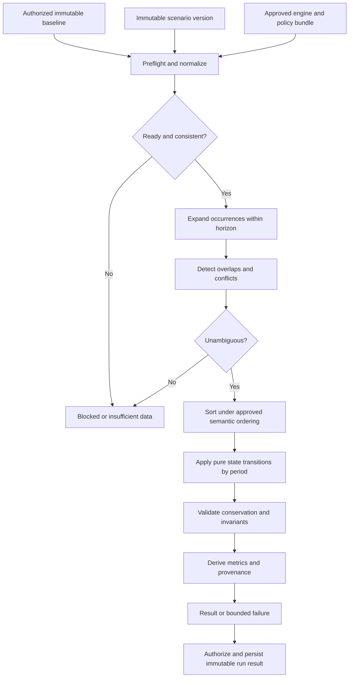

# Esokira — Scenario Engine Specification

**Dokumen:** Deterministic Financial Scenario Engine — kontrak model, aljabar state, event processing, snapshot, replay, dan verifikasi  
**Path kanonis:** `docs/financial/SCENARIO-ENGINE.md`  
**Versi dokumen:** `0.1.0`  
**Tanggal draft:** `2026-10-30`  
**Status dokumen:** `REVIEWED_INTERNAL — PENDING_OWNER_APPROVAL`  
**Status implementasi:** `SPECIFICATION ONLY — UNVERIFIED; R2 production implementation BLOCKED until applicable decisions and independent test oracles are approved`  
**Owner keputusan:** Product Owner / reviewer yang ditunjuk; *belum ada persetujuan implementasi final yang dicatat dalam dokumen sumber*  
**Cakupan:** R2 `S-07`–`S-09` / `FR-010`–`FR-016`; R3 hanya batas integrasi, bukan rancangan statistik atau optimizer.  
**Hubungan:** spesifikasi perilaku UI di [`SIMULATIONS.md`](../features/SIMULATIONS.md); dokumen ini mendefinisikan semantik dan interface perhitungan **di Go**, bukan endpoint yang sudah final.

> **Perintah awal untuk AI coding agent:** Jangan menafsirkan pseudocode, contoh angka, payload, event order, tipe internal, dan tabel usulan sebagai izin langsung membuat migration/API production. Baca aturan di `../../AGENTS.md`, lalu cek keputusan `Q-04`, `Q-05`, `Q-06`, `Q-11`, beserta `CALC-Q*`, `SIM-Q*`, `LP-Q*` dan status pada [Decision Log](../planning/DECISION-LOG.md). Bila hasil numerik berubah menurut pilihan yang masih `TBD`, hentikan *affected slice* sebagai `BLOCKED`; demonstrasi dengan input eksplisit tetap boleh dirancang sebagai **fixture referensi bersyarat**, bukan hasil production. Menjalankan simulasi **tidak pernah** mem-post transaksi aktual.

---

## 0. Tujuan, otoritas, dan batas dokumen

### 0.1 Masalah yang diselesaikan

Engine deterministik menjawab pertanyaan *what if* dengan menghitung perubahan posisi finansial dari snapshot yang teridentifikasi dan asumsi hipotetis yang eksplisit. Misalnya: pendapatan berkurang selama lima bulan, membeli aset pada tanggal tertentu, memindahkan dana kas ke investasi, atau menyusun rencana kontribusi goal. Output harus dapat ditelusuri dari keadaan awal melalui setiap efek hingga keadaan akhir, **tanpa mengubah actual accounts**.

Kontrak inti:

1. **Exact and classified:** setiap nilai uang punya satuan, kategori, tanda, dan pemisahan aset, utang, income, expense, serta transfer yang benar.
2. **Deterministic and reproducible:** baseline snapshot + scenario version + model/policy + engine yang sama menghasilkan hasil ekuivalen menurut kebijakan presisi yang disetujui.
3. **Safe and honest:** input hilang, konflik, horizon, timing, atau model tidak didukung menghasilkan status keterbatasan; tidak ada angka atau keputusan yang diada-adakan.
4. **Isolated:** engine merupakan komputasi murni. Database dan API hanyalah orchestration; tidak ada *side effect* ke ledger aktual.
5. **Versioned:** hasil lama tidak berubah diam-diam; perubahan actual memunculkan *stale indication* atau rebase eksplisit sesuai kebijakan.
6. **Testable:** setiap invariant mempunyai oracle independen, golden reference, property test, dan bukti eksekusi.

### 0.2 Hierarki sumber kebenaran

Saat dokumen berbeda:

1. Keputusan eksplisit pemilik proyek yang **disetujui dan tercatat** dalam Decision Log / ADR yang berlaku.
2. Requirement yang disetujui pada PRD dan prinsip wajib dalam Financial Domain Rules.
3. Kontrak matematis di Calculation Specs dan golden reference yang statusnya cocok dengan model yang dipilih.
4. Dokumen ini untuk implementasi engine, `LIFE-PLANNING.md` untuk input peristiwa, dan `SIMULATIONS.md` untuk pengalaman pengguna.
5. Contoh API, SQL, pseudocode, dan usulan teknis **tidak** menjadi final hanya karena ditulis secara detail.

Saat konflik tidak bisa diselesaikan tanpa memilih kebijakan, laporkan `BLOCKED`, sumber yang bertentangan, pengaruh ke output/test, dan pilihan yang memerlukan owner approval. **Jangan memakai rekomendasi model sebagai keputusan diam-diam.**

### 0.3 Yang sengaja tidak dicakup

- Final OpenAPI routes, response codes, fields, Go package names, tabel DB, worker vendor, atau dependency third-party.
- Autoposting recurring transaction, pemindahan saldo goal, rekening bank nyata, pembayaran, trading, dan action finansial otonom.
- *Optimization objective*, Monte Carlo, RNG/distributions, probabilitas berhasil, percentile, retirement/FIRE policy, atau Financial GPS sebagai rekomendasi yang sudah jadi.
- Model FX/multi-currency otomatis, return pasar real-time, penilaian properti aktual, pajak hukum, suku bunga bank nyata, dan kebijakan kredit dunia nyata.
- Threshold kas, kalender, rounding, inflasi, compounding timing, atau amortization sebagai default produksi sebelum approved.

**Dokumen berstatus reviewed** berarti review naskah internal, bukan otorisasi kode atau hasil test yang telah dijalankan.

## 1. Peta referensi lintas dokumen

| Kebutuhan | Referensi kanonis | Alasan |
|---|---|---|
| Scope, release, FR | [PRD](../product/PRD.md), [Feature Matrix](../product/FEATURE-MATRIX.md) | `FR-010`–`FR-016`, non-goals, R2 gates. |
| Aturan yang tidak boleh dilanggar | [Financial Domain Rules](FINANCIAL-DOMAIN-RULES.md) | `DR-001`–`DR-024`, konservasi uang, actual/forecast. |
| Rumus dan *model candidates* | [Calculation Specs](CALCULATION-SPECS.md) | `CS-008`–`CS-012`, `CS-016`; ketidakpastian policy. |
| Oracle numerik independen | [Financial Test Cases](FINANCIAL-TEST-CASES.md) | `FTC-CASH-*`, `FTC-LOAN-*`, `FTC-BUD-*`, `FTC-STRESS-*`, `FTC-SCEN-*`. |
| Input life events & no-double-count | [Life Planning](../features/LIFE-PLANNING.md) | `LP-Q01`–`LP-Q16`, contoh pembelian rumah. |
| Goal dan dana yang tersedia | [Financial Goals](../features/FINANCIAL-GOALS.md) | Funding `Q-11`; planned vs actual. |
| Actual ledger | [Transactions](../features/TRANSACTIONS.md) | Account/source revision dan financial events tidak boleh ditulis oleh scenario. |
| Product UX simulasi | [Simulations](../features/SIMULATIONS.md) | `SIM-I01`–`SIM-I20`, `SIMT-*`, `SCR-14..17`. |
| Backend/engine boundary | [Backend Architecture](../architecture/BACKEND-ARCHITECTURE.md), [System Architecture](../architecture/SYSTEM-ARCHITECTURE.md) | Pure Go engine, orchestration, authz. |
| SQL, baselines, results | [Database Design](../architecture/DATABASE-DESIGN.md) | Entitas hanya kandidat; tidak menulis migration final. |
| API error, idempotency | [API Guidelines](../architecture/API-GUIDELINES.md) | Contract-first; payload contoh bukan OpenAPI. |
| Security & privacy | [Security & Privacy](../security/SECURITY-PRIVACY.md) | Owner scope, secrets, sensitive fields, retention. |
| User journeys & screens | [User Flows](../design/USER-FLOWS.md), [Screen Specs](../design/SCREEN-SPECS.md) | UI tidak menjadi financial authority. |
| Delivery & evidence | [Tasks](../planning/TASKS.md), [Master Roadmap](../planning/MASTER-ROADMAP.md), [Progress](../planning/PROGRESS.md) | R2 masih `EP-*`, bukan task production yang siap. |
| Decisions & sign-off | [Decision Log](../planning/DECISION-LOG.md), [Definition of Done](../development/DEFINITION-OF-DONE.md), [Testing Strategy](../development/TESTING-STRATEGY.md) | Blocking approvals dan bukti DONE. |
| Agent instructions | [Root](../../AGENTS.md), [Backend](../../backend/AGENTS.md), [Frontend](../../frontend/AGENTS.md) | Tanggung jawab subtree yang relevan. |
| Pusat navigasi | [Documentation Index](../INDEX.md) | Lokasi file kanonis / draft. |

File `MONTE-CARLO.md` dan `GOAL-OPTIMIZER.md` **masih direncanakan pada tanggal draft ini**. Jangan berpura-pura kedua spesifikasi itu sudah siap/approved.

## 2. Release allocation dan capability ownership

| Slice | Requirement | Kapabilitas engine | Exit proof minimum | Status saat draft |
|---|---|---|---|---|
| `S-07` | `FR-010` | Normalisasi budget/recurring sebagai *planned inputs* yang tidak diposting | Occurrence dedup dan actual/plan isolation | `BLOCKED` pada aturan period/occurrence |
| `S-07` | `FR-011` | Typed hypothetical life-event effects | Event tidak mengubah account/asset/debt aktual | `BLOCKED` pada event taxonomy/timing |
| `S-08` | `FR-012` | Projection state transition deterministik | `FTC-CASH-*`, `FTC-LOAN-*` yang relevan; replay | `BLOCKED` pada policy model |
| `S-08` | `FR-013` | Versioned run, snapshot, comparison contract | `FTC-SCEN-01..08`, stale/rebase tests | `BLOCKED` pada `Q-06` |
| `S-08` | `FR-014` | Cash-flow/shortfall series | Cash != external flow, negative cash visible | `BLOCKED` pada threshold/policy |
| `S-09` | `FR-015` | Parameterized deterministic shock | `FTC-STRESS-01..07` dengan asumsi eksplisit | `BLOCKED` pada timing/shortfall |
| `S-09` | `FR-016` | Explainable metric/rule evidence | Rule trace, no action or invented certainty | `BLOCKED` pada rule approval |
| `S-09` | `FR-022` | **Bukan tanggung jawab engine**: reminder/consent | No notifications tanpa opt-in | Kontrak produk/privasi terpisah |
| `S-10..12/R3` | `FR-017..020`, `EN-005` | Integrasi result terverifikasi, extension model | Memerlukan spesifikasi R3 tersendiri | `OUT_OF_SCOPE` |

Konsep epic: `EP-S07-01/02`, `EP-S08-01/02/03`, `EP-S09-01/02/03` pada `TASKS.md`. R2 harus dipecah menjadi task bounded dengan persetujuan sebelum implementasi; jangan langsung mengklaim epic sebagai `DONE`.

## 3. Bahasa domain dan kelas data

| Istilah | Definisi | Kesalahan yang dicegah |
|---|---|---|
| `Actual` | Posisi/kejadian yang dicatat sebagai nyata oleh pengguna dan disimpan oleh backend | Tidak sama dengan *bank verified*. |
| `Planning draft` | Asumsi niat pengguna yang masih editable | Tidak boleh menjadi ledger posted. |
| `Baseline snapshot` | Sumber keadaan awal pada `as_of` tertentu dengan revision/fingerprint | Jangan diam-diam mengganti dengan saldo hari ini. |
| `Scenario version` | Input/assumptions yang dibekukan untuk suatu run | Jangan menulis ulang versi historical. |
| `Engine/model policy` | Kontrak yang menentukan cara evaluasi waktu, rate, rounding, urutan, cash shortfall | Tidak boleh default tersembunyi. |
| `Effect` | Perubahan kelas posisi atau arus yang diklasifikasi, bukan sekadar signed amount | Menghindari net worth ganda. |
| `Occurrence` | Instans dari one-time/recurring rule pada tanggal tertentu dengan identitas logis | Retry/overlap tidak menjadi double event. |
| `Forecast` | Deret posisi hipotetis setelah baseline | Bukan available bank balance. |
| `External net flow` | Income eksternal minus external consumption/expense yang didefinisikan | Tidak sama dengan cash account delta. |
| `Cash delta` | Perubahan posisi cash-like di model | Dapat mencakup debt principal dan asset conversion. |
| `Net worth` | Semua aset **tanpa duplikasi** minus outstanding liabilities | Boleh negatif. |
| `Stale` | Run lama masih sah untuk baseline lama namun tidak merepresentasikan input/revision terbaru | Tidak berarti harus dihitung ulang diam-diam. |
| `Insufficient data` | Informasi wajib tidak tersedia untuk klaim/model tertentu | Jangan otomatis isi 0. |
| `Unsupported model` | Fitur/parameter di luar kemampuan dan approval model ini | Jangan beri angka palsu. |
| `Deterministic` | Output tidak dipengaruhi RNG jika identitas dan input canonical sama | Tidak berarti *pasti terjadi*. |

**Pemegang sumber data:** API backend yang memeriksa principal dan ownership menyiapkan data dan snapshot; **pure Go engine** hanya menerima nilai sintetis/tervalidasi dan tidak memiliki izin SQL, HTTP, maupun user session.

## 4. Invariants wajib (`SE-I01`–`SE-I24`)

ID `SE-I*` adalah anchor **lokal baru** yang melengkapi `DR-*` / `SIM-I*`, bukan pengganti dan bukan persetujuan policy. Setiap perubahan makna memerlukan review lintas dokumen.

| ID | Kontrak tidak boleh dilanggar | Sumber |
|---|---|---|
| `SE-I01` | Evaluasi, preview, compare, rebase dan retry **tidak melakukan actual posting**. | `DR-001/002`, `SIM-I01` |
| `SE-I02` | Setiap input dan output mengungkap source class (`actual_snapshot`/`planned`/`forecast`), as-of dan unit. | `DR-014/018` |
| `SE-I03` | Hasil numerik tidak mungkin lolos tanpa currency + numeric scale/policy yang sesuai. | `DR-004`, `CALC-Q01/02` |
| `SE-I04` | Transfer antar-posisi milik user, tanpa fee/FX, tidak membuat income/expense atau net worth baru. | `DR-006/023` |
| `SE-I05` | Pokok utang mengubah cash dan outstanding secara berpasangan; bukan konsumsi. | `DR-010/023`, `CS-010` |
| `SE-I06` | Pembelian aset mencatat perpindahan cash dan posisi aset; jangan menghilangkan sisi aset saat mengklaim net worth. | `DR-009/023`, `LP` |
| `SE-I07` | Setiap posisi cash/investment/other asset masuk total assets **sekali**. | `DR-009/010` |
| `SE-I08` | Goal planned contribution tidak menciptakan funded balance, cash, atau asset ganda. | `DR-011/012`, `Q-11` |
| `SE-I09` | Recurring draft/occurrence tidak menjadi posted actual karena simulation run. | `DR-013` |
| `SE-I10` | Event identity, effective date, recurrence, source dan precedence tidak boleh menyebabkan silent double count. | `DR-018`, `SIM-I19` |
| `SE-I11` | Input wajib yang hilang menghasilkan status jelas; tidak mengarang debt, fee, return, inflation, atau capacity=0. | `DR-017` |
| `SE-I12` | Rate mempunyai unit temporal, jenis, dasar, dan representasi nyata/nominal yang konsisten. | `CS-002/006/009`, `Q-05` |
| `SE-I13` | Future cash negatif tetap terlihat; tidak clamp ke 0 atau menciptakan loan implisit. | `FTC-CASH-04`, `SIM-I09` |
| `SE-I14` | Net worth bisa negatif, dan diturunkan dari aset unik minus liability. | `DR-010` |
| `SE-I15` | Dua replay identik di kebijakan/engine yang sama menghasilkan output identik atau ekuivalen menurut approved precision. | `DR-016`, `FTC-SCEN-01` |
| `SE-I16` | Historical scenario version/run tidak ditimpa saat actual, draft, atau engine berubah. | `DR-016/020` |
| `SE-I17` | Staleness dijelaskan; rebase eksplisit membuat identitas baru sesuai approved policy. | `DR-020`, `CS-012` |
| `SE-I18` | A/B tidak diranking jika metric, units, horizon, as-of, nominal/real, policy tidak kompatibel. | `FTC-SCEN-05/06` |
| `SE-I19` | Shock terdefinisi sebagai `replace` **atau** `delta` secara eksplisit; tidak diterapkan ganda. | `FR-015`, `LP-Q06` |
| `SE-I20` | Stress deterministic tidak menghasilkan success probability atau janji kepastian. | `DR-015/024` |
| `SE-I21` | Computation pure/bounded: tidak ada persistence, mutation aktual, network, atau output parsial sukses. | `BE`, `NFR-002/010` |
| `SE-I22` | Orchestrator memeriksa kepemilikan baseline, scenario, version, nested result, cache, dan export. | `DR-003`, `SEC` |
| `SE-I23` | Input/output privat tidak bocor ke log publik, telemetry, exception, atau unrelated users. | `DR-021`, `SEC` |
| `SE-I24` | Model advanced, probabilitas, optimizer, dan keputusan finansial otomatis tidak diaktifkan oleh engine R2. | `DR-024`, `FR-017..020` |

Jika sebuah test tidak dapat dibuktikan karena keputusan belum approved, klasifikasinya `BLOCKED`/`NOT_RUN`, bukan `PASS`.

## 5. Financial state model dan invariant dimensional

### 5.1 Bentuk *conceptual state*, bukan Go struct final

```text
ScenarioState(t) {
  positions: {
    cash_like_by_account_or_bucket,       // owned & disjoint
    investments_by_position,              // tidak mengulang di cash
    other_assets_by_position,             // tidak mengulang nilai akun investasi
    liabilities_by_obligation,            // outstanding principal & approved accrued items
  },
  goal_labels_or_allocations,             // anotasi atas dana eligible, bukan uang baru
  event_occurrence_state,                // untuk recurrence/dedup/provenance
  warnings_and_data_completeness,
  effective_period,
  lineage: { baseline_id, scenario_version_id, policy_version, engine_version },
}
```

- Posisi `cash_like`, `investments`, dan `other_assets` harus **disjoint** atau berasal dari satu canonical position yang diberi classifier tunggal. Jika satu rekening investasi sudah masuk sebagai `investment`, jangan ulang nilai yang sama di `cash` atau `other_assets`.
- Setiap nilai `Money` membawa currency, unit/scale, dan tanda. Current committed choice adalah **belum final**: IDR-only integer vs fixed decimal dan rounding masih `Q-04`.
- Liabilitas harus *outstanding*, bukan total nilai cicilan masa depan. Bunga akrual/kapitalisasi memerlukan kontrak berbeda.
- Snapshot baseline **tidak** menjadi tabel ledger baru yang dapat menerima posting actual. Kandidat skema berada di Database Design §12–13.

### 5.2 Persamaan identitas posisi

Untuk satu currency yang sudah diselaraskan, tanpa double counting:

```text
TotalAssets_t = Cash_t + Investments_t + OtherAssets_t
NetWorth_t    = TotalAssets_t - OutstandingLiabilities_t

DeltaNW_t = (Cash_t - Cash_(t-1))
          + (Investments_t - Investments_(t-1))
          + (OtherAssets_t - OtherAssets_(t-1))
          - (Liabilities_t - Liabilities_(t-1))
```

Persamaan ini adalah **identitas aljabar** pada basis valuasi yang sama, bukan aturan bahwa seluruh delta NW berasal dari `income - expense`: valuation changes, returns, accrual, dan reclassification mungkin juga memengaruhi NW. Jangan mengurangi `external_expense` kedua kali setelah kas/asset effects sudah mengurangi posisi.

**Conservation checks:** transfer RpX dari cash ke investasi (fee=0, return=0) -> `ΔCash=-X`, `ΔInvest=+X`, `ΔNW=0`; pinjaman RpX dicairkan -> `ΔCash=+X`, `ΔDebt=+X`, `ΔNW=0`; bayar pokok RpX -> `ΔCash=-X`, `ΔDebt=-X`, `ΔNW=0`; bunga RpY dibayar -> `ΔCash=-Y`, `ΔDebt=0`, `ΔNW=-Y`; income RpZ diterima -> `ΔCash=+Z`, `ΔNW=+Z` jika tiada kewajiban/contra effect lain.

### 5.3 Mengapa income/expense dan cash delta terpisah

```text
external_net_operating_flow_t
  = external_income_t - (external_consumption_t + recognized_external_expense_and_fees_t)

cash_account_delta_t = cash_close_t - cash_open_t
```

`cash_account_delta` dapat dipengaruhi penjualan/pembelian aset, transfer internal lintas kelas, pencairan pinjaman dan principal repayment. Arus external itu adalah **reporting classification**, bukan operasi tambahan pada positions setelah event dievaluasi. Taxonomy final fee, refund, investment return dan accrual memerlukan approval (`Q-03/Q-05`).

## 6. Typed effect grammar dan classification matrix

### 6.1 Effect envelope (CANDIDATE)

```text
EffectCandidate {
  origin: actual_baseline | planned_budget | recurring_rule | life_event | explicit_shock,
  origin_id, occurrence_key, scenario_version_id,
  effective_date_or_instant, period_assignment,
  type: external_income | consumption_expense | transfer | loan_drawdown |
        principal_repayment | paid_interest | asset_purchase | asset_sale |
        valuation_change | investment_return | goal_earmark | ... ,
  amount: MoneyExact,
  from_position?, to_position?, linked_liability?, linked_asset?,
  override_mode: replace | delta | additive | not_applicable,
  source_relationships: [],
  modeling_policy_version,
}
```

Nama enum di atas adalah **rancangan semantik**, tidak mengesahkan DTO/API, database table, jumlah kategori R2, atau Go type. Engine harus menolak effect yang unsupported atau memiliki *ambiguous source ownership*; jangan menyelundupkan effects yang tidak dimodelkan.

### 6.2 Matrix transisi hipotetis untuk model referensi sederhana

Asumsi tabel: satu currency, no FX/tax/fee/valuation drift kecuali kolom menyebut, nominal sebelum rounding final. `X > 0`.

| Effect | `Δcash` | `Δinvestment` | `Δother_asset` | `Δliability` | Reported income/expense | `Δnet worth` | Guard |
|---|---:|---:|---:|---:|---|---:|---|
| External income received | `+X` | `0` | `0` | `0` | Income `+X` | `+X` | Hanya jika receipt benar-benar diasumsikan terjadi. |
| Consumption expense paid | `-X` | `0` | `0` | `0` | Expense `+X` | `-X` | Jangan rekam dua kali. |
| Cash A → cash B | `0` total | `0` | `0` | `0` | Tidak ada | `0` | Di level akun A `-X`, B `+X`. |
| Cash → investment | `-X` | `+X` | `0` | `0` | Tidak ada | `0` | Pindah kelas aset, bukan konsumsi. |
| Buy asset for cash | `-X` | `0` | `+X` | `0` | Tidak ada dari principal | `0` | Hanya pada initial-value convention ini. |
| Loan drawdown | `+X` | `0` | `0` | `+X` | Tidak ada earned income | `0` | Paired cash/debt. |
| Principal repayment | `-X` | `0` | `0` | `-X` | Tidak ada consumption expense | `0` | Tidak boleh membayar melebihi principal tanpa policy. |
| Paid interest/fee | `-X` | `0` | `0` | `0` | Expense `+X` | `-X` | Jika fee sudah tercakup di line lain, jangan gandakan. |
| Unrealized investment gain | `0` | `+X` | `0` | `0` | Bukan earned salary income | `+X` | Return model dan valuation basis harus approved. |
| Goal earmark only | `0` | `0` | `0` | `0` | Tidak ada | `0` | Planned != funded. |

**Catatan:** `asset_sale` dan efek FX/paid tax/mortgage closing memiliki variasi realisasi profit, fee, dan cost basis. Jangan memaksa model di atas sebagai model accounting komprehensif. Untuk unsupported complexity, laporkan `MODEL_NOT_APPROVED`/`INSUFFICIENT_DATA` dengan detail internal yang aman.

## 7. Kontrak input envelope dan preflight

### 7.1 Input yang perlu dibekukan sebelum eksekusi

| Grup | Field semantik wajib | Catatan |
|---|---|---|
| Baseline | Stable snapshot identity, `as_of`, included source revisions, currency/positions, completeness | Snapshot/ref strategy masih `Q-06`. |
| Scenario | Immutable version identity, normalized events, assumptions, dependency refs | Draft mutable tidak boleh jadi sumber hasil lama tanpa freeze. |
| Engine policy | Engine/model version, calendar, time-step, ordering, rate, money scale/rounding | Semua pilihan harus approved/explicit. |
| Run | Horizon, output metric units, allowed effect catalog, resource budget | Tidak boleh unbounded. |
| Access | Verified owner & nested authorization di orchestrator | Engine pure tidak menerima raw auth token. |
| Comparison | Same metric/units, time axis, source baseline and policy compatibility | Hasil incompatible jangan diranking. |

### 7.2 Preflight dan deterministik error

Preflight adalah *pure validation*, tidak membaca data dari network dan tidak mengubah database.

1. Pastikan snapshot disediakan dari trusted backend dan dikunci pada input version yang tepat.
2. Pastikan semua posisi masuk satu kategori tepat sekali, currency konsisten, dan semua nominal exact/non-overflow.
3. Validasi tanggal/horizon/timezone dan kebijakan month-end, effective date, partial periods, leap day, DST yang disetujui.
4. Pastikan rate-kind dan period, compounding, return/valuation schedule, inflasi nominal/real tidak ambigu.
5. Validasi type, origin, explicit replacement-vs-delta, referenced asset/debt/account, dan occurrence key.
6. Deteksi konflik sumber budget/recurring/life event/goal supaya satu cash effect tidak muncul dua kali.
7. Periksa policy dukungan model untuk loan/amortization, fees, taxes, currency conversion dan liquidity.
8. Tetapkan batas horizon, jumlah events, recursion, memory, CPU/timeout sebelum memulai.
9. Jika data kritis hilang, return status terstruktur: `INSUFFICIENT_DATA` atau `BLOCKED_BY_DECISION`, **bukan** default angka.
10. Hanya jika semua preflight wajib lolos, mulai evaluasi state dari snapshot immutable.

**Tiga kelas validasi:** `MUST_PASS` untuk accounting/security; `MODEL_DEPENDENT` untuk aturan waktu/rate yang perlu approval; `OUT_OF_SCOPE` untuk R3 yang tidak dapat diselundupkan.

## 8. Waktu, kalender, periode, dan recurrence

### 8.1 Satu sumbu waktu yang eksplisit

`occurred_on`/tanggal efektif actual bukan `recorded_at`. `scenario_as_of`, `period_start`, `period_end`, dan `calculated_at` mewakili peran berbeda. Engine tidak boleh membaca jam saat runtime lalu memilih waktu efektif baru secara implisit. Semua rentang dan batas inklusif/eksklusif harus dibakukan lewat policy yang disetujui.

**Candidate reference profile untuk test** (BUKAN aturan product): 5 periode bulanan utuh, cash flow pada **akhir** tiap bulan, return dan interest nol kecuali fixture menyatakan lain, threshold `0` pada **akhir** bulan, horizon tepat lima periode. Profil ini hanya membuat `FTC-STRESS-*` dapat dihitung manual. Profil produksi untuk tanggal 29–31, leap day, partial month, timezone/DST, business day adjustment tetap `CALC-Q03/Q07/Q10` dan `LP-Q03/04`.

### 8.2 Occurrence expansion

```text
normalize(rule, approvedCalendarPolicy, horizon)
  -> occurrences[] { source_rule, effective_date, ordinal, immutable_occurrence_key }
```

- Rule recurring yang belum *posted* boleh menjadi asumsi forecast, bukan actual expense.
- Rule satu kali membuat **maksimal satu** occurrence untuk satu identitas dan versi.
- Tanggal di luar horizon tidak memengaruhi hasil; event boundary harus dites eksplisit.
- Retry ekspansi yang sama tidak boleh menciptakan occurrence baru dengan identity berbeda.
- Sumber yang sudah diwakili actual pada baseline tidak boleh diproyeksikan ulang secara otomatis untuk tanggal efektif yang sama tanpa matching policy.
- Recurrence dengan akhir tidak diketahui membutuhkan horizon yang bounded dan budget komputasi.
- `replace` dan `delta` harus punya target rule yang jelas; overlap konflik tanpa precedence approved -> block.

### 8.3 Urutan peristiwa pada tanggal sama

**Belum ditentukan secara global.** Pendapatan masuk, repayment loan, return, pembelian aset, dan goal earmark mungkin tidak komutatif. Deterministic tie-breaker (misalnya stable event ID) hanya boleh digunakan **setelah** urutan semantik di-approve; sorting berdasarkan UUID saja tidak menyelesaikan masalah interest accrual/return timing. Catat dua skenario yang beda urutan jika keduanya menghasilkan uang berbeda dan ajukan keputusan.

## 9. Normalisasi input, konflik, dan provenance

### 9.1 Sumber event yang mungkin bertumpuk

| Kombinasi sumber | Risiko | Keputusan yang dibutuhkan sebelum dihitung |
|---|---|---|
| Budget vs posted actual | Menganggap batas budget sebagai tambahan expense | Budget hanya batas, tidak otomatis event pengeluaran. |
| Recurring rule vs already posted occurrence | Double expense | Link occurrence ke posted instance atau kebijakan lain yang approved. |
| Goal savings plan vs life-event down payment | Mengurangi kas dua kali | Tautkan effect atau pilih source of payment; `Q-11/LP-Q07`. |
| Life-event salary change vs baseline recurring salary | Salary baru ditambah salary lama | Tentukan `replace` atau `delta` beserta effective date. |
| Cash asset purchase vs loan drawdown | Membuat uang tanpa liability | Pair financing effect dan asset recognition. |
| Net investment return vs separate fees | Fee/return dipotong dua kali | Label gross/net serta siapa pemilik fee. |
| Inflation-adjusted target vs already-future-nominal amount | Double inflation | Tipe amount nominal/real dan base date harus jelas. |
| Two shocks same income channel | Overwrite tak pasti atau double decrease | Precedence/combination policy wajib eksplisit. |

**Required outcome untuk konflik:** `AMBIGUOUS_EFFECT` dengan origin IDs internal yang aman dan `user_resolvable_cause`, atau blocked partial result yang tidak ditandai complete. Jangan silently dedup dua kegiatan berbeda hanya karena amount sama; jangan juga menghitung dua record yang sebenarnya representasi pembayaran yang sama.

### 9.2 Origin trace

Setiap occurrence harus bisa ditelusuri ke `source_type`, `source_id`, `source_version`, `scenario_version_id`, `policy_version`, `effective_time`, `reason`, dan satu set `resulting_position_deltas`. Jangan log detail nominal/tanggal privat secara umum; provenance detail disimpan dalam akses yang sudah diautorisasi dan mengikuti retention.

## 10. Pipeline deterministik dan order policy

### 10.1 Candidate end-to-end pipeline — **requires approvals**



Diagram ini menggambarkan boundary dan check, **bukan pemilihan final** event ordering/DB schema.

### 10.2 Kandidat tahap internal periode

Referensi `Calculation Specs §10.2` memberi **urutan usulan**, bukan kebijakan production:

1. `opening_state` dari akhir periode sebelumnya.
2. Pendapatan eksternal dan pengeluaran konsumsi yang effective pada periode.
3. Bunga pinjaman dan pembayaran pokok/bunga sesuai jadwal approved.
4. Return investasi atau perubahan valuasi sesuai rate-period/timing approved.
5. Pembelian/penjualan aset dan event finansial life planning yang terklasifikasi.
6. Internal transfer dan goal earmark (tanpa menciptakan funding aktual).
7. Tutup periode, validasi konservasi, hitung cash/NW/shortfall, catat warnings.

**Instruksi keras:** bagian ini **tidak** membolehkan implementer menetapkan fixed end-month salary, return-before-contribution, atau interest-before-loan drawdown tanpa approval `SIM-Q04`, `CALC-Q03/07/10`, dan `SE-Q*`. Jika order mengubah output, wajib golden test untuk minimal dua permutasi sebelum sign-off.

### 10.3 Pseudocode Go-like — bukan final API

```text
Project(verifiedSnapshot, immutableVersion, approvedPolicy, horizon) -> ProjectionOutcome:
    validation = Preflight(verifiedSnapshot, immutableVersion, approvedPolicy, horizon)
    if validation.hasBlockingIssues:
        return Blocked(validation.code, validation.safeReasons)

    occurrences = ExpandBounded(immutableVersion.plans, approvedPolicy.calendar, horizon)
    conflicts = AnalyzeOccurrenceConflicts(occurrences, verifiedSnapshot.sourceRevisions)
    if conflicts.unresolved:
        return Blocked(AMBIGUOUS_EFFECT, conflicts.safeReasons)

    state = DeepCopyFrozen(verifiedSnapshot.startState)
    for period in ApprovedPeriods(approvedPolicy.calendar, horizon):
        effects = OrderByApprovedSemantics(occurrences.forPeriod(period), approvedPolicy)
        nextState, trace = ApplyPureEffects(state, effects, approvedPolicy)
        if not ValidateInvariants(nextState, state, trace):
            return Failed(INTERNAL_INVARIANT_VIOLATION, safeDiagnosticId)
        metrics = DeriveMetrics(nextState, state, trace, approvedPolicy)
        yieldImmutablePeriodResult(metrics, trace.summary)
        state = nextState

    return Complete(resultSeries, provenanceFingerprint, warnings, completeness)
```

`yieldImmutablePeriodResult` adalah konsep akumulasi hasil memori/stream internal yang aman. **Hanya orchestration dapat mem-persist result**; `Project` tidak menerima DB handle, token, logger sensitif, atau jaringan. Pada kegagalan setelah periode ke-n, output tidak boleh diterima sebagai `COMPLETE`; jika *partial* diizinkan, flag harus explicit dan ditangani end-to-end.

## 11. Perhitungan state transition dan reconciliation

### 11.1 Kandidat per-period balance equations

Dengan notasi `K`=kas eligible, `I`=investasi disjoint, `A`=aset nonkas lain, `D`=utang outstanding, semua dalam mata uang/basis seragam, per periode `t`:

```text
K_t = K_(t-1)
    + external_income_t
    - external_consumption_t
    - paid_interest_and_fees_t
    - principal_repayment_t
    + loan_proceeds_t
    - cash_paid_for_assets_t
    + cash_received_from_asset_sales_t
    - cash_to_investment_t
    + investment_to_cash_t
    + other_explicit_cash_movements_t

I_t = I_(t-1) + approved_investment_return_t
    + cash_to_investment_t - investment_to_cash_t
    - approved_investment_fees_t

A_t = A_(t-1) + recognized_asset_purchases_t
    - recognized_asset_disposals_t + approved_asset_revaluation_t

D_t = D_(t-1) + principal_drawdown_t
    - principal_repayment_t + approved_capitalized_interest_t

NW_t = K_t + I_t + A_t - D_t
```

**Status:** model referensi `CS-009`, bukan full accounting model. Pencairan loan `loan_proceeds` harus cocok dengan `principal_drawdown` setelah biaya/withholding dimodelkan eksplisit; aset yang dibeli dari kas diakui hanya satu kali; biaya investasi yang sudah terpotong dalam `approved_investment_return` tidak boleh dipotong lagi. Pada cash account berbeda, gunakan sub-ledger hipotetis per-account agar transfer internal dapat direkonsiliasi. Tanpa kebijakan multi-currency/valuation, model ini tidak mendukung agregasi currency campuran.

### 11.2 Event equality vs final balance

*Event delta* = perubahan posisi pada suatu kejadian, *period delta* = agregat seluruh event yang efektif dalam periode dan valuation yang diizinkan. Jika sebuah event internal memiliki `ΔNW=0`, hasil akhir periode tetap bisa `ΔNW !=0` karena efek lain. Property test harus mengisolasi event yang diuji dari return, fee, loan interest, dan perubahan eksternal.

### 11.3 Transactional invariants vs scenario accounting

Engine boleh menggunakan efek **hipotetis** yang seolah berpasangan seperti debit/kredit, tetapi **tidak menulis jurnal transaksi aktual**, tidak menghasilkan posted transfer, dan tidak melakukan reconciliation yang mengubah ledger. Unit testing financial engine tidak menggantikan integration tests atomicity transaksi di database (`TRANSACTIONS.md`).

## 12. Life-event modeling, financing, dan debt schedule

### 12.1 Sumber life event

`FR-011` dan `LIFE-PLANNING.md` menetapkan bentuk efek yang harus bisa dijelaskan: one-off expense, recurring cost, salary replacement/delta, pembelian/penjualan aset, serta loan principal/interest jika model disetujui. Efek tanpa tanggal, satuan, dan klasifikasi `source` yang dapat ditelusuri tetap `INCOMPLETE`.

### 12.2 Identity contoh pembelian rumah

**QA fixture, bukan mortgage price model:** sebelum transaksi cash **Rp120 juta**, house asset **0**, debt **0**, NW awal **Rp120 juta**. Asumsi future purchase: harga/valuasi awal rumah **Rp500 juta**, down payment kas **Rp100 juta**, loan principal baru **Rp400 juta**, tanpa biaya/pajak/bunga.

```text
Cash_after = 120m - 100m = 20m
House_asset_after = 0 + 500m = 500m
Debt_after = 0 + 400m = 400m
NetWorth_after = 20m + 500m - 400m = 120m
```

Jika **fee pembayaran kas tambahan Rp10 juta** dimodelkan sebagai expense, cash akhir menjadi Rp10 juta dan NW menjadi Rp110 juta pada nilai aset sama. Jangan memakai loan Rp400 juta sebagai pendapatan gaji atau menambah Rp500 juta ke cash. Contoh ini menguji konservasi saja, tidak memperkirakan cicilan KPR atau appreciation rumah.

### 12.3 Ilustrasi anuitas fixed-rate dengan input eksplisit

`FTC-LOAN-01` memakai `L=210.000`, `i=10% per periode`, `n=2`, cicilan akhir periode dan tanpa fee: PMT=121.000; periode 1 bunga=21.000, pokok=100.000, sisa=110.000; periode 2 bunga=11.000, pokok=110.000, sisa=0. Ini **referensi aritmetis** untuk model fixed amortization, bukan approval default KPR nyata. Zero-interest, early repayment, floating reset, fee, grace, rounding residual, accrued interest dan negative rates butuh keputusan/fixture lain.

### 12.4 Kekurangan data dan model parsial

Jika bunga floating, pajak, fee, atau outstanding schedule tidak disediakan tetapi UI menjanjikan "total biaya rumah hingga lunas", hasil wajib `INSUFFICIENT_DATA` atau `MODEL_NOT_APPROVED`. Mode *one-off identity preview* hanya boleh tampil bila jelas dibedakan dari total life-cycle forecast.

## 13. Return, inflation, compounding, nominal/real

### 13.1 Rate type system

Wajib menyatakan `rate_kind` (nominal annual vs effective annual vs effective per period), frekuensi, *time basis*, compounding event time, kapan fee diterapkan, dan skala intermediate. `annual_effective -> periodic_effective` menggunakan transformasi pada `Calculation Specs §3` hanya jika period model sesuai; tidak boleh membagi tingkat efektif tahunan dengan 12 lalu mengklaim identik tanpa keputusan.

**Reference arithmetic:** fixed period return `i=0.01` dan saldo investasi Rp1.000.000 selama dua periode, tanpa setoran/biaya -> Rp1.020.100; untuk setoran akhir vs awal dua periode `P=0,C=100.000,i=1%`, hasil masing-masing Rp201.000 dan Rp203.010 (identitas `CS-005`). Kedua hasil valid untuk **dua timing berbeda**; engine tidak boleh memilih salah satu diam-diam.

### 13.2 Inflation labeling

```text
FutureNominal = BasePurchasingPower * (1+inflation_per_period)^n
RealAtBase    = FutureNominal / (1+inflation_per_period)^n
```

Gunakan rumus hanya bila `inflation_per_period > -1` dan unit/horizon kompatibel. Input target yang sudah **nominal pada future date** tidak boleh diinflasi kedua kali. Nominal 2030 dan real 2026 tidak boleh dibandingkan mentah. Pilihan inflation index, base period, fee, return source dan revaluation model masih `Q-05/CALC-Q06`.

### 13.3 Money safety

- Persisted financial Money dan hasil agregasi untuk reporting tidak boleh bergantung pada binary float tanpa penanganan presisi yang disetujui.
- Hindari tiap-event rounding arbitrer jika itu dapat menimbulkan drift; jangan juga menunda rounding sampai akhir tanpa kebijakan.
- Periksa overflow, underflow, *division by zero*, negative rate domain, extreme horizon.
- Serialisasi API harus mempertahankan exactness; contoh `"1000000"` vs numeric bukan keputusan final sebelum `Q-04`.
- Jika suatu model memerlukan presisi statistik R3, Money output yang ditampilkan tetap harus melalui approved quantization; `float64` Monte Carlo internals bukan izin memakai binary float untuk buku saldo aktual.

## 14. Goal contributions, available capacity, dan alokasi

Goal planned contribution adalah **anotasi/kegiatan hipotetis**, bukan tambahan kas. Jika model memindahkan kas ke dedicated goal account pada skenario, itu perubahan lokasi posisi yang harus direkonsiliasi, bukan inflow eksternal dan tidak bisa dihitung dua kali.

`Q-11` memblokir penetapan dana goal aktual dan persentase funded. `FR-009` feasibility yang memerlukan `available_capacity` tidak boleh memakai `income-expense` begitu saja jika debt principal, buffer, biaya hidup wajib, dan cash restrictions tidak diketahui (`CALC-Q11`). Untuk R2, jika dua goals mengonsumsi sumber dana yang sama, engine harus mendeteksi *competing allocation* menurut kebijakan approved; jangan mengalokasikan dua kali satu saldo hanya karena label goals berbeda.

**Jangan** mengimplementasikan `FR-017` optimizer sebagai *side effect* perhitungan skenario. Skenario deterministik dapat menjadi oracle konservasi/feasibility yang dipanggil oleh optimizer R3 setelah objektif/kendala diapprove.

## 15. Future cash-flow series dan liquidity signals

### 15.1 Minimal fields per completed period

| Field semantik | Guard |
|---|---|
| `period_identity`, opening/closing timestamp model | Tidak mencampur tanggal pencatatan. |
| `cash_open`, `cash_close`, `cash_delta` | Cash forecast tidak sama dengan total kekayaan. |
| `external_income`, `external_consumption`, `recognized_fees` | Klasifikasi konsisten tanpa transfer sebagai income. |
| `principal_drawdown`, `principal_repayment`, `interest_paid` | Utang dan bunga terpisah. |
| `cash_to_investment`, `investment_to_cash` | Reallocation tidak merusak NW. |
| `investment_value`, `other_assets`, `liabilities_outstanding`, `net_worth` | Posisi disjoint dan timestamp consistent. |
| `goal_planned_allocation` | Belum berarti funded. |
| `shortfall_threshold`, `shortfall_amount`, `first_shortfall_period` | Model policy/timing wajib disebut. |
| `warnings`, `source_completeness`, `provenance_ref` | User tahu batas hasil. |

### 15.2 Shortfall bukan kebangkrutan

Candidate reference `cash_shortfall_t=max(0,K_min-K_t)` untuk akhir periode, dengan `K_min=0` pada **golden reference fixture**, bukan default production. Jika kas akhir `-Rp1 juta`, tampilkan proyeksi kekurangan Rp1 juta. Jangan auto-clamp 0, auto-borrow 1 juta, atau menggunakan label "pasti bangkrut". Perbandingan runway memerlukan threshold dan *check timing* identik.

### 15.3 Missing obligations

Jika kewajiban pembayaran utang tidak diketahui, hasil *safe-to-spend* atau *runway yang mengklaim lengkap* harus diberi `INSUFFICIENT_DATA` (`FTC-CASH-08`, `FTC-STRESS-05`). Perhitungan parsial boleh untuk review dengan *coverage* yang eksplisit, tidak diklaim full plan.

## 16. Deterministic stress test (`FR-015`)

### 16.1 Stress sebagai controlled difference

```text
base   = Project(B, S, E, P)
stress = Project(B, ApplyExplicitShock(S, shock), E, P)
delta  = metric(stress) - metric(base)
```

Agar *causal comparison* masuk akal, `B` baseline, `E` engine, `P` policies, currency, time axis, dan metric harus sama. Shock harus mendefinisikan target, effective date, duration, magnitude, dan `replace/delta`. Perbedaan selain shock wajib diungkap.

### 16.2 Reference five-month income shock

Starting cash Rp4 juta. Baseline income Rp1 juta/bulan dan mandatory outflow Rp1 juta/bulan; stress mengganti income menjadi nol selama lima bulan; cash check di **akhir bulan**, threshold nol, tanpa pinjaman implisit.

| Bulan | Baseline cash akhir | Stress cash akhir | Selisih stress minus baseline |
|---:|---:|---:|---:|
| 1 | Rp4.000.000 | Rp3.000.000 | -Rp1.000.000 |
| 2 | Rp4.000.000 | Rp2.000.000 | -Rp2.000.000 |
| 3 | Rp4.000.000 | Rp1.000.000 | -Rp3.000.000 |
| 4 | Rp4.000.000 | Rp0 | -Rp4.000.000 |
| 5 | Rp4.000.000 | -Rp1.000.000 | -Rp5.000.000 |

**Expected:** `first_shortfall_period=5`; `fully_funded_periods_before_shortfall=4`; final delta `-Rp5 juta`. Angka dan interpretasi ini mengikuti `FTC-STRESS-01/02/03` **bersyarat pada model fixture**. Tidak boleh disimpulkan sebagai statistik probabilitas, kemampuan bayar dunia nyata, atau default threshold yang disetujui.

### 16.3 Shock combinations dan unsupported behavior

Shock income `replace` + perubahan biaya `delta` dapat digabung hanya setelah precedence dan model overlap disetujui. Floating loan reset atau probabilistic market shock **tidak** boleh diselundupkan sebagai deterministic event tanpa model yang jelas. Semua stress output harus memuat *missing-data warnings* dan provenance shock.

## 17. Immutable versions, staleness, rebase, dan comparisons

### 17.1 Distinct identities

```text
BaselineId + ActualRevisionSet + AsOf + InclusionScope
ScenarioId + ImmutableScenarioVersionId + AssumptionFingerprint
EngineVersion + PolicyBundleVersion
RunId + CanonicalInputFingerprint + CompletedAt
```

ID dan field ini adalah **konsep identitas**, bukan format DB primary key atau hashing yang dipilih. Dalam approved implementation, fingerprint harus dibangun dari **canonical serialization** yang stabil, termasuk semantik waktu/money dan urutan occurrence, serta memiliki versi schema. Urutan key JSON yang berubah, locale client, atau timestamp *wall clock* pada saat run tidak boleh membuat output berbeda tanpa mengubah input semantik.

### 17.2 Deterministic replay dan historical results

- Replay `B1 + S1 + E1 + P1` harus memulihkan output sama berdasarkan policy precision.
- Perubahan actual `B1→B2` menghasilkan input baru; tidak mengubah run lama, dan dapat menandai run lama `stale` relatif pada *current* bila relevan.
- Perubahan draft `S1→S2` adalah versi baru; jangan menimpa asumsi historical.
- Pembaruan engine `E1→E2` dapat mengubah hasil; simpan metadata, bandingkan terarah, jangan menulis ulang historical output diam-diam.
- Rebase harus menghasilkan identitas baru (scenario version/run atau hubungan derivatif) dengan jejak *parent*, bukan refresh tersembunyi.
- Source revision yang sangat lama mungkin dihapus sesuai retention; bila tidak dapat replay, tunjukkan `REPLAY_UNAVAILABLE`/alasan aman, bukan mengklaim bisa menghitung ulang.

### 17.3 A/B comparability matrix

| Dimensi | Syarat compare langsung | Jika tidak cocok |
|---|---|---|
| Currency/FX | Same currency; FX approved jika lintas uang | `INCOMPATIBLE_COMPARISON` |
| Date axis/horizon | Same periods / approved normalization | `INCOMPATIBLE_COMPARISON` |
| Metric | Cash dengan cash; NW dengan NW; same cash class | `INCOMPATIBLE_COMPARISON` |
| Nominal/real | Same base purchasing power | `INCOMPATIBLE_COMPARISON` |
| Engine/policy | Semantik model kompatibel | Review, rerun atau disabled ranking |
| Baseline source | Common baseline atau perubahan eksplisit dijelaskan | Beri context, hindari klaim sebab tunggal |
| Completeness | Dua complete runs atau cakupan parsial jelas | Disable decisive ranking |
| Staleness | Label stale, jangan menyembunyikannya | Rebase choice, bukan auto-recompute |

Perbandingan boleh memperlihatkan dua hasil yang berbeda provenance **dengan label dan keterbatasan**, tetapi tidak boleh mengurangi angka lalu menyatakan B lebih menguntungkan jika dimensinya tidak kompatibel (`FTC-SCEN-05/06`).

## 18. Result status, lifecycle, dan error taxonomy

### 18.1 Konsep state (belum final HTTP/API enum)

| State | Makna | Boleh dipakai UI sebagai sukses? |
|---|---|---|
| `NOT_RUN` | Tidak ada kalkulasi | Tidak. |
| `VALIDATING` | Preflight/draft → immutable snapshot | Tidak. |
| `BLOCKED` | Policy/decision belum disetujui | Tidak. |
| `INSUFFICIENT_DATA` | Input kritis tidak ada | Tidak. |
| `INVALID_INPUT` | Data melanggar invariant atau format | Tidak. |
| `RUNNING` | Engine sedang menghitung | Tidak. |
| `COMPLETE` | Semua period/effects tervalidasi | Ya, dengan disclaimer dan provenance. |
| `PARTIAL` | Hanya subset terhitung karena kebijakan eksplisit | Hanya hasil parsial berlabel; tidak sebagai complete. |
| `FAILED` | Execution/invariant error, tidak ada sukses | Tidak. |
| `CANCELLED` | Dibatalkan secara valid | Tidak. |
| `STALE` | Flag relasi terhadap revision terbaru, bukan state hasil numerik | Historical result tetap bisa dibuka dengan warning. |

**Pemisahan orthogonal:** `run_status=COMPLETE` dan `currentness=STALE` dapat bersamaan, karena run sudah benar untuk B1 tetapi tidak current untuk B2. `FAILED` tidak sama dengan forecast negative net worth; hasil kas negatif adalah nilai hasil yang sah jika model memungkinkan dan sudah lengkap.

### 18.2 Error taxonomy (semantik internal)

| Kode konseptual | Pemicu | Safe behavior |
|---|---|---|
| `INVALID_MONEY_OR_UNIT` | Currency/scale/overflow tidak valid | Tolak input; tidak hitung sebagian sebagai full result. |
| `INVALID_RATE_OR_PERIOD` | Rate kind atau calendar/horizon tidak kompatibel | Minta koreksi asumsi. |
| `AMBIGUOUS_EFFECT` | Dua sumber mungkin satu arus kas | Tampilkan konflik tanpa exposing private IDs. |
| `INSUFFICIENT_DATA` | Fee/debt/income wajib tidak diketahui | Blok metrik yang memerlukan data. |
| `MODEL_NOT_APPROVED` | Formula/loan/FX/shock policy belum approved | Laporkan decision ID. |
| `STALE_BASELINE` | Actual revision berubah | Tunjukkan rebase option sesuai policy. |
| `INCOMPATIBLE_COMPARISON` | Metode/units/horizon berbeda | Jangan rank/delta angka mentah. |
| `RESOURCE_LIMIT` | Horizon/event count/time budget dilewati | Fail bounded, no ghost result. |
| `REPLAY_UNAVAILABLE` | Snapshot/model lama tidak bisa direkonstruksi | Buka stored result bila masih berhak; tanpa klaim replay. |
| `UNAUTHORIZED_RESOURCE` | Resource lintas owner | Respons aman/opaque tanpa detail internal. |
| `INTERNAL_INVARIANT_VIOLATION` | Conservation/consistency check gagal | Fail closed, diagnosis privat yang disanitasi. |

Kode di atas **tidak** mengesahkan HTTP status code, DTO naming, atau error localization. Itu milik API Guidelines dan OpenAPI yang nanti disetujui.

## 19. Backend orchestration, persistence, dan isolation

### 19.1 Tanggung jawab setiap boundary

| Layer | Boleh | Tidak boleh |
|---|---|---|
| HTTP handler | Authn/Authz context, parse validated inputs, response/error mapping | Menghitung uang resmi dari `float64`; SQL langsung untuk engine. |
| Application/orchestrator | Capture authorized snapshot, freeze version, invoke engine, persist result | Menggunakan state actual mutable saat replay tanpa snapshot. |
| Pure financial engine | Normalize/evaluate immutable inputs; return typed results | DB, HTTP, owner token, external API, billing, actual writes. |
| Repository/PostgreSQL | Store snapshot/version/run under owner; transactional consistency & revision | Menganggap model proposal sebagai migrations yang approved. |
| Flutter | Show requested run/version, label forecasts/stale and warnings | Mengubah result dengan rumus alternatif client-side. |
| Background worker (R3 optional) | Bounded execution after approved queue/lifecycle | Unbounded replay, cross-user reads, duplicate posting. |

### 19.2 Persistence concept (candidate only)

`scenario_baselines`, `scenarios`, `scenario_versions`, `simulation_runs`, dan `simulation_results` pada Database Design §§12–13 adalah **kandidat**. Setiap record harus punya owner-safe relation, immutable identity, *as_of*, execution model metadata, retention and deletion rules serta appropriate version conflict handling. No real schema until `Q-06/DB-Q*` approved.

Persistance audit yang dibutuhkan:

- Authorized owner checks untuk root/nested baseline/scenario/version/run/result dan ekspor.
- Ensure orchestration tidak melakukan partial commit yang membuat result `COMPLETE` tanpa seluruh periods/metadata.
- Satu logical run/request yang di-*retry* tidak harus menghasilkan duplicate independently completed records; pilih idempotency policy dulu.
- Jika actual posting terjadi saat capture snapshot, tentukan konsistensi read/transaction snapshot dan revision; jangan gabungkan posisi dari waktu berbeda secara diam-diam.
- Jangan memakai `ON DELETE CASCADE` atau pending job cancel semantics tanpa retention/account deletion approval.
- Old run read vs rebase harus membedakan archived/current/stale/deleted dan *owner revoked*.

### 19.3 Timeout, retry, concurrency

Timeout HTTP tidak membuktikan bahwa server belum menyimpan run. Setelah timeout, client meng-query status logical request (hanya bila API policy disetujui) dan tidak mengirim ulang dengan identity berbeda secara otomatis. Concurrent edits pada draft memerlukan token/version check; missing token tidak mengizinkan blind last-write-wins. R3 workers harus menanggung at-least-once delivery dengan dedup, cancellation, retention, quotas dan crash recovery sebelum diluncurkan.

## 20. Security, privacy, dan operational constraints

- Semua financial scenario data termasuk sensitive. Jangan log salary, household event, goal amounts, account IDs yang bisa menghubungkan identitas, raw baseline, token atau encrypted payload.
- Authorize setiap parent dan nested resource di backend, termasuk preview, comparison, copy, export, stored result, query filter, dan cancellation. Filtering by owner di query saja tanpa nested ownership proof mungkin tidak cukup.
- Jangan membuat default analytics events yang memasukkan user-sensitive financial values. Gunakan counts/status/code teragregasi yang tidak mengungkap identitas.
- Engine dapat melakukan kalkulasi mahal; batasi events, horizon, recurrence expansion, concurrent runs, CPU, memory, result size, dan cancellation. Angka limit final masih `SIM-Q16/Q-10`.
- Jangan menyimpan detail financial sensitive di generic crash log. Audit trail terpisah dari actual ledger, dengan retention policies.
- Result yang sudah jadi tidak boleh disajikan lintas pengguna melalui cache key/URL yang tidak tenant-safe. Device cache harus dipurge pada logout/account switch sesuai security-approved lifecycle.
- Implementasikan fail-closed: tidak ada *best effort answer* yang disajikan seolah complete ketika invariant validation gagal.
- Jangan mengklaim real-time bank sync/financial recommendation karena seluruh sumber pada MVP adalah manually recorded actual/planning.

## 21. Independent reference examples (documentation QA)

Semua contoh berikut adalah **aritmetika dan reference vectors dokumentasi**. Mereka belum dijalankan terhadap kode Go nyata. Saat implementasi, buat fixture terstruktur yang mendeklarasikan setiap asumsi dan menerapkan toleransi/kebijakan precision yang **disetujui**, bukan memilih expected numbers agar cocok dengan hasil engine.

### 21.1 `SE-REF-01` — cash flow != external operating flow (`FTC-CASH-01/02`)

Premis: cash awal Rp4.000.000, income eksternal +Rp6.000.000, konsumsi -Rp3.000.000, bunga dibayar -Rp100.000, principal repayment -Rp900.000, cash→investment -Rp1.000.000; no return/fee lain.

```text
Cash_close = 4.000.000 + 6.000.000 - 3.000.000 - 100.000 - 900.000 - 1.000.000
           = Rp5.000.000
External_net_flow = 6.000.000 - 3.000.000 - 100.000 = Rp2.900.000
Cash_delta = 5.000.000 - 4.000.000 = Rp1.000.000
```

Cash→investment Rp1 juta menambah investments, principal Rp900 ribu mengurangi outstanding debt. Expected `cash_delta != external_net_flow`; jangan menyebut Rp1 juta transfer sebagai konsumsi.

### 21.2 `SE-REF-02` — internal transfer (FTC-CASH-03)

Cash A=Rp1.200.000 dan B=Rp800.000, A→B Rp500.000 tanpa biaya; result A=Rp700.000, B=Rp1.300.000; total cash tetap **Rp2.000.000**, external expense 0, perubahan NW 0. Ini menguji per-account effects, bukan hanya total aggregation.

### 21.3 `SE-REF-03` — hypothetical negative cash (`FTC-CASH-04`)

Cash Rp1.000.000 dan expense hipotetis Rp2.000.000, income 0, no approved loan -> closing cash **-Rp1.000.000**. Ini warning/shortfall, bukan DB overdraft actual, bukan otomatis loan dan bukan error runtime.

### 21.4 `SE-REF-04` — house identity (Life Planning §9.1)

Cash Rp120m, rumah Rp0, debt Rp0, rencana DP Rp100m, nilai rumah awal Rp500m, debt Rp400m, fees0 -> cash Rp20m, asset Rp500m, outstanding Rp400m, NW Rp120m. Dengan fee10m cash Rp10m, NW Rp110m. Purely conservation; KPR real-life model belum approved.

### 21.5 `SE-REF-05` — five-month stress (`FTC-STRESS-01..03`)

Cash awal Rp4m, baseline income=expense=Rp1m/bulan, stressed salary replaced by 0, expenditure remains Rp1m/bulan, period-end cash threshold0 -> baseline ending cash Rp4m setiap bulan; stress ending cash Rp3m,Rp2m,Rp1m,Rp0,-Rp1m. Fully funded periods before first deficit 4, first shortfall at month5. No probability.

### 21.6 `SE-REF-06` — loan principal not expense (`FTC-LOAN-05`)

Payment Rp1.100.000 includes principal Rp1.000.000 and interest Rp100.000. Cash decreases Rp1.100.000; outstanding liability decreases Rp1.000.000; resulting NW decreases **Rp100.000**, not Rp1.100.000, assuming other positions unchanged.

### 21.7 `SE-REF-07` — replay vs new baseline (`FTC-SCEN-01/04/07`)

`B1+S1+E1+P1` recalculated twice must match under numeric contract. After actual updated to `B2`, old completed run preserves B1 semantics and may be stale. `B2+S1+E1+P1` is a **new input** whose output may differ; never rewrite prior result in place.

### 21.8 `SE-REF-08` — goal and purchase overlap

Planned down-payment goal Rp100m plus house purchase down payment Rp100m may refer to **one** cash outflow. Without linked origin/precedence, mark `AMBIGUOUS_EFFECT`; do not subtract Rp200m or double-count funded money. This is a **blocked case**, not an arithmetical production default.

## 22. Testing philosophy dan evidence controls

**Tiga kelompok kewajiban:**

1. **Pure deterministic/unit/golden:** exact money identities, typed effects, rate/time edge cases, replay, negative forecast, stress.
2. **Property/metamorphic:** conservation, idempotent normalization, input permutation invariance bila policy menjamin, scale/partial event decomposition.
3. **Integration/security/ops:** snapshot capture and revision, owner boundaries, SQL isolation, retry after timeout, corruption/incomplete status, cache leakage, cancellation, deletion/retention.

**Status yang boleh dipakai untuk implementasi:** `PASS` hanya setelah perintah test dijalankan dan hasilnya tersimpan; `FAIL`, `NOT_RUN`, `BLOCKED`, dan `SKIPPED` harus dibedakan. Test terkait policy `TBD` adalah `BLOCKED`, walaupun fixture ilustratifnya benar secara matematika. Code review atau sukses build saja tidak membuktikan financial accuracy. Tool/command Go/CI harus diambil dari repository nyata dan **tidak boleh dibuat-buat dalam handoff**.

### 22.1 Crosswalk ke golden cases upstream

| Kontrak engine | Oracle yang sudah didefinisikan upstream | Fokus |
|---|---|---|
| State cash, external flow | `FTC-CASH-01..09` | Transfer, income, expense, negative cash, horizon, goal. |
| Loan/liability | `FTC-LOAN-01..10` | Principal/interest/rounding policy. |
| Budget/recurring | `FTC-BUD-01..06` | Planned vs posted; idempotency. |
| Stress | `FTC-STRESS-01..07` | Runway, shortfall, safe copy. |
| Version/comparison | `FTC-SCEN-01..08` | Reproducibility, stale, owner isolation, dimensionality. |
| Numeric contract | `CS-001/002/006/009/010/011/012/016` | Exactness, rate kind, model policy. |
| UX and integrasi | `SIMT-001..048`, `LPT-001..040` | Historical result, event/source, UI states. |
| Security/privacy | `ST-001..075` pada Security & Privacy | Nested owner, leakage, deletion races. |

## 23. Local acceptance tests — `SET-001` sampai `SET-060`

`SET-*` adalah suite **baru untuk scenario engine**; bukan pengganti `FTC-*` atau `SIMT-*`. Field `Status dasar` berarti kesiapan spesifikasi kasus, **bukan hasil test aplikasi**. Semua executable tests masih `NOT_RUN` sampai code/repository tersedia dan policy terkait approved.

| ID | Group | Input / tindakan | Expected behavior / oracle | Upstream | Kesiapan |
|---|---|---|---|---|---|
| `SET-001` | Numeric | Money actual diserahkan dalam nominal exact, tanpa float sebagai saldo | Representasi tidak kehilangan exact units; unsupported float shortcut ditolak | `DR-004; CS-001` | `DOMAIN` |
| `SET-002` | Numeric | Mata uang berbeda digabung tanpa FX policy | INVALID_MONEY_OR_UNIT; bukan jumlah campuran | `FTC-SCEN-05` | `DOMAIN` |
| `SET-003` | Numeric | Jumlah berpotensi overflow/underflow saat akumulasi | Fail bounded; tidak wrap menjadi saldo lain | `CS-001` | `DOMAIN` |
| `SET-004` | Numeric | Rounding per event vs di akhir memberi hasil beda | Test blocked sampai rounding stage/version disetujui | `CALC-Q02` | `BLOCKED` |
| `SET-005` | Numeric | Return annual nominal dimasukkan sebagai annual effective | RATE_KIND_AMBIGUOUS/invalid; bukan silently 1/12 | `CS-002; CALC-Q05` | `DOMAIN` |
| `SET-006` | Numeric | Dua periode saldo investasi Rp1m dengan i=1% tanpa kontribusi | Rp1.020.100 pada model ref fixed period | `CS-005` | `CONDITIONAL` |
| `SET-007` | State | Cash A 1.2m dan B .8m, transfer .5m no fee | A .7m, B 1.3m; total cash2m; ΔNW0 | `FTC-CASH-03` | `DOMAIN` |
| `SET-008` | State | Cash→invest Rp1m no return/fee | Δcash -1m; Δinvestment +1m; ΔNW0 | `DR-006/009` | `DOMAIN` |
| `SET-009` | State | Drawdown loan Rp10m no fee | Δcash +10m; Δliability +10m; ΔNW0 | `FTC-LOAN-04` | `DOMAIN` |
| `SET-010` | State | Principal repayment Rp1m no fee | Δcash -1m; Δliability -1m; ΔNW0 | `DR-023` | `DOMAIN` |
| `SET-011` | State | Payment principal1m + interest .1m | Cash -1.1m, debt -1m, ΔNW -.1m | `FTC-LOAN-05` | `DOMAIN` |
| `SET-012` | State | Cash buy asset Rp3m valued Rp3m no fee | Cash -3m; other assets +3m; ΔNW0 | `FTC-CASH-07` | `CONDITIONAL` |
| `SET-013` | State | Account investment counted in investment and other asset simultaneously | Reject duplicate position or canonicalize using approved unique ownership | `DR-009/010` | `DOMAIN` |
| `SET-014` | State | Net worth goes negative from modeled cash/asset/liability | Report signed negative NW; not clamp0 | `DR-010` | `DOMAIN` |
| `SET-015` | Flow | Cash4m + income6m - expense3m - interest.1m - principal.9m - cash→investment1m | Cash close5m, external net2.9m, cash delta1m | `FTC-CASH-01/02` | `CONDITIONAL` |
| `SET-016` | Flow | Income effect occurs once, engine invoked twice fresh | Results each show income once, no accumulated +2m extra | `FTC-CASH-06` | `DOMAIN` |
| `SET-017` | Flow | Opening balance 2m in baseline | No new external income from opening snapshot | `DR-005` | `DOMAIN` |
| `SET-018` | Flow | Budget limit1m + actual spend .8m included baseline | Budget is not extra spending of 1m | `FTC-BUD-01/02` | `DOMAIN` |
| `SET-019` | Flow | Planned contribution label Rp500k with no transfer | No extra cash or asset from earmark | `FTC-CASH-05` | `DOMAIN` |
| `SET-020` | Flow | Recurring planned future occurrence not posted | May project once, actual ledger remains untouched | `FTC-BUD-04` | `DOMAIN` |
| `SET-021` | Calendar | Event effective month4 but horizon3 months | No effects in three-period result | `FTC-CASH-09` | `CONDITIONAL` |
| `SET-022` | Calendar | Event exactly at period boundary | Blocked until inclusive/exclusive boundary approved | `CALC-Q03; SE-Q03` | `BLOCKED` |
| `SET-023` | Calendar | Recurring monthly day31 into February | Blocked until month-end rule approved | `LP-Q04; CALC-Q03` | `BLOCKED` |
| `SET-024` | Calendar | Leap day and timezone transition | Stable periods only under approved calendar semantics | `LP-Q03/04` | `BLOCKED` |
| `SET-025` | Calendar | Two noncommuting events on same effective date | Blocked until semantic ordering golden oracle approved | `SIM-Q04; CALC-Q10` | `BLOCKED` |
| `SET-026` | Calendar | Recurrence expansion retried twice for same version | Same logical occurrence set; no duplicates | `SIM-I19` | `DOMAIN` |
| `SET-027` | Conflict | Goal DP100m and house DP100m refer to same payment | AMBIGUOUS_EFFECT pending linkage, not 200m expense | `LP-Q07; SE-I10` | `BLOCKED` |
| `SET-028` | Conflict | Salary10m changed to15m replacement | Modeled income15m, not25m, under explicit replace | `LP EX-02` | `CONDITIONAL` |
| `SET-029` | Conflict | Salary10m plus explicit delta5m | Modeled income15m under delta convention; no double apply | `LP EX-02` | `CONDITIONAL` |
| `SET-030` | Conflict | Shocks target same income stream with contradictory precedence | AMBIGUOUS_EFFECT/blocked rather than choose winner | `SIM-Q08/11` | `BLOCKED` |
| `SET-031` | Conflict | Net return already contains fees and separate fee event exists | Prevent double fee or request source relationship | `CS-009` | `BLOCKED` |
| `SET-032` | Conflict | Inflation-adjusted future nominal target re-inflated | Reject double inflation; preserve price-basis metadata | `CS-006` | `DOMAIN` |
| `SET-033` | Debt | Fixed annuity L210k i10% per period n2 | PMT121k; debt110k after 1, 0 after2 | `FTC-LOAN-01` | `CONDITIONAL` |
| `SET-034` | Debt | Loan rate0 principal120k horizon3 | PMT40k, interest0, outstanding80k/40k/0 | `FTC-LOAN-02` | `CONDITIONAL` |
| `SET-035` | Debt | Floating KPR rate resets after first period without approved model | MODEL_NOT_APPROVED not fixed schedule extrapolation | `FTC-LOAN-08` | `BLOCKED` |
| `SET-036` | Debt | Repayment larger than outstanding with no overpayment rules | Invalid/blocked, no negative debt magically | `FTC-LOAN-09` | `BLOCKED` |
| `SET-037` | Debt | Home cash120m, DP100m, house500m, debt400m, fee0 | Cash20m, NW120m under reference basis | `LP §9.1` | `CONDITIONAL` |
| `SET-038` | Debt | Same house purchase with fee10m cash | Cash10m, NW110m under reference basis | `LP §9.1` | `CONDITIONAL` |
| `SET-039` | Run | Starting cash1m, consumption2m, income0 | Cash close -1m with warning; no implied borrowing | `FTC-CASH-04` | `CONDITIONAL` |
| `SET-040` | Run | Required debt obligation missing for safe-to-spend | INSUFFICIENT_DATA, never assume debt=0 | `FTC-CASH-08` | `DOMAIN` |
| `SET-041` | Run | Stress starting4m, salary0, spending1m for5 months | Cash closes3m,2m,1m,0,-1m | `FTC-STRESS-01` | `CONDITIONAL` |
| `SET-042` | Run | Stress baseline salary1m and spending1m for5 months | Cash close4m each month | `FTC-STRESS-02` | `CONDITIONAL` |
| `SET-043` | Run | Stress vs baseline final delta and first shortfall | -5m final; first shortfall month5; 4 fully funded periods | `FTC-STRESS-03` | `CONDITIONAL` |
| `SET-044` | Run | Cash threshold positive but unspecified | Blocked model-dependent shortfall/runway claim | `CALC-Q11` | `BLOCKED` |
| `SET-045` | Run | Stress preview emits chance of failure without stochastic model | Reject probabilistic presentation; result only conditional | `DR-015/024` | `DOMAIN` |
| `SET-046` | Version | B1+S1+E1+P1 replay without modifications | Equivalent output and stable normalized fingerprint | `FTC-SCEN-01` | `DOMAIN` |
| `SET-047` | Version | Scenario version1 changed after completed run | Version1/result immutable; new version2 | `FTC-SCEN-03` | `DOMAIN` |
| `SET-048` | Version | Actual update B1→B2 after old run | Old unchanged; explicit stale/rebase action | `FTC-SCEN-04/07` | `CONDITIONAL` |
| `SET-049` | Version | Compare IDR vs USD with no FX approval | INCOMPATIBLE_COMPARISON, no ranking | `FTC-SCEN-05` | `DOMAIN` |
| `SET-050` | Version | Compare real2026 vs nominal2030 unnormalized | INCOMPATIBLE_COMPARISON, no direct delta | `FTC-SCEN-06` | `DOMAIN` |
| `SET-051` | Security | Scenario_id belongs to another user | Deny nested input/run/results without leaking values | `FTC-SCEN-08` | `INTEGRATION` |
| `SET-052` | Security | Baseline request mutates actual ledger as a side effect | Fail security/actual isolation test | `FTC-SCEN-02` | `INTEGRATION` |
| `SET-053` | Security | Sensitive salary, assets, scenarios in generic log | No raw values or identifiers exposed | `DR-021; SEC` | `INTEGRATION` |
| `SET-054` | Security | User logs out then opens cached foreign result | Cache purged/owner-scoped; unauthorized data never shown | `SEC; SIM-I14` | `INTEGRATION` |
| `SET-055` | Ops | HTTP client times out after server stored completed run | Do not issue duplicate logical run; reconcile status approved | `SIM-Q13` | `BLOCKED` |
| `SET-056` | Ops | Run hits horizon/event count/resource limit | RESOURCE_LIMIT, not COMPLETE partial data | `SIM-Q16` | `INTEGRATION` |
| `SET-057` | Ops | Engine detects invariant violation on period3 of5 | FAILED/complete=false; no corrupt complete result | `SE-I21` | `DOMAIN` |
| `SET-058` | Ops | Cancel requested during calculation | CANCELLED lifecycle consistent; no ghost COMPLETE | `SIM-Q13` | `BLOCKED` |
| `SET-059` | Ops | Engine source/rounding policy upgraded while result stored | Old provenance retained; no silent rewrite | `FTC-SCEN-01/07` | `DOMAIN` |
| `SET-060` | Ops | R3 optimizer/MC endpoint invoked on R2 engine only | MODEL_NOT_APPROVED/feature unavailable | `DR-024` | `DOMAIN` |


### 23.1 Aturan penggunaan suite

- Kesiapan `DOMAIN` menunjukkan invariant matematis/keamanan yang berlaku tanpa memilih policy numerik final; **bukan** berarti sudah ada test code yang lulus.
- `CONDITIONAL` memerlukan model fixture yang eksplisit dan approval ketika dijadikan kontrak release. Semua expected Rp dalam `SET-*` berasal dari contoh upstream yang berasumsi no fee/return/FX kecuali disebut.
- `BLOCKED` adalah test yang **harus ada setelah keputusan dipilih**; expected value final belum sah di R2.
- `INTEGRATION` membutuhkan Go/DB/HTTP/Flutter nyata; jangan menandainya PASS hanya dengan membaca contoh.
- Tambahkan test ID `SET-*` ke traceability task/PR jika mengubah behavior; **jangan mengubah** ID `FTC-*`, `SIMT-*`, `LPT-*` di sumber lain.

## 24. Property-based & metamorphic tests

| Property | Generator/transformasi | Oracle | Batas/pengecualian |
|---|---|---|---|
| `PROP-SE-01` conservation of transfer | Random amount X dan dua position yang eligible | Sum assets dan NW invariant jika no fee/FX | Tidak untuk currency berbeda. |
| `PROP-SE-02` paired borrowing | Random X >=0 pada drawdown | Δcash=Δdebt=X; ΔNW=0 | Fee harus dikontrol nol. |
| `PROP-SE-03` principal payment | Random 0<=X<=outstanding | Δcash=Δdebt=-X; ΔNW=0 | No interest/fee. |
| `PROP-SE-04` pure replay | Frozen canonical fixture, run n kali | Ekuivalen output/fingerprint | Same engine+policy+precision. |
| `PROP-SE-05` no actual mutation | Hash/write guards sebelum/sesudah run | Actual DB state unchanged | Engine isolation; DB integration. |
| `PROP-SE-06` horizon clipping | Tambah event setelah end of horizon | Results in-horizon unchanged | Boundary policy explicit. |
| `PROP-SE-07` permutation safety | Acak input event order | Same output **hanya** bila approved semantic ordering menyatakan input-order-insensitive | Noncommuting effects butuh policy. |
| `PROP-SE-08` net worth identity | Generate nonduplicated asset/liability positions | NW == assets minus liabilities | Value basis/currency same. |
| `PROP-SE-09` shock control | Add income replacement one channel | No duplicate baseline salary | Target/precedence explicit. |
| `PROP-SE-10` goal label | Add earmark-only planned contribution | No asset/cash creation | Funded model separate. |
| `PROP-SE-11` negative forecast | Outflow > opening+inflows, no borrowing | Negative cash preserved | Agreed reference profile. |
| `PROP-SE-12` owner isolation | Two users with identical human-readable scenario labels | No cross-owner nested results | Test server/cache, not pure engine. |
| `PROP-SE-13` period accumulation | Reconcile per-period cash deltas with closing-opening | Sum of classified cash deltas matches | Approved rounding stage. |
| `PROP-SE-14` historical immutability | Update actual revision, older run exists | Old output doesn't change | Approved stale tracking. |
| `PROP-SE-15` version provenance | Change model/policy fingerprint | New provenance, no historical overwrite | Canonical hash/version final. |
| `PROP-SE-16` resource boundedness | Increase event/horizon until limit | Safe ResourceLimit, no false Complete | Approved quotas. |

Property tests yang butuh oracle numerik final harus diberi `BLOCKED` sampai policy disetujui. Generator **tidak** boleh menebak negative rates, overdraft, FX rates, atau loan schedules di luar domain yang sudah approved.

## 25. Backend & Flutter acceptance traceability

| Task/epic | Engine deliverable | Upstream tests | UI guard |
|---|---|---|---|
| `EP-S07-01` | Planned budget/recurring event normalization | `FTC-BUD-01..06`; `SET-017..026` | Budget != saldo account. |
| `EP-S07-02` | Typed life-event with origin, amount, date and position effects | `LPT-001..040`; `SET-027..038` | Tidak post actual. |
| `EP-S08-01` | Deterministic projection and conservation | `FTC-CASH-01..09`, `FTC-LOAN-01..10`; `SET-001..045` | Actual vs forecast ditandai. |
| `EP-S08-02` | Snapshot/version/stale/replay/compare | `FTC-SCEN-01..08`; `SET-046..050` | Stale and incompatibility labels. |
| `EP-S08-03` | Per-period cash-flow & shortfall | `FTC-CASH-01..09`, `SET-039..044` | Negative cash as shortage, not bankruptcy certainty. |
| `EP-S09-01` | Parameterized deterministic stress | `FTC-STRESS-01..07`, `SET-041..045` | No fake probability. |
| `EP-S09-02` | Rule-based insight evidence | `CS-016`, `SIMT-*` | Rule/source/uncertainty shown. |
| `EP-S09-03` | R2 release regression and consent integration | `SIMT-*`, `ST-*`; S-02/03/05 regressions | No reminder without opt-in. |

**Notasi range pada tabel mengelompokkan kasus yang paling relevan, bukan menyatakan seluruhnya lulus atau seluruhnya dibutuhkan identik untuk semua task.** Beberapa `SET-*` di grup lebih awal juga mendukung testing lintas modul. Pemetaan final CI harus ditulis pada implementasi task.

## 26. Dependency and migration risk checkpoints

| Change | Dokumen wajib direview bersama | Risiko utama |
|---|---|---|
| Money scale/rounding | `FINANCIAL-DOMAIN-RULES`, `CALCULATION-SPECS`, `DATABASE-DESIGN`, `API-GUIDELINES`, golden tests | Silent historic numeric drift. |
| Event order/calendar | `LIFE-PLANNING`, `SIMULATIONS`, `CALCULATION-SPECS`, tests, Screen Specs | Duplicate effect / date mismatch. |
| Loan/return/inflation | `CALCULATION-SPECS`, Financial Goals, Life Planning, tests | Double interest/fees/FX. |
| Baseline/version schema | Database Design, API Guidelines, Security Privacy, UX | Historical provenance broken. |
| Stale/rebase | Simulations, User Flows, Screen Specs, Progress | Old results called current. |
| Run/job lifecycle | Backend Architecture, Testing Strategy, Security, future R3 specs | Retry/cancel races. |
| Goal funding | Financial Goals, Domain Rules, Transactions | Double counting of funded cash. |
| Optimization/Monte Carlo | Future dedicated specs and Decision Log | False precision or unsafe financial advice. |

**Database migration** yang menyentuh snapshots/scenario versions wajib didahului approved schema serta migrasi kompatibilitas/provenance, bukan edit data historical untuk memaksa test hijau. Model version upgrade dapat mengharuskan backfill/recompute yang terlihat dan disetujui; jangan rewrite output lama diam-diam.

## 27. Open decisions register (`SE-Q01`–`SE-Q18`)

`SE-Q*` adalah **indeks lokal untuk menyiapkan approval**, bukan keputusan tambahan yang sudah disetujui. Parent decision `Q-01..Q-11` dikelola di [Decision Log](../planning/DECISION-LOG.md); semua status di bawah adalah `BLOCKED`/`TBD` saat draft.

| ID | Parent / local cross-reference | Pertanyaan yang harus diputuskan | Dampak jika belum approved | Status |
|---|---|---|---|---|
| `SE-Q01` | `Q-04 / CALC-Q01` | Satuan uang exact, currency pertama, skala penyimpanan/serialisasi hasil per periode? | Production monetary IO tidak final | `BLOCKED` |
| `SE-Q02` | `Q-04 / CALC-Q02` | Rounding setiap event, akhir periode, atau output only; toleransi replay? | Expected quantized results belum final | `BLOCKED` |
| `SE-Q03` | `Q-04 / CALC-Q03; LP-Q03/04` | Calendar, timezone, period boundary, leap, end-of-month, partial periods? | Projection tanggal belum final | `BLOCKED` |
| `SE-Q04` | `Q-05/Q-06; SIM-Q04; CALC-Q10` | Order semantic untuk dua event pada tanggal/period sama dan return timing? | Perhitungan nonkomutatif blocked | `BLOCKED` |
| `SE-Q05` | `Q-05; CALC-Q05` | Jenis rate, annual effective vs nominal, negative rate domain, compounding time? | Return/loan rates blocked | `BLOCKED` |
| `SE-Q06` | `Q-05; CALC-Q06` | Basis inflasi real/nominal, date dan index, target already-inflated? | Inflation forecast blocked | `BLOCKED` |
| `SE-Q07` | `Q-05; CALC-Q07; LP-Q08` | Loan amortization, fee/tax, asset valuation, grace period, floating reset? | Housing/debt comprehensive results blocked | `BLOCKED` |
| `SE-Q08` | `Q-06; SIM-Q01` | Snapshot penuh, immutable references atau hybrid; revision scope? | Baseline persistence/replay blocked | `BLOCKED` |
| `SE-Q09` | `Q-06; SIM-Q02` | Dependency-aware staleness, relevant source change, invalidation horizon? | Currentness/rebase blocked | `BLOCKED` |
| `SE-Q10` | `Q-06; SIM-Q03` | Freeze draft/version, fork, retention, immutability, optimistic concurrency? | Historical versioning blocked | `BLOCKED` |
| `SE-Q11` | `Q-05/Q-06; SIM-Q08; LP-Q07` | Recurring source dedup, override precedence, income replace/delta? | Double-count risk; source conflict blocked | `BLOCKED` |
| `SE-Q12` | `Q-11; CALC-Q08` | Funded goal attribution, earmark and allocation conflict model? | Funded/goal-affordability claims blocked | `BLOCKED` |
| `SE-Q13` | `Q-05/Q-06; CALC-Q11; SIM-Q11` | Cash minimum, shortfall measurement time, runway definition? | Stress/runway labels blocked | `BLOCKED` |
| `SE-Q14` | `Q-06; SIM-Q12` | Comparison equivalence: currency, horizon, model, basis, baseline? | A/B numeric comparison policy blocked | `BLOCKED` |
| `SE-Q15` | `Q-06; SIM-Q13` | Sync/async R2 runs, retry/idempotency, cancel, timeout reconciliation? | Run lifecycle persistence blocked | `TBD` |
| `SE-Q16` | `Q-10; SIM-Q14` | Result/baseline retention, deletion/export, rollback on user delete? | Production data lifecycle blocked | `BLOCKED` |
| `SE-Q17` | `Q-10; SIM-Q16` | Max horizon/event count/recurrence, CPU/memory/time/tenant quota? | Unbounded engine rollout blocked | `TBD` |
| `SE-Q18` | `Q-01/Q-06; SIM-Q17` | Explainable insight rules, source completeness and conditional UX copy? | Production FR-016 rules blocked | `BLOCKED` |


### 27.1 Approval mechanics

Untuk setiap keputusan, record harus memuat: ID induk, pilihan terpilih, alternatif dan alasan, reviewer/owner, tanggal approval, effective version, dampak `FR/DR/CS`, dampak DB/API/UI/worker, expected numerical fixtures dan plan migrasi jika diperlukan. Setelah disetujui, **perbarui sumber utama** (Decision Log/Calculation Specs/related docs) lalu tambahkan regression tests. Jangan sekadar mengubah satu baris `SE-Q` menjadi `DECIDED` tanpa jejak.

### 27.2 Prioritas keputusan untuk R2

1. **`Q-04` / SE-Q01–03:** money, dates, precision. Ini juga dapat memblokir actual/goal foundation.
2. **`Q-05` / SE-Q04–07:** effect grammar, order, return, inflation, debt terms.
3. **`Q-06` / SE-Q08–11 dan 14–15:** baseline, version, stale, run lifecycle.
4. **`Q-11` / SE-Q12:** funded/capacity attribution sebelum goal-supported financial claims.
5. **SE-Q13/17/18:** stress threshold, limits, explainable insight rules sebelum R2 production sign-off.
6. Kebijakan retention `Q-10` untuk menyimpan raw snapshot/results, serta keamanan nested resources.

R3 `Q-07/Q-08` belum diputuskan di sini; tetap blocked sampai `GOAL-OPTIMIZER.md`, `MONTE-CARLO.md`, dan owner approval tersedia.

## 28. Definition of Ready, Definition of Done, dan release gate

### 28.1 Definition of Ready untuk satu *engine task*

- [ ] Scope task/epic sudah dipecah, dependency dan owner review jelas (`TASKS.md`).
- [ ] Relevant `Q-*` dan `SE-Q*` **telah diputuskan untuk slice ini**, bukan bergantung pada candidate example saja.
- [ ] Exact money/time/rate policy terdokumentasi, termasuk negative/unknown cases.
- [ ] Input/output contract dan engine versioning approved; tidak perlu mengarang endpoint/schema.
- [ ] Fixture upstream + expected outcomes independen disetujui, termasuk rounding tolerances.
- [ ] Test plan unit/property/integration/security/stale/replay disiapkan.
- [ ] Repo dan instruksi `AGENTS.md` sudah diinspeksi, build/test commands verified.

Jika satu komponen belum Ready, catat `BLOCKED` pada task terkait; unit prototype dengan data sintetis boleh diisolasi bila workflow mengizinkan, **bukan** dipindahkan ke production tanpa approval.

### 28.2 Definition of Done untuk satu task implemented

- [ ] Actual-vs-scenario isolation dan semua relevant `DR-*`, `SE-I*` terbukti melalui test.
- [ ] Unit, golden, property dan boundary tests relevan dijalankan dan tersedia command/output/commit evidence.
- [ ] Failure/insufficient-data/unknown-model paths tidak menghasilkan false `COMPLETE`.
- [ ] Pure engine tanpa I/O selain input yang disediakan; backend authz dan DB tests nyata sesuai scope.
- [ ] Perubahan model memiliki version, migration/replay impact dan approval pada Decision Log.
- [ ] API contract validated against actual OpenAPI, UI copy/translations/replay state konsisten.
- [ ] Performance/resource/privacy/tenant-isolation tests relevan lulus di lingkungan yang dilaporkan.
- [ ] `TASKS.md`/`PROGRESS.md` diperbarui **berdasarkan bukti**; tidak ada fabricated PASS.
- [ ] Reviewer/owner menyetujui hasil jika release gate memerlukan sign-off.

### 28.3 R2 exit

R2 baru dapat dinyatakan siap jika `EP-S07-*`, `EP-S08-*`, dan `EP-S09-*` yang approved telah dipecah dan selesai sesuai scope rilis, regression R1 tetap lulus, security retention/backup/restore gates memenuhi kebijakan, UX menandai semua forecast dan missing-data, stress/insights tidak mengklaim probabilitas, serta persetujuan owner tercatat. `FR-022` consent reminders tidak boleh hilang dari acceptance hanya karena bukan fungsi core engine.

## 29. Internal review dan handoff agent

### 29.1 Scope review yang telah dilakukan pada dokumen ini

- Konservasi kas/aset/liabilitas dibandingkan `DR-001..024`, `CS-008..012`, `CS-016`.
- Contoh numerik `FTC-CASH-01/02/03/04/07`, `FTC-LOAN-01/05`, `FTC-STRESS-01/02/03`, `FTC-SCEN-01/02/04/05/06/07/08` dibedakan dari production policies.
- R2 slices R2 S-07/08/09 dan `EP-*` konsisten dengan Master Roadmap dan TASKS.
- Unapproved decisions tetap `BLOCKED/TBD`, tanpa mengunci money, calendar, event ordering, mortgage, return, FX, DB schema, API, atau queue.
- Pseudocode dinyatakan bukan implementasi final; tanpa klaim pengujian Go/PostgreSQL/Flutter.

### 29.2 Handoff template untuk agent implementasi

```text
TASK/EPIC: EP-Sxx-yy → TK-Sxx-nn (after approved decomposition)
SOURCE DOCS: SCENARIO-ENGINE, CALCULATION-SPECS, FINANCIAL-TEST-CASES, applicable feature specs
DECISIONS: Q-xx; SE-Qxx; approval record/link
SCOPE: minimal behavior + excluded items
INPUT POLICY: currency/precision, calendar, rate, baseline, event ordering
CHANGED CODE/TEST FILES: actual list discovered in repo
REFERENCE ORACLES: FTC-..., SET-..., PROPERTY-SE-...
COMMANDS RUN: actual Go/DB/CI commands, environment and tool versions
RESULTS: PASS/FAIL/NOT_RUN/BLOCKED with evidence and known limitations
SECURITY: owner isolation, sensitive-log and cleanup verification
MIGRATION/REPLAY: impact, whether new baseline/model version needed
TASK STATUS: DONE/PARTIAL/BLOCKED/UNVERIFIED (never inferred)
NEXT STEP: one approved bounded task or one concrete owner decision needed
```

### 29.3 Keterbatasan review dokumen

Dokumen ini adalah output penulisan spesifikasi dan QA terhadap sumber Markdown yang tersedia. **Belum ada repository implementasi atau hasil tes Go/Flutter/PostgreSQL yang diklaim telah dijalankan**. Contoh angka diperlakukan sebagai fixture referensi dengan asumsi tertera. Semua status masih `REVIEWED_INTERNAL — PENDING_OWNER_APPROVAL` sampai owner menilai model, API/schema, dan requirement.

---

## Appendix A — Candidate typed interface sketches (not copy-paste code)

```text
// Conceptual input types only. Naming/Go modules are TBD.
MoneyExact { value_in_approved_unit, currency }
Rate { value_exact_or_approved_precision, kind, period, nominal_or_real, fees_basis }
DatePolicy { timezone, period_grid, inclusive_cutoff, partial_period_policy, holiday_policy }
Position { id, owner_scope_checked_upstream, kind, money_value, valuation_as_of }
BaselineSnapshot { snapshot_identity, as_of, revision_set, coverage, positions[] }
ScenarioVersion { version_identity, origin, effects[], assumption_set, source_links[] }
PolicyBundle { version, money_policy, date_policy, rate_policy, effect_ordering, supported_models, limits }
ProjectionPeriod { period_key, cash_open, external_flow_components, cash_close,
                   investments, other_assets, liabilities, net_worth, shortfall, trace_ref }
ProjectionResult { complete_flag, warning_codes[], periods[], fingerprint, engine_version,
                   scenario_version, baseline_identity, policy_version, source_coverage }

// Orchestration: verified auth/session -> owner-scoped snapshot -> pure engine -> owner-scoped persistence.
// Do NOT have pure engine write SQL, HTTP requests, actual financial_events or account_movements.
```

## Appendix B — Machine-readable test fixture proposal (NOT approved API)

```yaml
fixture_id: SE-REF-05
status: CONDITIONAL_REFERENCE
version: '0.1'
policy_reference:
  calendar: five_full_monthly_periods_end_of_month
  cash_shortfall_threshold: '0'       # fixture only, NOT product default
  currency: IDR
  rounding: exact_reference_arithmetic
  rate_and_interest: none
baseline:
  cash: '4000000'
  actual_revision: B1
scenario:
  monthly_consumption_end_period: '1000000'
  monthly_income_baseline_end_period: '1000000'
  income_shock:
    mode: replace
    target: monthly_income_baseline_end_period
    replacement: '0'
    duration_months: 5
assertions:
  baseline_cash_close: ['4000000','4000000','4000000','4000000','4000000']
  shock_cash_close: ['3000000','2000000','1000000','0','-1000000']
  first_shortfall_period: 5
  fully_funded_periods_before_shortfall: 4
  final_cash_delta_shock_minus_baseline: '-5000000'
notes:
  - 'Only a deterministic reference fixture, no probability or real-world guarantee'
  - 'Convert to implementation test only after rate/time/money policies approved'
```

## Appendix C — Anti-double-count and data lineage review checklist

- [ ] Bukti actual snapshot disusun sebagai posisi/flow baseline yang tidak berulang di projected positions.
- [ ] Setiap simulated occurrence punya identitas `source + version + date + ordinal` yang dapat diidentifikasi lagi.
- [ ] Planned goal saving dan payment event tidak mengonsumsi satu cash amount dua kali.
- [ ] Investment/current accounts tidak terhitung sebagai dua assets.
- [ ] Loan drawdown, principal payment, interest, fee, taxes dan home value mempunyai sisi yang tepat.
- [ ] External income/expense tidak mengklasifikasikan transfer internal sebagai konsumsi.
- [ ] Return/fees *gross/net* tidak dihitung dua kali.
- [ ] Nominal/real, start-date/end-date, timezone/horizon, currency compatible.
- [ ] Data tidak lengkap ditampilkan sebagai incomplete/blocked, bukan nilai nol.
- [ ] Run lama tetap attributable pada baseline dan engine policy versi yang lama.
- [ ] Tidak ada label probabilitas pada stress deterministic.
- [ ] Owner/authz pada setiap nested result; tidak ada data ke log umum.
- [ ] Latency/resource timeout tidak menghasilkan `COMPLETE` palsu.

## Appendix D — Perubahan setelah dokumen ini dibuat

Jika `SCENARIO-ENGINE.md` nanti disetujui, agent yang melakukan konsolidasi harus memeriksa kembali *backlink* dari `SIMULATIONS.md` dan `LIFE-PLANNING.md`, menambahkan file baru ini ke `docs/INDEX.md`/`README.md`, menautkan keputusan yang approved ke `DECISION-LOG.md`, dan memperbarui `TASKS.md`/`PROGRESS.md` hanya setelah audit repository dan tindakan nyata. Jangan menyalin status `REVIEWED_INTERNAL` menjadi `APPROVED` hanya karena jumlah dokumen bertambah.
