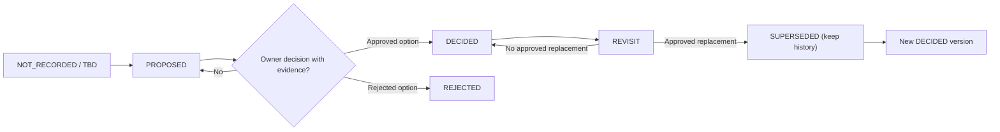

# Esokira — Decision Log & Approval Register

> **Canonical path:** `docs/planning/DECISION-LOG.md`  
> **Version:** `0.1.0`  
> **Prepared:** `2026-10-30` (Asia/Jakarta)  
> **Document status:** `REVIEWED_INTERNAL — PENDING_OWNER_APPROVAL`  
> **Decision approval status:** `NOT_RECORDED` for `Q-01`–`Q-11` and for every source-local decision indexed below; no signed owner decision was produced in this document task.  
> **Implementation status:** `UNVERIFIED` (repository, running app, database migrations, API contracts, and deployment have not been audited).  
> **Scope:** R0–R3, delivery slices `S-00`–`S-12`; R4 discovery only.  
> **Audience:** Product Owner, AI coding agents, Flutter/Go engineers, QA, reviewers of security and financial models.  
> **Authority:** This file indexes and records decisions with evidence. It does **not** silently approve proposals, replace detailed specifications, or authorize application deployment.

---

## 0. Operating contract — read before using this log

1. **`PROPOSED` is not `DECIDED`.** A repeated suggestion in multiple Markdown files still needs explicit approval if it changes product behavior, security, monetary semantics, or production architecture.
2. **Root task instructions remain authoritative for agent behavior:** [`AGENTS.md`](../../AGENTS.md) and the applicable `frontend/AGENTS.md` or `backend/AGENTS.md`. This file must not override them.
3. **Separate three things:** a decision approving an option; a document reviewed/approved for accuracy; and an implementation task tested/DONE. None proves the other two.
4. **Do not backfill fictitious approvals.** A message asking to generate the next Markdown or saying “gas” authorizes drafting the next artifact, not selecting a model/provider or releasing Esokira.
5. **Honor documented product constraints:** Flutter frontend, Go backend, PostgreSQL, monorepo `frontend/` + `backend/`, and incremental modular-monolith direction. Other technology names mentioned as candidates are not automatically selected.
6. **Stop only the dependent work:** if a choice is missing, make the precise task/slice `BLOCKED`, but allow unrelated documentation, tests or isolated prototypes when clearly labeled and authorized.
7. **Never change financial actuals using simulation.** Goal planned contribution, forecast, Monte Carlo result, and actual account balance are distinct. Transfers must not create phantom income/expense.
8. **No real data or credentials in decisions.** Use references to sanitized evidence, not pasted user balances, login tokens, legal identities, or bank details.
9. **No history rewrite.** If a decision is superseded, retain the former record, add a new dated revision, and list its migration/test implications.
10. **This v0.1.0 register is a baseline index, not proof that Esokira's source repository or production environment exists.** Audit the real repository before marking any implementation task `NOT_STARTED`, `IN_PROGRESS` or `DONE`.

### Interpretation of statuses

| Status | Meaning | Permitted use |
|---|---|---|
| `NOT_RECORDED` | No owner approval evidence has been entered in this ledger. | Default for initial decisions. Does not prove nobody ever discussed them. |
| `TBD` | Specific question requires a product/technical decision. | Plan, compare options; block affected production behavior. |
| `PROPOSED` | An explicit candidate has been documented but not accepted. | Research, review, prototype with a label; not authoritative final configuration. |
| `BLOCKED` | A specific task cannot pass its gate until a named decision/evidence exists. | Record task ID, reason and next owner action. |
| `DECIDED` | Authorized owner chose an option, date/source and rationale recorded. | Synchronize canonical spec, tests and affected task gates before implementation. |
| `REJECTED` | An alternative has been formally declined. | Preserve rejected option and why; do not reintroduce silently. |
| `SUPERSEDED` | A previous approved record was replaced by another approved record. | Preserve history and point to new record. |
| `REVISIT` | An approved record is being reconsidered, but original remains in force until replacement. | Do not apply a new choice prematurely. |

**Notation rule:** `Q-xx` = parent product decisions owned by `PRD.md` §12. `ARCH-Qxx`, `BE-Qxx`, etc. = questions owned by their *respective* domain documents. `Q-01` and `ARCH-Q01` are not the same ID; never combine them by number alone.

---

## 1. What is already grounded vs what is not yet approved

| Category | Recorded basis | Treatment |
|---|---|---|
| Mobile frontend | User chose **Flutter** | Working project constraint. Do not change to React Native/web-only without an explicit change request. |
| Backend | User chose **Golang** | Working project constraint. Do not introduce an unrelated runtime as replacement without approval. |
| Primary database | User chose **PostgreSQL** | Working project constraint. Do not silently switch to Firestore or another store. |
| Repository | User requested monorepo with `frontend/` and `backend/` | Working project constraint. Supporting `/docs`, `/contracts`, and `/infra` are architectural proposals where applicable. |
| Architecture | Modular monolith recommended across docs | Recommended direction; detailed module/API/queue choices remain proposed where not approved. |
| Brand identity | “Esokira” has been used as **working name** | Brand/trademark/design approval remains `Q-01`, `DS-Q01`. |
| Libraries/providers | `chi`, `pgx`, `sqlc`, River, Riverpod/BLoC, auth, hosting, telemetry | Candidate options, **not locked dependencies**. |
| Actual monetary model | Exact representation and separation of actual vs hypothetical required | Final currency unit/scale, ledger model, rounding, effective date and corrections remain open. |
| Project delivery | `S-00`–`S-12` and R0–R3 documented | Plan; no release is verified or approved by this file. |

**Scope is deliberate:** Esokira plans finances and explores hypothetical futures. It does not by default move customer money, place trades, provide bank accounts, issue loans, or promise investment results. R4 ideas require their own approval.

---

## 2. Canonical decisions and source-of-truth routing

| Subject | Authoritative source | Role of DECISION-LOG |
|---|---|---|
| Product approval, scope, feature semantics | [`PRD.md`](../product/PRD.md), [`PRODUCT-VISION.md`](../product/PRODUCT-VISION.md) | Record who accepted/changed the product decision and point back to owner. |
| Release order and dependencies | [`FEATURE-MATRIX.md`](../product/FEATURE-MATRIX.md), [`MASTER-ROADMAP.md`](./MASTER-ROADMAP.md) | Record gate evidence and impact; do not renumber slices. |
| Numeric/financial domain | [`FINANCIAL-DOMAIN-RULES.md`](../financial/FINANCIAL-DOMAIN-RULES.md), [`CALCULATION-SPECS.md`](../financial/CALCULATION-SPECS.md) | Link approved model to actual test oracle. |
| Financial reference tests | [`FINANCIAL-TEST-CASES.md`](../financial/FINANCIAL-TEST-CASES.md) | Link accepted numerical policy to golden cases, never invent results. |
| System/backend/frontend | [`SYSTEM-ARCHITECTURE.md`](../architecture/SYSTEM-ARCHITECTURE.md), [`BACKEND-ARCHITECTURE.md`](../architecture/BACKEND-ARCHITECTURE.md), [`FRONTEND-ARCHITECTURE.md`](../architecture/FRONTEND-ARCHITECTURE.md) | Register decisions and ADR when needed; diagrams are not approvals. |
| PostgreSQL storage | [`DATABASE-DESIGN.md`](../architecture/DATABASE-DESIGN.md) | Approve schema policy *before* production migrations; illustrative SQL remains non-binding. |
| API wire contract | [`API-GUIDELINES.md`](../architecture/API-GUIDELINES.md); actual `contracts/openapi.yaml` if implemented | Track decisions; actual approved OpenAPI is authoritative for serialized endpoints, not prose examples. |
| UI/navigation | [`DESIGN-SYSTEM.md`](../design/DESIGN-SYSTEM.md), [`USER-FLOWS.md`](../design/USER-FLOWS.md), [`SCREEN-SPECS.md`](../design/SCREEN-SPECS.md) | Record UX decisions and link prototype/device evidence. |
| Security/privacy | [`SECURITY-PRIVACY.md`](../security/SECURITY-PRIVACY.md) | Track threat/consent/retention/incident ownership and public release signoffs. |
| Agent execution | [`DEVELOPMENT-WORKFLOW.md`](../development/DEVELOPMENT-WORKFLOW.md), [`TESTING-STRATEGY.md`](../development/TESTING-STRATEGY.md), [`DEFINITION-OF-DONE.md`](../development/DEFINITION-OF-DONE.md) | Record process approvals; task/test status belongs to PROGRESS. |
| Work execution and evidence | [`TASKS.md`](./TASKS.md), [`PROGRESS.md`](./PROGRESS.md) | Link decision to exact task blockers; PROGRESS owns observed implementation/test state. |

Precedence is **subject ownership plus explicit approved revision**, not “newest Markdown wins.” If two docs conflict, create a drift ticket, stop the affected implementation, and obtain owner resolution in the canonical source.

---

## 3. Master register — 11 unresolved parent decisions

All 11 rows are `NOT_RECORDED` for formal approval as of document preparation. The responsible approver is **provisionally Product Owner**; financial, security, or technical review may be required depending on the decision. A proposed owner role is not a signed approval.

| ID | Decision subject | First affected slice / gate | Decision owner (proposed) | Approval recorded? | Canonical question |
|---|---|---|---|---|---|
| `Q-01` | Product identity, intended audience, Indonesia/IDR scope and MVP | `S-00` | Product Owner | `NOT_RECORDED` | [`PRD.md` §12](../product/PRD.md) |
| `Q-02` | Identity provider, verified principal and session lifecycle | `S-01`/`S-02` | Product Owner + security reviewer | `NOT_RECORDED` | [`PRD.md` §12](../product/PRD.md) |
| `Q-03` | Opening balances, ledger, transfer, corrections and audit | `S-01`/`S-03` | Product Owner + finance/Go/DB reviewers | `NOT_RECORDED` | [`PRD.md` §12](../product/PRD.md) |
| `Q-04` | Exact money unit, rate/time convention and rounding | `S-01`/`S-03`/`S-05` | Product Owner + financial reviewer | `NOT_RECORDED` | [`PRD.md` §12](../product/PRD.md) |
| `Q-05` | Inflation, return, debt and assumption defaults/handling | R1 compound specifics; `S-07`/`S-08` R2 | Product Owner + financial reviewer | `NOT_RECORDED` | [`PRD.md` §12](../product/PRD.md) |
| `Q-06` | Scenario baseline, version, staleness and rebase | `S-07`/`S-08` | Product Owner + Go/DB reviewer | `NOT_RECORDED` | [`PRD.md` §12](../product/PRD.md) |
| `Q-07` | Goal optimizer objective, constraints and infeasible policy | `S-10` | Product Owner + financial reviewer | `NOT_RECORDED` | [`PRD.md` §12](../product/PRD.md) |
| `Q-08` | Monte Carlo assumptions, correlation, seed and uncertainty disclosure | `S-11` | Product Owner + statistical/financial reviewer | `NOT_RECORDED` | [`PRD.md` §12](../product/PRD.md) |
| `Q-09` | Notification channel, consent and frequency | `S-09` | Product Owner + privacy reviewer | `NOT_RECORDED` | [`PRD.md` §12](../product/PRD.md) |
| `Q-10` | Hosting, backup, retention, offline/sync and legal/release review | `S-00` baseline; pre-public R1 | Product Owner + security/ops/legal review | `NOT_RECORDED` | [`PRD.md` §12](../product/PRD.md) |
| `Q-11` | Actual goal funding, allocation, progress and double-counting | `S-05` | Product Owner + financial/DB reviewers | `NOT_RECORDED` | [`PRD.md` §12](../product/PRD.md) |

**No blanket BLOCKED flag:** these 11 are unresolved decisions, not proof every task in R0/R1 is blocked. `TASKS.md` and source-local sections determine which *specific* write, calculation, UI, or release gate depends on an unresolved choice.

---

## 4. Decisions to resolve early, with evidence expected

### `Q-01` — Product scope and brand approval

- **Question:** Is Esokira an accepted product name and is the proposed Bahasa Indonesia/Rupiah-first R1 scope correct? Which R1 capabilities are explicitly in-scope/out-of-scope?
- **Choices for review (not selections):** working name pending brand checks; approve name as product identity after review; adjust scope with updated PRD and Feature Matrix.
- **Minimum owner evidence:** explicit R0/R1 scope approval, date, PRD/version reference, owner statement. Branding approval should not claim trademark clearance without separate verification.
- **Blocked while unresolved:** marking PRD/R1 release as formally approved; not the ability to draft technical plans.
- **Related:** `DS-Q01`; `TK-S00-02`.

### `Q-02` — Identity, session and principal

- **Question:** Choose Firebase Authentication/OIDC/another provider, supported login methods, token verification and revocation, multi-device lifecycle, identity-to-user mapping, recovery and step-up verification.
- **Safety invariant:** account ownership comes from a verified backend principal, not a caller-supplied `user_id`.
- **Evidence required:** IdP decision, auth flow, Go verification strategy, security test plan, threat review and approved authenticated API contract.
- **Blocked while unresolved:** live login/authorization implementation and auth-coupled production writes.
- **Related:** `ARCH-Q01`, `BE-Q01`, `SEC-Q01..Q03`, `UF-Q02`, `SS-Q02`; `S-01/S-02`.

### `Q-03` — Ledger, opening balances, edits and transfer rules

- **Question:** Decide opening balance source and cutover, posted/draft transaction lifecycle, transfer accounting, corrections/reversals, fees/refunds, negative balances and auditability.
- **Choices for comparison:** immutable event ledger with movements; simpler transactional rows plus strong audit; other reviewed design. No choice is approved by this document.
- **Safety invariant:** atomic transfers, no duplicate actual postings under retry; internal transfers do not create income/expense; corrections retain audit evidence.
- **Evidence required:** documented journal/ledger proposal and rejected alternatives, DB transaction tests, concurrency/idempotency tests, owner approval and schema migration review.
- **Blocked while unresolved:** actual write schema, production transaction/transfer posting and backdated correction behavior.
- **Related:** `FDR-Q01..Q03`, `ARCH-Q02`, `DB-Q01`, `BE-Q02`; `S-03`.

### `Q-04` — Money, percentage, calendars and rounding

- **Question:** IDR-only vs multi-currency, exact storage unit/scale (`BIGINT` IDR vs fixed-precision `NUMERIC`), API decimal encoding, rates and day count, rounding boundaries, timezone/effective date, contribution timing and negative-rate policy.
- **Safety invariant:** stored actual money is exact; no floating-point source-of-truth for account balances; units must never be ambiguous.
- **Evidence required:** approved representation, examples of round-trip Flutter → API → Go → PostgreSQL → Flutter, golden numerical tests, migration constraints.
- **Blocked while unresolved:** conflicting money schema, accepted monetary wire contract, compounding conventions and transaction totals.
- **Related:** `FDR-Q04..Q06`, `CALC-Q01..Q04`, `DB-Q02`, `ARCH-Q03`, `API-Q03`; `S-01/S-03/S-05`.

### `Q-05` — Returns, inflation and debt modeling

- **Question:** Select which assumptions are required/optional, annual effective vs nominal conventions, costs/taxes, missing-value behavior, debt interest and valuation policy, nominal/real separation.
- **Readiness distinction:** R1 compound-specific assumptions require a review before the `S-05` calculator; detailed future projection assumptions may be deferred to `S-07/S-08`. Do not defer all of `Q-05` past R1.
- **Evidence required:** calculation contract revisions, numerical examples, inflation disclosure wording and `FTC-*` acceptance for enabled modes.
- **Blocked while unresolved:** hard-coded undocumented return/inflation assumptions and production forecasts based on invented defaults.
- **Related:** `FDR-Q08/09`, `CALC-Q*`, `FR-008/012/014/019`; `S-05/S-08`.

### `Q-06` — Scenario baseline/version/reproducibility

- **Question:** Snapshot vs revision references, immutable scenario versions, baseline rebase/staleness, consistency under data edits, sharing/retention and simulation provenance.
- **Safety invariant:** a hypothetical scenario cannot mutate actual finance records; stale simulations must not appear current.
- **Evidence required:** data lifecycle and state diagrams, transaction-bound snapshot semantics, staleness tests, scenario comparison acceptance.
- **Blocked while unresolved:** persistent R2 scenario engine and source-of-truth claims for forecasts.
- **Related:** `FDR-Q10`, `ARCH-Q05`, `DB-Q*`, `UF-Q*`, `SS-Q12`; `S-07/S-08`.

### `Q-07` — Goal allocation optimizer

- **Question:** Define objective, priorities, available budget, partial funding, constraints, infeasibility, tie-breaks and explainability. Specify whether optimization is deterministic or risk-aware.
- **Safety invariant:** never describe a heuristic as mathematically optimal unless an accepted algorithm and test justification support that claim.
- **Evidence required:** approved `GOAL-OPTIMIZER.md`, problem instances, baseline comparators, property/feasibility tests, owner review.
- **Blocked while unresolved:** production `FR-017` optimization engine and claims of optimal allocation.
- **Related:** `FDR-Q11`, `CALC-Q*`, `S-10`.

### `Q-08` — Monte Carlo, statistical confidence and FIRE uncertainty

- **Question:** Choose return distributions/correlations, negative-tail assumptions, inflation model, seed/replay, run budget, quantiles, goal success definition, warnings and model versioning.
- **Safety invariant:** “72% success” means model-conditioned result, never a promised real-world outcome; simulated paths cannot post actual transactions.
- **Evidence required:** approved `MONTE-CARLO.md`, reproducibility tests, statistical validation, performance budgets, user-facing disclosure review.
- **Blocked while unresolved:** production Monte Carlo and probabilistic retirement claims.
- **Related:** `FDR-Q12`, `SEC-Q15/16/20`, `TS-Q10`, `S-11`.

### `Q-09` — Notifications and consent

- **Question:** Opt-in vs opt-out, types of alerts, frequency, providers, secure content handling, delivery expectations and preference controls.
- **Safety invariant:** no sensitive financial data in unsolicited notification previews by default.
- **Evidence required:** consent UX, privacy review, user preferences, disable/revoke flows, provider security assessment and test plan.
- **Blocked while unresolved:** live notification sending; in-app insight screens may be designed separately if permitted.
- **Related:** `SEC-Q10`, `UF-Q14`, `SS-Q15`, `S-09`.

### `Q-10` — Operations, retention and public-release safety

- **Question:** Hosting/region, secrets management, backups/PITR/restore drills, retention and deletion, offline policy, monitoring, incident ownership and applicable Indonesian legal review.
- **Early vs late:** R0 may prototype reproducible local setup while hosting decisions are pending; no public financial-data production launch without approved policies and operational test evidence.
- **Evidence required:** reviewed threat model, data inventory, restore drill, secrets handling, retention/export/delete runbook and applicable legal checklist.
- **Blocked while unresolved:** real-user production rollout and release claims, not basic documentation or isolated local development.
- **Related:** `SEC-Q09..Q20`, `DB-Q*`, `ARCH-Q*`, `S-00/R1`.

### `Q-11` — Goal actual-funded semantics

- **Question:** Define what counts as funded: explicit contribution, earmarked account balance, virtual envelope or another reviewed method. Specify withdrawal/reallocation/transfer handling and double-counting protection.
- **Safety invariant:** planned contribution is not actual funded value; changing a goal must not create or erase cash.
- **Evidence required:** approved funded-attribution policy, real-vs-planned sample transactions, DB data integrity cases, goal-progress UI wording, R1 regression tests.
- **Blocked while unresolved:** goal progress labeled as real funds and production feasibility numbers that depend on actual allocation.
- **Related:** `FDR-Q07`, `ARCH-Q04`, `DB-Q*`, `SS-Q06`, `FR-007/009`, `S-05`.

---

## 5. Decision readiness timeline (no invented calendar dates)

| Priority | Gate | Decisions or required reviews | May continue while pending | Must not ship while pending |
|---|---|---|---|---|
| P0 | `S-00` repo/requirements audit | `Q-01` scope; `Q-10` risk baseline; agent governance `DW-Q*` as needed | Inspect repo, catalogue contracts, list open questions | Claim approved MVP/release or close task with fabricated evidence |
| P0 | `S-01` technical foundation | `Q-02`; `Q-03/Q-04` where schemas/money semantics involved; `ARCH/BE/DB/API` local choices | Environment skeleton, safe isolated tests | Live auth, ledger writes, final schemas/contracts without decisions |
| P0 | `S-02` authentication | `Q-02`, security/session/data-minimization choices | UI drafts and interface mocks labeled non-production | Identity-protected writes without verified principal |
| P0 | `S-03` transactions | `Q-03/Q-04`, transfer idempotency, correction policy | Test harness design, local fixtures | Production postings, transfer/correction APIs |
| P1 | `S-05/S-06` goals/calculator | `Q-04`, R1 subset `Q-05`, `Q-11` | Formula exploration and validated prototypes | Misleading goal funding, undocumented money/rate conventions |
| P1 | `S-07/S-08` R2 projection | R2 `Q-05`, `Q-06` | UX models, versioned scenario research | Persistent scenarios/projections presented as approved behavior |
| P2 | `S-09` alerts/insights | `Q-09`, privacy consent and insight evidence review | Non-sending UI prototypes | Live notifications before consent/privacy gate |
| P2 | `S-10` optimizer | `Q-07`, approved objective and constraints | Research test instances | Production optimality claims |
| P2 | `S-11/S-12` Monte Carlo/FIRE/GPS | `Q-08` and worker quotas/model/disclosure | Offline research and validation planning | Production probabilistic probability/confidence or guaranteed financial advice |
| P0 pre-public | Any external production release | `Q-10` plus complete DoD/security/data-rights review | Local/staging development with synthetic data | Public release on real users' data |

A local decision with an earlier effect can raise the gate priority. This table is a routing guide, not a substitute for task-specific prerequisites in `TASKS.md`.

---

## 6. Register and evidence format — use for future *actual* approvals

### 6.1 Mandatory record fields

| Field | Requirement |
|---|---|
| `decision_id` | Existing parent `Q-xx` or local ID, never a duplicate ID with different meaning. |
| `canonical_owner_doc` | Path to the specification that owns this decision subject. |
| `status` | `NOT_RECORDED/TBD/PROPOSED/BLOCKED/DECIDED/REJECTED/SUPERSEDED/REVISIT` with definitions above. |
| `decision_question` | One precise question; separate unrelated topics into a recorded subdecision while linking to parent. |
| `alternatives_reviewed` | Trade-offs; include “do nothing” if meaningful. Do not imply a candidate was chosen. |
| `selected_option` | Only if DECIDED; otherwise `NONE`. |
| `rationale_and_risks` | Why, security, financial, operational and product risks. |
| `owner_approver` | Named role/person or unambiguously identified responsible Product Owner, not inferred by agent. |
| `approval_evidence` | Permanent chat/issue/PR/ADR link or signed decision record, timestamp and version. No invented IDs. |
| `affected` | Exact `FR-*`, `EN-*`, `NFR-*`, `DR-*`, `CS-*`, `S-*`, `TK-*` as applicable. |
| `required_updates` | Canonical docs, OpenAPI, SQL migration, UI/UX contracts, tests, implementation tasks. |
| `verification_and_exit` | What test/review evidence must exist before task/release gate closes. |
| `supersedes/superseded_by` | Preserve decision history for changed policies. |
| `last_reviewed` | Only when actually reviewed. Avoid fabricated review timestamp. |

### 6.2 Example record template (NOT an approved decision)

```yaml
# TEMPLATE ONLY — DO NOT PASTE AS AN APPROVED RECORD
# Store the real record in an approved issue/ADR or in this log after owner evidence exists.
decision_id: Q-04
canonical_owner_doc: docs/product/PRD.md
status: TBD
question: "Choose exact money representation and rounding/effective-date policy"
selected_option: null
alternatives_reviewed: []
owner_approver: null
approval_evidence: null
approved_at: null
affected:
  release_slices: [S-01, S-03, S-05]
  related_ids: [FDR-Q04, FDR-Q05, FDR-Q06, DB-Q02, ARCH-Q03]
required_updates:
  - docs/financial/FINANCIAL-DOMAIN-RULES.md
  - docs/financial/CALCULATION-SPECS.md
  - docs/architecture/DATABASE-DESIGN.md
  - docs/architecture/API-GUIDELINES.md
verification_evidence: []
notes: "No option may be treated as final without owner approval."
```

### 6.3 Valid state transitions



A task's `BLOCKED` state is **not** a decision approval status. `REVIEWED_INTERNAL` is a *document* review status, not a parent `Q-*` decision. If a candidate is explicitly rejected, the parent decision may still be unresolved until another option is selected.

---

## 7. Applying a new approval without documentation drift

1. **Capture evidence first:** exact owner statement, date, review context and affected ID(s). An agent must not write “approved by owner” merely because the user requested a document.
2. **Resolve ownership:** update the PRD for product semantics, financial domain for numerical policy, database design for storage, architecture for boundaries, security for risk handling. The log points to those edits.
3. **Record options and trade-offs:** selected/rejected alternatives, assumptions, constraints, side effects and migration risks.
4. **Update cross-domain dependents:** e.g. choosing `Q-04` may affect Go money types, PostgreSQL constraints, OpenAPI decimal schema, Flutter input parsing and golden tests.
5. **Require validation:** run the tests relevant to a changed approved decision. Merely updating a test's expected output cannot prove the result is correct; independently review changed financial reference values.
6. **Reopen impacted tasks:** use task IDs and `PROGRESS.md` for evidence/status; do not mark tasks `DONE` solely because a decision was signed.
7. **Preserve history:** use supersession markers rather than deleting older decisions. Note data migration/reconciliation and compatibility rules if production data exists.
8. **Report unresolved blockers:** if no owner available, record a specific question plus safe next steps; never set a fabricated default.

### Example propagation — approving money encoding (`Q-04`)

- **Parent:** `PRD.md` §12, `FINANCIAL-DOMAIN-RULES.md` `FDR-Q04..Q06`.
- **Architecture:** update `DATABASE-DESIGN.md` `DB-Q02`, `API-GUIDELINES.md` `API-Q03`, backend/frontend architecture, root/nested AGENTS only if evergreen rules change.
- **Execution contracts:** update `contracts/openapi.yaml` and migrations **only if those files actually exist** and are in the authorized task scope; otherwise create scoped tasks to implement them.
- **Quality evidence:** financial golden tests, Go decimal unit tests, PostgreSQL round-trip, Flutter parsing/widget tests, API serialization/compatibility tests.
- **Status:** decision DECIDED only with owner evidence; corresponding implementation remains `UNVERIFIED/PARTIAL` until actual code/test evidence exists.

---

## 8. Documentation conflicts, ambiguity and safe stop rules

| Condition | Agent action | What not to do |
|---|---|---|
| Same topic appears as `PROPOSED` in multiple files | Identify canonical owner and parent Q; log local references; ask for explicit choice before dependent code. | Do not call majority agreement “approved.” |
| Parent is `TBD`, local doc says “recommended” | Keep parent unresolved and note recommendation for review. | Do not upgrade a local candidate to DECIDED. |
| Parent approved, dependent doc disagrees | Open `DOCUMENTATION_DRIFT`, block affected change until reconciled. | Do not silently pick newest file. |
| Approved policy conflicts with current code | Record observed code and change request; propose safe migration/tests. | Do not rewrite financial history or schema without review. |
| Existing repo implementation is unknown | Preserve `UNVERIFIED`, run audit under `TK-S00-01`. | Do not assume empty repo or mark `NOT_STARTED`. |
| User says “gas buat markdown selanjutnya” | Draft only the named next document and validate artifact. | Do not infer approval of choices contained in it. |
| Owner wants to change an approved decision | Record `REVISIT`, impact analysis, then explicit new approval. | Do not erase previous decision/evidence. |
| Security/privacy ambiguity | Minimize exposure, use synthetic fixtures, request reviewer decision. | Do not expose customer data or bypass ownership checks to keep work moving. |

---

## 9. Task linkage, S-00 entry and release handoff

| Item | What this document can truthfully supply | What remains after document creation |
|---|---|---|
| `TK-S00-01` | Pointers to documents to audit | Actual repository and environment inspection/evidence, not done here |
| `TK-S00-02` | `Q-01` proposed approval checklist | Real owner confirmation of R0/R1 scope |
| `TK-S00-09` | Draft decision register, indexed source-local questions and governance | Repository presence, task-specific acceptance, owner review; **not automatically DONE** |
| `S-00` gate | List of unresolved, targeted decisions | Repo audit, scope decisions, task evidence and S-00 exit review |
| `S-01` gate | Prerequisite routing for architecture/auth/money decisions | Selected libraries/providers, approved contracts, migration plan and tests |
| R1 acceptance | Specific parent decision dependencies | Implementation evidence, financial/security tests, data rights and real release approval |
| R2/R3 readiness | Future decision-owner questions and specs needed | Model-specific approvals; full simulation implementations and validation |

**Handoff protocol:** in each coding session, cite the actual `decision_id` and `task_id`, affected docs, status with evidence, tests executed (or `NOT_RUN`), and the next safe action. Maintain observed state only in [`PROGRESS.md`](./PROGRESS.md). This file is not a second task board.

---

## 10. Evidence ledger (initial state)

| Evidence slot | Current value | Why |
|---|---|---|
| Owner approvals for `Q-01`–`Q-11` | `NOT_RECORDED` | Source files mark questions unresolved; this authoring task supplies no owner-specific approval record. |
| Source-local decision approvals | `NOT_RECORDED` | Candidate question indexing is not approval; inspect sources and future signed records. |
| Production DB schema approvals | `NOT_RECORDED` | `DATABASE-DESIGN.md` contains review-only SQL examples. |
| Approved runtime OpenAPI contract | `UNVERIFIED` | `API-GUIDELINES.md` is guidance, not proof of generated `contracts/openapi.yaml`. |
| Repository audit | `NOT_RUN` | No actual Flutter/Go source-tree assessment was performed in this document task. |
| Go/Flutter/PostgreSQL tests | `NOT_RUN` | Tests described in Markdown are not test executions. |
| Existing release/deployment | `UNVERIFIED` | Do not infer production deployment from planned architecture. |

This initial ledger should be append-only for real approval entries. Do not add placeholder approvals with invented people/dates or synthetic ticket references.

---

## 11. Source-local decision index — do not duplicate or auto-approve

The following is an **index of existing local decision questions**, not hundreds of newly approved independent product choices. Every ID is copied from its owning documentation source. A row's source status is included only when explicit in that source table; `NOT_RECORDED` means the source row did not supply a recognized status field. In all cases, **owner approval evidence in this central ledger is currently NOT_RECORDED**.

Read the linked source document for full alternatives, exact parent relationships, and impacted flows. When a source-local topic refines a parent `Q-*`, record approval against the actual canonical owner and preserve both IDs in the evidence. All proposed libraries, models, design tokens, numeric tolerances and thresholds remain unapproved until documented.

### 11.1 Source-local register inventory

| Local ID range | Count | Canonical document | Approval evidence in this log |
|---|---:|---|---|
| `ARCH-Q01`–`ARCH-Q13` | 13 | [SYSTEM-ARCHITECTURE.md](../architecture/SYSTEM-ARCHITECTURE.md) | Source-only questions: no consolidated owner approval recorded |
| `BE-Q01`–`BE-Q17` | 17 | [BACKEND-ARCHITECTURE.md](../architecture/BACKEND-ARCHITECTURE.md) | Source-only questions: no consolidated owner approval recorded |
| `FE-Q01`–`FE-Q18` | 18 | [FRONTEND-ARCHITECTURE.md](../architecture/FRONTEND-ARCHITECTURE.md) | Source-only questions: no consolidated owner approval recorded |
| `DB-Q01`–`DB-Q17` | 17 | [DATABASE-DESIGN.md](../architecture/DATABASE-DESIGN.md) | Source-only questions: no consolidated owner approval recorded |
| `API-Q01`–`API-Q16` | 16 | [API-GUIDELINES.md](../architecture/API-GUIDELINES.md) | Source-only questions: no consolidated owner approval recorded |
| `FDR-Q01`–`FDR-Q13` | 13 | [FINANCIAL-DOMAIN-RULES.md](../financial/FINANCIAL-DOMAIN-RULES.md) | Source-only questions: no consolidated owner approval recorded |
| `CALC-Q01`–`CALC-Q15` | 15 | [CALCULATION-SPECS.md](../financial/CALCULATION-SPECS.md) | Source-only questions: no consolidated owner approval recorded |
| `DS-Q01`–`DS-Q16` | 16 | [DESIGN-SYSTEM.md](../design/DESIGN-SYSTEM.md) | Source-only questions: no consolidated owner approval recorded |
| `UF-Q01`–`UF-Q17` | 17 | [USER-FLOWS.md](../design/USER-FLOWS.md) | Source-only questions: no consolidated owner approval recorded |
| `SS-Q01`–`SS-Q22` | 22 | [SCREEN-SPECS.md](../design/SCREEN-SPECS.md) | Source-only questions: no consolidated owner approval recorded |
| `SEC-Q01`–`SEC-Q21` | 21 | [SECURITY-PRIVACY.md](../security/SECURITY-PRIVACY.md) | Source-only questions: no consolidated owner approval recorded |
| `DW-Q01`–`DW-Q08` | 8 | [DEVELOPMENT-WORKFLOW.md](../development/DEVELOPMENT-WORKFLOW.md) | Source-only questions: no consolidated owner approval recorded |
| `TS-Q01`–`TS-Q16` | 16 | [TESTING-STRATEGY.md](../development/TESTING-STRATEGY.md) | Source-only questions: no consolidated owner approval recorded |
| `DOD-Q01`–`DOD-Q14` | 14 | [DEFINITION-OF-DONE.md](../development/DEFINITION-OF-DONE.md) | Source-only questions: no consolidated owner approval recorded |

**Total local IDs indexed: 223.** Parent product questions: 11. **Important:** these figures measure unresolved question references, not accepted decisions and not implemented features.

### 11.2 ARCH: [SYSTEM-ARCHITECTURE.md](../architecture/SYSTEM-ARCHITECTURE.md) — 13 local questions

| Source-local ID | Existing question/subject (as in source) | Explicit source status |
|---|---|---|
| `ARCH-Q01` | Pilihan IdP, token/session lifecycle, user mapping, revoke, reauth | `NOT_RECORDED` |
| `ARCH-Q02` | Posting/ledger, reversal, overdraft, isolation dan dedup strategy | `NOT_RECORDED` |
| `ARCH-Q03` | Exact money type, unit, decimals, rounding, dates/timezones | `NOT_RECORDED` |
| `ARCH-Q04` | Model goal funding dan actual vs planned attribution | `NOT_RECORDED` |
| `ARCH-Q05` | Baseline snapshot, version policy, staleness/rebase, retention | `NOT_RECORDED` |
| `ARCH-Q06` | Optimizer objective, constraints dan policy | `NOT_RECORDED` |
| `ARCH-Q07` | Monte Carlo RNG/model, reproducibility, percentile, resource limit | `NOT_RECORDED` |
| `ARCH-Q08` | Reminder provider, opt-in, payload, delivery controls | `NOT_RECORDED` |
| `ARCH-Q09` | Export/delete, retention/backup, hosting, legal, offline policy | `NOT_RECORDED` |
| `ARCH-Q10` | Queue and worker technology, transactional enqueue, cancellation | `NOT_RECORDED` |
| `ARCH-Q11` | OpenAPI version/toolchain, error envelope, idempotency key, pagination | `NOT_RECORDED` |
| `ARCH-Q12` | Actual p50/p95 latency, resource budgets, throttles, capacity | `NOT_RECORDED` |
| `ARCH-Q13` | Nama kerja, users/locale IDR dan MVP scope disetujui? | `NOT_RECORDED` |

### 11.3 BE: [BACKEND-ARCHITECTURE.md](../architecture/BACKEND-ARCHITECTURE.md) — 17 local questions

| Source-local ID | Existing question/subject (as in source) | Explicit source status |
|---|---|---|
| `BE-Q01` | Identity provider, token/session lifecycle, user mapping | `NOT_RECORDED` |
| `BE-Q02` | Ledger vs editable events, posting/void/reversal, audit model | `NOT_RECORDED` |
| `BE-Q03` | Exact money Go/PG/JSON, scale, rounding | `NOT_RECORDED` |
| `BE-Q04` | Effective/recorded/as-of time and timezone rules | `NOT_RECORDED` |
| `BE-Q05` | Goal funding attribution, status/progress | `NOT_RECORDED` |
| `BE-Q06` | Router choice, OpenAPI generation, error envelope | `NOT_RECORDED` |
| `BE-Q07` | Retry/idempotency key, uniqueness scope, TTL | `NOT_RECORDED` |
| `BE-Q08` | DB pool/query library, migrations, transaction pattern | `NOT_RECORDED` |
| `BE-Q09` | Scenario baseline/snapshot, versioning, stale/rebase | `NOT_RECORDED` |
| `BE-Q10` | Queue library, enqueue atomicity, retries/cancel/retention | `NOT_RECORDED` |
| `BE-Q11` | Optimizer objective/constraints/penalty | `NOT_RECORDED` |
| `BE-Q12` | Monte Carlo model, RNG/seed, percentile, versioning | `NOT_RECORDED` |
| `BE-Q13` | Export/delete, data retention, backup, privacy | `NOT_RECORDED` |
| `BE-Q14` | Notification provider, opt-in, payload | `NOT_RECORDED` |
| `BE-Q15` | Per-endpoint timeout, quotas, load targets, p95 | `NOT_RECORDED` |
| `BE-Q16` | Owner confirmation of scope and market/locale assumptions | `NOT_RECORDED` |
| `BE-Q17` | Hosting/deployment, backup and recovery environment | `NOT_RECORDED` |

### 11.4 FE: [FRONTEND-ARCHITECTURE.md](../architecture/FRONTEND-ARCHITECTURE.md) — 18 local questions

| Source-local ID | Existing question/subject (as in source) | Explicit source status |
|---|---|---|
| `FE-Q01` | State management utama: Riverpod / BLoC / lainnya? | `NOT_RECORDED` |
| `FE-Q02` | Router: `go_router` atau alternatif? | `NOT_RECORDED` |
| `FE-Q03` | HTTP dan serialization: Dio/http; manual/generated? | `NOT_RECORDED` |
| `FE-Q04` | Auth provider dan secure storage? | `NOT_RECORDED` |
| `FE-Q05` | Offline read/cache dan writes? | `NOT_RECORDED` |
| `FE-Q06` | Amount/rate/date/timezone representation? | `NOT_RECORDED` |
| `FE-Q07` | Local calculation preview diizinkan atau tidak? | `NOT_RECORDED` |
| `FE-Q08` | Navigation tabs, screen hierarchy, design tokens? | `NOT_RECORDED` |
| `FE-Q09` | Chart library dan data table pattern? | `NOT_RECORDED` |
| `FE-Q10` | Simulation job status transport? | `NOT_RECORDED` |
| `FE-Q11` | Notification provider & payload preferences? | `NOT_RECORDED` |
| `FE-Q12` | Export/save/share dan delete flow? | `NOT_RECORDED` |
| `FE-Q13` | Min OS, Android/iOS rollout, device matrix? | `NOT_RECORDED` |
| `FE-Q14` | Localization/currency policy final? | `NOT_RECORDED` |
| `FE-Q15` | Telemetry, consent, and crash data scope? | `NOT_RECORDED` |
| `FE-Q16` | Performance acceptance budgets? | `NOT_RECORDED` |
| `FE-Q17` | Scenario stale/compare/rebase UX policy? | `NOT_RECORDED` |
| `FE-Q18` | Goal-funded status rendering policy? | `NOT_RECORDED` |

### 11.5 DB: [DATABASE-DESIGN.md](../architecture/DATABASE-DESIGN.md) — 17 local questions

| Source-local ID | Existing question/subject (as in source) | Explicit source status |
|---|---|---|
| `DB-Q01` | Typed tx row vs event+movements vs double-entry; posting/reversal/split/fee | `NOT_RECORDED` |
| `DB-Q02` | IDR-only + BIGINT rupiah vs NUMERIC(scale); JSON string, rounding/overflow | `NOT_RECORDED` |
| `DB-Q03` | Opening cutover, backdated, same-day order, timezone, overdraft | `NOT_RECORDED` |
| `DB-Q04` | Idempotency key scope/replay/TTL, atomic status, return response | `NOT_RECORDED` |
| `DB-Q05` | Virtual envelope vs dedicated account vs actual allocation | `NOT_RECORDED` |
| `DB-Q06` | Auth provider, issuer/subject mapping, linking/merge | `NOT_RECORDED` |
| `DB-Q07` | Manual vs computed liability, interest/repayment policy | `NOT_RECORDED` |
| `DB-Q08` | Full immutable snapshot vs versioned ref/hybrid; stale/rebase | `NOT_RECORDED` |
| `DB-Q09` | Worker queue library, job/transaction outbox, failure recovery | `NOT_RECORDED` |
| `DB-Q10` | Application authz only vs + PostgreSQL RLS; role/pooling protocol | `NOT_RECORDED` |
| `DB-Q11` | Export/delete, retention, backup purging, audit and legal hold | `NOT_RECORDED` |
| `DB-Q12` | Benchmark workloads, quotas, p95, size constraints | `NOT_RECORDED` |
| `DB-Q13` | Migration runner, PostgreSQL target version, numeric mapping / query generator | `NOT_RECORDED` |
| `DB-Q14` | Asset representation, valuation freshness, overdraft classification | `NOT_RECORDED` |
| `DB-Q15` | Recurrence grammar, notification preferences, privacy | `NOT_RECORDED` |
| `DB-Q16` | Optimizer objective, Monte Carlo RNG, results scale/model versions | `NOT_RECORDED` |
| `DB-Q17` | Product Owner mengesahkan IDR-first/locale dan scope per release | `NOT_RECORDED` |

### 11.6 API: [API-GUIDELINES.md](../architecture/API-GUIDELINES.md) — 16 local questions

| Source-local ID | Existing question/subject (as in source) | Explicit source status |
|---|---|---|
| `API-Q01` | OpenAPI tooling/version, base `/api/v1`, host per environment | `NOT_RECORDED` |
| `API-Q02` | JSON snake_case/camelCase, response envelope, ID type | `NOT_RECORDED` |
| `API-Q03` | Money wire encoding, rate precision, currency, rounding metadata | `NOT_RECORDED` |
| `API-Q04` | RFC 9457, error codes, strict JSON decode, status/field policy | `NOT_RECORDED` |
| `API-Q05` | Idempotency scope, fingerprint, replay status, TTL, recovery | `NOT_RECORDED` |
| `API-Q06` | Auth token/provider mapping dan 403-vs-404 policy | `NOT_RECORDED` |
| `API-Q07` | Cursor/limit/filter/sort/as-of boundaries | `NOT_RECORDED` |
| `API-Q08` | ETag/If-Match dan update-conflict strategy | `NOT_RECORDED` |
| `API-Q09` | Async run/cancel method, polling/backoff, lifecycle | `NOT_RECORDED` |
| `API-Q10` | Baseline/version/provenance/staleness/result schema | `NOT_RECORDED` |
| `API-Q11` | Export/delete/reauth/retention/download links | `NOT_RECORDED` |
| `API-Q12` | Rate/quota/resource budgets, latency & safe observability | `NOT_RECORDED` |
| `API-Q13` | Notification schema dan safe push payload | `NOT_RECORDED` |
| `API-Q14` | Backward compatibility & minimum Flutter client | `NOT_RECORDED` |
| `API-Q15` | CI OpenAPI lint/diff, codegen, contract test tools | `NOT_RECORDED` |
| `API-Q16` | Optimizer/Monte Carlo/retirement/Financial GPS result schemas | `NOT_RECORDED` |

### 11.7 FDR: [FINANCIAL-DOMAIN-RULES.md](../financial/FINANCIAL-DOMAIN-RULES.md) — 13 local questions

| Source-local ID | Existing question/subject (as in source) | Explicit source status |
|---|---|---|
| `FDR-Q01` | Model opening balance dan backdated transaction. | `NOT_RECORDED` |
| `FDR-Q02` | Edit, void/reverse, audit, dan lifecycle transaksi. | `NOT_RECORDED` |
| `FDR-Q03` | Overdraft, account negatif, fee, refund, split & transfer same account. | `NOT_RECORDED` |
| `FDR-Q04` | Mata uang awal dan representasi uang exact. | `NOT_RECORDED` |
| `FDR-Q05` | Rounding, scale, negative rate, format dan overflow limit. | `NOT_RECORDED` |
| `FDR-Q06` | Zona waktu, tanggal effective, period closing, end-of-month. | `NOT_RECORDED` |
| `FDR-Q07` | Funded progress dan hubungan goal-account. | `NOT_RECORDED` |
| `FDR-Q08` | Kebijakan liabilitas/interest/penilaian aset/inflasi. | `NOT_RECORDED` |
| `FDR-Q09` | Formula, compounding timing, kapasitas kontribusi. | `NOT_RECORDED` |
| `FDR-Q10` | Baseline dan rebase/version scenario. | `NOT_RECORDED` |
| `FDR-Q11` | Objective function, constraints, tie-breaking untuk optimizer. | `NOT_RECORDED` |
| `FDR-Q12` | RNG/statistical model untuk Monte Carlo. | `NOT_RECORDED` |
| `FDR-Q13` | Retensi, export, deletion, dan aturan privasi lanjutan. | `NOT_RECORDED` |

### 11.8 CALC: [CALCULATION-SPECS.md](../financial/CALCULATION-SPECS.md) — 15 local questions

| Source-local ID | Existing question/subject (as in source) | Explicit source status |
|---|---|---|
| `CALC-Q01` | Money storage/API: IDR-only integer unit atau fixed decimal? | `NOT_RECORDED` |
| `CALC-Q02` | Skala intermediate dan aturan rounding financial Money/PMT/setoran minimum? | `NOT_RECORDED` |
| `CALC-Q03` | Tanggal awal, end-of-month, tahun kabisat, partial-period, timezone? | `NOT_RECORDED` |
| `CALC-Q04` | Setoran awal/akhir dan frekuensi return yang tampil di UI? | `NOT_RECORDED` |
| `CALC-Q05` | Annual effective vs nominal as UI input; negative return domain dan batas? | `NOT_RECORDED` |
| `CALC-Q06` | Inflasi nominal vs real, target harga sekarang/masa depan, default model? | `NOT_RECORDED` |
| `CALC-Q07` | Bagaimana biaya, pajak, bunga, loan amortization, dan life events ditiming? | `NOT_RECORDED` |
| `CALC-Q08` | Funded goal berdasarkan envelope/account/contribution event? | `NOT_RECORDED` |
| `CALC-Q09` | Opening posting, overdraft, reversal/backdated, kategori utang? | `NOT_RECORDED` |
| `CALC-Q10` | Period ordering, baseline snapshot/rebase/version/stale policy? | `NOT_RECORDED` |
| `CALC-Q11` | Available capacity dan cash buffer, shortfall threshold? | `NOT_RECORDED` |
| `CALC-Q12` | Goal optimizer objective, constraints, priority/tie-break? | `NOT_RECORDED` |
| `CALC-Q13` | MC distributions, parameters, correlations, RNG, percentiles, success semantics? | `NOT_RECORDED` |
| `CALC-Q14` | FIRE spending, retirement horizon, withdrawal policy, liquidity rules? | `NOT_RECORDED` |
| `CALC-Q15` | Numeric tolerances, performance limits, reproducibility across architectures? | `NOT_RECORDED` |

### 11.9 DS: [DESIGN-SYSTEM.md](../design/DESIGN-SYSTEM.md) — 16 local questions

| Source-local ID | Existing question/subject (as in source) | Explicit source status |
|---|---|---|
| `DS-Q01` | Final visual identity, Esokira branding | `NOT_RECORDED` |
| `DS-Q02` | Exact font family and license | `NOT_RECORDED` |
| `DS-Q03` | Design tokens, typographic scale, radii | `NOT_RECORDED` |
| `DS-Q04` | Navigation destinations and exact route hierarchy | `NOT_RECORDED` |
| `DS-Q05` | Theme behavior | `NOT_RECORDED` |
| `DS-Q06` | Supported form factors and screenshot baselines | `NOT_RECORDED` |
| `DS-Q07` | Chart library / performance and accessibility | `NOT_RECORDED` |
| `DS-Q08` | Component naming and directory layout | `NOT_RECORDED` |
| `DS-Q09` | Numeric compact notation and copy policies | `NOT_RECORDED` |
| `DS-Q10` | Goal funded progress UI | `NOT_RECORDED` |
| `DS-Q11` | Financial assumptions defaults/UI controls | `NOT_RECORDED` |
| `DS-Q12` | Monte Carlo/optimizer risk communication | `NOT_RECORDED` |
| `DS-Q13` | Offline/cache privacy presentation | `NOT_RECORDED` |
| `DS-Q14` | Haptic/motion policy | `NOT_RECORDED` |
| `DS-Q15` | Illustration and brand asset package | `NOT_RECORDED` |
| `DS-Q16` | Localization rollout | `NOT_RECORDED` |

### 11.10 UF: [USER-FLOWS.md](../design/USER-FLOWS.md) — 17 local questions

| Source-local ID | Existing question/subject (as in source) | Explicit source status |
|---|---|---|
| `UF-Q01` | Final R1 navigation tabs, routes and calculator entry | `PROPOSED` |
| `UF-Q02` | Chosen auth provider and reauthentication boundaries | `TBD` |
| `UF-Q03` | Exact required onboarding fields and skip rules | `TBD` |
| `UF-Q04` | Ledger opening/edit/reversal/negative balances and fees | `BLOCKED` |
| `UF-Q05` | Monetary decimal parsing, effective date, rate timing, rounding | `BLOCKED` |
| `UF-Q06` | Goal funded attribution/status vs manually completed | `BLOCKED` |
| `UF-Q07` | Export formats, retention, delivery and deletion status | `BLOCKED` |
| `UF-Q08` | Offline data storage/draft encryption and safe retry UX | `TBD` |
| `UF-Q09` | Scenario baseline, immutable versions and stale revision design | `BLOCKED` |
| `UF-Q10` | Recurring transaction posting and month-end convention | `TBD` |
| `UF-Q11` | Risk/distribution model, engine provenance, job quota and cancel policy | `BLOCKED` |
| `UF-Q12` | Allocation objective and infeasible explanation policy | `BLOCKED` |
| `UF-Q13` | Retirement/withdrawal assumptions and disclosure | `BLOCKED` |
| `UF-Q14` | Notification opt-in, cadence/provider, safe content | `TBD` |
| `UF-Q15` | Chart/timeline/screen detail and final component boundaries | `PROPOSED` |
| `UF-Q16` | Product localization and accessible UX baseline devices | `PROPOSED` |
| `UF-Q17` | Whether calculator requires login and whether unsaved drafts persist | `TBD` |

### 11.11 SS: [SCREEN-SPECS.md](../design/SCREEN-SPECS.md) — 22 local questions

| Source-local ID | Existing question/subject (as in source) | Explicit source status |
|---|---|---|
| `SS-Q01` | Final R1 primary navigation count, labels and exact route names | `PROPOSED` |
| `SS-Q02` | Authentication provider, supported login methods, session expiry/re-auth | `TBD` |
| `SS-Q03` | Required onboarding data, skip policy, consent | `TBD` |
| `SS-Q04` | Ledger/opening/transfer/correction model | `BLOCKED` |
| `SS-Q05` | Monetary units, precision, validation, effective dates, rounding | `BLOCKED` |
| `SS-Q06` | Goal actual-funding attribution and completion labels | `BLOCKED` |
| `SS-Q07` | Compound calculator assumptions, public access, draft policy | `TBD` |
| `SS-Q08` | Exports, data deletion, delivery format, retention and status | `BLOCKED` |
| `SS-Q09` | Safe offline cache, local draft encryption and unknown-write recovery | `TBD` |
| `SS-Q10` | Final R2 `Rencana` navigation, scenario view hierarchy | `PROPOSED` |
| `SS-Q11` | Recurring transaction auto-post vs reminder-only | `TBD` |
| `SS-Q12` | Scenario baseline, immutable versions, comparison compatibility and stale rules | `BLOCKED` |
| `SS-Q13` | Projection/loan/inflation assumption policy | `BLOCKED` |
| `SS-Q14` | Insight evidence rules and financial GPS recommendation wording | `BLOCKED` |
| `SS-Q15` | Notification opt-in, permission UX, cadence and safe copy | `TBD` |
| `SS-Q16` | Goal-optimizer objective, constraints and feasibility labels | `BLOCKED` |
| `SS-Q17` | Monte Carlo distribution, model provenance, async job progress/cancel | `BLOCKED` |
| `SS-Q18` | Retirement / FIRE withdrawal, inflation, horizon and risk model | `BLOCKED` |
| `SS-Q19` | Theme palettes, typography, component dimensions and chart variants | `PROPOSED` |
| `SS-Q20` | Supported devices, localization, test matrix, gesture/accessibility targets | `PROPOSED` |
| `SS-Q21` | Approved API operation IDs, error schemas, decimal serialization | `BLOCKED` |
| `SS-Q22` | Real UI copy and translations for money/risk/privacy/disclosures | `PROPOSED` |

### 11.12 SEC: [SECURITY-PRIVACY.md](../security/SECURITY-PRIVACY.md) — 21 local questions

| Source-local ID | Existing question/subject (as in source) | Explicit source status |
|---|---|---|
| `SEC-Q01` | Penyedia identitas (Firebase Auth / OIDC / opsi lain), flow login dan account recovery. | `TBD` |
| `SEC-Q02` | Token verification claims, refresh/revocation/session lifecycle, multi-device logout. | `TBD` |
| `SEC-Q03` | Step-up verification export/delete dan session freshness. | `TBD` |
| `SEC-Q04` | Owner model, service roles, RLS usage, tenant session scoping, app connection pooling. | `TBD` |
| `SEC-Q05` | Ledger event/correction model dan money precision/serialization. | `TBD` |
| `SEC-Q06` | Idempotency key scope, TTL, request hash, replay response/status and recovery after timeout. | `TBD` |
| `SEC-Q07` | Mobile credential secure storage choice and cache/offline persistence/OS backup policy. | `TBD` |
| `SEC-Q08` | Screenshot/app-switcher privacy posture, biometric unlock and accessibility tradeoffs. | `TBD` |
| `SEC-Q09` | Logging/analytics/crash providers, sampling, data allowlist, retention and processor terms. | `TBD` |
| `SEC-Q10` | Data inventory, legal processing basis, privacy notice, optional-consent controls, subprocessor map. | `TBD` |
| `SEC-Q11` | Data deletion lifecycle, backup purge/reconciliation, legal hold, retention schedule and response owner. | `TBD` |
| `SEC-Q12` | Data export scope, format, time-limited delivery and expiry policy. | `TBD` |
| `SEC-Q13` | Hosting/provider, region, TLS keys/cert strategy, DB isolation, key management and data transfer. | `TBD` |
| `SEC-Q14` | Operational RPO/RTO, backup/PITR/restore drill schedules and alerting. | `TBD` |
| `SEC-Q15` | API and simulation rate limits, quotas, timeout/resource caps; abuse monitoring policy. | `TBD` |
| `SEC-Q16` | Background queue/worker isolation/identity, retry/cancel and retention. | `TBD` |
| `SEC-Q17` | PSE applicability, UU PDP compliance roles, DPIA/risk assessment and legal review of product launch. | `TBD` |
| `SEC-Q18` | Incident owner/contact tree, incident severity SLA, breach notice process, tabletop schedule. | `TBD` |
| `SEC-Q19` | Formal security verification target: OWASP MASVS/ASVS selected controls, toolchain, evidence retention. | `TBD` |
| `SEC-Q20` | Model/snapshot retention, replay evidence vs personal-data deletion (R2/R3). | `TBD` |
| `SEC-Q21` | Additional scope: shared goals permissions, portfolio integrations, AI provider and regulatory reclassification. | `TBD` |

### 11.13 DW: [DEVELOPMENT-WORKFLOW.md](../development/DEVELOPMENT-WORKFLOW.md) — 8 local questions

| Source-local ID | Existing question/subject (as in source) | Explicit source status |
|---|---|---|
| `DW-Q01` | Select primary coding agent(s) and which instruction-file formats are actually loaded by them | `TBD` |
| `DW-Q02` | Confirm whether implementation requires a separate owner-approved plan per task or per significant slice | `PROPOSED` |
| `DW-Q03` | Choose branch/PR/commit conventions after Git repository and remote are configured | `TBD` |
| `DW-Q04` | Choose final test commands, CI environment and required checks after toolchains exist | `TBD` |
| `DW-Q05` | Decide whether a separate reviewer is required for financial/security/breaking changes | `PROPOSED` |
| `DW-Q06` | Select task/progress format and approve the planned planning-doc files | `TBD` |
| `DW-Q07` | Define deployment promotion, owner sign-off and rollback authority | `TBD` |
| `DW-Q08` | Decide evidence retention policy (logs, sanitized screenshots and CI artifacts) | `TBD` |

### 11.14 TS: [TESTING-STRATEGY.md](../development/TESTING-STRATEGY.md) — 16 local questions

| Source-local ID | Existing question/subject (as in source) | Explicit source status |
|---|---|---|
| `TS-Q01` | Choose test runner and project-wide dependency policy once actual manifests exist | `TBD` |
| `TS-Q02` | Choose PostgreSQL integration isolation (testcontainers / disposable Compose / CI service) | `PROPOSED` |
| `TS-Q03` | Select canonical fixtures, synthetic ID setup and teardown strategy | `TBD` |
| `TS-Q04` | Approve coverage targets and risk-based minimum test granularity | `TBD` |
| `TS-Q05` | Approve test workload, performance budgets and device matrix | `TBD` |
| `TS-Q06` | Define platform support versions for Android/iOS and Flutter toolchain | `TBD` |
| `TS-Q07` | Define API contract lint/diff tooling after OpenAPI approval | `TBD` |
| `TS-Q08` | Define expected tolerance/reference decimal precision only after CALC decisions | `BLOCKED` |
| `TS-Q09` | Decide selection/schedule of security reviews, mobile device assessments and optional pentest | `TBD` |
| `TS-Q10` | Approve R3 stochastic/optimizer statistical validation design and acceptance bands | `BLOCKED` |
| `TS-Q11` | Set critical release criteria and branch protections once CI platform is chosen | `PROPOSED` |
| `TS-Q12` | Decide sanitized evidence location, access and retention with privacy owner | `TBD` |
| `TS-Q13` | Decide who may approve golden-output, snapshot and migration-test changes | `PROPOSED` |
| `TS-Q14` | Define backup/restore rehearsal cadence and disaster-recovery targets | `TBD` |
| `TS-Q15` | Establish a real-device accessibility/native permission test plan | `TBD` |
| `TS-Q16` | Confirm how task IDs, `TEST_RESULT` logs and requirement status are tracked in planned planning docs | `TBD` |

### 11.15 DOD: [DEFINITION-OF-DONE.md](../development/DEFINITION-OF-DONE.md) — 14 local questions

| Source-local ID | Existing question/subject (as in source) | Explicit source status |
|---|---|---|
| `DOD-Q01` | Who can formally accept low-risk tasks vs high-risk financial/security tasks? | `TBD` |
| `DOD-Q02` | Which CI provider and mandatory branch checks are enforced? | `TBD` |
| `DOD-Q03` | Exact financial golden reference approval and exception protocol | `TBD` |
| `DOD-Q04` | Minimum coverage/quality thresholds by component and release | `TBD` |
| `DOD-Q05` | Supported device/platform/OS matrix and test evidence standard | `TBD` |
| `DOD-Q06` | Performance and heavy job budgets/measurement methodology | `TBD` |
| `DOD-Q07` | CI artifact/report storage, access and retention | `TBD` |
| `DOD-Q08` | Release sign-off format and environments (internal beta / public / production) | `TBD` |
| `DOD-Q09` | Restore rehearsal, disaster-recovery acceptance criteria | `TBD` |
| `DOD-Q10` | How to track task/release status in `TASKS.md` and `PROGRESS.md` | `TBD` |
| `DOD-Q11` | Acceptance of changed API/schema plus migration compatibility window | `TBD` |
| `DOD-Q12` | Final money representation, ledger, ownership and retry policies | `NOT_RECORDED` |
| `DOD-Q13` | Approval of R3 model methodology, statistics and risk disclosures | `NOT_RECORDED` |
| `DOD-Q14` | Who approves security/privacy exceptions and what cannot be waived? | `TBD` |

---

## 12. Decision governance review checklist (use at each iteration)

- [ ] Re-read `PRD.md` §12 and verify each `Q-01`–`Q-11` still refers to the same subject.
- [ ] For each locally affected `PREFIX-Qxx`, inspect its original register before declaring an impact.
- [ ] Check whether new explicit owner approval evidence exists; if absent, preserve `NOT_RECORDED`.
- [ ] Confirm the owner is competent/authorized for product, finance, security and legal implications; do not invent reviewers.
- [ ] Cross-check proposed option against non-negotiable domain invariants and data privacy constraints.
- [ ] Record alternatives, rationale, risk, date/source, required test changes and migration impacts for each approved choice.
- [ ] Update the owning source before dependent documents and code; note unresolved `DOCUMENTATION_DRIFT`.
- [ ] Do not weaken financial golden test expected values without independently reviewed calculation evidence.
- [ ] Do not close task/release gates without actual code/test/reviewer evidence in `PROGRESS.md`.
- [ ] Ensure no secrets, personal financial details, fabricated dates or fictitious issue links are included in this log.

## 13. Next recommended use of this file

1. Place this file under `docs/planning/DECISION-LOG.md` in the actual monorepo; verify that the previous source documents also exist at their canonical paths.
2. Run `TK-S00-01` to inspect the repository and toolchain; do not mark tasks or approval values based on Markdown creation alone.
3. Conduct `TK-S00-02` with the Product Owner to resolve minimum R0/R1 scope and `Q-01`.
4. Before implementing auth/ledger/money, collect a scoped answer for `Q-02`, `Q-03`, and `Q-04`; collect the R1 subset of `Q-05` and `Q-11` prior to goal/calculator production behavior.
5. Record approved choices with linked evidence; propagate each to canonical docs, contracts, test cases, and task blockers. Keep R2/R3 model decisions deferred until their relevant slice.

### Document boundary

This document is a **decision register**. It does not contain runnable database migrations, OpenAPI endpoints, legal approval, a financial-advice model, or proof of any working Esokira feature. Its review status only means the Markdown content was checked against the supplied documents; the Product Owner must still review and approve actual product/technical decisions.

**End — `DECISION-LOG.md` v0.1.0 (`REVIEWED_INTERNAL — PENDING_OWNER_APPROVAL`).**
