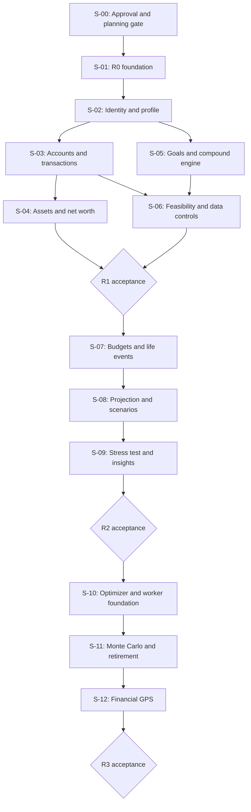

# Esokira — Master Implementation Roadmap

> **Canonical path:** `docs/planning/MASTER-ROADMAP.md`  
> **Version:** `0.1.0`  
> **Prepared:** 30 October 2026  
> **Document status:** `REVIEWED_INTERNAL — PENDING_OWNER_APPROVAL`  
> **Implementation status:** `UNVERIFIED` — repository source code, deployed systems, CI, and migrations have **not** been audited in this documentation task.  
> **Scope:** R0 Engineering Foundation → R1 MVP → R2 Planning V1 → R3 Advanced; R4 is discovery-only.  
> **Audience:** Product Owner, AI coding agents, Flutter/Go engineers, QA, security and product reviewers.  
> **Purpose:** translate the PRD, Feature Matrix, financial rules, architectural designs, and quality policy into an ordered, **evidence-gated delivery strategy**. This roadmap is neither an approved sprint schedule nor proof of implemented functionality.

---

## 0. Executive contract — read before using this roadmap

**Mission:** develop Esokira incrementally as a mobile-first, Indonesia-oriented personal financial life-planning and simulation product. The system must distinguish *actual financial state* from goals, scenarios, forecasts, and stochastic results. It is not a payment, banking, trading, lending, or automated investment platform.

**Fixed choices from the Product Owner conversation:** Flutter frontend, Go backend, PostgreSQL database, and monorepo directories `frontend/` and `backend/`. All other stack or modeling choices carry the status recorded in their owning specification. In particular, authentication provider, `pgx/sqlc`, router, queue, Flutter state management, monetary representation, rounding policy, hosting, and model assumptions are **not approved simply because a document recommends them**.

The roadmap has five non-negotiable rules:

1. **No automatic approval.** `REVIEWED_INTERNAL` of a `.md` file does not turn `PROPOSED` or `TBD` into `DECIDED` and is not permission to deploy production code.
2. **No phantom progress.** Until the actual repository is inspected, all implementation statuses remain `UNVERIFIED`, not `NOT_STARTED` or `DONE`.
3. **No requirement invention.** The PRD owns feature behavior; this roadmap owns sequencing and exit evidence. Do not use a slice summary to create undocumented features, APIs, SQL schemas, or financial formulas.
4. **No false financial outcomes.** Transfers, goals, and simulations must obey approved domain invariants and numerically verified test vectors; a future scenario must never mutate actual balances.
5. **No declaration of DONE without evidence.** Use `DEFINITION-OF-DONE.md` and `TESTING-STRATEGY.md`; command output, test environment, reviewer decision, and unresolved risks must be recorded.

**Document-only completion:** creation and internal review of this roadmap does **not** establish approval of R0, a working Go/Flutter app, a configured PostgreSQL database, or a released Esokira build.

---

## 1. Source-of-truth hierarchy and required reading

All paths below are relative to `docs/planning/MASTER-ROADMAP.md` unless otherwise noted.

| Area | Canonical document | What it owns |
|---|---|---|
| Product purpose | [`PRODUCT-VISION.md`](../product/PRODUCT-VISION.md) | Audience, value, V-01–V-05 pillars, non-goals |
| Requirements | [`PRD.md`](../product/PRD.md) | `FR-001`–`FR-024`, `EN-001`–`EN-006`, `NFR-001`–`NFR-010` |
| Feature dependency sequence | [`FEATURE-MATRIX.md`](../product/FEATURE-MATRIX.md) | R0–R4, `S-00`–`S-12`, feature ordering and readiness |
| Financial meaning | [`FINANCIAL-DOMAIN-RULES.md`](../financial/FINANCIAL-DOMAIN-RULES.md) | `DR-001`–`DR-024`, balances, ownership, goal funding |
| Financial calculations | [`CALCULATION-SPECS.md`](../financial/CALCULATION-SPECS.md) | `CS-001`–`CS-016`; inputs, timing, rate, numerical conventions |
| Financial evidence | [`FINANCIAL-TEST-CASES.md`](../financial/FINANCIAL-TEST-CASES.md) | `FTC-*` reference cases and invariants |
| System boundaries | [`SYSTEM-ARCHITECTURE.md`](../architecture/SYSTEM-ARCHITECTURE.md) | Trust boundary and overall topology |
| Go services | [`BACKEND-ARCHITECTURE.md`](../architecture/BACKEND-ARCHITECTURE.md) | Backend responsibilities and `BE-Q01`–`BE-Q17` |
| Flutter | [`FRONTEND-ARCHITECTURE.md`](../architecture/FRONTEND-ARCHITECTURE.md) | Feature layers, state, caching and `FE-Q01`–`FE-Q18` |
| PostgreSQL | [`DATABASE-DESIGN.md`](../architecture/DATABASE-DESIGN.md) | Candidate schema, constraints, `DB-Q*`; illustrative SQL is not a migration |
| API standards | [`API-GUIDELINES.md`](../architecture/API-GUIDELINES.md) | Conventions and `API-Q*`; sample routes are not live endpoints |
| Visual system | [`DESIGN-SYSTEM.md`](../design/DESIGN-SYSTEM.md) | Candidate colors, tokens, component/accessibility rules |
| User behavior | [`USER-FLOWS.md`](../design/USER-FLOWS.md) | `UF-00`–`UF-31`, alternatives, `UXT-*` |
| Flutter screens | [`SCREEN-SPECS.md`](../design/SCREEN-SPECS.md) | `SCR-00`–`SCR-22`, screen states, UX gates |
| Security/privacy | [`SECURITY-PRIVACY.md`](../security/SECURITY-PRIVACY.md) | Threat controls and `ST-001`–`ST-075` tests |
| Root agent rules | [`AGENTS.md`](../../AGENTS.md) | All-task guardrails, authority and decision policy |
| Frontend agent rules | [`frontend/AGENTS.md`](../../frontend/AGENTS.md) | Flutter-only agent behavior |
| Backend agent rules | [`backend/AGENTS.md`](../../backend/AGENTS.md) | Go/PostgreSQL agent behavior |
| Execution protocol | [`DEVELOPMENT-WORKFLOW.md`](../development/DEVELOPMENT-WORKFLOW.md) | Inspect → Trace → Plan → Gate → Implement → Verify → Handoff |
| Verification approach | [`TESTING-STRATEGY.md`](../development/TESTING-STRATEGY.md) | `TS-001`–`TS-040`, test layers and evidence |
| Acceptance policy | [`DEFINITION-OF-DONE.md`](../development/DEFINITION-OF-DONE.md) | `DOD-G01`–`DOD-G10` and release gates |

**Once approved and present**, actual `contracts/openapi.yaml` is authoritative for serialized API wire shapes; applied migrations under `backend/db/migrations/` are authoritative for deployed schema. This roadmap does not create or approve either artifact. If sources disagree, identify the *owner of that subject*, raise a decision, and update that owner first; never settle conflicts by silently copying the last document read.

**Reading policy for agents:** first root and nested `AGENTS.md`, then the task's PRD IDs and relevant sections, not the entire knowledge base on every request. Use this roadmap as the route map, not a substitute for detailed source specifications.

---

## 2. Product outcomes, principles, and release boundaries

| Pillar | Product outcome | Primary release |
|---|---|---|
| V-01 — Financial Reality | User can inspect assets, liabilities, actual cash activity and known data limits. | R1 |
| V-02 — Goal-Based Planning | User can create goals, inspect calculations and distinguish planned from actual funding. | R1, enhanced R2 |
| V-03 — Life & Scenario Simulation | User can compare multiple hypothetical futures without changing actuals. | R2 |
| V-04 — Risk & Optimization | User can see feasible/infeasible trade-offs and distributional uncertainty. | R2 stress test; R3 optimizer/Monte Carlo/FIRE |
| V-05 — Explainable Guidance | User can understand evidence, limitations and compare alternative financial actions. | R2 insights; R3 Financial GPS |

**Out of scope through R3:** real payments, placing trades, linking bank/broker accounts by default, granting loans, enterprise accounting, and presenting professional investment recommendations as certainty. No live integrations, telemetry providers or AI services may be inserted without scoped approval and security review.

| Release | Product promise | Explicit boundary | Status today |
|---|---|---|---|
| R0 | Reproducible development/testing and secure app/data foundations. | Not yet a complete usable financial product. | `UNVERIFIED` |
| R1 | Actual finances + first useful goal/calculator journey. | No full life-event scenario/risk engine. | `UNVERIFIED` |
| R2 | Deterministic future planning and explainable insights. | No probabilistic guarantee or optimizer without R3 gate. | `UNVERIFIED` |
| R3 | Optimizer, Monte Carlo, FIRE and Financial GPS after model review. | No automated transfer, trade or investment execution. | `UNVERIFIED` |
| R4 | Research shared goals and portfolio planning concepts. | Discovery only; no production implementation authorization. | `DISCOVERY` |

**Time, budget and staffing:** no fabricated sprint length, launch date, cost ceiling, user adoption target, throughput SLA, coverage percentage, or p95 latency. Those are `TBD` until measured or separately approved. `S-00`–`S-12` are delivery slices, **not** calendar sprints.

---

## 3. Overall delivery sequence and dependencies

The canonical slice inventory is exactly `S-00` through `S-12`, from `FEATURE-MATRIX.md`. Preserve the numbering.



The chart is a **high-level execution sequence**, not a complete dependency graph for each requirement. For definitive feature prerequisites, use `FEATURE-MATRIX.md` §6. Parallel implementation is allowed only where interfaces, prerequisites, and ownership are clear; an earlier diagram arrow never overrides actual dependency checks.

### 3.1 Summary of slices

| Release | Slice | Key work | Requirement/enabler coverage |
|---|---|---|---|
| Planning | S-00 | Readiness/approval, initial decision register, golden tests gate | Planning gate; not implementation |
| R0 | S-01 | Monorepo, DB foundation, API contract foundation, security/CI, engine test harness | EN-001, EN-002, EN-003, EN-006, plus **R0 portion** of EN-004 |
| R1 | S-02 | Identity + financial profile | FR-001, FR-002 |
| R1 | S-03 | Accounts, opening balances, income/expense/transfer | FR-003, FR-004 |
| R1 | S-04 | Assets, liabilities, net worth dashboard | FR-005, FR-006 |
| R1 | S-05 | Goals + compound calculator; complete relevant engine tests | FR-007, FR-008, **EN-004 completion for the feature** |
| R1 | S-06 | Goal feasibility + export/deletion | FR-009, FR-021; **R1 gate** |
| R2 | S-07 | Budget, recurring, life events | FR-010, FR-011 |
| R2 | S-08 | Deterministic projection, scenario/versioning, future cash flow | FR-012, FR-013, FR-014 |
| R2 | S-09 | Stress tests, explainable insights, notifications | FR-015, FR-016, FR-022; **R2 gate** |
| R3 | S-10 | Multi-goal optimizer and worker setup | FR-017, EN-005 |
| R3 | S-11 | Monte Carlo and Retirement/FIRE | FR-018, FR-019 |
| R3 | S-12 | Financial GPS + explainable alternative paths | FR-020; **R3 gate** |

**EN-004 reconciliation:** `DEFINITION-OF-DONE.md` treats independent engine testability as an R0 gate; `FEATURE-MATRIX.md` places `EN-004` in S-05 alongside FR-008. Implement the *empty/contract-ready pure domain boundary and test harness* in R0, then add approved compound calculation behavior and golden vectors in S-05. This is a **two-stage readiness interpretation**, not a change to feature dependency or a claim that FR-008 is in R0. If owner requires an entirely completed EN-004 at R0, record that detail explicitly before closing the R0 gate.

---

## 4. Approval and decision gate model

A roadmap slice must be distinguished from permission to commit code.

| State | Meaning | Eligible action |
|---|---|---|
| `PROPOSED` | Described in docs, not owner-approved. | Draft, review, enumerate options, isolated research. |
| `TBD` | A binding choice or test oracle does not yet exist. | Identify blocker, measure options, request specific owner decision. |
| `DECIDED` | Explicit owner decision recorded for the defined scope. | May be used by tasks within that scope after DoR. |
| `BLOCKED` | Required policy, source, dependency or verification is missing. | Do not implement the affected production behavior. |
| `UNVERIFIED` | Actual repository/state has not been checked. | Audit; do not claim absent or completed implementation. |

A separate task tracker may use `NOT_STARTED → READY → IN_PROGRESS → IN_REVIEW → DONE`, plus `PARTIAL/BLOCKED/CANCELLED`, **only after the repo is audited and tasks exist**. Keep test outcomes (`PASS/FAIL/NOT_RUN/SKIPPED/BLOCKED/N/A`) separate from task statuses.

### 4.1 Minimum readiness for any implementation slice

- [ ] Scoped task and release/FR/EN IDs are recorded, authorized by owner, and aligned with PRD and Feature Matrix.
- [ ] Existing repository structure, Git state, source, tests and environment have been inspected (do not assume an empty codebase).
- [ ] Prerequisite slices and tests are evidenced; unresolved blockers do not affect the proposed code path.
- [ ] Relevant policy choices (auth, ledger, precision, scenario version, risk, etc.) have an explicit approved value where used.
- [ ] Approved financial test oracle is available **before** implementing numerical rules; the proposed result is not derived solely from the code being written.
- [ ] API/DB/client changes have a contract/migration plan and backward compatibility assessment.
- [ ] Security/consent impact is evaluated, including export/deletion if relevant.
- [ ] Acceptance includes normal, boundary, failure, retry and ownership cases where applicable.
- [ ] Verification tools, disposable DB/test users, and missing test infrastructure are documented honestly.

A *documentation-only* task can be completed while implementation is blocked; do not conflate document readiness with feature acceptance.

---

## 5. S-00 — Product and architecture readiness (planning gate)

**Outcome:** approved implementation boundaries for the earliest safe R0 work; a maintained register of unresolved decisions; executable verification plan. This slice does not build the app.

**Inputs:** 21 existing baseline Markdown documents (including three `AGENTS.md` files); Product Owner feedback; actual repository audit if any code already exists.

**Work packages (not already-completed task claims):**

1. Inspect baseline docs and mark proposed vs approved decisions. Resolve duplicate/conflicting authority at the owning source, not here.
2. Confirm scope R0/R1 and priority order; treat R2/R3 as planning horizons, not implicit build authorization.
3. Resolve first-wave decisions listed in §15: identity provider, data ownership, ledger/opening-balance model, money precision, privacy/retention and deployment/test environments.
4. Decide whether the candidate tech library set is accepted **per dependency**; do not bulk approve chi/pgx/sqlc/River/Riverpod because they were mentioned in a conversation.
5. Review `CALCULATION-SPECS.md` and `FINANCIAL-TEST-CASES.md`: partition independently verifiable core examples from still-TBD models and mark blocking policy separately.
6. Prepare an approved task backlog with dependency IDs and bounded acceptance; the next document `TASKS.md` will hold it after creation.
7. Define minimum release reviewer(s), evidence storage, and change approval mechanism; no auto-approval by AI.

**Exit evidence:** owner decision references and unresolved blocker list, approved R0 scope, selected initial test environment and the first bounded tasks. If only drafts exist, report `PARTIAL` or `BLOCKED` for S-00; **do not call it DONE**.

**Hard stop:** no irreversible financial schema design, authentication integration or production financial calculation may be implemented merely because S-00 appears in this roadmap.

---

## 6. S-01 / R0 — Engineering Foundation

**Outcome:** one reproducible development environment with Flutter, Go, PostgreSQL foundation, security controls, API verification and independently testable financial engine boundary. R0 does **not** promise finished customer features.

| Workstream | Output expected | Critical verification |
|---|---|---|
| Monorepo (`EN-001`) | `frontend/`, `backend/`, root config, documented setup and relevant build/test commands. | Reproduce clean checkout setup; independent build/analyze/test runs if tools exist. |
| PostgreSQL (`EN-002`) | Approved migration lifecycle, owner boundary, constraints and disposable test DB. | Apply/rollback or forward-only migration policy tests as approved; cross-user negatives. |
| API foundation (`EN-003`) | Approved minimum OpenAPI contract, validation/error/security middleware skeleton. | Contract parses, negative auth tests, no fabricated endpoints. |
| Financial engine core (`EN-004`, R0 portion) | Pure Go domain package and test harness independent of transport/database. | Go unit test can execute trivial isolated invariants without backend boot. |
| Secrets/operations (`EN-006`) | Secret config policy, privacy-safe logs, health/recovery documentation and backup plan. | Sensitive config never in client or git; synthetic restore exercise as scoped. |
| Flutter shell | Minimal safe launch/navigation, error and session states when auth policy permits. | Analyzer/widget tests; no fake balance or live data. |
| CI baseline | Repo-verified lint/format/build/unit/selected integration checks, not invented commands. | Actual pipeline log, environment and failure behavior. |

**Suggested implementation order:** inspect repo → approved local Postgres → migrations/schema fundamentals → API validation/auth interfaces → pure financial test harness → Flutter launch shell → CI/security/recovery verification. Avoid assuming Docker Compose, Makefile or CI already exist; introduce them only through an approved task.

**R0 decision gates:** auth provider and server-verified principal (needed before real user data); SQL/ledger ownership schema; policy for config/secrets; local/staging database isolation; migration rollback strategy; initial money type if account schema includes amounts. Production secrets, real financial records or external bank data never belong in fixtures.

**R0 exit:** all relevant `DOD-G01`–`DOD-G10` and release R0 checklist in `DEFINITION-OF-DONE.md` §12.1, including recorded evidence, must be satisfied. Unit tests alone do not demonstrate authenticated ownership or a safe database migration.

**Explicit exclusions:** `EN-005` is an R3 enabler. Redis, microservices, recommendation AI, Monte Carlo workers, live payment/bank integrations and R2/R3 UI are not R0 requirements.

---

## 7. R1 — Minimum useful personal finance product (S-02 through S-06)

**User outcome:** the same user can authenticate, record actual financial state, create a goal, see a validated compound/feasibility estimate and control export/deletion of their data. There must be no permanent fake-success backend or charts.

### 7.1 S-02 — Identity, sessions and profile (`FR-001`, `FR-002`)

**Build within approved scope:** session restoration and logout, a backend-verified principal, owner isolation, profile validation, onboarding with clear use of personal information, and coherent loading/unauthorized/offline states in Flutter.

**Dependency:** R0 identity interfaces, owner mapping and security decisions. Login SDK/provider and exact profile attributes remain blocked until selected.

**Evidence:** two synthetic users cannot read/update each other's accounts/profile; session expiry and unauthorized paths are tested; onboarding completes or fails safely; error/log content excludes sensitive data.

**Do not:** treat a client-selected `user_id` as the owner; enable a financial screen with fabricated production values.

### 7.2 S-03 — Accounts and actual transactions (`FR-003`, `FR-004`)

**Build within approved scope:** accounts and opening balances; income/expense/transfer; corrections or reversal only according to approved ledger policy; clear transaction details, validation and retry/recovery UX.

**Dependency:** approved posting/ledger schema (`PRD Q-03`), money/time/currency policy (`Q-04`), authorization and migration tests.

**Evidence:** opening balance is not new income; transfer without fee preserves net worth; no partial transfer posting; duplicate retry/timeout does not produce double posting; concurrency and rollback verified in a disposable PostgreSQL database; unauthorized resource access rejected.

**Do not:** display success immediately after timeout with unknown server outcome; quietly hard-delete audit-critical rows if reversal policy is undecided.

### 7.3 S-04 — Assets, liabilities and net worth (`FR-005`, `FR-006`)

**Build within approved scope:** financial asset and liability records, dated valuations, actual net worth and period summaries, understandable dashboard cards/charts with data recency and negative values.

**Dependency:** S-03 ledger semantics, anti-double-counting policy and approved net-worth test vectors.

**Evidence:** net worth = included assets minus liabilities; account cash is counted once; internal transfers do not inflate expenses; liabilities and negative net worth render correctly; last-updated/actual labels are visible.

**Do not:** present projected growth as actual net worth; merge investment account balances with separate valuations unless the accounting rule explicitly prevents duplication.

### 7.4 S-05 — Goals and compound calculator (`FR-007`, `FR-008`, EN-004)

**Build within approved scope:** goal create/edit/archive, targets and priorities, compound calculator inputs/results, assumption summary and future-versus-actual labels. Complete the approved numerical implementation over the pure engine introduced in R0.

**Dependency:** financial goals data model, funded-goal policy (`PRD Q-11`), rate/contribution timing/rounding policy (`Q-04`) and relevant independently verified `FTC-*` cases.

**Evidence:** rate zero, horizon zero, invalid units, periodic contributions and compounding timing tests pass; calculated results show total contributions versus estimated gains; planned contributions are never presented as confirmed funding.

**Do not:** invent investment returns or use Flutter's own undocumented formula as authoritative business logic.

### 7.5 S-06 — Goal feasibility, data rights and R1 closure (`FR-009`, `FR-021`)

**Build within approved scope:** compute required goal contribution and capacity/shortfall; display infeasible plans transparently; provide secure export and deletion request flows with retention/backup explanations.

**Dependency:** goal funding policy, approved feasibility formulas and capacity semantics; owner-approved export/delete/retention and recovery rules.

**Evidence:** boundary and infeasible goal tests; no actual balance mutation from setting a contribution goal; correct cross-user denial for exports/deletions; end-to-end synthetic UJ-01 and UJ-02 user journeys pass; deletion/export failures are observable without exposing private data.

**R1 acceptance gate:** S-02 to S-06 meet all applicable PRD acceptance criteria; R0 gates remain passing; selected UX accessibility, financial golden, DB concurrency, API contract and security tests have real evidence. If FR-021 is not safely implemented, **R1 is not complete**; changing release scope requires a formal PRD/owner decision.

---

## 8. R2 — Planning and deterministic future scenarios (S-07 through S-09)

**User outcome:** users compare hypothetical life plans on a reproducible financial baseline. Forecasts, life events and alerts must never be treated as posted financial facts.

**Documentation blocker:** `docs/financial/SCENARIO-ENGINE.md` is a **planned future artifact, not one of the 21 baseline docs**. Approve the snapshot/version/event ordering/cash-flow semantics and expected results before production implementation of the dependent engine.

### 8.1 S-07 — Budget, recurring plans and life events (`FR-010`, `FR-011`)

**Build:** category/period budgeting, safe recurring transactions, and hypothetical dated one-time/repeating life events attached to a planning draft. Life event semantics are scenario inputs, not actual postings.

**Dependency:** S-03 actual transaction model; approved recurring idempotency behavior; life-event modeling rules and dates.

**Evidence:** budget-vs-actual excludes transfers; recurring processing cannot duplicate actual records on retry; adding/editing a life event never changes a real account; all event assumptions are visible and validated.

### 8.2 S-08 — Projection, scenario versioning and forecast (`FR-012`, `FR-013`, `FR-014`)

**Build:** deterministic monthly or approved-period projection; baseline snapshots and versions; scenario compare; future cash-flow shortfall markers; stale-result behavior when actual data is revised.

**Dependency:** approved `SCENARIO-ENGINE.md`, rate/time/cost/inflation policy (`PRD Q-05`), scenario baseline/versioning policy (`Q-06`), R1 actual data and S-07 life events.

**Evidence:** same baseline + assumptions + engine version reproduces results; comparing two versions does not mutate actuals; late edits/stale snapshots are detectable; negative cash forecasts are distinguished from negative actual balances; unsupported assumptions are flagged rather than silently defaulted.

**Do not:** overwrite actual snapshots when creating scenarios or infer financial certainty from deterministic outputs.

### 8.3 S-09 — Stress test, insights, reminders (`FR-015`, `FR-016`, `FR-022`)

**Build:** parameterized shock scenarios, understandable resilient-cash metrics, explainable rule-based insights with insufficient-data behavior and opt-in reminder preferences. Provider and frequency of notifications remain `TBD` until approved.

**Dependency:** S-08 projection/forecast, approved shocks/rules and privacy-safe notification policy (`PRD Q-09`).

**Evidence:** lost-income/expense-shock cases and recovery UX; insights cite rules and assumptions; missing inputs never trigger invented risk scores; reminders off by default until explicit user opt-in; lock screen preview does not expose balances.

**R2 acceptance gate:** R1 regression remains valid; scenario isolation, reproducibility, stale data handling, stress tests and explanation boundaries pass; privacy and no-real-money-action checks are recorded. Notification delivery must not be mislabeled successful merely because the UI preference was saved.

---

## 9. R3 — Advanced simulation and explainable decisions (S-10 through S-12)

**User outcome:** users see which goals are feasible under constraints, understand modeled uncertainty and compare alternative paths. R3 is **not** automatically authorized because R2 is planned or complete.

### 9.1 S-10 — Goal allocation optimization and worker foundation (`FR-017`, `EN-005`)

**Build:** a formally specified, testable multi-goal optimizer with feasible/infeasible results and approved objective/constraints/tie-break rules. Prepare bounded background job capability for heavy simulation, with status and ownership controls.

**Documentation blocker:** `docs/financial/GOAL-OPTIMIZER.md` is still a **planned artifact** and its optimization model is not fully authorized by `CALCULATION-SPECS.md` alone.

**Dependency:** S-08 deterministic engine, goal and capacity policies, owner-approved optimization objective (`PRD Q-07`) and worker infrastructure design. Worker may be developed as a separate subtask within S-10; do not make optimizer code depend on a queue unless processing load justifies it.

**Evidence:** independently checked reference optimum, deliberately infeasible cases, deterministic tie-break, positive/zero/negative constraint tests; queued job isolation, retry/deduplication and timeout/cancellation testing when worker is in scope.

### 9.2 S-11 — Monte Carlo and Retirement/FIRE (`FR-018`, `FR-019`)

**Build:** stochastic simulation using owner-reviewed assumptions, seeded runs, statistical summaries and limitation disclosures; retirement decumulation and depletion modeling with nominal/real distinctions.

**Documentation blocker:** `docs/financial/MONTE-CARLO.md` is not yet in the baseline docs. Statistical distribution, correlations, seed, iteration budget, confidence communication and interpretation require model review (`PRD Q-08`). Retirement assumptions must be separately approved.

**Dependency:** R2 projection and S-10 worker readiness for long-running jobs, plus independent reference/validation plan.

**Evidence:** repeated runs with the same model version/seed/inputs yield agreed reproducible summaries within approved tolerance; error/failure/job timeout states are correct; outcome percentiles, success-rate definition, sequence-of-returns and retirement depletion cases verified; performance measured against an **approved** resource budget.

**Do not:** label sample-path frequency as guaranteed real-world success probability; choose unreviewed normal-return distribution as a production default.

### 9.3 S-12 — Financial GPS/adaptive alternatives (`FR-020`)

**Build:** generated alternative paths (change contribution, target, deadline, priority) calculated through the same validated engines as the primary scenario; show reasons, constraints, trade-offs, uncertainty and explicit user choice.

**Dependency:** S-09 explainable insights, S-10 optimizer, S-11 risk engine, approved financial advice boundary and reviewed explanation/copy.

**Evidence:** recommended options can be replayed against scenario/optimizer/risk engines; impossible alternatives are rejected or marked infeasible; stale engine results cannot masquerade as current; UI never auto-submits actual transfers or investments.

**R3 acceptance gate:** all relevant financial models independently reviewed, probabilistic language validated, seeded replay and worker reliability proven, prior R0–R2 quality maintained, UI model transparency and security/privacy checks passed. Missing statistical model approval is **BLOCKED**, not an invitation for AI to pick a convenient one.

---

## 10. R4 — Discovery backlog, not a delivery commitment

**FR-023:** Shared financial goals — research account sharing, permissions, invitations, revocation, consent, conflict handling, ownership and deletion semantics.  
**FR-024:** Portfolio planning — research asset model, price provenance, return assumptions, risk, licensing/compliance and recommendation boundaries.

Allowed activity: user research, problem framing, threat modeling, feasibility studies and *proposed* PRD revisions. Disallowed activity without new approval: live backend endpoints, permission models, production database tables, screens marketed as functional features, bank/broker integrations and automatic investing.

Discovery exit is a reviewed product/technical decision, **not** a new R4 implementation status.

---

## 11. Cross-cutting workstreams and integration contracts

| Workstream | R0–R1 work | R2–R3 extensions | Interface/owner rule |
|---|---|---|---|
| Product and documentation | Resolve decisions, bounded acceptance, user journeys | Scenario/model specification and transparent guidance | PRD owns behavior; Feature Matrix owns ordering |
| Go domain | Money types, posting use cases, independent financial library | Projection, optimizer, Monte Carlo, FIRE | Engine cannot import HTTP/DB/UI packages |
| PostgreSQL | Approved migrations, tenancy and financial integrity | Scenario versions, run provenance and worker storage | Schema change requires reviewed migration/integration tests |
| REST/OpenAPI | Auth, validation, errors, CRUD and calculations | Scenario compare and job lifecycle | Approved OpenAPI is wire source; example API docs are not endpoints |
| Flutter | Auth, profiles, actual finances, goals, error recovery | Timeline, scenarios, risk visualizations and Financial GPS | No authoritative local balance mutation or invented API fields |
| Security/privacy | Tenant isolation, safe storage, data export/deletion | Job ownership, model data leakage and notification privacy | Server principal authoritative; explicit data lifecycle |
| QA | Golden numbers, DB concurrency, widget/API tests | Deterministic/stochastic references, job restart/failure | Report actual test commands, setup and results |
| Operations | CI, secrets, monitoring, restore and staging readiness | Bounded workers, retention, model version upgrades | Measure costs/performance; no invented provider/SLA |

### 11.1 Small vertical slices, not horizontal-only scaffolding

Prefer work that produces a complete testable behavior from approved UI input through API/use case/DB or engine to result and back, plus error handling. Example in R1: create account → save opening balance → retrieve actual balance → display in Flutter with correct status and unauthorized cases. Large layers may be built initially if they directly support a verifiable next slice; do not count an empty folder tree as a feature.

### 11.2 Separation of financial truth

- **Actual:** durable user records, transactions and owned resources. Only dedicated, authorized financial-write use cases can mutate them.
- **Planned:** goals and intended allocations; planned contribution is not actual-funded progress.
- **Scenario/forecast:** immutable or versioned hypotheses derived from an identifiable baseline and explicit assumptions; changes cannot post actual transactions.
- **Stochastic run:** versioned model/seed/provenance and statistical output; may become stale when the baseline changes.
- **Insight/advice-like display:** explanation of verified model outputs, not financial transactions or guarantees.

This distinction must be enforced **in database, backend, API and Flutter**, not only by different label colors.

---

## 12. Dependency gates and safe parallelization

**Chain A (actual finance):** `EN-001/002/003/006 → FR-001/002 → FR-003/004 → FR-005/006`.  
**Chain B (first goals):** `EN-004 → FR-008`; `FR-002 → FR-007`; `FR-004/007/008 → FR-009`; `FR-001/003/004/005/007 → FR-021`.  
**Chain C (planning):** `FR-004 → FR-010`; `FR-007 → FR-011`; actuals + goals + budget/events → `FR-012 → FR-013/014 → FR-015 → FR-016`; `FR-007/016 → FR-022`.  
**Chain D (advanced):** goals + feasibility + projection/scenarios → `FR-017`; projection/scenarios + `EN-005` → `FR-018`; projection + Monte Carlo → `FR-019`; scenario + explainable insights + optimizer + Monte Carlo → `FR-020`.

**Parallelizable after approved interfaces:** Flutter component testing and Go financial golden test implementation; documentation of UX states and backend error taxonomy; independent security threat cases and migration tests.  
**Do not parallelize without integration ownership:** editing the same OpenAPI/schema migrations, adopting different money/time semantics in Flutter and Go, or separate agents implementing competing ledger/optimizer methods.

A parallel agent handoff must identify file ownership, branch/base revision if Git exists, interfaces, decisions, tests executed and limitations. The integration owner verifies actual compatibility; another agent's `DONE` label alone is not evidence.

---

## 13. Prerequisite documents and missing future specifications

**Already created as reviewed drafts (not automatically approved):** the 21 files listed in §1; these include six baseline financial and product documents, system/backend/frontend/database/API architecture, design and UX, security, three AGENTS files, workflow, testing and DoD.

**Needed before certain production behavior (planned, not yet existing):**

| Document/contract | Required before | Policy |
|---|---|---|
| `docs/financial/SCENARIO-ENGINE.md` | FR-012, FR-013, FR-014 and dependent R2/R3 runs | Specify baseline, snapshots, event ordering, time/rate, revisions and deterministic test oracle. |
| `docs/financial/GOAL-OPTIMIZER.md` | FR-017 | Specify objective, priorities, constraint handling, ties, infeasible reference solutions. |
| `docs/financial/MONTE-CARLO.md` | FR-018, FR-019 | Approve statistical model, seed, correlation/inflation/sequence risk and validation ranges. |
| Financial GPS explanation rules (dedicated spec or approved section) | FR-020 | Rule provenance, safe alternatives and advice boundaries. |
| `contracts/openapi.yaml` | Implementation of contract-bound API/client operations | Machine-readable approved payloads, errors, auth, time and monetary serialization. |
| Versioned SQL migrations | Actual DB writes, user-owned storage, transaction/worker persistence | Actual tested schema after data-model approval, not example SQL from Markdown. |
| `docs/planning/TASKS.md` | Routine agent task execution after roadmap approval | Real backlog with task IDs, dependencies, acceptance, blockers, owner decisions. |
| `docs/planning/PROGRESS.md` | Long-running coordination/tracking | Observed progress and execution evidence only. |
| `docs/planning/DECISION-LOG.md` | Formalizing open→approved policy decisions | Decision, rationale, approver, date, affected specs and test impacts. |
| `docs/development/LOCAL-SETUP.md` and deployment plan | Reproducible R0 operations / later releases | Commands/credentials must be derived from actual manifests/environment. |

Do **not** create a fake file/reference and pretend it already exists. A missing item is a precisely reported `BLOCKED_BY_DOC`, `BLOCKED_BY_DECISION`, or `UNVERIFIED` state, as applicable. Specifications can be drafted in advance when the owner authorizes that document task.

---

## 14. Definition of Ready / Definition of Done / release gates

`DEVELOPMENT-WORKFLOW.md` specifies how agents work; `TESTING-STRATEGY.md` specifies which test evidence is necessary; `DEFINITION-OF-DONE.md` decides acceptance. This roadmap adds sequencing **without weakening** those documents.

### 14.1 Universal quality gates

`DOD-G01` scope, `G02` behavior, `G03` financial semantics, `G04` security/privacy, `G05` API/DB/client consistency, `G06` UX, `G07` operations/reliability, `G08` real verification evidence, `G09` documentation/traceability, `G10` review/handoff.

Each task evaluates all applicable gates with **actual** outcomes (`PASS/FAIL/NOT_RUN/SKIPPED/BLOCKED/N/A` and reason for `N/A`). **Tests not run are not PASS.** A documentation-only task is not required to run nonexistent Go/Flutter source tests; it must verify source references, artifacts and ZIP when packaged.

### 14.2 Release evidence matrix

| Gate | R0 | R1 | R2 | R3 |
|---|---|---|---|---|
| Clean environment, build and targeted CI evidence | Required | Re-run impacted | Re-run impacted | Re-run impacted |
| DB migrations, owner isolation, transaction integrity | Foundation and negative tests | Full transfer/correction/export paths | Regression + recurring and scenario isolation | Regression + job ownership |
| Pure Go numerical tests | Harness and core invariants | Compound, goal and net worth golden vectors | Deterministic replay, stress and shortfall | Optimizer optimum, stochastic reference, FIRE depletion |
| Approved API contract and client compatibility | Baseline | Actual/goal operations | Scenario/version/forecast operations | Run lifecycle and financial GPS outputs |
| Flutter error/loading/empty/accessibility | Base shell | Actual + goal journeys | Scenario + stale/recovery journeys | Worker progress, model caveat and alternatives |
| Data protection and recovery | Secrets, logs, backups plan | Export/deletion/retention and authorized release controls | Consent/notification privacy + scenario data | Sensitive job/model output retention and cancellation |
| Runtime behavior | Capture baseline | Measure agreed API workload | Forecast and scenario loads | Measure CPU/memory/queue/time against approved limits |
| Product acceptance and deployment permission | Owner R0 gate | Owner R1 acceptance | Owner R2 acceptance | Owner R3 acceptance |

Thresholds for test coverage, latency, stochastic convergence and resource budget remain `TBD`. Never set a pass threshold from intuition. If an affected release has an outstanding critical gate, mark it `BLOCKED`/`PARTIAL` rather than reporting completion.

### 14.3 Hard stops (cannot be waived into DONE)

- Cross-user financial data read/write/export/delete.
- Wrong or inconsistent actual money balances, partial posting, duplicate transfer on retry.
- Scenario/job/goal simulation that mutates actuals.
- Secret/token or sensitive financial record leakage.
- Known incorrect numerical result or falsely reassuring risk claim.
- Unapproved statistical/optimization policy masquerading as a validated result.
- Destructive account deletion without approved retention/recovery behavior.

Small noncritical UX exceptions may be documented and explicitly approved according to DoD policy, but a waiver is never fabricated test success.

---

## 15. Decision queue — resolve near the first affected slice

This table **routes** decisions; it does not approve choices. The canonical question IDs remain in `PRD.md` §12; backend/frontend/DB/API/security documents may carry additional local IDs.

| Product decision | First affected slice | What owner/reviewer must settle | Default action while unresolved |
|---|---|---|---|
| `Q-01` product naming/locale/scope approval | S-00 | Working brand, initial user audience, R1 priority | Continue drafts; do not assert approval |
| `Q-02` auth provider and session model | S-01/S-02 | Provider, principal verification, lifecycle | Block auth-coupled production writes |
| `Q-03` ledger/opening balance/correction | S-01/S-03 | Posting semantics, reconciliation, revision/audit policy | Block financial write schema and flows |
| `Q-04` monetary/time/rate precision | S-01/S-03/S-05 | Money representation, currency, rounding, effective dates, contribution timing | Block conflicting numeric/storage implementation |
| `Q-05` inflation/return/debt modeling | S-07/S-08 | Which assumptions are supported and how unknowns are handled | Block dependent projection defaults |
| `Q-06` scenario baseline and version | S-07/S-08 | Snapshot/revision/stale behavior | Block scenario persistence/projections |
| `Q-07` optimizer objective/constraints | S-10 | Feasibility, weights, priorities, tie-breakers | Block FR-017 production engine |
| `Q-08` stochastic risk model | S-11 | Distributions, correlations, seed, interpretation, run budget | Block Monte Carlo/FIRE model release |
| `Q-09` notification consent/provider | S-09 | Opt-in, frequency, safe preview, delivery channel | Block live notifications |
| `Q-10` hosting/backup/retention/legal review | S-00 baseline; R1 production | Environment, restore/retention and release review | Block live-data production rollout |
| `Q-11` actual goal funding/progress | S-05 | What qualifies as funded, association to account/transaction, anti-double-counting | Block funded progress and dependent forecasts |

**Other necessary decisions:** `BE-Q01`–`BE-Q17` in Backend Architecture; `FE-Q01`–`FE-Q18` in Frontend Architecture; `DB-Q*`, `API-Q*`, `TS-Q01`–`TS-Q16`, design, security and workflow/DoD decision registers. Reference the specific local ID only after locating the actual row. Do **not** auto-approve all local decisions to unblock a slice.

**Decision record proposal** (future `DECISION-LOG.md`):

```yaml
id: "DEC-0001"  # example; assign real unique ID only when log exists
source_question: "Q-03"
status: "PROPOSED | DECIDED | REJECTED | REVISIT"
options: []
chosen_option: null
rationale: null
owner: null
approved_at: null
impacted_requirements: ["FR-003", "FR-004", "FR-006"]
impacted_documents: ["docs/financial/FINANCIAL-DOMAIN-RULES.md", "docs/architecture/DATABASE-DESIGN.md"]
required_tests: ["disposable DB posting/rollback/concurrency cases"]
```

The template is illustrative, not a registered decision or production YAML schema.

---

## 16. Risk register and mitigation order

| Risk | Affects | Signal and likely impact | Mitigation / hard boundary |
|---|---|---|---|
| RK-01 Unapproved ledger semantics | R0/R1 | Double counted income, invalid net worth, transfers posted partially | Approve posting model + independent DB/golden tests before actual writes |
| RK-02 Money/rate conversion errors | R1–R3 | Wrong compound/goal result with seemingly correct UI | Decimal policy, rate/timing contracts, edge/golden tests |
| RK-03 Tenant data leakage (IDOR) | All | User accesses other's records or jobs | Server-verified principal, owner-scoped queries, negative E2E tests |
| RK-04 Unknown write outcome | R1/R2 | Retry duplicates transactions | Stable idempotency, consistent unknown/pending UX, server reconciliation |
| RK-05 Scenario contaminates actuals | R2/R3 | Future event changes real balance | Data/class boundary, immutable snapshots, dedicated isolation tests |
| RK-06 Undocumented stochastic model | R3 | False confidence in FIRE/MC success | Statistical design approval, model limitations and seeded tests |
| RK-07 Background overload | R3 | CPU/memory costs, runaway jobs, user-visible hanging | Job budget, concurrency cap, cancel/retry/timeout, measurement |
| RK-08 Sensitive telemetry/backups | R0–R3 | Personal finances/tokens persist in logs or backups | Redaction, retention, access audits, restore/deletion policy |
| RK-09 API/schema drift | All | Flutter and Go interpret fields differently | Approved OpenAPI, contract tests, staged migration/compatibility |
| RK-10 AI agent scope creep | All | Unapproved dependencies, mass refactors, fake completion | Bounded tasks, review of diff, agent rule hierarchy, DoD evidence |
| RK-11 Excessive early architecture | R0 | Slower delivery without user benefit; unnecessary services | Modular monolith first, defer queues/cache/cloud until justified |
| RK-12 UX hides uncertainties | R1–R3 | Users believe plans are actual or probabilities guaranteed | Explicit actual/forecast labels, assumptions, insufficient-data/stale states |
| RK-13 Legal/retention assumptions | Production release | Misleading deletion/consent claims and policy risk | Expert legal/privacy review, transparent retention, no self-certified compliance |
| RK-14 Model version changes | R2/R3 | Replaying an older plan produces unexplained differences | Persist engine/model version, input/seed, migration/cached-result policy |

Risk priority is qualitative until likelihood/impact is assessed using actual operating context. Do not invent numerical risk scores.

---

## 17. Milestone acceptance and demonstration scenarios

Demos are **acceptance evidence targets**, not a substitute for automated testing. Use synthetic users and explicitly named environments.

| Milestone | Demo target | Minimum independent evidence |
|---|---|---|
| M-R0 | Clean setup + Go/Flutter baseline + disposable PostgreSQL + safe auth skeleton | Real build/test, migration, auth-negative, secret/config reports |
| M-R1-A | Two synthetic users, accounts, transfer, net worth | Concurrent transfer rollback/idempotency, isolation, net worth oracle |
| M-R1-B | Create financial goal, calculate compound/feasibility, inspect assumptions | Approved FTC vectors, invalid/zero edge cases, goal progress distinction |
| M-R1-C | Export/delete user data without exposing another user's records | Consent/retention/ownership and recovery tests |
| M-R2-A | Two versions from one baseline yield reproducible different futures | Same-input replay, actual isolation, stale detection, cash shortfall fixtures |
| M-R2-B | Stress shock yields explainable insight and optional reminder | Rule provenance, incomplete-data fallback, notification preview privacy |
| M-R3-A | Multiple goals: feasible and infeasible optimizer cases | Independently checked objective/constraints, reference oracle |
| M-R3-B | Seeded Monte Carlo and retirement failure/depletion examples | Statistical/model review, replay and resource tests |
| M-R3-C | Financial GPS compares alternatives and lets user decide | Engine-derived options, no actual write, review of probabilistic language |

**Acceptance principle:** a screenshot, seeded demo or green unit-test count is insufficient when authorization, database integration, or financial calculation correctness is not independently verified.

---

## 18. Implementation backlog contract for future `TASKS.md`

The roadmap does **not** assign real tasks or mark them done. When `TASKS.md` is created, derive tasks from each `S-xx` slice using the following *proposed* task schema:

```yaml
id: "DRAFT-R0-001"     # example only, not an approved task
release: "R0"
slice: "S-01"
title: "Implement minimal approved PostgreSQL migration lifecycle"
status: "UNVERIFIED"
requirements: ["EN-002", "NFR-001", "NFR-006"]
in_scope: ["Migration runner and synthetic integration verification"]
out_of_scope: ["Production ledger transactions", "Monte Carlo workers"]
depends_on: ["Approved data model and environment policy"]
source_specs: ["docs/architecture/DATABASE-DESIGN.md", "docs/security/SECURITY-PRIVACY.md"]
blocking_decisions: ["Q-03", "Q-04"]
expected_files: []    # must be discovered in real repo
test_plan: ["Disposable PostgreSQL migration and ownership negative tests"]
acceptance: ["Repeatable schema setup", "Documented verification output"]
owner_approval: null
implementation_evidence: []
```

**Task sizing rules:** a task should have one primary behavior and clearly bounded files, contracts and verification. Split tasks that combine unrelated DB migration, UI redesign, and statistical-model changes. A task may touch several layers if it forms one cohesive vertical behavior and compatibility is explicitly tested.

**Suggested R0 task decomposition after audit:** repository baseline/CI; approved DB foundation; API/error/auth boundary; pure Go engine test harness; Flutter app shell; privacy/observability; restore verification. This list does **not** imply those tasks or files already exist.

**Where progress belongs:** `TASKS.md` tracks assignments/dependencies/status, `PROGRESS.md` tracks actual observed work and evidence, `DECISION-LOG.md` tracks explicit choices. Keep `FEATURE-MATRIX.md` as the high-level feature index; do not record chat-only progress as verified implementation status.

---

## 19. Planning cadence, WIP and collaboration rules

- Use **one active coherent implementation slice** as the default for an individual developer assisted by agents. Small independent preparatory tasks are allowed when they do not consume the same files or depend on unapproved contracts.
- Before each task: Inspect actual code → Trace specs → Plan impact → Obtain any required approval → Implement the smallest testable change → Verify → Review and handoff.
- At each slice boundary: compare current feature acceptance, failed tests, open decisions, debt and privacy/financial risk. Do not roll forward as if a blocked quality gate passed.
- Replan when a dependency is discovered, an owner decision changes a product rule, a measured performance/cost assumption fails, or a safety issue appears. Replan the *affected* tasks and docs, not the whole repository by default.
- Feature flags/stubs can support safe development but must be clearly labeled, not advertised as functional. No permanent fake-success UI/endpoint or placeholder formulas in release builds.
- Explicit user authorization is required for production deployment, account deletion, external service activation, irreversible migration and material scope changes. A request to create the next Markdown is authorization for that artifact only.

There is intentionally **no weekly schedule or delivery estimate**. Establish throughput and dates only after repository audit, team capacity, selected hosting and initial tasks are measured/approved.

---

## 20. Security, privacy, operations, and launch readiness

Production delivery is a separate decision from merging passing code.

### 20.1 Before external/beta users with real financial information

- Approved authentication/session model and secure token storage; known attack paths tested.
- Ownership rules for collections, nested resources, export/delete and background jobs tested using different synthetic accounts.
- Configuration/secrets isolation, TLS, safe logging, incident and backup/restore procedures in an actual environment.
- Transparent data collection, retention, backup deletion limitations, user rights, and relevant Indonesian PDP/PSE assessment by qualified responsible parties.
- API endpoint abuse limits, worker quotas, user-facing error/recovery states and monitoring of critical failures.
- Approved API/DB migrations and a rollout/rollback/forward-fix plan, with verified environment compatibility.
- No claims of guaranteed returns or regulatory certification; investment modeling framed as educational estimate with assumptions.

### 20.2 Release environments (proposed, not provisioned)

| Environment | Intended use | Restrictions |
|---|---|---|
| Local | Development with synthetic data and disposable DB | Never commit credentials or production dumps |
| CI | Automated static checks, tests, contract validation | Ephemeral credentials; sanitized artifacts and controlled retention |
| Staging | Integration/load/recovery tests and release rehearsal | No undeclared real user data; explicit isolation from production |
| Production | User-facing release after owner acceptance | Least privilege, monitoring, incident and restore readiness |

**No hosting provider, CI vendor, log store, push service or queue provider is declared selected here.** Their costs and data protection implications are decisions, not assumptions.

---

## 21. Traceability — all product requirements and enablers

This table references authoritative ID meaning from `PRD.md` and canonical sequencing from `FEATURE-MATRIX.md`. Detailed acceptance remains in those files.

| ID | Primary slice | Release | Core verification evidence |
|---|---|---|---|
| FR-001 | S-02 | R1 | Auth/session and cross-user access negatives |
| FR-002 | S-02 | R1 | Onboarding validation and privacy explanation |
| FR-003 | S-03 | R1 | Opening balance and ownership DB tests |
| FR-004 | S-03 | R1 | Income/expense/transfer, atomicity, concurrency, retry |
| FR-005 | S-04 | R1 | Valuation and no-double-counting fixtures |
| FR-006 | S-04 | R1 | Actual net worth and period totals verified |
| FR-007 | S-05 | R1 | Goal lifecycle and funded-vs-planned policy |
| FR-008 | S-05 | R1 | Compound numerical golden cases and labels |
| FR-009 | S-06 | R1 | Feasibility/shortfall and boundary cases |
| FR-010 | S-07 | R2 | Recurring posting/idempotency and budget period |
| FR-011 | S-07 | R2 | Life event isolation from actual transactions |
| FR-012 | S-08 | R2 | Deterministic replay and assumptions |
| FR-013 | S-08 | R2 | Scenario snapshot/version comparison |
| FR-014 | S-08 | R2 | Forecast shortfall and actual-vs-future labels |
| FR-015 | S-09 | R2 | Parameterized stress and safety explanations |
| FR-016 | S-09 | R2 | Rule provenance and insufficient-data behavior |
| FR-017 | S-10 | R3 | Approved constraint model and feasible/infeasible oracle |
| FR-018 | S-11 | R3 | Model/seed provenance, statistical validation, job behavior |
| FR-019 | S-11 | R3 | Retirement funding/depletion and nominal/real tests |
| FR-020 | S-12 | R3 | Reproducible alternatives, no actual financial mutation |
| FR-021 | S-06 | R1 | Secure data export/deletion with retention policy |
| FR-022 | S-09 | R2 | Opt-in preferences and safe notification preview |
| FR-023 | None | R4 Discovery | Research/consent/permission questions only |
| FR-024 | None | R4 Discovery | Research/model/market/legal questions only |
| EN-001 | S-01 | R0 | Reproducible monorepo/build/CI |
| EN-002 | S-01 | R0 | Migration and owner-scoped DB checks |
| EN-003 | S-01 | R0 | Versioned API/validation/auth foundation |
| EN-004 | S-01 readiness; S-05 numerical implementation | R0 then R1 | Pure engine independent testability; approved compound golden cases |
| EN-005 | S-10 | R3 | Queue/worker safety and controlled heavy jobs |
| EN-006 | S-01 | R0 | Secrets, privacy-safe observability, recovery |

### 21.1 NFR traceability and primary gate

| NFR | Core outcome | Earliest gate; persists in later releases |
|---|---|---|
| NFR-001 | Server ownership/authz | R0 foundation; R1 negative user tests |
| NFR-002 | Financial correctness | R0 harness; R1 financial golden vectors |
| NFR-003 | Reproducibility | R1 compound; R2 scenario; R3 stochastic replay |
| NFR-004 | Performance | Instrument early; approved SLA thresholds before relevant release |
| NFR-005 | UX and accessibility | R0 shell; each R1–R3 functional screen |
| NFR-006 | Reliability | R0 DB/ops; R1 transfers; R3 workers |
| NFR-007 | Observability/privacy | R0 safe logging; every release |
| NFR-008 | Consent and lifecycle | R1 export/delete, R2 reminders, production gate |
| NFR-009 | Test/quality gates | All releases and tasks |
| NFR-010 | Actual-vs-simulation boundary | R1 labels; mandatory in R2/R3 |

The table is a **traceability plan**, not an executed test report. All `FTC-*`, `ST-*`, `UXT-*`, `TS-*` details remain in their owning catalogs.

---

## 22. Acceptance record and agent handoff templates

### 22.1 Slice review sheet (copy into tracking after actual work)

```markdown
# Slice Review — S-XX / RX

- Reviewer / date / environment:
- Repository base revision (if Git exists):
- Owner-approved scope and decisions:
- FR/EN/NFR, DR/CS/FTC, UI/security references:
- Completed tasks and observed behavior:
- Known blockers, failures and unverified behavior:
- Tests executed (command, environment, actual result, artifacts):
- Tests NOT_RUN/SKIPPED/BLOCKED (reasons):
- Contract/schema migration and compatibility evidence:
- Financial/security integrity review:
- Applicable DOD-G01–DOD-G10 status and proof:
- Decision: ACCEPTED | CHANGES_REQUIRED | BLOCKED
- Next authorized task/slice:
```

### 22.2 Release acceptance (not automatic)

```markdown
# Release Acceptance — R0/R1/R2/R3

- Release and approved scope/version:
- Feature Matrix and PRD baseline:
- Slice evidence included:
- Requirement/test coverage and defects:
- Financial numerical reviews and scenario isolation:
- Security/privacy and user data rights review:
- Build, migration, CI, backup/restore and observability evidence:
- Performance/load evidence against approved thresholds:
- Unsupported platforms/limitations disclosed:
- Owner/reviewer decision and recorded date:
- Deployment authorization: YES | NO | NOT_REQUESTED
```

### 22.3 Agent final message

Use the status taxonomy and handoff format from `AGENTS.md` / `DEVELOPMENT-WORKFLOW.md`:

```text
Status: DONE | PARTIAL | BLOCKED | UNVERIFIED
Task / slice / relevant IDs:
Files changed:
Behavior verified:
Commands/tests actually run + results:
Not run / why:
Decisions and risks:
Next authorized step:
```

An agent may report `DONE` for *this Markdown artifact* after verifying the file and ZIP; such a status **never** means the software project, slice, or release is DONE.

---

## 23. Roadmap change control and consistency checks

Changes in the roadmap are **downstream** of approved scope/policy modifications:

1. Record a proposed change with owner question, business/technical rationale, affected FR/EN/NFR, DR/CS/FTC, risks and release implications.
2. Find the owning specification: PRD for behavior, Feature Matrix for sequencing, domain/calculation documents for numerical rules, approved OpenAPI/migrations for live contracts.
3. Obtain decision approval if required; update owning docs first, then this roadmap, backlog, screens, testing and agent rules as relevant.
4. Never renumber `FR-`, `EN-`, `DR-`, `CS-`, `SCR-`, `UF-`, or `S-` IDs silently. If a feature changes phases, preserve its stable ID and explain migration.
5. If release gates are reduced or an affected feature deferred, revise PRD/Feature Matrix and obtain owner sign-off. Do not silently shrink R1 to achieve a `DONE` label.
6. After repo coding begins, document *observed* status and test evidence; distinguish this from requirements and planning status.

### 23.1 Review cadence proposal

- Before each task: check dependency/decisions and run the DoR gate.
- After each task: update evidence/backlog, review mismatches and handoff.
- At slice boundary: review regression, risk and readiness for the next slice.
- At release boundary: formal owner acceptance, security/privacy and numerical review, deployment authorization separately.
- When policy or architecture changes: targeted re-review of affected sources, not blind rewrite of every Markdown.

---

## 24. Recommended next documents and approval path

1. **Review/approve this `MASTER-ROADMAP.md`** as a sequencing proposal, recording changed decisions and R0 scope; product/architecture policy remains governed by its own owning documents.
2. Draft **`docs/planning/TASKS.md`**, with task IDs derived from `S-00` and `S-01` first. Keep R2/R3 future tasks as high-level backlog until their financial models are approved.
3. Draft **`docs/planning/PROGRESS.md`** as an initial `UNVERIFIED` state and evidence log; never pretend implementation exists.
4. Add **`docs/planning/DECISION-LOG.md`** (or accepted equivalent) before the first policy-dependent implementation.
5. Complete `docs/development/LOCAL-SETUP.md` and initial OpenAPI/migration decisions when the real repository is available; verify actual tool commands.
6. Prior to R2/R3, author and review `SCENARIO-ENGINE.md`, `GOAL-OPTIMIZER.md`, `MONTE-CARLO.md` and explanation guardrails as required by their dependent slices.

Do not create all these files automatically from a roadmap task; continue the **one document → review → next document** workflow unless the owner explicitly requests a different scope.

---

## 25. Internal document QA and owner review

### 25.1 Review completed for this document

- [x] Uses canonical release and slice IDs `R0`–`R4`, `S-00`–`S-12` without reassigning meanings.
- [x] Maps all `FR-001`–`FR-024`, `EN-001`–`EN-006`, and `NFR-001`–`NFR-010` to the original PRD releases.
- [x] Keeps `FR-021` in R1; `FR-022` in R2; `FR-023/024` discovery only.
- [x] Explains the two-stage EN-004 readiness/implementation interpretation transparently.
- [x] Lists future missing financial-model docs as prerequisites, not present/approved artifacts.
- [x] Distinguishes documentation completeness, owner decisions, implementation status, test evidence and deployment permission.
- [x] Preserves data ownership, real/simulated isolation, exact-money, idempotency and privacy/retention hard stops.
- [x] Does not set invented dates, SLAs, coverage targets, investment parameters or technology approvals.
- [x] Includes slice exit evidence, release gates, risks, task/handoff templates and decision routes.

### 25.2 Product Owner review still required

- [ ] Approve or revise the R0–R3 release scope and sequencing.
- [ ] Decide whether the EN-004 R0/S-05 division described above reflects the intended engineering gate.
- [ ] Decide urgent S-00 blockers (`PRD Q-01`–`Q-04`, `Q-10` and other affected decisions) before production-dependent implementation.
- [ ] Confirm reviewer/approval ownership, evidence policy, and how to maintain backlog/progress/decision records.
- [ ] Approve any specific dates, budget, selected libraries, production environment or quantitative gates **only after** evidence/constraints exist.

**Internal document-review outcome:** `REVIEWED_INTERNAL — PENDING_OWNER_APPROVAL`. The Markdown is suitable as a proposed planning reference and as input to the next `TASKS.md` draft; **no software implementation or release is certified here**.
