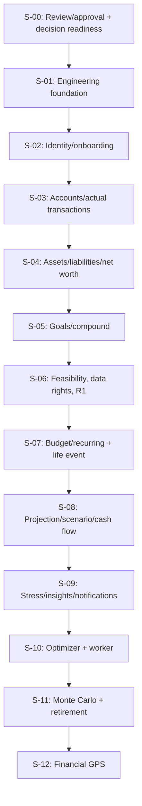

# Esokira — Task Backlog and Agent Execution Plan

> **Canonical path:** `docs/planning/TASKS.md`  
> **Version:** `0.1.0`  
> **Prepared:** 30 October 2026 (Asia/Jakarta)  
> **Documentation status:** `REVIEWED_INTERNAL — PENDING_OWNER_APPROVAL` (applies after internal QA; owner approval not inferred)  
> **Planning status:** `DRAFT` — tasks are proposals, not an approved sprint commitment  
> **Implementation status:** `UNVERIFIED` for every task/epic; the actual source repository was not audited when preparing this document.  
> **Test execution status:** `NOT_RUN`; no Flutter, Go, PostgreSQL or deployment test is claimed.  
> **Scope:** Detailed work packages for S-00 through S-06 (planning, R0 and R1); high-level backlog for S-07 through S-12 (R2/R3). R4 remains discovery only.

---

## 0. Contract before using this backlog

This is a proposed **task execution index** for Esokira, not an implementation report. The owner has selected Flutter, Go, PostgreSQL, and a monorepo with `frontend/` and `backend/`; details such as authentication provider, monetary representation, migration strategy, UI state management, HTTP router, worker technology, API wire format, and financial model policies remain separately gated by their owning documents. Do not bulk-approve candidate technologies.

1. **Inspect the repository first.** All records start as `UNVERIFIED`, not `NOT_STARTED` or `DONE`. If a component exists, audit it instead of replacing it blindly.
2. **No auto approval.** An instruction such as “gas lanjut” allows the requested next artifact/task only; it does not resolve `Q-*`, `BE-Q*`, `FE-Q*`, database/API/privacy decisions, or grant deployment permission.
3. **Scope follows dependency.** Follow `S-00`–`S-12` and the PRD/Feature Matrix; R2/R3 epics must be decomposed and separately approved before production implementation.
4. **Money and privacy are hard stops.** Keep actuals separate from plans; do not invent rates, assumptions, or statistical distributions; do not leak another user’s data; do not declare an unknown transaction outcome a success.
5. **Testing requires evidence.** Expected acceptance is not a PASS. For every change, record exact environment, executed command, result, risk and reviewer; `NOT_RUN` stays `NOT_RUN` until executed.
6. **No dates or team assignments invented.** Task IDs are stable proposals; no ETA, sprint length, cost, cloud provider, coverage target, or performance SLA is implied.

**Source-of-truth precedence:** PRD for features; Financial Domain Rules for invariants; Calculation Specs and independent FTC for numeric semantics; actual approved OpenAPI and applied migrations for implemented wire/schema; User Flows/Screen Specs for user behavior; Security & Privacy for controls; DoD/Testing Strategy for acceptance; Master Roadmap/Feature Matrix for delivery dependencies. This file only records work items and evidence needed.

## 1. Source map and navigation

| Owner area | Canonical document(s) |
|---|---|
| Product | [`PRODUCT-VISION`](../product/PRODUCT-VISION.md), [`PRD`](../product/PRD.md), [`FEATURE-MATRIX`](../product/FEATURE-MATRIX.md) |
| Domain and mathematics | [`FINANCIAL-DOMAIN-RULES`](../financial/FINANCIAL-DOMAIN-RULES.md), [`CALCULATION-SPECS`](../financial/CALCULATION-SPECS.md), [`FINANCIAL-TEST-CASES`](../financial/FINANCIAL-TEST-CASES.md) |
| System design | [`SYSTEM`](../architecture/SYSTEM-ARCHITECTURE.md), [`BACKEND`](../architecture/BACKEND-ARCHITECTURE.md), [`FRONTEND`](../architecture/FRONTEND-ARCHITECTURE.md), [`DATABASE`](../architecture/DATABASE-DESIGN.md), [`API`](../architecture/API-GUIDELINES.md) |
| UI / behavior | [`DESIGN-SYSTEM`](../design/DESIGN-SYSTEM.md), [`USER-FLOWS`](../design/USER-FLOWS.md), [`SCREEN-SPECS`](../design/SCREEN-SPECS.md) |
| Security | [`SECURITY-PRIVACY`](../security/SECURITY-PRIVACY.md) |
| Agent instructions | [`root AGENTS`](../../AGENTS.md), [`frontend/AGENTS`](../../frontend/AGENTS.md), [`backend/AGENTS`](../../backend/AGENTS.md) |
| Process and verification | [`DEVELOPMENT-WORKFLOW`](../development/DEVELOPMENT-WORKFLOW.md), [`TESTING-STRATEGY`](../development/TESTING-STRATEGY.md), [`DEFINITION-OF-DONE`](../development/DEFINITION-OF-DONE.md) |
| Delivery plan | [`MASTER-ROADMAP`](./MASTER-ROADMAP.md) |

Do not assume `contracts/openapi.yaml`, `backend/db/migrations/`, `PROGRESS.md`, `DECISION-LOG.md`, or `docs/financial/SCENARIO-ENGINE.md`, `MONTE-CARLO.md`, `GOAL-OPTIMIZER.md` already exist. They are generated and validated only through authorized tasks. References to those names are **proposed future deliverables** until audited.

## 2. Task identity, status and evidence model

- Detailed R0/R1 record IDs are `TK-Sxx-nn`; R2/R3 planning epics use `EP-Sxx-nn`. **Never reuse an ID**; mark `CANCELLED` or `SUPERSEDED` when retired. IDs are documentation identifiers, not Git issue numbers.
- `planning_status`: initially `DRAFT`, meaning work needs owner review and a DoR gate. Agent may refine a task proposal but must not claim `READY` merely because it is written here.
- `implementation_status`: initially `UNVERIFIED`; after inspecting repo and recording evidence, use `NOT_STARTED`, `READY`, `IN_PROGRESS`, `IN_REVIEW`, `DONE`, `PARTIAL`, `BLOCKED`, or `CANCELLED` per `DEVELOPMENT-WORKFLOW.md`. A known unfinished task may be `PARTIAL`, not automatically `DONE`.
- `test_status`: `NOT_RUN`, `PASS`, `FAIL`, `SKIPPED`, `BLOCKED` or `N/A` with reason. A QA plan, example output, screenshot or generated test case is not test execution.
- `decision_status`: `PROPOSED`, `TBD`, `DECIDED`, `BLOCKED`, etc. **never substitute task status** for approval. Every blocking `Q-*` must be evaluated against an actual owner decision.
- Task dependency references are exact `TK-`/`EP-` IDs from this document. External decisions (`Q-*`), policy approval, R0/R1 release gate, and document availability live in **Decision gate** (not in the dependency graph).

### 2.1 Proposed record update format

```yaml
task_id: TK-S03-04                      # Example ID from this backlog
planning_status: DRAFT               # Not owner-approved yet
implementation_status: UNVERIFIED   # Repo not audited
test_status: NOT_RUN                 # No commands run
assignee: null                      # Never invent a human owner
depends_on: [TK-S03-03]
blocking_decisions: [Q-03, Q-04]
approved_by: null
approved_at: null
implementation_ref: null           # Commit/PR after actual implementation
evidence_refs: []                   # Actual logs and review references only
blocker_notes: []
```

The YAML above is a **status-change example**, not a live assignment. Do not fill `approved_by`, commit or test evidence with fabricated values.

### 2.2 Definition of Ready (before starting code)

- [ ] Exact FR/EN/NFR IDs, task scope, prerequisites, and expected behavior reviewed.
- [ ] Actual repository/branch environment audited; affected files located; Git status checked.
- [ ] All **relevant** decisions approved (not all project decisions globally).
- [ ] Approved API/DB/UX/numeric contracts in place for the affected behavior.
- [ ] Positive, invalid, boundary, failure/retry and ownership cases defined as applicable.
- [ ] Safe verification environment and command(s) identified; rollback/recovery plan for destructive operations.
- [ ] No critical blocker remains on the task’s intended code path; owner authorized task execution.

### 2.3 Universal Definition of Done

Apply `DOD-G01`–`DOD-G10` from [`DEFINITION-OF-DONE.md`](../development/DEFINITION-OF-DONE.md). Tests must be *executed and evidenced*. A document-only task can be complete after reference/structural review without claiming app tests; a financial DB write needs a real disposable PostgreSQL test, not only mock-based unit tests.

## 3. Slice index, total proposed tasks and decision gates

| Slice | Release | Purpose | Detail level | Planned items | Gate before advancing |
|---|---|---|---|---:|---|
| `S-00` | Planning | Review/approval + decision readiness | Detailed tasks | 9 | Owner scope and Q-02/Q-03/Q-04/Q-10/Q-11 decisions |
| `S-01` | R0 | Engineering foundation | Detailed tasks | 14 | R0 DoD + security/DB/CI evidence |
| `S-02` | R1 | Identity/onboarding | Detailed tasks | 6 | Identity and privacy acceptance |
| `S-03` | R1 | Accounts/actual transactions | Detailed tasks | 8 | Atomic/owner/idempotent DB evidence |
| `S-04` | R1 | Assets/liabilities/net worth | Detailed tasks | 6 | Nonduplicated net worth oracle |
| `S-05` | R1 | Goals/compound | Detailed tasks | 8 | Approved compound golden tests |
| `S-06` | R1 | Feasibility, data rights, R1 | Detailed tasks | 7 | R1 DoD and FR-021 acceptance |
| `S-07` | R2 | Budget/recurring + life event | Planning epics | 2 | R1 gate; recurring/event spec |
| `S-08` | R2 | Projection/scenario/cash flow | Planning epics | 3 | SCENARIO-ENGINE.md + Q-05/Q-06 |
| `S-09` | R2 | Stress/insights/notifications | Planning epics | 3 | R2 gate and Q-09 |
| `S-10` | R3 | Optimizer + worker | Planning epics | 2 | GOAL-OPTIMIZER.md + worker gates |
| `S-11` | R3 | Monte Carlo + retirement | Planning epics | 2 | MONTE-CARLO.md + Q-08 + FIRE review |
| `S-12` | R3 | Financial GPS | Planning epics | 1 | R3 model/security/owner acceptance |

**Interpretation:** `S-00` is an approval/planning gate; it is not an R0 implementation and does not secretly count toward passing R0 tests. `EN-004` establishes a pure-Go test harness during R0/S-01 and completes actual compound formulas during R1/S-05. `EN-005` is R3, not R0. R4 (FR-023, FR-024) is discovery-only and has no production task.

## 4. Proposed task dependency map



The diagram shows the **coarse sequence**, not every task-level prerequisite. Within R0/R1, follow `Depends on` fields below. Some independent work may run in parallel after reviewing file ownership, interface compatibility and decision gates. Never treat a rough sequencing arrow as proof a prior gate has passed.

## 5. Detailed backlog — S-00: Review/approval + decision readiness

**Type:** planning and approval work. Each decision record is its own deliverable. This section may be reviewed independently of any existing repository, but implementation permission still requires an owner decision.

### TK-S00-01 — Audit repository dan environment aktual

- **Release / slice:** `Planning` / `S-00` · **Requirements:** Planning gate (no FR/EN implementation claim)
- **Depends on:** None within this backlog
- **Decision gate:** Akses repo/env
- **Scope / deliverable:** Inspeksi struktur direktori, Git state, file yang ada, toolchain dan pipeline yang benar-benar tersedia; pisahkan temuan dari asumsi dokumen.
- **Acceptance criteria:**
  - Inventaris current/absent/unknown untuk frontend, backend, migration, contracts, CI dan tests disertai bukti path/versi.
  - Tidak mengubah status implementasi menjadi NOT_STARTED atau DONE tanpa bukti repo.
  - Temuan risiko dan data sensitif yang tidak sengaja terlihat ditangani tanpa menyalin rahasia.
- **Expected verification (not executed):**
  - Laporan audit ringkas, daftar perintah inspeksi yang benar-benar dijalankan dan referensi commit/branch bila tersedia.
- **Out of scope:** Tidak melakukan refactor, install dependency, migrasi, atau deploy.

### TK-S00-02 — Review scope R0/R1 dan prioritas MVP dengan pemilik proyek

- **Release / slice:** `Planning` / `S-00` · **Requirements:** Planning gate (no FR/EN implementation claim)
- **Depends on:** `TK-S00-01`
- **Decision gate:** `Q-01`, Persetujuan Product Owner
- **Scope / deliverable:** Review PRODUCT-VISION, PRD, Feature Matrix dan 13 slices; ajukan persetujuan eksplisit R0/R1; klasifikasikan R2/R3 sebagai horizon dan R4 discovery.
- **Acceptance criteria:**
  - Daftar requirement R1 FR-001..FR-009 dan FR-021 tidak berubah secara diam-diam.
  - Setiap perubahan lingkup disertai dokumen pemilik yang harus diperbarui.
  - Keputusan disimpan dengan referensi pernyataan pemilik, bukan inferensi dari kata “gas”.
- **Expected verification (not executed):**
  - Record persetujuan/penolakan beserta versi dan tanggal; jika belum ada, hasil BLOCKED untuk approval.
- **Out of scope:** Tidak memindahkan FR antar-rilis atau menyatakan Product Owner telah menyetujui seluruh dokumen.

### TK-S00-03 — Putuskan authentication provider dan model sesi

- **Release / slice:** `Planning` / `S-00` · **Requirements:** Planning gate (no FR/EN implementation claim)
- **Depends on:** `TK-S00-02`
- **Decision gate:** `Q-02`
- **Scope / deliverable:** Bandingkan pendekatan provider identitas dan verifikasi Go, termasuk expiry, revocation, kepemilikan user dan token storage Flutter.
- **Acceptance criteria:**
  - Opsi, konsekuensi privasi, implementasi, dan biaya tercatat.
  - Pilihan hanya berstatus DECIDED setelah persetujuan pemilik.
  - Dampak pada auth, API, DB dan Flutter diidentifikasi.
- **Expected verification (not executed):**
  - Decision record atau status TBD dengan daftar artefak terdampak.
- **Out of scope:** Tidak otomatis memasang Firebase Auth, OIDC library, atau SDK tertentu.

### TK-S00-04 — Putuskan model saldo, transfer, koreksi, dan funding goals

- **Release / slice:** `Planning` / `S-00` · **Requirements:** Planning gate (no FR/EN implementation claim)
- **Depends on:** `TK-S00-02`
- **Decision gate:** `Q-03`, `Q-11`
- **Scope / deliverable:** Review ledger/opening balance, transfer atomik, reversal/audit, perubahan saldo, dan pengaitan kontribusi aktual terhadap goal tanpa double counting.
- **Acceptance criteria:**
  - Arsitektur posting mencantumkan invariant DR-005..DR-012 dan DR-022.
  - Contoh transfer dan saldo dapat direkonsiliasi dengan financial test cases.
  - Bila pilihan belum final, tugas schema/write yang bergantung tetap BLOCKED.
- **Expected verification (not executed):**
  - Opsi/decision record dan daftar golden/integration tests yang wajib.
- **Out of scope:** Tidak menghasilkan migrasi finansial production atau transaksi aktual.

### TK-S00-05 — Putuskan kebijakan uang, rate, waktu, dan pembulatan

- **Release / slice:** `Planning` / `S-00` · **Requirements:** Planning gate (no FR/EN implementation claim)
- **Depends on:** `TK-S00-02`
- **Decision gate:** `Q-04`
- **Scope / deliverable:** Review mata uang/satuan uang, persentase, rate annual vs monthly, tanggal efektif, periode, time zone, timing setoran dan aturan rounding.
- **Acceptance criteria:**
  - Representasi saldo persis dapat dipertahankan oleh Go/PostgreSQL/JSON/Flutter.
  - Konvensi future value dan goal feasibility eksplisit untuk CS-001, CS-002, CS-005, CS-007.
  - Tidak ada fallback tersembunyi untuk input yang belum dispesifikasikan.
- **Expected verification (not executed):**
  - Decision record dan hasil pemeriksaan test vector independen yang relevan.
- **Out of scope:** Tidak menganggap skema bigint/NUMERIC, jumlah digit, atau default rate sudah diputuskan.

### TK-S00-06 — Putuskan baseline privasi, data rights dan lingkungan

- **Release / slice:** `Planning` / `S-00` · **Requirements:** Planning gate (no FR/EN implementation claim)
- **Depends on:** `TK-S00-02`
- **Decision gate:** `Q-10`
- **Scope / deliverable:** Identifikasi environment lokal/CI/staging, secret boundaries, backup/restore, export/deletion/retention, dan review hukum yang dibutuhkan.
- **Acceptance criteria:**
  - Dokumen menjelaskan siapa menyetujui environment dan kebijakan retensi.
  - Tidak menyatakan patuh UU PDP/PSE tanpa review yang relevan.
  - Kegagalan ekspor/penghapusan dan retensi backup ditangani sebagai requirement.
- **Expected verification (not executed):**
  - Daftar keputusan dan pemilik review keamanan/privasi; status TBD bila belum disetujui.
- **Out of scope:** Tidak membeli layanan cloud, mengaktifkan telemetry, mengimpor data asli, atau deploy.

### TK-S00-07 — Review pilihan library, kontrak, dan strategi test awal

- **Release / slice:** `Planning` / `S-00` · **Requirements:** `EN-001`, `EN-003`, `EN-004`, `NFR-009`
- **Depends on:** `TK-S00-01`, `TK-S00-02`
- **Decision gate:** Pilihan router, sqlc/driver, client state, CI, migration policy
- **Scope / deliverable:** Petakan kandidat dependency per kebutuhan dan kompatibilitas; definisikan bukti format/lint/test dan konsep OpenAPI minimum.
- **Acceptance criteria:**
  - Setiap kandidat memiliki alasan dan status terpisah (PROPOSED/DECIDED).
  - Satu kontrak API authoritative ditunjuk setelah dipilih.
  - Tidak menciptakan threshold coverage/latency yang belum disepakati.
- **Expected verification (not executed):**
  - Decision checklist + test plan R0, dengan perintah tool yang benar setelah audit.
- **Out of scope:** Tidak bulk-approve chi, pgx, sqlc, River, Riverpod, go_router, atau CI vendor.

### TK-S00-08 — Review oracle financial golden dan blokir model belum siap

- **Release / slice:** `Planning` / `S-00` · **Requirements:** `EN-004`, `NFR-002`
- **Depends on:** `TK-S00-04`, `TK-S00-05`
- **Decision gate:** Konvensi numerik, perhitungan/tes yang perlu approval
- **Scope / deliverable:** Bagi FTC yang sudah bisa diverifikasi independen vs yang memerlukan keputusan; tandai Monte Carlo/optimizer sebagai future-gated.
- **Acceptance criteria:**
  - Nilai expected dibuat dari referensi independen, bukan dari fungsi yang sedang dibuat.
  - Case 0%, 0 horizon, setoran awal/akhir, transfer dan net worth dipetakan ke kontrak CS.
  - Case bersyarat diberi status BLOCKED tanpa mengarang pass/fail.
- **Expected verification (not executed):**
  - Tabel oracle READY/CONDITIONAL/BLOCKED beserta sumber dan reviewer.
- **Out of scope:** Tidak menetapkan model probabilistik atau objektif optimizer.

### TK-S00-09 — Buat decision register dan catatan bukti awal

- **Release / slice:** `Planning` / `S-00` · **Requirements:** Planning gate (no FR/EN implementation claim)
- **Depends on:** `TK-S00-01`, `TK-S00-02`
- **Decision gate:** Persetujuan penempatan/format catatan proyek
- **Scope / deliverable:** Siapkan struktur decision/evidence register yang menautkan Q-01..Q-11 dan keputusan lokal tanpa merekayasa approval historis.
- **Acceptance criteria:**
  - Setiap keputusan punya ID, owner, status, alasan, dokumen terdampak dan bukti bila tersedia.
  - Item belum disetujui tetap PROPOSED/TBD.
  - Rujukan dari task ke keputusan bisa ditelusuri.
- **Expected verification (not executed):**
  - Draft `DECISION-LOG.md` / catatan setara jika diotorisasi; audit referensi.
- **Out of scope:** Tidak menandai task implementation DONE atau membuat log palsu.

**S-00 exit check:** decisions/scope with real owner references exist, unresolved blockers are documented, first authorized R0 tasks are identified. Otherwise keep S-00 `PARTIAL`/`BLOCKED`. A completed Markdown alone does not satisfy this check.

## 6. Detailed backlog — S-01: Engineering foundation

**Type:** R0 engineering foundation. Scaffold and contracts are only built after the respective decisions; R0 does not include an R3 worker, Redis or a production financial schema that has not been approved.

### TK-S01-01 — Bangun struktur monorepo terverifikasi

- **Release / slice:** `R0` / `S-01` · **Requirements:** `EN-001`
- **Depends on:** `TK-S00-01`, `TK-S00-02`
- **Decision gate:** Pilihan layout/toolchain dasar
- **Scope / deliverable:** Buat/normalisasi frontend, backend dan konfigurasi root sesuai repo aktual; pisahkan build Flutter/Go.
- **Acceptance criteria:**
  - Tidak menimpa kode yang sudah ada tanpa analisis.
  - Flutter dan Go dapat dibangun/diperiksa secara independen dalam lingkungan yang tersedia.
  - README local entrypoint dan .gitignore mencegah rahasia masuk repo.
- **Expected verification (not executed):**
  - Diff repo + log perintah build/analyze/test yang benar-benar dijalankan.
- **Out of scope:** Tidak membuat microservices, queue, Redis, atau data finansial contoh produksi.

### TK-S01-02 — Siapkan lingkungan PostgreSQL lokal dan CI disposable

- **Release / slice:** `R0` / `S-01` · **Requirements:** `EN-002`, `NFR-006`
- **Depends on:** `TK-S01-01`, `TK-S00-06`
- **Decision gate:** DB env/provider/secret policy
- **Scope / deliverable:** Siapkan PostgreSQL lokal/ephemeral untuk testing, konfigurasi terbatas dan reset fixture sintetik.
- **Acceptance criteria:**
  - DB test terisolasi dari data pribadi atau production.
  - Prosedur setup dan reset bisa diulang.
  - Kredensial contoh tidak dipakai sebagai production secret dan tidak committed.
- **Expected verification (not executed):**
  - Log koneksi ke database disposable, setup/reset dan scan konfigurasi.
- **Out of scope:** Tidak mengimpor data bank, dump produksi, atau ledger final.

### TK-S01-03 — Siapkan Go API bootstrap dan lifecycle

- **Release / slice:** `R0` / `S-01` · **Requirements:** `EN-001`, `EN-003`
- **Depends on:** `TK-S01-01`
- **Decision gate:** Pemilihan router dan toolchain
- **Scope / deliverable:** Implement entrypoint Go minimal, graceful shutdown, request cancellation dan health endpoint non-sensitif.
- **Acceptance criteria:**
  - Server dapat hidup/mati tanpa kebocoran data.
  - Health endpoint tidak mengungkap konfigurasi atau data user.
  - Error boot/config dilaporkan aman.
- **Expected verification (not executed):**
  - Go build/test + smoke test dan shutdown check.
- **Out of scope:** Tidak membuat endpoint finansial dengan data dummy seolah real.

### TK-S01-04 — Siapkan Flutter shell dan error/empty/session states dasar

- **Release / slice:** `R0` / `S-01` · **Requirements:** `EN-001`, `NFR-005`
- **Depends on:** `TK-S01-01`
- **Decision gate:** Router/state-management dipilih sebelum pemasangan
- **Scope / deliverable:** Buat app shell aman, theme awal dan state navigasi error/loading; integrasi auth provider di task terpisah.
- **Acceptance criteria:**
  - Aplikasi dapat dijalankan minimal di target platform terverifikasi.
  - Tidak menampilkan saldo produksi fiktif.
  - Widget shell dan fallback network/error memiliki tes dasar.
- **Expected verification (not executed):**
  - Flutter analyze/test dan run/screenshot jika tersedia; keterbatasan perangkat dicatat.
- **Out of scope:** Tidak membuat semua SCR-00..SCR-22 atau memaksakan library belum approved.

### TK-S01-05 — Siapkan lifecycle migration PostgreSQL

- **Release / slice:** `R0` / `S-01` · **Requirements:** `EN-002`
- **Depends on:** `TK-S01-02`
- **Decision gate:** Migration tooling + rollback/forward-fix policy
- **Scope / deliverable:** Implement runner migration untuk skema fondasi yang sudah disetujui dan dokumentasikan urutan apply/repair.
- **Acceptance criteria:**
  - Migration dapat diterapkan berulang pada DB disposable dengan hasil deterministik.
  - Strategi rollback/forward-fix diuji sesuai kebijakan.
  - Tidak membuat tabel saldo/transaksi finansial sebelum Q-03/Q-04 disetujui.
- **Expected verification (not executed):**
  - Migration test log; schema inspection dari DB aktual.
- **Out of scope:** Tidak membuat irreversible migration pada DB live.

### TK-S01-06 — Definisikan boundary principal dan owner di PostgreSQL

- **Release / slice:** `R0` / `S-01` · **Requirements:** `EN-002`, `NFR-001`
- **Depends on:** `TK-S01-05`, `TK-S00-03`
- **Decision gate:** Q-02; owner mapping; scope data
- **Scope / deliverable:** Implement model identitas internal dan owner key hanya setelah kebijakan autentikasi ditetapkan; susun negative ownership test.
- **Acceptance criteria:**
  - User A tidak bisa membaca resource milik user B meskipun ID ditebak.
  - Identitas dari verified server principal, bukan query/body client.
  - Schema dan constraint sesuai migrasi disetujui.
- **Expected verification (not executed):**
  - Integration test dua user sintetik di PostgreSQL dengan kasus deny.
- **Out of scope:** Tidak memilih auth provider sendiri atau mengganti ledger.

### TK-S01-07 — Buat OpenAPI contract minimum yang valid

- **Release / slice:** `R0` / `S-01` · **Requirements:** `EN-003`, `NFR-009`
- **Depends on:** `TK-S01-03`, `TK-S00-07`
- **Decision gate:** Konvensi API/Q API terkait harus diputuskan
- **Scope / deliverable:** Tulis kontrak machine-readable untuk endpoint foundation yang benar-benar akan dibuat, termasuk validation/error schema.
- **Acceptance criteria:**
  - File OpenAPI dapat diparsing/di-lint dengan tool terverifikasi.
  - Contoh Markdown tidak dianggap kontrak wire.
  - Belum ada route finansial yang dibuat tanpa FR/approval.
- **Expected verification (not executed):**
  - OpenAPI lint/validation + diff test contract.
- **Out of scope:** Tidak menyatakan kontrak sample di dokumen sudah production API.

### TK-S01-08 — Implement validasi request dan error middleware

- **Release / slice:** `R0` / `S-01` · **Requirements:** `EN-003`, `NFR-007`
- **Depends on:** `TK-S01-03`, `TK-S01-07`
- **Decision gate:** Error shape/HTTP mapping yang disetujui
- **Scope / deliverable:** Buat sanitasi error dan input validation untuk route foundation dengan request/correlation ID aman.
- **Acceptance criteria:**
  - Input invalid gagal aman dan memiliki error konsisten dengan kontrak.
  - Error internal tidak mengekspos token, angka sensitif, atau stack trace.
  - Cancelled request ditangani benar.
- **Expected verification (not executed):**
  - HTTP negative tests + sanitized logging assertions.
- **Out of scope:** Tidak mengarang enum error finansial di luar API contract.

### TK-S01-09 — Implement auth adapter interface dan deny-by-default guard

- **Release / slice:** `R0` / `S-01` · **Requirements:** `EN-003`, `NFR-001`
- **Depends on:** `TK-S01-06`, `TK-S01-08`
- **Decision gate:** Q-02 dan API auth policy
- **Scope / deliverable:** Definisikan adapter/verifier boundary dan middleware owner principal sesuai pilihan; block unauthenticated private operations.
- **Acceptance criteria:**
  - Token invalid/expired/revoked diperlakukan sesuai provider/policy.
  - Tidak ada identitas palsu dari header arbitrary.
  - Test non-owner tidak menghasilkan data privat.
- **Expected verification (not executed):**
  - HTTP auth negative tests + unit test adapter; provider-specific integration jika tersedia.
- **Out of scope:** Tidak mencatat token ataupun mengasumsikan pilihan Firebase Auth/OIDC.

### TK-S01-10 — Buat pure Go financial engine boundary & test harness

- **Release / slice:** `R0` / `S-01` · **Requirements:** `EN-004`, `NFR-002`
- **Depends on:** `TK-S01-01`, `TK-S00-08`
- **Decision gate:** Kontrak boundary, belum formula produksi
- **Scope / deliverable:** Buat struktur paket financial domain tanpa dependensi HTTP/DB dan harness table-driven golden test.
- **Acceptance criteria:**
  - Unit test dapat dijalankan tanpa server/DB.
  - Input/output dan exact money abstraction sesuai keputusan yang sudah disetujui.
  - R0 tidak diam-diam implement FR-008; formulas diselesaikan S-05.
- **Expected verification (not executed):**
  - Go test direct pada pure engine package; dependency inspection.
- **Out of scope:** Tidak menyuntikkan nilai expected untuk menggenapkan test yang masih BLOCKED.

### TK-S01-11 — Siapkan config, secrets, dan privacy-safe observability

- **Release / slice:** `R0` / `S-01` · **Requirements:** `EN-006`, `NFR-007`
- **Depends on:** `TK-S01-03`, `TK-S00-06`
- **Decision gate:** Secret policy, log/telemetry provider
- **Scope / deliverable:** Pisahkan config environment dan rahasia; siapkan structured log minim data sensitif, request IDs dan basic health/error instrumentation.
- **Acceptance criteria:**
  - Tidak ada secret/hardcoded key dalam repo atau client.
  - Request/error logs tidak memuat token/PII/nominal sensitif.
  - Config invalid memunculkan error aman tanpa start sebagian.
- **Expected verification (not executed):**
  - Secret scan yang dijalankan, log capture sintetis, config negative tests.
- **Out of scope:** Tidak mengaktifkan third-party analytics/cloud observability tanpa approval.

### TK-S01-12 — Buat CI minimal yang benar-benar menjalankan quality checks

- **Release / slice:** `R0` / `S-01` · **Requirements:** `EN-001`, `NFR-009`
- **Depends on:** `TK-S01-03`, `TK-S01-04`, `TK-S01-05`, `TK-S01-07`, `TK-S01-10`
- **Decision gate:** CI provider; environment/test runner
- **Scope / deliverable:** Siapkan pipeline untuk build/test/analyze Go/Flutter, kontrak API dan migrasi disposable sesuai tooling aktual.
- **Acceptance criteria:**
  - Status gagal jika test kritis gagal.
  - Pipeline tidak memerlukan secret produksi.
  - Laporan command + exit code tersedia dan dapat direproduksi.
- **Expected verification (not executed):**
  - CI run/log/commit ID; failure-path check.
- **Out of scope:** Tidak membuat green badge palsu, coverage/latency threshold rekaan.

### TK-S01-13 — Rancang dan uji backup/restore pada data sintetis

- **Release / slice:** `R0` / `S-01` · **Requirements:** `EN-006`, `NFR-006`
- **Depends on:** `TK-S01-02`, `TK-S00-06`
- **Decision gate:** Policy backup, retention, staging ownership
- **Scope / deliverable:** Siapkan prosedur backup/restore disposable, pemisahan akses, dan recovery notes.
- **Acceptance criteria:**
  - Restore di DB test dapat diverifikasi dengan checksums/record counts.
  - Tidak menggunakan backup user asli atau production credential.
  - Batas retensi serta kewenangan restore jelas atau diberi TBD.
- **Expected verification (not executed):**
  - Backup + restore test logs dan prosedur pemulihan.
- **Out of scope:** Tidak menjanjikan penghapusan absolut data dari backup tanpa kebijakan.

### TK-S01-14 — Review release gate R0 berdasarkan bukti

- **Release / slice:** `R0` / `S-01` · **Requirements:** `EN-001`, `EN-002`, `EN-003`, `EN-004`, `EN-006`, `NFR-009`
- **Depends on:** `TK-S01-01`, `TK-S01-02`, `TK-S01-03`, `TK-S01-04`, `TK-S01-05`, `TK-S01-06`, `TK-S01-07`, `TK-S01-08`, `TK-S01-09`, `TK-S01-10`, `TK-S01-11`, `TK-S01-12`, `TK-S01-13`
- **Decision gate:** Persetujuan Product Owner + DOD-G01..G10 yang applicable
- **Scope / deliverable:** Review deliverables, code diff, tests, source/decision alignment, security, restore dan limitations secara eksplisit.
- **Acceptance criteria:**
  - Semua critical gates memiliki evidence atau status FAIL/BLOCKED yang jelas.
  - Tidak menutup release bila authentication/data boundary atau secret policy tidak aman.
  - Persetujuan R0 dicatat, bukan diasumsikan.
- **Expected verification (not executed):**
  - Review R0 signed/approved reference atau BLOCKED/IN_REVIEW handoff.
- **Out of scope:** Tidak memulai deployment production karena scaffold sudah berjalan.

**R0 exit check:** `TK-S01-14` must review `EN-001`, `EN-002`, `EN-003`, R0 portion of `EN-004`, `EN-006`, with evidence matching DoD §12.1. `EN-005` stays R3.

## 7. Detailed backlog — S-02: Identity/onboarding

**Type:** R1 scoped implementation. If a gate is unresolved, record `BLOCKED` only for the affected subtask and proceed with independent, authorized work; do not fill unknowns with invented defaults.

### TK-S02-01 — Integrasikan identitas dan session verification Go

- **Release / slice:** `R1` / `S-02` · **Requirements:** `FR-001`, `NFR-001`
- **Depends on:** `TK-S01-09`, `TK-S01-14`
- **Decision gate:** Q-02 dan provider verification policy
- **Scope / deliverable:** Implement provider adapter terpilih untuk autentikasi request dan lifecycle sesi.
- **Acceptance criteria:**
  - Token invalid, expired dan user tidak sah mendapat denial.
  - Tidak percaya user_id dalam payload.
  - Tidak membocorkan token di error/log.
- **Expected verification (not executed):**
  - HTTP integration tests untuk auth positif/negatif dan session expiry.
- **Out of scope:** Tidak membuat password management kustom tanpa approved design.

### TK-S02-02 — Buat user mapping dan tenant isolation end-to-end

- **Release / slice:** `R1` / `S-02` · **Requirements:** `FR-001`, `NFR-001`
- **Depends on:** `TK-S02-01`, `TK-S01-06`
- **Decision gate:** Owner/DB policy disetujui
- **Scope / deliverable:** Hubungkan identitas terverifikasi dengan user internal; enforce ownership pada repository dan nested queries.
- **Acceptance criteria:**
  - User sintetik A/B tidak dapat membaca/mengubah resource satu sama lain.
  - Tidak bocor melalui pagination, error atau existence response.
  - Kasus session revocation dan account scope diuji.
- **Expected verification (not executed):**
  - API+DB cross-user negative tests.
- **Out of scope:** Tidak menggunakan resource ID sebagai dasar otorisasi.

### TK-S02-03 — Buat model profil keuangan dan endpoint validasinya

- **Release / slice:** `R1` / `S-02` · **Requirements:** `FR-002`
- **Depends on:** `TK-S02-02`, `TK-S01-05`
- **Decision gate:** Field mandatory/optional dan privacy purpose
- **Scope / deliverable:** Tentukan field profil dari PRD dan implement DB/API create/read/update berdasarkan kontrak approved.
- **Acceptance criteria:**
  - Missing/invalid field ditolak atau diberi incomplete-state sesuai policy.
  - Data input tersimpan milik owner yang terautentikasi.
  - Tidak memakai assumed salary/age sebagai data pengguna.
- **Expected verification (not executed):**
  - DB migration + API contract tests + cross-owner denial.
- **Out of scope:** Tidak membuat prediksi finansial dari profil belum lengkap.

### TK-S02-04 — Buat Flutter login, restore session, dan logout

- **Release / slice:** `R1` / `S-02` · **Requirements:** `FR-001`, `NFR-005`
- **Depends on:** `TK-S02-01`, `TK-S01-04`
- **Decision gate:** Provider Flutter SDK, secure storage dipilih
- **Scope / deliverable:** Bangun SCR autentikasi dengan state idle/loading/error/expired/offline sesuai Screen Specs.
- **Acceptance criteria:**
  - Tidak ada private navigation saat sesi tidak sah.
  - Logout membersihkan cache sensitif sesuai policy.
  - Kesalahan auth bisa dipahami dan retry tidak menipu status login.
- **Expected verification (not executed):**
  - Widget tests dan device/integration login/logout/expired jika environment tersedia.
- **Out of scope:** Tidak menyimpan access token di plain preferences.

### TK-S02-05 — Buat onboarding dan financial profile Flutter

- **Release / slice:** `R1` / `S-02` · **Requirements:** `FR-002`, `NFR-005`
- **Depends on:** `TK-S02-03`, `TK-S02-04`
- **Decision gate:** Screen fields/consent UI approved
- **Scope / deliverable:** Implement onboarding profil dengan validasi, penjelasan penggunaan data, dan keadaan profil belum lengkap.
- **Acceptance criteria:**
  - Field mengikuti API contract, tidak dibuat sendiri.
  - Loading, validation, offline dan server error memiliki recovery.
  - Aksesibilitas, bahasa dan angka rupiah diuji di UI.
- **Expected verification (not executed):**
  - Widget tests, API fixture contract, selected integration evidence.
- **Out of scope:** Tidak memasang analytics tanpa privacy consent policy.

### TK-S02-06 — Tutup acceptance S-02 dengan dua user sintetis

- **Release / slice:** `R1` / `S-02` · **Requirements:** `FR-001`, `FR-002`, `NFR-001`
- **Depends on:** `TK-S02-02`, `TK-S02-05`
- **Decision gate:** Auth provider/env tersedia
- **Scope / deliverable:** Review user journey autentikasi dan onboarding, sesi expired, data privat dan negative authorization.
- **Acceptance criteria:**
  - Backend denial didemonstrasikan terhadap user lain.
  - Sesi tidak aktif tidak memunculkan data lama.
  - Hanya menggunakan synthetic user data.
- **Expected verification (not executed):**
  - E2E traces + security checks + report remaining blockers.
- **Out of scope:** Tidak menyimpulkan S-03..S-06 sudah lulus.


## 8. Detailed backlog — S-03: Accounts/actual transactions

**Type:** R1 scoped implementation. If a gate is unresolved, record `BLOCKED` only for the affected subtask and proceed with independent, authorized work; do not fill unknowns with invented defaults.

### TK-S03-01 — Tetapkan dan migrasikan account + ledger posting schema

- **Release / slice:** `R1` / `S-03` · **Requirements:** `FR-003`, `FR-004`, `NFR-002`
- **Depends on:** `TK-S02-06`, `TK-S01-05`, `TK-S00-04`, `TK-S00-05`
- **Decision gate:** Q-03/Q-04 model dan migration policy
- **Scope / deliverable:** Implement schema account, opening balance dan record/posting sesuai approved ledger; constraints dan index owner.
- **Acceptance criteria:**
  - Opening balance tidak muncul sebagai income periodik.
  - Currency/unit/timestamps mengikuti policy approved.
  - Migration idempotent/aman di disposable DB dan owner constraints diuji.
- **Expected verification (not executed):**
  - Applied migration logs + schema inspection + opening-balance assertions.
- **Out of scope:** Tidak menetapkan double-entry vs simpler ledger sendiri.

### TK-S03-02 — Implement account CRUD dan opening balance API

- **Release / slice:** `R1` / `S-03` · **Requirements:** `FR-003`, `NFR-001`
- **Depends on:** `TK-S03-01`, `TK-S02-02`
- **Decision gate:** Approved OpenAPI operations dan account rules
- **Scope / deliverable:** Implement create/read/update account dan opening amount dengan server-side ownership.
- **Acceptance criteria:**
  - Akun user lain tidak bisa diakses/diubah.
  - Opening amount tidak dicatat lagi sebagai income.
  - Validation of name, currency and dates plus stable response.
- **Expected verification (not executed):**
  - API contract + real DB integration + unauthorized tests.
- **Out of scope:** Tidak menganggap data akun sebagai live bank sync.

### TK-S03-03 — Implement pencatatan income/expense atomik

- **Release / slice:** `R1` / `S-03` · **Requirements:** `FR-004`, `NFR-006`
- **Depends on:** `TK-S03-01`, `TK-S03-02`
- **Decision gate:** Q-03 posting rules, Q-04 money
- **Scope / deliverable:** Implement posted income/expense melalui transaksi DB yang menjaga saldo dan audit fields.
- **Acceptance criteria:**
  - Invalid amounts/accounts/dates rejected.
  - No partial write after DB failure.
  - Retry and duplicates follow approved key/reconciliation mechanism.
- **Expected verification (not executed):**
  - Disposable PG rollback/commit tests dan per-account owner authorization.
- **Out of scope:** Tidak membuat expense untuk transfer internal.

### TK-S03-04 — Implement transfer atomik, idempotency, dan unknown outcome

- **Release / slice:** `R1` / `S-03` · **Requirements:** `FR-004`, `NFR-006`
- **Depends on:** `TK-S03-03`
- **Decision gate:** Approved idempotency/transaction and reconciliation policy
- **Scope / deliverable:** Pindahkan nilai antar account user sendiri secara satu transaksi; expose idempotency-safe outcome.
- **Acceptance criteria:**
  - Debit dan kredit commit/rollback bersama.
  - Transfer tanpa fee/FX tidak mengubah net worth dan income/expense.
  - Duplicate request, concurrent request, timeout ambiguitas tidak menghasilkan double posting.
- **Expected verification (not executed):**
  - PostgreSQL concurrency/rollback/duplicate/replay tests, plus API failure tests.
- **Out of scope:** Tidak mengaktifkan transfer uang nyata atau provider pembayaran.

### TK-S03-05 — Implement koreksi/pembatalan sesuai audit policy

- **Release / slice:** `R1` / `S-03` · **Requirements:** `FR-004`
- **Depends on:** `TK-S03-03`, `TK-S03-04`
- **Decision gate:** Q-03 reversal/correction retention
- **Scope / deliverable:** Implement edit, correction atau reversal sesuai keputusan posting tanpa merusak integritas.
- **Acceptance criteria:**
  - Jejak histori dapat ditelusuri jika diwajibkan.
  - No orphan entry and no stale balance after correction.
  - Cross-owner changes ditolak.
- **Expected verification (not executed):**
  - PostgreSQL correction/reversal & conflict tests.
- **Out of scope:** Tidak hard-delete catatan audit jika dilarang policy.

### TK-S03-06 — Buat UI accounts dan opening balance

- **Release / slice:** `R1` / `S-03` · **Requirements:** `FR-003`, `NFR-005`
- **Depends on:** `TK-S03-02`, `TK-S01-04`
- **Decision gate:** Approved API response, UX monetary format
- **Scope / deliverable:** Implement SCR group accounts/detail/form dengan data dari backend dan state actual.
- **Acceptance criteria:**
  - Saldo tidak ditampilkan sebagai forecast.
  - Create/edit validasi dan state loading/empty/error/offline.
  - Currency text tidak dikonversi melalui double untuk nilai aktual.
- **Expected verification (not executed):**
  - Flutter widget tests & API fixture validation.
- **Out of scope:** Tidak membuat UI integrasi bank.

### TK-S03-07 — Buat UI income, expense, transfer dan recovery

- **Release / slice:** `R1` / `S-03` · **Requirements:** `FR-004`, `NFR-005`
- **Depends on:** `TK-S03-03`, `TK-S03-04`, `TK-S03-05`, `TK-S03-06`
- **Decision gate:** Approved mutation, idempotency and pending UX policy
- **Scope / deliverable:** Buat forms, history dan detail, confirmation states, serta pending/unknown timeout recovery.
- **Acceptance criteria:**
  - Submit ganda dicegah pada UI namun backend tetap idempotent.
  - Timeout tidak dinyatakan sukses palsu.
  - Transfer dipisahkan dari income/expense; angka lokal ditampilkan tepat.
- **Expected verification (not executed):**
  - Widget tests pending/unknown/error + Flutter-Go integration tests.
- **Out of scope:** Tidak membuat fake permanent-success state atau client-side accounting logic.

### TK-S03-08 — Jalankan regression ledger, cross-user, dan concurrency

- **Release / slice:** `R1` / `S-03` · **Requirements:** `FR-003`, `FR-004`, `NFR-001`, `NFR-002`, `NFR-006`
- **Depends on:** `TK-S03-04`, `TK-S03-05`, `TK-S03-07`
- **Decision gate:** Test data sintetis, approved oracle
- **Scope / deliverable:** Buktikan saldo/reversal/retry, isolasi pemilik, dan agregasi income/expense melalui DB sungguhan.
- **Acceptance criteria:**
  - No cross-user access across endpoint; no double posting.
  - Rollback/concurrency/migration edge tests pass.
  - Status test dilaporkan PASS/FAIL/NOT_RUN jujur dengan environment.
- **Expected verification (not executed):**
  - DB test logs, API contract logs, frontend flow evidence and defect list.
- **Out of scope:** Tidak menutup R1 atau mengklaim audit independen tanpa reviewer.


## 9. Detailed backlog — S-04: Assets/liabilities/net worth

**Type:** R1 scoped implementation. If a gate is unresolved, record `BLOCKED` only for the affected subtask and proceed with independent, authorized work; do not fill unknowns with invented defaults.

### TK-S04-01 — Migrate aset, kewajiban dan valuation metadata

- **Release / slice:** `R1` / `S-04` · **Requirements:** `FR-005`, `NFR-002`
- **Depends on:** `TK-S03-08`
- **Decision gate:** Aset anti-double-counting dan valuation policy
- **Scope / deliverable:** Buat schema untuk aset/kewajiban beserta as-of timestamp, klasifikasi, owner constraints.
- **Acceptance criteria:**
  - Akun cash yang sudah termasuk net worth tidak dihitung ulang melalui aset terpisah.
  - Currency/valuation date dapat diperiksa.
  - FK/user ownership dan migrasi diuji.
- **Expected verification (not executed):**
  - DB integration, schema, and duplicate valuation tests.
- **Out of scope:** Tidak menarik harga market live atau mengarang nilai aset.

### TK-S04-02 — Implement API assets dan liabilities

- **Release / slice:** `R1` / `S-04` · **Requirements:** `FR-005`, `NFR-001`
- **Depends on:** `TK-S04-01`
- **Decision gate:** Approved endpoints, valuation rules
- **Scope / deliverable:** CRUD assets, liabilities dan as-of value sesuai kontrak.
- **Acceptance criteria:**
  - Input invalid/unknown valuation ditangani.
  - Tidak ada akses antar-user.
  - Response memuat tanggal valuasi atau empty/unknown state.
- **Expected verification (not executed):**
  - OpenAPI + DB + two-owner negative tests.
- **Out of scope:** Tidak membuat loan origination atau market prices.

### TK-S04-03 — Implement net worth dan non-duplication di Go

- **Release / slice:** `R1` / `S-04` · **Requirements:** `FR-006`, `NFR-002`
- **Depends on:** `TK-S03-08`, `TK-S04-02`
- **Decision gate:** CS-004 dan valuation rules approved
- **Scope / deliverable:** Hitung total included assets minus liabilities dengan period & as-of konsisten.
- **Acceptance criteria:**
  - Negative net worth valid.
  - Saldo akun tidak dihitung dua kali.
  - Transfer internal tidak mengubah net worth bila tanpa fee/FX.
- **Expected verification (not executed):**
  - Golden CS-004/FTC-*; cross-check independent calculations.
- **Out of scope:** Tidak memakai angka projection sebagai aktual.

### TK-S04-04 — Buat API dashboard actual-only

- **Release / slice:** `R1` / `S-04` · **Requirements:** `FR-006`, `NFR-005`
- **Depends on:** `TK-S04-03`
- **Decision gate:** Approved period aggregation and response schema
- **Scope / deliverable:** Sajikan summary actual assets/liabilities/net worth plus income/expense per period.
- **Acceptance criteria:**
  - Data bertimestamp / last updated, status insufficiency clear.
  - Transfer excludes income/expense aggregate.
  - Owner-only access with invalid period handling.
- **Expected verification (not executed):**
  - API contract + DB queries with synthetic periods.
- **Out of scope:** Tidak membuat predictive KPIs pada R1 dashboard.

### TK-S04-05 — Bangun dashboard dan assets/liabilities Flutter

- **Release / slice:** `R1` / `S-04` · **Requirements:** `FR-005`, `FR-006`, `NFR-005`
- **Depends on:** `TK-S04-02`, `TK-S04-04`
- **Decision gate:** Design tokens/screens approved
- **Scope / deliverable:** Tampilkan angka actual/utang/net worth dengan format lokal dan freshness; CRUD aset/utang sesuai screen specs.
- **Acceptance criteria:**
  - Negative values dan zero/empty amounts dapat dibaca.
  - Loading/error/offline/stale dipisahkan.
  - Tidak ada chart seolah real-time bila hanya valuation manual.
- **Expected verification (not executed):**
  - Widget, accessibility, screen-state tests; device evidence if available.
- **Out of scope:** Tidak mengubah Design System sendiri atau menambah chart library tanpa approval.

### TK-S04-06 — Verify net worth dan period reporting regression

- **Release / slice:** `R1` / `S-04` · **Requirements:** `FR-005`, `FR-006`, `NFR-002`
- **Depends on:** `TK-S04-05`
- **Decision gate:** Golden reference cases available
- **Scope / deliverable:** Review asset inclusion, liabilities, opening balance dan period aggregation across backend/frontend.
- **Acceptance criteria:**
  - CS-004 dan FTC net worth scenarios pass.
  - Cash vs valuation anti-double-counting tested.
  - Privacy and cross-owner negative cases pass.
- **Expected verification (not executed):**
  - Unit/DB/API/widget evidence + unresolved risks.
- **Out of scope:** Tidak menutup seluruh R1 gate.


## 10. Detailed backlog — S-05: Goals/compound

**Type:** R1 scoped implementation. If a gate is unresolved, record `BLOCKED` only for the affected subtask and proceed with independent, authorized work; do not fill unknowns with invented defaults.

### TK-S05-01 — Implement model goal dan aturan status funding

- **Release / slice:** `R1` / `S-05` · **Requirements:** `FR-007`, `NFR-010`
- **Depends on:** `TK-S02-06`, `TK-S00-04`, `TK-S03-08`
- **Decision gate:** Q-11 actual vs planned funding semantics
- **Scope / deliverable:** Definisikan status, target, due date, priority dan relasi kontribusi aktual sesuai approved model.
- **Acceptance criteria:**
  - Planned allocation bukan saldo tersedia/funded amount.
  - Goal edit/archive/achieved tidak memindahkan uang.
  - User ownership dan goal state transitions diuji.
- **Expected verification (not executed):**
  - Migration + domain/integration tests for planned vs actual.
- **Out of scope:** Tidak otomatis membuat transfer ke akun bank atau membeli instrumen investasi.

### TK-S05-02 — Implement Go financial goals API

- **Release / slice:** `R1` / `S-05` · **Requirements:** `FR-007`, `NFR-001`
- **Depends on:** `TK-S05-01`
- **Decision gate:** OpenAPI goal endpoints approved
- **Scope / deliverable:** CRUD, mark achieved dan archive goals melalui owner-scoped service.
- **Acceptance criteria:**
  - Target/due date/priority validation, state error and ownership.
  - Planned vs funded fields cannot be confused.
  - Delete/archive follows audit policy.
- **Expected verification (not executed):**
  - API contract + DB integration + cross-user tests.
- **Out of scope:** Tidak implement goal optimizer R3.

### TK-S05-03 — Buat UI goals dan progress yang jujur

- **Release / slice:** `R1` / `S-05` · **Requirements:** `FR-007`, `NFR-005`
- **Depends on:** `TK-S05-02`, `TK-S01-04`
- **Decision gate:** Goal screen specs and approved progress rules
- **Scope / deliverable:** Buat goal list/create/detail/progress/edit/archive dengan label planned/actual.
- **Acceptance criteria:**
  - Progress aktual tidak diisi dari nominal rencana.
  - Form invalid, empty, denied dan offline ditangani.
  - Goal due date dan negative/zero data konsisten dengan policy.
- **Expected verification (not executed):**
  - Flutter widget tests + API fixture tests.
- **Out of scope:** Tidak mempromosikan projected growth sebagai funded goal.

### TK-S05-04 — Setujui calculator contract dan golden oracle sebelum kode

- **Release / slice:** `R1` / `S-05` · **Requirements:** `FR-008`, `EN-004`, `NFR-002`
- **Depends on:** `TK-S00-05`, `TK-S00-08`, `TK-S01-10`
- **Decision gate:** Q-04 timing/rate/precision, CS-002/005
- **Scope / deliverable:** Recheck inputs, compound timing, rate conversion, zero horizon, fees/rounding dan expected values independently.
- **Acceptance criteria:**
  - Setiap test vector yang memerlukan policy masih BLOCKED sampai disetujui.
  - No arithmetic expectation based only on future implementation output.
  - API inputs/units documented for Flutter.
- **Expected verification (not executed):**
  - Reviewed oracle/decision reference + test-case mapping to FTC.
- **Out of scope:** Tidak menganggap konvensi setoran awal atau akhir sudah diputuskan.

### TK-S05-05 — Implement pure Go compound calculator dan golden tests

- **Release / slice:** `R1` / `S-05` · **Requirements:** `FR-008`, `EN-004`, `NFR-002`
- **Depends on:** `TK-S05-04`
- **Decision gate:** Approved FV/rate/precision conventions
- **Scope / deliverable:** Implement CS-005 (dengan CS-001/002) secara pure Go dan return assumptions/breakdown.
- **Acceptance criteria:**
  - Horizon zero dan rate zero correct.
  - Invalid inputs fail with defined errors.
  - Setoran awal/akhir dan conversions match approved FTC expected values.
- **Expected verification (not executed):**
  - Go unit/table/property tests no DB; golden reference report.
- **Out of scope:** Tidak menulis simulation output ke actual transaction tables.

### TK-S05-06 — Buat endpoint compound calculation yang tervalidasi

- **Release / slice:** `R1` / `S-05` · **Requirements:** `FR-008`, `EN-003`
- **Depends on:** `TK-S05-05`, `TK-S01-07`
- **Decision gate:** Approved OpenAPI request/response serialization
- **Scope / deliverable:** Expose calculation service via approved REST operation with input validator and standardized errors.
- **Acceptance criteria:**
  - Payload/response comply with OpenAPI.
  - Units, currency, as-of/time assumptions and forecast label visible.
  - Malformed/overflow/unsupported units rejected; no auth bypass if private inputs.
- **Expected verification (not executed):**
  - Contract + HTTP edge tests + no-sensitive-logging test.
- **Out of scope:** Tidak menyimpan run permanen tanpa data model/retention approval.

### TK-S05-07 — Buat Flutter compound calculator dengan asumsi eksplisit

- **Release / slice:** `R1` / `S-05` · **Requirements:** `FR-008`, `NFR-005`
- **Depends on:** `TK-S05-06`, `TK-S01-04`
- **Decision gate:** Design components, precision input and API contract
- **Scope / deliverable:** Implement form, hasil, chart bila diperlukan, dan rincian total setoran versus estimasi pertumbuhan.
- **Acceptance criteria:**
  - Menampilkan estimasi, bukan jaminan.
  - Tidak menghitung uang resmi menggunakan double Flutter.
  - Loading, invalid field, network error dan retry aman.
- **Expected verification (not executed):**
  - Widget tests for 0 rate/horizon/invalid; API integration.
- **Out of scope:** Tidak membuat Monte Carlo/UI return probabilistik dalam R1.

### TK-S05-08 — Review integrasi goals dan calculator S-05

- **Release / slice:** `R1` / `S-05` · **Requirements:** `FR-007`, `FR-008`, `EN-004`
- **Depends on:** `TK-S05-03`, `TK-S05-07`
- **Decision gate:** Approved numerical oracle and goal rules
- **Scope / deliverable:** Uji journey create goal, simulate contribution, lihat assumptions tanpa mengubah actuals.
- **Acceptance criteria:**
  - Golden inputs preserve expected amounts end-to-end.
  - Goal planned vs actual explicit in backend/frontend.
  - Cross-user data cannot be referenced.
- **Expected verification (not executed):**
  - E2E synthetic journey + golden/contract/widget evidence.
- **Out of scope:** Tidak menutup R1 sebelum feasibility & data rights S-06.


## 11. Detailed backlog — S-06: Feasibility, data rights, R1

**Type:** R1 scoped implementation. If a gate is unresolved, record `BLOCKED` only for the affected subtask and proceed with independent, authorized work; do not fill unknowns with invented defaults.

### TK-S06-01 — Implement required contribution & goal feasibility Go

- **Release / slice:** `R1` / `S-06` · **Requirements:** `FR-009`, `NFR-002`
- **Depends on:** `TK-S05-08`, `TK-S03-08`
- **Decision gate:** Q-04/Q-11 and CS-007 capacity policy
- **Scope / deliverable:** Hitung kebutuhan setoran dan kapasitas/shortfall transparan berdasarkan approved goal rules.
- **Acceptance criteria:**
  - Infeasible target distinguished from numerical error.
  - Zero/expired/invalid horizons and no-input state defined.
  - Tidak ada mutasi account actual karena perhitungan.
- **Expected verification (not executed):**
  - Pure Go CS-007 golden/edge tests with independent oracle.
- **Out of scope:** Tidak membuat multi-goal optimizer FR-017.

### TK-S06-02 — Implement endpoint feasibility dan response provenance

- **Release / slice:** `R1` / `S-06` · **Requirements:** `FR-009`, `EN-003`
- **Depends on:** `TK-S06-01`, `TK-S05-02`
- **Decision gate:** Approved API response/assumptions field
- **Scope / deliverable:** Expose feasibility result, capacity/shortfall and assumptions via reviewed contract.
- **Acceptance criteria:**
  - Success/invalid/insufficient states explicit.
  - Owner verification on goal/input references.
  - Error payload cannot imply guaranteed return.
- **Expected verification (not executed):**
  - Contract tests + ownership negative tests + golden binding.
- **Out of scope:** Tidak menyajikan success probability Monte Carlo.

### TK-S06-03 — Implement UI feasibility dan opsi penyesuaian non-eksekusi

- **Release / slice:** `R1` / `S-06` · **Requirements:** `FR-009`, `NFR-005`, `NFR-010`
- **Depends on:** `TK-S06-02`, `TK-S05-03`
- **Decision gate:** Goal UX states and approved explanation
- **Scope / deliverable:** Tampilkan required contribution, infeasible warning, assumptions dan tampilan pembanding informatif.
- **Acceptance criteria:**
  - Target tidak berubah tanpa explicit save.
  - Shortfall visible and zero/negative handling appropriate.
  - Forecast labeled distinct from actual.
- **Expected verification (not executed):**
  - Widget + integration tests for feasibility/insufficient data/timeout.
- **Out of scope:** Tidak membuat Financial GPS automated recommendations FR-020.

### TK-S06-04 — Implement safe data export backend

- **Release / slice:** `R1` / `S-06` · **Requirements:** `FR-021`, `NFR-008`, `NFR-001`
- **Depends on:** `TK-S03-08`, `TK-S04-06`, `TK-S05-08`
- **Decision gate:** Q-10 format, retention and authorization
- **Scope / deliverable:** Implement owner-requested data export untuk supported R1 data with documented format and lifecycle.
- **Acceptance criteria:**
  - Only requesting owner records included.
  - No sensitive records leaked via logs/temp download URL.
  - Expiry/failure/retry policy documented and tested.
- **Expected verification (not executed):**
  - Export tests with two users, generated archive/schema checks, privacy log inspection.
- **Out of scope:** Tidak mengklaim semua backups sudah ikut terhapus.

### TK-S06-05 — Implement secure deletion request/account lifecycle backend

- **Release / slice:** `R1` / `S-06` · **Requirements:** `FR-021`, `NFR-008`, `NFR-001`
- **Depends on:** `TK-S06-04`
- **Decision gate:** Q-10 deletion/retention/re-auth/legal policy
- **Scope / deliverable:** Implement request, confirmation, authenticated account deletion/data deletion workflow sesuai approved policy.
- **Acceptance criteria:**
  - Wrong-user or unauthenticated deletion denied.
  - Failure and partial retries visible, audit/retention limitations disclosed.
  - Dependents cleaned/retained only by documented decision.
- **Expected verification (not executed):**
  - Synthetic user deletion/restore/negative tests, data inventory after deletion.
- **Out of scope:** Tidak langsung melakukan destructive production operations tanpa persetujuan.

### TK-S06-06 — Buat Flutter export/delete settings dan confirmation states

- **Release / slice:** `R1` / `S-06` · **Requirements:** `FR-021`, `NFR-005`, `NFR-008`
- **Depends on:** `TK-S06-04`, `TK-S06-05`
- **Decision gate:** Approved copy/consent/retention and secure confirmation
- **Scope / deliverable:** Expose data rights screens, confirmation, progress/failure, safe logout and download handling.
- **Acceptance criteria:**
  - User warned about irreversible/retained data where applicable.
  - No fake deletion success before backend confirmation.
  - A11y, sensitive cache cleanup and offline/retry handling tested.
- **Expected verification (not executed):**
  - Widget and synthetic E2E with export/delete backend.
- **Out of scope:** Tidak melakukan local-only deletion yang diklaim menghapus server data.

### TK-S06-07 — Review R1 acceptance dan release readiness

- **Release / slice:** `R1` / `S-06` · **Requirements:** `FR-001`, `FR-002`, `FR-003`, `FR-004`, `FR-005`, `FR-006`, `FR-007`, `FR-008`, `FR-009`, `FR-021`, `NFR-009`
- **Depends on:** `TK-S06-03`, `TK-S06-06`, `TK-S04-06`, `TK-S03-08`, `TK-S02-06`
- **Decision gate:** Owner approval; all critical DOD-G gates
- **Scope / deliverable:** Jalankan dan review e2e UJ-01/UJ-02, regression R0, financial golden, auth/data rights, API/DB/UI/security quality.
- **Acceptance criteria:**
  - Every R1 feature matches PRD acceptance, no hidden blocked FR-021.
  - All required tests have real evidence or release is BLOCKED/PARTIAL.
  - Owner sign-off separate from CI.
- **Expected verification (not executed):**
  - Release acceptance record, test logs, risk register and owner decision.
- **Out of scope:** Tidak deploy beta/production dengan real data otomatis.

**R1 exit check:** `TK-S06-07` must review every R1 FR including `FR-021` and the R0 regressions. Unapproved reduced scope requires PRD revision and Product Owner decision; it cannot be silently called R1 DONE.

## 12. R2 / R3 backlog — epics only, not production-ready tasks

The following entries are **epics for scoping and dependency tracking**. Before implementation, each must be decomposed into bounded `TK-Sxx-nn` tasks after source specifications, model test oracles, API/schema design, and owner decisions are reviewed. No R2 or R3 implementation is authorized by this document alone.

### S-07 — Budget/recurring + life event

#### EP-S07-01 — Budget & recurring actuals

- **Requirements:** `FR-010` · **Depends on:** `TK-S06-07`
- **Blocking gates:** Period semantics; recurring idempotency; owner approval
- **Proposed scope:** Budget period/category rules, recurring scheduler design, API/Flutter behavior dan rollback/replay safety.
- **Definition of Ready:** FR-004 ledger stable; Budget/recurring semantics and tests approved.
- **Acceptance outline:** Budget vs actual excludes transfer; Recurring retry does not double-post actuals.

#### EP-S07-02 — Life events as hypothetical planning inputs

- **Requirements:** `FR-011` · **Depends on:** `TK-S05-08`
- **Blocking gates:** SCENARIO-ENGINE.md + Q-06 event/baseline rules
- **Proposed scope:** Model one-time/recurring life events in planning drafts, screen and explicit impact assumptions.
- **Definition of Ready:** Goal model and scenario boundary approved; No automatic actual posting.
- **Acceptance outline:** Create/edit event leaves actual records unchanged; Dates/effects verified.

### S-08 — Projection/scenario/cash flow

#### EP-S08-01 — Deterministic projection engine

- **Requirements:** `FR-012` · **Depends on:** `EP-S07-01`, `EP-S07-02`
- **Blocking gates:** SCENARIO-ENGINE.md; Q-05 and Q-06
- **Proposed scope:** Versioned deterministic monthly projection with defined event order, inflation, cash/asset/liability updates.
- **Definition of Ready:** Independent expected values approved; Input versioning rules reviewed.
- **Acceptance outline:** Same input+version gives same result; No mutation of actual balance.

#### EP-S08-02 — Scenario versions & comparison

- **Requirements:** `FR-013` · **Depends on:** `EP-S08-01`
- **Blocking gates:** Q-06 snapshot/revision/stale policy
- **Proposed scope:** Scenario draft/immutable versioning, comparison, stale detection and secure per-owner reads.
- **Definition of Ready:** Baseline capture/revision model approved; Contract and schema reviewed.
- **Acceptance outline:** Old versions reproducible; Actual changes cause explicit stale/recompute.

#### EP-S08-03 — Future cash-flow forecast

- **Requirements:** `FR-014` · **Depends on:** `EP-S08-01`
- **Blocking gates:** Shortfall semantics and units
- **Proposed scope:** Build forecast chart, projected inflows/outflows and cash shortfall warnings with as-of/baseline labels.
- **Definition of Ready:** Projection engine verified; Approved negative cash behavior.
- **Acceptance outline:** Forecast never displayed as actual; Shortfall/period results verifiable.

### S-09 — Stress/insights/notifications

#### EP-S09-01 — Financial stress test

- **Requirements:** `FR-015` · **Depends on:** `EP-S08-02`, `EP-S08-03`
- **Blocking gates:** Shock definition and CS-011 thresholds
- **Proposed scope:** Compare baseline vs job-loss/expense-shock scenarios, runway and resilience under defined assumptions.
- **Definition of Ready:** Deterministic scenario engine approved; Shock and depleted-cash oracles approved.
- **Acceptance outline:** Effects are explainable; No changes to actuals.

#### EP-S09-02 — Explainable rule-based insights

- **Requirements:** `FR-016` · **Depends on:** `EP-S09-01`, `TK-S06-03`
- **Blocking gates:** Insight rule provenance, insufficient-data policy
- **Proposed scope:** Derived recommendations/alerts with source rule, parameters, fallback and no external action.
- **Definition of Ready:** CS-016/rules approved; Forecast & goal data available.
- **Acceptance outline:** No invented financial scores; User can inspect assumption and rationale.

#### EP-S09-03 — Consent-first reminders & R2 gate

- **Requirements:** `FR-022` · **Depends on:** `EP-S09-02`
- **Blocking gates:** Q-09 notification provider/consent and privacy
- **Proposed scope:** Preferences/opt-in, safe local or remote reminder mechanism and R2 regression/release review.
- **Definition of Ready:** User opt-in model reviewed; No secret amounts in lockscreen.
- **Acceptance outline:** No notifications without opt-in; R2 gate includes R1 regression.

### S-10 — Optimizer + worker

#### EP-S10-01 — Multi-goal optimization engine

- **Requirements:** `FR-017` · **Depends on:** `EP-S08-02`, `TK-S06-03`
- **Blocking gates:** GOAL-OPTIMIZER.md; Q-07 objective/constraints
- **Proposed scope:** Formal allocation objective/constraints, feasible/infeasible outputs, bounded algorithms and test oracles.
- **Definition of Ready:** Optimization spec signed off; Independent reference optimum exists.
- **Acceptance outline:** No fabricated optimality claim; Deterministic tie-break and infeasible behavior tested.

#### EP-S10-02 — Bounded background jobs foundation

- **Requirements:** `EN-005` · **Depends on:** `TK-S01-05`, `TK-S01-09`
- **Blocking gates:** Worker provider, retry/cancel/concurrency/resource policy
- **Proposed scope:** Job scheduling, status lifecycle, owner isolation, deduplication, timeout/cancel and bounded worker concurrency.
- **Definition of Ready:** Architecture and limits approved; Threat/retry tests designed.
- **Acceptance outline:** Worker crash and replay safe; Cross-user job/results denied.

### S-11 — Monte Carlo + retirement

#### EP-S11-01 — Seeded Monte Carlo risk simulation

- **Requirements:** `FR-018` · **Depends on:** `EP-S08-02`, `EP-S10-02`
- **Blocking gates:** MONTE-CARLO.md; Q-08 stochastic model
- **Proposed scope:** Seeded stochastic paths, percentile summaries, run metadata, privacy-safe result retention and caveats.
- **Definition of Ready:** Model distributions/correlations reviewed; Test bands, resource budgets approved.
- **Acceptance outline:** Seeded replay and statistical behavior validated; No guaranteed outcomes claimed.

#### EP-S11-02 — Retirement/FIRE accumulation & decumulation

- **Requirements:** `FR-019` · **Depends on:** `EP-S11-01`
- **Blocking gates:** Retirement assumptions, cash withdrawal/sequence-of-returns policy
- **Proposed scope:** Retirement timeline, withdrawal/expense and depletion modeling, nominal-real explanations and scenarios.
- **Definition of Ready:** Retirement model and tests reviewed; Monte Carlo/forecast conditions satisfied.
- **Acceptance outline:** Depletion cases verified; No universal safe withdrawal promise.

### S-12 — Financial GPS

#### EP-S12-01 — Financial GPS & R3 release gate

- **Requirements:** `FR-020` · **Depends on:** `EP-S09-02`, `EP-S10-01`, `EP-S11-01`
- **Blocking gates:** CS-016 explainability and product/legal boundaries
- **Proposed scope:** Offer transparent alternative paths based on verified engine outputs with no automatic finance action.
- **Definition of Ready:** R2/R3 engines verified; Alternative comparison policy approved.
- **Acceptance outline:** Explanations trace to model outputs; R3 owner acceptance after regression and threat review.

**R4:** `FR-023` and `FR-024` remain `DISCOVERY`; do not create migrations, API operations, production UI or implementation tasks until PRD scope/acceptance is explicitly revised and approved.

## 13. Hard stops and owner-decision routing

| Decision (source: PRD §12) | First impacted tasks / epics | Policy while unresolved |
|---|---|---|
| `Q-01` | TK-S00-02 | Product scope approval must be recorded; naming assumptions do not authorize implementation. |
| `Q-02` | TK-S00-03, TK-S01-06/09, TK-S02-01/04 | Do not hardcode provider/token or implement private financial writes. |
| `Q-03` | TK-S00-04, TK-S03-01/03/04/05 | No production ledger/account write model until posting/reversal decision. |
| `Q-04` | TK-S00-05, TK-S03-01, TK-S05-04/05, TK-S06-01 | No contradictory monetary/rate/time and rounding behavior. |
| `Q-05` | EP-S08-01, EP-S09-01, EP-S11-02 | Block unsupported inflation/debt/return scenario defaults. |
| `Q-06` | EP-S07-02, EP-S08-01/02 | No scenario persistence/versioning without approved baseline/staleness. |
| `Q-07` | EP-S10-01 | No optimizer production results before objective/constraints review. |
| `Q-08` | EP-S11-01/02 | No Monte Carlo success estimates without model and seed policy. |
| `Q-09` | EP-S09-03 | No live notifications without opt-in/provider/privacy design. |
| `Q-10` | TK-S00-06, TK-S01-13, TK-S06-04/05 | No unsupported legal/retention guarantees or live-data rollout. |
| `Q-11` | TK-S00-04, TK-S05-01/03, TK-S06-01 | Planned funds cannot be shown as actual funded goal progress. |

Local decision registers (e.g. `BE-Q01`–`BE-Q17`, `FE-Q01`–`FE-Q18`, `DB-Q*`, `API-Q*`, `TS-Q*`, security/design/DoD decisions) remain owned by their source documents. **Do not renumber** or infer approvals from candidate recommendations. If an ID is not located, reference source path/section and mark it `UNVERIFIED` instead of inventing it.

## 14. Requirement traceability — no gaps

| Requirement | Planned task/epic | Release |
|---|---|---|
| `FR-001` | `TK-S02-01`, `TK-S02-02`, `TK-S02-04`, `TK-S02-06`, `TK-S06-07` | R1 |
| `FR-002` | `TK-S02-03`, `TK-S02-05`, `TK-S02-06`, `TK-S06-07` | R1 |
| `FR-003` | `TK-S03-01`, `TK-S03-02`, `TK-S03-06`, `TK-S03-08`, `TK-S06-07` | R1 |
| `FR-004` | `TK-S03-01`, `TK-S03-03`, `TK-S03-04`, `TK-S03-05`, `TK-S03-07` (+2 supporting items) | R1 |
| `FR-005` | `TK-S04-01`, `TK-S04-02`, `TK-S04-05`, `TK-S04-06`, `TK-S06-07` | R1 |
| `FR-006` | `TK-S04-03`, `TK-S04-04`, `TK-S04-05`, `TK-S04-06`, `TK-S06-07` | R1 |
| `FR-007` | `TK-S05-01`, `TK-S05-02`, `TK-S05-03`, `TK-S05-08`, `TK-S06-07` | R1 |
| `FR-008` | `TK-S05-04`, `TK-S05-05`, `TK-S05-06`, `TK-S05-07`, `TK-S05-08` (+1 supporting items) | R1 |
| `FR-009` | `TK-S06-01`, `TK-S06-02`, `TK-S06-03`, `TK-S06-07` | R1 |
| `FR-010` | `EP-S07-01` | R2 |
| `FR-011` | `EP-S07-02` | R2 |
| `FR-012` | `EP-S08-01` | R2 |
| `FR-013` | `EP-S08-02` | R2 |
| `FR-014` | `EP-S08-03` | R2 |
| `FR-015` | `EP-S09-01` | R2 |
| `FR-016` | `EP-S09-02` | R2 |
| `FR-017` | `EP-S10-01` | R3 |
| `FR-018` | `EP-S11-01` | R3 |
| `FR-019` | `EP-S11-02` | R3 |
| `FR-020` | `EP-S12-01` | R3 |
| `FR-021` | `TK-S06-04`, `TK-S06-05`, `TK-S06-06`, `TK-S06-07` | R1 |
| `FR-022` | `EP-S09-03` | R2 |
| `FR-023` | Discovery-only / no implementation task (explicitly check Feature Matrix) | R4 |
| `FR-024` | Discovery-only / no implementation task (explicitly check Feature Matrix) | R4 |

| Engineering enabler | Coverage | Release |
|---|---|---|
| `EN-001` | `TK-S00-07`, `TK-S01-01`, `TK-S01-03`, `TK-S01-04`, `TK-S01-12`, `TK-S01-14` | R0 |
| `EN-002` | `TK-S01-02`, `TK-S01-05`, `TK-S01-06`, `TK-S01-14` | R0 |
| `EN-003` | `TK-S00-07`, `TK-S01-03`, `TK-S01-07`, `TK-S01-08`, `TK-S01-09`, `TK-S01-14`, `TK-S05-06` ... | R0 |
| `EN-004` | `TK-S00-07`, `TK-S00-08`, `TK-S01-10`, `TK-S01-14`, `TK-S05-04`, `TK-S05-05`, `TK-S05-08` | R0 + R1 completion |
| `EN-005` | `EP-S10-02` | R3 |
| `EN-006` | `TK-S01-11`, `TK-S01-13`, `TK-S01-14` | R0 |

### 14.1 NFR review ownership

| NFR | Mandatory first proof owner(s) | Additional release-specific proof |
|---|---|---|
| `NFR-001` | TK-S01-06/09, TK-S02-02 | S-03 transfers, S-06 export/deletion, R2/R3 nested resources |
| `NFR-002` | TK-S01-10, TK-S04-03, TK-S05-05 | S-06 feasibility; R2/R3 financial model approval |
| `NFR-003` | EP-S08-01/02 | Seeded Monte Carlo EP-S11-01; stale/version tests |
| `NFR-004` | TK-S01-14 baseline measurement plan | R1 throughput and R3 job resource limits measured after approval |
| `NFR-005` | TK-S01-04, TK-S02-05, TK-S04-05 | R1–R3 widget/UX accessibility tests |
| `NFR-006` | TK-S01-13, TK-S03-04/08 | Recurring S-07, worker S-10, restore verification |
| `NFR-007` | TK-S01-08/11 | R1 error paths and R3 jobs sanitized |
| `NFR-008` | TK-S00-06, TK-S06-04/05/06 | R2 notification consent; R3 model data retention |
| `NFR-009` | TK-S01-12/14, TK-S06-07 | R2/R3 regression and independent model acceptance |
| `NFR-010` | TK-S05-01, TK-S06-03 | R2 scenario/event and R3 simulations never mutate actuals |

### 14.2 Financial Domain Rules integration

| DR IDs | First direct work / expected negative test |
|---|---|
| `DR-001–DR-003` | S-01 owner boundary; S-02 identity; S-07–S-12 scenario actual isolation |
| `DR-004–DR-008` | S-00 money policy; S-03 opening, transfer, atomicity and idempotency |
| `DR-009–DR-010` | S-04 asset/net worth no-double-counting golden tests |
| `DR-011–DR-012` | S-05/S-06 planned vs actual goal funding; R2/R3 no automatic payments |
| `DR-013–DR-014` | R2 recurring/forecast; R1 actual/projection display conventions |
| `DR-015–DR-017` | S-05 assumptions; R2/R3 model uncertainty, incomplete input, replay |
| `DR-018–DR-020` | S-03 effective dates; R2 versions/staleness; R3 guidance provenance |
| `DR-021–DR-023` | S-01 logs; S-03 posting corrections; S-04 classification/net worth |
| `DR-024` | R3 optimizer, Monte Carlo, retirement and independent model-review gate |

The DR matrix is a **planning route**, not proof that all 24 invariants have passed tests. CS-001–CS-016 remain governed by Calculation Specs; FTC-* expected values and TS/ST/UXT test definitions remain owned by their respective source documents. Do not invent new golden vector IDs in the backlog.

## 15. Task execution contract, parallel work and handoff

### 15.1 One-task work order for a coding agent

```markdown
Task: TK-Sxx-nn  (use an actual ID above)
Goal: [one bounded capability]
Current repo audit: [branch/commit, observed files, tests, configs]
Required docs: AGENTS.md + relevant owning specs [paths/section/FR/CS]
Decision gate: [each applicable Q-ID + evidence of DECIDED or blocker]
Dependencies: [task IDs + actual PASS/DONE evidence; not just proposed plan]
Files expected to change: [inspect actual repo before listing]
Acceptance tests: [normal, invalid, boundary, authorization, retry as relevant]
Out of scope: [explicit]
Implement: [only after review and authorization]
Verify: [commands, environment, exit codes and artifacts]
Handoff: [diff summary, test PASS/FAIL/NOT_RUN, risk, next suggested step]
```

### 15.2 Parallel work constraints

Prefer **one active coherent task** for a solo developer and agent. Parallelize only independent work with distinct file ownership, approved interfaces and no common unapproved schema/contract. If two agents touch the same migration, OpenAPI operation or financial function, serialize and review integration instead of merging opportunistically.

### 15.3 Status update and evidence template

```yaml
task_id: TK-S01-01
implementation_status: IN_REVIEW       # Example; NOT actual current status
environment: local-synthetic
git_commit: null                        # Fill with real commit when available
commands_executed: []                   # Full actual commands + exit codes
tests:
  - name: Go build
    status: NOT_RUN                      # Keep honest until executed
    log_ref: null
findings: []
decisions_used: []
reviewer: null
next_action: null
```

`PROGRESS.md` (once created) will store actual handoffs and evidence; this file stores proposed task scope/dependencies. `DECISION-LOG.md` will store explicit owner choices. Do not duplicate daily progress in Feature Matrix, and do not assert test results without logs.

## 16. Change control and unknowns

1. New scope: identify owning PRD change, impact to Feature Matrix/Master Roadmap, assign new task ID, approve before code; never silently slide an R3 feature into R0.
2. New decision: log `PROPOSED` with options; advance to `DECIDED` only on explicit owner approval; update source spec and affected FTC/API/DB/schema/client, then dependent tasks.
3. Failed test: record `FAIL` and relevant environment; fix/rollback within authorized scope or mark `BLOCKED`. Do not edit golden expected values merely to match incorrect output.
4. Discovered implemented code: audit before labeling task `DONE`; prior implementation can be partially complete or incompatible with current specs.
5. Destructive operations: separate explicit approval for live account deletion, irreversible migration, production deployment and any paid external provider, even if a planning task is marked DONE.
6. Progress: no fabricated sprint dates, assignees, throughput, % completion or deployment readiness.

## 17. Review checklist and next document

- [ ] Product Owner has approved or revised R0/R1 scope and this task breakdown (not implied by the act of generating it).
- [ ] Actual monorepo audit completed; initial implementation statuses updated with evidence.
- [ ] Q-02, Q-03, Q-04, Q-10, Q-11 decisions reviewed before affected code.
- [ ] Appropriate numeric oracles and data model policies approved before financial implementations.
- [ ] Task IDs and dependency graph accepted; bounded work order selected.
- [ ] CI/toolchain and evidence storage defined without fake proof.
- [ ] R2/R3 epics remain not authorized and have prerequisites visible.
- [ ] `PROGRESS.md` created **after** repo audit to record actual work, not merely proposed progress.

**Next artifact:** `docs/planning/PROGRESS.md` (initially an honest `UNVERIFIED` audit/checkpoint record) followed by `DECISION-LOG.md` if not yet created and approval of first R0 tasks. Do not mark S-00, R0 or R1 complete solely because this Markdown is written.

## Appendix A. Source inventory and audit scope

These 22 source files were available to this documentation-authoring task; their presence here is not proof they are committed to the user’s monorepo. They are all baseline v0.1.0 documents with internal review status and unresolved owner approvals.

- `../product/PRODUCT-VISION.md`
- `../product/PRD.md`
- `../product/FEATURE-MATRIX.md`
- `../financial/FINANCIAL-DOMAIN-RULES.md`
- `../financial/CALCULATION-SPECS.md`
- `../financial/FINANCIAL-TEST-CASES.md`
- `../architecture/SYSTEM-ARCHITECTURE.md`
- `../architecture/BACKEND-ARCHITECTURE.md`
- `../architecture/FRONTEND-ARCHITECTURE.md`
- `../architecture/DATABASE-DESIGN.md`
- `../architecture/API-GUIDELINES.md`
- `../design/DESIGN-SYSTEM.md`
- `../design/USER-FLOWS.md`
- `../design/SCREEN-SPECS.md`
- `../security/SECURITY-PRIVACY.md`
- `../../AGENTS.md`
- `../../frontend/AGENTS.md`
- `../../backend/AGENTS.md`
- `../development/DEVELOPMENT-WORKFLOW.md`
- `../development/TESTING-STRATEGY.md`
- `../development/DEFINITION-OF-DONE.md`
- `MASTER-ROADMAP.md`

## Appendix B. Template for a blocked task

```markdown
Task ID: TK-S03-04
Status: BLOCKED (only after repository inspection confirms actual state)
Blocking decision: Q-03 — atomic posting/idempotency policy not approved
Affected acceptance: retry must not duplicate a transfer
What can proceed: isolated synthetic concurrency test plan; no ledger production code
Requested owner decision: approve posting/reversal/idempotency approach
No test PASS claimed: all relevant execution statuses stay NOT_RUN until executed
```

## Appendix C. Internal document QA / verification policy

- Unique task IDs, valid internal dependencies, acyclic dependency graph and correct slice assignment must be checked mechanically.
- Requirement coverage must include `FR-001`–`FR-022` according to release scope, `EN-001`–`EN-006`, `NFR-001`–`NFR-010`; `FR-023`/`FR-024` must remain discovery only.
- References to 22 source Markdown paths must resolve against the materialized baseline or be explicitly marked planned/future.
- Markdown fences/tables/heading IDs and ZIP payload must be checked. Archive path must be exactly `docs/planning/TASKS.md`; ZIP contents must be byte-identical to the standalone Markdown.
- Only document/packaging QA may be described as PASS here. Implementation, API/DB, CI, numerical and security tests are still `NOT_RUN` until executable evidence exists.

**Document review:** internal technical cross-check only; **owner approval remains pending**. The entire backlog is a proposal and not permission to start a blocked production implementation.
