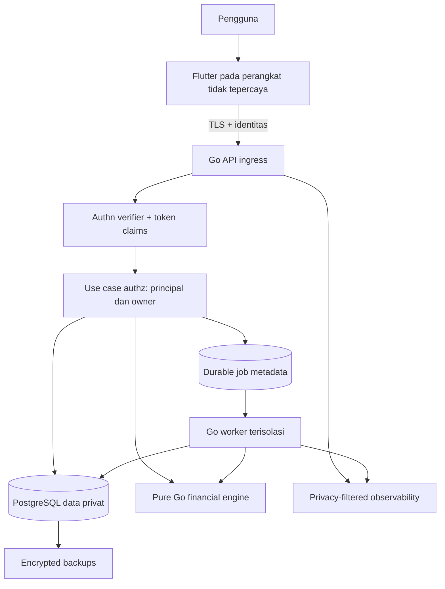
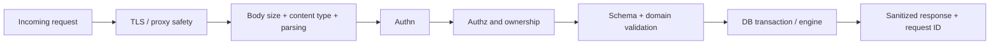
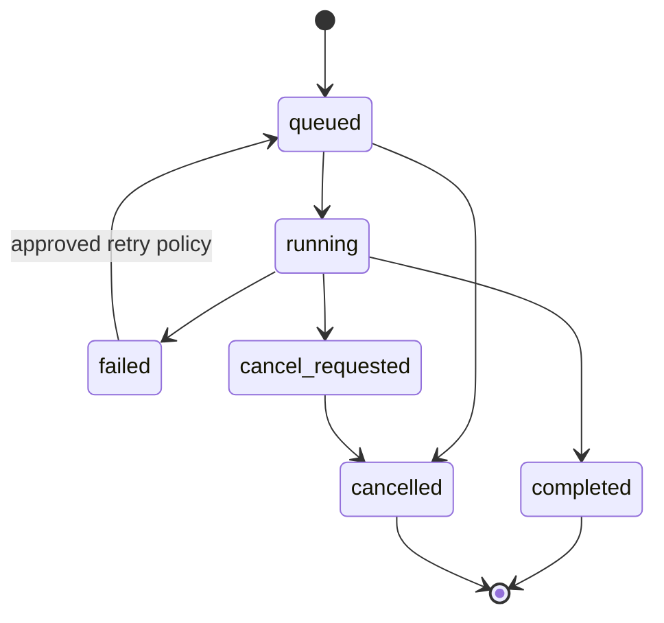
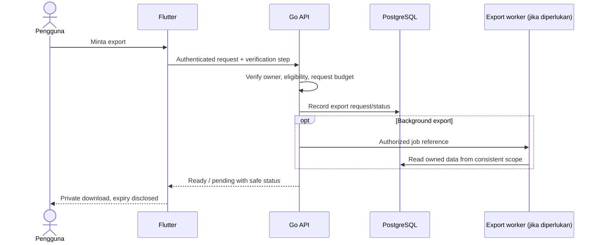

# Esokira — Security & Privacy Architecture

> **Document ID:** ESOKIRA-SECURITY-PRIVACY  
> **Version:** 0.1.0  
> **Updated:** 2026-10-30 (Asia/Jakarta)  
> **Status:** `REVIEWED_INTERNAL — PENDING_OWNER_APPROVAL`  
> **Scope:** R0–R3; R4 discovery only  
> **Audience:** Product Owner, AI coding agents, Flutter/Go engineers, DBA, QA, operations, legal/privacy reviewer  
> **Path:** `docs/security/SECURITY-PRIVACY.md`

---

## 0. Executive rules: cara menggunakan dokumen

Dokumen ini mengubah kebutuhan privasi dan keamanan produk Esokira menjadi **kontrak rancangan, prosedur verifikasi, dan daftar keputusan yang harus disetujui**. Ini bukan bukti implementasi, hasil penetration test, sertifikasi OWASP, maupun opini hukum final. Jangan gunakan file ini untuk menyatakan aplikasi sudah compliant sebelum audit, konfigurasi, dan pengujian nyata dilakukan.

### 0.1 Tingkat keputusan

| Label | Interpretasi oleh AI coding agent |
|---|---|
| `REQUIRED` | Invariant atau pengamanan minimum yang sudah berasal dari requirement/domain; wajib dipertahankan tanpa melemahkannya. |
| `PROPOSED` | Kandidat pola, kontrol, konfigurasi, atau target awal; implementasi produksi memerlukan review dan approval. |
| `TBD` | Keputusan belum diambil; agent **tidak boleh** mengarang penyelesaian diam-diam. |
| `BLOCKED` | Fitur/operasi tidak boleh masuk produksi sebelum keputusan, kontrak, dan tes prasyarat terpenuhi. |
| `R0/R1/R2/R3/R4` | Fase sesuai PRD, bukan tanggal deadline atau status implementasi. |

### 0.2 Aturan yang tidak bisa ditawar

1. **Client Flutter tidak tepercaya.** Seluruh API privat wajib melakukan verifikasi identitas dan otorisasi atas objek terkait di server.
2. **`owner_id` bukan input otorisasi.** Ikat pemilik data dari principal hasil verifikasi token, bukan body, query, header arbitrer, atau penyamaran ID resource.
3. **Private by default.** Akun, transaksi, goals, assets, liabilities, snapshots, scenarios, simulation runs, exports, insights, dan notifications adalah data personal kecuali telah melalui model izin yang disetujui.
4. **Tidak boleh membocorkan data ke log, crash report, analytics, URL, push notification, contoh kode, atau prompt AI** tanpa dasar, minimisasi, dan izin/pemberitahuan yang sesuai.
5. **Actual ≠ plan ≠ forecast.** Simulasi tidak pernah melakukan *actual financial posting* atau memberi progress goal yang dianggap sudah didanai tanpa mekanisme pencatatan terpisah yang sah.
6. **Semua mutasi keuangan aktual harus atomik, dapat dipertanggungjawabkan, dan aman saat retry.** Timeout bukan bukti gagal/sukses.
7. **Tidak ada rahasia di repositori, Flutter bundle, atau screenshot.** Semua nilai sensitif masuk secret manager/environment sesuai deployment policy.
8. **Export dan deletion adalah operasi data sensitif**, wajib memiliki authorization, perlindungan dari enumeration, pemantauan pekerjaan, serta kebijakan retensi dan backup yang transparan.
9. **Fail closed:** token tak valid, ownership ambigu, konfigurasi otorisasi gagal, atau dependency verification tidak tersedia harus menghentikan akses; jangan fallback ke mode publik.
10. **Jangan menandai fitur `DONE` hanya karena UI/API berhasil dijalankan**. Security regression tests dan bukti verifikasi di section 23 harus tersedia.

### 0.3 Source of truth dan konflik

| Area | Dokumen pemilik | Peran file ini |
|---|---|---|
| Visi/tujuan dan cakupan rilis | [`../product/PRODUCT-VISION.md`](../product/PRODUCT-VISION.md), [`../product/PRD.md`](../product/PRD.md), [`../product/FEATURE-MATRIX.md`](../product/FEATURE-MATRIX.md) | Menentukan pengamanan fitur yang telah didefinisikan, **tidak** menciptakan fitur baru. |
| Makna saldo, transaksi, funding, actual vs scenario | [`../financial/FINANCIAL-DOMAIN-RULES.md`](../financial/FINANCIAL-DOMAIN-RULES.md) | Mendefinisikan kontrol untuk menjaga invariant. |
| Rumus/simulasi dan golden tests | [`../financial/CALCULATION-SPECS.md`](../financial/CALCULATION-SPECS.md), [`../financial/FINANCIAL-TEST-CASES.md`](../financial/FINANCIAL-TEST-CASES.md) | Menjaga integritas input, output, metadata dan reproducibility, bukan mendefinisikan ulang rumus. |
| Arsitektur sistem/Go/Flutter/DB | [`../architecture/SYSTEM-ARCHITECTURE.md`](../architecture/SYSTEM-ARCHITECTURE.md), [`../architecture/BACKEND-ARCHITECTURE.md`](../architecture/BACKEND-ARCHITECTURE.md), [`../architecture/FRONTEND-ARCHITECTURE.md`](../architecture/FRONTEND-ARCHITECTURE.md), [`../architecture/DATABASE-DESIGN.md`](../architecture/DATABASE-DESIGN.md) | Menetapkan trust boundary, kontrol akses, ancaman, dan verifikasi. |
| Format dan perilaku endpoint | [`../architecture/API-GUIDELINES.md`](../architecture/API-GUIDELINES.md) → `../../contracts/openapi.yaml` **setelah disetujui** | Menambah security requirements, **tidak** menyetujui endpoint/payload ilustratif. |
| Layar, navigasi, dan copy | [`../design/DESIGN-SYSTEM.md`](../design/DESIGN-SYSTEM.md), [`../design/USER-FLOWS.md`](../design/USER-FLOWS.md), [`../design/SCREEN-SPECS.md`](../design/SCREEN-SPECS.md) | Mengatur perlindungan layar, storage, dan user-facing privacy. |

Jika sebuah implementasi atau contoh dalam file lain bertentangan dengan aturan akses privat, keamanan saldo aktual, atau larangan kebocoran data, **hentikan pekerjaan dan buat change proposal**. Jangan diam-diam mengubah dokumen sumber. Jika ada konflik dengan hasil persetujuan terbaru, catat keputusan dan sinkronkan dokumen turunannya.

---

## 1. Konteks produk, threat surface, dan non-goals

Esokira adalah aplikasi **personal financial planning & simulation**, dengan Flutter Android/iOS, Go REST API, dan PostgreSQL. Sistem menyimpan data keuangan pribadi serta menghasilkan proyeksi. Beberapa fitur dapat mengirim job berat ke worker Go. Input keuangan awalnya manual; **bukan** pemroses transfer bank nyata, brokerage, payment gateway, atau penasihat investasi berlisensi.

**In-scope:** autentikasi, tenancy/ownership, API, database, pencatatan aktual, personal profile, goals, scenario, simulator, background jobs, observability, ekspor, penghapusan, data perangkat, CI/CD, backup, insiden.

**Out of scope R1–R3:** bank linking, pembayaran uang sungguhan, transaksi sekuritas, social feed, shared goals (`FR-023`) dan portfolio management (`FR-024`) yang masih R4 discovery. Jika scope berubah, wajib memperbarui threat model, privacy impact, dan kontrol akses sebelum implementasi.

### 1.1 Sasaran pengamanan

- **Confidentiality:** pengguna hanya mengakses data miliknya; tidak ada leak dari client/API/database/worker/log/backup.
- **Integrity:** posting aktual tidak terduplikasi, tidak setengah tersimpan, dan tidak dikacaukan hasil simulasi.
- **Availability:** sistem tahan resource abuse, worker runaway, dependency down, dan memiliki jalur recovery yang teruji.
- **Privacy:** minimisasi data, transparansi tujuan, ekspor/hapus, retensi, kendali notifikasi/analytics, serta tindakan yang dapat ditelusuri.
- **Financial trustworthiness:** hasil benar-benar berasal dari input/versi model yang sah; *forecast* dan *actual* tidak disamakan.

### 1.2 Klasifikasi pengguna dan privilege

| Principal / actor | Privilege dasar | Catatan |
|---|---|---|
| Pengunjung tanpa sesi | Hanya konten publik/health metadata minimal | Tidak mendapat informasi apakah user ID/akun ada. |
| Pengguna terautentikasi | CRUD resource miliknya menurut lifecycle dan owner policy | Tidak memiliki akses ke data user lain meskipun mengetahui ID. |
| Worker Go | Memproses job yang diizinkan, dengan scope dan tujuan terbatas | Tidak menjadi admin generik; tetap cek owner/status job dan output destination. |
| Operator / support | Akses infrastruktur terbatas untuk operasional | Akses data produksi harus lewat prosedur akses darurat yang diaudit; tidak otomatis boleh baca transaksi. |
| CI/CD | Hak build/deploy sesuai environment | Tidak menyimpan token produksi di artefak/log atau build Flutter. |
| Penyedia identitas eksternal (jika dipilih) | Verifikasi login/subject | Tidak boleh menjadi sumber keputusan ownership resource di database tanpa mapping yang benar. |

---

## 2. Threat model dan batas kepercayaan

### 2.1 Logical trust boundaries



Penempatan layanan yang ditunjukkan **logis**, bukan topologi hosting yang sudah disetujui. `Authn` (siapa) tidak menggantikan `Authz` (boleh apa terhadap objek tertentu).

### 2.2 Aset yang dilindungi

| Aset | Dampak bila bocor/dirusak | Klasifikasi awal |
|---|---|---|
| Token akses/refresh dan kredensial | Pengambilalihan sesi | Restricted |
| Financial accounts, transactions, assets, liabilities | Pembukaan profil finansial personal; perubahan saldo | Restricted |
| Goal, life event, dan financial profile | Pengungkapan target hidup/prioritas dan penghasilan | Restricted |
| Baseline, scenario, simulation results, retirement | Inferensi finansial dan rencana hidup | Restricted |
| Email, subject ID, perangkat/session metadata | Identifikasi/pengambilalihan akun | Confidential / Restricted menurut field |
| Export files, backups, DB dumps | Kebocoran agregat seluruh data | Restricted |
| Log tanpa PII / metrik teragregasi | Data operasional terbatas | Internal |
| UI theme dan dokumentasi publik | Informasi nonrahasia | Public |

Klasifikasi ini adalah **rancangan internal**. Buat data inventory per field sebelum production; asumsi bahwa seluruh metadata tidak sensitif adalah salah.

### 2.3 Register ancaman (risk assessment awal)

| Threat ID | Jalur serangan / kesalahan | Risiko | Pengamanan utama | Verifikasi |
|---|---|---|---|---|
| TH-01 | BOLA/IDOR: ubah ID account/goal/simulation milik orang lain | Kritis | Verified principal + owner-scoped repository + tests dua user | ST-006–ST-012 |
| TH-02 | ID token palsu, `alg=none`, issuer/audience tidak cocok | Kritis | Verifikasi signature, alg allowlist, claims, expiry, revocation sesuai provider | ST-001–ST-005 |
| TH-03 | Duplicate transfer pada timeout/retry | Kritis | Idempotency durable + DB transaction atomic + replay canonical result | ST-020–ST-024 |
| TH-04 | Edit skenario mengubah actual posting | Kritis | Separate application commands/storage boundaries | ST-025–ST-028 |
| TH-05 | Data finansial masuk log/analytics/crash report | Tinggi | Data minimization + redaction + telemetry tests | ST-029–ST-032 |
| TH-06 | Token/cache terbaca dari storage device / backup OS | Tinggi | Platform secure storage, cache policy, session cleanup | ST-033–ST-039 |
| TH-07 | Export user A diunduh user B / public storage link | Kritis | Owner authorization, private object storage, expiring single-use delivery jika dipilih | ST-040–ST-043 |
| TH-08 | Deletion dinyatakan tuntas meskipun ada data aktif/backup | Tinggi | Lifecycle states, tombstone, retention registry, evidence | ST-044–ST-048 |
| TH-09 | SSRF / unvalidated external URL pada import atau integrations R4 | Tinggi jika diaktifkan | URL allowlist/egress policy + feature review | ST-051 |
| TH-10 | Worker mengambil job lintas user / memroses run lama secara salah | Tinggi | Scoped job payload, durable status, version validation, limits | ST-052–ST-056 |
| TH-11 | SQL injection / unsafe dynamic filters | Kritis | Parameterized SQL + allowlisted sort/filter fields + tests | ST-013–ST-016 |
| TH-12 | Database/backup kebuka ke internet atau role superuser dipakai API | Kritis | Private network, least privilege, encryption, rotation, restore drills | ST-057–ST-062 |
| TH-13 | Kompromi dependency/pipeline menyebabkan pencurian secret | Tinggi | Review dependency, pinning, secret scan, restricted CI tokens | ST-063–ST-067 |
| TH-14 | Statistik model/insight menyesatkan pengguna | Tinggi | Model version, provenance, display caveats, deterministic golden tests | ST-068–ST-071 |

**Klasifikasi prioritas `Kritis/Tinggi` adalah penilaian awal, bukan skor CVSS/penilaian risiko formal.** Review ulang pada perubahan arsitektur, penyedia auth, storage lokal, deployment, dan integrasi eksternal.

### 2.4 Abuse cases yang wajib direproduksi

- User A mengambil ID transaksi user B dari log/pola UUID lalu mengakses/menghapusnya → tetap ditolak tanpa memberitahukan data B.
- User A membuat account miliknya tetapi mengisi `destination_account_id` milik B → transfer ditolak seluruhnya; tidak boleh posting parsial.
- Memutar ulang request POST dengan idempotency key sama dan body sama → satu efek; body berbeda dengan key sama → conflict sesuai policy setelah approval.
- Network putus setelah commit transfer → UI harus menampilkan status *unknown/pending verification*, bukan POST baru dengan identitas operasi baru.
- Logout user A dan login user B di perangkat sama → tidak boleh menampilkan saldo A dari memory, cache, route state, thumbnail atau push content.
- Worker menerima job run yang dibatalkan/diarsipkan atau owner berubah → tidak mem-publish hasil sebagai run aktif.
- Menghapus scenario R3 → data actual tidak berubah, lalu akses resource scenario yang dihapus tidak bocor ke pengguna lain.
- Deletion request saat export/worker masih berjalan → lifecycle harus menentukan pembatalan, penghentian akses, dan pembersihan artefak.

---

## 3. Security architecture dan control register

Kontrol di bawah adalah **baseline perilaku**. Kode/konfigurasi/detail provider tetap mengikuti keputusan pada section 24. `SEC-xxx` adalah ID stabil untuk audit dan testing; tidak setara dengan kode yang sudah ditulis.

| Control ID | Level | Kebutuhan | Target |
|---|---|---|---|
| SEC-001 | REQUIRED | Semua API privat memverifikasi identitas dan resource authorization server-side | R0 |
| SEC-002 | REQUIRED | Principal berasal dari credential yang diverifikasi; client owner field bukan izin | R0 |
| SEC-003 | REQUIRED | Cross-user read/write/list/aggregate/export/delete ditolak | R0 |
| SEC-004 | REQUIRED | Child resources dan parent ownership diperiksa, termasuk nested ID | R0 |
| SEC-005 | REQUIRED | Tidak ada actual posting oleh simulasi, insight, preview, atau AI | R0 |
| SEC-006 | REQUIRED | Actual writes atomic + safe retry; timeout outcome ambigu ditangani | R1 |
| SEC-007 | REQUIRED | Secret, token, saldo, nama goal/transaction mentah tidak masuk telemetry biasa | R0 |
| SEC-008 | REQUIRED | TLS untuk traffic eksternal dan koneksi internal sesuai risk/deployment | R0 |
| SEC-009 | REQUIRED | Validasi input batas ukuran, tipe, range, format, referensi dan resource ownership | R0 |
| SEC-010 | REQUIRED | Otorisasi ekspor dan deletion serta status lifecycle yang dapat diaudit | R1 |
| SEC-011 | REQUIRED | Uji isolasi tenant dan permission negative tests otomatis | R0 |
| SEC-012 | REQUIRED | Tidak ada secrets plaintext di repo, build mobile, log, atau pipeline artifacts | R0 |
| SEC-013 | PROPOSED | Throttling berbasis IP/principal/route dan resource budget | R0 sebelum publik |
| SEC-014 | PROPOSED | Audit security events minim PII dengan retensi terbatas | R1 |
| SEC-015 | PROPOSED | Mobile secure storage untuk kredensial, cache finansial default off / encrypted bila disetujui | R0 |
| SEC-016 | PROPOSED | Database role least privilege; app role bukan owner/superuser/BYPASSRLS | R0 |
| SEC-017 | PROPOSED | RLS sebagai defense-in-depth setelah model tenant, connection pool dan tests siap | R1 |
| SEC-018 | PROPOSED | Backups terenkripsi, terisolasi, memiliki retention dan restore drill | R0 sebelum production |
| SEC-019 | PROPOSED | Vulnerability scans/SBOM/dependency review dalam CI | R0 |
| SEC-020 | PROPOSED | Release/change approvals dan rollback yang terdokumentasi | R0 |
| SEC-021 | PROPOSED | Step-up verification untuk export/delete/credential changes | R1 |
| SEC-022 | PROPOSED | Background job identity, bounded workload, cancellation dan replay policy | R3 |
| SEC-023 | PROPOSED | Minimisasi prompt/data ke penyedia AI jika fitur kelak diperkenalkan | R4 discovery |
| SEC-024 | PROPOSED | Documented breach response dan notification decision process | Sebelum publik |
| SEC-025 | PROPOSED | Build/device checks dan screenshot/privacy posture berdasar threat model, tanpa jaminan mutlak | R1 |
| SEC-026 | PROPOSED | Data processing register, privacy notice, consent/choice, dan DSAR handling | R1 |

**Jangan membuat pernyataan “semua kontrol terpenuhi” sebelum bukti testing, persetujuan teknis, dan review operasional tersedia.**

---

## 4. Authentication: provider-neutral sampai keputusan final

`PRD Q-02`, `ARCH-Q01`, `BE-Q01`, `API-Q...` terkait identitas masih `TBD`. Kandidat identitas meliputi Firebase Authentication atau provider OIDC lain; file ini **tidak menetapkan pemenang**.

### 4.1 Kontrak verifikasi credential

1. Flutter memperoleh credential/token hanya dari SDK/flow auth yang disetujui; browser-based OAuth/OIDC bila digunakan harus mengikuti flow native yang benar (misalnya PKCE), bukan menanam client secret dalam app.
2. API memverifikasi **signature**, issuer, audience, expiration, nbf bila ada, allowed algorithm, dan klaim identitas menurut provider. **Decode JWT bukan verifikasi.**
3. Subject eksternal dinormalisasi ke **internal user ID** dengan mapping eksplisit (lihat database design); email bukan primary security key karena bisa berubah.
4. Revocation, account disabling, token refresh, multi-device session, dan rotasi key/JWKS harus didefinisikan sesuai provider sebelum production.
5. Validasi gagal ⇒ `401`/error terstandar dan akses privat ditolak. `403` vs `404` untuk resource terotorisasi parsial adalah kebijakan API yang harus dibakukan (`API-Q06`).
6. Jangan memasukkan token dalam URI, error, crash breadcrumbs, analytics, logs, QR code, atau link invite.
7. Untuk login/restore, gunakan batas percobaan dan proteksi brute-force sesuai kemampuan provider.

### 4.2 Session lifecycle yang harus ditangani

| Event | Perilaku aman |
|---|---|
| App pertama kali dibuka | `unknown/restoring`; tampilkan shell netral tanpa nominal sampai validasi sesi selesai. |
| Session terverifikasi | Muat user-scoped state; jangan gunakan cache milik user terdahulu. |
| Token expired | Satu mekanisme refresh terkoordinasi; hindari infinite-refresh loop dan retry mutasi dengan idempotency identity baru. |
| User logout | Hapus credential lokal yang dikelola aplikasi, state sensitif, cache dan back stack sesuai kebijakan; revocation remote sesuai kemampuan provider. |
| User berganti akun | Partition/clear semua cache dan queued state berdasarkan user; tidak ada layar nominal dari user sebelumnya. |
| Account dinonaktifkan / deletion pending | Tolak mutasi privat yang tidak diizinkan dan hentikan job sesuai lifecycle policy. |
| Device hilang / dicuri | User harus memiliki mekanisme memutus sesi bila model penyedia mendukung; spesifikasi final `TBD`. |

### 4.3 Aksi sensitif dan step-up authentication

**PROPOSED:** export penuh, penghapusan permanen, perubahan metode login, dan menambah device memerlukan autentikasi ulang atau verifikasi fresh-session. Pilihan mekanisme, umur freshness, device risk, recovery account, dan UX baru **TBD**. Menggunakan biometrik perangkat dapat meningkatkan UX membuka aplikasi, tetapi **bukan bukti kepemilikan token yang diterima backend** tanpa protokol jelas.

---

## 5. Authorization dan multi-tenant isolation (aturan server)

**REQUIRED:** semua resources privat harus dimiliki principal yang telah diverifikasi. Shared goals (`FR-023`) tidak boleh menjadi alasan menerapkan akses lintas-user sebelum R4 disetujui.

### 5.1 Enforcement points

- **Route/middleware:** pastikan request telah diautentikasi; public routes adalah allowlist eksplisit.
- **Use case/service:** cek akses ke entitas dan maksud operasi; validasi data parent-child termasuk account, movement, goal, scenario, run, export artifact.
- **Repository/query:** filter berdasarkan owner yang diketahui server, bukan hanya filter data global setelah diambil.
- **Database constraints/RLS bila dipilih:** lapisan tambahan; tidak menggantikan authorization aplikasi.
- **Worker:** konteks job tidak menjamin izin abadi; revalidate run/owner/status saat eksekusi dan sebelum mempublikasi hasil.

### 5.2 Query pattern konseptual

```sql
-- PSEUDOCODE: bentuk tabel dan kolom mengikuti DB-DESIGN yang telah disetujui.
-- owner_id diperoleh dari verified principal di Go, BUKAN input user.
SELECT id, name
FROM financial_goals
WHERE id = $1 AND owner_id = $2;
```

Untuk relationship bersarang, scoped lookup wajib memvalidasi bahwa child dan parent memiliki owner yang sama. Gunakan foreign keys/constraints yang tepat menurut `DATABASE-DESIGN.md`; jangan mengandalkan pola UUID tidak dapat ditebak sebagai kontrol akses.

### 5.3 401 / 403 / 404 dan side-channel

- `401`: autentikasi tidak ada/tidak valid.
- `403`: principal terautentikasi tetapi tidak mempunyai hak atas tindakan, **jika** kebijakan mengungkap kondisi dilarang.
- `404`: boleh digunakan untuk resource privat yang keberadaannya tidak boleh diungkap; pilih konsisten menurut `API-Q06`.
- Response time, error body, pagination, total count, autocomplete, export, log akses, dan filter harus tidak mengungkap resource user lain.
- UI route guard membantu UX tetapi **bukan** pengganti authz backend.

### 5.4 Service-to-service identity

Jika worker menggunakan koneksi database langsung, gunakan service credential/role dengan izin minimum. Job harus mengandung scoped identifiers **tanpa token user mentah**. Jangan mengandalkan `job.owner_id` yang dikirim Flutter tanpa pengecekan oleh API saat enqueue.

---

## 6. Validasi input, REST API, dan anti-abuse

### 6.1 Request validation pipeline



Urutan rinci middleware dapat berbeda sesuai framework; invariant utamanya adalah operasi privat dan side effect tidak dijalankan sebelum verifikasi serta validasi. Request oversized atau malformed harus ditolak dengan status terstandar tanpa membanjiri log.

### 6.2 Input yang harus ditolak atau dibatasi

- ID parent/child milik user lain; referensi orphaned; field owner override.
- Negative/zero amount bila domain tidak mengizinkan; besar nominal di luar batas model; `NaN`, `Infinity`, eksponen/float yang tidak aman untuk exact money.
- Rate tak valid, horizon terlalu besar, iterasi Monte Carlo tak terbatas, payload daftar goals sangat panjang, memory/CPU exhaustion.
- Request body sangat besar, JSON nested ekstrem, invalid UTF-8, tipe salah, URL/redirect yang tidak termasuk allowlist.
- Dynamic sort/filter yang disisipkan ke SQL tanpa allowlist.
- Unsafe filename/path untuk export, download, dan imported data jika nanti dirilis.
- Error user-facing yang mengandung SQL, stack trace, token, alamat internal, atau data user lain.

### 6.3 Resource exhaustion / budget

**PROPOSED:** pembatasan kombinasi IP + principal + route + work type; upper bounds parameter simulasi; queue concurrency caps; request/DB timeouts; memory budget dan cancel; backpressure. Nilai kuota, limit harian, jumlah iterasi, threshold alert dan p95 **TBD** setelah load test, bukan ditentukan dari tebakan.

### 6.4 Retry, cache, dan HTTP semantics

- `GET` privat tidak boleh menghasilkan side effect domain; gunakan headers dan caching policy yang mencegah penyimpanan di shared caches.
- `POST` yang melakukan *actual posting*, job enqueue, ekspor/deletion harus punya idempotency/state transition contract sebelum release.
- `Idempotency-Key` adalah kandidat di `API-GUIDELINES.md`, tetapi format, TTL, key scope, request hash, dan replay semantics belum final.
- Jika retry mengulang identitas yang sama, hasilnya harus **satu efek aktual**, atau hasil konflik yang menjelaskan mismatch; bukan double debit/credit.
- Client dan server harus membedakan validation failure, dependency unavailable, unknown outcome, dan committed success; tidak boleh mengarang sukses setelah timeout.

### 6.5 Response dan browser-related controls

Flutter native bukan browser, sehingga CORS bukan mekanisme otorisasi mobile. Jika nanti ada web client/admin, tetapkan origin allowlist, CSRF sesuai mekanisme cookie, browser security headers, dan cookie attributes berdasarkan desain autentikasi yang dipilih. Saat ini **jangan mengaktifkan `*` sebagai pengganti keputusan security**. API error mengikuti schema yang sudah disetujui di OpenAPI.

---

## 7. Integritas transaksi, ledger, dan actual finance data

Aturan transaksi bersumber dari `DR-xxx`, `CS-003/004`, `FR-003/004/005/006`, dan rancangan database.

### 7.1 Atomic transfer (R1)

```mermaid
sequenceDiagram
  participant M as Flutter
  participant A as Go API
  participant UC as Authorized transfer use case
  participant DB as PostgreSQL
  M->>A: Submit transfer (same operation identity)
  A->>UC: Verified principal + validated inputs
  UC->>DB: BEGIN; check owner; lock required rows
  UC->>DB: Check idempotency + balance policy
  UC->>DB: Post debit and credit atomically
  alt success
    UC->>DB: COMMIT
    DB-->>A: Canonical committed result
    A-->>M: Success + operation ID
  else failure
    UC->>DB: ROLLBACK
    A-->>M: Safe error or unknown/recovery state
  end
```

- Jangan implementasi debit dan credit menggunakan dua request HTTP terpisah.
- Jangan melakukan mutation transfer pada database tanpa transaksi dan constraints yang ditinjau.
- Correction/reversal memiliki aksi domain eksplisit; model event/ledger/hard-delete **masih DB-Q01/03 TBD**.
- Perubahan saldo/ownership/account lifecycle harus tahan concurrent updates dan lost updates; pilih locking/optimistic version sesuai DB decision.
- Jangan menafsirkan peningkatan net worth dari transfer internal; saldo dan laporan mengikuti domain rules.

### 7.2 Exact money dan serialization

Presisi uang, rounding, currency unit, dan representasi JSON belum disetujui. Kontrol keamanan/integritas menuntut **tidak memakai floating-point sebagai sumber kebenaran transaksi aktual** dan tidak boleh mengonversi nilai mentah ke `double` Flutter secara diam-diam. Batas nominal, negative handling, serialization, precision, dan scale ditetapkan melalui `PRD Q-04`, `CALCULATION-SPECS.md`, `DATABASE-DESIGN.md`, `API-GUIDELINES.md`.

### 7.3 Auditability tanpa data leak

Simpan event audit minimal: tipe aksi, trusted principal ID/pseudonymous actor, target resource class/ID internal yang perlu, timestamp UTC, request/correlation ID, status, origin/service context yang tidak sensitif. **Jangan** memasukkan deskripsi transaksi, jumlah uang, password/token, atau seluruh before/after payload ke audit stream biasa. Jika forensik memerlukan nilai tambahan, gunakan store akses terbatas dan policy retensi yang disetujui.

### 7.4 Skenario, snapshot, dan provenance

- Input/baseline scenario harus berupa snapshot atau referensi immutable/berversi yang mampu direproduksi.
- Hasil lama dapat menjadi *stale* setelah actual revision berubah; tetap berlabel dan tidak menulis ulang history sebagai hasil yang masih berlaku.
- Simulation outputs dapat mengandung informasi finansial sama sensitif dengan actual; kontrol akses dan deletion berlaku identik.
- Metadata model/engine version/random seed harus cukup untuk audit, **tanpa** mem-bypass retensi/minimisasi.

---

## 8. PostgreSQL security, tenant isolation, dan backup

### 8.1 Database identity dan network

**REQUIRED behavior:** hanya backend/worker/service yang disetujui dapat mencapai PostgreSQL; koneksi database tidak berasal langsung dari Flutter. PostgreSQL production tidak memiliki public unauthenticated access. Dev/staging/prod memiliki credential dan data terpisah. Jika DB dikelola pihak ketiga, pastikan kontrak, lokasi data, audit akses, enkripsi, dan backup dikaji.

**PROPOSED practice:**

- Separate database roles: `migration_owner` untuk DDL, `app_runtime` untuk query minimum, dan `worker_runtime` jika permission job berbeda. **Jangan** menjalankan aplikasi memakai superuser, table owner, atau role dengan `BYPASSRLS`.
- Parameterized SQL (`pgx`/`sqlc` bila dipilih); semua kolom yang dipakai dynamic `ORDER BY` harus berasal dari enum allowlist.
- TLS DB sesuai topologi dan standar deployment; sertifikat diverifikasi di lingkungan yang memerlukannya.
- Secret dan credential DB diinject saat runtime, dirotasi, serta dibatasi aksesnya; tidak pernah dimasukkan ke Flutter build.
- Limit connection pool, query timeout, lock timeout, dan timeout worker sesuai profiling. Hindari migration yang memblokir tabel finansial tanpa maintenance/rollback plan.
- Unique constraints, foreign keys dan check constraints melindungi integritas. Constraint **bukan** pengganti owner validation across joins.

### 8.2 Row-Level Security (RLS) — defense-in-depth, bukan keputusan otomatis

RLS PostgreSQL dapat membantu isolasi tenant tetapi salah konfigurasi bisa membuat isolasi gagal. **PROPOSED, TBD:** kebutuhan RLS, per-table policies, pengisian trusted principal ke connection/session, cara menghindari kebocoran context pada pooled connection, role ownership, dan integration tests ditetapkan bersama database design.

Hal yang harus diuji sebelum menyatakan RLS aktif:

1. App role bukan superuser, table owner bypass, atau role `BYPASSRLS`.
2. Jika owner table harus tunduk pada policy, pertimbangkan `FORCE ROW LEVEL SECURITY` sesuai konfigurasi.
3. Semua tenant-owned tables dan child tables punya kebijakan `SELECT` dan `WITH CHECK` write sesuai kebutuhan.
4. `TRUNCATE`, referential integrity, admin functions dan SECURITY DEFINER routines tidak dianggap otomatis terproteksi RLS.
5. Context tenant tidak tertinggal pada connection pool saat request user lain.
6. Cross-user tests dilakukan pada **database sebenarnya** menggunakan role yang sama dengan deployment aplikasi, bukan hanya unit-test repository mock.

Dokumentasi PostgreSQL menjelaskan bahwa pemilik tabel biasanya bypass RLS, sedangkan superuser dan `BYPASSRLS` selalu bypass; rujukan: [PostgreSQL Row Security Policies](https://www.postgresql.org/docs/current/ddl-rowsecurity.html).

### 8.3 Data at rest dan field encryption

- Encryption at rest untuk volume/DB/object storage/backup menjadi baseline **PROPOSED** dan harus dibuktikan dengan konfigurasi provider.
- Encryption in transit saat client↔API dan untuk koneksi internal yang melewati trust boundary.
- Kebutuhan *field-level encryption* atau envelope encryption untuk atribut tertentu **TBD setelah data classification & risk review**; jangan otomatis mengenkripsi seluruh kolom tanpa analisis query, indexing, dan key rotation.
- Key encryption tidak boleh disimpan berdampingan dengan ciphertext di public repository; gunakan KMS/secret manager bila diperlukan.
- Jangan menyatakan suatu kolom aman hanya karena database memakai TLS: TLS tidak otomatis melindungi data pada disk, backup, crash dump, atau log.

### 8.4 Backup / restore

| Kontrol | Minimum yang harus diputuskan sebelum production |
|---|---|
| RPO/RTO | Angka objective sesuai kebutuhan dan kemampuan restore; **TBD**, bukan placeholder yang diam-diam dianggap SLA. |
| Frequency dan retention | Jadwal backup, PITR bila diperlukan, jangka retensi, dan alasan legal/business. |
| Access | Akses backup lebih ketat dari read-only biasa; tidak tersedia publik; audit read/export. |
| Encryption dan key management | Bukti enkripsi serta kebijakan rotasi/recovery key. |
| Restore drill | Uji ke lingkungan terisolasi dengan data/scope yang aman; verifikasi counts/constraints dan hasil sampling. |
| Deletion lifecycle | Tentukan cara data pengguna yang telah dihapus diperlakukan jika backup lama dipulihkan; rekonsiliasi tombstone/purge queue wajib. |
| Incident recovery | Runbook, owner, jalur komunikasi, dan prioritas pemulihan. |

**BLOCKED:** rilis publik tidak boleh mengklaim backup/restore atau deletion compliance tanpa uji restore dan kebijakan retention yang ditinjau.

---

## 9. Flutter mobile security (Android & iOS)

### 9.1 Endpoint dan transport

- Gunakan HTTPS untuk API produksi dan verifikasi TLS chain/hostname melalui mekanisme platform/HTTP client.
- Certificate pinning bukan default wajib; **PROPOSED hanya setelah evaluasi threat model, rotasi sertifikat, fallback, dan dampak outage**. Pinning yang salah bisa mematikan aplikasi saat cert rotation.
- Jangan menonaktifkan pemeriksaan sertifikat di release (`badCertificateCallback => true`, custom insecure adapter, trust-all, dan sejenisnya terlarang).
- Deep links/universal links divalidasi: autentikasi, host/path allowlist, resource authorization, dan sanitasi parameter. Jangan simpan credential dalam deep link.
- Host API di-build melalui konfigurasi environment yang disetujui, bukan mengambil host arbitrary dari data user.

### 9.2 Secret/token storage

- Token/refresh token bila disimpan di perangkat menggunakan secure storage berbasis Android Keystore / iOS Keychain sesuai kebijakan provider, **bukan SharedPreferences biasa atau file plaintext**.
- Browser/cookie/provider SDK storage dapat memiliki mekanisme sendiri; jangan menduplikasi token tanpa perlu.
- Jangan embed `client_secret`, database password, API private key, service-account JSON, atau encryption master key dalam Flutter build; semua file APK/IPA dapat diekstrak dan dianalisis.
- Pseudonymous installation ID/analytics ID pun harus melalui privacy review; jangan membuat fingerprint device tanpa dasar.

Referensi teknis: [OWASP MASTG — Cryptographic Key Storage](https://mas.owasp.org/MASTG/knowledge/android/MASVS-STORAGE/MASTG-KNOW-0047/) dan [OWASP MASVS](https://mas.owasp.org/MASVS/).

### 9.3 Cache, offline, dan local persistence

**Default `PROPOSED`:** cache response data keuangan privat **memory-only** kecuali kebutuhan offline yang disetujui. Jika persistent offline cache dipilih, tetapkan encryption key, per-user partition, TTL, data minimization, clear on logout/account switch, OS backup exclusions, behavior after device restore, key rotation dan migration.

- Jangan menyimpan complete financial profile, transaction history, atau Monte Carlo run detail di preferences biasa.
- Cache key harus mencakup user internal yang terverifikasi; response lama user A tidak pernah ditampilkan saat user B login.
- Offline UI boleh menampilkan data yang memang tersimpan dengan aman **dan label timestamp/sumber yang jujur**. Tidak boleh menganggap mutasi offline sukses sebelum backend mengonfirmasi.
- Draft form privat di memori dibersihkan saat logout; persistent drafts membutuhkan kebijakan sendiri.
- Clipboard berisi nilai finansial harus diperlakukan sebagai potensi disclosure; jangan auto-copy token atau identitas akun sensitif.

### 9.4 Screenshot, app switcher, dan screen recording

Informasi keuangan dapat muncul di *app switcher snapshots*, screenshot, notifikasi, atau screen recorder. Opsi **PROPOSED**: privacy overlay pada saat app background, hide-balance toggle, serta kebijakan screenshot khusus halaman yang sangat sensitif. Implementasinya platform-specific dan tidak boleh menghalangi accessibility tanpa pertimbangan. Android `FLAG_SECURE` dan perilaku iOS berbeda; **tidak ada jaminan** perangkat yang terkompromi bisa dicegah merekam layar.

### 9.5 Root/jailbreak, reverse engineering, dan device trust

Deteksi root, emulator, integrity attestation, dan obfuscation boleh dipertimbangkan berdasarkan risiko, tetapi tidak boleh menjadi satu-satunya kontrol keamanan. **Server tetap memverifikasi semua permission.** Pengguna yang memakai perangkat tidak ideal perlu mendapat pesan akurat, bukan klaim bahwa data pasti aman/tidak aman. Jangan menambahkan library integrity yang mengumpulkan data identifikasi berlebihan tanpa review privacy.

### 9.6 Accessibility vs privacy

Teks saldo dan grafik harus tetap dapat dibaca screen reader saat pengguna memilih menampilkannya. Hindari menonaktifkan text scaling atau menyembunyikan seluruh data dari accessibility hanya demi screenshot protection. Privacy modes perlu diuji untuk screen reader, keyboard, screen magnification, contrast, dark mode, dan orientation.

---

## 10. Security backend Go dan middleware

### 10.1 Composition root dan dependencies

- Pisahkan `identity verifier`, `authorization policy`, `audit logger`, `rate limiter`, dan `sensitive logging scrubber` sebagai dependency nyata yang dapat diuji.
- Jangan memberi handler akses langsung ke role admin DB; use case menerima verified principal dari trusted context yang dibuat middleware.
- Kontrak `AuthContext` perlu membedakan `principal_id`, internal `user_id`, tenant/owner scope, token issuance time (jika relevan), dan permissions; **schema final TBD**.
- Structured logging menggunakan allowlist field dan tracing/correlation ID, bukan format print seluruh request/response.
- Middleware failures jangan diperlakukan sebagai success untuk downstream handlers.

### 10.2 Safe failure dan errors

- API mengembalikan error terstandar dengan kode stabil; hindari raw SQL error, stack trace, token, sensitive input, dan resource name orang lain.
- Log server hanya menyimpan informasi diagnostik ter-redact yang dibutuhkan.
- Panic recovery menjamin request gagal dengan aman tetapi **bukan bukti transaksi sudah rollback**; seluruh DB transaction wajib dikelola dengan commit/rollback yang benar.
- Parameter timeout berasal dari kebijakan deployment dan operasi; context cancellation mengakhiri pekerjaan ketika aman. Jangan mengabaikan error commit karena client disconnect.

### 10.3 SQL, template, file dan external calls

- Seluruh nilai SQL melalui bind parameters; nama kolom/order dari allowlist.
- Jangan mempercayai path/filename dari client; export artifacts memakai internal generated key, path traversal ditolak.
- Untuk integrasi HTTP masa depan: SSRF defense (allowlist host, DNS/IP validation, restricted egress, redirect policy, timeout). **Tidak ada bank integration yang disetujui sekarang.**
- Jangan log raw query dengan bound values finansial; query plan/slow query observability harus redacted.

### 10.4 Build and dependency hygiene

- Gunakan Go modules dan versi dependency yang dipin/ditinjau.
- Jalankan `go test`, `go vet`, `gofmt`/format-check, security/dependency scanner yang dipilih, serta review perubahan `go.mod/go.sum`.
- Service/container runtime non-root bila memungkinkan, filesystem hanya-sebatas-perlu, health/readiness yang tidak mengungkap secrets.
- Debug endpoints dan profiler tidak boleh publik tanpa autentikasi kuat dan batas jaringan.
- Error monitoring/OTEL jangan membawa request body atau full SQL parameters sebagai atribut default.

---

## 11. Background workers dan simulation abuse (R2–R3)

Worker dapat menjalankan Monte Carlo, optimizer, export, deletion, notifikasi, dan perhitungan berat **jika** fase tersebut membutuhkan kerja async. Pilihan library antrian Go/driver DB (`River`, job table custom, dll.) **TBD**, bukan disetujui oleh dokumen ini.

### 11.1 Aturan aman per job

1. API memverifikasi identity/owner/izin serta request budget sebelum enqueue.
2. Job mendapat **server-generated immutable** job ID, owner scope, kind, input snapshot reference/hashed assumptions, engine version dan expiry policy.
3. Payload tidak menyimpan raw access token/refresh token atau data finansial lengkap jika referensi ke data aman mencukupi.
4. Worker memvalidasi job status/owner/tenant/versi, cancelled state dan ketersediaan input sebelum mengeksekusi.
5. Enforce max iterations, CPU/memory budget, max concurrent jobs per owner, cancellation, progress bounds, retry policy, dan final error sanitization.
6. Worker menulis hasil pada run yang benar secara atomik. **At-least-once** processing tidak boleh membuat duplicate artifacts atau mem-publish dua versi bertentangan.
7. Hasil `stale`/cancelled tidak diam-diam ditandai `completed-fresh` setelah baseline berubah; tampilkan informasi version/as-of.
8. Pembersihan job history/results/exports mengikuti retention policy dan data lifecycle owner.

### 11.2 Kandidat state machine



**PROPOSED:** status dan transisi akhir ditetapkan pada `BACKEND-ARCHITECTURE.md`, `DATABASE-DESIGN.md`, dan OpenAPI. Jangan menganggap diagram ini schema/DDL production.

### 11.3 Special case: privacy vs reproducibility

R3 simulations memerlukan seed, model version, dan input snapshot untuk replay (`NFR-003`), tetapi prinsip data minimization mewajibkan retensi terbatas (`NFR-008`). Putuskan **berapa lama** input, snapshot, dan seed disimpan; opsi purge, download atas permintaan, serta efek delete account. Auditability bukan alasan menyimpan seluruh financial profile selamanya.

---

## 12. Privacy-by-design: data inventory, purpose dan minimization

### 12.1 Data lifecycle map

| Data class | Tujuan | Source | Primary store | Risiko dan policy |
|---|---|---|---|---|
| Account identity | Login, pemulihan akun, pemetaan internal principal | Provider auth / user | Auth provider + PostgreSQL mapping | Retention, account recovery, access/export/delete TBD. |
| Basic finance profile | Input untuk planning | User | PostgreSQL | Data minimum; purpose notice; hindari default tersembunyi. |
| Actual accounts/transactions | Ringkasan saldo, catatan manual, net worth | User | PostgreSQL | Restricted; atomic writes, audit, no public export. |
| Asset/liability valuations | Net worth dan kapasitas finansial | User | PostgreSQL | Restricted; as-of date dan data quality. |
| Goals and life events | Perencanaan tujuan dan timeline | User | PostgreSQL | Restricted; bukan actual funds. |
| Scenario/simulation inputs/results | Forecast, stress, retirement, risk | User + backend | PostgreSQL / temporary job results | Restricted; versioning, ownership, replay vs retention. |
| Push token / notification prefs (R2) | Pengingat opt-in | SDK/provider | Minimal token registry | No sensitive text on lockscreen by default; revocation TTL. |
| Export artefact | Permintaan pengguna | Derived sensitive data | Private object/file store if needed | Short-lived delivery and deletion; avoid public URLs. |
| Security logs | Investigasi abuse/failure | API/worker | Restricted telemetry | Pseudonymized IDs, limited retention, no payloads. |
| Product analytics (opsional) | UX improvement | User interactions | Analytics tool TBD | Optional, minimized, disclose; no raw financial amounts/names. |

**TBD:** detail field-by-field, basis pemrosesan (tidak semua memakai consent), kategori data PDP, data processors, geographic region, sub-processors, dan transfer lintas batas. Ini harus didokumentasikan sebelum publikasi, bukan hanya setelah ada insiden.

### 12.2 Data minimization decision gates

- Apakah data field benar-benar diperlukan untuk fitur yang disetujui sekarang?
- Apakah ada alternatif agregat/non-identifying yang cukup?
- Apakah data bisa dihitung on demand tanpa menyimpan snapshot permanen?
- Apakah cache aplikasi/analytics/recommendation provider menyalin data sensitif?
- Apakah pengguna dapat mengetahui tujuan pengumpulan dan mengontrol yang opsional?
- Apa retensi minimum yang masuk akal dan bagaimana deletion dieksekusi di semua replika?

### 12.3 Consent, legal basis, dan pilihan pengguna

**Jangan menyatakan consent sebagai satu-satunya dasar hukum untuk semua pemrosesan.** Penentuan dasar pemrosesan harus melibatkan peninjauan hukum. UX wajib memisahkan fungsi inti (yang membutuhkan data agar bekerja) dari pemrosesan opsional seperti analytics, personalisasi ekstra, push reminder, atau integrasi eksternal.

- Privacy notice harus tersedia sebelum/ketika data relevan dikumpulkan, dalam bahasa yang dapat dipahami.
- Opt-in untuk notifikasi sesuai permission OS dan preferensi internal; matikan reminder tidak menghapus transaksi keuangan.
- Jangan melakukan dark pattern, pre-checked consent untuk hal yang butuh pilihan aktif, atau menyembunyikan cara menarik persetujuan.
- Perubahan privacy policy yang material harus melalui change management dan communication plan.

### 12.4 Analytics, crash reports, prompt/AI policy

**Allowlist event** (contoh konseptual): `onboarding_step_completed`, `goal_created` (tanpa nilai target), `simulation_started` (tanpa params), `api_error_code` (tanpa raw response), latency aggregates. Nama goal, pendapatan, saldo, id rekening, deskripsi transaksi, parameter personal, dan full input snapshot **tidak termasuk event analytics default**.

Jika developer memakai AI coding agent: jangan paste produksi user data, database dump, token, signing keys, recovery codes atau network trace autentikasi ke prompt. Gunakan fixture sintetis. Jika nantinya fitur AI dipakai di produk, buat privacy assessment baru, data flow dan kontrak pemroses; tidak otomatis diizinkan oleh FR-016 (rule-based insights).

---

## 13. Export, data access, correction dan deletion (FR-021)

Akses, ekspor, koreksi, pembatasan pemrosesan, serta penghapusan data adalah **product + security + privacy lifecycle**, bukan sekadar `DELETE FROM users`.

### 13.1 Export flow (PROPOSED)



**PROPOSED:** ekspor data mentah dan metadata bertipe machine-readable (JSON/CSV) dengan format terdokumentasi dan waktu *as-of*. Ekspor R1 meliputi data aktual/goals yang relevan; R2/R3 bertambah sesuai fitur yang tersedia. Harus tersedia penjelasan field, waktu, keterbatasan, dan status. Export file link harus private/expiring dan tidak bisa direplay user lain; jangan menaruh data dalam URL.

### 13.2 Deletion flow dan state (PROPOSED)

1. Authenticated user meminta delete; aplikasi menampilkan dampak yang jujur dan meminta konfirmasi eksplisit.
2. Untuk penghapusan destruktif lakukan step-up verification jika disetujui. Tandai request secara unik/idempotent.
3. Backend menetapkan lifecycle `requested → verifying → processing → completed` atau `failed/needs_attention`; enum final **TBD**.
4. Atur sesi/token dan akses akun selama pending deletion berdasarkan kebijakan final; cegah penerbitan job/artefak baru yang bertentangan.
5. Hapus/anonimkan data terkait sesuai kewajiban legal, retensi, dan dependency order; jangan menghapus satu tabel sambil menyisakan data pengguna di agregat, worker, analytic sink, dan export artefact.
6. Untuk backup immutable, dokumentasikan retensi/expiry, restore reconciliation, dan legal holds yang valid; **jangan menjanjikan semua backup langsung hilang** bila mekanismenya tidak demikian.
7. Catat completion evidence yang tidak mengungkap data sensitif; beri konfirmasi yang tidak menyesatkan.

**Keputusan retensi, legal hold, SLA pemrosesan, backup expiry, verifikasi identitas, dan mekanisme pemusnahan adalah `TBD` hingga direview.** Pastikan request data subject tidak diabaikan karena satu job gagal; sediakan retry/escalation operational.

### 13.3 Correction dan data portability

Koreksi financial posting mengikuti domain action/correction policy (tidak otomatis hard-delete jejak transaksi). Hak perubahan atas data personal dan riwayat audit mesti dipenuhi sesuai kebijakan yang sah tanpa menghilangkan integritas ledger. Format portability harus tetap terbaca dan terdokumentasi; jangan sertakan token/hashed secrets yang tidak diperlukan dalam export.

---

## 14. Retention schedule: kerangka sebelum angka final

Tidak boleh mengisi angka retensi dengan tebakan. Sebelum public beta, keputusan berikut harus menjadi kebijakan tertulis yang disetujui beserta implementasi dan automated cleanup:

| Data/artefak | Retention trigger | Kebijakan yang harus ditetapkan | Owner keputusan |
|---|---|---|---|
| Active account data | Selama akun aktif dan dibutuhkan | Purpose + kategori + deletion trigger | Product + privacy |
| Financial transactions | Kebutuhan pencatatan/pelaporan dan dasar hukum | Audit/correction vs user delete; anonymization bila layak | Domain + privacy/legal |
| Simulation results | Selesai run / scenario delete | Durasi reproducibility vs minimization | Product + engine + privacy |
| Job metadata/errors | Job completion/failure | Diagnostics window, purge/deletion | Backend + ops |
| Export artifacts | Export generated/delivered | Expiry singkat sesuai kebutuhan, revocation dan cleanup | Product + privacy |
| Access/security logs | Event log created | Security detection vs proportionality | Security + ops |
| Analytics events | Per event/per user request | Anonymization/aggregation/opt-out | Product + privacy |
| DB backup / PITR | Snapshot generated | Backup window, legal holds, restore reconciliation | Infrastructure + privacy |
| Crash reports | Crash generated | Minimized retention, scrub, vendor contract | Mobile + security |
| Third-party provider data | Provider processing ends | Subprocessor terms, contract, deletion verification | Privacy + legal |

**Policy state:** semua angka retention saat ini `TBD`; jangan mengubah `TBD` menjadi defaults yang tersembunyi dalam kode.

---

## 15. Notifications, insights, dan privacy-safe communication

- Push notification R2 hanya berjalan bila disetujui user/OS; token adalah data yang harus dilindungi dan dihapus saat sign-out/perangkat tidak aktif menurut kebijakan.
- Konten lock screen default **netral**, misalnya “Ada pembaruan rencana keuangan” alih-alih menyebut saldo, jumlah utang, atau nama goal pribadi.
- Deep link dari notification harus masuk lewat session gate dan authorization seperti navigasi biasa.
- Rule-based insight menunjukkan alasan/asumsi tanpa mengunggah semua transaksi ke layanan analytics untuk setiap insight.
- Notification permission ditolak tidak boleh memblokir fitur utama planning; UI menawarkan alternatif in-app jika sesuai requirement.
- Pengguna bisa mengubah preferensi pengingat dan menarik opt-in; worker tidak boleh terus mengirim setelah preferensi dicabut.

---

## 16. Observability dan audit trail tanpa kebocoran

### 16.1 Logging allowlist (PROPOSED)

| Data | Log normal? | Catatan |
|---|---|---|
| Request ID, route template, method, response code, duration bucket | Ya | Tidak gunakan raw URL query berisi data pribadi. |
| Internal pseudonymous actor ID, hashed/scoped correlation | Terbatas | Berguna untuk audit; masa simpan dibatasi. |
| Raw `Authorization`/refresh token/cookie | **Tidak** | Zero tolerance untuk normal logs. |
| Request/response body transaksi, salary, assets, account balances | **Tidak** | Gunakan synthetic fixture saat debug. |
| SQL bind parameter finansial | **Tidak** | Query logging harus filter/sanitize. |
| Full user email, phone, goal/transaction notes | **Tidak** secara default | Butuh justifikasi eksplisit dan restricted sink. |
| Error code kategori, job ID pseudonymous, worker status | Ya terbatas | Tidak menyimpan job payload lengkap. |
| Model version, run status, duration, iteration bucket | Ya | Hindari personal snapshot/seed dalam public telemetry. |

### 16.2 Operational metrics

**PROPOSED:** HTTP error ratios, p50/p95 latencies, DB pool saturation, queue wait, worker failures, restore drill, invalid token events (aggregate), rejected unauthorized object access, rate limiting events. Jangan memasukkan identifier sensitif sebagai label Prometheus/metrics karena cardinality dan privacy risk.

### 16.3 Security audit events

Record event types seperti login policy failure, export requested/completed, deletion requested/completed, security config changed, unauthorized object attempt (secara agregat), role/service credential change dan incident response action. Query audit hanya oleh role yang diizinkan. Log manipulasi uang dapat memakai domain audit ID tanpa menyalin entire payload.

### 16.4 Data retention di third parties

Sentry/Firebase Crashlytics/OTEL/APM providers **belum dipilih**. Sebelum menambahkan SDK, lakukan data inventory, SDK permission review, subprocessor terms, region/transfer check, consent/legal basis, sampling dan purge policy. Default “SDK mengirim semua breadcrumbs” tidak boleh diterima tanpa review.

---

## 17. Secrets, environments, dan supply-chain security

### 17.1 Lingkungan dan keys

| Lingkungan | Data | Secret policy | Pengaman |
|---|---|---|---|
| Local | Synthetic fixtures | `.env` lokal yang di-ignore; `.env.example` tanpa nilai rahasia | DB dev isolated; debug logs tetap scrub. |
| CI | Synthetic/test | Short-lived CI identity / secret store | PR dari fork tidak otomatis menerima prod secrets; least privilege. |
| Staging | Synthetic atau sanitized sesuai kebijakan | Staging-only credentials | Endpoint private, no production token reuse. |
| Production | Real user data | Secret manager / environment injection yang terlindungi | Restricted deploy access, audit, rotation, rollback. |

**Forbidden:** commit database credentials, signing keys, Firebase service-account private key, export decryption keys, real account info, atau `.env` asli ke Git. Jika secret terlanjur bocor, **rotate/revoke**, bukan hanya menghapus commit.

### 17.2 CI/CD quality gates (PROPOSED)

1. Lint, format, unit tests frontend/backend.
2. Secret scanning pada changed files dan history sesuai policy; dependency vulnerability review dan license checks.
3. OpenAPI validation dan contract compatibility testing; private endpoints diuji negatif.
4. PostgreSQL migration dry-run/rollback plan pada isolated test DB; role/ownership/constraints tested.
5. SAST/mobile security checks menurut risk rating dan tools yang dipilih.
6. Build release ditandatangani dengan credentials yang dikelola aman; artifacts memiliki provenance dan akses terbatas.
7. Deployment memerlukan approval untuk perubahan auth, data lifecycle, access policies, dan finance mutations.
8. Post-deploy smoke: auth, owner isolation, read/write, rollback/restore readiness, alerting, dan telemetry scrub.

### 17.3 Third-party dependencies

Review metadata dependensi: owner/reputation, update cadence, CVEs, platform permissions, licenses, data processing/telemetry, dan maintenance risk. Jangan mengambil kode keamanan dari blog/issue tanpa evaluasi. Patch kritis melalui prosedur darurat dengan regression suite.

### 17.4 AI coding agent hygiene

- Beri agent akses minimum ke file dan environment yang diperlukan.
- Coding agent tidak mendapat production credentials atau real user data secara default.
- Dependency/install action yang mengakses network memerlukan review sumber paket dan versi.
- Agent tidak boleh mematikan authz, TLS, rate limit, linter, atau test hanya supaya build hijau.
- Semua perubahan di bagian security-sensitive harus direview dengan threat scenario dan test evidence.

---

## 18. Incident response dan breach handling

Dokumen ini menetapkan **proses internal yang diusulkan**, bukan pengganti penasihat hukum/incident response professional.

### 18.1 Incident severity (PROPOSED)

| Severity | Ilustrasi | Respons |
|---|---|---|
| SEV-1 Critical | Cross-user financial data leak, credential compromise masif, actual ledger corruption | Stop exposure/affected service, preserve evidence, rotate secrets, notify incident lead + legal immediately. |
| SEV-2 High | Restricted export leak, session takeover terkonfirmasi, backup access tak sah | Containment prioritas, audit scope, legal notice assessment. |
| SEV-3 Medium | Broken auth attempt tanpa exploit, aggressive rate limit abuse, debug log misconfigured tanpa exfiltration confirmed | Investigate, tighten controls, record corrective actions. |
| SEV-4 Low | Cosmetic disclosure non-sensitive atau false positive | Track and improve, review severity. |

Severity dan eskalasi final harus disetujui berdasarkan risiko aktual, bukan kategori tabel secara otomatis.

### 18.2 Response runbook

```text
DETECT -> TRIAGE -> CONTAIN -> INVESTIGATE -> ERADICATE
       -> RECOVER -> ASSESS NOTICE OBLIGATIONS -> POSTMORTEM
```

1. **Detect:** monitoring, laporan pengguna, researcher report, alert third party, integrity deviation.
2. **Triage:** tandai insiden, waktu, environment, jenis data, kemungkinan jumlah pengguna terdampak; mulai incident timeline.
3. **Contain:** revoke/rotate compromised credentials, limit access, disable affected endpoint/job, block egress jika perlu. Hati-hati tidak merusak bukti.
4. **Preserve evidence:** logs yang sudah diproteksi, change history, hash artifacts, request IDs; batasi akses forensik.
5. **Investigate:** impact, root cause, actual/projection contamination, backups/exports/third-party processors.
6. **Recover:** deployment fix, DB integrity checks, restore jika diperlukan; validasi cross-user regression.
7. **Notifications:** legal/privacy lead menentukan siapa yang wajib diberi tahu, konten notice, dan tenggat sesuai hukum yang berlaku; simpan approval record.
8. **Postmortem:** kontrol pencegahan, test regresi, tanggung jawab, deadline, update threat register/ADR.

### 18.3 Indonesia PDP notice clock

Pasal 46 UU 27/2022 menetapkan kewajiban pemberitahuan tertulis atas kegagalan pelindungan data pribadi dalam **3 × 24 jam** kepada subjek data dan lembaga terkait, dengan substansi minimal tertentu; penerapan prosedurnya harus diperiksa menurut keadaan kasus, regulasi pelaksana terkini, dan nasihat hukum. **Jangan menjadikan proses internal triage sebagai alasan untuk menunggu sampai tenggat berlalu.** Referensi teks resmi: [JDIH Komdigi — UU Nomor 27 Tahun 2022](https://jdih.komdigi.go.id/produk_hukum/view/id/832/t/crc32/).

**TBD sebelum publik:** incident owner, daftar kontak regulator/otoritas yang berwenang saat kejadian, komunikasi ke pengguna, templating, escalation route, provider incident agreement, dan latihan table-top.

---

## 19. Regulatory & privacy compliance review — Indonesia (bukan legal opinion)

> **Catatan:** status peraturan dapat berubah. Seluruh keputusan implementasi produk publik/komersial perlu verifikasi peraturan terakhir dan, jika perlu, review penasihat hukum Indonesia. Checklist ini mencegah agent berasumsi “nonbank app = bebas aturan”.

### 19.1 UU PDP (UU Nomor 27 Tahun 2022)

Aspek yang harus diperiksa secara sistematis:

- Peran Esokira sebagai pengendali/pemroses data dan hubungan dengan provider auth, hosting, telemetry, messaging.
- Dasar pemrosesan dan pemberitahuan tujuan yang spesifik serta transparan.
- Klasifikasi data pribadi dan apakah data keuangan tertentu termasuk kategori perlindungan khusus menurut konteks hukum.
- Hak subjek data: akses, perbaikan, penarikan persetujuan untuk pemrosesan yang memang berdasar consent, pembatasan, penghapusan/pemusnahan, dan mekanisme tanggapan.
- Pencatatan kegiatan pemrosesan, keamanan dan kontrol akses.
- Risiko tinggi/DPIA bila syaratnya terpenuhi; perlu review, bukan auto-tidak-perlu.
- Data breach notices, response clock, konten komunikasi, dan kewajiban pemberitahuan kepada otoritas.
- Transfer lintas negara, lokasi cloud/SDK subprocessor, perjanjian pemrosesan data, dan retensi.

Referensi normatif: [UU 27/2022, JDIH Komdigi](https://jdih.komdigi.go.id/produk_hukum/view/id/832/t/crc32/). File ini tidak menetapkan secara sepihak lamanya seluruh hak harus dipenuhi; legal counsel harus memeriksa pasal relevan serta pengecualian per kasus.

### 19.2 PSE Lingkup Privat

Kemungkinan kewajiban pendaftaran PSE bergantung pada jenis layanan, pengelola, dan ruang lingkup kegiatan saat peluncuran. Lakukan klasifikasi Esokira terhadap aturan PSE sebelum publikasi, terutama jika monetisasi/digital service/fitur transaksi kelak ditambahkan. Jangan menyimpulkan otomatis wajib atau otomatis tidak wajib tanpa penilaian. Referensi: [Portal PSE Privat Komdigi](https://pse.komdigi.go.id/pertanyaan-umum) dan [Permenkominfo Nomor 5 Tahun 2020](https://jdih.komdigi.go.id/produk_hukum/view/id/759/t/pera).

### 19.3 Fintech/financial product scope

Saat ini Esokira dirancang sebagai **planning dan simulation** tanpa menerima dana, membeli sekuritas, memindahkan uang bank, atau merekomendasikan produk investasi spesifik. Bila scope berkembang ke advice produk investasi, brokerage, lending, insurance, payment, open banking, atau investasi langsung, **hentikan asumsi regulatory scope sebelumnya** dan lakukan review izin/aturan otoritas terkait sebelum feature release.

### 19.4 Compliance deliverables minimum sebelum public beta

- Privacy notice draft yang sesuai data inventory + processor/subprocessor map.
- Terms & financial-model disclaimer yang tidak menyesatkan.
- Data subject request procedure: verifikasi, pencatatan request, respons, deletion/export.
- Retention/deletion matrix dengan periode dan backup handling yang disetujui.
- Incident notice plan dengan owner dan contact tree.
- Data storage region dan cross-border transfer review.
- PSE applicability decision + dasar analisis.
- Bukti security testing terkait release dan daftar risiko residual yang disetujui.

---

## 20. Security controls menurut fase rilis

| Fase | Minimum yang harus siap | Belum boleh dianggap siap bila... |
|---|---|---|
| **R0 Foundation** | Trust boundaries, identity abstraction (provider unresolved), schema owner model, secret separation, safe logs, CI scanning basics, security test scaffolding, least-privilege deployment plan. | Kode dapat membaca DB tanpa owner scope, contoh token di repo, atau seluruh API private bisa dipanggil tanpa auth. |
| **R1 MVP** | Auth provider approved, login/logout/session, real ownership tests, secure mobile token storage, atomic/idempotent finance writes, export/delete end-to-end, notice/retention, backup/restore, privacy-safe UI. | Ledger data model, money precision, auth, export/deletion, or incident plan masih berstatus BLOCKED. |
| **R2 Planning V1** | Scenario/actual isolation, versioned baseline and permissions, in-app/push preference opt-in, repeat posting idempotency, insight no-leak, staleness notices. | Life events posted as real transactions, stale results silently presented current, notifications leak amounts. |
| **R3 Advanced** | Worker authorization, queue controls, reproducibility vs retention, rate/resource bounds, optimizer/Monte Carlo provenance, cancellation and result ownership. | Arbitrary Monte Carlo loads, guessed statistical model, cross-user job leakage, no isolation/replay tests. |
| **R4 Discovery only** | New privacy impact assessment, ACL/shared consent, external data import threat model, regulatory reclassification as needed. | Team treats R4 as approved product scope. |

---

## 21. Security test specification matrix

**Status:** test specifications, **belum** hasil test Go/Flutter/PostgreSQL. Gunakan data sintetis dua atau lebih user, isolated PostgreSQL, mock identity provider hanya untuk unit test, dan identity adapter/integration environment yang nyata untuk verification. Setiap test menyimpan bukti command, revision commit, environment, expected/actual behavior, dan reviewer.

### 21.1 Identity, session, dan authz — `ST-001`–`ST-019`

| Test ID | Fase | Skenario | Expected result |
|---|---|---|---|
| ST-001 | R0 | Missing credential ke private API | `401`, tanpa data atau side effect. |
| ST-002 | R0 | Token palsu/modified signature | Ditolak, tanpa fallback ke anonymous owner. |
| ST-003 | R0 | Token issuer/audience salah atau algoritma tidak diizinkan | Ditolak dan logged secara sanitized. |
| ST-004 | R0 | Token expired/nbf invalid | Ditolak atau recovery flow yang sesuai provider, tanpa data leak. |
| ST-005 | R1 | Token revoked/disabled (bila provider mendukung) | Berlaku sesuai revocation policy yang disetujui; uji batas waktu. |
| ST-006 | R0 | User A membaca akun milik B by ID | Denied/no disclosure. |
| ST-007 | R1 | User A mengubah/menghapus transaksi B | Denied; data B unchanged. |
| ST-008 | R1 | User A meminta semua goals dengan query `owner_id=B` | Query owner override diabaikan/ditolak; hanya A. |
| ST-009 | R1 | User A transfer ke account B | Denied; no partial financial posting. |
| ST-010 | R2 | User A fetch version/simulation milik B | Denied; no metadata leak. |
| ST-011 | R3 | User A polling run B/insight B | Denied; job/result tidak bocor. |
| ST-012 | R1 | List/dashboard aggregations dan pagination dua user | Counts/totals tidak memuat data user lain. |
| ST-013 | R0 | SQL injection dalam filter/description | Tidak mengubah query semantics/data lain; parameterized. |
| ST-014 | R0 | Dynamic sort field sebagai SQL payload | Ditolak melalui allowlist, tidak membentuk raw SQL. |
| ST-015 | R0 | Oversized/recursive JSON payload | Rejected dengan error aman sesuai limit; tidak OOM. |
| ST-016 | R0 | Invalid IDs/unknown fields/unsupported enum | Stable safe validation failure; no writes. |
| ST-017 | R1 | Logout lalu login user B pada device sama | Data A tidak tampil dari memory/cache/back stack. |
| ST-018 | R1 | Deep link private resource user B dari session A | Authenticated session + ownership check; fallback netral. |
| ST-019 | R1 | Forged email-as-owner yang kebetulan sama | Ownership berdasarkan trusted subject mapping, bukan email input. |

### 21.2 Financial integrity dan scenario isolation — `ST-020`–`ST-028`

| Test ID | Fase | Skenario | Expected result |
|---|---|---|---|
| ST-020 | R1 | Transfer yang sama dikirim dua kali identitas sama | Satu transfer terposting; replay deterministic sesuai kontrak. |
| ST-021 | R1 | Request idempotency key sama, payload berbeda | Conflict/rejection; tidak membuat posting tambahan. |
| ST-022 | R1 | Kegagalan DB saat hanya satu sisi transfer tersimpan sementara | Rollback semua; debit/credit tetap konsisten. |
| ST-023 | R1 | Client timeout setelah server commit | Rekonsiliasi status original operation; tidak membuat mutasi kedua. |
| ST-024 | R1 | Dua concurrent updates/transfer saling balap | Invariant ledger dan version/lock tetap konsisten. |
| ST-025 | R2 | Buat/edit/delete planning event dan scenario | No actual financial movements. |
| ST-026 | R2 | Projection dan stress test berhasil | Tidak mengubah saldo, transaksi, net worth actual. |
| ST-027 | R3 | Monte Carlo/goal optimizer run | Output baru hanya di simulation domain; no actual mutation. |
| ST-028 | R2 | Actual revision berubah setelah baseline dibuat | Old simulation flagged stale/version retained; no silent overwrite. |

### 21.3 Telemetry dan mobile privacy — `ST-029`–`ST-039`

| Test ID | Fase | Skenario | Expected result |
|---|---|---|---|
| ST-029 | R0 | API mutation dengan token, amount, note khusus di request | Logs/traces tanpa token/body/amount/note. |
| ST-030 | R1 | Exception berisi SQL bind values | Client dan crash report tidak memuat data keuangan. |
| ST-031 | R1 | Product analytics untuk goal/simulation event | Event hanya berisi approved fields; no personal figures/goal names. |
| ST-032 | R1 | Sensitive error dikirim dari worker | Alert hanya safe metadata dan error category. |
| ST-033 | R1 | Inspect app files/SharedPreferences pada test device | Token tidak plaintext di ordinary preferences/cache. |
| ST-034 | R1 | OS backup/restore test untuk sensitive local data | Sesuai exclusion/encryption policy; data A tidak muncul setelah restore yang tidak sah. |
| ST-035 | R1 | Login A kemudian B dengan offline cache aktif (jika dipilih) | Cache partitioned/cleared; no cross-account read. |
| ST-036 | R1 | App backgrounded pada financial screen | App switcher privacy behavior sesuai approved policy. |
| ST-037 | R1 | Flutter release network inspection | TLS verified; no trust-all / invalid cert acceptance. |
| ST-038 | R1 | APK/IPA static inspection | Tidak ada service account key, API private key, DB password. |
| ST-039 | R1 | Token expired dan auto-refresh saat POST mutasi berlangsung | Tidak infinite retry, tidak duplicate posting; user sees truthful state. |

### 21.4 Export, deletion, retention — `ST-040`–`ST-050`

| Test ID | Fase | Skenario | Expected result |
|---|---|---|---|
| ST-040 | R1 | User A meminta export B | Denied tanpa metadata/data B. |
| ST-041 | R1 | Link/export artifact user A diakses user B | Denied; URL/token scope dan expiration sesuai policy. |
| ST-042 | R1 | Export berisi accounts, movements dan goals yang diizinkan | Data konsisten/terdokumentasi; tidak termasuk hashed passwords/token. |
| ST-043 | R1 | Export artifact kedaluwarsa/revoked | Download gagal; file/metadata cleanup berjalan. |
| ST-044 | R1 | Unauthorized deletion B atau request replay tidak valid | Denied/no duplicate destructive action. |
| ST-045 | R1 | Deletion confirmed, partial worker failure | Status jujur `processing/failed`, retry/escalation; tidak false complete. |
| ST-046 | R1 | Delete user dengan goal/simulation/export dependent | Scope jelas, cleanup sesuai policy, no orphan sensitive data. |
| ST-047 | R1 | Restore database dari backup sebelum penghapusan | Tombstone/purge reconciliation mencegah reactivation data yang harus terhapus. |
| ST-048 | R1 | Delete account saat simulation/export job running | Job stop/cancel/purge mengikuti policy dan tidak republish artefact. |
| ST-049 | R1 | Retention policy cleanup job berjalan berulang | Idempotent, evidence recorded, no collateral delete. |
| ST-050 | R1 | User menarik consent untuk optional processing | Pemrosesan opsional dihentikan sesuai scope dan policy; core data tidak otomatis rusak. |

### 21.5 Worker, infrastructure dan supply chain — `ST-051`–`ST-067`

| Test ID | Fase | Skenario | Expected result |
|---|---|---|---|
| ST-051 | R4 | Unsafe external URL/import source saat integrasi ditambahkan | SSRF/redirect/internal IP denied; egress policy enforced. |
| ST-052 | R3 | Worker job owner B diinjeksi ke request milik A | API dan worker menolak cross-owner job/result. |
| ST-053 | R3 | Job duplicate delivery | Satu canonical run result, no duplicate publish. |
| ST-054 | R3 | Monte Carlo iteration count di atas limit | Rejected/queued policy without resource exhaustion. |
| ST-055 | R3 | Cancelled/expired job mulai diproses | Tidak mem-publish sebagai fresh completed. |
| ST-056 | R3 | Retried job dengan engine version/baseline berubah | Revalidate and preserve provenance; do not silently substitute model. |
| ST-057 | R0 | DB port exposed ke public network | Exposure check gagal pada insecure deployment; private access verified. |
| ST-058 | R0 | Runtime database role mengakses tabel tanpa privilege | Operation denied; no superuser/BYPASSRLS. |
| ST-059 | R1 | RLS test (jika disetujui) dengan pooled sessions dua user | No inherited session owner/tenant leakage. |
| ST-060 | R1 | RLS write policy menggunakan parent/child ownership | Cross-tenant insert/update rejected. |
| ST-061 | R1 | Encrypted backup created/restored pada isolated environment | Restore valid, content protected, integrity checked. |
| ST-062 | R1 | Production secrets dan backup URL ditemukan dalam telemetry/artifact | No leaks; fail release if found. |
| ST-063 | R0 | Commit code dengan canary secret | Secret scanner blocks/reports. |
| ST-064 | R0 | Build dari PR tidak tepercaya | Tidak memiliki production deploy token/secret. |
| ST-065 | R0 | Dependency upgrade membawa critical vulnerability | Build/review gate flags according to accepted policy. |
| ST-066 | R0 | Release/debug build scan | Debug/profiler/test endpoint unavailable publicly. |
| ST-067 | R0 | Rollback/app build provenance verification | Artifacts traceable to reviewed commit; secure deployment evidence. |

### 21.6 Financial model integrity, notices dan user trust — `ST-068`–`ST-075`

| Test ID | Fase | Skenario | Expected result |
|---|---|---|---|
| ST-068 | R1 | Compound preview dengan input valid/invalid | Output source, assumptions, label `ilustrasi`, no fabricated success. |
| ST-069 | R2 | Projection output menunjukkan actual vs forecast | UI/accessibility memisahkan labels dan timestamp. |
| ST-070 | R3 | Monte Carlo result tampil tanpa model version / uncertainty | UI menolak atau menandai inadequate results; probability tidak disajikan pasti. |
| ST-071 | R3 | Financial GPS recommendations dengan data tak cukup | Insufficient-data state; tidak melakukan transaksi, tidak mengarang return. |
| ST-072 | R1 | Privacy notice tidak mencakup data sebenarnya yang dikumpulkan | Compliance review gate fails; release blocked. |
| ST-073 | R2 | Notification opt-out / OS permission denied (R2 fitur) | Optional reminder tidak berjalan; core planning tetap berfungsi. |
| ST-074 | R1 | Reported breach tabletop rehearsal | Owner, evidence, legal notice assessment dan timeline dapat ditunjukkan. |
| ST-075 | R1 | Data subject request (access/correction/export/delete) end-to-end | Identitas diverifikasi, request ditelusuri, SLA ditentukan kebijakan, tidak ada cross-user disclosure. |

### 21.7 Test evidence contract

Setiap kasus uji yang dijalankan menyimpan minimal:

```yaml
# Ilustrasi FORMAT TEST REPORT; bukan file test otomatis siap jalan.
test_id: ST-009
result: PASS | FAIL | BLOCKED | NOT_RUN
release: R1
commit: "<git-sha>"
environment: "<isolated-test-environment>"
identity_provider_mode: "<provider-or-test-adapter>"
expected: "Unauthorized cross-owner transfer must create no postings."
observed: "<actual observation, redacted>"
evidence_ref: "<safe-ci-job-or-report-reference>"
reviewer: "<reviewer-id>"
```

**Tidak boleh menyatakan `PASS` tanpa actual execution evidence.** Untuk tests `BLOCKED` akibat auth provider, money encoding, retention atau worker strategy belum disetujui, catat link ke keputusan terbuka dan risiko residual.

---

## 22. Cross-reference ke requirement dan workflow

### 22.1 Product functional requirements (FR-001–FR-024)

| Requirement | Security/privacy concern yang harus diverifikasi | Coverage utama |
|---|---|---|
| FR-001 | Authentication, secure session, owner isolation | SEC-001–004; ST-001–019 |
| FR-002 | Minimum collection, onboarding notice, input privacy | SEC-007/026; ST-029/072 |
| FR-003 | Accounts/owner mapping, secure opening balance writes | SEC-001/003/006; ST-006/020–024 |
| FR-004 | Actual transactions/transfer, atomicity and idempotency | SEC-003/006; ST-007/009/020–024 |
| FR-005 | Assets/liabilities privacy and data fidelity | SEC-003/005; ST-012/025 |
| FR-006 | Actual dashboard aggregate leak and status | SEC-003/007; ST-012/069 |
| FR-007 | Goal ownership, planned vs funded | SEC-003/005; ST-008/025 |
| FR-008 | Pure compound calculator, honest presentation | SEC-005/009; ST-068 |
| FR-009 | Goal feasibility vs actual capacity, non-posting | SEC-005/009; ST-025/068 |
| FR-010 | Recurring posting dedupe, budget privacy | SEC-006; ST-020–024 |
| FR-011 | Life events non-posting, restricted data | SEC-003/005; ST-025 |
| FR-012 | Projection data provenance, non-mutating | SEC-005; ST-026/028/069 |
| FR-013 | Scenario version ownership and stale display | SEC-003/005; ST-010/028 |
| FR-014 | Private cash-flow forecast and labeling | SEC-003/005; ST-010/069 |
| FR-015 | Financial stress test non-posting | SEC-005/009; ST-026/069 |
| FR-016 | Explainable insight privacy/no AI data export by default | SEC-005/007; ST-031/071 |
| FR-017 | Optimizer bounded input/job scopes | SEC-005/022; ST-027/054 |
| FR-018 | Monte Carlo worker limits and privacy | SEC-022; ST-052–056/070 |
| FR-019 | Retirement private model and output provenance | SEC-003/005; ST-011/070 |
| FR-020 | Financial GPS no actual side-effect, safe insight | SEC-005/007; ST-071 |
| FR-021 | Export, deletion, retention and user rights | SEC-010/021/026; ST-040–050/075 |
| FR-022 | Notifications opt-in and safe content | SEC-007/026; ST-073 |
| FR-023 | Shared goals (`R4 ONLY`) requires new ACL, consent, revocation review | BLOCKED for R1–R3 |
| FR-024 | Portfolio planning (`R4 ONLY`) may require new data/regulatory/financial assessment | BLOCKED for R1–R3 |

### 22.2 Engineering and non-functional requirements

| Requirement | Relevansi terhadap security |
|---|---|
| EN-001 | Monorepo CI, format/lint, isolated testing dan supply-chain controls. |
| EN-002 | Owner-aware DB migrations/constraints, tenant isolation, transaction safety. |
| EN-003 | API validation, authz, versioning, safe errors dan logs. |
| EN-004 | Financial engine correctness + privacy-preserving input and test fixtures. |
| EN-005 | Bounded/reliable worker, retries, idempotency, cancel/security. |
| EN-006 | Config/secrets, observability, backup/restore, safe deployment. |
| NFR-001 | Identity and owner authorization. |
| NFR-002 | Financial correctness, atomicity and exact money. |
| NFR-003 | Reproducible simulations vs data minimization. |
| NFR-004 | Performance controls and load-related abuse limits; numeric SLA TBD. |
| NFR-005 | Truthful disclosure, accessibility, privacy UI. |
| NFR-006 | Reliability, retry safety, backup/restore. |
| NFR-007 | Privacy-preserving logs/analytics/monitoring. |
| NFR-008 | Consent, retention, deletion/export lifecycle. |
| NFR-009 | Quality gates, CI, security regression. |
| NFR-010 | Hard boundary actual vs simulation. |

### 22.3 Mapping ke Financial Domain dan Calculation Specs

| Area keamanan | Referensi domain/perhitungan | Pengujian |
|---|---|---|
| Ownership dan data privacy | `DR-001`–`DR-024` (lihat bagian ownership dalam domain spec) | ST-006–012, ST-040–050 |
| Actual amount and transfer integrity | `CS-003/004`, corresponding `DR` transfer rules | ST-020–024 |
| Compound rate and assumptions | `CS-001/002/005/006` | ST-068 + golden financial cases |
| Goal contribution, funding versus planned | `CS-007` + domain goal rules | ST-025, ST-068 |
| Cash flow/forecast/stress scenarios | `CS-009/010/011/012` | ST-026/028/069 |
| Multi-goal optimization | `CS-013` | ST-027/054 |
| Monte Carlo | `CS-014` | ST-052–056/070 |
| Retirement | `CS-015` | ST-070 |
| Financial GPS explainability | `CS-016` | ST-071 |

`DR-xxx` dan `CS-xxx` adalah **referensi** ke dokumen resmi, bukan angka atau rumus baru. Nilai dan expected outputs yang deterministik hanya berasal dari `FINANCIAL-TEST-CASES.md` yang tervalidasi.

### 22.4 Mapping ke screen dan user flow

| UI / journey | Security rule |
|---|---|
| `SCR-00/01`, `UF-00/01/15` | Session tri-state, no private content before auth; credential removal after logout. |
| `SCR-03–08`, `UF-03–09/12` | Actual ownership, no fake funded progress, safe retries, user-scoped cache. |
| `SCR-09/10`, `UF-10/11` | Clear forecast/illustration labels, sanitized input, no silent actual write. |
| `SCR-11`, `UF-13/14` | Export/delete request authorization and truthful lifecycle. |
| `SCR-12–17`, `UF-16–25` | Scenario/non-posting isolation; notification preferences and safe insights. |
| `SCR-18–21`, `UF-26–30` | Worker/job permission, resource bounds, provenance, uncertainty. |
| `SCR-22`, `UF-31` | Access denied, stale, offline, unknown write outcome do not reveal or fabricate values. |

User flow ranges mengikuti current `USER-FLOWS.md`; sebelum agent mengimplementasi screen tertentu, ia wajib membaca subflow/screen yang tepat. Bila range subflow berubah, pemetaan ini harus diperbarui **sebagai bagian dari change review**.

---

## 23. Definition of Ready, Definition of Done, dan production release gate

### 23.1 Security Definition of Ready (sebelum coding modul)

- [ ] Fitur ada di PRD/Feature Matrix untuk fase rilis yang disetujui.
- [ ] Data classification dan tujuan pemrosesan tiap field diketahui; belum ada data collection baru tanpa review.
- [ ] Auth provider dan session contract disetujui untuk modul privat.
- [ ] Ownership model dan accessible operations eksplisit, termasuk nested resources.
- [ ] Untuk actual writes: ledger/precision/idempotency/transactions decisions disetujui.
- [ ] Untuk sim: baseline/snapshot/reproducibility/retention decisions sesuai fase disetujui.
- [ ] Contract API/OpenAPI, UI flow, error states dan observability redaction cukup rinci.
- [ ] Relevant `ST-xxx` tests dipilih, dan cara menjalankannya ditulis.

### 23.2 Security Definition of Done (per modul)

- [ ] Kode dan migrasi mengikuti approved architecture; tidak melanggar domain invariants.
- [ ] Semua private operations punya server-side authn + object-level authz.
- [ ] Cross-user positive/negative tests lulus dengan dua principal nyata atau integration test yang representatif.
- [ ] Request validation, safe errors, parameterized SQL, anti-abuse limits sesuai scope diverifikasi.
- [ ] Tidak ada token/saldo/nama goal/deskripsi transaksi mentah di log, traces, analytics, crash, exported CI reports.
- [ ] Mutasi aktual memiliki atomicity/idempotency tests (jika relevan); unknown outcome ditangani.
- [ ] Flutter cache dan session logout/account-switch tests lulus (jika relevan).
- [ ] DB migrations/role/constraints diuji pada isolated PostgreSQL, bukan hanya mock.
- [ ] Export/deletion/retention evidence tersedia (jika relevan).
- [ ] Owner/reviewer merekam hasil test yang benar-benar dijalankan dan residual risks.
- [ ] `SECURITY-PRIVACY.md` dan sumber kontrak diperbarui jika scope atau threat surface berubah.

### 23.3 Public release gate (tidak boleh dilewati)

1. **Owner approval** terhadap security-critical decisions dan privacy policy.
2. Authentication serta authorization teruji, termasuk IDOR/BOLA, role, workers, exports.
3. Data deletion/export dengan retention/backup behavior yang transparan dan teruji.
4. CI security tests, secret scanning, dependency review, dan runtime hardening.
5. Backup **restore drill** di environment terisolasi, RPO/RTO target yang disetujui.
6. Threat model diperbarui dengan risiko residual tinggi/kritis yang diterima secara eksplisit atau ditutup.
7. Evaluasi applicability UU PDP/PSE dan kewajiban regulator berdasarkan model bisnis saat rilis.
8. Incident response contact, triage, breach notice assessment, dan monitoring siap.
9. Privacy-safe UX pada Flutter termasuk cache/logout/deep links/notification.
10. Release sign-off dilakukan oleh pihak yang bertanggung jawab; dokumen ini **tidak memberikan sign-off otomatis**.

---

## 24. Open decisions and blockers (untuk Product Owner)

Tidak ada angka, provider, atau kebijakan berikut yang boleh diam-diam dipilih agent. Setiap keputusan harus dicatat di `DECISION-LOG.md` / ADR dan disinkronkan dengan dokumen pemilik serta tests.

| ID | Status | Keputusan yang diperlukan | Dependensi / blocker |
|---|---|---|---|
| SEC-Q01 | TBD | Penyedia identitas (Firebase Auth / OIDC / opsi lain), flow login dan account recovery. | `PRD Q-02`, `ARCH-Q01`, `BE-Q01`; R1 auth blocked. |
| SEC-Q02 | TBD | Token verification claims, refresh/revocation/session lifecycle, multi-device logout. | SEC-Q01; `FR-001`. |
| SEC-Q03 | TBD | Step-up verification export/delete dan session freshness. | SEC-Q01; `FR-021`. |
| SEC-Q04 | TBD | Owner model, service roles, RLS usage, tenant session scoping, app connection pooling. | `DATABASE-DESIGN.md`; `EN-002`. |
| SEC-Q05 | TBD | Ledger event/correction model dan money precision/serialization. | `DB-Q01...`, `PRD Q-04`; R1 actual write blocked. |
| SEC-Q06 | TBD | Idempotency key scope, TTL, request hash, replay response/status and recovery after timeout. | `API-GUIDELINES.md`, `DATABASE-DESIGN.md`; R1 actual write blocked. |
| SEC-Q07 | TBD | Mobile credential secure storage choice and cache/offline persistence/OS backup policy. | `FRONTEND-ARCHITECTURE.md`, `SCREEN-SPECS.md`. |
| SEC-Q08 | TBD | Screenshot/app-switcher privacy posture, biometric unlock and accessibility tradeoffs. | `DESIGN-SYSTEM.md`, mobile threat model. |
| SEC-Q09 | TBD | Logging/analytics/crash providers, sampling, data allowlist, retention and processor terms. | `EN-006`, `NFR-007/008`. |
| SEC-Q10 | TBD | Data inventory, legal processing basis, privacy notice, optional-consent controls, subprocessor map. | `FR-002/021/022`; pre-public. |
| SEC-Q11 | TBD | Data deletion lifecycle, backup purge/reconciliation, legal hold, retention schedule and response owner. | `FR-021`; R1 public gate. |
| SEC-Q12 | TBD | Data export scope, format, time-limited delivery and expiry policy. | `FR-021`; R1 public gate. |
| SEC-Q13 | TBD | Hosting/provider, region, TLS keys/cert strategy, DB isolation, key management and data transfer. | `SYSTEM-ARCHITECTURE.md`, ops. |
| SEC-Q14 | TBD | Operational RPO/RTO, backup/PITR/restore drill schedules and alerting. | `NFR-006`, deployment. |
| SEC-Q15 | TBD | API and simulation rate limits, quotas, timeout/resource caps; abuse monitoring policy. | `NFR-004`, load tests. |
| SEC-Q16 | TBD | Background queue/worker isolation/identity, retry/cancel and retention. | `FR-018`, `EN-005`; R3 blocked. |
| SEC-Q17 | TBD | PSE applicability, UU PDP compliance roles, DPIA/risk assessment and legal review of product launch. | Pre-public legal review. |
| SEC-Q18 | TBD | Incident owner/contact tree, incident severity SLA, breach notice process, tabletop schedule. | Pre-public operations. |
| SEC-Q19 | TBD | Formal security verification target: OWASP MASVS/ASVS selected controls, toolchain, evidence retention. | `NFR-009`; pre-public gate. |
| SEC-Q20 | TBD | Model/snapshot retention, replay evidence vs personal-data deletion (R2/R3). | `NFR-003/008`, scenario/Monte Carlo designs. |
| SEC-Q21 | TBD | Additional scope: shared goals permissions, portfolio integrations, AI provider and regulatory reclassification. | R4 discovery; not R1–R3 implementation. |

**Important:** `SEC-Qxx` are local security decision IDs. They do **not** replace `PRD Q-xx`, `DB-Qxx`, `API-Qxx`, `BE-Qxx`, or `ARCH-Qxx`; they link to those authoritative decisions. Security decisions may remain unanswered at documentation stage, but cannot be silently overridden when relevant code is implemented.

---

## 25. Review status, unresolved risk dan langkah berikutnya

### 25.1 Review summary

| Pemeriksaan dokumen | Status | Catatan |
|---|---|---|
| Cross-reference PRD / FE / BE / DB / API / User Flows | Reviewed internally | Tidak ada keputusan teknis besar diam-diam dikunci oleh file ini. |
| Product release separation R0–R4 | Reviewed internally | R4 ditandai discovery/blocked. |
| Tenant isolation, transaction integrity, scenario non-posting | Defined as requirements | Implementasi dan negative tests **belum** ada. |
| Mobile, worker, database, export/deletion threat model | Drafted and reviewed internally | Provider, retention, hosting, limits belum final. |
| UU PDP dan PSE applicability | Source referenced | **Tidak** menggantikan legal review terbaru. |
| Security test matrix | Specifications authored | `NOT_RUN` sampai code/CI tersedia. |
| Owner sign-off | **PENDING** | Tidak ada approval otomatis. |

### 25.2 Daftar pekerjaan setelah dokumen ini

1. Review prioritas keamanan dan `SEC-Q01–Q21` bersama Product Owner, khususnya yang memblokir R0/R1.
2. Sinkronkan decisions ke `SYSTEM-ARCHITECTURE.md`, `BACKEND-ARCHITECTURE.md`, `FRONTEND-ARCHITECTURE.md`, `DATABASE-DESIGN.md`, dan `API-GUIDELINES.md` bila sudah disetujui.
3. Setelah source-of-truth stabil, tulis `AGENTS.md` minimal untuk melarang agent bypass security/financial invariants.
4. `TESTING-STRATEGY.md` harus mengadopsi matriks `ST-xxx` beserta test harness yang nyata; jangan sekadar menyalin kata-kata `PASS`.
5. `MASTER-ROADMAP.md` / `TASKS.md` memisahkan security foundation R0, secured financial R1, scenario R2, worker R3.
6. Sebelum public beta, lakukan legal/privacy review sesuai layanan yang benar-benar tersedia saat itu.

---

## Appendix A — Reference standards & primary sources

Standar berikut adalah **rujukan praktik dan checklist**, bukan sertifikasi otomatis dan bukan pengganti dokumen authoritative Esokira.

1. [OWASP Mobile Application Security Verification Standard (MASVS) — mobile app baseline](https://mas.owasp.org/MASVS/) (v2.1.0 termasuk privacy controls; lihat [release notes](https://mas.owasp.org/news/2024/01/18/masvs-v210-release--masvs-privacy/)).
2. [OWASP Mobile Application Security Testing Guide (MASTG)](https://mas.owasp.org/MASTG/) — implementasi pengujian Android/iOS.
3. [OWASP API Security Top 10:2023](https://owasp.org/API-Security/editions/2023/en/0x11-t10/) — terutama BOLA/IDOR, authentication, resource consumption, authorization.
4. [OWASP Application Security Verification Standard (ASVS) 5.0.0](https://asvs.owasp.org/) — persyaratan keamanan web/API, published May 2025.
5. [NIST SP 800-218 — Secure Software Development Framework (SSDF)](https://csrc.nist.gov/pubs/sp/800/218/final) — security practices in SDLC.
6. [PostgreSQL — Row Security Policies](https://www.postgresql.org/docs/current/ddl-rowsecurity.html) — RLS semantics, owner bypass and role caveats.
7. [PostgreSQL — CREATE POLICY](https://www.postgresql.org/docs/current/sql-createpolicy.html) — `USING`, `WITH CHECK` dan pengaturan policy.
8. [UU Republik Indonesia Nomor 27 Tahun 2022 tentang Pelindungan Data Pribadi — JDIH](https://jdih.komdigi.go.id/produk_hukum/view/id/832/t/crc32/).
9. [Pendaftaran PSE Lingkup Privat — FAQ resmi Komdigi](https://pse.komdigi.go.id/pertanyaan-umum).
10. [Permenkominfo Nomor 5 Tahun 2020 — JDIH](https://jdih.komdigi.go.id/produk_hukum/view/id/759/t/pera).

**Snapshot of external reference check:** 2026-10-30. Re-check versions/regulatory status before production release; standards/regulations may evolve.

## Appendix B — Agent review prompt: before implementation

> Baca `docs/security/SECURITY-PRIVACY.md` dan dokumen authoritative terkait modul yang ditugaskan. Nyatakan release scope, data classification, trust boundary, owner enforcement points, actual-vs-scenario effects, security control IDs, dan test IDs yang relevan. Buat daftar `REQUIRED`, `PROPOSED`, `TBD`, `BLOCKED`. Jangan mulai implementasi pada blocker yang belum disetujui. Gunakan synthetic test data; jangan mengakses produksi atau menyimpan secrets. Setelah coding, laporkan test command, hasil sebenarnya, file terdampak, dan residual risks. Jangan mengklaim security compliant atau `DONE` tanpa bukti.

## Appendix C — Change control record template

```markdown
### SEC-CHANGE-YYYYMMDD-XX
- Status: PROPOSED | APPROVED | REJECTED
- Author / reviewer: <role>
- Related requirement: FR-xxx / EN-xxx / NFR-xxx / SEC-Qxx
- Change reason: <why>
- Assets/data affected: <scope>
- Threat scenario affected: TH-xx
- New/changed security controls: SEC-xx
- Test evidence required: ST-xx
- Documents and OpenAPI/DDL affected: <paths>
- Rollback / recovery plan: <plan>
- Privacy/legal review required: Yes / No / Unknown
- Decision and date: <decision>
```

---

**Document status remains `REVIEWED_INTERNAL — PENDING_OWNER_APPROVAL`.** Content is a design and verification reference, not a statement that Esokira is production-ready or certified secure.
